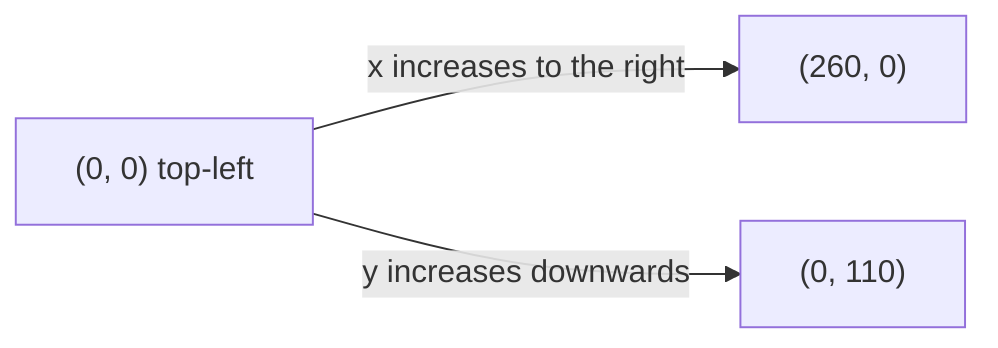
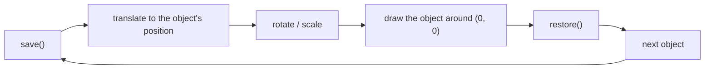

# Drawing on canvas

## In plain words

So far we have built pages out of boxes of text: headings, paragraphs, buttons. Sometimes you need free-form graphics instead: a chart, a game, a signature pad, a photo filter. Browsers offer two main ways to draw.

**SVG** is like a felt board. You place shapes on it (a circle here, a line there) and each shape *stays an object*: you can move it later, restyle it, or attach a click handler to it. The shapes are DOM elements.

**Canvas** is like a sheet of paper and a set of paints. You give drawing commands (fill this rectangle, stroke that curve) and they turn into coloured dots, called **pixels**. Once paint is on the paper, the paper has no memory of the "rectangle"; it only has colours. To change the picture you paint over it or wipe it and redraw.

This lesson concentrates on canvas, because it introduces a style of programming that DOM work does not: *you* keep the description of the scene in your own data, and redraw the whole picture from that data whenever something changes.

Why it matters for a job: charts and dashboards, image editors, maps, games and data visualisations are built on canvas (or on libraries that sit on top of it). Even if you later use a chart library, understanding the coordinate system, paths and the redraw loop lets you customise and debug it.

> **Before this lesson:** you need DOM basics and events ([Changing the document](#/lesson/javascript/changing-document), [Event handlers, propagation and delegation](#/lesson/javascript/event-handling)), `requestAnimationFrame` from the same lesson, and arrays with `forEach`/`reduce`.

## SVG in one example

SVG (Scalable Vector Graphics) is written as tags, directly inside HTML. Each tag describes a shape.

```html-run
<svg width="260" height="110" style="border: 1px solid #ccc">
  <rect x="10" y="10" width="80" height="50" fill="steelblue" />
  <circle id="sun" cx="150" cy="45" r="30" fill="gold" stroke="orange" stroke-width="4" />
  <line x1="200" y1="15" x2="250" y2="90" stroke="crimson" stroke-width="3" />
  <text x="10" y="95" font-size="14">click the sun</text>
</svg>

<script>
  const sun = document.getElementById("sun");
  sun.addEventListener("click", () => {
    sun.setAttribute("r", Number(sun.getAttribute("r")) === 30 ? 40 : 30);   // shapes are DOM elements
  });
</script>
```

The circle is an element. It has attributes, can be found with `getElementById`, and receives click events on exactly its round area. Because shapes are described by geometry and not by pixels, SVG stays sharp at any zoom level.

## The canvas element

### A drawing surface and its context

A `<canvas>` element is an empty rectangle of pixels. Its `width` and `height` **attributes** set how many pixels it has. All drawing goes through a **context** object, obtained with `getContext("2d")`.

```html-run
<canvas id="c" width="260" height="110" style="border: 1px solid #ccc"></canvas>

<script>
  const canvas = document.getElementById("c");
  const ctx = canvas.getContext("2d");

  ctx.fillStyle = "steelblue";
  ctx.fillRect(10, 10, 80, 50);          // x, y, width, height

  ctx.strokeStyle = "crimson";
  ctx.lineWidth = 3;
  ctx.strokeRect(110, 20, 60, 60);       // outline only
</script>
```

Line by line: `ctx` is the "painter". `fillStyle` chooses the paint for filling; any CSS colour works. `fillRect(10, 10, 80, 50)` fills a rectangle whose top-left corner is at x = 10, y = 10, and which is 80 pixels wide and 50 high. `strokeStyle` and `lineWidth` configure outlines, and `strokeRect` draws one.

Two things differ from what beginners expect:

- The origin (0, 0) is the **top-left** corner, x grows to the right and **y grows downwards**.
- Settings such as `fillStyle` are *sticky*: once set, they apply to every later drawing command until you change them.



> [!WARNING]
> Set a canvas's size with the `width` and `height` attributes (or properties), not with CSS. CSS only stretches the existing pixels, which gives a blurry, distorted picture. Also note that assigning to `canvas.width` clears the whole canvas.

## Paths: lines and shapes

Anything other than a rectangle is drawn as a **path**: a sequence of points and segments that you first describe and then either stroke (draw its outline) or fill (colour its inside).

```html-run
<canvas id="c" width="300" height="130" style="border: 1px solid #ccc"></canvas>

<script>
  const ctx = document.getElementById("c").getContext("2d");

  // an open zigzag line
  ctx.beginPath();                 // start a new path, forgetting any previous one
  ctx.moveTo(15, 100);             // lift the pen and put it down here
  ctx.lineTo(45, 30);              // draw a segment to here
  ctx.lineTo(75, 100);
  ctx.lineTo(105, 30);
  ctx.strokeStyle = "teal";
  ctx.lineWidth = 4;
  ctx.stroke();                    // now actually draw the outline

  // a filled triangle with an outline
  ctx.beginPath();
  ctx.moveTo(150, 100);
  ctx.lineTo(190, 25);
  ctx.lineTo(230, 100);
  ctx.closePath();                 // a segment back to the start point
  ctx.fillStyle = "khaki";
  ctx.fill();
  ctx.strokeStyle = "olive";
  ctx.lineWidth = 2;
  ctx.stroke();
</script>
```

The rhythm is always the same: `beginPath`, some `moveTo`/`lineTo` calls, then `stroke()` and/or `fill()`. Nothing appears until the last step. Forgetting `beginPath` is a classic bug: the new shape is added to the old path, and the next `stroke` redraws everything accumulated so far.

### Curves

`arc(x, y, radius, startAngle, endAngle)` adds part of a circle. Angles are measured in **radians**, not degrees: a full circle is $2\pi$ radians, a half circle is $\pi$. Angle 0 points to the right, and angles increase clockwise (because y points down).

```html-run
<canvas id="c" width="320" height="120" style="border: 1px solid #ccc"></canvas>

<script>
  const ctx = document.getElementById("c").getContext("2d");
  const degrees = (d) => (d * Math.PI) / 180;      // helper: degrees to radians

  ctx.beginPath();
  ctx.arc(55, 60, 40, 0, 2 * Math.PI);             // a full circle
  ctx.fillStyle = "gold";
  ctx.fill();

  ctx.beginPath();
  ctx.arc(155, 60, 40, degrees(30), degrees(330)); // most of a circle...
  ctx.lineTo(155, 60);                             // ...then to the centre
  ctx.closePath();                                 // ...and back: a wedge is missing
  ctx.fillStyle = "tomato";
  ctx.fill();

  ctx.beginPath();
  ctx.moveTo(215, 100);
  ctx.quadraticCurveTo(260, -20, 305, 100);        // control point, then end point
  ctx.strokeStyle = "slateblue";
  ctx.lineWidth = 4;
  ctx.stroke();
</script>
```

`quadraticCurveTo(cx, cy, x, y)` draws a smooth curve from the current point to (x, y), bent towards the control point (cx, cy). `bezierCurveTo` does the same with two control points.

## Text

`fillText(text, x, y)` paints text. The `font` property takes the same value as the CSS `font` property; `textAlign` and `textBaseline` decide how the text sits relative to the given point.

```html-run
<canvas id="c" width="320" height="100" style="border: 1px solid #ccc"></canvas>

<script>
  const ctx = document.getElementById("c").getContext("2d");
  ctx.font = "bold 22px sans-serif";
  ctx.fillStyle = "black";
  ctx.fillText("Sales 2030", 12, 30);

  ctx.font = "14px sans-serif";
  ctx.textAlign = "center";                        // x is now the middle of the text
  ctx.fillStyle = "gray";
  ctx.fillText("centred on x = 160", 160, 60);

  const label = "measured";
  const width = ctx.measureText(label).width;      // how wide will this text be?
  ctx.textAlign = "left";
  ctx.fillStyle = "seagreen";
  ctx.fillText(label, 12, 88);
  ctx.fillRect(12, 91, width, 2);                  // an underline of exactly that width
</script>
```

## A complete example: a bar chart from data

Now combine rectangles, lines and text into something useful. The function takes plain data and draws everything from it. Calling it again with different data redraws the chart.

```html-run
<canvas id="chart" width="360" height="220" style="border: 1px solid #ccc"></canvas>
<p><button id="shuffle">New data</button></p>

<script>
  const canvas = document.getElementById("chart");
  const ctx = canvas.getContext("2d");
  const colors = ["#4e79a7", "#f28e2b", "#59a14f", "#e15759", "#b07aa1"];

  function drawBarChart(data) {
    const margin = { top: 20, right: 15, bottom: 35, left: 40 };
    const plotWidth = canvas.width - margin.left - margin.right;
    const plotHeight = canvas.height - margin.top - margin.bottom;
    const maxValue = Math.max(...data.map((d) => d.value));
    const slot = plotWidth / data.length;                // horizontal space per bar
    const barWidth = slot * 0.6;

    ctx.clearRect(0, 0, canvas.width, canvas.height);    // wipe the previous picture

    // axes
    ctx.beginPath();
    ctx.moveTo(margin.left, margin.top);
    ctx.lineTo(margin.left, margin.top + plotHeight);
    ctx.lineTo(margin.left + plotWidth, margin.top + plotHeight);
    ctx.strokeStyle = "#444";
    ctx.lineWidth = 1;
    ctx.stroke();

    ctx.font = "12px sans-serif";
    ctx.textAlign = "center";
    data.forEach((d, i) => {
      const barHeight = (d.value / maxValue) * plotHeight;       // scale value to pixels
      const x = margin.left + i * slot + (slot - barWidth) / 2;
      const y = margin.top + plotHeight - barHeight;             // y grows downwards!
      ctx.fillStyle = colors[i % colors.length];
      ctx.fillRect(x, y, barWidth, barHeight);
      ctx.fillStyle = "#222";
      ctx.fillText(d.label, x + barWidth / 2, margin.top + plotHeight + 16);   // label under the bar
      ctx.fillText(d.value, x + barWidth / 2, y - 4);                          // value above it
    });
  }

  let data = [
    { label: "Fern", value: 42 }, { label: "Cactus", value: 17 }, { label: "Orchid", value: 30 },
    { label: "Bonsai", value: 8 }, { label: "Aloe", value: 25 },
  ];
  drawBarChart(data);

  document.getElementById("shuffle").addEventListener("click", () => {
    data = data.map((d) => ({ ...d, value: 5 + Math.floor(Math.random() * 45) }));
    drawBarChart(data);
  });
</script>
```

The essential calculation is the mapping from **data space** to **pixel space**. A value is a fraction of the maximum (`d.value / maxValue`), and that fraction of the plot height gives the bar's height in pixels. Because y grows downwards, the bar's top edge is "bottom of the plot minus the bar height". Every chart library is this arithmetic, generalised.

Notice the first drawing command: `clearRect` wipes the canvas. The function draws the *entire* picture every time. There is no "update the third bar"; with canvas you redraw.

## Images

`drawImage` copies an image (or another canvas) onto the canvas. With three arguments it draws at a position; with five it also scales; with nine it copies a rectangular piece of the source, which is how a game cuts single pictures out of a **sprite sheet** (one image containing many small pictures side by side).

To stay self-contained, this example first paints a small sprite sheet onto a hidden canvas, then uses that canvas as the image source:

```html-run
<canvas id="c" width="340" height="120" style="border: 1px solid #ccc"></canvas>

<script>
  // 1. make a "sprite sheet": three 32x32 faces next to each other
  const sheet = document.createElement("canvas");
  sheet.width = 96; sheet.height = 32;
  const s = sheet.getContext("2d");
  ["#ffd166", "#06d6a0", "#ef476f"].forEach((color, i) => {
    const cx = i * 32 + 16;
    s.fillStyle = color;
    s.beginPath(); s.arc(cx, 16, 14, 0, 2 * Math.PI); s.fill();
    s.fillStyle = "#222";
    s.fillRect(cx - 6, 10, 3, 4); s.fillRect(cx + 3, 10, 3, 4);            // eyes
    s.beginPath(); s.arc(cx, 17, 7, 0.15 * Math.PI, 0.85 * Math.PI); s.stroke();   // smile
  });

  // 2. draw from the sheet onto the visible canvas
  const ctx = document.getElementById("c").getContext("2d");
  ctx.imageSmoothingEnabled = false;                      // keep enlarged pixels crisp

  ctx.drawImage(sheet, 10, 10);                           // the whole sheet, original size
  ctx.drawImage(sheet, 120, 10, 192, 64);                 // the whole sheet, scaled to 192x64
  //            source: x   y  w   h    destination: x   y   w   h
  ctx.drawImage(sheet, 64, 0, 32, 32,               10, 60, 48, 48);   // only the third face, enlarged
</script>
```

With a real picture file you would create an `` element, set its `src`, and draw it inside its `load` event handler, because an image cannot be drawn before it has finished downloading.

## Transformations

Instead of computing rotated or scaled coordinates yourself, you can transform the **coordinate system** before drawing. Three methods do this: `translate(dx, dy)` moves the origin, `rotate(angle)` turns the axes around the origin, and `scale(sx, sy)` stretches them. Everything drawn afterwards is affected.

Transformations accumulate, so you need a way to undo them. `ctx.save()` pushes the current state (transformation, colours, line width and more) onto a stack, and `ctx.restore()` pops it back. Wrap any transformed drawing between the two.

```html-run
<canvas id="c" width="340" height="150" style="border: 1px solid #ccc"></canvas>

<script>
  const ctx = document.getElementById("c").getContext("2d");

  function drawArrow() {                 // always drawn around the origin, pointing right
    ctx.beginPath();
    ctx.moveTo(-25, -6); ctx.lineTo(10, -6); ctx.lineTo(10, -15); ctx.lineTo(30, 0);
    ctx.lineTo(10, 15); ctx.lineTo(10, 6); ctx.lineTo(-25, 6);
    ctx.closePath();
    ctx.fill();
  }

  const angles = [0, 45, 90, 135, 180];
  angles.forEach((degrees, i) => {
    ctx.save();                                   // remember the untransformed state
    ctx.translate(45 + i * 62, 50);               // move the origin to where this arrow goes
    ctx.rotate((degrees * Math.PI) / 180);        // turn the axes
    ctx.fillStyle = `hsl(${i * 60}, 70%, 50%)`;
    drawArrow();
    ctx.restore();                                // back to the untransformed state
  });

  ctx.save();
  ctx.translate(170, 115);
  ctx.scale(2.2, 0.8);                            // wide and flat
  ctx.fillStyle = "#555";
  drawArrow();
  ctx.restore();
</script>
```

`drawArrow` knows nothing about positions or angles; it always draws the same arrow around (0, 0). The caller places and turns the coordinate system first. This is the standard technique: **translate to the object's position, rotate, draw the object around the origin, restore**. The order matters: translating and then rotating spins the object in place, while rotating first would swing its position around the canvas corner.



## Animation and interaction

### The redraw loop

A canvas animation follows one pattern: keep the scene's **state** in ordinary data; on every frame, *update* the state according to the time that has passed, then *clear and redraw* everything.

```html-run
<canvas id="c" width="340" height="170" style="border: 1px solid #ccc; cursor: pointer"></canvas>
<p>Click the canvas to add a ball. Balls: <span id="count">3</span></p>

<script>
  const canvas = document.getElementById("c");
  const ctx = canvas.getContext("2d");

  const makeBall = (x, y) => ({
    x, y, radius: 8 + Math.random() * 8,
    vx: (Math.random() - 0.5) * 240,            // velocity in pixels per second
    vy: (Math.random() - 0.5) * 240,
    color: `hsl(${Math.floor(Math.random() * 360)}, 75%, 55%)`,
  });
  const balls = [makeBall(60, 60), makeBall(170, 90), makeBall(260, 50)];

  function update(seconds) {
    for (const ball of balls) {
      ball.x += ball.vx * seconds;
      ball.y += ball.vy * seconds;
      if (ball.x < ball.radius || ball.x > canvas.width - ball.radius) {      // hit a side wall
        ball.vx = -ball.vx;
        ball.x = Math.max(ball.radius, Math.min(ball.x, canvas.width - ball.radius));
      }
      if (ball.y < ball.radius || ball.y > canvas.height - ball.radius) {     // hit top or bottom
        ball.vy = -ball.vy;
        ball.y = Math.max(ball.radius, Math.min(ball.y, canvas.height - ball.radius));
      }
    }
  }

  function draw() {
    ctx.clearRect(0, 0, canvas.width, canvas.height);
    for (const ball of balls) {
      ctx.beginPath();
      ctx.arc(ball.x, ball.y, ball.radius, 0, 2 * Math.PI);
      ctx.fillStyle = ball.color;
      ctx.fill();
    }
  }

  let previous = null;
  function frame(time) {
    const seconds = previous === null ? 0 : Math.min((time - previous) / 1000, 0.05);
    previous = time;
    update(seconds);
    draw();
    requestAnimationFrame(frame);
  }
  requestAnimationFrame(frame);

  canvas.addEventListener("click", (event) => {
    balls.push(makeBall(event.offsetX, event.offsetY));
    document.getElementById("count").textContent = balls.length;
  });
</script>
```

Things to take away:

- `balls` is the state: an array of plain objects. The canvas is a picture of it.
- `update` and `draw` are separate functions. One changes data; the other only reads data and paints.
- Speeds are in pixels **per second** and are multiplied by the elapsed time, so the animation runs equally fast on a 60 Hz and a 144 Hz display. The step is capped at 0.05 seconds so that a pause (for instance a hidden tab) does not make balls jump through walls.
- The click handler does not draw anything. It adds to the state, and the next frame shows it.

### Which shape was clicked?

A canvas has no elements inside it, so a click handler receives only coordinates. Deciding which of *your* objects is at that point is your job, called **hit testing**. For a circle, compare the distance from the click to the centre with the radius; for a rectangle, check that x and y lie between its edges.

```javascript
function ballAt(x, y) {
  // search from the end: later balls are drawn on top
  return balls.findLast((ball) => Math.hypot(x - ball.x, y - ball.y) <= ball.radius);
}
```

### Sharp drawing on high-resolution screens

On phone and "retina" displays one CSS pixel is made of several physical pixels; the ratio is available as `window.devicePixelRatio`. A canvas with 300 pixels displayed 300 CSS pixels wide looks soft on such screens. The fix: give the canvas more real pixels, shrink it back with CSS, and scale the context so your drawing code can keep using CSS-pixel coordinates.

```javascript
function setupCanvas(canvas, cssWidth, cssHeight) {
  const ratio = window.devicePixelRatio || 1;
  canvas.width = cssWidth * ratio;                 // real pixels
  canvas.height = cssHeight * ratio;
  canvas.style.width = cssWidth + "px";            // displayed size
  canvas.style.height = cssHeight + "px";
  const ctx = canvas.getContext("2d");
  ctx.scale(ratio, ratio);                         // draw in CSS pixels from now on
  return ctx;
}
```

## Choosing a graphics interface

| | HTML elements | SVG | Canvas 2D |
|---|---|---|---|
| What you manipulate | boxes of text | shape elements | pixels through drawing commands |
| Remembers what was drawn | yes (DOM) | yes (DOM) | no; you keep the state |
| Events on individual shapes | built in | built in | you do the hit testing |
| Text, accessibility | excellent | good | poor; add alternatives yourself |
| Cost with thousands of objects | high | high | low |
| Scales without blur | yes | yes | needs the pixel-ratio fix |
| Typical uses | interfaces, documents | icons, diagrams, charts with moderate data | games, large data sets, image processing |

> [!TIP]
> A sensible default: use HTML and CSS for interface, SVG for icons and for charts with up to a few thousand elements (you get interaction and sharpness for free), and canvas when you must draw very many things per frame or work with individual pixels. For 3D or extreme performance there is a third canvas mode, WebGL, usually used through a library.

> [!INTERVIEW]
> Common questions: "Canvas versus SVG?" (immediate-mode pixels versus retained-mode DOM shapes; trade-offs in the table above). "How do you animate on a canvas?" (state in data, `requestAnimationFrame` loop, update by elapsed time, clear, redraw). "Why is my canvas blurry?" (sized with CSS instead of attributes, or not accounting for `devicePixelRatio`). "How do you detect a click on a drawn shape?" (hit testing against your own data). "What do `save` and `restore` do?" (push and pop the drawing state, including the transformation).

## Common pitfalls

1. **Sizing the canvas with CSS only.** The picture is stretched and blurred.
2. **Forgetting `beginPath`.** Old path segments are stroked or filled again.
3. **Describing a path and never calling `stroke` or `fill`.** Nothing is drawn.
4. **Passing degrees to `arc` or `rotate`.** They expect radians.
5. **Forgetting that y points down.** Charts come out upside down.
6. **Transformations that pile up.** Without `save`/`restore`, each frame rotates a little more than the last.
7. **Drawing an image before it has loaded.** Draw inside its `load` handler.
8. **Trying to "move" something already drawn.** Change your data and redraw.
9. **Frame-based speeds.** `x += 2` per frame runs at different speeds on different screens; multiply by elapsed time.

## Summary

- SVG describes shapes as DOM elements that persist and receive events; canvas executes drawing commands into pixels and remembers nothing.
- A canvas is sized by its `width`/`height` attributes and drawn on through a 2D context; the origin is top-left and y grows downwards.
- Rectangles have direct methods; other shapes are paths built with `beginPath`, `moveTo`, `lineTo`, `arc` and curve methods, then rendered with `stroke` or `fill`.
- `fillText` draws text; `drawImage` draws images, scaled or cropped from sprite sheets.
- `translate`, `rotate` and `scale` transform the coordinate system; `save` and `restore` bracket temporary changes.
- Animation is a loop: update state from elapsed time, clear, redraw, request the next frame. Interaction requires your own hit testing.
- Choose between HTML, SVG and canvas according to object count, interactivity and the need for pixel access.

## Glossary

- **Pixel**: one coloured dot of an image or screen.
- **SVG**: a markup language for vector graphics whose shapes are DOM elements.
- **Canvas**: an HTML element providing a pixel surface that scripts draw on.
- **Context**: the object returned by `getContext("2d")` through which all drawing is done.
- **Path**: a described outline made of lines and curves, to be stroked or filled.
- **Stroke / fill**: to draw the outline of a path / to colour its interior.
- **Radian**: the unit of angle used by canvas; $\pi$ radians equal 180 degrees.
- **Sprite sheet**: one image holding many smaller images, drawn piece by piece.
- **Transformation**: a change of the coordinate system by translation, rotation or scaling.
- **State stack**: the stack of drawing states managed by `save` and `restore`.
- **Immediate mode / retained mode**: drawing that forgets what it drew (canvas) / a scene of objects kept by the system (SVG, DOM).
- **Frame**: one complete redraw of the picture.
- **Hit testing**: working out which drawn object lies under a given point.
- **Device pixel ratio**: the number of physical screen pixels per CSS pixel.

## Check yourself

```quiz
[
  {"q": "On a canvas, where is the point (0, 0) and in which direction does y increase?", "options": ["Bottom-left; upwards", "Top-left; downwards", "Centre; upwards", "Top-right; downwards"], "answer": 1,
   "explain": "The origin is the top-left corner. x grows to the right and y grows towards the bottom."},
  {"q": "A script calls `ctx.moveTo(10, 10); ctx.lineTo(90, 10);` and nothing appears. What is missing?", "options": ["ctx.fillRect()", "ctx.stroke()", "ctx.closePath()", "ctx.save()"], "answer": 1,
   "explain": "moveTo and lineTo only describe a path. The outline is drawn when stroke() is called."},
  {"q": "Which call draws a complete circle of radius 20 centred at (50, 50)?", "options": ["ctx.arc(50, 50, 20, 0, 360)", "ctx.arc(50, 50, 20, 0, 2 * Math.PI)", "ctx.circle(50, 50, 20)", "ctx.arc(20, 50, 50, 0, Math.PI)"], "answer": 1,
   "explain": "arc takes centre, radius and start and end angles in radians. A full turn is 2π radians."},
  {"q": "Why should canvas dimensions be set with the width and height attributes and not only with CSS?", "options": ["CSS is ignored on canvas", "The attributes define the number of pixels; CSS merely stretches them, causing blur", "Attributes are faster to parse", "CSS sizes clear the canvas"], "answer": 1,
   "explain": "A canvas has a fixed pixel grid. Styling it larger scales that grid like an image."},
  {"q": "What is the purpose of wrapping drawing code in `ctx.save()` and `ctx.restore()`?", "options": ["To write the picture to disk", "To make transformations and style changes temporary by restoring the previous state", "To speed up drawing", "To start and end a path"], "answer": 1,
   "explain": "save pushes the current drawing state onto a stack and restore pops it, so the changes in between do not leak into later drawing."},
  {"q": "To draw a sprite rotated around its own centre at (x, y), what is the right order?", "options": ["rotate, then translate(x, y), then draw around the origin", "translate(x, y), then rotate, then draw around the origin", "draw, then rotate, then translate", "scale, then draw at (x, y)"], "answer": 1,
   "explain": "Moving the origin to the object first makes the rotation pivot there. Rotating first would swing the position around the canvas corner."},
  {"q": "In the bouncing-balls example, why is the velocity multiplied by the elapsed time?", "options": ["To convert radians to degrees", "So that movement speed is the same regardless of how many frames per second the display shows", "Because requestAnimationFrame requires it", "To avoid clearing the canvas"], "answer": 1,
   "explain": "Frame rates differ between devices. Distance = speed × time keeps the motion consistent."},
  {"q": "A canvas shows 500 circles and the user clicks. How does the program know which circle was hit?", "options": ["event.target is the circle", "It compares the click coordinates with the positions and radii stored in its own data", "The canvas fires a separate event per shape", "It reads the DOM tree of the canvas"], "answer": 1,
   "explain": "Canvas keeps no record of shapes. The program must test the point against its own model of the scene."}
]
```

> **Source:** Haverbeke, *Eloquent JavaScript* (4th ed.), ch. 17 "Drawing on Canvas" (SVG, the canvas element, lines and surfaces, paths, curves, text, images, transformation, choosing a graphics interface). Details checked against MDN: https://developer.mozilla.org/en-US/docs/Web/API/Canvas_API/Tutorial , https://developer.mozilla.org/en-US/docs/Web/API/CanvasRenderingContext2D/drawImage , https://developer.mozilla.org/en-US/docs/Web/API/CanvasRenderingContext2D/save , https://developer.mozilla.org/en-US/docs/Web/API/Window/devicePixelRatio
