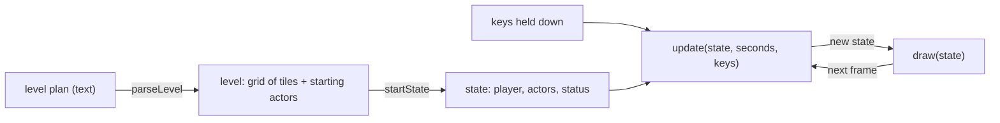

# Project: a platform game explained

## In plain words

A **platform game** is the kind of game in which a small figure runs and jumps across ledges, collects things and avoids dangers. In this project lesson we build a complete one, about two hundred lines long, and take it apart piece by piece.

A game looks like magic and is really a flip book. Many times per second the program does two things: it works out where everything should be *now* (the figure has fallen a little, a coin has bobbed a little), and it paints a fresh picture of that situation. Shown quickly one after another, the pictures look like movement. Everything else is detail: reading the keyboard, making sure the figure cannot walk through walls, and deciding when the player has won or lost.

The design uses the ideas this track has been building up: the game world is plain **data**; one **pure function** computes the next moment from the current one; another function **draws** the data on a canvas. The same separation appeared in the elevator simulation and is the architecture of most interactive software.

Why it matters for a job: few of us ship games, yet an input-update-render loop driven by time, a clean split between state and presentation, and collision arithmetic on rectangles appear in editors, maps, drag-and-drop, charts and animations. It is also a project small enough to finish and extend, which makes it a good portfolio piece.

> **Before this lesson:** you need the canvas API and the redraw loop ([Drawing on canvas](#/lesson/javascript/canvas-drawing)), keyboard and pointer events ([Keys, pointers, scrolling, timers and debouncing](#/lesson/javascript/keys-pointers-timers)), and immutable updates with spread ([Destructuring, spread, rest and JSON](#/lesson/javascript/destructuring-json)).

## The plan

The game: a level made of square tiles; a player who moves left and right and jumps; coins to collect; spikes and a patrolling monster to avoid. Collect every coin to win. Touch a spike or the monster, or fall off the bottom, and you lose.

The program has five parts, and we will build them in this order:



1. A **level** described as text and parsed into data.
2. **Collision** helpers that answer "what does this rectangle touch?".
3. An **update** function that advances the world by a small amount of time.
4. A **draw** function that paints a state on a canvas.
5. The **loop** and the **input** handling that tie everything together.

One decision up front: all positions and sizes are measured in **tiles**, not pixels. The player is 0.8 tiles wide; gravity is 30 tiles per second squared. Only the drawing code knows that a tile is 20 pixels. Changing the zoom level later means changing one number.

## Part 1: the level

### Levels as text

A level is drawn with characters, one per tile. This is easy to read and edit without any tools:

```text
#  wall          .  empty space      @  where the player starts
o  coin          ^  spike            m  monster
```

`parseLevel` turns the array of strings into two things: a grid `rows` in which every cell is `"wall"`, `"spike"` or `"empty"`, and a list of **actors**, the things that move or can disappear (coins and the monster). The player's start position is remembered separately.

```js-run
const levelPlan = [
  "........................................",
  "........................................",
  "..............o.o...........o...........",
  ".............#####.......#######........",
  "......o.................................",
  ".....###.........o..o.............o.o...",
  "..............#########.........#####...",
  ".@.......##.............................",
  "####..............m........##...........",
  "....####^^^####################...###^^#",
  "........................................",
];

function parseLevel(plan) {
  const actors = [];
  let start = { x: 0, y: 0 };
  const rows = plan.map((line, y) =>
    [...line].map((ch, x) => {
      if (ch === "@") { start = { x, y }; return "empty"; }
      if (ch === "o") { actors.push({ type: "coin", x: x + 0.25, y: y + 0.25, width: 0.5, height: 0.5, baseY: y + 0.25, wobble: x }); return "empty"; }
      if (ch === "m") { actors.push({ type: "monster", x, y: y + 0.2, width: 0.9, height: 0.8, speed: 3 }); return "empty"; }
      if (ch === "#") return "wall";
      if (ch === "^") return "spike";
      return "empty";
    })
  );
  return { rows, width: rows[0].length, height: rows.length, start, actors };
}

const level = parseLevel(levelPlan);
console.log("size:", level.width, "x", level.height, "tiles");
console.log("player starts at", JSON.stringify(level.start));
console.log("actors:", level.actors.map((a) => a.type).join(", "));
console.log("tile under the start position:", level.rows[level.start.y + 1][level.start.x]);
console.log("row 9 as tiles:", level.rows[9].map((t) => t[0]).join(""));
```

Reading `parseLevel`:

- `plan.map((line, y) => ...)` handles each row; `[...line].map((ch, x) => ...)` handles each character, so the callback knows the tile's column `x` and row `y`.
- For `@`, `o` and `m` the function records an actor (or the start position) **and returns `"empty"`** for the grid: the thing stands in empty space.
- A coin is half a tile in size and is centred in its tile (hence the `+ 0.25`). It remembers its resting height `baseY` so that it can bob up and down around it.
- The level object also stores `width` and `height` for convenience.

The grid never changes during play. Everything that changes lives in the *state*.

### Drawing the static level

Before anything moves, let us see the level. The drawing code scales the canvas so that one unit is one tile, then loops over the grid.

```html-run
<canvas id="view" width="800" height="220" style="max-width: 100%; border: 1px solid #888"></canvas>

<script>
  const levelPlan = [
    "........................................",
    "........................................",
    "..............o.o...........o...........",
    ".............#####.......#######........",
    "......o.................................",
    ".....###.........o..o.............o.o...",
    "..............#########.........#####...",
    ".@.......##.............................",
    "####..............m........##...........",
    "....####^^^####################...###^^#",
    "........................................",
  ];

  function parseLevel(plan) {
    const actors = [];
    let start = { x: 0, y: 0 };
    const rows = plan.map((line, y) =>
      [...line].map((ch, x) => {
        if (ch === "@") { start = { x, y }; return "empty"; }
        if (ch === "o") { actors.push({ type: "coin", x: x + 0.25, y: y + 0.25, width: 0.5, height: 0.5, baseY: y + 0.25, wobble: x }); return "empty"; }
        if (ch === "m") { actors.push({ type: "monster", x, y: y + 0.2, width: 0.9, height: 0.8, speed: 3 }); return "empty"; }
        if (ch === "#") return "wall";
        if (ch === "^") return "spike";
        return "empty";
      })
    );
    return { rows, width: rows[0].length, height: rows.length, start, actors };
  }

  const level = parseLevel(levelPlan);
  const SCALE = 20;                                   // pixels per tile
  const ctx = document.getElementById("view").getContext("2d");

  ctx.fillStyle = "#bfe3ff";                          // sky
  ctx.fillRect(0, 0, 800, 220);
  ctx.scale(SCALE, SCALE);                            // from here on, 1 unit = 1 tile

  level.rows.forEach((row, y) => row.forEach((tile, x) => {
    if (tile === "wall") {
      ctx.fillStyle = "#5b4636";
      ctx.fillRect(x, y, 1, 1);
    } else if (tile === "spike") {
      ctx.fillStyle = "#c0392b";
      ctx.beginPath();
      ctx.moveTo(x, y + 1); ctx.lineTo(x + 0.5, y + 0.2); ctx.lineTo(x + 1, y + 1);
      ctx.fill();
    }
  }));

  for (const actor of level.actors) {
    ctx.fillStyle = actor.type === "coin" ? "#f1c40f" : "#8e44ad";
    ctx.fillRect(actor.x, actor.y, actor.width, actor.height);
  }
  ctx.fillStyle = "#2c7be5";
  ctx.fillRect(level.start.x + 0.1, level.start.y + 0.1, 0.8, 0.9);   // the player
</script>
```

After `ctx.scale(20, 20)`, the call `fillRect(x, y, 1, 1)` paints a 20 by 20 pixel square at tile position (x, y). The drawing code works in tile units from then on.

## Part 2: collisions

### Rectangle against tiles

The player is a rectangle. To move it we must know whether a proposed position would overlap a wall. `tilesTouched` lists the kinds of tile that a rectangle overlaps:

```js-run
const levelPlan = [
  "........................................",
  "........................................",
  "..............o.o...........o...........",
  ".............#####.......#######........",
  "......o.................................",
  ".....###.........o..o.............o.o...",
  "..............#########.........#####...",
  ".@.......##.............................",
  "####..............m........##...........",
  "....####^^^####################...###^^#",
  "........................................",
];

function parseLevel(plan) {
  const actors = [];
  let start = { x: 0, y: 0 };
  const rows = plan.map((line, y) =>
    [...line].map((ch, x) => {
      if (ch === "@") { start = { x, y }; return "empty"; }
      if (ch === "o") { actors.push({ type: "coin", x: x + 0.25, y: y + 0.25, width: 0.5, height: 0.5, baseY: y + 0.25, wobble: x }); return "empty"; }
      if (ch === "m") { actors.push({ type: "monster", x, y: y + 0.2, width: 0.9, height: 0.8, speed: 3 }); return "empty"; }
      if (ch === "#") return "wall";
      if (ch === "^") return "spike";
      return "empty";
    })
  );
  return { rows, width: rows[0].length, height: rows.length, start, actors };
}

// Which kinds of tile does the rectangle (x, y, width, height) overlap? Positions are measured in tiles.
function tilesTouched(level, x, y, width, height) {
  const found = new Set();
  for (let ty = Math.floor(y); ty < Math.ceil(y + height); ty++) {
    for (let tx = Math.floor(x); tx < Math.ceil(x + width); tx++) {
      const outsideSideOrTop = tx < 0 || tx >= level.width || ty < 0;
      if (outsideSideOrTop) found.add("wall");                 // the level's edges are solid
      else if (ty >= level.height) found.add("empty");         // below the level: a bottomless pit
      else found.add(level.rows[ty][tx]);
    }
  }
  return found;
}

const overlaps = (a, b) =>
  a.x < b.x + b.width && a.x + a.width > b.x && a.y < b.y + b.height && a.y + a.height > b.y;

const level = parseLevel(levelPlan);

console.log([...tilesTouched(level, 1.1, 7.1, 0.8, 0.9)]);     // the player's starting box: free air
console.log([...tilesTouched(level, 1.1, 7.3, 0.8, 0.9)]);     // a little lower: dips into the floor
console.log([...tilesTouched(level, -0.5, 7, 0.8, 0.9)]);      // partly beyond the left edge
console.log([...tilesTouched(level, 8.2, 9.2, 0.5, 0.5)]);     // inside the spike pit
console.log(overlaps({ x: 0, y: 0, width: 2, height: 2 }, { x: 1, y: 1, width: 2, height: 2 }));
console.log(overlaps({ x: 0, y: 0, width: 2, height: 2 }, { x: 2, y: 0, width: 2, height: 2 }));
```

How it works: a rectangle from `x` to `x + width` covers the tile columns from `Math.floor(x)` up to, and not including, `Math.ceil(x + width)`. The same holds vertically. The two loops visit exactly those tiles and collect their kinds in a `Set`. Positions outside the grid are treated specially: beyond the left, right or top edge counts as wall, so nobody can leave the level sideways; below the bottom counts as empty, so pits are bottomless.

`overlaps` tests two rectangles against each other, used for player-versus-coin and player-versus-monster. Two rectangles overlap exactly when each one starts before the other one ends, on both axes. The last line prints `false`: rectangles that merely share an edge do not overlap.

| Condition | Meaning |
|---|---|
| `a.x < b.x + b.width` | a starts before b ends, horizontally |
| `a.x + a.width > b.x` | a ends after b starts, horizontally |
| `a.y < b.y + b.height` | a starts before b ends, vertically |
| `a.y + a.height > b.y` | a ends after b starts, vertically |

## Part 3: the update function

### State

The state of a running game is one object: a `status` (`"playing"`, `"won"` or `"lost"`), the elapsed `time`, the `player` (position, size, velocity) and the list of `actors`. `startState` builds it from a level, copying the actors so that restarting gives fresh coins.

### One step of time

`update(state, level, seconds, keys)` is the heart of the game. It receives the current state, the amount of time that has passed since the last step (a small fraction of a second), and an object saying which controls are held. It returns a **new state** and modifies nothing. We can therefore run it in a plain runnable panel, with no canvas and no keyboard, and watch the numbers:

```js-run
const levelPlan = [
  "........................................",
  "........................................",
  "..............o.o...........o...........",
  ".............#####.......#######........",
  "......o.................................",
  ".....###.........o..o.............o.o...",
  "..............#########.........#####...",
  ".@.......##.............................",
  "####..............m........##...........",
  "....####^^^####################...###^^#",
  "........................................",
];

function parseLevel(plan) {
  const actors = [];
  let start = { x: 0, y: 0 };
  const rows = plan.map((line, y) =>
    [...line].map((ch, x) => {
      if (ch === "@") { start = { x, y }; return "empty"; }
      if (ch === "o") { actors.push({ type: "coin", x: x + 0.25, y: y + 0.25, width: 0.5, height: 0.5, baseY: y + 0.25, wobble: x }); return "empty"; }
      if (ch === "m") { actors.push({ type: "monster", x, y: y + 0.2, width: 0.9, height: 0.8, speed: 3 }); return "empty"; }
      if (ch === "#") return "wall";
      if (ch === "^") return "spike";
      return "empty";
    })
  );
  return { rows, width: rows[0].length, height: rows.length, start, actors };
}

// Which kinds of tile does the rectangle (x, y, width, height) overlap? Positions are measured in tiles.
function tilesTouched(level, x, y, width, height) {
  const found = new Set();
  for (let ty = Math.floor(y); ty < Math.ceil(y + height); ty++) {
    for (let tx = Math.floor(x); tx < Math.ceil(x + width); tx++) {
      const outsideSideOrTop = tx < 0 || tx >= level.width || ty < 0;
      if (outsideSideOrTop) found.add("wall");                 // the level's edges are solid
      else if (ty >= level.height) found.add("empty");         // below the level: a bottomless pit
      else found.add(level.rows[ty][tx]);
    }
  }
  return found;
}

const overlaps = (a, b) =>
  a.x < b.x + b.width && a.x + a.width > b.x && a.y < b.y + b.height && a.y + a.height > b.y;

function startState(level) {
  return {
    status: "playing",
    time: 0,
    player: { x: level.start.x + 0.1, y: level.start.y + 0.1, width: 0.8, height: 0.9, vx: 0, vy: 0 },
    actors: level.actors.map((actor) => ({ ...actor })),       // fresh copies, so a restart begins clean
  };
}

const MOVE_SPEED = 7, GRAVITY = 30, JUMP_SPEED = 15;

// One step of the simulation: (old state, seconds passed, keys held) -> new state. Nothing is modified.
function update(state, level, seconds, keys) {
  if (state.status !== "playing") return state;
  const time = state.time + seconds;

  // --- player: horizontal movement, blocked by walls ---
  let { x, y, vy } = state.player;
  const { width, height } = state.player;
  const vx = (keys.right ? MOVE_SPEED : 0) - (keys.left ? MOVE_SPEED : 0);
  const newX = x + vx * seconds;
  if (!tilesTouched(level, newX, y, width, height).has("wall")) x = newX;

  // --- player: vertical movement with gravity; landing allows a jump ---
  vy += GRAVITY * seconds;
  const newY = y + vy * seconds;
  if (!tilesTouched(level, x, newY, width, height).has("wall")) {
    y = newY;
  } else if (vy > 0) {
    vy = keys.jump ? -JUMP_SPEED : 0;                          // standing on something
  } else {
    vy = 0;                                                    // bumped the head
  }
  const player = { x, y, width, height, vx, vy };

  // --- other actors ---
  let status = "playing";
  const actors = [];
  for (const actor of state.actors) {
    if (actor.type === "coin") {
      if (overlaps(player, actor)) continue;                   // collected: leave it out of the new list
      actors.push({ ...actor, y: actor.baseY + Math.sin(time * 5 + actor.wobble) * 0.08 });
    } else if (actor.type === "monster") {
      let speed = actor.speed;
      let nextX = actor.x + speed * seconds;
      const blocked = tilesTouched(level, nextX, actor.y, actor.width, actor.height).has("wall");
      const overEdge = !tilesTouched(level, nextX, actor.y + 1, actor.width, actor.height).has("wall");
      if (blocked || overEdge) { speed = -speed; nextX = actor.x; }   // turn around
      const moved = { ...actor, x: nextX, speed };
      if (overlaps(player, moved)) status = "lost";
      actors.push(moved);
    }
  }

  // --- win and lose conditions ---
  if (tilesTouched(level, x, y, width, height).has("spike") || y > level.height) status = "lost";
  if (status === "playing" && !actors.some((actor) => actor.type === "coin")) status = "won";

  return { status, time, player, actors };
}

const level = parseLevel(levelPlan);
let state = startState(level);
const describe = (s) => `t=${s.time.toFixed(2)} x=${s.player.x.toFixed(2)} y=${s.player.y.toFixed(2)} vy=${s.player.vy.toFixed(1)} coins=${s.actors.filter((a) => a.type === "coin").length} ${s.status}`;

console.log(describe(state));

// stand still for a quarter of a second: gravity pulls, the floor holds
for (let i = 0; i < 15; i++) state = update(state, level, 1 / 60, {});
console.log(describe(state));

// hold "jump" for one step, then let go and watch the arc
state = update(state, level, 1 / 60, { jump: true });
for (let i = 1; i <= 60; i++) {
  state = update(state, level, 1 / 60, {});
  if (i % 12 === 0) console.log(describe(state));
}

// walk right off the first ledge and keep going into the spikes
while (state.status === "playing") state = update(state, level, 1 / 60, { right: true });
console.log(describe(state));
```

The output shows a jump as numbers. The jump sets `vy` to -15 (upwards is negative, because y grows downwards). Gravity then pulls it towards zero: the printed samples show -9, then -3 near the top of the arc, then positive values as the player falls back to `y = 7.10`. The last line shows what walking right without jumping leads to: the spike pit, and the status `lost`.

Now the function itself, section by section.

**Horizontal movement.** The desired speed `vx` is +7, -7 or 0 tiles per second depending on the keys. The candidate position is `x + vx * seconds` (distance = speed × time). If the player's rectangle at that position would touch a wall, the move is cancelled; otherwise it is accepted.

**Vertical movement.** Gravity is an acceleration: each step it adds `GRAVITY * seconds` to the vertical speed `vy`. The candidate position is `y + vy * seconds`. Three cases:

- no wall there: accept the move (the player is in the air);
- a wall, and the player was moving **down**: the player is standing on something. Vertical speed becomes zero, or, if the jump key is held, becomes `-JUMP_SPEED`: this is the one and only place where a jump can start, so jumping in mid-air is impossible;
- a wall, and the player was moving **up**: a bumped head. Vertical speed becomes zero and gravity takes over.

Handling the two axes **separately** is the trick that makes platformer movement feel right. If the player runs into a wall while falling, the horizontal move is rejected and the vertical move still happens, so the player slides down along the wall and does not hang in the air.

**Actors.** The loop builds a new array. A coin that overlaps the player is skipped, which removes it; the others get a new `y` from a sine wave so that they bob. The monster advances; if its next position would touch a wall, or if there would be no floor under it one tile lower, it reverses. If it overlaps the player, the status becomes `lost`.

**Win and lose.** Touching a spike tile or falling below the level loses. Having no coins left wins.

> [!TIP]
> A pure `update` function is a gift for testing and debugging. You can replay a recorded list of inputs and always get the same game, write a "bot" in three lines as the example does, or step through one frame at a time. None of that is possible when game logic is scattered across event handlers that poke at the screen.

### Why multiply by `seconds`?

Screens refresh at different rates, and a busy computer skips frames. If the player moved a fixed distance per frame, the game would run faster on a faster display. Multiplying every speed by the real time that passed makes movement depend on time alone. The loop below also **caps** the step at 0.05 seconds: after a long pause (the tab was in the background) a huge step would let the player pass straight through a thin wall, because only the end position is checked.

## Parts 4 and 5: drawing, input and the loop

Here is the complete game. Click the canvas first so that it receives your key presses.

```html-run
<style>
  #game { display: block; max-width: 100%; border: 1px solid #888; outline: none; }
  .pad { margin-top: 6px; display: flex; gap: 6px; }
  .pad button { font-size: 20px; padding: 6px 16px; touch-action: none; user-select: none; }
</style>
<canvas id="game" width="480" height="220" tabindex="0"></canvas>
<div class="pad">
  <button data-key="left">&#9664;</button><button data-key="right">&#9654;</button>
  <button data-key="jump">&#9650; jump</button><button id="restart">restart</button>
</div>
<p>Arrow keys or A / D to move, Up, W or Space to jump, R to restart. Click the game first.</p>

<script>
  // ---------- parts 1 to 3: level, collisions, update (as explained above) ----------
  const levelPlan = [
    "........................................",
    "........................................",
    "..............o.o...........o...........",
    ".............#####.......#######........",
    "......o.................................",
    ".....###.........o..o.............o.o...",
    "..............#########.........#####...",
    ".@.......##.............................",
    "####..............m........##...........",
    "....####^^^####################...###^^#",
    "........................................",
  ];

  function parseLevel(plan) {
    const actors = [];
    let start = { x: 0, y: 0 };
    const rows = plan.map((line, y) =>
      [...line].map((ch, x) => {
        if (ch === "@") { start = { x, y }; return "empty"; }
        if (ch === "o") { actors.push({ type: "coin", x: x + 0.25, y: y + 0.25, width: 0.5, height: 0.5, baseY: y + 0.25, wobble: x }); return "empty"; }
        if (ch === "m") { actors.push({ type: "monster", x, y: y + 0.2, width: 0.9, height: 0.8, speed: 3 }); return "empty"; }
        if (ch === "#") return "wall";
        if (ch === "^") return "spike";
        return "empty";
      })
    );
    return { rows, width: rows[0].length, height: rows.length, start, actors };
  }

  // Which kinds of tile does the rectangle (x, y, width, height) overlap? Positions are measured in tiles.
  function tilesTouched(level, x, y, width, height) {
    const found = new Set();
    for (let ty = Math.floor(y); ty < Math.ceil(y + height); ty++) {
      for (let tx = Math.floor(x); tx < Math.ceil(x + width); tx++) {
        const outsideSideOrTop = tx < 0 || tx >= level.width || ty < 0;
        if (outsideSideOrTop) found.add("wall");                 // the level's edges are solid
        else if (ty >= level.height) found.add("empty");         // below the level: a bottomless pit
        else found.add(level.rows[ty][tx]);
      }
    }
    return found;
  }

  const overlaps = (a, b) =>
    a.x < b.x + b.width && a.x + a.width > b.x && a.y < b.y + b.height && a.y + a.height > b.y;

  function startState(level) {
    return {
      status: "playing",
      time: 0,
      player: { x: level.start.x + 0.1, y: level.start.y + 0.1, width: 0.8, height: 0.9, vx: 0, vy: 0 },
      actors: level.actors.map((actor) => ({ ...actor })),       // fresh copies, so a restart begins clean
    };
  }

  const MOVE_SPEED = 7, GRAVITY = 30, JUMP_SPEED = 15;

  // One step of the simulation: (old state, seconds passed, keys held) -> new state. Nothing is modified.
  function update(state, level, seconds, keys) {
    if (state.status !== "playing") return state;
    const time = state.time + seconds;

    // --- player: horizontal movement, blocked by walls ---
    let { x, y, vy } = state.player;
    const { width, height } = state.player;
    const vx = (keys.right ? MOVE_SPEED : 0) - (keys.left ? MOVE_SPEED : 0);
    const newX = x + vx * seconds;
    if (!tilesTouched(level, newX, y, width, height).has("wall")) x = newX;

    // --- player: vertical movement with gravity; landing allows a jump ---
    vy += GRAVITY * seconds;
    const newY = y + vy * seconds;
    if (!tilesTouched(level, x, newY, width, height).has("wall")) {
      y = newY;
    } else if (vy > 0) {
      vy = keys.jump ? -JUMP_SPEED : 0;                          // standing on something
    } else {
      vy = 0;                                                    // bumped the head
    }
    const player = { x, y, width, height, vx, vy };

    // --- other actors ---
    let status = "playing";
    const actors = [];
    for (const actor of state.actors) {
      if (actor.type === "coin") {
        if (overlaps(player, actor)) continue;                   // collected: leave it out of the new list
        actors.push({ ...actor, y: actor.baseY + Math.sin(time * 5 + actor.wobble) * 0.08 });
      } else if (actor.type === "monster") {
        let speed = actor.speed;
        let nextX = actor.x + speed * seconds;
        const blocked = tilesTouched(level, nextX, actor.y, actor.width, actor.height).has("wall");
        const overEdge = !tilesTouched(level, nextX, actor.y + 1, actor.width, actor.height).has("wall");
        if (blocked || overEdge) { speed = -speed; nextX = actor.x; }   // turn around
        const moved = { ...actor, x: nextX, speed };
        if (overlaps(player, moved)) status = "lost";
        actors.push(moved);
      }
    }

    // --- win and lose conditions ---
    if (tilesTouched(level, x, y, width, height).has("spike") || y > level.height) status = "lost";
    if (status === "playing" && !actors.some((actor) => actor.type === "coin")) status = "won";

    return { status, time, player, actors };
  }

  // ---------- part 4: drawing ----------
  const SCALE = 20;
  const canvas = document.getElementById("game");
  const ctx = canvas.getContext("2d");
  const level = parseLevel(levelPlan);

  function draw(state) {
    const viewWidth = canvas.width / SCALE;                         // how many tiles fit across
    const wanted = state.player.x + state.player.width / 2 - viewWidth / 2;
    const cameraX = Math.max(0, Math.min(wanted, level.width - viewWidth));   // keep the camera inside the level

    ctx.fillStyle = state.status === "lost" ? "#f6c4c4" : "#bfe3ff";
    ctx.fillRect(0, 0, canvas.width, canvas.height);

    ctx.save();
    ctx.scale(SCALE, SCALE);
    ctx.translate(-cameraX, 0);                                     // slide the world under the camera

    const firstColumn = Math.floor(cameraX), lastColumn = Math.min(level.width, Math.ceil(cameraX + viewWidth));
    for (let y = 0; y < level.height; y++) {
      for (let x = firstColumn; x < lastColumn; x++) {              // only the visible columns
        const tile = level.rows[y][x];
        if (tile === "wall") {
          ctx.fillStyle = "#5b4636";
          ctx.fillRect(x, y, 1.02, 1.02);
        } else if (tile === "spike") {
          ctx.fillStyle = "#c0392b";
          ctx.beginPath();
          ctx.moveTo(x, y + 1); ctx.lineTo(x + 0.25, y + 0.3); ctx.lineTo(x + 0.5, y + 1);
          ctx.lineTo(x + 0.75, y + 0.3); ctx.lineTo(x + 1, y + 1);
          ctx.fill();
        }
      }
    }

    for (const actor of state.actors) {
      if (actor.type === "coin") {
        ctx.fillStyle = "#f1c40f";
        ctx.beginPath();
        ctx.arc(actor.x + actor.width / 2, actor.y + actor.height / 2, actor.width / 2, 0, 2 * Math.PI);
        ctx.fill();
      } else {
        ctx.fillStyle = "#8e44ad";
        ctx.fillRect(actor.x, actor.y, actor.width, actor.height);
        ctx.fillStyle = "white";
        const eye = actor.speed > 0 ? 0.55 : 0.15;                  // the eye looks where the monster walks
        ctx.fillRect(actor.x + eye, actor.y + 0.15, 0.2, 0.2);
      }
    }

    const p = state.player;
    ctx.fillStyle = "#2c7be5";
    ctx.fillRect(p.x, p.y, p.width, p.height);
    ctx.fillStyle = "white";
    ctx.fillRect(p.x + (p.vx < 0 ? 0.1 : 0.5), p.y + 0.15, 0.2, 0.2);
    ctx.restore();

    // text is drawn in pixel coordinates, after restore
    const coinsLeft = state.actors.filter((actor) => actor.type === "coin").length;
    ctx.fillStyle = "#222";
    ctx.font = "14px sans-serif";
    ctx.textAlign = "left";
    ctx.fillText("coins left: " + coinsLeft + "   time: " + state.time.toFixed(1), 8, 18);
    if (state.status !== "playing") {
      ctx.font = "bold 26px sans-serif";
      ctx.textAlign = "center";
      ctx.fillText(state.status === "won" ? "You win!" : "Ouch!", canvas.width / 2, 90);
      ctx.font = "14px sans-serif";
      ctx.fillText("press R or the restart button", canvas.width / 2, 115);
    }
  }

  // ---------- part 5: input and the loop ----------
  const keys = { left: false, right: false, jump: false };
  const keyMap = { ArrowLeft: "left", KeyA: "left", ArrowRight: "right", KeyD: "right", ArrowUp: "jump", KeyW: "jump", Space: "jump" };
  let state = startState(level);
  const restart = () => { state = startState(level); canvas.focus(); };

  canvas.addEventListener("keydown", (event) => {
    if (event.code === "KeyR") restart();
    const control = keyMap[event.code];
    if (control) { keys[control] = true; event.preventDefault(); }   // stop arrow keys from scrolling the page
  });
  canvas.addEventListener("keyup", (event) => {
    const control = keyMap[event.code];
    if (control) keys[control] = false;
  });
  canvas.addEventListener("blur", () => { keys.left = keys.right = keys.jump = false; });

  for (const button of document.querySelectorAll(".pad button[data-key]")) {     // on-screen controls
    const control = button.dataset.key;
    button.addEventListener("pointerdown", (event) => { keys[control] = true; button.setPointerCapture(event.pointerId); });
    button.addEventListener("pointerup", () => { keys[control] = false; });
    button.addEventListener("pointercancel", () => { keys[control] = false; });
  }
  document.getElementById("restart").addEventListener("click", restart);

  let previous = null;
  function frame(time) {
    const seconds = previous === null ? 0 : Math.min((time - previous) / 1000, 0.05);
    previous = time;
    state = update(state, level, seconds, keys);     // 1. advance the world
    draw(state);                                     // 2. paint it
    requestAnimationFrame(frame);                    // 3. again, next frame
  }
  requestAnimationFrame(frame);
</script>
```

### Drawing with a camera

The level is 40 tiles wide and the canvas shows 24. `draw` computes `cameraX`, the tile column at the left edge of the view: ideally the player is centred, and the result is clamped so that the camera never shows anything outside the level. `ctx.translate(-cameraX, 0)` then shifts the whole world to the left by that amount. Every later drawing call uses plain world coordinates; the transformation does the scrolling. `save` and `restore` confine the scaling and translation to the world, so the text overlay can be drawn in ordinary pixel coordinates afterwards.

Only the visible columns of tiles are drawn. For a level this small it makes no difference; for a level a thousand tiles wide it is the difference between smooth and unplayable.

### Tracking keys

A game does not want key *events*; it wants to know, at every frame, which keys are **currently held**. So the handlers do almost nothing: `keydown` sets a flag in the `keys` object and `keyup` clears it. The `update` function reads the flags. This also solves a subtle problem: the operating system's key-repeat delay (press and hold a letter in a text field and notice the pause before it repeats) would make movement stutter if we moved the player inside the `keydown` handler.

Three details are worth copying:

- `event.code` is used, not `event.key`, so the controls are the same physical keys on every keyboard layout.
- `preventDefault` stops the arrow keys and the space bar from scrolling the page.
- When the canvas loses focus (`blur`), all flags are cleared. Otherwise a key released while another window is active would stay "held" for ever.

The on-screen buttons feed the same `keys` object through pointer events, which makes the game playable on a phone. `update` neither knows nor cares where the flags come from.

### The loop

`frame` is nine lines: compute the elapsed time, advance the state, draw it, ask for the next frame. Restarting is one assignment, `state = startState(level)`, because the entire game lives in that one value.

> [!WARNING]
> Checking only the end position of each step means a fast object can jump clean over a thin obstacle. This is called *tunnelling*. Our cap on the time step and the modest speeds prevent it here. Games with bullets or very fast movement subdivide the step or test the swept path.

## Ideas for extending the game

1. **Lives and a second level.** Keep `levels` in an array and an index plus a life counter outside `state`.
2. **Variable jump height.** Cut the upward speed when the jump key is released early.
3. **Stomping.** If the player is falling and its bottom is above the monster's middle, remove the monster and bounce.
4. **Moving platforms.** Actors that are treated as walls by the collision test.
5. **Pause.** A flag that makes `frame` skip the `update` call. (Notice how easy that is.)
6. **A level editor.** Click tiles to cycle through `.`, `#`, `^`, `o`; the level is only an array of strings.
7. **Sound.** Play a short sound when the coin count drops; compare the old and new state after `update`.

> [!INTERVIEW]
> This project gives you concrete answers to architecture questions. "How would you structure an interactive application?" State as data, a pure update (or reducer) function, a render function, and thin event handlers that record input. "How do you make animation frame-rate independent?" Multiply speeds by elapsed time and cap the step. "How do you detect collisions between rectangles?" The four-comparison overlap test; against a tile grid, convert the rectangle's edges to tile indexes with floor and ceil. "Why keep input in a `keys` object?" The loop needs the current state of the controls each frame, not a stream of events.

## Common pitfalls

1. **Moving in `keydown` handlers.** Key repeat makes it jerky and dependent on system settings.
2. **Frame-based speeds.** The game runs at different speeds on different machines.
3. **Testing both axes at once.** The player sticks to walls or cannot slide along them.
4. **Letting the player jump whenever the key is down.** Only allow it when a downward move was blocked.
5. **Forgetting to release keys on blur.** The character runs off by itself.
6. **Not capping the time step.** After a pause, things teleport through walls.
7. **Mutating the level's actor list.** A restart then begins with coins already gone. Copy on start, and build new arrays in `update`.
8. **Mixing drawing into the logic.** It becomes impossible to test, and every visual change risks breaking the rules.

## Summary

- A game is a loop: read input, update the state by the elapsed time, draw the state.
- Levels are convenient to author as text and are parsed into a static tile grid plus a list of actors.
- Positions are kept in tile units; drawing scales them to pixels and a translated coordinate system provides the scrolling camera.
- Collision with the grid is tested by converting a rectangle's edges to tile indexes; collision between actors uses the rectangle overlap test.
- Movement is resolved one axis at a time; gravity accumulates in the vertical speed; landing is detected as a blocked downward move, and that is where jumps start.
- A pure `update` function with immutable state makes the rules testable without graphics and makes restart, pause and replay trivial.

## Glossary

- **Platform game**: a game about running and jumping between ledges.
- **Tile**: one square cell of a level's grid.
- **Level**: the static layout of a stage, here a grid of tiles plus starting positions.
- **Actor**: an object in the game that moves or can be removed, such as a coin or monster.
- **Game state**: all the data describing the game at one moment.
- **Game loop**: the repeated cycle of input, update and draw.
- **Frame**: one pass through the loop, producing one picture.
- **Time step (delta time)**: the amount of time simulated in one update.
- **Velocity**: speed with a direction; here tiles per second along each axis.
- **Gravity**: a constant downward acceleration added to the vertical velocity each step.
- **Collision detection**: working out whether shapes overlap.
- **Bounding box**: the rectangle used to represent an object for collision purposes.
- **Camera**: the offset deciding which part of the world is visible.
- **Tunnelling**: a fast object passing through an obstacle between two checks.

## Check yourself

```quiz
[
  {"q": "What are the three things the game loop does on every frame, in order?", "options": ["Draw, read input, clear the level", "Work out the elapsed time and update the state, draw the state, request the next frame", "Parse the level, update, draw", "Wait for a key, then draw"], "answer": 1,
   "explain": "Each frame advances the simulation by the time since the previous frame, paints the result and schedules itself again."},
  {"q": "Why does `update` multiply speeds by `seconds`?", "options": ["To convert tiles to pixels", "So that the game runs at the same speed whatever the frame rate", "Because requestAnimationFrame passes seconds", "To slow the player down"], "answer": 1,
   "explain": "Distance is speed times time. Tying movement to elapsed time makes it independent of how often frames are drawn."},
  {"q": "In which situation does the update function allow a jump to start?", "options": ["Whenever the jump key is held", "When a downward move was blocked by a wall, meaning the player stands on something", "When vy is negative", "When the player touches a coin"], "answer": 1,
   "explain": "Standing is detected as a blocked downward step. Only then may vy be set to the upward jump speed, which rules out mid-air jumps."},
  {"q": "A rectangle spans from x = 2.3 to x = 3.1. Which tile columns does it overlap?", "options": ["Only column 2", "Columns 2 and 3", "Columns 2, 3 and 4", "Only column 3"], "answer": 1,
   "explain": "Columns run from floor(2.3) = 2 up to, not including, ceil(3.1) = 4, so columns 2 and 3."},
  {"q": "Why are horizontal and vertical movement tested separately?", "options": ["It is faster", "So that being blocked on one axis does not cancel movement on the other, letting the player slide along walls and floors", "Canvas requires it", "To make the monster slower"], "answer": 1,
   "explain": "If both were tested together, touching a wall while falling would freeze the player in mid-air."},
  {"q": "Why do the key handlers only set flags in a `keys` object instead of moving the player directly?", "options": ["Handlers cannot access the state", "The loop needs to know which keys are held on every frame, and key-repeat timing would make direct movement jerky", "Flags use less memory", "preventDefault would not work otherwise"], "answer": 1,
   "explain": "Continuous movement depends on the current state of the controls, sampled once per frame, not on the irregular stream of keydown events."},
  {"q": "How does the drawing code scroll the level?", "options": ["By changing every tile's x coordinate in the level data", "By translating the canvas coordinate system by minus the camera position before drawing", "By moving the canvas element with CSS", "By redrawing only the player"], "answer": 1,
   "explain": "The world stays where it is in data. A translation applied before drawing shifts everything on screen, and restore undoes it afterwards."},
  {"q": "What makes restarting the game a single assignment?", "options": ["The canvas remembers the first frame", "The whole game is one state value that can be rebuilt from the unchanged level with startState", "requestAnimationFrame resets automatically", "The level is reloaded from the server"], "answer": 1,
   "explain": "Because update never mutates the level or old states, a fresh state can be created at any time and simply replaces the current one."}
]
```

> **Source:** inspired by Haverbeke, *Eloquent JavaScript* (4th ed.), ch. 16 "Project: A Platform Game" (levels as text, actors, motion and collision, tracking keys, running the game) and ch. 17 (drawing the game on canvas); the game design, level and all code are original to this guide. Details checked against MDN: https://developer.mozilla.org/en-US/docs/Web/API/Window/requestAnimationFrame , https://developer.mozilla.org/en-US/docs/Web/API/KeyboardEvent/code , https://developer.mozilla.org/en-US/docs/Games/Techniques/2D_collision_detection
