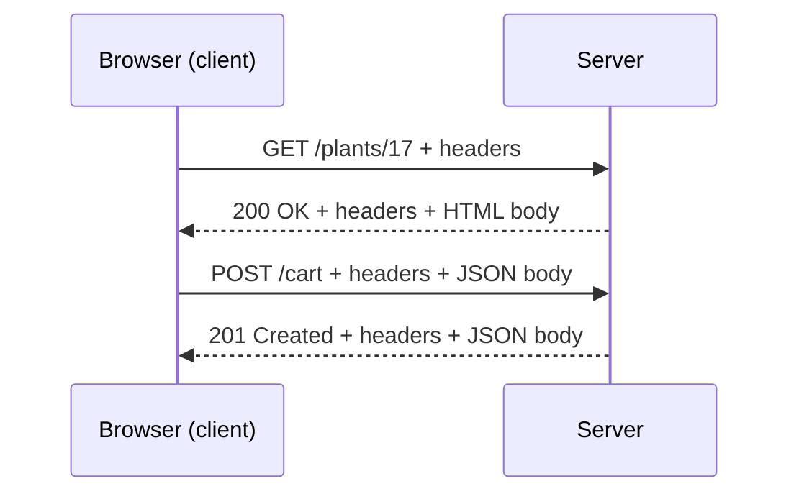
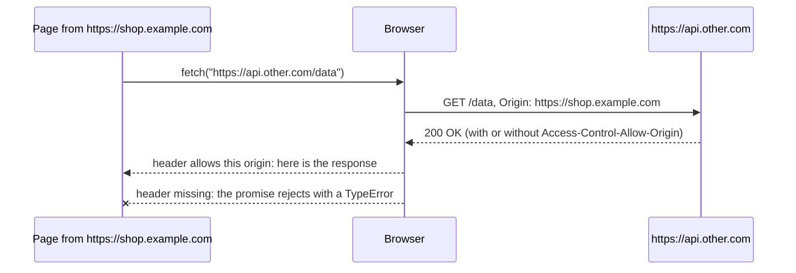

# HTTP, fetch, forms and client-side storage

## In plain words

A web page that only shows what was in its original file is a poster. A web *application* talks: it sends what the user typed to a server, asks for fresh data, and remembers things between visits. This lesson covers the four pieces that make that possible.

**HTTP** is the language browsers and servers speak. It works like sending a letter and getting a reply. The letter (a *request*) says what you want and may carry an attachment; the reply (a *response*) says how it went and carries what you asked for. Every image, every page, every piece of data on the Web travels this way.

**`fetch`** is the JavaScript function for sending such a letter from a script and reading the reply, without leaving or reloading the page.

**Forms** are how a page collects input: text boxes, checkboxes, menus, file pickers. JavaScript can read them, check what the user entered and decide what to do with it.

**Client-side storage** is a small notebook that the browser keeps for each website, so that a page can remember a setting or a draft the next time it is opened.

Why it matters for a job: "call an API and show the result" is the most common task in front-end development, and "build a form that validates and submits" is the second. Status codes, JSON, CORS errors and `localStorage` come up in practically every project and every interview.

> **Before this lesson:** you need promises and `async`/`await` ([Callbacks and promises](#/lesson/javascript/callbacks-promises), [Async functions and generators](#/lesson/javascript/async-await-generators)), JSON ([Destructuring, spread, rest and JSON](#/lesson/javascript/destructuring-json)), and events including `submit` and `preventDefault` ([Event handlers, propagation and delegation](#/lesson/javascript/event-handling)).

## The protocol

### A request and a response, as text

When you open `https://shop.example.com/plants/17`, the browser connects to the server and sends a **request**, which in its classic form is a few lines of plain text:

```text
GET /plants/17 HTTP/1.1
Host: shop.example.com
Accept: text/html
User-Agent: (the name of your browser)

```

The server answers with a **response**:

```text
HTTP/1.1 200 OK
Content-Type: text/html; charset=utf-8
Content-Length: 5120
Cache-Control: max-age=600

<!doctype html>
... the page ...
```

Both messages have the same three-part shape:

1. A **first line**. In a request: the *method*, the *path* and the protocol version. In a response: the version, a numeric *status code* and a short description.
2. **Headers**: lines of the form `Name: value` that carry extra information, such as the type of the content.
3. A blank line, followed by an optional **body**: the actual data (a page, an image, some JSON).



### Methods

The **method** states what the client wants done with the resource named by the path.

| Method | Meaning | Has a body? | Safe to repeat? |
|---|---|---|---|
| `GET` | read the resource | no | yes |
| `POST` | create something, or trigger an action | yes | no: repeating may create duplicates |
| `PUT` | replace the resource with the body | yes | yes |
| `PATCH` | change part of the resource | yes | not guaranteed |
| `DELETE` | remove the resource | usually not | yes |

A request that can be repeated without further effect is called **idempotent**. `GET` requests should never change anything on the server; browsers, caches and search engines rely on that.

### Status codes

The three-digit **status code** summarises the outcome. The first digit gives the category:

| Range | Category | Common examples |
|---|---|---|
| 2xx | success | `200 OK`, `201 Created`, `204 No Content` |
| 3xx | redirection | `301 Moved Permanently`, `304 Not Modified` |
| 4xx | the client made a mistake | `400 Bad Request`, `401 Unauthorized` (not logged in), `403 Forbidden`, `404 Not Found`, `429 Too Many Requests` |
| 5xx | the server failed | `500 Internal Server Error`, `503 Service Unavailable` |

### Taking a message apart

Because HTTP messages are structured text, we can parse one with ordinary string operations. This is not something you do in a browser (it is done for you), and it makes the format concrete:

```js-run
const rawResponse = [
  "HTTP/1.1 404 Not Found",
  "Content-Type: application/json",
  "Content-Length: 37",
  "",
  '{"error":"no plant with that number"}',
].join("\r\n");

function parseResponse(text) {
  const [head, body] = text.split("\r\n\r\n");            // a blank line separates head and body
  const [statusLine, ...headerLines] = head.split("\r\n");
  const [version, code, ...reason] = statusLine.split(" ");
  const headers = {};
  for (const line of headerLines) {
    const colon = line.indexOf(":");
    headers[line.slice(0, colon).toLowerCase()] = line.slice(colon + 1).trim();
  }
  return { version, status: Number(code), statusText: reason.join(" "), headers, body };
}

const response = parseResponse(rawResponse);
console.log(response.status, response.statusText);
console.log(response.headers["content-type"]);
console.log(JSON.parse(response.body).error);
console.log(response.status >= 200 && response.status < 300 ? "success" : "failure");
```

Lines in HTTP end with a carriage return and a line feed (`\r\n`). Header names are not case-sensitive, which is why the parser lower-cases them.

### URLs and encoding

Data sent with a `GET` request travels in the URL, after a question mark, as `name=value` pairs joined by `&`. This part is the **query string**. Characters with a special meaning in URLs (spaces, `&`, `?`, `=`, non-ASCII letters) must be **percent-encoded**: replaced by `%` and their byte values in hexadecimal. The built-in `URL` and `URLSearchParams` classes do the encoding and decoding for you.

```js-run
console.log(encodeURIComponent("ferns & mosses?"), decodeURIComponent("caf%C3%A9"));

const url = new URL("https://shop.example.com/search");
url.searchParams.set("q", "ferns & mosses");
url.searchParams.set("page", 2);
url.searchParams.append("tag", "shade");
url.searchParams.append("tag", "indoor");
console.log(url.href);

const incoming = new URL("https://shop.example.com/search?q=red+rose&max=20&tag=a&tag=b#results");
console.log(incoming.hostname, incoming.pathname, incoming.hash);
console.log(incoming.searchParams.get("q"), Number(incoming.searchParams.get("max")), incoming.searchParams.getAll("tag"));
console.log(incoming.searchParams.get("missing"));
```

> [!TIP]
> Never build URLs by gluing strings together with user input. `"/search?q=" + text` breaks as soon as the text contains `&` or `#`. Use `URLSearchParams` or at least `encodeURIComponent`.

## fetch

### The basic pattern

`fetch(url)` sends a request and returns a promise for a **`Response`** object. Reading the body is a second asynchronous step, because the body may still be arriving when the headers are already known: `response.json()` parses it as JSON, `response.text()` gives it as a string, and both return promises.

The pages on this site run in a sandbox without network access, so the first example fetches from a `data:` URL, a URL that *contains* its own content. The code is identical to what you would write for a real address.

```html-run
<pre id="out"></pre>
<script>
  const out = document.getElementById("out");
  const log = (...parts) => { out.textContent += parts.join(" ") + "\n"; };

  const plantsUrl = "data:application/json," + encodeURIComponent(JSON.stringify([
    { id: 1, name: "Fern", price: 12 },
    { id: 2, name: "Cactus", price: 7 },
  ]));

  async function loadPlants() {
    log("requesting...");
    const response = await fetch(plantsUrl);                 // 1. wait for the response headers
    log("status:", response.status, "| ok:", response.ok);
    log("content type:", response.headers.get("content-type"));
    const plants = await response.json();                    // 2. wait for the body and parse it
    for (const plant of plants) log(" -", plant.name, plant.price, "EUR");
  }

  loadPlants().catch((error) => log("failed:", error.message));
</script>
```

Line by line: `await fetch(...)` pauses until the server has answered with a status and headers. `response.ok` is `true` for status codes 200 to 299. `response.headers.get(name)` reads a header. `await response.json()` waits for the body and converts the JSON text into JavaScript values.

### The mistake everybody makes once

The promise returned by `fetch` is **rejected only when no response arrives at all**: no network, unknown host, blocked by the browser. A response with status 404 or 500 is still a response, so the promise is *fulfilled*. You must check `response.ok` yourself.

Since we cannot reach a real server here, the next example replaces `fetch` with a small stand-in that behaves like one for three paths. The `getJson` helper is exactly what you would use in a real project:

```html-run
<pre id="out"></pre>
<script>
  const out = document.getElementById("out");
  const log = (...parts) => { out.textContent += parts.join(" ") + "\n"; };

  // --- a pretend server, standing in for the network ---
  async function fakeFetch(path) {
    await new Promise((resolve) => setTimeout(resolve, 200));
    if (path === "/api/plants/1") return new Response(JSON.stringify({ id: 1, name: "Fern" }), { status: 200 });
    if (path === "/api/offline") throw new TypeError("Failed to fetch");       // what a network failure looks like
    return new Response(JSON.stringify({ error: "not found" }), { status: 404, statusText: "Not Found" });
  }

  // --- a helper worth keeping ---
  class HttpError extends Error {
    constructor(response) {
      super(`HTTP ${response.status} ${response.statusText}`);
      this.name = "HttpError";
      this.status = response.status;
    }
  }

  async function getJson(path) {
    const response = await fakeFetch(path);            // in real code: await fetch(path)
    if (!response.ok) throw new HttpError(response);   // turn 4xx and 5xx into exceptions
    return response.json();
  }

  async function main() {
    for (const path of ["/api/plants/1", "/api/plants/999", "/api/offline"]) {
      try {
        const data = await getJson(path);
        log(path, "->", JSON.stringify(data));
      } catch (error) {
        if (error instanceof HttpError && error.status === 404) log(path, "-> no such plant");
        else if (error instanceof HttpError) log(path, "-> server problem:", error.message);
        else log(path, "-> network problem:", error.message);
      }
    }
  }
  main();
</script>
```

Three distinct outcomes need three distinct reactions: data arrived; the server answered with an error status; no answer at all.

### Sending data

To send something, pass a second argument with the method, headers and body. For JSON, serialise with `JSON.stringify` and declare the content type:

```javascript
async function addToCart(productId, quantity) {
  const response = await fetch("/api/cart", {
    method: "POST",
    headers: { "Content-Type": "application/json" },
    body: JSON.stringify({ productId, quantity }),
  });
  if (!response.ok) throw new Error("Could not add to cart: HTTP " + response.status);
  return response.json();                     // the server's reply, e.g. the updated cart
}
```

### Cancelling and timeouts

A request can be cancelled through an `AbortController`. Its `signal` is passed to `fetch`; calling `abort()` makes the pending promise reject with an error whose name is `AbortError`. That is how you stop a search request that has become obsolete, and how you impose a time limit:

```javascript
async function fetchWithTimeout(url, milliseconds) {
  const response = await fetch(url, { signal: AbortSignal.timeout(milliseconds) });
  if (!response.ok) throw new Error("HTTP " + response.status);
  return response;
}
```

## Security: sandboxing, the same-origin policy and HTTPS

A script in a page can make requests, and the browser attaches the user's cookies for the target site to them. If any page could read the responses of any site, a malicious page could read your mail while you are logged in elsewhere. Browsers prevent this with the **same-origin policy**.

An **origin** is the combination of protocol, host and port: `https://shop.example.com` is one origin; `https://api.example.com` and `http://shop.example.com` are different ones. A script may freely read responses from its own origin. A response from a *different* origin is hidden from the script unless that server explicitly allows it by sending the header `Access-Control-Allow-Origin`. This opt-in mechanism is **CORS**, cross-origin resource sharing.



Two consequences confuse newcomers. First, a "CORS error" cannot be fixed in your front-end code; the *server* must send the header (or you route the call through your own server). Second, CORS protects users of browsers; it does not protect the server, which received and processed the request anyway. Other programs, such as command-line tools, ignore it entirely.

**HTTPS** wraps HTTP in an encrypted connection. It prevents others on the network from reading or altering the traffic, and it lets the browser verify that it is really talking to the named site. Modern browser features such as geolocation, service workers and the clipboard work only on HTTPS pages. Use it for everything.

> [!WARNING]
> Anything in your front-end JavaScript is visible to everyone, including "secret" API keys. Checks performed in the browser (is the price right? is this user an admin?) are a convenience for honest users, not security. The server must validate every request again, because an attacker can send requests without using your page at all.

## Forms

### Fields and their values

A form control is an element that holds a value the user can change. The main kinds:

```html-run
<style> label { display: block; margin: 6px 0; } </style>
<form id="order">
  <label>Name <input name="name" value="Ada"></label>
  <label>Quantity <input name="qty" type="number" value="2" min="1" max="9"></label>
  <label>Size
    <select name="size"><option value="s">Small</option><option value="m" selected>Medium</option><option value="l">Large</option></select>
  </label>
  <label><input name="gift" type="checkbox" checked> Gift wrap</label>
  <label>Delivery:
    <input name="delivery" type="radio" value="post" checked> Post
    <input name="delivery" type="radio" value="pickup"> Pickup
  </label>
  <label>Note <textarea name="note" rows="2">Leave at the door.</textarea></label>
</form>
<pre id="out"></pre>

<script>
  const form = document.getElementById("order");
  const out = document.getElementById("out");

  function show() {
    const f = form.elements;                      // access controls by their name attribute
    out.textContent = [
      "name:     " + JSON.stringify(f.name.value),
      "qty:      " + JSON.stringify(f.qty.value) + " (a string!) -> " + f.qty.valueAsNumber,
      "size:     " + f.size.value,
      "gift:     " + f.gift.checked,
      "delivery: " + f.delivery.value,
      "note:     " + JSON.stringify(f.note.value),
    ].join("\n");
  }
  form.addEventListener("input", show);           // input events bubble up from every control
  show();
</script>
```

Change any control and the summary updates. What to remember:

- `form.elements` gives access to the controls **by their `name` attribute**.
- Text-like controls expose their content as `value`, always a **string**, even for `type="number"`. Convert it (`Number(...)` or `valueAsNumber`).
- Checkboxes and radio buttons expose their state as the boolean `checked`. A group of radio buttons shares one name, and the group's `value` is the value of the selected one.
- A `<select>` exposes the selected option's `value`.

### Submitting: the form as a whole

Pressing Enter in a field or clicking a submit button fires the form's `submit` event. By default the browser would then send the fields to the server and load the response as a new page. An application that handles the data in JavaScript calls `preventDefault`, collects the values, and sends them itself. `new FormData(form)` gathers every named control in one go:

```html-run
<style> label { display: block; margin: 6px 0; } .error { color: crimson; } .ok { color: seagreen; } </style>
<form id="signup" novalidate>
  <label>Email <input name="email" type="email" required></label>
  <label>Password <input name="password" type="password" required minlength="8"></label>
  <label>Plan <select name="plan"><option>free</option><option>pro</option></select></label>
  <label><input name="terms" type="checkbox" required> I accept the terms</label>
  <button>Create account</button>
</form>
<p id="message"></p>

<script>
  const form = document.getElementById("signup");
  const message = document.getElementById("message");

  form.addEventListener("submit", async (event) => {
    event.preventDefault();                                  // stay on this page

    if (!form.checkValidity()) {                             // uses the required / type / minlength attributes
      const firstInvalid = form.querySelector(":invalid");
      message.className = "error";
      message.textContent = firstInvalid.name + ": " + firstInvalid.validationMessage;
      firstInvalid.focus();
      return;
    }

    const data = Object.fromEntries(new FormData(form));     // { email, password, plan, terms }
    const button = form.querySelector("button");
    button.disabled = true;                                  // prevent a double submission
    message.className = "";
    message.textContent = "Sending...";
    try {
      await new Promise((resolve) => setTimeout(resolve, 700));   // stands in for: await fetch("/api/signup", { method: "POST", ... })
      message.className = "ok";
      message.textContent = "Account created for " + data.email + " on the " + data.plan + " plan.";
      form.reset();
    } catch (error) {
      message.className = "error";
      message.textContent = "Something went wrong. Please try again.";
    } finally {
      button.disabled = false;
    }
  });
</script>
```

This handler is a template for nearly every form you will write:

1. `preventDefault()`.
2. **Validate.** Attributes such as `required`, `type="email"`, `minlength`, `min`, `max` and `pattern` describe the rules in HTML; `form.checkValidity()` tests them all, each control has a `validationMessage`, and the CSS selector `:invalid` finds offenders. (The `novalidate` attribute on the form switches off the browser's own pop-up bubbles so that we can show messages our way.)
3. **Collect** the data with `FormData`.
4. **Disable** the button while the request is running, so that an impatient double click does not create two accounts.
5. **Send**, and report success or failure. The `finally` block re-enables the button in both cases.

### Focus and disabled fields

The element with **focus** receives keyboard input. Scripts move it with `element.focus()` and remove it with `blur()`; `document.activeElement` tells you who has it. Moving focus to the first invalid field, as above, saves the user a search. The Tab key moves focus through the controls in document order.

A control with the `disabled` attribute cannot be focused or changed and is left out of the submitted data. Disabling is the right way to show that an action is temporarily unavailable.

### File fields

`<input type="file">` lets the user choose files from their device. For security reasons a script cannot read arbitrary files; it gets access only to those the user picked. The control's `files` property lists them as `File` objects with a `name`, `size` and `type`; their content is read asynchronously, for example with `await file.text()`.

```html-run
<input type="file" id="picker" accept=".txt,.csv,.json,.md">
<pre id="out">Choose a small text file from your device.</pre>

<script>
  const out = document.getElementById("out");
  document.getElementById("picker").addEventListener("change", async (event) => {
    const [file] = event.target.files;
    if (!file) return;
    const text = await file.text();
    out.textContent =
      `name: ${file.name}\nsize: ${file.size} bytes\ntype: ${file.type || "(unknown)"}\n` +
      `lines: ${text.split("\n").length}\n--- first 200 characters ---\n${text.slice(0, 200)}`;
  });
</script>
```

## Storing data on the client

### `localStorage`

Bindings vanish when the page is closed. To remember something across visits *in this browser*, the simplest tool is `localStorage`: a persistent table of string keys and string values, separate for every origin.

```javascript
localStorage.setItem("theme", "dark");
localStorage.getItem("theme");        // "dark" (or null if never set)
localStorage.removeItem("theme");
```

Since values must be strings, structured data goes through JSON. The preview frames on this site are sandboxed so strictly that storage access is refused, which is a good reminder that storage can *always* fail (private browsing, a full quota, user settings). The example therefore wraps storage in a small module that falls back to memory:

```html-run
<label>Draft note: <input id="note" size="30" placeholder="type, then press Run again"></label>
<p>Page opened <strong id="visits">?</strong> time(s). <button id="clear">Forget everything</button></p>
<p id="info" style="color: gray"></p>

<script>
  // a tiny wrapper: JSON in and out, and no crash when storage is unavailable
  const store = (() => {
    const memory = new Map();
    let persistent = true;
    try { localStorage.setItem("__probe", "1"); localStorage.removeItem("__probe"); }
    catch { persistent = false; }
    return {
      persistent,
      get(key, fallback) {
        try {
          const raw = persistent ? localStorage.getItem(key) : memory.get(key) ?? null;
          return raw === null ? fallback : JSON.parse(raw);
        } catch { return fallback; }                       // corrupted data: use the default
      },
      set(key, value) {
        const raw = JSON.stringify(value);
        if (persistent) localStorage.setItem(key, raw); else memory.set(key, raw);
      },
      remove(key) { if (persistent) localStorage.removeItem(key); else memory.delete(key); },
    };
  })();

  const state = store.get("demo-state", { visits: 0, note: "" });
  state.visits += 1;
  store.set("demo-state", state);

  const note = document.getElementById("note");
  note.value = state.note;
  document.getElementById("visits").textContent = state.visits;
  document.getElementById("info").textContent = store.persistent
    ? "Stored in localStorage: survives reloads."
    : "localStorage is blocked in this sandboxed preview, so the demo is using memory only. On a normal page the count would grow with every reload.";

  note.addEventListener("input", () => store.set("demo-state", { ...state, note: note.value }));
  document.getElementById("clear").addEventListener("click", () => {
    store.remove("demo-state");
    note.value = "";
    document.getElementById("visits").textContent = 0;
  });
</script>
```

### The options compared

| | Lifetime | Capacity | Sent to the server? | Typical use |
|---|---|---|---|---|
| `localStorage` | until deleted | a few megabytes | no | preferences, drafts, small caches |
| `sessionStorage` | until the tab is closed | a few megabytes | no | state of one tab, e.g. a multi-step form |
| cookies | until an expiry date | about 4 kilobytes each | **yes, with every request** to that site | login sessions (set by the server, marked `HttpOnly` and `Secure`) |
| IndexedDB | until deleted | large | no | big structured data, offline applications |

> [!WARNING]
> Do not keep passwords, access tokens or personal data in `localStorage`. Any script running on the page, including one injected through an XSS hole or a compromised third-party library, can read all of it. Session identifiers belong in `HttpOnly` cookies, which scripts cannot read.

> [!INTERVIEW]
> Frequent questions: "Does `fetch` reject on a 404?" (no; check `response.ok`). "GET versus POST?" (read versus create or act; data in the URL versus in the body; GET should be safe and is cacheable). "What is CORS?" (browser enforcement of the same-origin policy; the *server* opts in with `Access-Control-Allow-Origin`). "`localStorage` versus `sessionStorage` versus cookies?" (see the table). "How do you prevent a double form submission?" (disable the button while the request is pending). "What do 401, 403, 404 and 500 mean?"

## Common pitfalls

1. **Treating a fulfilled `fetch` as success.** HTTP errors do not reject; test `response.ok`.
2. **Forgetting the second `await`.** `response.json()` returns a promise.
3. **Reading the body twice.** A response body is a stream that can be consumed once.
4. **Sending an object as the body.** It must be serialised (`JSON.stringify`) and labelled with `Content-Type`.
5. **Building query strings by hand.** Use `URLSearchParams`.
6. **Trying to fix CORS in the browser.** It is a server setting.
7. **Forgetting `preventDefault` in a submit handler.** The page reloads.
8. **Using form values as numbers.** They are strings.
9. **Assuming storage always works and always holds valid JSON.** Wrap access in `try`/`catch` and provide defaults.
10. **Trusting client-side validation.** The server must check again.

## Summary

- HTTP is a request/response protocol. A request has a method, a path, headers and an optional body; a response has a status code, headers and a body.
- Methods express intent (`GET` reads, `POST` creates, `PUT`/`PATCH` change, `DELETE` removes); status codes report the outcome by class (2xx, 3xx, 4xx, 5xx).
- Query strings carry `name=value` pairs and must be percent-encoded; `URL` and `URLSearchParams` handle that.
- `fetch` returns a promise for a `Response`; check `ok`, then read the body with `json()` or `text()`. It rejects only on network-level failure. Options set the method, headers, body and an abort signal.
- The same-origin policy hides cross-origin responses unless the server allows them through CORS headers. HTTPS encrypts and authenticates.
- Form controls expose `value` (strings) or `checked`; `form.elements`, `FormData` and the constraint-validation API gather and check input; handle `submit`, prevent the default, disable while sending.
- `localStorage` and `sessionStorage` keep small string data per origin; cookies travel to the server; IndexedDB holds large data. Never store secrets in script-readable storage.

## Glossary

- **HTTP**: the request/response protocol used by the Web.
- **Request / response**: the message a client sends / the message the server sends back.
- **Method**: the verb of a request, such as `GET` or `POST`.
- **Header**: a named piece of metadata in a request or response.
- **Body**: the data carried by a request or response.
- **Status code**: the three-digit number describing the result of a request.
- **Idempotent**: having the same effect whether performed once or several times.
- **Query string**: the part of a URL after `?`, holding `name=value` pairs.
- **Percent-encoding**: writing special characters in URLs as `%` followed by hexadecimal digits.
- **API**: application programming interface; here, the set of URLs a server offers to programs.
- **`fetch`**: the browser function for making HTTP requests from scripts.
- **Origin**: the combination of protocol, host and port of a URL.
- **Same-origin policy**: the browser rule that isolates pages of different origins from each other.
- **CORS**: the mechanism by which a server permits cross-origin reads.
- **HTTPS**: HTTP over an encrypted, authenticated connection.
- **Form control**: an input element such as a text field, checkbox or select menu.
- **Validation**: checking that input satisfies the required rules.
- **`localStorage`**: persistent key/value storage for strings, per origin.
- **Cookie**: a small piece of data stored by the browser and sent to its site with each request.

## Check yourself

```quiz
[
  {"q": "A server answers a fetch request with status 500. What happens to the promise returned by `fetch`?", "options": ["It is rejected with an HttpError", "It is fulfilled with a Response whose ok property is false", "It stays pending", "It is fulfilled with null"], "answer": 1,
   "explain": "fetch rejects only when no response is obtained. Any HTTP status, including errors, yields a fulfilled promise; you must check response.ok or response.status."},
  {"q": "Which status code means the requested resource does not exist?", "options": ["200", "301", "404", "503"], "answer": 2,
   "explain": "404 Not Found is a client-error (4xx) code. 200 is success, 301 a permanent redirect and 503 a temporary server-side failure."},
  {"q": "What is wrong with `const data = await fetch(url).json();`?", "options": ["Nothing", "fetch returns a promise, which has no json method; the response must be awaited first", "json() needs an argument", "await cannot be combined with fetch"], "answer": 1,
   "explain": "The call order is: await the fetch promise to get a Response, then await response.json(). Written in one line: (await fetch(url)).json()."},
  {"q": "A user types 3 into `<input type=\"number\" name=\"qty\">`. What is `form.elements.qty.value + 1`?", "options": ["4", "\"31\"", "NaN", "\"4\""], "answer": 1,
   "explain": "The value of an input is always a string, even for type number, so + concatenates. Convert with Number() or use valueAsNumber."},
  {"q": "Why do submit handlers usually begin with `event.preventDefault()`?", "options": ["To validate the form", "To stop the browser from sending the form itself and loading a new page", "To stop the event from bubbling", "To clear the fields"], "answer": 1,
   "explain": "The default action of submit is a full-page form submission. Applications that send data with fetch must cancel it."},
  {"q": "A page from https://app.example.com fetches https://api.other.com/data and the browser reports a CORS error. Where must the fix be made?", "options": ["In the page's JavaScript, by adding a header to the request", "On api.other.com, which must send an Access-Control-Allow-Origin header (or through a proxy on your own server)", "In the user's browser settings", "By switching from fetch to XMLHttpRequest"], "answer": 1,
   "explain": "Cross-origin reading is granted by the responding server. Front-end code cannot override the same-origin policy."},
  {"q": "Which storage mechanism sends its contents to the server automatically with every request?", "options": ["localStorage", "sessionStorage", "Cookies", "IndexedDB"], "answer": 2,
   "explain": "Cookies are attached to requests for their site. The Web Storage and IndexedDB APIs are only accessible to scripts in the page."},
  {"q": "What does `localStorage.getItem(\"cart\")` return if nothing was ever stored under that key?", "options": ["undefined", "An empty string", "null", "It throws"], "answer": 2,
   "explain": "A missing key yields null. Note that JSON.parse(null) gives null as well, so code should supply a default."}
]
```

> **Source:** Haverbeke, *Eloquent JavaScript* (4th ed.), ch. 18 "HTTP and Forms" (the protocol, browsers and HTTP, fetch, HTTP sandboxing, security and HTTPS, form fields, focus, disabled fields, the form as a whole, file fields, storing data client-side). Details checked against MDN: https://developer.mozilla.org/en-US/docs/Web/HTTP/Overview , https://developer.mozilla.org/en-US/docs/Web/API/Fetch_API/Using_Fetch , https://developer.mozilla.org/en-US/docs/Web/HTTP/CORS , https://developer.mozilla.org/en-US/docs/Web/API/FormData , https://developer.mozilla.org/en-US/docs/Web/API/Window/localStorage
