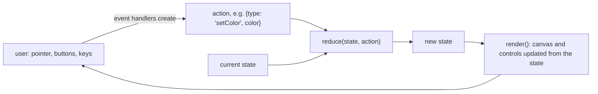
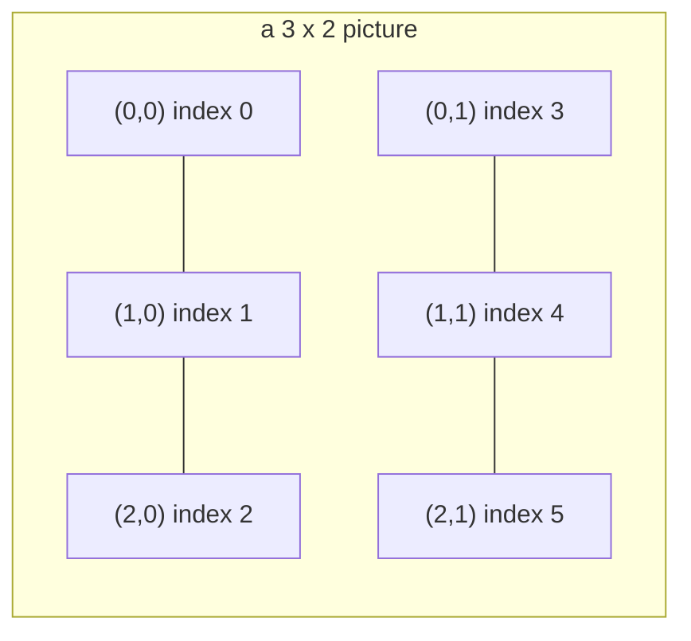

# Project: a pixel art editor explained

## In plain words

In this project lesson we build a small drawing program that runs in the browser: a grid of large square "pixels" that you colour with a pen, a rectangle tool and a paint bucket, with a colour picker and an undo button. It is about two hundred lines of code.

The interesting part is not the drawing. It is how the program is **organised**. Even a small application has many things that must stay in agreement: the picture on screen, the selected tool, the selected colour, whether the undo button is enabled. If every button handler reaches out and changes several of those directly, they drift apart and bugs appear ("the picture changed but undo is still grey").

The cure is the idea of a single source of truth. Think of a shop with one ledger. Nobody changes the stock by walking into the storeroom; every change is written as an entry in the ledger ("sold 2 ferns"), and the shelves are arranged to match the ledger. In our program the ledger is one object called the **state**. Changes are described by small objects called **actions**. One function, the **reducer**, computes the next state from the current state and an action. And after every change the screen is brought in line with the state. Data flows in one direction only: action, new state, screen.

Why it matters for a job: this is precisely the architecture of React with `useReducer`, of Redux, of Vue and of Elm. Understanding it in plain JavaScript, with nothing hidden by a framework, is the best preparation for working with any of them, and "how would you implement undo?" is a popular design question with a beautifully short answer here.

> **Before this lesson:** you need canvas drawing ([Drawing on canvas](#/lesson/javascript/canvas-drawing)), pointer events and dragging ([Keys, pointers, scrolling, timers and debouncing](#/lesson/javascript/keys-pointers-timers)), form controls ([HTTP, fetch, forms and client-side storage](#/lesson/javascript/http-fetch-forms)) and immutable updates ([Destructuring, spread, rest and JSON](#/lesson/javascript/destructuring-json)).

## The design



The state has four fields:

| Field | Meaning |
|---|---|
| `picture` | the image: its width, height and one colour per pixel |
| `tool` | the name of the selected tool: `"pen"`, `"rectangle"`, `"fill"` or `"pick"` |
| `color` | the selected colour, as a string such as `"#1d3557"` |
| `history` | earlier pictures, for undo |

Three rules hold everywhere in the program:

1. **The state is never modified in place.** A change produces a new state object (and, when the image changes, a new picture).
2. **Only the reducer produces new states.** Event handlers describe what happened by *dispatching* an action.
3. **The screen is derived from the state.** A `render` function makes canvas and controls reflect whatever the state says.

## Part 1: the picture as an immutable value

A picture is a plain object: `width`, `height` and `pixels`, an array holding one colour per pixel, row after row. The pixel at column `x` and row `y` lives at index `x + y * width`.



```js-run
function createPicture(width, height, color) {
  return { width, height, pixels: new Array(width * height).fill(color) };
}

const pixelAt = (picture, x, y) => picture.pixels[x + y * picture.width];

// Returns a NEW picture with the given pixels changed. `changes` is a list of { x, y, color }.
function drawPixels(picture, changes) {
  const pixels = picture.pixels.slice();                       // copy, then modify the copy
  for (const { x, y, color } of changes) {
    if (x >= 0 && x < picture.width && y >= 0 && y < picture.height) {
      pixels[x + y * picture.width] = color;
    }
  }
  return { width: picture.width, height: picture.height, pixels };
}

const blank = createPicture(4, 3, ".");
const dotted = drawPixels(blank, [{ x: 1, y: 0, color: "#" }, { x: 3, y: 2, color: "#" }, { x: 9, y: 9, color: "#" }]);

const show = (picture) => {
  for (let y = 0; y < picture.height; y++) {
    console.log(picture.pixels.slice(y * picture.width, (y + 1) * picture.width).join(" "));
  }
};
show(dotted);
console.log("the original is untouched:", blank.pixels.every((p) => p === "."));
console.log(pixelAt(dotted, 3, 2), dotted === blank, dotted.pixels === blank.pixels);
```

(The demonstration uses the characters `.` and `#` as "colours" so that pictures can be printed as text.)

Reading the code:

- `createPicture` builds the array with `new Array(width * height).fill(color)`.
- `pixelAt` converts a coordinate pair to an index.
- `drawPixels` is the only way to "change" a picture. It **copies** the pixel array with `slice()`, writes the changes into the copy and returns a new picture object. Changes that fall outside the picture are ignored, so tools need not worry about the edges.

The original picture is untouched, which the second-to-last line confirms. This immutability looks wasteful and is the foundation for everything that follows: undo becomes "keep the old picture", and "did the picture change?" becomes a comparison of two references with `!==`.

## Part 2: tools compute changes

A tool is a function that works out *which pixels should get which colour*. It does not draw and does not touch the state; it returns a list of changes for `drawPixels`.

```js-run
function createPicture(width, height, color) {
  return { width, height, pixels: new Array(width * height).fill(color) };
}

const pixelAt = (picture, x, y) => picture.pixels[x + y * picture.width];

// Returns a NEW picture with the given pixels changed. `changes` is a list of { x, y, color }.
function drawPixels(picture, changes) {
  const pixels = picture.pixels.slice();                       // copy, then modify the copy
  for (const { x, y, color } of changes) {
    if (x >= 0 && x < picture.width && y >= 0 && y < picture.height) {
      pixels[x + y * picture.width] = color;
    }
  }
  return { width: picture.width, height: picture.height, pixels };
}

function linePixels(from, to, color) {
  const steps = Math.max(Math.abs(to.x - from.x), Math.abs(to.y - from.y));
  const changes = [];
  for (let i = 0; i <= steps; i++) {
    const t = steps === 0 ? 0 : i / steps;                     // 0 at the start, 1 at the end
    changes.push({ x: Math.round(from.x + (to.x - from.x) * t), y: Math.round(from.y + (to.y - from.y) * t), color });
  }
  return changes;
}

function rectanglePixels(from, to, color) {
  const changes = [];
  for (let y = Math.min(from.y, to.y); y <= Math.max(from.y, to.y); y++) {
    for (let x = Math.min(from.x, to.x); x <= Math.max(from.x, to.x); x++) {
      changes.push({ x, y, color });
    }
  }
  return changes;
}

function floodPixels(picture, start, color) {
  const target = pixelAt(picture, start.x, start.y);
  if (target === color) return [];
  const changes = [];
  const seen = new Set();
  const stack = [start];
  while (stack.length > 0) {
    const { x, y } = stack.pop();
    const key = x + y * picture.width;
    if (x < 0 || x >= picture.width || y < 0 || y >= picture.height) continue;
    if (seen.has(key) || pixelAt(picture, x, y) !== target) continue;
    seen.add(key);
    changes.push({ x, y, color });
    stack.push({ x: x + 1, y }, { x: x - 1, y }, { x, y: y + 1 }, { x, y: y - 1 });
  }
  return changes;
}

const show = (title, picture) => {
  console.log(title);
  for (let y = 0; y < picture.height; y++) {
    console.log("  " + picture.pixels.slice(y * picture.width, (y + 1) * picture.width).join(" "));
  }
};
const blank = createPicture(7, 5, ".");

const withLine = drawPixels(blank, linePixels({ x: 0, y: 0 }, { x: 6, y: 3 }, "#"));
show("a pen stroke from (0,0) to (6,3):", withLine);

const withBox = drawPixels(blank, rectanglePixels({ x: 5, y: 3 }, { x: 2, y: 1 }, "R"));
show("a rectangle dragged from (5,3) to (2,1):", withBox);

const filled = drawPixels(withLine, floodPixels(withLine, { x: 6, y: 0 }, "o"));
show("bucket fill at (6,0): the line is a barrier", filled);

console.log(floodPixels(withLine, { x: 0, y: 0 }, "#").length, "changes when filling with the colour already there");
```

**`linePixels`** exists because pointer events do not arrive for every pixel. Move the pointer quickly and consecutive events can be ten pixels apart; painting only the reported positions would leave a dotted trail. So the pen connects the previous position to the current one. The function takes as many steps as the larger of the horizontal and vertical distances, and at step `i` it is the fraction `t = i / steps` of the way along, rounding to the nearest pixel.

**`rectanglePixels`** lists every pixel between two corners. `Math.min` and `Math.max` make it work whichever way the user drags.

**`floodPixels`** is the paint bucket: starting from one pixel, it finds all pixels of the same colour that are connected to it through their four direct neighbours. It keeps a `stack` of positions still to examine. Each round takes one position; if it is outside the picture, already seen, or of a different colour, it is skipped; otherwise it is recorded and its four neighbours are pushed. The explicit stack replaces recursion, which would overflow the call stack on a large area. The early `return []` when the target colour equals the new colour avoids pointless work. (A judged version of this algorithm is among this module's problems.)

## Part 3: state, actions and the reducer

An **action** is an object with a `type` and whatever extra data that kind of change needs: `{ type: "setColor", color: "#e63946" }`. The **reducer** takes the current state and an action and returns the next state.

```js-run
function createPicture(width, height, color) {
  return { width, height, pixels: new Array(width * height).fill(color) };
}

const pixelAt = (picture, x, y) => picture.pixels[x + y * picture.width];

// Returns a NEW picture with the given pixels changed. `changes` is a list of { x, y, color }.
function drawPixels(picture, changes) {
  const pixels = picture.pixels.slice();                       // copy, then modify the copy
  for (const { x, y, color } of changes) {
    if (x >= 0 && x < picture.width && y >= 0 && y < picture.height) {
      pixels[x + y * picture.width] = color;
    }
  }
  return { width: picture.width, height: picture.height, pixels };
}

const HISTORY_LIMIT = 50;

function initialState() {
  return { picture: createPicture(24, 16, "#f4f1e8"), tool: "pen", color: "#1d3557", history: [] };
}

// (state, action) -> new state. The only place where the state is allowed to change.
function reduce(state, action) {
  switch (action.type) {
    case "setTool":
      return { ...state, tool: action.tool };
    case "setColor":
      return { ...state, color: action.color };
    case "beginStroke":                                         // remember the picture before a change
      return { ...state, history: [...state.history, state.picture].slice(-HISTORY_LIMIT) };
    case "paint":
      return { ...state, picture: action.picture };
    case "undo":
      if (state.history.length === 0) return state;
      return { ...state, picture: state.history.at(-1), history: state.history.slice(0, -1) };
    default:
      throw new Error("Unknown action: " + action.type);
  }
}

let state = initialState();
const describe = (label) =>
  console.log(label.padEnd(22), "| tool:", state.tool, "| color:", state.color, "| top-left:", pixelAt(state.picture, 0, 0), "| history:", state.history.length);

describe("start");
state = reduce(state, { type: "setTool", tool: "fill" });
state = reduce(state, { type: "setColor", color: "#e63946" });
describe("after two settings");

state = reduce(state, { type: "beginStroke" });
state = reduce(state, { type: "paint", picture: drawPixels(state.picture, [{ x: 0, y: 0, color: state.color }]) });
describe("after one stroke");

state = reduce(state, { type: "beginStroke" });
state = reduce(state, { type: "paint", picture: drawPixels(state.picture, [{ x: 0, y: 0, color: "#000000" }]) });
describe("after a second stroke");

state = reduce(state, { type: "undo" });
describe("undo");
state = reduce(state, { type: "undo" });
describe("undo again");
const before = state;
state = reduce(state, { type: "undo" });
console.log("undo with empty history returns the very same state:", state === before);
```

The reducer is a `switch` on the action type, and every case returns a new object built with spread:

- **`setTool`, `setColor`**: copy the state with one field replaced.
- **`beginStroke`**: append the current picture to `history`. This is dispatched once at the start of every drawing gesture, *before* the picture changes. `.slice(-HISTORY_LIMIT)` keeps only the most recent fifty entries so that memory use stays bounded.
- **`paint`**: replace the picture. During one drag this is dispatched many times; because `beginStroke` already saved the old picture, the whole drag counts as one undoable step.
- **`undo`**: make the last history entry the current picture and remove it from the history. With an empty history it returns the *same* state object, which signals "nothing changed".

Look at how little undo needs. There is no code that knows how to reverse a pen stroke or un-fill an area. Because pictures are immutable, an old picture is still exactly what it was, so undo is "go back to the previous value". Storing fifty pictures of 384 pixels each is nothing; for large images one would store only the differences, and the principle would be the same.

> [!TIP]
> A reducer is a pure function, so it can be tested like one: build a state, apply actions, compare. No browser, no canvas and no clicking is needed, as the panel above shows. In a real project these would be your unit tests.

## Part 4: the complete editor

Now the parts that touch the browser: a canvas that shows the picture, controls, pointer handling, and the `dispatch`/`render` pair that connects everything.

```html-run
<style>
  .toolbar { display: flex; flex-wrap: wrap; gap: 8px; align-items: center; margin-bottom: 8px; font: 14px sans-serif; }
  #board { border: 1px solid #555; touch-action: none; cursor: crosshair; max-width: 100%; image-rendering: pixelated; }
  #preview { border: 1px solid #999; image-rendering: pixelated; vertical-align: middle; }
</style>

<div class="toolbar">
  <label>Tool
    <select id="tool">
      <option value="pen">pen</option>
      <option value="rectangle">rectangle</option>
      <option value="fill">fill</option>
      <option value="pick">pick colour</option>
    </select>
  </label>
  <label>Colour <input type="color" id="color"></label>
  <button id="undo">Undo</button>
  <button id="clear">Clear</button>
  <span>actual size: <canvas id="preview"></canvas></span>
</div>
<canvas id="board"></canvas>
<p style="font: 13px sans-serif; color: #555">Drag on the grid to draw. Ctrl+Z (or Cmd+Z) also undoes.</p>

<script>
  // ---------- parts 1 to 3: picture, tools, reducer (as explained above) ----------
  function createPicture(width, height, color) {
    return { width, height, pixels: new Array(width * height).fill(color) };
  }

  const pixelAt = (picture, x, y) => picture.pixels[x + y * picture.width];

  // Returns a NEW picture with the given pixels changed. `changes` is a list of { x, y, color }.
  function drawPixels(picture, changes) {
    const pixels = picture.pixels.slice();                       // copy, then modify the copy
    for (const { x, y, color } of changes) {
      if (x >= 0 && x < picture.width && y >= 0 && y < picture.height) {
        pixels[x + y * picture.width] = color;
      }
    }
    return { width: picture.width, height: picture.height, pixels };
  }

  function linePixels(from, to, color) {
    const steps = Math.max(Math.abs(to.x - from.x), Math.abs(to.y - from.y));
    const changes = [];
    for (let i = 0; i <= steps; i++) {
      const t = steps === 0 ? 0 : i / steps;                     // 0 at the start, 1 at the end
      changes.push({ x: Math.round(from.x + (to.x - from.x) * t), y: Math.round(from.y + (to.y - from.y) * t), color });
    }
    return changes;
  }

  function rectanglePixels(from, to, color) {
    const changes = [];
    for (let y = Math.min(from.y, to.y); y <= Math.max(from.y, to.y); y++) {
      for (let x = Math.min(from.x, to.x); x <= Math.max(from.x, to.x); x++) {
        changes.push({ x, y, color });
      }
    }
    return changes;
  }

  function floodPixels(picture, start, color) {
    const target = pixelAt(picture, start.x, start.y);
    if (target === color) return [];
    const changes = [];
    const seen = new Set();
    const stack = [start];
    while (stack.length > 0) {
      const { x, y } = stack.pop();
      const key = x + y * picture.width;
      if (x < 0 || x >= picture.width || y < 0 || y >= picture.height) continue;
      if (seen.has(key) || pixelAt(picture, x, y) !== target) continue;
      seen.add(key);
      changes.push({ x, y, color });
      stack.push({ x: x + 1, y }, { x: x - 1, y }, { x, y: y + 1 }, { x, y: y - 1 });
    }
    return changes;
  }

  const HISTORY_LIMIT = 50;

  function initialState() {
    return { picture: createPicture(24, 16, "#f4f1e8"), tool: "pen", color: "#1d3557", history: [] };
  }

  // (state, action) -> new state. The only place where the state is allowed to change.
  function reduce(state, action) {
    switch (action.type) {
      case "setTool":
        return { ...state, tool: action.tool };
      case "setColor":
        return { ...state, color: action.color };
      case "beginStroke":                                         // remember the picture before a change
        return { ...state, history: [...state.history, state.picture].slice(-HISTORY_LIMIT) };
      case "paint":
        return { ...state, picture: action.picture };
      case "undo":
        if (state.history.length === 0) return state;
        return { ...state, picture: state.history.at(-1), history: state.history.slice(0, -1) };
      default:
        throw new Error("Unknown action: " + action.type);
    }
  }

  // ---------- part 4a: showing a picture on a canvas ----------
  const SCALE = 16;                                     // screen pixels per picture pixel

  function paintCanvas(canvas, picture, scale) {
    canvas.width = picture.width * scale;               // assigning the size also clears the canvas
    canvas.height = picture.height * scale;
    const ctx = canvas.getContext("2d");
    for (let y = 0; y < picture.height; y++) {
      for (let x = 0; x < picture.width; x++) {
        ctx.fillStyle = pixelAt(picture, x, y);
        ctx.fillRect(x * scale, y * scale, scale, scale);
      }
    }
  }

  // ---------- part 4b: the store: one state, changed only through dispatch ----------
  const board = document.getElementById("board");
  const preview = document.getElementById("preview");
  const toolSelect = document.getElementById("tool");
  const colorInput = document.getElementById("color");
  const undoButton = document.getElementById("undo");

  let state = initialState();
  let shownPicture = null;                              // the picture currently on the canvas

  function dispatch(action) {
    state = reduce(state, action);
    render();
  }

  function render() {                                   // make the screen agree with the state
    if (state.picture !== shownPicture) {               // redraw only when the picture really changed
      paintCanvas(board, state.picture, SCALE);
      paintCanvas(preview, state.picture, 1);
      shownPicture = state.picture;
    }
    toolSelect.value = state.tool;
    colorInput.value = state.color;
    undoButton.disabled = state.history.length === 0;
  }

  // ---------- part 4c: controls turn events into actions ----------
  toolSelect.addEventListener("change", () => dispatch({ type: "setTool", tool: toolSelect.value }));
  colorInput.addEventListener("input", () => dispatch({ type: "setColor", color: colorInput.value }));
  undoButton.addEventListener("click", () => dispatch({ type: "undo" }));
  document.getElementById("clear").addEventListener("click", () => {
    dispatch({ type: "beginStroke" });
    dispatch({ type: "paint", picture: createPicture(state.picture.width, state.picture.height, "#f4f1e8") });
  });
  window.addEventListener("keydown", (event) => {
    if ((event.ctrlKey || event.metaKey) && event.key.toLowerCase() === "z") {
      event.preventDefault();
      dispatch({ type: "undo" });
    }
  });

  // ---------- part 4d: drawing with the pointer ----------
  function pointerPosition(event) {                     // which picture pixel is under the pointer?
    const box = board.getBoundingClientRect();
    return {
      x: Math.floor((event.clientX - box.left) / (box.width / state.picture.width)),
      y: Math.floor((event.clientY - box.top) / (box.height / state.picture.height)),
    };
  }

  let stroke = null;                                    // information about the drag in progress, or null

  board.addEventListener("pointerdown", (event) => {
    const position = pointerPosition(event);
    if (state.tool === "pick") {
      dispatch({ type: "setColor", color: pixelAt(state.picture, position.x, position.y) });
      return;
    }
    dispatch({ type: "beginStroke" });                  // one history entry for the whole gesture
    if (state.tool === "fill") {
      dispatch({ type: "paint", picture: drawPixels(state.picture, floodPixels(state.picture, position, state.color)) });
      return;
    }
    stroke = { start: position, last: position, base: state.picture };
    board.setPointerCapture(event.pointerId);
    continueStroke(position);
  });

  board.addEventListener("pointermove", (event) => {
    if (stroke === null) return;
    const position = pointerPosition(event);
    if (position.x === stroke.last.x && position.y === stroke.last.y) return;   // still in the same pixel
    continueStroke(position);
  });

  function continueStroke(position) {
    let picture;
    if (state.tool === "pen") {
      picture = drawPixels(state.picture, linePixels(stroke.last, position, state.color));
    } else {                                            // rectangle: always start again from the picture before the drag
      picture = drawPixels(stroke.base, rectanglePixels(stroke.start, position, state.color));
    }
    stroke.last = position;
    dispatch({ type: "paint", picture });
  }

  const endStroke = () => { stroke = null; };
  board.addEventListener("pointerup", endStroke);
  board.addEventListener("pointercancel", endStroke);

  render();                                             // first paint
</script>
```

### Showing the picture

`paintCanvas` sets the canvas size from the picture (which also clears it) and fills one square per pixel. It is called twice in `render`: once at 16 times magnification for the board, once at actual size for the small preview.

### `dispatch` and `render`

These two functions are the spine of the application.

`dispatch(action)` is the *only* place where `state` is assigned. It runs the reducer and then calls `render`.

`render` makes the page match the state: it repaints the canvases if (and only if) the picture is a different object from the one shown last, sets the two controls to the state's tool and colour, and enables or disables the undo button. Notice that no event handler ever enables the undo button, repaints the canvas or touches another control. They only dispatch. Whatever sequence of actions occurs, the screen cannot disagree with the state, because the screen is always recomputed from it.

The check `state.picture !== shownPicture` is where immutability pays off for performance: one reference comparison tells us whether any of the 384 pixels changed.

### Controls

Each control's handler is one line: read the control, dispatch an action. The colour input fires `input` events continuously while the user drags inside the browser's colour chooser. The keyboard handler dispatches the same `undo` action as the button, so both paths behave identically by construction. "Clear" is implemented with the two actions we already have: save the current picture to history, then paint a blank one, which makes clearing undoable for free.

### Pointer handling

`pointerPosition` converts the pointer's window coordinates to picture coordinates. It divides by the canvas's *displayed* size (from `getBoundingClientRect`), not by `SCALE`, because CSS may have shrunk the canvas on a narrow screen (`max-width: 100%`).

A drawing gesture has a little state of its own, which is not part of the application state: the binding `stroke` holds where the drag started, the last position, and the picture as it was before the drag (`base`).

- **Pick** dispatches `setColor` with the colour under the pointer and ends.
- **Fill** dispatches `beginStroke` and one `paint`, and ends.
- **Pen** paints a line from the last position to the current one onto the *current* picture, so the stroke accumulates.
- **Rectangle** paints onto the *base* picture every time. That is what makes the rectangle follow the pointer like a rubber band: each move discards the previous rectangle by starting again from the picture before the drag. Without immutability we would have to remember and restore every overwritten pixel.

`setPointerCapture` keeps the events coming when the pointer leaves the canvas mid-drag, and `touch-action: none` in the CSS stops touch screens from scrolling the page instead.

## Saving and loading

Two export formats come for free.

The canvas can produce an image file. `canvas.toDataURL("image/png")` returns the whole PNG image encoded as a `data:` URL, which can be used as the `href` of a download link or the `src` of an image:

```javascript
function downloadPicture(picture) {
  const canvas = document.createElement("canvas");
  paintCanvas(canvas, picture, 1);                         // actual size: one screen pixel per picture pixel
  const link = document.createElement("a");
  link.href = canvas.toDataURL("image/png");
  link.download = "pixel-art.png";                         // the download attribute makes the browser save the file
  link.click();
}
```

And because a picture is plain data, `JSON.stringify(state.picture)` is a complete save file, small enough for `localStorage`, and `JSON.parse` restores it. Loading an image file works the other way round: read the chosen file, draw it on a canvas with `drawImage`, read the raw pixels with `getImageData`, and convert each one to a colour string.

```javascript
function pictureFromImage(image) {
  const width = Math.min(image.width, 100), height = Math.min(image.height, 100);
  const canvas = document.createElement("canvas");
  canvas.width = width; canvas.height = height;
  const ctx = canvas.getContext("2d");
  ctx.drawImage(image, 0, 0);
  const { data } = ctx.getImageData(0, 0, width, height);  // four numbers per pixel: red, green, blue, alpha
  const hex = (n) => n.toString(16).padStart(2, "0");
  const pixels = [];
  for (let i = 0; i < data.length; i += 4) {
    pixels.push("#" + hex(data[i]) + hex(data[i + 1]) + hex(data[i + 2]));
  }
  return { width, height, pixels };
}
```

> [!WARNING]
> `getImageData` and `toDataURL` refuse to work (they throw a `SecurityError`) once an image from another origin has been drawn onto the canvas without CORS permission. The canvas is then said to be *tainted*. The rule exists so that a page cannot read the pixels of images that only the user is allowed to see.

## Ideas for extending the editor

1. **Redo.** Keep a second stack. `undo` pushes the current picture onto it; `redo` pops from it; any new stroke empties it.
2. **A circle tool.** Like the rectangle, but include only pixels within a radius of the start.
3. **Autosave.** After each action, write `state.picture` to `localStorage` (debounced), and load it in `initialState`.
4. **Faster painting.** Give `paintCanvas` the previous picture and repaint only the pixels that differ.
5. **A grid overlay and zoom.** `SCALE` is one number.
6. **Keyboard shortcuts for tools.** One more `keydown` branch that dispatches `setTool`.

Every one of these is a new action type, a few lines in the reducer or a new tool function, and perhaps one more line in `render`. Nothing existing has to be rewritten, which is the practical test of a good structure.

> [!INTERVIEW]
> Use this project to explain: **unidirectional data flow** (events produce actions, a reducer produces state, the view renders from state); **why immutability** (cheap change detection by reference, trivial undo, no accidental shared mutation); **what a reducer is** (a pure function `(state, action) => newState`); and **how to implement undo/redo** (stacks of past and future states). If asked about performance: store differences instead of full snapshots, and re-render only what changed.

## Common pitfalls

1. **Mutating the pixel array in place.** History entries then all point at the same, changed array, and undo does nothing.
2. **Updating controls from event handlers.** The control and the state drift apart; let `render` do it.
3. **Saving history on every `paint`.** One drag would produce dozens of undo steps. Save once per gesture.
4. **Painting only the reported pointer positions.** Fast strokes become dotted; connect the points.
5. **Drawing the rubber-band rectangle on top of the previous one.** Start from the picture before the drag each time.
6. **Using `event.offsetX` divided by a fixed scale.** It breaks when CSS resizes the canvas; measure the displayed size.
7. **Recursive flood fill.** It overflows the stack on large areas; use an explicit stack or queue.
8. **Unbounded history.** Cap its length.

## Summary

- The application keeps one state object (`picture`, `tool`, `color`, `history`) that is never mutated.
- Pictures are immutable values; `drawPixels` returns a changed copy. Tools are pure functions that compute lists of pixel changes.
- Event handlers dispatch actions; the reducer `(state, action) => newState` is the only place where new states are made; `render` updates the canvas and controls from the state.
- Immutability turns change detection into a reference comparison, the rubber-band rectangle into "redraw from the base picture", and undo into "restore the previous picture".
- Pointer handling converts screen coordinates to picture coordinates, captures the pointer during a drag, and groups a drag into one history entry.
- Plain-data state is easy to save (JSON, PNG through the canvas) and to test without a browser.

## Glossary

- **State**: the single object holding everything the application needs to know at a given moment.
- **Single source of truth**: the principle that each fact is stored in exactly one place, from which everything else is derived.
- **Action**: a plain object describing a change that should happen, identified by a `type`.
- **Dispatch**: to send an action to the store so that the state is updated.
- **Reducer**: a pure function that computes the next state from the current state and an action.
- **Store**: the holder of the current state together with the `dispatch` function.
- **Render**: to update the visible page so that it reflects the state.
- **Unidirectional data flow**: data moving in one direction: action, state, view.
- **Immutable value**: a value that is never modified after creation; changes create new values.
- **Snapshot**: a saved earlier state.
- **Undo history**: the list of snapshots that can be restored.
- **Flood fill**: an algorithm that recolours a connected area of equal colour.
- **Rubber band**: a shape preview that follows the pointer during a drag.
- **Data URL**: a URL that contains the data itself, such as an encoded image.
- **Tainted canvas**: a canvas whose pixels may not be read because cross-origin content was drawn on it.

## Check yourself

```quiz
[
  {"q": "In this architecture, which code is allowed to assign a new value to `state`?", "options": ["Any event handler", "Only dispatch, using the result of the reducer", "The render function", "Each tool function"], "answer": 1,
   "explain": "All changes go through dispatch, which calls the reducer. Handlers describe what happened; render only reads the state."},
  {"q": "Why does `drawPixels` copy the pixel array with `slice()` before writing to it?", "options": ["Arrays cannot be written to directly", "So that the previous picture, which history or the canvas may still refer to, stays unchanged", "To sort the pixels", "Because fill() requires a copy"], "answer": 1,
   "explain": "Pictures are immutable values. Earlier pictures kept in the undo history must not be affected by later drawing."},
  {"q": "How is undo implemented?", "options": ["By reversing the last tool operation pixel by pixel", "By replacing the current picture with the last picture saved in history and removing it from history", "By reloading the page", "By clearing the canvas"], "answer": 1,
   "explain": "Because old pictures are never modified, restoring one is enough. No tool needs to know how to undo itself."},
  {"q": "Why is `beginStroke` dispatched once at pointerdown and not together with every `paint` action?", "options": ["To make drawing faster", "So that an entire drag is undone in one step and history is not flooded with intermediate pictures", "Because paint cannot change history", "To capture the pointer"], "answer": 1,
   "explain": "A drag produces many paint actions. Saving the picture once at the start groups them into a single undoable change."},
  {"q": "During a rectangle drag, why is each new rectangle drawn onto `stroke.base` instead of onto the current picture?", "options": ["The current picture is frozen", "So that the previous, differently sized rectangle disappears and only the latest one is shown", "To save memory", "Because rectangles cannot overlap"], "answer": 1,
   "explain": "Starting from the picture as it was before the drag discards earlier previews, giving the rubber-band effect."},
  {"q": "What does `render` compare to decide whether the canvas must be repainted?", "options": ["Every pixel of the old and new pictures", "The references state.picture and shownPicture", "The tool name", "The length of the history"], "answer": 1,
   "explain": "A changed picture is always a new object, so a single reference comparison detects any change."},
  {"q": "Why does the pen tool draw a line between the previous and the current pointer position?", "options": ["To make thicker strokes", "Pointer events are not delivered for every pixel, so fast movements would otherwise leave gaps", "Because canvas cannot draw single pixels", "To support undo"], "answer": 1,
   "explain": "Consecutive events can be far apart. Connecting them fills in the pixels the pointer passed over."},
  {"q": "Which statement about the reducer is correct?", "options": ["It reads from the DOM", "It is a pure function of the current state and an action and can be tested without a browser", "It must call render", "It stores the state in a global variable"], "answer": 1,
   "explain": "The reducer only computes a new state value from its two arguments, which makes it straightforward to test in isolation."}
]
```

> **Source:** inspired by Haverbeke, *Eloquent JavaScript* (4th ed.), ch. 19 "Project: A Pixel Art Editor" (components, the state, the canvas, drawing tools, saving and loading, undo history); the design shown here (reducer with actions, tools returning change lists) and all code are original to this guide. Details checked against MDN: https://developer.mozilla.org/en-US/docs/Web/API/HTMLCanvasElement/toDataURL , https://developer.mozilla.org/en-US/docs/Web/API/CanvasRenderingContext2D/getImageData , https://developer.mozilla.org/en-US/docs/Web/HTML/Element/input/color
