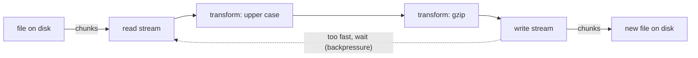

# Node.js: modules, files, streams and npm

## In plain words

For its first fourteen years JavaScript lived only inside web browsers. **Node.js** is a program that runs JavaScript *outside* the browser, directly on a computer, like Python or Java. Take away the page, the buttons and the DOM; give the language the ability to read and write files, open network connections and start other programs; and you have Node.

A helpful picture: the JavaScript language is an engine. A browser is one vehicle built around that engine, with windows and a steering wheel for end users. Node is another vehicle built around the *same* engine: a delivery van with no windows and a large cargo area. The engine (the language you have learned) is identical; the equipment around it differs.

What people use Node for:

- **servers**: programs that answer HTTP requests (the next lesson builds one);
- **command-line tools**: every build tool, test runner and formatter you will use as a front-end developer is a Node program;
- **scripts**: renaming a thousand files, converting data, automating chores.

Why it matters for a job: even pure front-end work means running `npm install` and `npm run dev` every day, and those are Node. Being able to write a small script or read a server's code makes you far more useful. Interviewers for full-stack roles ask about Node's module system, its event loop, streams and how asynchronous file access works.

> **Before this lesson:** you need ES modules and CommonJS ([ES modules and CommonJS](#/lesson/javascript/es-modules-commonjs)), npm basics ([Packages, bundlers and module design](#/lesson/javascript/bundlers-module-design)), promises and `async`/`await` ([Async functions and generators](#/lesson/javascript/async-await-generators)) and error handling ([Exceptions and error handling](#/lesson/javascript/exceptions)).

> [!NOTE]
> The runnable panels on this site execute in your browser, where Node's file and network modules do not exist. Node code is therefore shown as static listings (all of them were run with a current Node version while writing this lesson). Where a mechanism can be imitated in plain JavaScript, a runnable panel lets you experiment with the idea. To try the real thing, install Node from nodejs.org, save a listing as a `.mjs` file and run `node file.mjs` in a terminal.

## Running Node

### The first script

Save this as `hello.mjs`:

```javascript
// file: hello.mjs
const name = process.argv[2] ?? "world";
console.log(`Hello, ${name}!`);
console.log("Node version:", process.version);
```

and run it from a terminal (a window where you type commands):

```text
$ node hello.mjs
Hello, world!
Node version: v22.11.0
$ node hello.mjs Ada
Hello, Ada!
```

`console.log` writes to the terminal. The global object `process` represents the running program. `process.argv` is the array of command-line words: element 0 is the path of the `node` program, element 1 the path of the script, and the user's arguments start at index 2.

Other useful members of `process`:

| Member | Meaning |
|---|---|
| `process.argv` | the command-line arguments |
| `process.env` | environment variables, e.g. `process.env.PORT`; the standard place for configuration and secrets |
| `process.cwd()` | the current working directory (the folder the command was run from) |
| `process.exit(code)` | stop the program; code 0 means success, anything else failure |
| `process.exitCode = 1` | set the exit code without stopping abruptly |
| `process.stdout`, `process.stdin` | the output and input of the terminal, as streams |

Typing `node` with no file starts an interactive prompt, the **REPL** (read, evaluate, print loop), handy for trying an expression.

### What is the same and what is different

The language is the same: every lesson in Part 1 of this track applies unchanged, including promises and the event loop. The environment differs:

| | Browser | Node.js |
|---|---|---|
| Global object | `window` | `globalThis` (historically `global`) |
| Page and DOM | `document`, events on elements | none |
| Files | only those the user picks | full access through `node:fs` |
| Network | `fetch`, limited by the same-origin policy | `fetch`, plus raw servers and sockets, no same-origin policy |
| Modules | ES modules through `<script type="module">` | ES modules and CommonJS |
| Trust | runs untrusted code in a sandbox | runs *your* code with *your* permissions |

That last row deserves emphasis. A Node program can delete your files. Run only code you trust.

## Modules in Node

Node ships with a library of **built-in modules**. They are imported with the prefix `node:` to distinguish them from installed packages:

```javascript
import { readFile } from "node:fs/promises";   // file system
import path from "node:path";                  // file path arithmetic
import os from "node:os";                      // information about the computer
import { createServer } from "node:http";      // web servers
import { EventEmitter } from "node:events";    // publish/subscribe
```

The three kinds of import specifier:

- `"node:fs"`: a built-in module;
- `"./util.js"` or `"../lib/x.js"`: a file of your project, relative to the importing file (the extension is required in ES modules);
- `"express"`: a package installed in `node_modules`.

Recall from the modules lesson that a file is an ES module if it ends in `.mjs` or if the nearest `package.json` says `"type": "module"`. Older code uses CommonJS, where the same imports read `const { readFile } = require("node:fs/promises");`.

## The file system

### Reading and writing files

The module `node:fs/promises` offers file operations that return promises. Every one of them is asynchronous, because disks are slow compared with the processor and the single JavaScript thread must not sit waiting.

```javascript
// file: notes.mjs
import { readFile, writeFile, appendFile, readdir, stat } from "node:fs/promises";

await writeFile("notes.txt", "first line\nsecond line\n", "utf8");    // create or overwrite
await appendFile("notes.txt", "third line\n");                        // add to the end

const text = await readFile("notes.txt", "utf8");                     // the whole file as a string
console.log(text.trimEnd().split("\n").length, "lines");              // 3 lines

console.log(await readdir("."));                                      // names in the current folder

const info = await stat("notes.txt");
console.log(info.size, info.isFile(), info.isDirectory());            // 34 true false
```

Line by line:

- `writeFile(path, content, encoding)` replaces the file's content, creating the file if needed.
- `readFile(path, "utf8")` resolves to the content as a string. The second argument is the **character encoding**, the rule for turning bytes into characters; UTF-8 is the universal choice. *Without* it you get a `Buffer`, Node's object for raw bytes, which is what you want for images and other non-text files.
- `readdir` lists a folder; `stat` reports size, dates and whether the path is a file or a folder.
- `await` is used at the top level, which ES modules permit.

Other functions follow the same pattern: `mkdir` (create a folder), `rm` (delete), `rename`, `copyFile`.

### Errors

File operations fail for reasons outside your control: the file is missing, access is denied, the disk is full. The promise is then rejected with an error whose `code` property identifies the cause: `"ENOENT"` (no such file or folder), `"EACCES"` (permission denied), `"EEXIST"` (already exists), `"EISDIR"` (is a directory).

```javascript
import { readFile } from "node:fs/promises";

async function readConfig(file) {
  try {
    return JSON.parse(await readFile(file, "utf8"));
  } catch (error) {
    if (error.code === "ENOENT") return {};          // no config file: use defaults
    throw error;                                     // anything else is a real problem
  }
}
```

This is the selective catching from the exceptions lesson: handle the one case you expect, rethrow the rest.

### Three styles of the same API

Node grew up before promises existed, so its file API comes in three flavours. You will meet all of them in real code.

```javascript
import fs from "node:fs";
import { readFile } from "node:fs/promises";

// 1. promises (preferred today)
const a = await readFile("notes.txt", "utf8");

// 2. error-first callbacks (the original style)
fs.readFile("notes.txt", "utf8", (error, b) => {
  if (error) throw error;
  console.log(b.length);
});

// 3. synchronous: blocks the whole program until done
const c = fs.readFileSync("notes.txt", "utf8");
```

> [!WARNING]
> The `...Sync` functions stop *everything* while they work. That is acceptable in a short script and at program start-up. Inside a server it is a serious mistake: while one request waits for the disk, no other request can be handled, because there is only one thread.

### Paths

Operating systems disagree about paths: Windows writes `C:\Users\ada\notes.txt`, Linux and macOS write `/home/ada/notes.txt`. Never glue paths together with string concatenation. The `node:path` module does it correctly on every system:

```javascript
import path from "node:path";

path.join("data", "2030", "report.csv");      // data/2030/report.csv   (data\2030\report.csv on Windows)
path.join("data", "..", "logs", "app.log");   // logs/app.log           (".." means "one folder up")
path.resolve("notes.txt");                    // an absolute path based on the current working directory
path.basename("/home/ada/notes.txt");         // "notes.txt"
path.dirname("/home/ada/notes.txt");          // "/home/ada"
path.extname("photo.final.png");              // ".png"
```

A relative path such as `"notes.txt"` is interpreted from the **current working directory**, the folder the user was in when starting the program, *not* from the folder containing your script. To refer to a file next to the script itself, use `import.meta.dirname` (or `__dirname` in CommonJS): `path.join(import.meta.dirname, "data.json")`.

## Events

Much of Node is built on **event emitters**: objects on which you register listeners with `on(name, fn)` and which call those listeners when they `emit(name, ...args)`. It is the same idea as `addEventListener` in the browser, minus the DOM tree.

```javascript
import { EventEmitter } from "node:events";

const orders = new EventEmitter();
orders.on("order", (order) => console.log("kitchen: cook order", order.id));
orders.on("order", (order) => console.log("billing: charge order", order.id));
orders.once("order", () => console.log("manager: our first order today!"));

orders.emit("order", { id: 1 });      // all three listeners run, in registration order
orders.emit("order", { id: 2 });      // the "once" listener is gone
```

Servers, streams and child processes are all emitters. To make the mechanism tangible, here is a miniature version that runs in the browser:

```js-run
class MiniEmitter {
  #listeners = new Map();                         // event name -> array of functions
  on(name, fn) {
    if (!this.#listeners.has(name)) this.#listeners.set(name, []);
    this.#listeners.get(name).push(fn);
    return this;
  }
  once(name, fn) {
    const wrapper = (...args) => { this.off(name, wrapper); fn(...args); };
    return this.on(name, wrapper);
  }
  off(name, fn) {
    this.#listeners.set(name, (this.#listeners.get(name) ?? []).filter((f) => f !== fn));
    return this;
  }
  emit(name, ...args) {
    const listeners = [...(this.#listeners.get(name) ?? [])];   // copy: listeners may remove themselves
    for (const fn of listeners) fn(...args);
    return listeners.length > 0;
  }
}

const orders = new MiniEmitter();
orders.on("order", (o) => console.log("kitchen: cook order", o.id));
orders.once("order", () => console.log("manager: our first order today!"));
console.log(orders.emit("order", { id: 1 }));
console.log(orders.emit("order", { id: 2 }));
console.log(orders.emit("refund", { id: 1 }));
```

`emit` calls the listeners **synchronously**, one after another, and returns whether there were any. An emitter is not asynchronous by itself; it is a way of organising callbacks.

## Streams

### Why not read everything at once?

`readFile` loads the entire file into memory. For a 2-kilobyte configuration file that is perfect. For a 4-gigabyte log file it exhausts memory, and for a network connection the data has no fixed end at all. A **stream** delivers data piece by piece, in **chunks**, as it becomes available, so a program can process arbitrarily large data using a small, constant amount of memory.

An analogy: you can move water with a bucket (fill it completely, carry it, empty it) or with a hose (water flows through continuously). A bucket limits you to what you can carry. A hose does not care how big the lake is.

There are four kinds of stream:

| Kind | Role | Examples |
|---|---|---|
| readable | a source you read from | a file being read, an incoming HTTP request, `process.stdin` |
| writable | a destination you write to | a file being written, an outgoing HTTP response, `process.stdout` |
| duplex | both at once | a network socket |
| transform | a duplex stream whose output is computed from its input | compression, encryption, text conversion |

### Reading in chunks

Readable streams are *async iterables*, so the `for await...of` loop from the generators lesson consumes them:

```javascript
import { createReadStream } from "node:fs";

let bytes = 0, chunks = 0;
for await (const chunk of createReadStream("big.log")) {    // chunk is a Buffer of up to 64 KB
  bytes += chunk.length;
  chunks += 1;
}
console.log(`${bytes} bytes in ${chunks} chunks`);
```

For text files that should be handled line by line, the `node:readline` module turns a stream of chunks into a stream of lines:

```javascript
import { createReadStream } from "node:fs";
import { createInterface } from "node:readline";

let errors = 0;
const lines = createInterface({ input: createReadStream("big.log"), crlfDelay: Infinity });
for await (const line of lines) {
  if (line.includes("ERROR")) errors += 1;
}
console.log(errors, "error lines");
```

Why is a helper needed? Because chunk boundaries fall anywhere, including in the middle of a line. The following simulation shows the problem and its solution: keep the unfinished tail of each chunk and put it in front of the next one.

```js-run
// pretend these three pieces arrive one after another from a file or the network
const chunks = ["2030-07-01 INFO start\n2030-07-01 ERR", "OR disk full\n2030-07-02 INFO ret", "ry ok\n2030-07-02 ERROR timeout\n"];

function* linesFrom(chunkSource) {
  let leftover = "";                               // the incomplete line at the end of the previous chunk
  for (const chunk of chunkSource) {
    const pieces = (leftover + chunk).split("\n");
    leftover = pieces.pop();                       // the last piece may be unfinished: keep it for later
    yield* pieces;                                 // every other piece is a complete line
  }
  if (leftover !== "") yield leftover;             // a final line without a line break
}

let errors = 0;
for (const line of linesFrom(chunks)) {
  console.log("line:", line);
  if (line.includes("ERROR")) errors += 1;
}
console.log("error lines:", errors);
console.log("naive count per chunk:", chunks.filter((c) => c.includes("ERROR")).length);
```

The word `ERROR` is split across the first two chunks. Searching each chunk separately misses it; reassembling lines finds both occurrences. Every stream-processing tool contains this "carry the remainder" logic somewhere.

### Piping

Streams become powerful when connected: the output of one feeds the input of the next, like sections of pipe. The function `pipeline` connects them, waits for completion, and reports an error from any stage.

```javascript
import { createReadStream, createWriteStream } from "node:fs";
import { pipeline } from "node:stream/promises";
import { Transform } from "node:stream";
import { createGzip } from "node:zlib";

// a transform stream: receives chunks, passes on changed chunks
const upperCase = new Transform({
  transform(chunk, encoding, callback) {
    callback(null, chunk.toString().toUpperCase());      // (error, output)
  },
});

await pipeline(
  createReadStream("notes.txt"),          // source
  upperCase,                              // change the data on the way through
  createGzip(),                           // compress it
  createWriteStream("notes.upper.txt.gz") // destination
);
console.log("done");
```



This program can convert a file of any size while holding only a few chunks in memory. The dotted arrow shows **backpressure**: if the destination cannot keep up, the pipeline automatically pauses the source until there is room again, so that data does not pile up in memory. `pipeline` handles this for you, which is the main reason to use it over manual `read` and `write` calls.

> [!TIP]
> Reach for streams when the data is large, of unknown size, or arriving over time (uploads, downloads, logs, video). For small files `readFile` and `writeFile` are simpler and perfectly fine.

## npm in daily use

The package-manager concepts from the modules lesson (`package.json`, semantic versions, the lock file, `node_modules`) all come from Node. A typical session when starting a project:

```text
$ mkdir word-count && cd word-count
$ npm init -y                     creates package.json
$ npm pkg set type=module         use ES modules in .js files
$ npm install chalk               adds a dependency (coloured terminal output)
$ npm install -D vitest           adds a development dependency (a test runner)
```

Scripts in `package.json` give names to commands. `npm run <name>` executes one with the tools in `node_modules/.bin` available, and `npx <tool>` runs a tool once without a script entry.

```json
{
  "name": "word-count",
  "type": "module",
  "scripts": {
    "start": "node src/main.js",
    "test": "vitest run"
  }
}
```

### A complete small command-line tool

To finish, a tool that combines the pieces: arguments, paths, files, error codes and an exit status. It counts lines, words and characters in the files named on the command line.

```javascript
// file: wc.mjs      usage: node wc.mjs notes.txt other.txt
import { readFile } from "node:fs/promises";
import path from "node:path";

function count(text) {
  return {
    lines: text === "" ? 0 : text.trimEnd().split("\n").length,
    words: text.split(/\s+/).filter((word) => word !== "").length,
    characters: [...text].length,
  };
}

const files = process.argv.slice(2);
if (files.length === 0) {
  console.error("usage: node wc.mjs <file> [more files]");
  process.exit(1);
}

for (const file of files) {
  try {
    const { lines, words, characters } = count(await readFile(file, "utf8"));
    console.log(`${String(lines).padStart(6)} ${String(words).padStart(6)} ${String(characters).padStart(7)}  ${path.basename(file)}`);
  } catch (error) {
    console.error(`${file}: ${error.code === "ENOENT" ? "no such file" : error.message}`);
    process.exitCode = 1;                       // remember the failure, keep processing the other files
  }
}
```

The pure part, `count`, can be tried right here:

```js-run
function count(text) {
  return {
    lines: text === "" ? 0 : text.trimEnd().split("\n").length,
    words: text.split(/\s+/).filter((word) => word !== "").length,
    characters: [...text].length,
  };
}
console.log(count("first line\nsecond line\n"));
console.log(count(""));
console.log(count("one\n\n  two   three  "));
```

Notice the structure: the logic lives in a pure function that knows nothing about Node, and a thin layer around it deals with arguments, files and errors. `console.error` writes to a separate output channel reserved for diagnostics, and a non-zero exit code tells other programs (and shell scripts) that something went wrong.

> [!INTERVIEW]
> Typical Node questions: "Is Node single-threaded?" (your JavaScript runs on one thread with an event loop; file and network operations are carried out by the system or a small thread pool in the background and report back through the loop). "Why avoid `readFileSync` in a server?" (it blocks every other request). "What is a stream and when would you use one?" (chunked processing with constant memory; large or unbounded data). "What is backpressure?" (slowing the producer when the consumer cannot keep up). "CommonJS versus ES modules in Node?" "What do `process.argv`, `process.env` and exit codes do?"

## Common pitfalls

1. **Forgetting the encoding.** `readFile(file)` without `"utf8"` yields a `Buffer`, and string methods are missing.
2. **Synchronous file calls in servers.** They freeze all clients.
3. **Assuming relative paths are relative to the script.** They are relative to the working directory.
4. **Concatenating paths with `+ "/" +`.** Use `path.join`.
5. **Ignoring rejected promises.** An unhandled rejection crashes modern Node. Catch errors and check `error.code`.
6. **Reading huge files with `readFile`.** Use a stream.
7. **Splitting chunks into lines without keeping the remainder.** Lines are cut in half at chunk borders.
8. **Hard-coding secrets and ports.** Read configuration from `process.env`.
9. **`require` in an ES module, or `import` in a CommonJS file.** Check the file extension and `"type"` in `package.json`.

## Summary

- Node.js runs JavaScript outside the browser with access to files, the network and the operating system; the language and the event loop are the same, the environment differs.
- `process` exposes arguments, environment variables, the working directory and the exit code.
- Built-in modules are imported with the `node:` prefix; project files with relative paths; packages by name.
- `node:fs/promises` reads and writes files asynchronously; failures carry codes such as `ENOENT`; callback and synchronous variants exist, and the synchronous ones block.
- `node:path` builds and analyses paths portably.
- Event emitters register and call listeners; much of Node's API is built on them.
- Streams process data in chunks with constant memory; `pipeline` connects sources, transforms and destinations and manages backpressure.
- npm scripts name the commands of a project; a good tool keeps pure logic separate from input and output.

## Glossary

- **Node.js**: a runtime that executes JavaScript outside the browser.
- **Runtime**: the program and libraries that execute code and provide its environment.
- **Terminal (command line)**: a text interface for starting programs by typing commands.
- **Command-line argument**: a word given after the program name when starting it.
- **Environment variable**: a named setting supplied to a program by the system that starts it.
- **Working directory**: the folder a program was started in; the base for relative paths.
- **Exit code**: the number a program returns when it ends; 0 means success.
- **Built-in module**: a module that ships with Node, imported as `node:name`.
- **Buffer**: Node's object for a sequence of raw bytes.
- **Encoding**: the rule for converting between bytes and characters, such as UTF-8.
- **Event emitter**: an object that calls registered listener functions when named events are emitted.
- **Stream**: an object that delivers or accepts data in successive chunks.
- **Chunk**: one piece of data travelling through a stream.
- **Pipe / pipeline**: a connection that feeds one stream's output into another's input.
- **Transform stream**: a stream that outputs a modified version of its input.
- **Backpressure**: the mechanism that slows a data source when its consumer is too slow.
- **REPL**: the interactive prompt that reads, evaluates and prints expressions.

## Check yourself

```quiz
[
  {"q": "A script is started with `node greet.mjs Ada Lovelace`. What is `process.argv[2]`?", "options": ["\"node\"", "\"greet.mjs\"", "\"Ada\"", "\"Lovelace\""], "answer": 2,
   "explain": "Index 0 is the path of node, index 1 the path of the script. The user's own arguments begin at index 2."},
  {"q": "What does `await readFile(\"data.txt\")` (no second argument) resolve to?", "options": ["A string", "A Buffer of raw bytes", "An array of lines", "undefined"], "answer": 1,
   "explain": "Without an encoding Node cannot know how to turn bytes into characters, so it returns the bytes. Pass \"utf8\" to get a string."},
  {"q": "A file does not exist. How should code detect that specific failure after `readFile` rejects?", "options": ["error.message === \"missing\"", "error.code === \"ENOENT\"", "error === null", "typeof error === \"string\""], "answer": 1,
   "explain": "System errors carry a stable code property. ENOENT means that no such file or directory exists."},
  {"q": "Why is `fs.readFileSync` a bad idea inside a request handler of a busy server?", "options": ["It returns stale data", "It blocks the single JavaScript thread, so no other request can be served until the read finishes", "It cannot read text files", "It is removed from Node"], "answer": 1,
   "explain": "Synchronous calls halt the event loop. Asynchronous calls let the server handle other work while the disk is busy."},
  {"q": "A program is started in the folder /home/ada with `node scripts/tool.mjs`, and the script calls `readFile(\"config.json\", \"utf8\")`. Which file is read?", "options": ["/home/ada/scripts/config.json", "/home/ada/config.json", "/config.json", "It depends on the file's encoding"], "answer": 1,
   "explain": "Relative paths are resolved against the current working directory, which is where the command was run, not where the script is stored."},
  {"q": "What is the main benefit of processing a 5 GB file with streams?", "options": ["The file is read faster than the disk allows", "Only a small piece is in memory at any time, so memory use stays constant", "Streams automatically parse JSON", "Streams do not need error handling"], "answer": 1,
   "explain": "Data flows through in chunks. Loading the whole file with readFile would need gigabytes of memory."},
  {"q": "What does this print?\n\n`const pieces = (\"ab\" + \"c\\nde\\nf\").split(\"\\n\"); const rest = pieces.pop(); console.log(pieces, rest);`", "options": ["[\"abc\", \"de\", \"f\"] undefined", "[\"abc\", \"de\"] f", "[\"ab\", \"c\"] de", "[\"abc\"] de"], "answer": 1,
   "explain": "Splitting abc\\nde\\nf gives three pieces. pop removes the last, unfinished one (f) to be joined with the next chunk; the complete lines are abc and de."},
  {"q": "What is backpressure?", "options": ["Compressing data before writing it", "Signalling a fast data source to pause while a slower destination catches up", "Retrying failed writes", "Reading a file backwards"], "answer": 1,
   "explain": "Without it, data produced faster than it can be consumed would accumulate in memory. pipeline applies it automatically."}
]
```

> **Source:** Haverbeke, *Eloquent JavaScript* (4th ed.), ch. 20 "Node.js" (the node command, modules, installing with npm, the file system module, streams). Facts checked against the Node.js documentation: https://nodejs.org/api/fs.html , https://nodejs.org/api/stream.html , https://nodejs.org/api/process.html ; and MDN: https://developer.mozilla.org/en-US/docs/Learn_web_development/Extensions/Server-side/Node_server_without_framework
