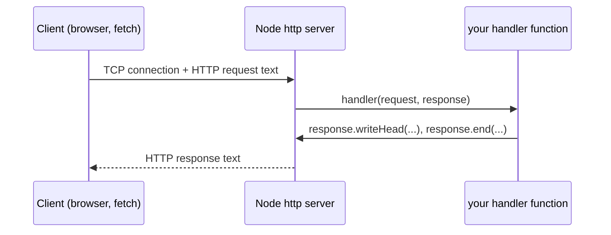
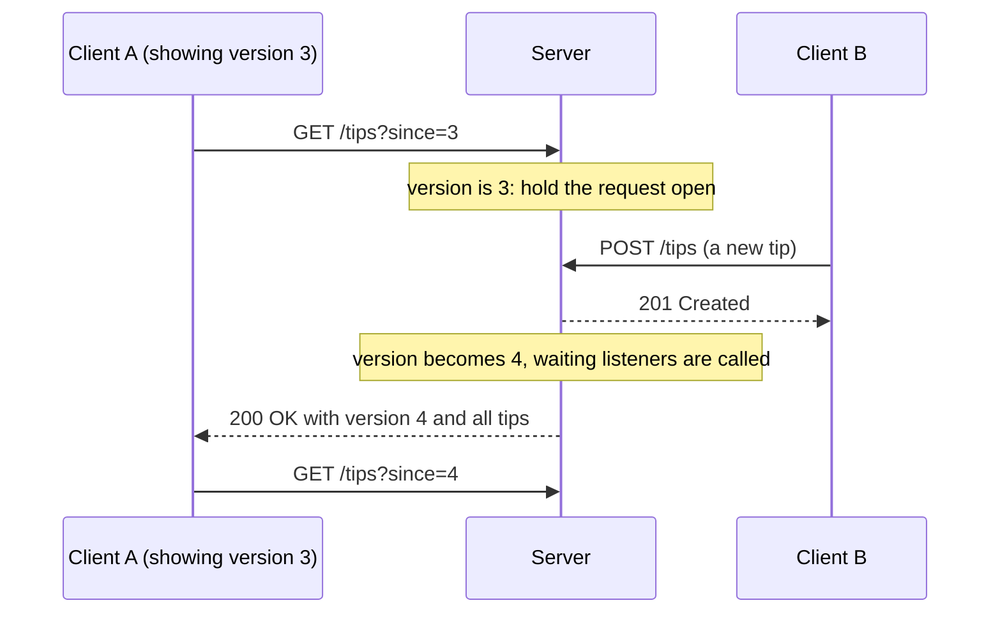

# Node HTTP servers and a tip-sharing project

## In plain words

Every time you open a web page, a program somewhere receives your request and sends back a response. That program is a **server**. In this lesson we write one in Node.js, first in six lines, and then as a small but complete project: a service where people share handy tips ("sharpen knives on a whetstone") and vote for the ones they like.

Think of a server as the counter of a post office. Customers (browsers and other programs) come to the counter with slips of paper (requests). The clerk reads each slip, works out what is wanted ("the list of tips, please", "add this new tip", "delete tip 12"), does it, and hands back a reply. The clerk follows a rule book that says which kinds of slip exist and what to do for each. In server terms the rule book is the list of **routes**, and the set of slips a server understands is its **API** (application programming interface).

The design lesson of this project is the one that has run through this whole track: keep the *thinking* separate from the *plumbing*. The rule book will be a plain function that takes a description of a request and returns a description of a response, with no network anywhere in sight, so that it can be run and tested right on this page. A thin layer of Node code then connects that function to real HTTP.

Why it matters for a job: front-end developers call APIs all day, and knowing how the other side works makes you much better at it: you understand status codes, why a request was rejected, and what the server can and cannot trust. For full-stack roles, building a JSON API with routing, validation and proper error responses is the standard exercise.

> **Before this lesson:** you need HTTP methods, status codes and `fetch` ([HTTP, fetch, forms and client-side storage](#/lesson/javascript/http-fetch-forms)), Node basics and streams ([Node.js: modules, files, streams and npm](#/lesson/javascript/node-core)), custom errors ([Exceptions and error handling](#/lesson/javascript/exceptions)) and regular expressions with groups ([Regular expressions: patterns, sets, groups](#/lesson/javascript/regex-basics)).

> [!NOTE]
> Server code needs Node and cannot run inside this page, so it is shown as static listings; all of it was executed against a real Node server while this lesson was written. The request-handling core is ordinary JavaScript and *is* runnable here.

## The smallest server

```javascript
// file: hello-server.mjs        run with: node hello-server.mjs
import { createServer } from "node:http";

const server = createServer((request, response) => {
  response.writeHead(200, { "Content-Type": "text/plain; charset=utf-8" });
  response.end(`You asked for ${request.method} ${request.url}\n`);
});

server.listen(8000, () => console.log("Listening on http://localhost:8000"));
```

Run it and open `http://localhost:8000/any/path?x=1` in a browser. The page shows `You asked for GET /any/path?x=1`. What each part does:

- `createServer(handler)` builds a server. The handler function is called **once for every incoming request**, with two objects.
- `request` describes what the client sent: `request.method` (`"GET"`), `request.url` (the path and query string), `request.headers`, and the body, which is a readable stream.
- `response` is how you answer. `writeHead(status, headers)` sends the status code and headers; `end(text)` sends the body and finishes the response. A response that is never ended leaves the client waiting for ever.
- `listen(8000)` makes the server wait for connections on **port** 8000. A port is a numbered door on a computer; many programs can listen on one machine as long as each uses a different port. `localhost` is the name for "this same computer".

The program does not exit after the last line: a listening server keeps the event loop alive. Stop it with Ctrl+C in the terminal.



One handler for everything means the handler must look at the method and the path and decide what to do. That decision is called **routing**.

## Designing the API

Before writing code, decide what the service offers. Ours manages one kind of thing, a *tip*, which looks like this as JSON:

```json
{ "id": 1, "title": "Sharpen knives", "text": "Use a whetstone.", "author": "ana", "votes": 3 }
```

The operations follow the common **REST** conventions: a URL names a thing (a *resource*), and the HTTP method says what to do with it.

| Method and path | Meaning | Success status |
|---|---|---|
| `GET /tips` | list all tips | 200 |
| `GET /tips/7` | read one tip | 200 |
| `POST /tips` | create a tip from the JSON body | 201 Created |
| `POST /tips/7/votes` | add a vote to a tip | 200 |
| `DELETE /tips/7` | remove a tip | 204 No Content |

And the failures: 400 for a body that is missing fields, 404 for a tip or path that does not exist, 405 when the path exists but not with that method, 500 if our own code has a bug.

## The core: requests in, responses out

Here is the entire logic of the service. It imports nothing and knows nothing about HTTP connections. A request is a plain object `{ method, path, body }`; a response is a plain object `{ status, body, headers }`.

```js-run
class HttpError extends Error {
  constructor(status, message) {
    super(message);
    this.status = status;
  }
}

function createApp() {
  const tips = new Map();                    // id -> tip
  let nextId = 1;
  let version = 0;                           // goes up by one with every change
  const changeListeners = [];

  function changed() {
    version += 1;
    for (const listener of changeListeners.splice(0)) listener();    // call each waiting listener once
  }

  // ---- a tiny router: "/tips/:id" style patterns ----
  const routes = [];
  function route(method, pattern, handler) {
    const names = [];
    const source = pattern.replace(/:(\w+)/g, (whole, name) => { names.push(name); return "([^/]+)"; });
    routes.push({ method, regex: new RegExp("^" + source + "$"), names, handler });
  }

  function findTip(idText) {
    const tip = tips.get(Number(idText));
    if (!tip) throw new HttpError(404, "no tip with id " + idText);
    return tip;
  }

  // ---- the routes of the API ----
  route("GET", "/tips", () => ({ status: 200, body: { version, tips: [...tips.values()] } }));

  route("GET", "/tips/:id", ({ params }) => ({ status: 200, body: findTip(params.id) }));

  route("POST", "/tips", ({ body }) => {
    if (body === null || typeof body !== "object") throw new HttpError(400, "a JSON object is required");
    const { title, text, author = "anonymous" } = body;
    if (typeof title !== "string" || title.trim() === "") throw new HttpError(400, "title is required");
    if (typeof text !== "string" || text.trim() === "") throw new HttpError(400, "text is required");
    if (title.length > 80) throw new HttpError(400, "title is too long (80 characters at most)");
    const tip = { id: nextId++, title: title.trim(), text: text.trim(), author: String(author), votes: 0 };
    tips.set(tip.id, tip);
    changed();
    return { status: 201, body: tip, headers: { Location: "/tips/" + tip.id } };
  });

  route("POST", "/tips/:id/votes", ({ params }) => {
    const tip = findTip(params.id);
    const updated = { ...tip, votes: tip.votes + 1 };
    tips.set(tip.id, updated);
    changed();
    return { status: 200, body: updated };
  });

  route("DELETE", "/tips/:id", ({ params }) => {
    tips.delete(findTip(params.id).id);
    changed();
    return { status: 204 };
  });

  // ---- request in, response out: no network involved ----
  function handle({ method, path, body = null }) {
    const matching = routes
      .map((r) => ({ route: r, match: r.regex.exec(path) }))
      .filter((entry) => entry.match !== null);
    if (matching.length === 0) return { status: 404, body: { error: "not found: " + path } };

    const entry = matching.find((candidate) => candidate.route.method === method);
    if (!entry) {
      const allowed = matching.map((candidate) => candidate.route.method).join(", ");
      return { status: 405, body: { error: "method not allowed" }, headers: { Allow: allowed } };
    }

    const params = {};
    entry.route.names.forEach((name, i) => { params[name] = decodeURIComponent(entry.match[i + 1]); });
    try {
      return entry.route.handler({ params, body });
    } catch (error) {
      if (error instanceof HttpError) return { status: error.status, body: { error: error.message } };
      return { status: 500, body: { error: "internal server error" } };     // never leak details of a bug
    }
  }

  return {
    handle,
    get version() { return version; },
    onNextChange(listener) { changeListeners.push(listener); },
  };
}

// ---- try it: no server needed ----
const app = createApp();
const show = (request) => {
  const response = app.handle(request);
  console.log(request.method.padEnd(6), request.path.padEnd(16), "->", response.status, JSON.stringify(response.body ?? ""), response.headers ? JSON.stringify(response.headers) : "");
};

show({ method: "GET", path: "/tips" });
show({ method: "POST", path: "/tips", body: { title: "Sharpen knives", text: "Use a whetstone.", author: "ana" } });
show({ method: "POST", path: "/tips", body: { title: "  Label your leftovers ", text: "With the date." } });
show({ method: "POST", path: "/tips", body: { title: "", text: "nothing" } });
show({ method: "POST", path: "/tips", body: null });
show({ method: "POST", path: "/tips/1/votes" });
show({ method: "POST", path: "/tips/1/votes" });
show({ method: "GET", path: "/tips/1" });
show({ method: "GET", path: "/tips/99" });
show({ method: "PUT", path: "/tips/1" });
show({ method: "GET", path: "/recipes" });
show({ method: "DELETE", path: "/tips/2" });
show({ method: "GET", path: "/tips" });
```

Run it and read the output as a conversation between a client and the service. Then study the code in four pieces.

### State

`createApp` is a factory function. Each call creates a separate application with its own private data, held in closures: the `Map` of tips, the next id to hand out, and a `version` counter that increases with every change (it becomes useful at the end of the lesson). Because nothing is global, a test can create a fresh app whenever it likes.

### The router

`route(method, pattern, handler)` registers one line of the rule book. The pattern is a path in which a colon marks a variable part: `"/tips/:id"`. To match real paths, the pattern is converted into a regular expression. The `replace` call finds each `:name`, remembers the name, and substitutes the group `([^/]+)`, meaning "one or more characters other than a slash". So `"/tips/:id/votes"` becomes the expression `^/tips/([^/]+)/votes$` with the name list `["id"]`.

### The handlers

Each handler receives `{ params, body }` and returns a response description. They are short because two helpers carry the load:

- `findTip` either returns the tip or **throws** an `HttpError` with status 404. Handlers can therefore be written as if the tip always exists.
- The `POST /tips` handler validates the body field by field and throws `HttpError(400, ...)` with a message that tells the client what to fix. Only then does it build the tip, taking only the fields it expects (extra properties sent by the client are ignored), trimming the texts and setting `votes` to 0 itself.

The vote handler creates an updated copy of the tip and stores it, in the immutable style used throughout this track.

### `handle`

This function is the clerk at the counter:

1. Collect all routes whose pattern matches the **path**. If there are none: 404.
2. Among those, look for one with the right **method**. If there is none, the path is valid and the method is not: 405, with an `Allow` header listing the methods that would work.
3. Build the `params` object from the captured groups (decoding percent-encoded characters).
4. Call the handler inside `try`/`catch`. A thrown `HttpError` becomes a response with its status and message. **Any other error** is a bug in our code; the client receives a bland 500 and no details.

> [!WARNING]
> Never send internal error messages or stack traces to clients. They reveal file paths, library versions and logic that help an attacker. Log the details on the server; send the client a generic message.

## Connecting the core to HTTP

Now the plumbing. This file is the only place that knows about Node's `http` module. It translates a real request into the plain object our core expects, and the core's answer back into a real response.

```javascript
// file: server.mjs
import { createServer } from "node:http";
import { createApp } from "./app.mjs";         // the core shown above, with "export" in front of createApp

const app = createApp();
const MAX_BODY = 20_000;                          // bytes

async function readJsonBody(request) {
  let text = "";
  for await (const chunk of request) {            // the request body is a readable stream
    text += chunk;
    if (text.length > MAX_BODY) return { tooLarge: true };
  }
  if (text === "") return { value: null };
  try {
    return { value: JSON.parse(text) };
  } catch {
    return { invalid: true };
  }
}

function send(response, { status, body, headers = {} }) {
  const payload = body === undefined ? "" : JSON.stringify(body);
  response.writeHead(status, {
    "Content-Type": "application/json; charset=utf-8",
    "Content-Length": Buffer.byteLength(payload),
    ...headers,
  });
  response.end(payload);
}

const server = createServer(async (request, response) => {
  const url = new URL(request.url, "http://localhost");
  console.log(request.method, url.pathname);

  // long polling: GET /tips?since=3&wait=25 answers only when the version is newer than 3 (or after 25 s)
  if (request.method === "GET" && url.pathname === "/tips" && url.searchParams.has("since")) {
    const since = Number(url.searchParams.get("since"));
    const maxWait = Math.min(Number(url.searchParams.get("wait") ?? 25), 60) * 1000;
    if (app.version === since) {
      const timer = setTimeout(() => send(response, { status: 304 }), maxWait);
      app.onNextChange(() => {
        clearTimeout(timer);
        if (!response.writableEnded) send(response, app.handle({ method: "GET", path: "/tips" }));
      });
      return;
    }
  }

  const parsed = await readJsonBody(request);
  if (parsed.tooLarge) return send(response, { status: 413, body: { error: "request body too large" } });
  if (parsed.invalid) return send(response, { status: 400, body: { error: "body is not valid JSON" } });
  send(response, app.handle({ method: request.method, path: url.pathname, body: parsed.value }));
});

const port = Number(process.env.PORT ?? 8000);
server.listen(port, () => console.log(`Tip server listening on http://localhost:${port}`));
```

### Reading the request body

The body of a request arrives as a stream of chunks, exactly like a file read through a stream in the previous lesson. `readJsonBody` gathers the chunks into a string with `for await`, then parses the JSON. Two defensive measures are essential in any real server:

- **A size limit.** Without one, a client can send gigabytes and exhaust the server's memory. Past the limit we answer 413 (Content Too Large).
- **A `try`/`catch` around `JSON.parse`.** A malformed body is the client's mistake (400), not a crash.

### Sending the response

`send` serialises the body, sets the `Content-Type` so that clients know it is JSON, sets `Content-Length` (computed with `Buffer.byteLength`, because the length is in bytes and some characters take several), merges in any extra headers such as `Location`, and ends the response.

### The request handler

The handler builds a `URL` object from `request.url` to separate the path from the query string, logs the request, reads the body, and passes `{ method, path, body }` to `app.handle`. Everything interesting has already been tested without a network.

Trying it from a terminal with `curl`, a command-line HTTP client:

```text
$ curl -i -X POST localhost:8000/tips -d '{"title":"Sharpen knives","text":"Use a whetstone."}'
HTTP/1.1 201 Created
Content-Type: application/json; charset=utf-8
Location: /tips/1

{"id":1,"title":"Sharpen knives","text":"Use a whetstone.","author":"anonymous","votes":0}

$ curl -i -X PUT localhost:8000/tips/1
HTTP/1.1 405 Method Not Allowed
Allow: GET, DELETE

{"error":"method not allowed"}
```

## Getting updates to the browser: long polling

A page showing the tips should update when *someone else* adds one. HTTP only lets the client start a conversation; the server cannot call the browser. Three common solutions exist:

| Technique | How it works | Trade-off |
|---|---|---|
| polling | the client asks again every few seconds | simple; wasteful and always a little late |
| **long polling** | the client asks, and the server *holds the request open* until there is news | timely, works everywhere; one open request per client |
| WebSockets / server-sent events | a connection that stays open for messages in either or one direction | most efficient; more moving parts |

Our server implements long polling with the `version` counter. A client that has version 3 requests `GET /tips?since=3`. If the server's version is already higher, it answers at once. If it is still 3, the server does **not** answer; it parks the request by registering a listener with `app.onNextChange`. When any change happens, `changed()` calls the listener, which finally sends the current list. If nothing happens for 25 seconds, a timer answers `304 Not Modified`, and the client asks again. This is the block near the top of the request handler above.



The matching client code is a loop:

```javascript
// in the page's script
async function watchTips(render) {
  let version = -1;
  for (;;) {
    try {
      const response = await fetch(`/tips?since=${version}&wait=25`);
      if (response.status === 304) continue;                 // nothing new: ask again
      if (!response.ok) throw new Error("HTTP " + response.status);
      const data = await response.json();
      version = data.version;
      render(data.tips);                                     // redraw the list from the data
    } catch (error) {
      console.error("connection problem, retrying in 3 s", error);
      await new Promise((resolve) => setTimeout(resolve, 3000));
    }
  }
}
```

## Serving the page itself

A complete application also has to deliver its HTML, CSS and JavaScript files. A server can map URL paths to files in a folder. The crucial point is security: a request for `/../../etc/passwd` must not escape that folder. Resolve the requested path against the folder and verify that the result is still inside it.

```javascript
import { createReadStream } from "node:fs";
import { stat } from "node:fs/promises";
import path from "node:path";

const PUBLIC = path.resolve("public");
const TYPES = { ".html": "text/html; charset=utf-8", ".js": "text/javascript", ".css": "text/css", ".png": "image/png" };

async function serveFile(urlPath, response) {
  const file = path.resolve(PUBLIC, "." + decodeURIComponent(urlPath === "/" ? "/index.html" : urlPath));
  if (file !== PUBLIC && !file.startsWith(PUBLIC + path.sep)) {       // tried to leave the public folder
    response.writeHead(403).end("Forbidden");
    return;
  }
  try {
    const info = await stat(file);
    if (!info.isFile()) throw new Error("not a file");
    response.writeHead(200, { "Content-Type": TYPES[path.extname(file)] ?? "application/octet-stream", "Content-Length": info.size });
    createReadStream(file).pipe(response);                            // stream the file to the client
  } catch {
    response.writeHead(404).end("Not found");
  }
}
```

The file is streamed with `pipe`, so even a large file never has to fit in memory.

## From exercise to production

Our server keeps its data in memory: restart it and the tips are gone. Real services need more. A checklist of what frameworks and infrastructure add:

- **Persistence.** Store data in a database (PostgreSQL, SQLite, MongoDB). For a toy, writing the tips to a JSON file after each change is enough.
- **A framework.** Express, Fastify or Hono provide routing, body parsing and middleware so that you do not write them by hand. Having built a router yourself, you will recognise everything they do.
- **Validation of all input**, as we did, usually with a schema library.
- **Authentication and authorisation.** Who is this client, and may they delete that tip?
- **Rate limiting**, so that one client cannot flood the service.
- **HTTPS**, normally provided by a proxy or hosting platform in front of Node.
- **Configuration through environment variables**, as with `PORT` above.
- **Logging and monitoring**, so that you learn about failures before your users tell you.

> [!TIP]
> Keep the shape of this project when you move to a framework: route handlers that parse and validate input, call plain functions containing the real logic, and translate the result into a response. Logic that never touches `request` and `response` objects can be tested without starting a server.

> [!INTERVIEW]
> Expect questions such as: "Walk me through what happens when a POST request reaches your server" (routing, body parsing as a stream with a size limit, validation, state change, status code and headers). "What status code for a missing resource, bad input, wrong method, or a server bug?" (404, 400, 405, 500). "What makes an API RESTful?" (resources named by URLs, standard methods with their usual meanings, status codes, statelessness). "How can a server push updates to browsers?" (polling, long polling, server-sent events, WebSockets, with trade-offs). "How do you prevent path traversal when serving files?" "Why should logic be separated from the HTTP layer?" (testability and reuse).

## Common pitfalls

1. **Forgetting `response.end()`.** The client waits until it times out.
2. **Writing headers after the body has started.** Node throws "headers already sent"; decide status and headers first.
3. **Reading the body without a size limit.** An easy denial-of-service hole.
4. **Trusting the body's shape.** Validate types and required fields; ignore unexpected properties.
5. **Returning 200 for everything.** Clients rely on status codes to tell success from failure.
6. **Leaking error details in 500 responses.**
7. **Blocking the event loop in a handler** (synchronous file access, heavy computation): every other client waits.
8. **Serving files from a path built directly from the URL.** Normalise and check that the result stays inside the public folder.
9. **Keeping important data only in memory.** It disappears on restart.

## Summary

- `http.createServer` calls a handler for every request with a `request` (method, URL, headers, body stream) and a `response` (`writeHead`, `end`); `listen(port)` starts it.
- An API is designed as resources (URLs) and methods, with precise status codes for success and for each kind of failure.
- Routing selects a handler by path pattern and method; patterns with `:name` parts can be compiled to regular expressions.
- The project's core is a pure function from a request description to a response description, with validation by throwing `HttpError` and a catch-all that turns unexpected errors into a 500.
- A thin adapter reads the body stream with a size limit, parses JSON safely, calls the core and writes the response.
- Long polling holds a request open until data changes, giving near-instant updates over plain HTTP.
- Static files must be served with path-traversal protection; production services add persistence, authentication, rate limiting, HTTPS and logging.

## Glossary

- **Server**: a program that waits for requests and answers them.
- **Port**: a number identifying one listening program on a computer.
- **`localhost`**: the network name of the computer itself.
- **Request handler**: the function a server calls for each incoming request.
- **Routing**: choosing the code to run from the method and path of a request.
- **Route**: one entry of the routing table: a method, a path pattern and a handler.
- **Path parameter**: a variable part of a path, such as the `7` in `/tips/7`.
- **API**: the set of requests a service accepts and the responses it gives.
- **REST**: a style of API design based on resources, standard HTTP methods and status codes.
- **Resource**: a thing the API exposes, identified by a URL.
- **Validation**: checking that incoming data has the required shape and values.
- **Adapter**: a thin layer that translates between two interfaces, here between Node's HTTP objects and plain data.
- **Polling / long polling**: asking repeatedly at intervals / asking once and having the server wait to answer until there is news.
- **Path traversal**: an attack that uses `..` in a path to reach files outside the intended folder.
- **Persistence**: keeping data so that it survives a restart.
- **Middleware**: in server frameworks, functions that process a request on its way to the handler.

## Check yourself

```quiz
[
  {"q": "In a Node HTTP server, how often is the function passed to `createServer` called?", "options": ["Once, when the server starts", "Once for every incoming request", "Once per connected client", "Once per second"], "answer": 1,
   "explain": "The function is the request handler. Node calls it with fresh request and response objects each time a request arrives."},
  {"q": "A client sends `PUT /tips/3`, and the API defines only GET and DELETE for that path. Which status code is appropriate?", "options": ["404 Not Found", "400 Bad Request", "405 Method Not Allowed", "500 Internal Server Error"], "answer": 2,
   "explain": "The resource exists but does not support that method. 405 is sent together with an Allow header listing the supported methods."},
  {"q": "Why does the core of the project take plain objects instead of Node's request and response objects?", "options": ["Node objects are too slow", "So that the logic can be run and tested without any network or server", "Because JSON cannot be parsed otherwise", "To support older browsers"], "answer": 1,
   "explain": "A function from a request description to a response description is easy to call directly, as the runnable example shows."},
  {"q": "What does the pattern `/tips/:id/votes` become when the router compiles it?", "options": ["A string comparison with the literal text", "A regular expression in which :id is replaced by a group matching one path segment", "A list of all possible ids", "A function that always returns true"], "answer": 1,
   "explain": "Each :name is replaced by ([^/]+), and the name is remembered so that the captured text can be stored under params.id."},
  {"q": "Why must `readJsonBody` enforce a maximum body size?", "options": ["JSON.parse fails on long strings", "Otherwise a client could exhaust the server's memory by sending an enormous body", "HTTP forbids bodies above 20 kilobytes", "To make responses faster"], "answer": 1,
   "explain": "The body is accumulated in memory. An unbounded body is a simple denial-of-service attack."},
  {"q": "A handler throws an unexpected TypeError because of a programming mistake. What should the client receive?", "options": ["The stack trace, to help debugging", "Status 200 with an empty body", "Status 500 with a generic message, while details are logged on the server", "Nothing; the connection should stay open"], "answer": 2,
   "explain": "Internal details can help attackers and are useless to clients. The server records them privately."},
  {"q": "How does long polling deliver updates promptly?", "options": ["The server opens a connection to the browser", "The client's request is left unanswered until something changes, and the client immediately asks again after each answer", "The client asks every 100 milliseconds", "The browser reloads the page"], "answer": 1,
   "explain": "The server holds the pending request and responds the moment there is news (or after a timeout)."},
  {"q": "A static file server builds the file name as `publicFolder + request.url`. What is the danger?", "options": ["Files load slowly", "A URL containing ../ sequences can reach files outside the public folder", "Only HTML files can be served", "The server cannot set a content type"], "answer": 1,
   "explain": "This is path traversal. Resolve the path and verify that the result is still inside the intended folder before reading it."}
]
```

> **Source:** Haverbeke, *Eloquent JavaScript* (4th ed.), ch. 20 "Node.js" (the HTTP module, a file server) and ch. 21 "Project: Skill-Sharing Website" (design, long polling, HTTP interface, the server, the client); the tip-sharing service, its router and all code are original to this guide. Facts checked against the Node.js documentation: https://nodejs.org/api/http.html ; and MDN: https://developer.mozilla.org/en-US/docs/Web/HTTP/Status , https://developer.mozilla.org/en-US/docs/Web/HTTP/Methods , https://developer.mozilla.org/en-US/docs/Glossary/REST
