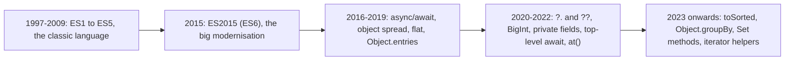

# Modern JavaScript: ES2015 and beyond

## In plain words

Languages change. English from 1900 is perfectly readable today, but nobody then said "email" or "to google". JavaScript is the same: the language of 2010 still runs, yet modern code is full of words and constructions that did not exist then, and a newcomer reading a current code base meets all of them at once.

The big turning point was 2015. That year's edition of the language standard, known as **ES2015** or **ES6**, added more features than all previous editions together: `let` and `const`, arrow functions, classes, modules, promises, template literals, destructuring. Since then a smaller batch has arrived every year (ES2016, ES2017 and so on).

You have already met most of the important features in this track, each in its natural place. This lesson is the map that puts them side by side: what was added, why, and how the old and new ways compare. Think of it as a phrase book for modern JavaScript. It also fills the gaps with features that did not fit earlier: optional chaining and its relatives in full, `Map` and `Set` companions, the non-mutating array methods, and the `Intl` formatting tools.

Why it matters for a job: you will read code written anywhere between 2012 and today, often in the same file. Recognising which idiom replaces which makes old code readable and your own code current. "What is new in ES6?" and "what is the difference between `??` and `||`?" are standard interview warm-ups.

> **Before this lesson:** this is a consolidation lesson. It assumes the language part of the track, especially [Functions and scope](#/lesson/javascript/functions-scope), [Destructuring, spread, rest and JSON](#/lesson/javascript/destructuring-json), [Prototypes, classes and encapsulation](#/lesson/javascript/prototypes-classes), [ES modules and CommonJS](#/lesson/javascript/es-modules-commonjs) and [Async functions and generators](#/lesson/javascript/async-await-generators).

## How the language evolves

JavaScript is standardised under the name **ECMAScript** (hence "ES") by a committee called TC39, in which browser makers and other companies take part. A proposed feature moves through numbered stages, from idea to finished; once finished and implemented in browsers, it is included in the next yearly edition.



Two practical consequences. First, features arrive in browsers gradually; sites such as MDN and "Can I use" show which browser versions support what. Second, projects that must support old browsers run their code through a **transpiler** (Babel, TypeScript, esbuild) that rewrites new syntax into older syntax, and add **polyfills**, pieces of code that supply missing built-in functions.

## The phrase book: old way and new way

### Declaring variables

```js-run
// before 2015
var total = 0;
for (var i = 0; i < 3; i++) { total += i; }
console.log(total, i);                 // i leaked out of the loop

// today
const prices = [4, 8, 15];             // const: the binding never changes
let sum = 0;                           // let: the binding will change
for (const price of prices) sum += price;
console.log(sum, typeof price);        // price does not exist out here
```

`let` and `const` are block-scoped and cannot be used before their declaration; `var` is function-scoped and silently `undefined` before it. The interview lesson examines the "temporal dead zone" behind that difference.

### Functions

```js-run
// before
var double = function (n) { return n * 2; };
function greetOld(name) {
  name = name || "stranger";                       // manual default (breaks for "" and 0)
  var rest = Array.prototype.slice.call(arguments, 1);
  return "Hello " + name + " and " + rest.length + " others";
}

// today
const triple = (n) => n * 3;                       // arrow function
function greet(name = "stranger", ...others) {     // default value and rest parameter
  return `Hello ${name} and ${others.length} others`;   // template literal
}

console.log(double(4), triple(4));
console.log(greetOld(), "|", greet(), "|", greet("Ada", "Bo", "Cy"));
```

### Objects and arrays

```js-run
const name = "Miso", age = 3, field = "colour";

// before
var catOld = { name: name, age: age, speak: function () { return this.name + " says meow"; } };
catOld[field] = "grey";
var copyOld = Object.assign({}, catOld, { age: 4 });
var firstOld = [10, 20, 30][0];

// today
const cat = {
  name, age,                                        // shorthand properties
  [field]: "grey",                                  // computed property name
  speak() { return `${this.name} says meow`; },     // method shorthand
};
const older = { ...cat, age: 4 };                   // object spread
const [first, ...remaining] = [10, 20, 30];         // array destructuring with rest
const { name: catName, colour = "unknown" } = cat;  // object destructuring, rename and default

console.log(catOld.speak(), copyOld.age, firstOld);
console.log(cat.speak(), older.age, first, remaining, catName, colour);
```

### Classes and modules

Before 2015, "classes" were constructor functions with methods assigned to `prototype`, and "modules" were IIFEs or CommonJS. The `class` syntax and the `import`/`export` keywords replaced both patterns; see the lessons on prototypes and on modules for the full story.

```js-run
class Temperature {
  #celsius;                                   // private field (ES2022)
  static freezing = new Temperature(0);       // static field
  constructor(celsius) { this.#celsius = celsius; }
  get fahrenheit() { return this.#celsius * 9 / 5 + 32; }
  toString() { return `${this.#celsius} C`; }
}
console.log(`${Temperature.freezing} is ${Temperature.freezing.fahrenheit} F`);
console.log(`${new Temperature(37)} is ${new Temperature(37).fahrenheit.toFixed(1)} F`);
```

### Asynchronous code

Callbacks gave way to promises (2015), and promise chains to `async`/`await` (2017):

```javascript
// callbacks
loadUser(id, function (error, user) {
  if (error) return handle(error);
  loadOrders(user, function (error, orders) { /* ... */ });
});

// promises
loadUser(id).then((user) => loadOrders(user)).then(show).catch(handle);

// async / await
try {
  const user = await loadUser(id);
  show(await loadOrders(user));
} catch (error) {
  handle(error);
}
```

## Safe navigation: `?.`, `??` and friends

These operators, added in 2020 and 2021, changed everyday code more than almost anything since ES2015, so they get a detailed treatment.

### The problem

Data from servers is nested and often incomplete. Reading a property of `undefined` or `null` throws a `TypeError`. The traditional defence was a chain of `&&`:

```js-run
const order = { id: 7, customer: { name: "Rui", address: null } };

// before: check every step by hand
const cityOld = order && order.customer && order.customer.address && order.customer.address.city;
console.log(String(cityOld));
```

### Optional chaining `?.`

`a?.b` means: if `a` is `null` or `undefined`, stop and produce `undefined`; otherwise read `a.b`. Once a link "short-circuits", the entire rest of the chain is skipped.

```js-run
const order = { id: 7, customer: { name: "Rui", address: null }, items: [{ sku: "A1" }], note() { return "fragile"; } };

console.log(String(order.customer?.address?.city));     // property access
console.log(String(order.items?.[0]?.sku), String(order.items?.[5]?.sku));   // index access: ?.[ ]
console.log(String(order.note?.()), String(order.print?.()));                // call if the method exists: ?.( )
console.log(String(order.coupon?.code.toUpperCase()));  // coupon is missing: the whole rest is skipped

const missing = null;
console.log(String(missing?.anything.at.all));
```

Three forms exist: `obj?.prop`, `obj?.[expression]` and `fn?.(arguments)`.

> [!WARNING]
> Use `?.` where absence is *expected*, not everywhere. Writing `user?.profile?.name` when `user` must always exist hides a bug: the page shows a blank instead of failing where the real problem is. An optional chain is a statement that "missing is fine here".

### Nullish coalescing `??`

`a ?? b` yields `a` unless `a` is `null` or `undefined`, in which case it yields `b`. Compare with `||`, which also falls back on `0`, `""`, `false` and `NaN`:

```js-run
const settings = { volume: 0, nickname: "", notifications: false, theme: null };

console.log(settings.volume || 50, settings.volume ?? 50);
console.log(JSON.stringify(settings.nickname || "guest"), JSON.stringify(settings.nickname ?? "guest"));
console.log(settings.notifications || true, settings.notifications ?? true);
console.log(settings.theme ?? "light", settings.fontSize ?? 14);

console.log(settings.account?.plan ?? "free");     // the classic pair: optional chain plus default
```

### Logical assignment

Three operators combine a logical test with assignment. Each assigns only when needed:

| Operator | Assigns when the left side is | Typical use |
|---|---|---|
| `a ??= b` | `null` or `undefined` | set a default once |
| `a \|\|= b` | falsy | replace empty values |
| `a &&= b` | truthy | transform a value only if present |

```js-run
const options = { retries: 0, label: "" };
options.retries ??= 3;          // stays 0: zero is a real value
options.timeout ??= 5000;       // was missing: now 5000
options.label ||= "untitled";   // empty string is falsy: replaced
console.log(options);

const counts = {};
for (const word of ["tea", "milk", "tea"]) {
  counts[word] ??= 0;           // create the counter the first time
  counts[word] += 1;
}
console.log(counts);
```

## Newer built-in helpers

### Strings

```js-run
console.log("7".padStart(3, "0"), "abc".padEnd(6, ".") + "|");
console.log("a-b-c".replaceAll("-", "+"), "  trim me  ".trimStart() + "|");
console.log("JavaScript".includes("Script"), "report.pdf".endsWith(".pdf"), "abc".at(-1));
console.log("ha".repeat(3));
```

### Arrays

Negative indexing with `at`, searching from the end, flattening, and a family of methods that return a **changed copy** instead of mutating:

```js-run
const scores = [40, 10, 30, 20];

console.log(scores.at(-1), scores.includes(30), scores.findLast((n) => n > 25));
console.log([1, [2, [3, [4]]]].flat(2), ["a b", "c"].flatMap((s) => s.split(" ")));

console.log(scores.toSorted((a, b) => a - b));   // sorted copy
console.log(scores.toReversed());                // reversed copy
console.log(scores.with(1, 99));                 // copy with one element replaced
console.log(scores.toSpliced(1, 2));             // copy with two elements removed
console.log(scores);                             // the original is unchanged

console.log(Array.from({ length: 4 }, (_, i) => i * i));
console.log(Array.from("héllo"), Array.of(7, 8));
```

`toSorted`, `toReversed`, `with` and `toSpliced` (2023) are the immutable counterparts of `sort`, `reverse`, index assignment and `splice`.

### Objects

```js-run
const prices = { tea: 3, cake: 5, soup: 4 };

console.log(Object.entries(prices));
const doubled = Object.fromEntries(Object.entries(prices).map(([item, price]) => [item, price * 2]));
console.log(doubled);
console.log(Object.hasOwn(prices, "tea"), Object.hasOwn(prices, "toString"));

const people = [{ name: "Ana", team: "red" }, { name: "Bo", team: "blue" }, { name: "Cy", team: "red" }];
const byTeam = Object.groupBy(people, (person) => person.team);
console.log(Object.keys(byTeam), byTeam.red.map((p) => p.name));

console.log(structuredClone({ when: new Date(0), nested: { list: [1, 2] } }).nested.list);
```

`Object.entries` and `Object.fromEntries` are inverses, which makes "transform an object" a three-step pipeline: to pairs, map, back to an object. `Object.groupBy` (2024) does in one call what took a `reduce` before.

### `Map`, `Set` and their weak cousins

`Map` and `Set` were introduced in the lesson on prototypes. Their "weak" variants solve a memory problem. A `WeakMap` uses objects as keys **without keeping them alive**: when nothing else refers to a key object, the entry disappears and the memory can be reclaimed. That makes it the right tool for attaching extra data to objects you do not own.

```js-run
const unique = new Set([3, 1, 3, 2, 1]);
console.log([...unique], unique.has(2), unique.size);
console.log([...new Set("mississippi")].join(""));

const visits = new Map([["home", 3]]);
visits.set("about", (visits.get("about") ?? 0) + 1);
console.log([...visits]);

const metadata = new WeakMap();                 // keys must be objects
let button = { label: "Save" };                 // imagine a DOM element
metadata.set(button, { clicks: 0 });
metadata.get(button).clicks += 1;
console.log(metadata.get(button).clicks, metadata.has(button));
button = null;                                  // the entry can now be garbage-collected
```

### Numbers

```js-run
console.log(2 ** 10, 1_000_000 + 1);
console.log(Number.isInteger(5.0), Number.isSafeInteger(2 ** 53), Number.parseFloat("3.14abc"));
console.log(String(2n ** 64n), typeof 10n);
console.log(Math.trunc(-4.7), Math.sign(-3), Math.hypot(3, 4));
```

### Template literals, in depth

A template literal can be prefixed with a function name. The function, called a **tag**, receives the literal's fixed text pieces and the interpolated values separately and can combine them however it likes. Tags are used for escaping (safe HTML or SQL), translation and styling libraries.

```js-run
function safeHtml(strings, ...values) {
  const escape = (value) => String(value).replace(/[&<>"']/g, (ch) => `&#${ch.charCodeAt(0)};`);
  return strings.reduce((result, text, i) => result + text + (i < values.length ? escape(values[i]) : ""), "");
}

const comment = '';
console.log(safeHtml`<p>${comment}</p>`);
console.log(String.raw`C:\new\table`);          // a built-in tag: backslashes are kept as written
```

`safeHtml` receives `["<p>", "</p>"]` and the value list `[comment]`. It escapes each value before joining, so the markup written by the programmer stays markup and the data stays text.

## Formatting for humans: `Intl`

Displaying numbers, money and dates correctly for a user's language is hard. The built-in `Intl` objects do it for every locale:

```js-run
const amount = 1234567.891;
console.log(new Intl.NumberFormat("en-US").format(amount));
console.log(new Intl.NumberFormat("de-DE").format(amount));
console.log(new Intl.NumberFormat("en-GB", { style: "currency", currency: "GBP" }).format(amount));
console.log(new Intl.NumberFormat("en", { notation: "compact" }).format(amount));
console.log(new Intl.NumberFormat("en", { style: "percent", maximumFractionDigits: 1 }).format(0.4567));

const date = new Date(Date.UTC(2030, 6, 15, 9, 30));
console.log(new Intl.DateTimeFormat("en-GB", { dateStyle: "long", timeZone: "UTC" }).format(date));
console.log(new Intl.DateTimeFormat("fr-FR", { weekday: "long", day: "numeric", month: "long", timeZone: "UTC" }).format(date));

const relative = new Intl.RelativeTimeFormat("en", { numeric: "auto" });
console.log(relative.format(-1, "day"), "|", relative.format(3, "week"));
console.log(new Intl.ListFormat("en", { type: "conjunction" }).format(["tea", "milk", "sugar"]));
console.log(new Intl.PluralRules("en").select(1), new Intl.PluralRules("en").select(5));
```

> [!TIP]
> Never format currency or dates by hand with string concatenation. Thousands separators, decimal commas, the position of the currency symbol and the order of day and month differ between countries. `Intl` already knows all of them.

## A feature timeline

| Edition | Highlights |
|---|---|
| ES2015 | `let`/`const`, arrow functions, classes, modules, promises, template literals, destructuring, default/rest/spread, `Map`/`Set`, symbols, iterators, generators, `for...of` |
| ES2016 | `**`, `Array.prototype.includes` |
| ES2017 | `async`/`await`, `Object.entries`/`values`, `padStart`/`padEnd` |
| ES2018 | object rest/spread, `Promise.prototype.finally`, async iteration, named regex groups, look-behind |
| ES2019 | `flat`/`flatMap`, `Object.fromEntries`, `trimStart`/`trimEnd`, optional `catch` binding |
| ES2020 | `?.`, `??`, `BigInt`, `Promise.allSettled`, dynamic `import()`, `globalThis`, `matchAll` |
| ES2021 | `??=` `\|\|=` `&&=`, `replaceAll`, `Promise.any`, numeric separators |
| ES2022 | private `#fields`, static blocks, top-level `await`, `at()`, `Object.hasOwn`, `error.cause` |
| ES2023 | `toSorted`, `toReversed`, `with`, `toSpliced`, `findLast` |
| ES2024 and later | `Object.groupBy`, `Promise.withResolvers`, new `Set` methods (`union`, `intersection`), iterator helpers |

## Worked example: modernising a function

Here is a function in the style of 2012 and the same logic rewritten with current features. Both produce a summary of orders per customer.

```js-run
var orders = [
  { customer: { name: "Ana" }, items: [{ price: 12, qty: 2 }], coupon: { percent: 10 } },
  { customer: { name: "Bo" }, items: [{ price: 7, qty: 5 }, { price: 3, qty: 1 }] },
  { customer: null, items: [] },
];

// ----- 2012 style -----
function summariseOld(orders) {
  var lines = [];
  for (var i = 0; i < orders.length; i++) {
    var order = orders[i];
    var name = order.customer && order.customer.name ? order.customer.name : "guest";
    var total = 0;
    for (var j = 0; j < order.items.length; j++) {
      total += order.items[j].price * order.items[j].qty;
    }
    var percent = order.coupon && order.coupon.percent !== undefined ? order.coupon.percent : 0;
    total = total * (100 - percent) / 100;
    lines.push(name + ": " + total.toFixed(2) + " EUR");
  }
  return lines;
}

// ----- today -----
const money = new Intl.NumberFormat("en-IE", { style: "currency", currency: "EUR" });

const summarise = (orders) =>
  orders.map(({ customer, items, coupon }) => {
    const subtotal = items.reduce((sum, { price, qty }) => sum + price * qty, 0);
    const total = subtotal * (100 - (coupon?.percent ?? 0)) / 100;
    return `${customer?.name ?? "guest"}: ${money.format(total)}`;
  });

console.log(summariseOld(orders));
console.log(summarise(orders));
```

Count the improvements: `map` and `reduce` replace index loops; parameter destructuring names the parts of each order; `?.` and `??` replace hand-written existence checks; a template literal replaces concatenation; `Intl` replaces manual formatting. The new version is a third of the length and says what it means.

> [!INTERVIEW]
> Know the differences that are asked most: `var` versus `let`/`const` (scope, hoisting, redeclaration); arrow functions versus `function` (no own `this` or `arguments`, cannot be constructors); `??` versus `||` (nullish versus falsy); `?.` semantics (short-circuits the whole chain, yields `undefined`); `Map` versus object (any key type, order, size); `WeakMap` (keys held weakly, not iterable); spread versus rest (expanding versus collecting); and mutating versus copying array methods (`sort` versus `toSorted`).

## Common pitfalls

1. **Using `||` for defaults when `0`, `""` or `false` are valid.** Use `??`.
2. **Sprinkling `?.` everywhere.** It hides bugs where a value must exist.
3. **Forgetting that `?.` yields `undefined`, never `null`,** and that `a?.b.c` still throws if `a.b` is missing while `a` exists.
4. **Mixing `??` with `||` or `&&` without parentheses.** It is a syntax error.
5. **Assuming the newest methods exist everywhere.** Check browser support for very recent additions, or transpile and polyfill.
6. **Arrow functions as object methods or constructors.** They have no `this` of their own.
7. **Expecting `const` to make objects immutable.** It only fixes the binding.
8. **Confusing `Object.entries(map)` with `[...map]`.** `Object.entries` on a `Map` returns an empty array; a `Map` is iterated directly.

## Summary

- JavaScript is standardised as ECMAScript in yearly editions; ES2015 was the major modernisation, and tools transpile and polyfill new features for older environments.
- Modern replacements: `let`/`const` for `var`; arrow functions, defaults and rest for `function` tricks; template literals for concatenation; shorthand, computed keys, spread and destructuring for manual object work; classes and ES modules for prototype and IIFE patterns; `async`/`await` for callbacks.
- `?.` reads through possibly missing values and short-circuits to `undefined`; `??` supplies a default only for `null` and `undefined`; `??=`, `||=` and `&&=` assign conditionally.
- Newer helpers include `at`, `includes`, `flat`, `findLast`, the copying methods `toSorted`/`toReversed`/`with`, `Object.entries`/`fromEntries`/`groupBy`/`hasOwn`, `structuredClone`, `replaceAll` and `padStart`.
- `Map`, `Set`, `WeakMap` and `WeakSet` cover collections; tagged templates customise string construction; `Intl` formats numbers, dates, lists and plurals for any locale.

## Glossary

- **ECMAScript (ES)**: the official standard that defines the JavaScript language.
- **ES2015 / ES6**: the 2015 edition, which introduced most of what is called modern JavaScript.
- **TC39**: the committee that develops the standard.
- **Transpiler**: a tool that translates newer syntax into older syntax.
- **Polyfill**: code that adds a missing built-in function to an older environment.
- **Optional chaining**: the `?.` operator.
- **Nullish**: being `null` or `undefined`.
- **Nullish coalescing**: the `??` operator, which falls back only for nullish values.
- **Logical assignment**: the operators `??=`, `||=` and `&&=`.
- **Tagged template**: a template literal processed by a function placed in front of it.
- **`WeakMap` / `WeakSet`**: collections that do not prevent their object keys or members from being garbage-collected.
- **Garbage collection**: the automatic freeing of memory that is no longer reachable.
- **Locale**: a language and region setting, such as `en-GB`, that determines formatting conventions.
- **`Intl`**: the built-in namespace for locale-aware formatting and comparison.

## Check yourself

```quiz
[
  {"q": "What does this print?\n\n`const cfg = { timeout: 0 }; console.log(cfg.timeout || 30, cfg.timeout ?? 30);`", "options": ["0 0", "30 0", "30 30", "0 30"], "answer": 1,
   "explain": "|| falls back for any falsy value, including 0. ?? falls back only for null and undefined, so the real setting 0 is kept."},
  {"q": "What does this print?\n\n`const user = { profile: null }; console.log(user.profile?.name, user.settings?.theme.dark);`", "options": ["null undefined", "undefined undefined", "It throws a TypeError", "undefined null"], "answer": 1,
   "explain": "Each optional chain meets null or undefined and short-circuits to undefined. In the second, the rest of the chain (.theme.dark) is skipped entirely."},
  {"q": "What is the value of `x` after `let x = \"\"; x ??= \"default\";`?", "options": ["\"default\"", "\"\"", "undefined", "null"], "answer": 1,
   "explain": "??= assigns only when the left side is null or undefined. The empty string is neither, so x is unchanged. ||= would have replaced it."},
  {"q": "What does this print?\n\n`const a = [3, 1, 2]; const b = a.toSorted(); console.log(a, b);`", "options": ["[1, 2, 3] [1, 2, 3]", "[3, 1, 2] [1, 2, 3]", "[3, 1, 2] [3, 1, 2]", "It throws"], "answer": 1,
   "explain": "toSorted returns a sorted copy and leaves the original untouched, unlike sort, which reorders the array in place."},
  {"q": "Which statement about arrow functions is true?", "options": ["They have their own this", "They can be called with new", "They take this from the surrounding scope and have no arguments object", "They are hoisted like function declarations"], "answer": 2,
   "explain": "Arrow functions are lexically bound: this and arguments come from the enclosing function. They cannot be used as constructors."},
  {"q": "What does `Object.fromEntries(Object.entries({ a: 1, b: 2 }).map(([k, v]) => [k, v * 10]))` produce?", "options": ["[[\"a\", 10], [\"b\", 20]]", "{ a: 10, b: 20 }", "{ a: 1, b: 2 }", "[10, 20]"], "answer": 1,
   "explain": "entries turns the object into key/value pairs, map multiplies each value, and fromEntries builds an object from the new pairs."},
  {"q": "Why would you use a `WeakMap` to attach data to DOM elements?", "options": ["It is faster than Map for strings", "Entries vanish automatically when the element is no longer referenced elsewhere, avoiding a memory leak", "It can be iterated in order", "It accepts numbers as keys"], "answer": 1,
   "explain": "A WeakMap does not keep its keys alive. A regular Map would hold on to removed elements for ever."},
  {"q": "Which expression is a syntax error?", "options": ["a ?? (b || c)", "(a ?? b) || c", "a ?? b || c", "a?.b ?? c"], "answer": 2,
   "explain": "?? may not be combined directly with || or && without parentheses, because the intended grouping would be unclear."}
]
```

> **Source:** this lesson goes beyond the source book. It consolidates features introduced throughout Haverbeke, *Eloquent JavaScript* (4th ed.), ch. 1-11, and adds later additions to the language. Details checked against MDN: https://developer.mozilla.org/en-US/docs/Web/JavaScript/Reference/Operators/Optional_chaining , https://developer.mozilla.org/en-US/docs/Web/JavaScript/Reference/Operators/Nullish_coalescing , https://developer.mozilla.org/en-US/docs/Web/JavaScript/Reference/Global_Objects/Array/toSorted , https://developer.mozilla.org/en-US/docs/Web/JavaScript/Reference/Global_Objects/Object/groupBy , https://developer.mozilla.org/en-US/docs/Web/JavaScript/Reference/Global_Objects/Intl
