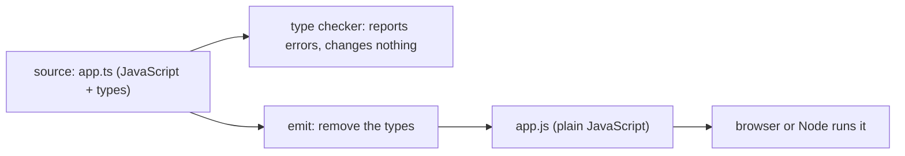

# TypeScript basics: types, interfaces, generics, narrowing

## In plain words

JavaScript lets you pass anything to anything. A function that expects a number will accept a string, an object or nothing at all, and you find out that something is wrong only when the program runs, sometimes weeks later, in front of a user.

**TypeScript** is JavaScript with labels. You write down what kind of value each variable, parameter and return value is supposed to be, for example "this is a number", "this is a list of users", "this may be missing". A tool called the **type checker** then reads your whole program *before it runs* and points out every place where the labels do not fit: a misspelled property name, a forgotten argument, a value that might be `undefined`.

A good comparison is the spell checker in a word processor. It does not write the text for you and it does not change what the text means; it underlines mistakes while you type, so that they never reach the reader. And like a spell checker, the labels are not part of the final product: before a TypeScript program runs, the labels are stripped away and plain JavaScript remains.

Why it matters for a job: most professional JavaScript projects are written in TypeScript today, including nearly all React, Angular and Node code bases started in recent years. Job advertisements list it next to JavaScript, and interviews include questions on interfaces, generics, union types and narrowing.

> **Before this lesson:** you need the JavaScript language part of this track, in particular objects and arrays ([Objects, arrays and mutability](#/lesson/javascript/objects-arrays)), functions ([Functions and scope](#/lesson/javascript/functions-scope)), classes ([Prototypes, classes and encapsulation](#/lesson/javascript/prototypes-classes)) and the modern operators `?.` and `??` ([Modern JavaScript: ES2015 and beyond](#/lesson/javascript/modern-javascript)).

> [!NOTE]
> TypeScript code must be checked and converted by the TypeScript tools, so the listings in this lesson are static. To experiment, use the official online playground at typescriptlang.org/play, which shows errors as you type. The few runnable panels below are plain JavaScript and demonstrate the run-time checks that TypeScript understands.

## What TypeScript is and is not

- It is a **superset** of JavaScript: every JavaScript program is also syntactically a TypeScript program, and you add types on top.
- Checking happens at **compile time**, the moment the code is processed by the tool, not while it runs. The technical term is *static* type checking.
- The output is ordinary JavaScript. Types are **erased**; nothing of them exists at run time.



Installing and running the compiler in a project:

```text
npm install -D typescript       add TypeScript as a development dependency
npx tsc --init                  create a tsconfig.json with settings
npx tsc                         check all files and write .js output
npx tsc --noEmit                check only
```

In practice your editor runs the checker continuously and underlines problems as you type, and build tools such as Vite strip the types for you.

## The first annotation

Here is a JavaScript function with a typical silent bug, followed by its TypeScript version.

```javascript
// JavaScript
function priceWithTax(price, rate) {
  return price * (1 + rate);
}
priceWithTax("20", 0.2);      // "20" * 1.2 happens to work: 24
priceWithTax(20);             // NaN, and nobody is told
```

```typescript
// TypeScript
function priceWithTax(price: number, rate: number): number {
  return price * (1 + rate);
}

priceWithTax(20, 0.2);        // fine
priceWithTax("20", 0.2);      // error: Argument of type 'string' is not assignable to parameter of type 'number'.
priceWithTax(20);             // error: Expected 2 arguments, but got 1.
```

A **type annotation** is a colon followed by a type, written after a parameter or variable name. The annotation after the parameter list, `): number`, is the function's return type. Line by line: `price: number` says the first argument must be a number; the two faulty calls are rejected *before the program ever runs*, each with a message that names the problem.

### Inference: you write fewer types than you think

You do not have to annotate everything. When a variable is initialised, TypeScript **infers** its type from the value:

```typescript
let count = 5;                 // inferred: number
const title = "Dune";          // inferred: the literal type "Dune"
const tags = ["sci-fi", "classic"];   // inferred: string[]

count = "five";                // error: Type 'string' is not assignable to type 'number'.
tags.push(42);                 // error: Argument of type 'number' is not assignable to parameter of type 'string'.
```

The usual practice: annotate **function parameters** (they cannot be inferred) and the boundaries of your program, and let inference handle local variables and most return types.

## The basic types

```typescript
let age: number = 41;                       // all numbers, integers and fractions alike
let name: string = "Ada";
let active: boolean = true;
let nothing: null = null;
let notYet: undefined = undefined;
let big: bigint = 10n;

let scores: number[] = [90, 85];            // an array of numbers; Array<number> means the same
let point: [number, number] = [40, 75];     // a tuple: fixed length, a type per position
let entry: [string, number] = ["tea", 3];

function log(message: string): void {       // void: the function returns nothing useful
  console.log(message);
}
```

Two special types need care:

- **`any`** switches the checker off for a value: anything may be assigned to it and anything may be done with it. It exists for migrating old code and is otherwise a hole in your safety net.
- **`unknown`** is the safe counterpart: anything may be assigned to it, but you may do nothing with it until you have checked what it is. Use `unknown` for data from outside (`JSON.parse`, network responses).

```typescript
const a: any = JSON.parse(text);
a.foo.bar();                    // no error from the checker; may crash at run time

const u: unknown = JSON.parse(text);
u.foo;                          // error: 'u' is of type 'unknown'.
if (typeof u === "string") {
  u.toUpperCase();              // fine: inside this block TypeScript knows u is a string
}
```

## Describing objects

### Object types, interfaces and type aliases

The shape of an object is described by listing its properties and their types. You can give such a description a name in two ways:

```typescript
interface User {
  id: number;
  name: string;
  email?: string;               // the question mark makes the property optional
  readonly createdAt: Date;     // may be set at creation and not changed afterwards
}

type Point = { x: number; y: number };      // a type alias for the same kind of description

const ada: User = { id: 1, name: "Ada", createdAt: new Date() };

ada.name = "Ada L.";            // fine
ada.createdAt = new Date();     // error: Cannot assign to 'createdAt' because it is a read-only property.
ada.nmae;                       // error: Property 'nmae' does not exist on type 'User'. Did you mean 'name'?
const bad: User = { id: 2 };    // error: Property 'name' is missing ... 'createdAt' is missing
```

The last three lines show the everyday value of types: misspellings and forgotten fields are caught at once, and your editor can offer the list of valid property names after you type a dot.

**`interface` or `type`?** For object shapes they are almost interchangeable. Interfaces can be extended with `extends` and are the traditional choice for objects and classes. Type aliases can name *any* type, including unions and tuples, which interfaces cannot. A common convention: `interface` for object shapes, `type` for everything else.

```typescript
interface Admin extends User {
  permissions: string[];
}

type Id = number | string;                    // only a type alias can name a union
type UserWithPosition = User & Point;         // intersection: has all properties of both
```

### Structural typing

TypeScript compares types by their **structure**, not by their name. Any object that has the required properties fits, whatever it is called and wherever it came from.

```typescript
interface Named { name: string }

function greet(thing: Named) {
  return "Hello, " + thing.name;
}

const dog = { name: "Rex", legs: 4 };
greet(dog);                     // fine: dog has a name property of type string
```

This matches how JavaScript code actually behaves ("if it has a `name`, I can use it") and is sometimes described with the phrase *duck typing*.

## Functions

```typescript
function repeat(text: string, times: number = 2, separator?: string): string {
  return Array(times).fill(text).join(separator ?? "");
}

const add = (a: number, b: number): number => a + b;

// the type OF a function: parameters and result
type Comparator = (a: number, b: number) => number;
const descending: Comparator = (a, b) => b - a;       // parameter types are inferred from Comparator

function total(...amounts: number[]): number {        // rest parameter
  return amounts.reduce((sum, n) => sum + n, 0);
}
```

A parameter with a default value or a trailing `?` is optional. Function types are written with an arrow: `(a: number, b: number) => number` reads "a function taking two numbers and returning a number".

## Union types and narrowing

### Either this or that

Real values are often one of several things: an id that is a number or a string, a result that is data or `null`. A **union type** lists the alternatives with `|`.

```typescript
function formatId(id: number | string): string {
  return id.toUpperCase();      // error: Property 'toUpperCase' does not exist on type 'number'.
}
```

The checker refuses, correctly: `id` *might* be a number, and numbers have no `toUpperCase`. With a union you may only do what is valid for **every** member, until you find out which member you have.

### Narrowing

Finding out is called **narrowing**. You write an ordinary JavaScript check, and TypeScript follows your logic: inside the branch where the check succeeded, the variable has the narrower type.

```typescript
function formatId(id: number | string): string {
  if (typeof id === "string") {
    return id.toUpperCase();    // here id is string
  }
  return id.toFixed(0);         // here id can only be number
}
```

The checks that narrow are plain JavaScript, which you can run:

```js-run
function describe(value) {
  if (value === null) return "null";                               // equality check
  if (typeof value === "string") return "string of length " + value.length;     // typeof
  if (Array.isArray(value)) return "array with " + value.length + " items";     // Array.isArray
  if (value instanceof Date) return "date in year " + value.getUTCFullYear();   // instanceof
  if (typeof value === "object" && "radius" in value) return "circle-like object";   // the in operator
  return "something else: " + typeof value;
}

for (const sample of [null, "tea", [1, 2], new Date(0), { radius: 2 }, 42]) {
  console.log(describe(sample));
}
```

In TypeScript, with the parameter declared as `unknown` or as a union, each of those `if` statements narrows the type in its branch. The checker understands `typeof`, `instanceof`, `in`, `Array.isArray`, comparisons with `null` and `undefined`, and truthiness tests.

### `null` and `undefined`: the billion-dollar check

With the recommended `strict` setting, `null` and `undefined` are not silently included in every type. A value that may be missing must say so in its type, and the checker then **forces** you to handle the missing case. This single feature eliminates the most common JavaScript error, "cannot read properties of undefined".

```typescript
function findUser(id: number): User | undefined {
  return users.find((user) => user.id === id);
}

const user = findUser(7);
user.name;                      // error: 'user' is possibly 'undefined'.

if (user) {
  user.name;                    // fine: narrowed to User
}
const label = user?.name ?? "unknown";    // optional chaining and ?? fit perfectly
```

### Literal types and discriminated unions

A type can be a single specific value. Unions of such **literal types** describe "one of these exact strings":

```typescript
type Direction = "north" | "south" | "east" | "west";
let heading: Direction = "north";
heading = "up";                 // error: Type '"up"' is not assignable to type 'Direction'.
```

Combine literal types with object types and you get the most useful modelling tool in TypeScript, the **discriminated union**: several object shapes that share one property (the *discriminant*) whose literal value tells them apart.

```typescript
type RequestState =
  | { status: "loading" }
  | { status: "success"; data: string[] }
  | { status: "error"; message: string };

function render(state: RequestState): string {
  switch (state.status) {
    case "loading":
      return "Loading...";
    case "success":
      return state.data.join(", ");        // data exists only in this branch
    case "error":
      return "Failed: " + state.message;   // message exists only in this branch
  }
}
```

Checking `state.status` narrows the whole object. Trying to read `state.data` in the `"error"` branch is a compile-time error. Compare this with the common alternative, one object with `loading`, `data` and `error` properties that are all optional, which allows nonsense combinations such as "loading and failed at the same time".

The same idea works at run time in plain JavaScript; TypeScript adds the guarantee that every case is handled:

```js-run
function area(shape) {
  switch (shape.kind) {
    case "circle": return Math.PI * shape.radius ** 2;
    case "rectangle": return shape.width * shape.height;
    case "triangle": return (shape.base * shape.height) / 2;
    default: throw new Error("unknown shape: " + JSON.stringify(shape));
  }
}
const shapes = [{ kind: "circle", radius: 1 }, { kind: "rectangle", width: 2, height: 3 }, { kind: "triangle", base: 4, height: 5 }];
console.log(shapes.map((shape) => area(shape).toFixed(2)));
```

In TypeScript the `default` branch can assign the value to a variable of type **`never`**, the type that has no values. If someone later adds a fourth shape and forgets to add a `case`, that assignment stops compiling and points at the gap. This technique is known as an *exhaustiveness check*.

```typescript
default: {
  const unreachable: never = shape;        // error here if a kind is not handled above
  throw new Error("unknown shape");
}
```

## Generics

### The problem

Write a function that returns the first element of an array. What is its type?

```typescript
function first(items: any[]): any {
  return items[0];
}
const n = first([1, 2, 3]);     // n is any: the checker has forgotten that it is a number
n.toUpperCase();                // no error, crashes at run time
```

Using `any` throws away the connection between input and output. We want to say: "whatever the element type is, the result has *that same* type".

### Type parameters

A **generic** function declares a **type parameter**, a placeholder for a type, in angle brackets. Think of it as a parameter that receives a type instead of a value.

```typescript
function first<T>(items: T[]): T | undefined {
  return items[0];
}

const n = first([1, 2, 3]);         // T is inferred as number, so n is number | undefined
const s = first(["a", "b"]);        // T is inferred as string
n?.toFixed(1);                      // fine
s?.toFixed(1);                      // error: Property 'toFixed' does not exist on type 'string'.
```

`T` is filled in separately at each call, normally by inference from the arguments. You have been using generic types all along: `number[]` is shorthand for `Array<number>`, and a promise of a user is `Promise<User>`.

Several type parameters and generic types of your own:

```typescript
function pair<A, B>(a: A, b: B): [A, B] {
  return [a, b];
}

interface ApiResponse<T> {
  data: T;
  receivedAt: Date;
}

async function getJson<T>(url: string): Promise<ApiResponse<T>> {
  const response = await fetch(url);
  if (!response.ok) throw new Error("HTTP " + response.status);
  return { data: (await response.json()) as T, receivedAt: new Date() };
}

const result = await getJson<User[]>("/api/users");
result.data[0].name;                // the editor knows this is a string
```

### Constraints

Sometimes a generic function needs to know *something* about its type parameter. A **constraint**, written with `extends`, restricts which types are allowed:

```typescript
function longest<T extends { length: number }>(a: T, b: T): T {
  return a.length >= b.length ? a : b;
}
longest("tea", "coffee");           // strings have a length
longest([1, 2], [3]);               // arrays have a length
longest(10, 20);                    // error: number has no length property

function getProperty<T, K extends keyof T>(object: T, key: K): T[K] {
  return object[key];
}
getProperty(ada, "name");           // type string
getProperty(ada, "age");            // error: "age" is not a key of User
```

`keyof T` is the union of the property names of `T`, and `T[K]` is the type of that property. Together they describe "a valid key of this object, and the type stored under it".

### Utility types

TypeScript ships generic helpers that build new types from existing ones. The ones you will use weekly:

| Utility | Result |
|---|---|
| `Partial<User>` | all properties of `User`, each optional |
| `Required<User>` | all properties required |
| `Readonly<User>` | all properties read-only |
| `Pick<User, "id" \| "name">` | only the listed properties |
| `Omit<User, "email">` | everything except the listed properties |
| `Record<string, number>` | an object with string keys and number values |
| `ReturnType<typeof fn>` | the type a function returns |
| `Awaited<Promise<User>>` | the type a promise resolves to (`User`) |

```typescript
function updateUser(id: number, changes: Partial<Omit<User, "id">>): User { /* ... */ }
updateUser(1, { name: "Ada Lovelace" });    // any subset of the fields except id

const stock: Record<string, number> = { fern: 12, cactus: 30 };
```

## Classes in TypeScript

Classes gain property declarations with types, and access modifiers that the checker enforces:

```typescript
class Account {
  readonly id: number;
  private balance = 0;                       // usable only inside this class (compile-time check)
  constructor(id: number, public owner: string) {   // "public owner" declares and assigns a property
    this.id = id;
  }
  deposit(amount: number): void {
    if (amount <= 0) throw new RangeError("amount must be positive");
    this.balance += amount;
  }
}

interface Printable { print(): string }
class Invoice implements Printable {         // the class promises to satisfy the interface
  print() { return "Invoice"; }
}
```

`private` is checked by the compiler only and vanishes at run time. JavaScript's own `#private` fields (from the lesson on classes) are also supported and remain private while the program runs.

## The edge of the type system

### Types do not exist at run time

Because types are erased, they cannot check data that arrives while the program runs. A network response typed as `User` is only *claimed* to be a user:

```typescript
const user = (await response.json()) as User;   // a type assertion: "trust me"
user.name.toUpperCase();                        // crashes if the server sent something else
```

`as User` is a **type assertion**: it tells the checker what you believe, without any check. For data crossing the boundary of your program (network, files, user input, `localStorage`), validate at run time and narrow from `unknown`. A function that performs such a check and tells the compiler about the result is a **type guard**; its return type is written `value is User`.

```typescript
function isUser(value: unknown): value is User {
  return typeof value === "object" && value !== null
    && typeof (value as any).id === "number"
    && typeof (value as any).name === "string";
}

const parsed: unknown = JSON.parse(text);
if (isUser(parsed)) {
  parsed.name;                   // safely narrowed to User
}
```

The run-time half of that guard is plain JavaScript:

```js-run
function isUser(value) {
  return typeof value === "object" && value !== null
    && typeof value.id === "number"
    && typeof value.name === "string";
}

for (const text of ['{"id":1,"name":"Ada"}', '{"id":"1","name":"Ada"}', '[1,2]', 'null', '{"id":2}']) {
  console.log(text.padEnd(24), isUser(JSON.parse(text)) ? "is a user" : "rejected");
}
```

Libraries such as Zod let you describe a shape once and obtain both the run-time validator and the static type from it.

> [!WARNING]
> Each `any` and each `as` is a place where you have overruled the checker, and so a place where a run-time type error can hide. Prefer `unknown` plus narrowing. If a project's code is full of `any`, it has the cost of TypeScript without the benefit.

### Configuration worth knowing

The file `tsconfig.json` controls the compiler. The setting that matters most is `"strict": true`, which enables the null checks described above and forbids implicit `any`. Start every new project with it.

```json
{
  "compilerOptions": {
    "target": "ES2022",
    "module": "ESNext",
    "strict": true,
    "noUncheckedIndexedAccess": true
  },
  "include": ["src"]
}
```

Libraries written in JavaScript describe their types in **declaration files** ending in `.d.ts`. Many packages include them; for others, the community publishes them as `@types/<package>` (for example `npm install -D @types/node`).

> [!TIP]
> Let the types do design work for you. Before writing a function, write its signature and the types of its data. If the types are awkward to state ("this field is present only when that flag is true"), the design probably has a flaw that a discriminated union would fix.

> [!INTERVIEW]
> Be ready for: "`interface` versus `type`?" (both name object shapes; interfaces extend and merge, aliases can name unions, tuples and any other type). "`any` versus `unknown`?" (unchecked versus must-narrow-first). "What is a generic and why use one?" (a type parameter that preserves the relationship between input and output types). "What is narrowing?" (control-flow analysis of `typeof`, `in`, `instanceof`, equality and discriminant checks). "What is a discriminated union?" "Do types exist at run time?" (no; validate external data). "What does `strict` do?" "Structural versus nominal typing?"

## Common pitfalls

1. **Believing types validate run-time data.** They are erased; an API can still send anything.
2. **Reaching for `any` to silence an error.** The error is usually telling you something true.
3. **Overusing `as`.** An assertion is an unchecked claim.
4. **Annotating everything.** Redundant annotations add noise; rely on inference for locals.
5. **Using `object` or `{}` as a type.** They accept almost anything and describe nothing; write the shape.
6. **Optional properties everywhere.** They push `undefined` checks onto every user of the type. Model distinct states with a union.
7. **Forgetting `strict`.** Without it, `null` slips through and much of the value is lost.
8. **Confusing the non-null assertion `value!` with a check.** It only silences the compiler.

## Summary

- TypeScript adds static types to JavaScript; a checker reports mismatches before the code runs, and the types are erased from the emitted JavaScript.
- Annotations follow a colon; inference supplies most types of local variables. `any` disables checking, `unknown` demands a check first.
- Interfaces and type aliases name object shapes; `?` marks optional and `readonly` marks unchangeable properties; types are compared structurally.
- Union types express alternatives; narrowing with `typeof`, `in`, `instanceof`, equality and discriminant properties tells the checker which alternative is present; `strict` makes `null` and `undefined` explicit.
- Discriminated unions model states precisely, and `never` verifies that every case is handled.
- Generics use type parameters to relate input and output types; constraints (`extends`), `keyof` and utility types (`Partial`, `Pick`, `Omit`, `Record`) build types from types.
- External data must be validated at run time; type guards connect such checks to the type system.

## Glossary

- **TypeScript**: a superset of JavaScript that adds static types.
- **Type checker**: the tool that verifies that values are used consistently with their declared types.
- **Static typing**: checking types before the program runs.
- **Compile time / run time**: when code is checked and converted / when it executes.
- **Type annotation**: an explicit type written after a colon.
- **Type inference**: the checker working out a type from the code without an annotation.
- **Type erasure**: the removal of all types when JavaScript is emitted.
- **Interface**: a named description of an object's shape.
- **Type alias**: a name given to any type with the `type` keyword.
- **Structural typing**: compatibility decided by an object's properties, not by its declared name.
- **Union type**: a type that allows several alternatives, written with `|`.
- **Literal type**: a type consisting of one exact value, such as `"north"`.
- **Narrowing**: refining a broad type to a more specific one through checks.
- **Discriminated union**: a union of object types distinguished by a shared literal property.
- **Generic**: a function or type with type parameters.
- **Type parameter**: a placeholder such as `T` that stands for a type supplied later.
- **Constraint**: a restriction on a type parameter, written with `extends`.
- **Type assertion**: `value as Type`, an unchecked claim about a value's type.
- **Type guard**: a function whose boolean result narrows a type (`value is User`).
- **Declaration file**: a `.d.ts` file describing the types of JavaScript code.

## Check yourself

```quiz
[
  {"q": "When are TypeScript's type errors reported?", "options": ["While the program runs, as exceptions", "Before the program runs, by the type checker", "Only in the browser console", "When the server responds"], "answer": 1,
   "explain": "Type checking is static. The checker analyses the source code and reports problems at compile time; the emitted JavaScript contains no types."},
  {"q": "Given `function len(x: string | string[]) { return x.length; }`, why does this compile without narrowing?", "options": ["Unions are never checked", "length exists on both string and string[], so the access is valid for every member of the union", "TypeScript converts x to a string", "It does not compile"], "answer": 1,
   "explain": "Without narrowing you may use only what all members of a union have in common. Both strings and arrays have a length property."},
  {"q": "What is the difference between `any` and `unknown`?", "options": ["They are identical", "any allows any operation without checking; unknown must be narrowed before it can be used", "unknown is only for numbers", "any is checked at run time"], "answer": 1,
   "explain": "Both accept every value, but unknown keeps the checker switched on: you must prove what the value is before using it."},
  {"q": "With `type State = { status: \"ok\"; data: string } | { status: \"error\"; message: string }`, where may `state.message` be read?", "options": ["Anywhere", "Only after checking that state.status === \"error\"", "Only inside a class", "Nowhere"], "answer": 1,
   "explain": "The shared status property is the discriminant. Checking it narrows the object to the member that has a message property."},
  {"q": "What does `function wrap<T>(value: T): T[] { return [value]; }` return for `wrap(\"tea\")`?", "options": ["any[]", "string[]", "unknown", "T[] with T undetermined"], "answer": 1,
   "explain": "The type parameter T is inferred as string from the argument, so the return type T[] becomes string[]."},
  {"q": "A response is handled with `const user = (await res.json()) as User;`. What does `as User` guarantee at run time?", "options": ["That the object has all User properties", "Nothing; it is an unchecked assertion and types are erased", "That missing properties get default values", "That an exception is thrown for wrong data"], "answer": 1,
   "explain": "A type assertion only informs the checker. To be safe, validate the data at run time, for example with a type guard."},
  {"q": "What does `Partial<User>` describe?", "options": ["A User with some properties removed", "A type with all of User's properties, each optional", "Half of the User objects", "A read-only User"], "answer": 1,
   "explain": "Partial maps every property to an optional one, which suits functions that accept a set of changes."},
  {"q": "TypeScript uses structural typing. What does that mean for `function greet(p: { name: string })` called with `{ name: \"Rex\", legs: 4 }` stored in a variable?", "options": ["Error: the object is not declared as that type", "Accepted: the object has a name property of type string, and extra properties do not matter", "Accepted only if a class is used", "Error: too many properties"], "answer": 1,
   "explain": "Compatibility depends on shape. Any value with the required properties fits, regardless of where or how it was declared."}
]
```

> **Source:** this lesson goes beyond the source book (Haverbeke, *Eloquent JavaScript*, 4th ed., ch. 8 mentions types and TypeScript briefly). Facts checked against the TypeScript handbook: https://www.typescriptlang.org/docs/handbook/2/everyday-types.html , https://www.typescriptlang.org/docs/handbook/2/narrowing.html , https://www.typescriptlang.org/docs/handbook/2/generics.html ; and MDN: https://developer.mozilla.org/en-US/docs/Glossary/TypeScript
