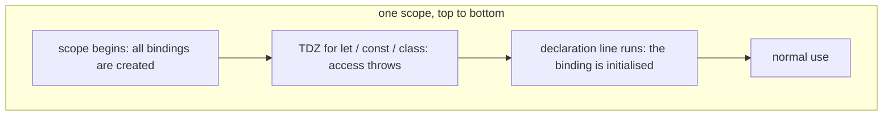

# Interview core: this, closures, hoisting, equality

## In plain words

A technical interview for a JavaScript job nearly always includes a few short questions of the form "what does this code print, and why?". They are not trivia for its own sake. Four areas of the language behave in ways that surprise people who learned it by copying examples, and the questions probe whether you understand the rules or have only been lucky so far:

- **`this`**: a word whose meaning changes depending on *how a function is called*.
- **closures**: functions that remember the variables around them.
- **hoisting**: declarations that seem to "move" to the top of their scope.
- **equality**: the difference between `==` and `===`, and the automatic conversions behind it.

Think of this lesson as the practice session before a driving test. You already know how to drive; you learned each of these topics earlier in the track. Here we revisit them in the form in which examiners ask about them: a compact rule, then puzzles of increasing trickiness, each with a full explanation. The aim is that you can *reason out loud* to the answer, because an interviewer cares far more about your reasoning than about the final line of output.

Why it matters for a job: these questions decide interviews, and, more importantly, the same misunderstandings cause real bugs: handlers that lose their object, loops whose callbacks all see the last value, variables that are `undefined` although you are sure you assigned them.

> **Before this lesson:** this is a revision lesson. It builds on [Type coercion and equality](#/lesson/javascript/coercion-equality), [Functions and scope](#/lesson/javascript/functions-scope), [Closures and recursion](#/lesson/javascript/closures-recursion) and [Prototypes, classes and encapsulation](#/lesson/javascript/prototypes-classes).

> [!NOTE]
> How to use the puzzles: read the code, **write down your prediction**, then press Run, then read the explanation. Several examples are wrapped in a function that starts with `"use strict";`. That makes them behave as code does in modules and classes, which is how nearly all modern JavaScript runs. (The playground itself runs old-style "sloppy" code, in which a few of the rules differ.)

## Part 1: `this`

### The rule

`this` is not determined by where a function is *written*. It is determined, each time, by how the function is **called**. Check these cases in order; the first one that applies wins.

```mermaid
flowchart TD
  A["A function is being called. What is this?"] --> B{"Is it an arrow function?"}
  B -- yes --> B1["this of the surrounding code (fixed when the arrow was created)"]
  B -- no --> C{"Called with new?"}
  C -- yes --> C1["the newly created object"]
  C -- no --> D{"Called through call, apply or a bound function?"}
  D -- yes --> D1["the object that was supplied"]
  D -- no --> E{"Called as obj.method()?"}
  E -- yes --> E1["obj, the thing before the dot"]
  E -- no --> F["plain call: undefined in strict mode (the global object in sloppy mode)"]
```



### Puzzle 1: the detached method

```js-run
(function () {
  "use strict";
  const user = {
    name: "Ada",
    greet() { return "Hi, " + this.name; },
  };

  console.log(user.greet());

  const greet = user.greet;
  try {
    console.log(greet());
  } catch (error) {
    console.log(error.constructor.name);
  }
})();
```

**Explanation.** `user.greet()` is a method call: the object before the dot is `user`, so `this.name` is `"Ada"`. The line `const greet = user.greet` copies only the *function*; no object travels with it. `greet()` is then a plain call, `this` is `undefined`, and reading `undefined.name` throws a `TypeError`. The same thing happens whenever a method is passed as a callback: `setTimeout(user.greet, 100)`, `button.addEventListener("click", user.greet)`, `names.map(user.greet)`.

### Puzzle 2: three repairs

```js-run
(function () {
  "use strict";
  const user = {
    name: "Ada",
    greet() { return "Hi, " + this.name; },
  };
  const run = (callback) => callback();          // stands in for setTimeout, addEventListener, ...

  console.log(run(user.greet.bind(user)));       // 1. bind: a new function with this fixed
  console.log(run(() => user.greet()));          // 2. wrap: call it as a method inside an arrow
  console.log(user.greet.call({ name: "Bo" }));  // 3. call: choose this for one call
})();
```

**Explanation.** `bind` returns a *new* function whose `this` is permanently `user`. The arrow wrapper keeps the method call syntax `user.greet()` intact. `call` (and `apply`, which takes the arguments as an array) invokes the function once with a `this` of your choosing, here a different object.

### Puzzle 3: arrow functions and nested functions

```js-run
(function () {
  "use strict";
  const team = {
    name: "Rockets",
    members: ["Ana", "Bo"],
    withFunction() {
      return this.members.map(function (m) { return m + "@" + (this === undefined ? "nobody" : this.name); });
    },
    withArrow() {
      return this.members.map((m) => m + "@" + this.name);
    },
    arrowMethod: () => typeof this,
  };

  console.log(team.withFunction());
  console.log(team.withArrow());
  console.log(team.arrowMethod());
})();
```

**Explanation.** In `withFunction`, the callback is an ordinary `function`. `map` calls it as a plain function, so its `this` is `undefined`: an inner function does **not** inherit `this` from the method around it. In `withArrow`, the callback is an arrow function, which has no `this` of its own and uses the one of `withArrow`, namely `team`. The third line shows the reverse mistake: an arrow function used *as* a method ignores the object before the dot and takes `this` from the code surrounding the object literal, which here is the strict wrapper function called plainly, so `typeof this` is `"undefined"`.

Rule of thumb: **methods as ordinary functions, callbacks inside methods as arrows.**

### Puzzle 4: `bind` is permanent, `new` is stronger

```js-run
function whoAmI() { return this.label; }

const a = { label: "A" }, b = { label: "B" };
const boundToA = whoAmI.bind(a);

console.log(boundToA());
console.log(boundToA.call(b));          // call cannot override a bound this
console.log(boundToA.bind(b)());        // neither can a second bind

function Gadget(label) { this.label = label; }
const BoundGadget = Gadget.bind(a);
const made = new BoundGadget("from new");
console.log(made.label, a.label);       // new ignored the bound object
```

**Explanation.** Once bound, always bound: `call`, `apply` and further `bind` calls cannot change it, so the first three lines all print `A`. The single exception is `new`, which ranks above everything in the decision chart: it creates a fresh object and uses that as `this`, leaving `a` untouched.

### Puzzle 5: `this` in classes

```js-run
class Counter {
  count = 0;
  incrementMethod() { this.count += 1; return this.count; }
  incrementField = () => { this.count += 1; return this.count; };   // an arrow stored per instance
}

const counter = new Counter();
const { incrementMethod, incrementField } = counter;      // both detached

console.log(incrementField(), incrementField());
try {
  incrementMethod();
} catch (error) {
  console.log("detached method failed:", error.constructor.name);
}
```

**Explanation.** Class bodies are always strict, so the detached ordinary method has `this === undefined` and throws. The arrow function assigned in a class field was created during construction, where `this` is the new instance, and it keeps that `this` for ever. This is why React class components and many event-driven classes define handlers as arrow-function fields. The cost is one function object per instance instead of one shared on the prototype.

> [!INTERVIEW]
> When asked "what is `this`?", give the ordered rules: arrow functions take it from their surroundings; `new` makes a fresh object; `call`/`apply`/`bind` set it explicitly; a method call `obj.fn()` uses `obj`; a plain call gives `undefined` in strict mode. Then mention the classic bug (a method passed as a callback) and its fixes (`bind`, an arrow wrapper, or an arrow-function class field).

## Part 2: closures

### The rule

A function keeps access to the bindings of the scope in which it was created, for as long as the function exists, even after that scope's code has finished running. It holds the **bindings themselves**, not copies of their values.

### Puzzle 6: the loop

```js-run
const withVar = [];
for (var i = 0; i < 3; i++) withVar.push(() => i);

const withLet = [];
for (let j = 0; j < 3; j++) withLet.push(() => j);

console.log(withVar.map((f) => f()));
console.log(withLet.map((f) => f()));
```

**Explanation.** `var i` creates one binding for the whole enclosing function. All three arrows close over that single `i`, and by the time they run the loop has finished with `i === 3`: the output is `[3, 3, 3]`. `let j` creates a **new binding for each round** of the loop, so each arrow keeps its own: `[0, 1, 2]`. The traditional version of this question uses `setTimeout(() => console.log(i), 0)` in the loop; the reasoning is identical, because the callbacks run after the loop.

The pre-2015 fix created a scope per round by hand with an immediately invoked function:

```js-run
const fixed = [];
for (var i = 0; i < 3; i++) {
  (function (captured) {
    fixed.push(() => captured);
  })(i);
}
console.log(fixed.map((f) => f()));
```

### Puzzle 7: shared and separate state

```js-run
function makeCounter() {
  let count = 0;
  return { up: () => ++count, down: () => --count };
}

const a = makeCounter();
const b = makeCounter();
a.up(); a.up(); a.down();
b.down();
console.log(a.up(), b.up());
```

**Explanation.** Each call to `makeCounter` creates a fresh `count`. The two functions returned from the *same* call share it; functions from *different* calls do not. For `a`: 1, 2, 1, then `up` gives 2. For `b`: -1, then `up` gives 0. Output: `2 0`.

### Puzzle 8: closures see the latest value

```js-run
function createLogger() {
  let prefix = "[v1]";
  const log = (message) => prefix + " " + message;
  prefix = "[v2]";
  return log;
}
console.log(createLogger()("hello"));

let total = 10;
const report = () => "total is " + total;
total = 99;
console.log(report());
```

**Explanation.** A closure does not take a snapshot. `log` reads `prefix` when it is *called*, at which point the binding holds `"[v2]"`; `report` sees `99`. The mirror image of this puzzle is the **stale closure**: a function that closed over a binding from an *earlier* call and keeps using that old binding while newer code works with a new one. It is a frequent bug with React hooks, where each render creates new bindings.

### Puzzle 9: what a closure costs

```js-run
function makeHandlers() {
  const bigData = new Array(100000).fill("x");      // large, and referenced by a handler
  const tiny = bigData.length;
  return {
    usesBig: () => bigData.length,                  // keeps the whole array alive
    usesTiny: () => tiny,                           // keeps only the number
  };
}
const handlers = makeHandlers();
console.log(handlers.usesBig(), handlers.usesTiny());
```

**Explanation.** Nothing surprising is printed; the point is what stays in memory. As long as `handlers.usesBig` is reachable, the array it refers to cannot be garbage-collected. A long-lived closure (an event listener, a timer callback, an entry in a cache) that references a large object, a DOM element or a whole component keeps it alive. That is the most common form of memory leak in JavaScript, and the next lesson shows how to find and fix it.

### What closures are for

When asked for uses, name these: **private state** (the counter above, the module pattern); **function factories** (`makeMultiplier(3)`); **partial application and currying**; **memoization** (a cache held in a closure); **callbacks that need context** (event handlers, timers, promise handlers); and utilities such as `once`, `debounce` and `throttle`, all of which keep a little state between calls.

## Part 3: hoisting and the temporal dead zone

### The rule

Before running any code in a scope, the engine scans it for declarations and creates all the bindings in advance. This is called **hoisting**. What differs between the kinds of declaration is the state of the binding *before the line of the declaration is reached*:

| Declaration | Scope | Before its line |
|---|---|---|
| `function f() {}` | function (or block) | fully usable: the function exists |
| `var x` | function | exists with the value `undefined` |
| `let x`, `const x` | block | exists but is **uninitialised**: any access throws a `ReferenceError` |
| `class C {}` | block | same as `let` |
| `import` | module | fully usable |

The stretch between the start of the scope and the declaration line of a `let`, `const` or `class` binding is the **temporal dead zone** (TDZ).



### Puzzle 10: `var`, `let` and functions

```js-run
function demo() {
  const results = [];
  results.push(typeof declaredFunction);        // a function declaration: ready from the start
  results.push(String(withVar));                // var: exists, value undefined
  try {
    results.push(withLet);                      // let: in the temporal dead zone
  } catch (error) {
    results.push(error.name);
  }
  results.push(typeof expression);              // a var holding a function expression: still undefined

  var withVar = "assigned";
  let withLet = "assigned";
  var expression = function () {};
  function declaredFunction() {}
  return results;
}
console.log(demo());
```

**Explanation.** The function declaration is hoisted with its body, so `typeof` gives `"function"`. `var withVar` is hoisted and initialised to `undefined`; only the *assignment* stays on its original line. `withLet` exists and is in the TDZ: reading it throws a `ReferenceError`. And `var expression = function () {}` is a `var` like any other: the name is hoisted as `undefined`, and the function value arrives only when the assignment runs, so calling `expression()` early would throw "is not a function".

### Puzzle 11: shadowing and the dead zone

```js-run
const label = "outer";

function show() {
  try {
    return label;                 // which label is this?
  } catch (error) {
    return error.name;
  } finally {
    // nothing
  }
  let label = "inner";            // unreachable, yet it matters
}
console.log(show());
```

**Explanation.** The answer is `ReferenceError`, not `"outer"`. The `let label` inside `show` is hoisted to the top of the function's scope, so *throughout that scope* the name `label` refers to the inner binding, even on lines above the declaration and even though the declaration line is never reached. The inner binding is in its dead zone, and the outer one is shadowed. This proves that `let` is hoisted; it is the *initialisation* that is not.

### Puzzle 12: functions win, then assignments

```js-run
console.log(typeof thing);
var thing = "a string";
function thing() {}
console.log(typeof thing);
```

**Explanation.** Both declarations are hoisted. When a `var` and a function declaration share a name, the function value is what the binding holds at the start, so the first line prints `function`. Then the assignment `thing = "a string"` runs in its original place, and the second line prints `string`. Nobody should write this; it is asked to check that you can separate "declaration is hoisted" from "assignment stays put".

> [!TIP]
> In your own code, hoisting should never matter: declare with `const` or `let` at the point of first use, declare before you use, and prefer function declarations or `const` arrow functions consistently. The rules matter for reading old code and for interviews.

## Part 4: equality and coercion

### The rule

`===` compares without converting: different types are never equal. `==` converts first, following a fixed sequence: `null` and `undefined` equal each other and nothing else; booleans become numbers; a string facing a number becomes a number; an object facing a primitive is converted to a primitive. `Object.is` is like `===` except that `NaN` equals itself and `+0` differs from `-0`.

### Puzzle 13: predict each line

```js-run
console.log(1 == "1", 1 === "1");
console.log(0 == "", 0 == "0", "" == "0");
console.log(null == undefined, null == 0, null >= 0);
console.log(NaN == NaN, [NaN].includes(NaN), Object.is(NaN, NaN));
console.log([] == false, !![], [] == ![]);
console.log([1, 2] == "1,2", {} == "[object Object]");
console.log(typeof null, typeof [], typeof function () {}, typeof NaN);
```

**Explanation, line by line.**

1. `true false`. `==` converts the string to a number; `===` sees two types.
2. `true true false`. `""` and `"0"` both convert to `0`, yet compared with each other they are two different strings. Loose equality is not transitive.
3. `true false true`. `null` is loosely equal only to `undefined`; `null == 0` is false. But `>=` is a *relational* operator, which converts `null` to `0`, and `0 >= 0` is true.
4. `false true true`. `NaN` is unequal to everything under `==` and `===`. `includes` and `Object.is` use comparisons under which `NaN` matches itself.
5. `true true true`. An empty array is truthy (`!![]`), yet `[] == false` holds: `false` becomes `0`, `[]` becomes `""` and then `0`. In the third expression `![]` is `false`, which reduces it to the first.
6. `true true`. Objects are converted with `toString`: an array joins its elements with commas, and a plain object gives `"[object Object]"`.
7. `object object function number`. The famous `typeof` quirks.

### Puzzle 14: `+` and friends

```js-run
console.log(1 + "2", "3" - 1, "3" * "4", +"", +" 12 ", String(+"12px"));
console.log(1 + 2 + "3", "1" + 2 + 3, 1 + +"2");
console.log(true + 1, String(undefined + 1), null + 1);
console.log([] + [], [] + {}, [2] * [3]);
console.log(0.1 + 0.2 === 0.3, (0.1 + 0.2).toFixed(2) === "0.30", 9007199254740992 === 9007199254740993);
```

**Explanation.** `+` concatenates if either operand is a string (after converting objects to primitives); every other arithmetic operator converts to numbers. Evaluation is left to right, so `1 + 2 + "3"` is `"33"` and `"1" + 2 + 3` is `"123"`. `true` is `1`, `null` is `0`, `undefined` is `NaN`. Arrays become their comma-joined text: `[] + []` is the empty string (a blank in the output), `[] + {}` is `"[object Object]"`, and `[2] * [3]` is `6`. The last line is about floating point: `0.1 + 0.2` is not exactly `0.3`, formatting hides the error, and above $2^{53}$ neighbouring integers become indistinguishable.

### Puzzle 15: references, not values

```js-run
const a = { n: 1 };
const b = a;
const c = { n: 1 };
console.log(a === b, a === c, a == c, JSON.stringify(a) === JSON.stringify(c));

function change(obj, num) {
  obj.n = 99;            // mutates the caller's object
  obj = { n: -1 };       // re-points only the local parameter
  num = 500;             // changes only the local copy
}
let count = 1;
change(a, count);
console.log(a.n, b.n, count);
```

**Explanation.** For objects, both `==` and `===` compare **identity**: `a` and `b` are the same object, while `c` is a different object with equal content. To compare content you must compare the properties (or, for plain data, the JSON text). In the function call, the *reference* to the object is passed by value. Mutating through it changes the one shared object, visible as `a.n` and `b.n`; re-pointing the parameter affects nothing outside; and the number `count` was copied.

### What to say about `==`

Use `===` always. The one widely accepted exception is `value == null`, which is true exactly for `null` and `undefined`. Then show that you know *why* `==` is risky: it is not transitive, it treats `null` inconsistently with the relational operators, and it differs from truthiness (`"0" == false` is true although `"0"` is truthy).

## Part 5: mixed practice

These combine several rules. Predict, run, then read.

### Puzzle 16: default parameters and closures

```js-run
let x = 1;
function f(a = x, getX = () => x) {
  let x = 2;             // a different x, local to the body
  return [a, getX()];
}
x = 10;
console.log(f());
```

**Explanation.** Default values are evaluated at **call time**, in a scope of their own that sits between the outer scope and the function body. When `f()` runs, the outer `x` is `10`, so `a` is `10`. The arrow default closes over that same outer `x`, not the body's `x`, so `getX()` is also `10`. Output: `[10, 10]`.

### Puzzle 17: method chaining and `this`

```js-run
const calculator = {
  value: 0,
  add(n) { this.value += n; return this; },
  times(n) { this.value *= n; return this; },
};
console.log(calculator.add(2).times(5).add(1).value);

const { add } = calculator;
const other = { value: 100, add };
console.log(other.add(1).value, calculator.value);
```

**Explanation.** Returning `this` from each method makes chaining possible: 0 + 2 = 2, times 5 = 10, plus 1 = 11. In the second half, the same function is attached to another object; called as `other.add(1)`, its `this` is `other`, so it modifies `other.value` (101) and leaves `calculator.value` at 11. A function does not "belong" to the object it was first written in.

### Puzzle 18: prototype lookup

```js-run
function Animal(name) { this.name = name; }
Animal.prototype.sound = "...";
Animal.prototype.speak = function () { return this.name + " says " + this.sound; };

const cat = new Animal("Miso");
const dog = new Animal("Rex");
dog.sound = "woof";

console.log(cat.speak(), "|", dog.speak());
console.log(Object.hasOwn(cat, "sound"), Object.hasOwn(dog, "sound"), "sound" in cat);
Animal.prototype.sound = "meow";
console.log(cat.speak(), "|", dog.speak());
```

**Explanation.** Property reads go up the prototype chain; writes create an own property. `dog.sound = "woof"` shadows the shared value for `dog` only. `cat` has no own `sound` and reads the prototype's, so changing the prototype later changes what `cat` says, and does not affect `dog`.

### Puzzle 19: `typeof` in the dead zone

```js-run
console.log(typeof neverDeclared);
try {
  console.log(typeof declaredLater);
} catch (error) {
  console.log(error.name);
}
let declaredLater = 1;
```

**Explanation.** `typeof` on a name that does not exist at all is safe and gives `"undefined"`. On a `let` binding in its temporal dead zone, even `typeof` throws a `ReferenceError`.

### Puzzle 20: an immediately invoked function and `var`

```js-run
var status = "global";
(function () {
  if (typeof status === "undefined") {
    var status = "local";
    console.log("was undefined, now", status);
  } else {
    console.log("saw", status);
  }
})();
console.log(status);
```

**Explanation.** Inside the function, `var status` is hoisted to the top of the *function*, in spite of being written inside the `if` block (`var` ignores blocks). So within the function the name refers to a local binding that is `undefined` at the time of the test. The first branch runs and assigns the local binding; the outer `status` is untouched, and the last line prints `global`. With `let` the test itself would throw.

> [!WARNING]
> In an interview, never answer an output question with the bare result. Say the rule, apply it step by step, and state the result. If you are unsure, say what you would check ("this depends on strict mode; in a module `this` would be `undefined` here"). Interviewers reward visible, correct reasoning, and a confident wrong one-word answer is the worst outcome.

## Common pitfalls

1. **Passing a method as a callback and losing `this`.** Bind it or wrap it.
2. **Using arrow functions as object methods**, or ordinary functions as callbacks inside methods.
3. **`var` in loops with asynchronous callbacks.** Use `let`.
4. **Assuming closures copy values.** They share live bindings.
5. **Believing `let` and `const` are not hoisted.** They are; they are uninitialised until their line.
6. **Calling a function expression before its assignment.** Only declarations are hoisted with their body.
7. **Comparing with `==`**, or comparing objects and arrays with either operator and expecting a content comparison.
8. **Trusting `typeof null` or `typeof []`.**
9. **Reassigning a parameter and expecting the caller's variable to change.**

## Summary

- `this` is set per call: arrow functions inherit it; `new` creates it; `call`/`apply`/`bind` choose it; `obj.method()` uses `obj`; a plain call gives `undefined` in strict mode. Detached methods lose it; `bind`, arrow wrappers and arrow-function class fields preserve it.
- Closures keep live access to outer bindings. `let` creates a binding per loop round, `var` one per function. Closures provide private state and are also what keeps memory alive.
- All declarations are hoisted. Function declarations are usable at once, `var` is `undefined`, and `let`/`const`/`class` are in the temporal dead zone until their line runs.
- `===` never converts; `==` follows fixed conversion steps and is not transitive; objects compare by identity; `Object.is` handles `NaN` and signed zero.
- For output questions: state the rule, trace the steps, give the result.

## Glossary

- **`this`**: the binding that refers to the object a function was called on.
- **Method call**: a call of the form `obj.fn()`, which sets `this` to `obj`.
- **`bind`**: a method that returns a copy of a function with `this` (and optionally arguments) fixed.
- **Lexical `this`**: the way arrow functions take `this` from the surrounding code.
- **Strict mode**: the stricter variant of JavaScript, automatic in modules and classes, in which a plain call has `this === undefined`.
- **Closure**: a function together with the outer bindings it can access.
- **Stale closure**: a closure that still uses bindings from an earlier execution although newer ones exist.
- **Hoisting**: the creation of all of a scope's bindings before its code runs.
- **Temporal dead zone (TDZ)**: the period in which a `let`, `const` or `class` binding exists but may not be accessed.
- **Shadowing**: an inner binding hiding an outer one with the same name.
- **Coercion**: automatic type conversion.
- **Identity**: being the same object in memory, as opposed to having equal content.
- **Transitive**: a comparison for which a = b and b = c imply a = c.
- **IIFE**: an immediately invoked function expression.

## Check yourself

```quiz
[
  {"q": "In a module (strict mode), what happens here?\n\n`const obj = { n: 1, get() { return this.n; } }; const g = obj.get; g();`", "options": ["Returns 1", "Returns undefined", "Throws a TypeError because this is undefined", "Returns the global object"], "answer": 2,
   "explain": "g() is a plain call, so this is undefined in strict mode, and reading undefined.n throws. In sloppy mode this would be the global object and the result undefined."},
  {"q": "What does this print?\n\n`for (var i = 0; i < 2; i++) {} const f = () => i; console.log(f(), typeof j); for (let j = 0; j < 2; j++) {}`", "options": ["2 undefined", "2 number", "1 undefined", "It throws a ReferenceError"], "answer": 0,
   "explain": "var i belongs to the enclosing scope and is 2 after the loop. j is declared with let in a later loop header; its scope is that loop only, so at this point no j exists and typeof gives undefined."},
  {"q": "What does this print?\n\n`function a() { return typeof b; var b = 1; } function c() { try { return typeof d; } catch (e) { return e.name; } let d = 1; } console.log(a(), c());`", "options": ["undefined undefined", "number number", "undefined ReferenceError", "ReferenceError ReferenceError"], "answer": 2,
   "explain": "var b is hoisted with the value undefined. let d is hoisted without initialisation, and even typeof throws inside the temporal dead zone."},
  {"q": "Which expression is true?", "options": ["null == 0", "\"\" == \"0\"", "[] == false", "NaN == NaN"], "answer": 2,
   "explain": "false becomes 0 and the empty array becomes the empty string and then 0. null equals only undefined, the two strings differ, and NaN never equals itself."},
  {"q": "What does this print?\n\n`const fn = function () { return this.v; }.bind({ v: 1 }); console.log(fn.call({ v: 2 }), fn.bind({ v: 3 })());`", "options": ["2 3", "1 1", "1 3", "2 1"], "answer": 1,
   "explain": "A bound function keeps its this for good. Neither call nor a second bind can replace it."},
  {"q": "What does this print?\n\n`let n = 1; const get = () => n; n = 2; const obj = { n: 3, get }; console.log(get(), obj.get());`", "options": ["1 3", "2 3", "2 2", "1 1"], "answer": 2,
   "explain": "The arrow closes over the binding n, which now holds 2. Arrow functions ignore the object they are called on, so obj.get() also reads the outer n."},
  {"q": "What does this print?\n\n`function update(list, item) { list.push(item); list = []; item = \"z\"; } const arr = [\"a\"]; let s = \"b\"; update(arr, s); console.log(arr.length, s);`", "options": ["0 z", "2 b", "1 b", "2 z"], "answer": 1,
   "explain": "push mutates the caller's array through the shared reference. Reassigning the parameters list and item only re-points local bindings."},
  {"q": "Why does `[3, 3, 3]` result from pushing `() => i` three times in a `for (var i = 0; i < 3; i++)` loop and calling the functions afterwards?", "options": ["Arrow functions evaluate their body when created", "All three closures share the single function-scoped binding i, which is 3 after the loop", "var copies the value into each closure", "The array is filled in reverse"], "answer": 1,
   "explain": "Closures capture bindings, not values, and var creates only one binding for the whole loop. With let, each iteration has its own binding."}
]
```

> **Source:** this lesson goes beyond the source book as interview preparation; the underlying rules are covered in Haverbeke, *Eloquent JavaScript* (4th ed.), ch. 1 (automatic type conversion), ch. 3 (bindings and scopes, closure) and ch. 6 (methods and `this`, prototypes). Details checked against MDN: https://developer.mozilla.org/en-US/docs/Web/JavaScript/Reference/Operators/this , https://developer.mozilla.org/en-US/docs/Glossary/Hoisting , https://developer.mozilla.org/en-US/docs/Web/JavaScript/Reference/Statements/let#temporal_dead_zone_tdz , https://developer.mozilla.org/en-US/docs/Web/JavaScript/Equality_comparisons_and_sameness
