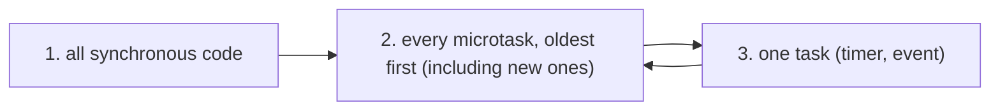
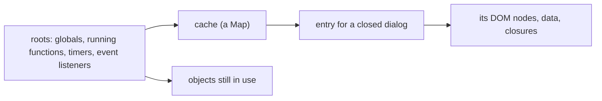

# Interview async and utilities: ordering, debounce, clone, leaks

## In plain words

The previous lesson covered the language questions that interviewers ask. This one covers the other two families you will meet in a JavaScript interview.

The first family is **"in what order does this print?"** for asynchronous code: a mix of ordinary statements, timers and promises. It tests whether you understand the event loop. The method never changes, and once you have it, these questions become mechanical: run the ordinary code, then the queue of promise callbacks, then the timers.

The second family is **"implement this small utility"**: `debounce`, `throttle`, a deep clone, `Promise.all`, a function that limits how many requests run at once. These are the tools every code base contains (usually from a library), and writing one from scratch shows that you command closures, recursion and promises. Think of a cook's trial shift: nobody asks for a banquet; they ask for an omelette, because an omelette shows technique.

A last topic belongs here too: **memory leaks**, programs that hold on to memory they no longer need until the page becomes slow. It is asked of anyone applying beyond junior level, and the causes are few and recognisable.

Why it matters for a job: these utilities and bugs are daily work, not interview folklore. A search box needs debounce; a dashboard that polls needs clean-up; copying state needs to be deep or deliberately shallow.

> **Before this lesson:** you need promises and combinators ([Callbacks and promises](#/lesson/javascript/callbacks-promises)), `async`/`await` ([Async functions and generators](#/lesson/javascript/async-await-generators)), the event loop ([The event loop, tasks and microtasks](#/lesson/javascript/event-loop-microtasks)), closures ([Closures and recursion](#/lesson/javascript/closures-recursion)) and debounce/throttle as first introduced in [Keys, pointers, scrolling, timers and debouncing](#/lesson/javascript/keys-pointers-timers).

> [!NOTE]
> Examples with real timers and promises are live pages whose first lines define `log`, which writes a line onto the page. Predict the output before pressing Run.

## Part 1: ordering questions

### The method

1. **Run the synchronous code** from top to bottom. Whenever you meet a `setTimeout`, note its callback in the *task* list. Whenever a promise callback (`then`, `catch`, `finally`, or the rest of an async function after an `await`) becomes ready, note it in the *microtask* list.
2. When the synchronous code is finished, **run the microtasks in order**. If a microtask queues another microtask, it goes to the end of the same list and still runs in this phase.
3. Take **one task**; run it; then drain the microtasks again. Repeat.



### Puzzle 1: the classic

```html-run
<pre id="out"></pre>
<script>
const out = document.getElementById("out");
const log = (...parts) => { out.textContent += parts.join(" ") + "\n"; };

log("A");
setTimeout(() => log("B"), 0);
Promise.resolve().then(() => log("C"));
new Promise((resolve) => { log("D"); resolve(); }).then(() => log("E"));
log("F");
</script>
```

**Explanation.** Synchronous pass: `A`; the timer callback goes to the task list; the first `then` callback goes to the microtask list; the function given to `new Promise` (the executor) runs **immediately and synchronously**, printing `D`, and its `then` callback joins the microtask list; `F`. Microtasks: `C`, `E`. Task: `B`. Output: `A D F C E B`. The trap is `D`: many candidates believe everything involving a promise is asynchronous.

### Puzzle 2: async functions

```html-run
<pre id="out"></pre>
<script>
const out = document.getElementById("out");
const log = (...parts) => { out.textContent += parts.join(" ") + "\n"; };

async function first() {
  log("1");
  await second();
  log("2");
}
async function second() {
  log("3");
}

log("4");
setTimeout(() => log("5"), 0);
first();
Promise.resolve().then(() => log("6"));
log("7");
</script>
```

**Explanation.** `4`. Timer noted. `first()` starts running synchronously: `1`. It calls `second()`, which also runs synchronously: `3`. Then the `await` suspends `first`; the remainder (`log("2")`) is queued as a microtask. Back at the top level: the `then` callback is queued behind it; `7`. Microtasks in order: `2`, `6`. Task: `5`. Output: `4 1 3 7 2 6 5`. Key fact: an async function is synchronous up to its first `await`.

### Puzzle 3: chains and nesting

```html-run
<pre id="out"></pre>
<script>
const out = document.getElementById("out");
const log = (...parts) => { out.textContent += parts.join(" ") + "\n"; };

Promise.resolve()
  .then(() => log("a1"))
  .then(() => log("a2"))
  .then(() => log("a3"));

Promise.resolve()
  .then(() => log("b1"))
  .then(() => log("b2"));

setTimeout(() => {
  log("t1");
  Promise.resolve().then(() => log("t1-micro"));
}, 0);
setTimeout(() => log("t2"), 0);
</script>
```

**Explanation.** Only `a1` and `b1` are ready at first. Running `a1` fulfils the promise that `a2` waits for, so `a2` is queued behind `b1`. The two chains therefore **interleave**: `a1 b1 a2 b2 a3`. Then the first timer task prints `t1` and queues a microtask, which runs before the next task: `t1-micro`, then `t2`.

### Puzzle 4: errors and return values in chains

```html-run
<pre id="out"></pre>
<script>
const out = document.getElementById("out");
const log = (...parts) => { out.textContent += parts.join(" ") + "\n"; };

Promise.resolve(1)
  .then((v) => { log("then 1:", v); return v + 1; })
  .then((v) => { log("then 2:", v); throw new Error("boom"); })
  .then((v) => log("then 3 (skipped):", v))
  .catch((e) => { log("catch:", e.message); return "recovered"; })
  .finally(() => { log("finally (receives nothing)"); return "ignored"; })
  .then((v) => log("then 4:", v));
</script>
```

**Explanation.** A returned value becomes the input of the next `then` (1, then 2). A thrown error rejects the chain, skipping `then 3` and landing in `catch`. Because `catch` returns normally, the chain is fulfilled again with `"recovered"`. `finally` runs in either case, gets no argument, and its return value is ignored, so `then 4` still receives `"recovered"`.

> [!INTERVIEW]
> Narrate ordering questions with the three lists. "Synchronous output is A, D, F. The microtask queue holds C, then E. The task queue holds B. So: A D F C E B." Add the facts that trip people up: the promise executor is synchronous; an async function runs synchronously until its first `await`; microtasks created during the microtask phase run in that same phase; each task is followed by a full microtask drain. In Node.js, `process.nextTick` callbacks run even before promise microtasks.

## Part 2: promise utilities

### Implementing `Promise.all`

The most requested implementation. Requirements: resolve with an array of results **in input order** (not completion order); reject as soon as any input rejects; accept plain values as well as promises; resolve immediately for an empty input.

```html-run
<pre id="out"></pre>
<script>
const out = document.getElementById("out");
const log = (...parts) => { out.textContent += parts.join(" ") + "\n"; };

function promiseAll(inputs) {
  return new Promise((resolve, reject) => {
    const items = [...inputs];
    const results = new Array(items.length);
    let remaining = items.length;
    if (remaining === 0) return resolve(results);

    items.forEach((item, index) => {
      Promise.resolve(item).then(                 // Promise.resolve also wraps plain values
        (value) => {
          results[index] = value;                 // store by position, not by arrival
          remaining -= 1;
          if (remaining === 0) resolve(results);
        },
        reject                                    // the first rejection rejects the whole thing
      );
    });
  });
}

function promiseAllSettled(inputs) {
  return promiseAll([...inputs].map((item) =>
    Promise.resolve(item).then(
      (value) => ({ status: "fulfilled", value }),
      (reason) => ({ status: "rejected", reason })
    )
  ));
}

function promiseRace(inputs) {
  return new Promise((resolve, reject) => {
    for (const item of inputs) Promise.resolve(item).then(resolve, reject);   // the first to settle wins
  });
}

const later = (value, ms) => new Promise((resolve) => setTimeout(() => resolve(value), ms));
const failLater = (message, ms) => new Promise((_, reject) => setTimeout(() => reject(new Error(message)), ms));

promiseAll([later("slow", 300), "plain value", later("fast", 100)]).then((r) => log("all:", JSON.stringify(r)));
promiseAll([]).then((r) => log("all of nothing:", JSON.stringify(r)));
promiseAll([later("ok", 100), failLater("broken", 200)]).catch((e) => log("all rejected:", e.message));
promiseAllSettled([later("ok", 100), failLater("broken", 150)]).then((r) => log("allSettled:", r.map((x) => x.status).join(", ")));
promiseRace([later("tortoise", 300), later("hare", 50)]).then((w) => log("race:", w));
</script>
```

The points to explain when you write this in an interview: results are stored by **index**; a **counter** (not `results.length`) decides when everything is done; `Promise.resolve(item)` normalises non-promises; a promise can settle only once, so later calls to `resolve` or `reject` are harmlessly ignored, which is what makes `promiseRace` three lines long. `allSettled` is `all` over inputs that can no longer reject.

### Limiting concurrency

`Promise.all(urls.map(fetchOne))` starts everything at once. With a thousand URLs that overwhelms the server or gets you blocked. A frequently asked exercise: run an async function over a list with **at most `limit` running at the same time**.

```html-run
<pre id="out"></pre>
<script>
const out = document.getElementById("out");
const log = (...parts) => { out.textContent += parts.join(" ") + "\n"; };

async function mapLimit(items, limit, worker) {
  const results = new Array(items.length);
  let next = 0;                                   // index of the next item nobody has taken yet

  async function runner() {                       // one "lane": takes items until none are left
    while (next < items.length) {
      const index = next++;                       // claim an item (safe: no await between read and increment)
      results[index] = await worker(items[index], index);
    }
  }

  const lanes = Array.from({ length: Math.min(limit, items.length) }, runner);
  await Promise.all(lanes);
  return results;
}

let active = 0, peak = 0;
async function fakeDownload(name) {
  active += 1; peak = Math.max(peak, active);
  await new Promise((resolve) => setTimeout(resolve, 150));
  active -= 1;
  return name.toUpperCase();
}

const start = Date.now();
mapLimit(["a", "b", "c", "d", "e", "f", "g"], 3, fakeDownload).then((results) => {
  log("results:", results.join(" "));
  log("most downloads at once:", peak);
  log("total time: about", Math.round((Date.now() - start) / 150) * 150, "ms (7 items, 3 at a time)");
});
</script>
```

Each "lane" is an async function looping over a shared index. Three lanes mean at most three items in flight. The line `const index = next++` is safe without locks because JavaScript runs to completion: no other lane can run between reading `next` and incrementing it.

### `sleep`, timeout and retry

Three small helpers that come up constantly, each a few lines:

```javascript
const sleep = (ms) => new Promise((resolve) => setTimeout(resolve, ms));

function withTimeout(promise, ms) {
  let timer;
  const timeout = new Promise((_, reject) => { timer = setTimeout(() => reject(new Error("timeout")), ms); });
  return Promise.race([promise, timeout]).finally(() => clearTimeout(timer));   // always clear the timer
}

async function retry(fn, { attempts = 3, delay = 200 } = {}) {
  for (let attempt = 1; ; attempt++) {
    try {
      return await fn();
    } catch (error) {
      if (attempt >= attempts) throw error;
      await sleep(delay * 2 ** (attempt - 1));          // exponential backoff: 200, 400, 800 ...
    }
  }
}
```

## Part 3: debounce and throttle, properly

### Testing timers without waiting

Timer-based utilities are awkward to demonstrate because they need real time to pass. Professional test suites solve this with **fake timers**: a pretend clock whose time moves only when the test says so. A miniature version is short, and with it the utilities can run synchronously in an ordinary panel:

```js-run
function createFakeClock() {
  let now = 0, nextId = 1;
  const timers = new Map();                         // id -> { time, fn }
  return {
    now: () => now,
    setTimeout(fn, ms) { const id = nextId++; timers.set(id, { time: now + ms, fn }); return id; },
    clearTimeout(id) { timers.delete(id); },
    advance(ms) {                                   // move time forward, firing due timers in order
      const end = now + ms;
      for (;;) {
        let due = null;
        for (const [id, timer] of timers) {
          if (timer.time <= end && (due === null || timer.time < due.time)) due = { id, ...timer };
        }
        if (due === null) break;
        timers.delete(due.id);
        now = due.time;
        due.fn();
      }
      now = end;
    },
  };
}

// ---- debounce: run after `wait` ms without calls; options for a leading call and cancel ----
function debounce(fn, wait, { leading = false, clock = globalThis } = {}) {
  let timer = null;
  let pending = null;                               // arguments of a call that still has to be delivered
  function debounced(...args) {
    const startOfBurst = timer === null;
    clock.clearTimeout(timer);                      // cancel the previous plan
    if (leading && startOfBurst) {
      fn.apply(this, args);                         // leading edge: run at once
      pending = null;
    } else {
      pending = args;                               // remember only the latest call
    }
    timer = clock.setTimeout(() => {                // make a new plan
      timer = null;
      if (pending !== null) {
        const latest = pending;
        pending = null;
        fn.apply(this, latest);                     // trailing edge
      }
    }, wait);
  }
  debounced.cancel = () => { clock.clearTimeout(timer); timer = null; pending = null; };
  return debounced;
}

const clock = createFakeClock();
const calls = [];
const save = debounce((text) => calls.push(`t=${clock.now()} save("${text}")`), 300, { clock });

save("h"); clock.advance(100);
save("he"); clock.advance(100);
save("hel"); clock.advance(299);
console.log("just before the wait is over:", calls.length, "calls");
clock.advance(1);
console.log(calls);

save("x"); save.cancel(); clock.advance(1000);
console.log("after cancel:", calls.length, "call in total");

const leadingCalls = [];
const click = debounce((n) => leadingCalls.push(`t=${clock.now()} click ${n}`), 300, { leading: true, clock });
click(1); clock.advance(50); click(2); clock.advance(50); click(3); clock.advance(1000);
click(4); clock.advance(1000);
console.log(leadingCalls);
```

Read the output. The trailing debounce fires once, 300 ms after the *last* call, with the last argument (`"hel"`). After `cancel`, nothing fires. The leading version fires immediately on the first call of a burst (`click 1`), then once more at the end of the burst with the last arguments (`click 3`); a single isolated call (`click 4`) fires once only.

The core of `debounce`, which is what you should be able to write from memory, is three steps: clear the pending timer, start a new one, call the function with the latest arguments when it fires. The `leading` option and `cancel` are the usual follow-up requests. The `clock` option exists only to make the example testable; in real code it defaults to the global timer functions.

### Throttle with a trailing call

The basic throttle (run at once, then ignore calls for an interval) drops the final call of a burst, so a scroll position or slider value can end up stale. A complete throttle remembers the latest ignored call and runs it when the interval ends:

```js-run
function createFakeClock() {
  let now = 0, nextId = 1;
  const timers = new Map();
  return {
    now: () => now,
    setTimeout(fn, ms) { const id = nextId++; timers.set(id, { time: now + ms, fn }); return id; },
    clearTimeout(id) { timers.delete(id); },
    advance(ms) {
      const end = now + ms;
      for (;;) {
        let due = null;
        for (const [id, t] of timers) if (t.time <= end && (due === null || t.time < due.time)) due = { id, ...t };
        if (due === null) break;
        timers.delete(due.id); now = due.time; due.fn();
      }
      now = end;
    },
  };
}

function throttle(fn, interval, { clock = globalThis } = {}) {
  let waiting = false;          // are we inside the quiet interval?
  let pendingArgs = null;       // the most recent call that arrived during the interval

  function run(context, args) {
    fn.apply(context, args);
    waiting = true;
    clock.setTimeout(() => {
      waiting = false;
      if (pendingArgs !== null) {               // something arrived meanwhile: run it now
        const args = pendingArgs;
        pendingArgs = null;
        run(context, args);
      }
    }, interval);
  }

  return function (...args) {
    if (waiting) pendingArgs = args;            // remember only the latest
    else run(this, args);
  };
}

const clock = createFakeClock();
const seen = [];
const onScroll = throttle((y) => seen.push(`t=${clock.now()} y=${y}`), 100, { clock });

for (let t = 0; t <= 250; t += 25) {            // a scroll event every 25 ms for a quarter of a second
  onScroll(t * 4);
  clock.advance(25);
}
clock.advance(500);
console.log(seen);
```

Eleven events produce four calls: one at once, then one per 100 ms, and the last one carries the final position (`y=1000`), so the display ends up correct.

| Question | Answer |
|---|---|
| Search-as-you-type, auto-save, validating on input, window resize | debounce |
| Scroll handlers, pointer tracking, progress updates, rate-limiting a button | throttle |
| Must the function run at the *start* of activity? | leading edge |
| Must the *final* state be processed? | trailing edge |

## Part 4: deep clone and deep equal

### Shallow versus deep

A **shallow copy** (`{ ...obj }`, `[...arr]`, `Object.assign`) duplicates the top level; nested objects are shared. A **deep copy** duplicates every level. For plain data, the built-in `structuredClone(value)` is the right answer today. Interviewers still ask you to write one, to see recursion, type checks and cycle handling.

```js-run
function deepClone(value, seen = new WeakMap()) {
  if (value === null || typeof value !== "object") return value;    // primitives (and functions) as they are
  if (seen.has(value)) return seen.get(value);                      // already copied: reuse (handles cycles)

  if (value instanceof Date) return new Date(value.getTime());
  if (value instanceof RegExp) return new RegExp(value.source, value.flags);

  if (value instanceof Map) {
    const copy = new Map();
    seen.set(value, copy);
    for (const [k, v] of value) copy.set(deepClone(k, seen), deepClone(v, seen));
    return copy;
  }
  if (value instanceof Set) {
    const copy = new Set();
    seen.set(value, copy);
    for (const v of value) copy.add(deepClone(v, seen));
    return copy;
  }

  const copy = Array.isArray(value) ? [] : Object.create(Object.getPrototypeOf(value));
  seen.set(value, copy);                                            // register BEFORE recursing
  for (const key of Reflect.ownKeys(value)) {                       // string and symbol keys
    copy[key] = deepClone(value[key], seen);
  }
  return copy;
}

const original = {
  name: "report",
  tags: ["a", { deep: true }],
  created: new Date(Date.UTC(2030, 0, 1)),
  lookup: new Map([["k", { n: 1 }]]),
};
original.self = original;                                           // a cycle

const copy = deepClone(original);
copy.tags[1].deep = false;
copy.lookup.get("k").n = 2;

console.log(original.tags[1].deep, original.lookup.get("k").n);     // untouched
console.log(copy !== original, copy.self === copy, copy.created instanceof Date, copy.created !== original.created);
console.log(Array.isArray(copy.tags), copy.created.getUTCFullYear());

const viaJson = JSON.parse(JSON.stringify({ created: new Date(0), nothing: undefined, list: [undefined] }));
console.log(typeof viaJson.created, "nothing" in viaJson, JSON.stringify(viaJson.list));
```

What to say while writing it:

- Primitives are returned as they are; `typeof null` is `"object"`, so `null` is checked first.
- The `seen` map from original to copy serves two purposes: it stops infinite recursion on **cycles**, and it preserves shared references (an object referenced twice is copied once). A `WeakMap` is used so the bookkeeping does not keep objects alive.
- The copy is registered in `seen` **before** recursing into its children; otherwise a cycle would recurse for ever.
- Special objects (`Date`, `RegExp`, `Map`, `Set`) need their own construction.
- The last lines show why the JSON round trip is not a general clone: dates become strings, `undefined` disappears or turns into `null`, and a cycle would throw.

### Deep equality

The companion question. Compare by structure, not identity:

```js-run
function deepEqual(a, b) {
  if (Object.is(a, b)) return true;                         // same value or same object (also NaN with NaN)
  if (a === null || b === null || typeof a !== "object" || typeof b !== "object") return false;
  if (Object.getPrototypeOf(a) !== Object.getPrototypeOf(b)) return false;   // array vs object, Date vs object
  if (a instanceof Date) return a.getTime() === b.getTime();

  const keysA = Object.keys(a), keysB = Object.keys(b);
  if (keysA.length !== keysB.length) return false;
  return keysA.every((key) => Object.hasOwn(b, key) && deepEqual(a[key], b[key]));
}

console.log(deepEqual({ a: [1, { b: 2 }] }, { a: [1, { b: 2 }] }));
console.log(deepEqual({ a: 1, b: 2 }, { b: 2, a: 1 }), deepEqual([1, 2], [2, 1]));
console.log(deepEqual({ a: undefined }, { b: undefined }), deepEqual([], {}), deepEqual(NaN, NaN));
console.log(deepEqual(new Date(5), new Date(5)), deepEqual({ a: 1 }, { a: 1, b: 2 }));
```

## Part 5: memory leaks

### What a leak is

JavaScript frees memory automatically. The **garbage collector** periodically finds every object that can no longer be *reached* from the running program (starting from global variables, the call stack and pending callbacks) and reclaims it. A **memory leak** is therefore never "forgetting to free"; it is **keeping a reference by accident** to something you no longer need. As long as one reference path exists, the object, and everything it refers to, stays.



### The usual suspects

**1. Event listeners that are never removed.** A listener on `window` or `document` lives as long as the page. If it closes over a component, that component can never be collected.

**2. Timers that are never cleared.** A `setInterval` callback and everything it references stay alive until `clearInterval`.

**3. Caches and collections that only grow.** A `Map` used as a cache with no eviction is a leak with a nicer name.

**4. Detached DOM nodes.** An element removed from the page while a variable or closure still points at it.

**5. Closures holding more than intended.** A small callback that references one large object keeps the whole object.

The fix is always the same shape: give every "start" a matching "stop".

```js-run
// A component that starts things, and a destroy() that undoes every one of them.
function createWidget(bus, clock) {
  const bigState = new Array(50_000).fill("data");
  const cache = new Map();

  const onMessage = (message) => { cache.set(message.id, { message, snapshot: bigState.length }); };
  bus.on("message", onMessage);                              // 1. a listener
  const ticker = clock.setInterval(() => cache.size, 1000);  // 2. a timer

  return {
    cacheSize: () => cache.size,
    destroy() {
      bus.off("message", onMessage);                         // undo 1
      clock.clearInterval(ticker);                           // undo 2
      cache.clear();                                         // 3. release cached entries
    },
  };
}

// minimal stand-ins so the example runs anywhere
const bus = {
  listeners: new Set(),
  on(name, fn) { this.listeners.add(fn); },
  off(name, fn) { this.listeners.delete(fn); },
  emit(message) { this.listeners.forEach((fn) => fn(message)); },
};
const clock = { timers: new Set(), setInterval(fn) { this.timers.add(fn); return fn; }, clearInterval(id) { this.timers.delete(id); } };

const widget = createWidget(bus, clock);
bus.emit({ id: 1 }); bus.emit({ id: 2 });
console.log("while alive:   listeners", bus.listeners.size, "| timers", clock.timers.size, "| cache", widget.cacheSize());

widget.destroy();
bus.emit({ id: 3 });
console.log("after destroy: listeners", bus.listeners.size, "| timers", clock.timers.size, "| cache", widget.cacheSize());
```

Without `destroy`, the bus and the timer would hold `onMessage` and the interval callback for ever; through their closures, `bigState` and the cache would stay too, once for every widget ever created.

Tools that prevent leaks by design:

- `addEventListener(type, fn, { signal })` with an `AbortController`: one `abort()` removes many listeners.
- `{ once: true }` for listeners that should run a single time.
- `WeakMap` and `WeakSet` for data attached to objects you do not own: the entry disappears with the object.
- Bounded caches: evict the least recently used entry when a size limit is reached (see the LRU problem in this track).
- Framework clean-up hooks: the function returned from React's `useEffect`, `onUnmounted` in Vue.

### Finding a leak

In the browser's developer tools, open the *Memory* panel. Take a **heap snapshot**, perform the suspect action several times (open and close the dialog ten times), force a garbage collection, and take another snapshot. Compare the two: object counts that grow with every repetition are the leak, and the *retainers* view shows the chain of references that keeps them alive. In the *Performance* panel, a memory graph that climbs like a staircase and never comes down tells the same story.

> [!WARNING]
> Leaks do not show up in a quick test. They appear in pages that stay open for hours: dashboards, editors, chat clients, single-page applications that never reload. For such software, clean-up code is as important as set-up code.

## Part 6: quick-fire output puzzles

Short questions that recur. Predict each line before running.

```js-run
console.log([10, 1, 5].sort(), [10, 1, 5].sort((a, b) => a - b));
console.log(["1", "2", "3"].map(parseInt).map(String), ["1", "2", "3"].map(Number));
console.log(typeof typeof 1, typeof (() => {}), typeof class {}, typeof Symbol());
console.log(0.1 + 0.2 === 0.3, 0.1 * 3, 9007199254740991 + 2);
console.log([1, 2, 3].indexOf(2) > -1, [NaN].indexOf(NaN), [NaN].includes(NaN));
console.log("5" + 3, "5" - 3, "5" * "3", String([] + null + 1));
console.log([..."hello"].reverse().join(""), "abc".split("").map((c) => c.charCodeAt(0)));
console.log(String(Math.max()), String(Math.min()), [] + [] === "");
console.log((function () { return typeof arguments; })(), (() => typeof globalThis)());
console.log([1, 2, 3].length = 0, Array(3).length, [, ,].length, [1, 2, 3].at(-1));
```

**Explanations.**

1. Default `sort` compares as strings: `[1, 10, 5]`; with a comparator: `[1, 5, 10]`.
2. `map` passes the index as `parseInt`'s radix: `[1, NaN, NaN]` (converted to strings here so that the panel can show `NaN`); `Number` ignores extra arguments: `[1, 2, 3]`.
3. `typeof` returns a string, so `typeof typeof 1` is `"string"`; functions and classes are `"function"`; a symbol is `"symbol"`.
4. Floating point: `false`, `0.30000000000000004`, and beyond the safe range the sum is off by one (`9007199254740992`).
5. `true`; `indexOf` uses `===` and cannot find `NaN` (`-1`); `includes` can (`true`).
6. `"53"`, `2`, `15`, and `[] + null + 1` is `"" + "null" + "1"`, that is `"null1"`.
7. `"olleh"` and `[97, 98, 99]`.
8. `Math.max()` with no arguments is `-Infinity` and `Math.min()` is `Infinity`: the starting values from which a maximum or minimum is built up. `[] + []` is `""`.
9. `arguments` is an array-like object: `"object"`; `globalThis` is an object.
10. An assignment expression has the assigned value: `0`. `Array(3)` has length 3 with no elements; `[, ,]` has length 2 (a trailing comma is ignored); `at(-1)` is `3`.

> [!TIP]
> When practising, do not memorise outputs. For each puzzle, name the single rule that decides it ("default sort is lexicographic", "map passes three arguments", "the executor is synchronous"). There are perhaps thirty such rules in total, and every new puzzle is a combination of them.

## Common pitfalls

1. **Assuming promise code never runs synchronously.** The executor of `new Promise` and the start of an async function do.
2. **Putting timers before microtasks when predicting order.**
3. **Using `results.push` in a hand-written `Promise.all`.** Results would be in completion order; assign by index.
4. **Forgetting the empty-input case in `Promise.all`.** The promise would never settle.
5. **Creating the debounced function inside the handler.** Each event gets its own timer.
6. **Not clearing the timeout in `withTimeout`.** The timer keeps the process alive and fires for nothing.
7. **Deep-cloning with JSON.** Dates, `undefined`, `Map`, `Set` and cycles are lost or throw.
8. **Registering the copy after recursing in `deepClone`.** Cycles recurse for ever.
9. **Adding listeners and intervals without a removal path.**
10. **Unbounded caches.**

## Summary

- For ordering questions: synchronous code first, then all microtasks (promise callbacks, async continuations), then one task (timer, event), repeating the microtask drain after every task. Promise executors and async functions up to their first `await` are synchronous.
- `Promise.all` by hand: results by index, a countdown, `Promise.resolve` for normalising, reject on first failure, resolve at once for empty input. `allSettled`, `race` and a concurrency limiter are small variations.
- Debounce clears and restarts a timer on every call; throttle runs at most once per interval and, done properly, replays the latest suppressed call. Fake clocks make them testable.
- Deep cloning is recursion over types with a `WeakMap` for cycles and shared references; `structuredClone` is the built-in answer; the JSON round trip is lossy. Deep equality compares structure recursively.
- Memory leaks are unwanted references: listeners, timers, growing caches, detached DOM nodes, oversized closures. Pair every set-up with a tear-down, use weak collections, and confirm with heap snapshots.

## Glossary

- **Task (macrotask)**: a unit of work from the task queue, such as a timer callback or event handler.
- **Microtask**: a promise callback or async continuation, run right after the current task.
- **Executor**: the function passed to `new Promise`; it runs synchronously.
- **Combinator**: a function that combines several promises into one (`all`, `allSettled`, `race`, `any`).
- **Concurrency limit**: the maximum number of operations allowed to be in progress at once.
- **Backoff**: increasing the delay between successive retries.
- **Fake timers**: a simulated clock used in tests to control time.
- **Debounce / throttle**: delaying a call until activity stops / limiting calls to one per interval.
- **Leading / trailing edge**: the start / the end of a burst of calls.
- **Shallow copy / deep copy**: a copy of the top level only / of every nested level.
- **Cycle (circular reference)**: an object that refers to itself, directly or indirectly.
- **Garbage collector**: the part of the engine that frees unreachable memory.
- **Reachable**: accessible through some chain of references from the program's roots.
- **Memory leak**: memory that stays reachable although it is no longer needed.
- **Detached DOM node**: an element removed from the document but still referenced by script.
- **Heap snapshot**: a recording of all objects in memory, used to find what is retained and why.

## Check yourself

```quiz
[
  {"q": "In what order are the letters logged?\n\n`setTimeout(() => log(\"A\"), 0); new Promise((r) => { log(\"B\"); r(); }).then(() => log(\"C\")); log(\"D\");`", "options": ["B D C A", "D B C A", "A B C D", "B C D A"], "answer": 0,
   "explain": "The executor runs synchronously (B), then D. The then callback is a microtask (C). The timer is a task and comes last (A)."},
  {"q": "In what order are the numbers logged?\n\n`async function f() { log(1); await null; log(2); } f(); log(3); Promise.resolve().then(() => log(4));`", "options": ["1 2 3 4", "1 3 2 4", "3 1 2 4", "1 3 4 2"], "answer": 1,
   "explain": "f runs synchronously up to the await (1). Then 3. The continuation of f was queued before the then callback, so the microtasks run as 2, then 4."},
  {"q": "In a hand-written Promise.all, why are results stored with `results[index] = value` instead of `results.push(value)`?", "options": ["push is slower", "Results must be in input order, and promises can complete in any order", "push does not work inside then", "To avoid memory leaks"], "answer": 1,
   "explain": "A fast later promise would otherwise appear before a slow earlier one. Indexing preserves the positions of the inputs."},
  {"q": "A trailing debounce with a wait of 200 ms is called at t = 0, 150 and 300 ms. When does the function run?", "options": ["At 200 ms", "At 350 ms", "At 500 ms", "At 200 ms and at 500 ms"], "answer": 2,
   "explain": "Every call restarts the timer. The last call at 300 ms is followed by 200 ms of silence, so the function runs once at 500 ms."},
  {"q": "What is the purpose of the `seen` WeakMap in `deepClone`?", "options": ["To make the clone immutable", "To return the already-made copy when an object is met again, which handles cycles and shared references", "To sort the keys", "To skip functions"], "answer": 1,
   "explain": "Without it, a structure that refers to itself would cause infinite recursion, and an object referenced twice would be duplicated."},
  {"q": "What does `JSON.parse(JSON.stringify({ d: new Date(0), u: undefined }))` produce?", "options": ["{ d: Date, u: undefined }", "{ d: \"1970-01-01T00:00:00.000Z\" }", "{ d: 0, u: null }", "It throws"], "answer": 1,
   "explain": "The date is serialised to its ISO string and comes back as a string. The undefined property is omitted altogether."},
  {"q": "Which of these is a typical cause of a memory leak in a long-running page?", "options": ["Declaring variables with const", "A setInterval or window event listener that is never removed and whose callback references large data", "Using arrow functions", "Calling JSON.parse"], "answer": 1,
   "explain": "The timer or listener keeps its callback reachable, and the callback's closure keeps the data reachable, so the garbage collector cannot free it."},
  {"q": "What does `[\"10\", \"10\", \"10\"].map(parseInt)` return?", "options": ["[10, 10, 10]", "[10, NaN, 2]", "[10, 0, 1]", "[NaN, NaN, NaN]"], "answer": 1,
   "explain": "map passes the index as the second argument, which parseInt uses as the radix: 0 (treated as decimal) gives 10, radix 1 is invalid, and \"10\" in base 2 is 2."}
]
```

> **Source:** this lesson goes beyond the source book as interview preparation; the underlying material is covered in Haverbeke, *Eloquent JavaScript* (4th ed.), ch. 11 (promises, async functions, the event loop) and ch. 15 (timers, debouncing). Details checked against MDN: https://developer.mozilla.org/en-US/docs/Web/JavaScript/Reference/Global_Objects/Promise/all , https://developer.mozilla.org/en-US/docs/Web/API/Window/structuredClone , https://developer.mozilla.org/en-US/docs/Web/JavaScript/Guide/Memory_management , https://developer.mozilla.org/en-US/docs/Web/JavaScript/Reference/Global_Objects/WeakMap
