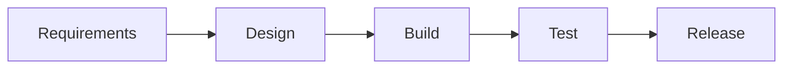
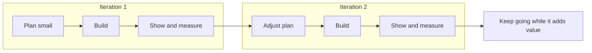

# What agile is: four values, twelve principles

> **Before this lesson:** nothing. This is the first lesson of the track. It helps a little if you have worked on any group project, at school or at work, where the plan changed halfway through.

## In plain words

Imagine you are asked to plan a friend's birthday party six months in advance. You could write a 40-page plan on day one, covering the menu, the music and the seating, then execute it exactly, and find out on the night that your friend has become vegetarian and moved to another city. Or you could agree the big idea now, then check in with your friend every couple of weeks, adjust the plan, and have something small ready at each step (the venue booked, then the invitations sent, then the menu tasted).

The second way is the heart of **agile**. Agile is a way of building software (and other complex things) in small pieces, showing each piece to the people who will use it, and changing course based on what you learn. It is not one method or one tool. It is a set of values and principles that many methods, such as Scrum and Kanban, put into practice.

Why it matters for a job: almost every software job posting in Big Tech and in the Singapore market mentions "Agile", "Scrum" or "Jira". Interviewers rarely ask you to recite the Agile Manifesto, but they do ask "How does your team work?", "What happens when requirements change mid-sprint?" and "What would you do if the plan was clearly wrong?" A clear grasp of why agile exists lets you answer those questions with judgement instead of buzzwords.

## The problem agile was reacting to

To understand agile, you need to know what came before it. For decades, many software projects followed a **plan-driven** approach, often called **waterfall**. Waterfall means doing the phases of a project one after another, each one finished and signed off before the next begins, like water falling down a series of steps.



On paper this looks tidy. In practice it ran into three recurring problems:

1. **Requirements change.** Customers rarely know exactly what they want until they see something working. By the time a waterfall project released, the market or the customer's needs had often moved.
2. **Feedback arrives late.** Testing happened near the end, so a misunderstanding made in month one could stay hidden until month eleven, when fixing it was most expensive.
3. **Progress is hard to see.** Halfway through, a project might report "60% complete" because 60% of the documents were written, while not one feature actually worked.

None of this means waterfall is always wrong. When the requirements are stable and well understood (a bridge, a regulatory report with fixed rules), detailed up-front planning can be sensible. Agile shines where there is a lot of uncertainty, which describes most product software.

## The Agile Manifesto

In 2001 a group of seventeen software practitioners, who between them had invented several lightweight methods, met and wrote a short statement of what they had in common. It is called the **Manifesto for Agile Software Development**, usually shortened to the **Agile Manifesto**. It is published at agilemanifesto.org. The text may only be copied in full with its notice, so here it is paraphrased in our own words.

The manifesto lists four pairs of values. In each pair, the authors say they value **both** sides, but they value the left side **more**.

| They value more | Over | In plain words |
|---|---|---|
| Individuals and interactions | processes and tools | People talking and solving problems together matter more than following a procedure or a piece of software. |
| Working software | comprehensive documentation | Something that runs and can be tried is better evidence of progress than a thick specification. |
| Customer collaboration | contract negotiation | Work with the customer continuously instead of arguing over the exact wording of an agreement. |
| Responding to change | following a plan | When you learn something new, adapt, even if it means leaving the original plan. |

The most common misreading is "agile means no documentation, no plans and no process". The manifesto says the opposite: those things have value. It only says which side wins when the two conflict.

> [!WARNING]
> Notice the irony for this track: Jira is a tool, and tools sit on the *less* valued side of the first pair. A team that spends its stand-up arguing about Jira fields instead of talking about the work has the values upside down. Use Jira to support conversations, not replace them.

## The twelve principles, paraphrased

Behind the four values, the authors wrote twelve principles. Here they are in our own words, grouped by theme so they are easier to remember.

**Delivering value to the customer**

1. The top priority is to keep the customer satisfied by delivering useful software early and then continuously.
2. Changing requirements are welcome, even late in development, because adapting to change can give the customer a competitive edge.
3. Deliver working software often, every few weeks to every couple of months, and prefer the shorter end of that range.

**How people work together**

4. Business people and developers should work together every day throughout the project.
5. Build projects around motivated people. Give them the environment and support they need, and trust them to do the job.
6. The most efficient and effective way to share information within a team is talking face to face.

**Measuring progress and keeping a pace**

7. Working software is the main measure of progress.
8. Agile processes encourage a sustainable pace. Sponsors, developers and users should be able to keep the same steady pace indefinitely, without burning out.

**Quality and simplicity**

9. Constant attention to technical excellence and good design makes a team more agile, not less.
10. Simplicity, meaning the art of maximising the amount of work you do *not* have to do, is essential.
11. The best architectures, requirements and designs come from teams that organise themselves.

**Improving**

12. At regular intervals, the team reflects on how to become more effective, and then adjusts its behaviour accordingly.

You do not need to memorise the numbering. You should be able to explain the ideas and give an example of each. For instance, principle 10 is why a good engineer asks "do we actually need this feature?" before building it, and principle 12 is the reason Scrum has a retrospective.

> [!NOTE]
> "Face to face" was written in 2001. Today many teams are remote or hybrid, including across Singapore, India and Europe. Teams usually interpret this principle as "prefer rich, real-time conversation (a video call, pairing) over long chains of written messages".

## Agile versus waterfall, side by side

The clearest way to see the difference is to follow the same small project both ways. Suppose a food-delivery startup wants a "reorder my last meal" button in its app.

**Waterfall version.** The team spends three weeks writing a specification covering every case: what if a dish is no longer on the menu, what if the restaurant is closed, what if the price has changed. Then two weeks of design, four weeks of building, two weeks of testing. After eleven weeks, the feature ships. Usage data shows most people reorder from a *different* restaurant on weekends, so the button that only repeats the very last order is rarely useful.

**Agile version.** In the first two weeks, the team builds the simplest version: a button that reorders the last meal if every dish is still available, and hides itself otherwise. It ships to 10% of users. The data arrives within days: people want to choose from their last five orders. The next two weeks are spent on that. After six weeks the team has a feature people actually use, and has never built the complicated edge-case handling for a design that turned out to be wrong.



| Aspect | Plan-driven (waterfall) | Agile |
|---|---|---|
| When requirements are fixed | At the start | Continuously refined |
| Delivery | One big release at the end | Small, frequent increments |
| Feedback from users | Late | Early and often |
| Measure of progress | Documents and phases completed | Working software in use |
| Response to change | Formal change request | Expected and welcomed |
| Risk discovered | Late, when it is expensive | Early, while it is cheap |

## Agile is an umbrella, not a method

People sometimes say "we do agile" as if agile were a recipe. It is closer to a philosophy, and several concrete methods sit under it:

- **Scrum**, a lightweight framework that organises work into fixed-length cycles called **sprints**, with defined roles and meetings. Lessons 2 to 5 cover it.
- **Kanban**, a strategy for managing the flow of work by making it visible and limiting how much is in progress at once. Lesson 6 covers it.
- **Extreme Programming (XP)**, which focuses on engineering practices such as pair programming, test-driven development and continuous integration.
- **Lean software development**, which borrows ideas from manufacturing about removing waste.

Many real teams mix these: Scrum events with Kanban-style limits, plus XP engineering practices. That mix is normal. What makes a team agile is not the name of its method but whether it delivers small working pieces, learns from them and adapts.

> [!TIP]
> Continuous integration and frequent deployment are where agile's "deliver working software frequently" meets engineering. If you have read the CI/CD track, the lesson [Continuous integration: the practice, not the server](#/lesson/cicd/ci-practices) explains the technical half of this promise.

## Where Jira fits

**Jira** is a work-tracking product made by the company Atlassian. A team records each piece of work in Jira, moves it through stages such as "To Do", "In Progress" and "Done", plans cycles of work, and produces charts about progress. Lesson 10 introduces it properly.

Jira does not make a team agile. A team can use Jira to run a rigid waterfall project, and an agile team could run perfectly well with sticky notes on a wall. What Jira offers is a shared, searchable record of the work, which becomes important once a team is larger than a handful of people, works across time zones, or has to answer questions such as "what shipped in release 4.2, and which bugs were fixed in it?".

Throughout this track you will learn the agile ideas first and then how Jira represents them, so that you understand *why* a board or a report exists before you learn which button to press.

## Common misconceptions

**"Agile means no planning."** Agile teams plan constantly, at several levels: a product direction for months, a goal for the next couple of weeks, and a plan for today. What they avoid is a detailed plan for far into the future that nobody is willing to change.

**"Agile means no deadlines."** Businesses still have dates: a marketing launch, a regulatory change, a festival sale such as 11.11 in Southeast Asia. Agile teams handle a fixed date by adjusting *scope*: delivering the most valuable pieces first, so whatever exists on the date is useful.

**"Agile means going faster."** Agile reduces the cost of being wrong by finding out sooner. Teams often deliver *value* sooner, but the goal is learning and adapting, not typing faster.

**"We use Jira and have daily meetings, so we are agile."** Rituals without the underlying values are sometimes called "cargo cult agile": copying the visible actions while missing their purpose. A team that holds every Scrum meeting but never ships anything to users, or never changes anything after a retrospective, is not living the principles.

**"Agile is only for software."** The manifesto talks about software, but the ideas are used in marketing, design and operations teams too. Jira itself is used by non-software teams.

## A realistic team scenario

Priya is a new backend engineer at a Singapore fintech company. In her first week, the product manager says that the regulator has published new rules about how transaction limits must be shown to users, effective in three months.

A plan-driven response would be to write a full specification of every screen, get sign-off, and build for three months. Priya's team instead does this:

1. They agree on the outcome: "Every screen that shows a limit follows the new rule by the deadline."
2. They list the screens and sort them by how many users see each one.
3. In the first two weeks, they change the single most-used screen and show it to the compliance officer, who points out a wording issue that would have affected every screen.
4. They fix the wording pattern once, then roll it out to the remaining screens over the following cycles, showing compliance each piece as it is finished.
5. Every two weeks, they look at what slowed them down. They discover that waiting for design review takes three days, so they invite the designer to their planning meeting.

The deadline was fixed; the plan was not. The early feedback from compliance saved weeks of rework. That is agile in practice, and it is the kind of story you can tell in an interview when someone asks about changing requirements. The behavioural track's lesson on [ambiguity and changing priorities](#/lesson/behavioural/ambiguity) shows how to structure such a story.

## How interviewers probe this

> [!INTERVIEW]
> "What does agile mean to you?" A strong answer is short and concrete: "Delivering in small, working increments, getting feedback from real users early, and adapting the plan based on what we learn. In my last team that meant two-week sprints, a demo to stakeholders at the end of each one, and a retrospective where we picked one thing to improve." Avoid reciting the manifesto word for word; show that you understand the trade-off it describes.

Other common prompts:

- "When is waterfall a better choice?" Mention stable, well-understood requirements, heavy regulation that demands up-front sign-off, or work where a partial delivery is useless (you cannot ship half a satellite).
- "What are the downsides of agile?" Honest answers include: it needs an engaged customer or product owner, long-term dates are harder to promise precisely, and teams can neglect architecture if they only think a sprint ahead (which principle 9 warns against).
- "Your manager wants a fixed scope by a fixed date. How do you respond?" Talk about making trade-offs visible: estimate, show what fits, and agree which parts are must-haves.

## Summary

- Agile is a set of values and principles for building complex things in small, working increments with frequent feedback.
- It grew as a reaction to plan-driven approaches in which requirements were frozen early and feedback arrived late.
- The Agile Manifesto states four value pairs: people and interactions, working software, customer collaboration and responding to change are valued more than processes and tools, comprehensive documentation, contract negotiation and following a plan.
- Twelve principles expand on this: early and continuous delivery, welcoming change, daily collaboration, trust, conversation, working software as the measure of progress, sustainable pace, technical excellence, simplicity, self-organising teams and regular reflection.
- Scrum, Kanban, XP and Lean are methods under the agile umbrella. Jira is a tool that supports them but does not make a team agile on its own.

## Glossary

- **Agile** — an approach to building things in small increments, with frequent feedback and adaptation, based on the Agile Manifesto.
- **Agile Manifesto** — a short 2001 statement of four values for software development, published at agilemanifesto.org.
- **Waterfall** — a plan-driven approach where project phases happen one after another, each finished before the next starts.
- **Plan-driven** — fixing most requirements and the schedule at the start and then following that plan.
- **Iteration** — one short cycle of planning, building and reviewing; Scrum calls it a sprint.
- **Increment** — a working piece of the product delivered at the end of (or during) an iteration.
- **Scrum** — an agile framework built around fixed-length sprints, three accountabilities and five events.
- **Kanban** — an agile strategy that manages the flow of work by visualising it and limiting work in progress.
- **Extreme Programming (XP)** — an agile method focused on engineering practices like pairing and test-driven development.
- **Sustainable pace** — a workload a team can keep up indefinitely without burning out.
- **Cargo cult agile** — copying agile rituals without understanding or applying their purpose.
- **Jira** — Atlassian's product for tracking and planning work.

## Check yourself

```quiz
[
  {"q": "In the Agile Manifesto, what does 'working software over comprehensive documentation' mean?",
   "options": ["Documentation is forbidden", "Both have value, but working software is valued more when they conflict", "Documentation is more important than code", "Teams should only document after release"],
   "answer": 1,
   "explain": "Each value pair says the items on the right have value; the items on the left are valued more."},
  {"q": "Which situation is the best fit for a plan-driven (waterfall) approach?",
   "options": ["A new consumer app whose users are unknown", "A project with stable, well-understood requirements where partial delivery is useless", "A startup testing several product ideas", "A team that wants feedback every week"],
   "answer": 1,
   "explain": "Up-front planning pays off when requirements are unlikely to change and small increments cannot be used on their own."},
  {"q": "According to the principles, what is the main measure of progress?",
   "options": ["Number of documents signed off", "Hours worked", "Working software", "Number of Jira tickets closed"],
   "answer": 2,
   "explain": "The principles name working software as the primary measure of progress."},
  {"q": "Which principle is the direct reason Scrum has a retrospective?",
   "options": ["Simplicity is essential", "At regular intervals the team reflects and adjusts its behaviour", "Business people and developers work together daily", "Welcome changing requirements"],
   "answer": 1,
   "explain": "Regular reflection and adjustment is exactly what a retrospective does."},
  {"q": "A team holds every Scrum meeting and uses Jira, but has not shipped anything to users in six months. What is the best description?",
   "options": ["A mature agile team", "Rituals without the values: often called cargo cult agile", "A Kanban team", "A waterfall team by definition"],
   "answer": 1,
   "explain": "Agile is judged by delivering working increments and learning from them, not by holding meetings or using a tool."},
  {"q": "How do agile teams usually handle a fixed external deadline?",
   "options": ["Refuse the deadline", "Fix the scope and add overtime", "Deliver the most valuable pieces first and adjust scope so something useful exists on the date", "Switch to waterfall"],
   "answer": 2,
   "explain": "Ordering by value means whatever is finished by the date is the most useful subset."},
  {"q": "What does 'simplicity, the art of maximising the amount of work not done' encourage?",
   "options": ["Doing less testing", "Questioning whether a feature or piece of work is needed before building it", "Writing shorter code at any cost", "Skipping design"],
   "answer": 1,
   "explain": "The cheapest work is work you never needed to do. It is not an excuse to cut quality."}
]
```

> **Source:** Manifesto for Agile Software Development, https://agilemanifesto.org/ and Principles behind the Agile Manifesto, https://agilemanifesto.org/principles.html (paraphrased); Atlassian Agile Coach, https://www.atlassian.com/agile
