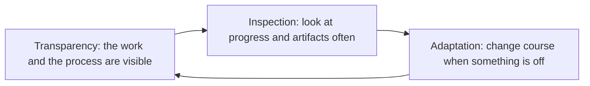

# Scrum theory: empiricism, pillars and values

> **Before this lesson:** read [What agile is: four values, twelve principles](#/lesson/jira/agile-values). You should know that agile means delivering in small increments and adapting to feedback.

## In plain words

Think about cooking a dish you have never made before without a recipe. You would not decide every step in advance and then refuse to taste anything until the end. You would cook a little, taste, adjust the salt, taste again. Each tasting is a small experiment that tells you what to do next.

**Scrum** is a way of organising a team's work that treats product development like that cooking: do a small, time-limited piece of work, look honestly at the result, and change what you do next based on what you saw. The official definition lives in a short, free document called **The Scrum Guide**, written by Ken Schwaber and Jeff Sutherland. The current edition was published in 2020. In this track, "the Guide" always means that 2020 edition.

Why it matters for a job: Scrum is the most common way that software teams organise themselves, and Jira's "Scrum" board and reports are built around it. If a job posting says "experience working in Scrum teams", the interviewer expects you to know what the events are for, not only their names. This lesson explains the theory that every Scrum event and artifact rests on. Without it, Scrum looks like a list of meetings; with it, each meeting has an obvious reason to exist.

## What the Guide says Scrum is

In the Guide's own framing, Scrum is a *lightweight framework*. A **framework** is a structure with some fixed parts and plenty of room for you to fill in the rest. "Lightweight" means it deliberately prescribes very little.

The Guide describes Scrum as helping people, teams and organisations create value through adaptive solutions to complex problems. In practice the cycle looks like this:

1. A **Product Owner** orders the work for a complex problem into a list called the **Product Backlog**.
2. The **Scrum Team** turns a selection of that work into a usable piece of product, called an **Increment**, during a fixed period called a **Sprint**.
3. The team and its **stakeholders** (anyone affected by or interested in the product, such as customers, managers and other teams) inspect the results and adjust for the next Sprint.
4. Repeat.

Each of those bold words gets its own lesson later. For now, the important point is that the cycle is short and repeated, and that every repetition produces something real that can be inspected.

> [!NOTE]
> The Guide is intentionally incomplete. It describes the minimum needed for Scrum and leaves practices to the team. It does **not** mention story points, velocity, user stories, burndown charts, or a "Definition of Ready". Those are popular practices that teams add on top. Jira supports many of them, which is why people often confuse them with Scrum itself. Knowing the difference is a mark of real understanding in an interview.

## Empiricism: learn from what you observe

Scrum is founded on **empiricism**. Empiricism is the idea that knowledge comes from experience, and that decisions should be based on what is actually observed rather than on what was predicted.

Why does software need this? Because most software work is **complex**: there are more unknowns than knowns. You do not know exactly how users will react, how long an unfamiliar library will take to learn, or what a legacy system will do when you touch it. In a complex situation, a detailed long-range prediction is mostly guesswork. The more reliable strategy is to take a small step, look at what happened, and decide the next step with that fresh knowledge.

The Guide also says Scrum uses **lean thinking**. Lean thinking, which comes from manufacturing, means reducing **waste** (anything that consumes effort without adding value, such as building features nobody uses, or work waiting in a queue) and focusing on the essentials.

Scrum combines these into an **iterative, incremental** approach:

- **Iterative** means you repeat a cycle, improving each time.
- **Incremental** means each cycle adds a working piece to what already exists.

Together they let a team optimise predictability (you know roughly what the next couple of weeks hold) and control risk (a wrong turn costs at most one short cycle).

## The three pillars

Empiricism only works if three conditions hold. The Guide calls them the three **pillars**: transparency, inspection and adaptation. They depend on each other in a fixed order.



### Transparency

**Transparency** means the work and the process must be visible to the people doing the work and to the people receiving it. If something is hidden, decisions about it are made on bad information.

Example: a developer has been stuck on a database migration for three days but marks the task "In Progress, nearly done" in Jira. The board looks healthy; reality is not. Every decision made from the board (adding more work, promising a release date) is now based on a false picture.

The Guide makes a strong point here: inspection without transparency is misleading and wasteful. You can hold the meetings, but if what you inspect is not honest, you learn nothing.

### Inspection

**Inspection** means checking the artifacts and progress towards agreed goals frequently and diligently, so that problems are detected early. Scrum builds inspection into its rhythm: the five events (lesson 4) are each an opportunity to inspect something specific.

Example: at the daily meeting, the team looks at progress towards the goal for the Sprint and notices that two of the five items have not started, with three days left.

### Adaptation

**Adaptation** means that when something is off course, the process or the product must be adjusted as soon as possible. The Guide notes that adaptation becomes harder when the people involved are not empowered or self-managing: if every change needs approval from someone outside the team, adaptation is slow.

Example: having noticed the two unstarted items, the team decides to pair on the riskiest one and tells the Product Owner that the fifth item will probably not fit.

> [!TIP]
> When a Scrum event feels pointless, ask which pillar it serves. A Daily Scrum that is only a status report to a manager has lost its inspection-and-adaptation purpose. Fix the purpose, not the meeting length.

## The five values

The Guide says Scrum's success depends on people living five **values**. They are short words, but each has a concrete meaning in team life.

| Value | What it looks like day to day |
|---|---|
| **Commitment** | The team commits to achieving its goals and to supporting each other. It is a commitment to effort and to the goal, not a guarantee that every item will be done. |
| **Focus** | The team concentrates on the work of the Sprint and its goal, instead of scattering effort across many unrelated things. |
| **Openness** | The team and stakeholders are open about the work and about the challenges, including bad news such as "I am stuck". |
| **Respect** | Members respect each other as capable, independent people, and are respected by those they work with. |
| **Courage** | Members have the courage to do the right thing and to work on tough problems, such as raising that a deadline is unrealistic. |

The values support the pillars. Openness and courage make transparency possible: people will only show the true state of the work if it is safe to do so. Respect makes honest inspection possible without blame. Focus and commitment make it possible to adapt without thrashing between priorities.

> [!WARNING]
> "Commitment" is often misused to pressure a team: "You committed to 40 points, so work the weekend." The 2020 Guide deliberately ties commitment to goals (the Sprint Goal), not to a fixed list of items. Lesson 5 explains the commitments attached to each artifact.

## The Scrum Team

A **Scrum Team** is the small unit that does the work. The Guide describes it as one Scrum Master, one Product Owner and Developers, with no sub-teams and no hierarchy inside it. It is a cohesive unit of professionals focused on one objective at a time: the Product Goal.

Key properties from the Guide:

- **Small.** The team is typically 10 or fewer people. Small teams communicate better and are more productive. If a team grows too large, the Guide suggests reorganising into several cohesive Scrum Teams that share the same Product Goal, Product Backlog and Product Owner.
- **Cross-functional.** Members have all the skills needed to create value each Sprint: for software, perhaps backend, frontend, testing and design skills between them.
- **Self-managing.** The team decides internally who does what, when and how. Nobody outside the team assigns individual tasks.
- **Accountable as a whole.** The entire team is accountable for creating a valuable, useful Increment every Sprint.

The next lesson covers the three accountabilities (Developers, Product Owner and Scrum Master) in detail.

## Theory in action: a two-week story

Here is how the pillars and values play out over one Sprint at a fictional Singapore e-commerce company, "ShopLah". The team of seven is building a faster checkout.

**Day 1.** The team agrees a goal: "Returning customers can pay with a saved card in two taps." The goal and the selected work are visible on the team's Jira board. (Transparency.)

**Day 4.** At the daily meeting, Wei Ming says the payment provider's test environment keeps timing out and he has been blocked for a day. Saying this in front of the team is uncomfortable; he does it anyway. (Courage and openness.)

**Day 4, ten minutes later.** The team inspects the board and sees that three items depend on the provider. (Inspection.) They decide that Aisha will build against a fake provider for now, so work can continue, and the Scrum Master will contact the provider's support. (Adaptation.)

**Day 9.** The team realises the "remember this card" consent screen needs legal review that will not happen in time. They talk to the Product Owner, who agrees to ship the two-tap payment for cards already saved and move the consent screen to the next Sprint. The goal still holds. (Focus on the goal, not the item list.)

**Day 10.** At the review, stakeholders try the feature. The marketing lead notices that the "saved card" label confuses people. That feedback goes into the Product Backlog. (Inspection of the product, adaptation of the plan.)

**Day 10, afternoon.** In the retrospective, the team notes that the blocked day cost them a lot and agrees to always build against a fake provider first in future. (Inspection of the process, adaptation of the way of working.)

Notice that nothing in this story required a special tool. Jira made the board visible to a team split between two offices, which helped transparency, but the pillars were carried by people talking honestly.

## What Scrum is not

Because Scrum is so common, many habits get attached to it. It helps to separate the framework from the habits.

| Commonly assumed | What the 2020 Guide actually says |
|---|---|
| Scrum requires story points and velocity | Not mentioned; these are optional practices |
| The Scrum Master is the team's manager | The Scrum Master is accountable for the team's effectiveness and serves the team; they do not assign work |
| Every item must be a "user story" | Not mentioned; Product Backlog items can take any form |
| The Sprint is always two weeks | A Sprint is one month or less; two weeks is a popular choice, not a rule |
| Scrum needs Jira | Scrum is tool-agnostic |
| Scrum means many meetings | Five events, each timeboxed, designed to replace other meetings |

## How interviewers probe this

> [!INTERVIEW]
> "What are the three pillars of Scrum?" Answer with all three and a one-line example of each, then connect them: "Transparency makes inspection meaningful, and inspection is only useful if we then adapt. For example, when our board showed that half the sprint's work was blocked on another team, we raised it at the daily meeting and swapped in unblocked work the same morning."

Other likely questions:

- "Why does Scrum use short Sprints?" Because empiricism needs frequent feedback. A short Sprint limits how far the team can go in the wrong direction before inspecting.
- "Which Scrum value is hardest in practice?" Courage is a good honest answer: saying "this won't fit" or "I broke the build" takes courage, and the whole process depends on it.
- "Is Scrum suitable for every team?" Scrum suits complex product work. A support team handling unpredictable incoming tickets often fits Kanban better (lesson 6).

## Summary

- Scrum is a lightweight framework, defined in the 2020 Scrum Guide by Schwaber and Sutherland, for creating value in complex work.
- It rests on empiricism (decide from what you observe) and lean thinking (reduce waste), applied iteratively and incrementally.
- The three pillars, transparency, inspection and adaptation, form a loop: make the work visible, look at it often, change course when needed.
- The five values, commitment, focus, openness, respect and courage, make the pillars work in practice.
- A Scrum Team is small (typically 10 or fewer), cross-functional and self-managing, with no sub-teams or hierarchy.
- Story points, velocity, user stories and Definition of Ready are popular add-ons, not part of the Guide.

## Glossary

- **Scrum** — a lightweight framework for complex work, organised around Sprints, three accountabilities, five events and three artifacts.
- **Scrum Guide** — the official, free definition of Scrum by Ken Schwaber and Jeff Sutherland; the current edition is from 2020.
- **Framework** — a structure with a few fixed parts that you complete with your own practices.
- **Empiricism** — making decisions based on what is observed and experienced rather than on prediction.
- **Lean thinking** — a way of working that reduces waste and focuses on what adds value.
- **Waste** — effort that adds no value, such as unused features or work waiting in queues.
- **Iterative** — improving through repeated cycles.
- **Incremental** — adding a working piece of product in each cycle.
- **Complex work** — work where more is unknown than known, so outcomes cannot be predicted in detail.
- **Transparency** — making work and process visible to everyone involved.
- **Inspection** — frequently checking progress and artifacts to spot problems early.
- **Adaptation** — adjusting the process or product as soon as a problem is spotted.
- **Stakeholder** — anyone outside the Scrum Team with an interest in the product, such as users, customers or managers.
- **Self-managing** — the team decides internally who does what, when and how.
- **Cross-functional** — the team has all the skills needed to create value each Sprint.

## Check yourself

```quiz
[
  {"q": "What is empiricism in Scrum?",
   "options": ["Following a detailed plan made at the start", "Making decisions based on what has been observed", "Letting a manager decide everything", "Estimating everything in story points"],
   "answer": 1,
   "explain": "Empiricism means knowledge comes from experience, so decisions are based on observation."},
  {"q": "Why does the Guide say inspection without transparency is a problem?",
   "options": ["It makes meetings longer", "Inspecting hidden or misrepresented work leads to misleading conclusions", "Inspection is only for managers", "Transparency is optional"],
   "answer": 1,
   "explain": "If what you inspect is not honest, decisions based on it are wrong, so the inspection is wasted."},
  {"q": "Which list gives the five Scrum values?",
   "options": ["Transparency, inspection, adaptation, focus, respect", "Commitment, focus, openness, respect, courage", "Speed, quality, cost, scope, time", "Honesty, velocity, focus, courage, trust"],
   "answer": 1,
   "explain": "Transparency, inspection and adaptation are the pillars; the values are commitment, focus, openness, respect and courage."},
  {"q": "What is the typical maximum size of a Scrum Team according to the 2020 Guide?",
   "options": ["5 or fewer", "10 or fewer", "15 or fewer", "There is no guidance"],
   "answer": 1,
   "explain": "The Guide says a Scrum Team is typically 10 or fewer people."},
  {"q": "Which of these does the 2020 Scrum Guide mention?",
   "options": ["Story points", "Velocity", "The Sprint Goal", "Definition of Ready"],
   "answer": 2,
   "explain": "The Sprint Goal is a Scrum commitment. Story points, velocity and Definition of Ready are add-on practices."},
  {"q": "A team grows to 18 people. What does the Guide suggest?",
   "options": ["Add a second Scrum Master to the same team", "Split into several cohesive Scrum Teams sharing the same Product Goal, Product Backlog and Product Owner", "Stop using Scrum", "Make the Sprint longer"],
   "answer": 1,
   "explain": "Large teams should reorganise into multiple Scrum Teams that share one product and one Product Owner."},
  {"q": "A developer hides that she is blocked because she fears blame. Which value and pillar are most directly harmed?",
   "options": ["Focus and adaptation", "Openness or courage, and transparency", "Respect and inspection only", "Commitment and velocity"],
   "answer": 1,
   "explain": "Hiding problems is a failure of openness and courage, and it destroys transparency, which undermines the other pillars."}
]
```

> **Source:** Ken Schwaber and Jeff Sutherland, *The Scrum Guide* (2020), sections on Scrum definition, Scrum theory, Scrum values and the Scrum Team, https://scrumguides.org/scrum-guide.html (paraphrased); Manifesto for Agile Software Development, https://agilemanifesto.org/
