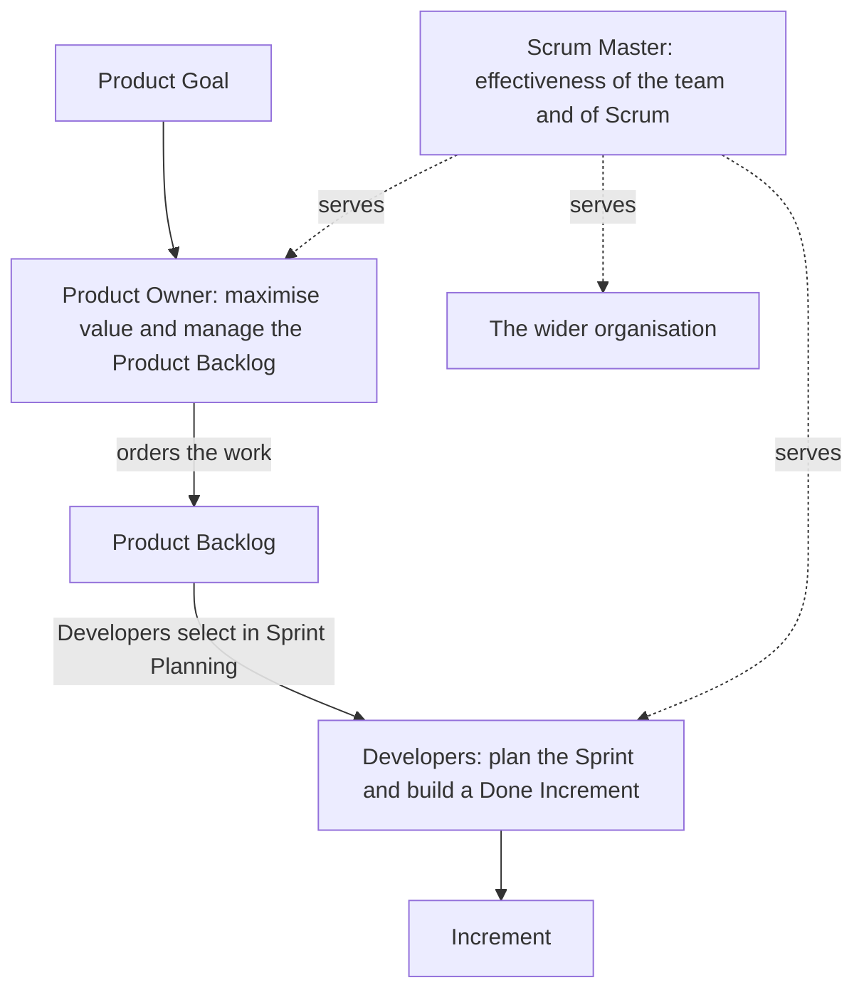

# Scrum accountabilities: Developers, Product Owner, Scrum Master

> **Before this lesson:** read [Scrum theory: empiricism, pillars and values](#/lesson/jira/scrum-theory). You should know what a Scrum Team is and why it is small, cross-functional and self-managing.

## In plain words

Picture a small restaurant kitchen. The head chef decides what goes on the menu and in which order dishes matter most. The cooks decide how to prepare each dish and hold each other to the kitchen's standards. A third person keeps the kitchen running smoothly: making sure the right supplies arrive, that service rituals happen on time, and that everyone knows the house way of working. None of them is the others' boss in the usual sense. Each one is *accountable* for a different outcome.

Scrum divides responsibility in a similar way. It names three **accountabilities**. An accountability is an outcome someone must answer for. The three are the **Developers**, the **Product Owner** and the **Scrum Master**. The 2020 Scrum Guide uses the word "accountabilities" deliberately: these are not job titles, and one person's job can include more or less than an accountability.

Why it matters for a job: interviewers often ask "Who decides what goes into a sprint?", "What does your Scrum Master do?" or "What happens when a stakeholder asks you directly for a feature?" The answers come straight from these accountabilities. Knowing them also helps you work well: you will know who to talk to about priorities (the Product Owner) and who to talk to about a process that is not working (the Scrum Master, and the whole team at the retrospective).

## The overall picture



The Guide describes the whole Scrum Team as accountable for creating a valuable, useful Increment every Sprint. Within that shared accountability, each of the three has specific outcomes to answer for.

## Developers

**Developers** are the people in the Scrum Team committed to creating any part of a usable Increment each Sprint. The word "developer" here is broad: it includes anyone doing the work, so a tester, designer, data analyst or technical writer on the team is a Developer in Scrum terms.

The Guide says Developers are always accountable for four things. Here they are in plain words with an example of each.

| Accountability | What it means | Example |
|---|---|---|
| Creating a plan for the Sprint | The Developers build the **Sprint Backlog**, the plan for how they will reach the Sprint's goal. | During planning, they break "export statements as PDF" into tasks: template, rendering service, download endpoint, tests. |
| Instilling quality | They follow the **Definition of Done**, the team's quality bar for finished work. | They will not call the PDF export finished until it has automated tests and passes accessibility checks, because the Definition of Done says so. |
| Adapting the plan every day | They adjust the plan towards the Sprint Goal as they learn. | On day three, the rendering library turns out to be slow, so they switch libraries and reshuffle tasks. |
| Holding each other accountable | They hold one another to professional standards. | In code review, a teammate points out a missing test; nobody needs a manager to enforce it. |

The key idea is **self-management**. Nobody outside the Developers tells them how to turn backlog items into a working Increment, or which person picks up which task. In Jira terms, that means a manager should not be assigning every sub-task on the board; the Developers pull work themselves.

> [!NOTE]
> Older Scrum material talks about a "Development Team" as a team within the team. The 2020 Guide removed that idea and uses "Developers", to stress that there is one Scrum Team with no sub-teams.

## Product Owner

The **Product Owner** (often shortened to **PO**) is accountable for **maximising the value of the product** that results from the Scrum Team's work. How they do that varies widely between organisations, teams and people.

The Guide also makes the Product Owner accountable for effective **Product Backlog management**. The **Product Backlog** is the single ordered list of everything that might be done to improve the product. Managing it includes:

1. Developing and clearly communicating the **Product Goal**, the long-term objective the team is working towards.
2. Creating and clearly communicating **Product Backlog items**, the individual pieces of work in the list.
3. **Ordering** those items. Note the word: ordered, not merely prioritised. Ordering means deciding a sequence, considering value, risk, dependencies and learning, not only labelling things "high" or "low".
4. Making sure the Product Backlog is transparent, visible and understood.

The Product Owner may delegate some of this work, for example letting a senior engineer write technical backlog items, but remains accountable for it.

Three rules from the Guide are especially important in real life:

- **One person, not a committee.** The Product Owner may represent the needs of many stakeholders, but one person makes the final call on ordering.
- **Respect the decisions.** For the Product Owner to succeed, the organisation must respect their decisions. Those decisions are visible in the content and order of the Product Backlog and in what the Increment contains at the Sprint Review.
- **Change goes through the Product Owner.** Anyone who wants to change the Product Backlog does so by convincing the Product Owner.

> [!WARNING]
> A classic anti-pattern: a senior manager walks up to a developer and says "Can you squeeze this in today?" The developer says yes, the Sprint Goal slips, and nobody else knows why. The healthy response is polite and simple: "That sounds important. Let's take it to our Product Owner so it can be ordered against the rest." This protects both the team and the manager.

### Product Owner versus Product Manager

Many companies, including large tech firms, have a job called **Product Manager** (PM). A Product Manager usually owns product strategy, research, roadmaps and business outcomes for a product area. In a company that uses Scrum, the Product Manager often holds the Product Owner accountability as part of their job. In other companies, especially banks and large enterprises, there is a dedicated Product Owner who works closely with a business sponsor. The title differs; the accountability is the same: someone must decide what is most valuable next and own the backlog's order.

## Scrum Master

The **Scrum Master** is accountable for establishing Scrum as defined in the Guide, by helping everyone in the team and the organisation understand Scrum's theory and practice. The Guide also makes the Scrum Master accountable for the **Scrum Team's effectiveness**: helping the team improve its practices within the framework.

The Guide calls Scrum Masters true leaders who serve the Scrum Team and the larger organisation. "Serve" is the key word: the Scrum Master is not the team's manager and does not assign work. The Guide lists how the Scrum Master serves three groups.

**Serving the Scrum Team**

- Coaching members in self-management and cross-functionality.
- Helping the team focus on creating high-value Increments that meet the Definition of Done.
- Causing the removal of **impediments**, meaning anything that blocks the team's progress and that the team cannot easily remove itself. Note "causing the removal": the Scrum Master does not have to remove every blocker personally, but makes sure someone does.
- Ensuring all Scrum events take place and are positive, productive and kept within their time limits.

**Serving the Product Owner**

- Helping find techniques for defining the Product Goal and managing the Product Backlog.
- Helping the team understand why clear and concise backlog items matter.
- Helping establish empirical product planning for a complex environment.
- Facilitating collaboration with stakeholders when requested or needed.

**Serving the organisation**

- Leading, training and coaching the organisation in adopting Scrum.
- Planning and advising Scrum implementations.
- Helping employees and stakeholders understand an empirical approach.
- Removing barriers between stakeholders and Scrum Teams.

> [!TIP]
> A good test for a Scrum Master's work: over time, the team should need them less for day-to-day facilitation. A team that cannot hold a useful Daily Scrum without the Scrum Master present has not yet learned self-management.

### Who is the Scrum Master in practice?

In many companies, the Scrum Master accountability is held by one of these:

- A dedicated Scrum Master or **Agile coach**, sometimes serving two or three teams.
- An **engineering manager** or team lead, which can work but risks blurring "serve" with "manage".
- A developer on the team, on rotation. Some big tech teams have no formal Scrum Master and share the work of facilitating events.

There is no single right answer. What matters is that someone is accountable for the team's effectiveness and the health of its process.

## Who decides what? A reference table

| Question | Who answers it |
|---|---|
| What is the long-term objective for the product? | Product Owner (the Product Goal) |
| What order should the Product Backlog be in? | Product Owner |
| How much work can we take into this Sprint? | Developers |
| How will we build this item? Who works on which task? | Developers |
| Is this item finished? | The Definition of Done, applied by the Developers |
| Why is our Daily Scrum taking 40 minutes? | Scrum Master helps the team find out; the team fixes it |
| Can we cancel this Sprint? | Only the Product Owner |
| A stakeholder wants something added | They convince the Product Owner |

## Scenario: three accountabilities on a busy Tuesday

The "Payments" team at a regional ride-hailing company runs two-week Sprints. Here is a Tuesday in week one.

**09:30, Daily Scrum.** Ravi, a backend developer, says the fraud-check service they depend on returns errors in staging. Two other items depend on it. The Developers discuss and agree that Ravi and Mei Lin will pair on a workaround, while Joseph picks up an independent item. Nobody asked a manager; the Developers adapted their own plan. *(Developers: adapting the plan daily.)*

**10:15.** Kenji, the team's Scrum Master, asks the fraud team's lead to look at the staging errors and sets up a short call between the two teams' engineers. *(Scrum Master: causing the removal of an impediment, removing barriers between teams.)*

**13:00.** A country manager messages Ravi directly: "Can you add e-wallet top-ups by Friday? Big partner meeting." Ravi replies that he will pass it to the Product Owner, Siti. *(Change goes through the Product Owner.)*

**14:00.** Siti talks to the country manager, learns the partner meeting needs a mock-up, not working code, and adds a backlog item for a design spike next Sprint. She explains the decision to the team at the next refinement session. *(Product Owner: ordering the backlog, maximising value, representing stakeholders.)*

**16:30.** The fraud service fix lands. The team's Jira board now shows the two blocked items moving again. Kenji notes the incident for discussion at the retrospective, so the team can decide whether to add a check for staging health. *(Scrum Master: team effectiveness; the whole team will decide at the retrospective.)*

## Mapping accountabilities to Jira

Jira itself has no built-in "Product Owner" or "Scrum Master" setting. People's abilities in Jira are controlled by permissions and space roles such as "Administrator" or "Member" (lesson 24 covers the basics). Teams usually make the accountabilities visible through habits:

- The Product Owner keeps the **backlog** view in Jira ordered by dragging items, and writes or approves item descriptions and acceptance criteria.
- The Developers create sub-tasks, assign themselves, and move cards across the **board**.
- The Scrum Master often configures the board, runs the sprint start and completion, and uses reports in retrospectives, though any trained team member can do these.

> [!WARNING]
> Watch out for a manager using Jira's assignee field to hand out tasks to individuals every morning. It quietly undoes self-management. The board should reflect the Developers' plan, not replace it.

## How interviewers probe this

> [!INTERVIEW]
> "A stakeholder from sales asks you to drop your sprint work and fix their urgent request. What do you do?" A strong answer: acknowledge the request, check whether it is a production emergency (if so, follow the team's incident process), otherwise route it to the Product Owner, who can order it against the Sprint Goal. If it truly must happen now, the team and PO decide together what to drop, and make that trade-off visible. This shows respect for the stakeholder and for the process.

Other likely questions:

- "What is the difference between a Scrum Master and a project manager?" A traditional project manager plans and assigns work and is accountable for delivery to a plan. A Scrum Master serves a self-managing team and is accountable for its effectiveness; planning and task assignment belong to the Developers.
- "Can the Product Owner also be a developer?" The Guide does not forbid one person holding several accountabilities, but combining PO and Developer can make it hard to step back and represent stakeholders. Say the trade-off.
- "Tell me about a time you disagreed with your Product Owner." This is a behavioural question. Use the structure from [Conflict and disagreement](#/lesson/behavioural/conflict): the disagreement, the data you gathered, how you discussed it, and the outcome.

## Summary

- Scrum has three accountabilities: Developers, Product Owner and Scrum Master. They are outcomes to answer for, not job titles.
- Developers create the Sprint plan, instil quality through the Definition of Done, adapt the plan daily, and hold each other accountable. They are self-managing.
- The Product Owner maximises the product's value and manages the Product Backlog: Product Goal, items, ordering and transparency. One person, whose decisions the organisation respects.
- The Scrum Master establishes Scrum, is accountable for the team's effectiveness, and serves the team, the Product Owner and the organisation, including causing the removal of impediments.
- Jira does not encode these accountabilities; teams show them through how they use the backlog and board.

## Glossary

- **Accountability** — an outcome a person must answer for; the 2020 Guide's word for the three parts of a Scrum Team.
- **Developers** — the people in the Scrum Team who create the Increment, whatever their speciality.
- **Product Owner (PO)** — the person accountable for maximising product value and managing the Product Backlog.
- **Scrum Master** — the person accountable for establishing Scrum and for the Scrum Team's effectiveness.
- **Product Backlog** — the single ordered list of what is needed to improve the product.
- **Product Backlog item** — one entry in the Product Backlog, such as a feature, fix or piece of research.
- **Product Goal** — the long-term objective the Scrum Team works towards.
- **Sprint Backlog** — the Developers' plan for the current Sprint.
- **Definition of Done** — the shared quality standard an item must meet to be part of the Increment.
- **Impediment** — anything blocking the team's progress that it cannot easily resolve alone.
- **Ordering** — arranging backlog items in a deliberate sequence, considering value, risk and dependencies.
- **Product Manager** — a common job title for someone owning a product's strategy and roadmap; often holds the Product Owner accountability.
- **Agile coach** — someone who helps teams or organisations adopt agile ways of working.

## Check yourself

```quiz
[
  {"q": "Who is accountable for ordering the Product Backlog?",
   "options": ["The Scrum Master", "The Developers", "The Product Owner", "The most senior engineer"],
   "answer": 2,
   "explain": "Product Backlog management, including ordering, is the Product Owner's accountability."},
  {"q": "Who decides how the work in a Sprint will be done and who does which task?",
   "options": ["The Product Owner", "The Developers", "The Scrum Master", "The engineering manager"],
   "answer": 1,
   "explain": "The Developers are self-managing: they create and adapt the Sprint plan."},
  {"q": "What does 'causing the removal of impediments' mean for a Scrum Master?",
   "options": ["Personally fixing every bug", "Making sure blockers get resolved, by whoever is best placed", "Removing team members who are slow", "Cancelling the Sprint"],
   "answer": 1,
   "explain": "The Scrum Master ensures blockers are removed but does not have to remove each one personally."},
  {"q": "According to the Guide, the Product Owner is...",
   "options": ["A committee of stakeholders", "One person who may represent many stakeholders", "Always the CEO", "Optional in small teams"],
   "answer": 1,
   "explain": "The Product Owner is one person, not a committee."},
  {"q": "In Scrum terms, a tester working in the team is...",
   "options": ["Not part of the Scrum Team", "A Developer", "A stakeholder", "A second Scrum Master"],
   "answer": 1,
   "explain": "Developers are anyone committed to creating the Increment, including testers, designers and analysts."},
  {"q": "A manager assigns every task on the Jira board to individuals each morning. Which Scrum idea does this undermine most?",
   "options": ["The Product Goal", "Self-management of the Developers", "The Sprint timebox", "Story points"],
   "answer": 1,
   "explain": "The Developers decide who does what. Daily assignment from outside the team replaces their self-management."},
  {"q": "A sales director wants a new feature added to the backlog. What is the Scrum way?",
   "options": ["Ask any developer to add it", "Convince the Product Owner", "Ask the Scrum Master to add it to the current Sprint", "Add it directly to the Sprint Backlog"],
   "answer": 1,
   "explain": "Anyone who wants to change the Product Backlog does so by convincing the Product Owner."},
  {"q": "What is the Scrum Master accountable for, according to the 2020 Guide?",
   "options": ["Delivering features on schedule", "The Scrum Team's effectiveness and establishing Scrum", "Writing the Product Goal", "Approving every pull request"],
   "answer": 1,
   "explain": "The Scrum Master establishes Scrum and is accountable for the team's effectiveness."}
]
```

> **Source:** Ken Schwaber and Jeff Sutherland, *The Scrum Guide* (2020), section "Scrum Team" (Developers, Product Owner, Scrum Master), https://scrumguides.org/scrum-guide.html (paraphrased); Atlassian Agile Coach, https://www.atlassian.com/agile
