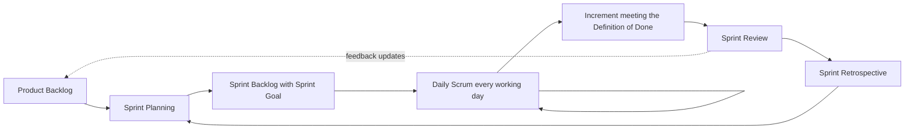

# The Scrum events and their timeboxes

> **Before this lesson:** read [Scrum theory](#/lesson/jira/scrum-theory) (the three pillars) and [Scrum accountabilities](#/lesson/jira/scrum-accountabilities) (Developers, Product Owner, Scrum Master).

## In plain words

A sports season has a rhythm: a pre-match team talk, the match itself, a short huddle at half-time, the post-match analysis with the coach, and then the next match. Each moment has a purpose and a fixed slot, and nobody needs to invent a new meeting to decide when to talk tactics.

Scrum gives a team the same kind of rhythm through five **events**. An event is a planned occasion with a specific purpose. Scrum's five are: the **Sprint**, **Sprint Planning**, the **Daily Scrum**, the **Sprint Review** and the **Sprint Retrospective**. Every event except the Sprint itself is an opportunity to inspect something and adapt. Every event has a **timebox**: a maximum length of time, after which the event ends whether or not it feels "finished".

Why it matters for a job: if you join a Scrum team, your calendar will contain these events every few weeks. Interviewers ask "Walk me through your sprint", "What happens in a retrospective?" and "What do you do if the daily stand-up runs long?". Knowing each event's purpose lets you answer, and lets you make the events useful instead of dreading them.

## The timeboxes at a glance

The Scrum Guide gives maximum lengths based on a one-month Sprint. For shorter Sprints, the Guide says the events are usually shorter.

| Event | Who takes part | Purpose in one line | Maximum length (one-month Sprint) |
|---|---|---|---|
| Sprint | The whole Scrum Team | A fixed-length container for all the other events and the work | One month or less |
| Sprint Planning | The whole Scrum Team (others may be invited to advise) | Agree why this Sprint is valuable, what can be done, and how | 8 hours |
| Daily Scrum | The Developers | Inspect progress towards the Sprint Goal and adapt the plan | 15 minutes |
| Sprint Review | Scrum Team and key stakeholders | Inspect the outcome and decide future adaptations | 4 hours |
| Sprint Retrospective | The Scrum Team | Plan ways to increase quality and effectiveness | 3 hours |

The 15-minute Daily Scrum is the only one that does not shrink: it is 15 minutes regardless of Sprint length.

> [!TIP]
> A timebox is a maximum, not a target. A two-week team's Sprint Planning might take two hours. If it takes eight every time, that is a sign the backlog is not refined enough before planning.

## The cycle



A new Sprint starts immediately after the previous one ends. There is no gap and no "hardening sprint" in between in the Guide's description.

## Event 1: the Sprint

The **Sprint** is the heartbeat of Scrum. It is a fixed-length period of one month or less in which ideas are turned into value. All the other events, and all the work, happen inside Sprints.

Fixed length matters. If a team ran a Sprint of ten days, then sixteen, then seven, it would lose its rhythm and its ability to compare one Sprint with the next. Most software teams pick one or two weeks; two weeks is very common.

The Guide sets rules for what happens during a Sprint:

- No changes are made that would endanger the **Sprint Goal** (the single objective for the Sprint, explained in lesson 5).
- Quality does not decrease. You do not cut tests to make the dates.
- The Product Backlog is refined as needed.
- Scope may be clarified and renegotiated with the Product Owner as more is learned.

That last rule is subtle and important. The *goal* is stable; the *exact list of items* is allowed to move, by agreement with the Product Owner, as the team learns.

### Cancelling a Sprint

A Sprint can be cancelled if its Sprint Goal becomes obsolete, for example because the company drops the product line or a regulator changes the rules overnight. **Only the Product Owner has the authority to cancel a Sprint.** Cancellations are rare and disruptive; the team then starts a new Sprint with fresh planning.

> [!WARNING]
> "Our Sprint is cancelled because we will not finish everything" is a misuse. Not finishing items is normal information for the review and retrospective. Cancellation is for when the goal itself no longer makes sense.

## Event 2: Sprint Planning

**Sprint Planning** starts the Sprint. The whole Scrum Team works out the plan together. The Product Owner makes sure attendees are ready to discuss the most important backlog items and how they connect to the Product Goal. The team may invite other people, such as an architect or a security specialist, to give advice.

The Guide organises planning around three topics:

**Topic one: Why is this Sprint valuable?** The Product Owner proposes how the product could increase its value in this Sprint. The whole team then crafts a **Sprint Goal** that explains to stakeholders why the Sprint is valuable. The Sprint Goal must be agreed before planning ends.

**Topic two: What can be done this Sprint?** In discussion with the Product Owner, the Developers select items from the Product Backlog to include. The team may refine these items during the conversation. Selecting how much can be completed is hard; the Guide notes that the more the Developers know about their past performance, upcoming capacity and Definition of Done, the more confident their forecast will be.

**Topic three: How will the chosen work get done?** For each selected item, the Developers plan the work needed to create an Increment that meets the Definition of Done. Often this means breaking items into smaller pieces of work of one day or less. How this is done is entirely up to the Developers.

The result is the **Sprint Backlog**: the Sprint Goal, the selected items, and the plan for delivering them.

> [!NOTE]
> "Capacity" means how much time the team actually has available this Sprint, after holidays, on-call duties, training and meetings. In Singapore, public holidays such as Hari Raya Puasa, Deepavali or Chinese New Year can take a big bite out of a two-week Sprint for the whole team at once. Lesson 15 and the problem [Sprint capacity planning](#/problem/jira-sprint-capacity) work through the arithmetic.

## Event 3: the Daily Scrum

The **Daily Scrum** is a 15-minute event for the Developers, held at the same time and place every working day to reduce complexity. Its purpose is to inspect progress towards the Sprint Goal and adapt the Sprint Backlog as necessary.

The Developers choose the format. A common one is three questions each ("What did I do yesterday towards the goal? What will I do today? Is anything blocking me?"), but the Guide does not require them. Many teams instead "walk the board": go through the columns from right to left (from nearly done to not started), asking what it takes to finish each item.

Who attends? It is for the Developers. If the Product Owner or Scrum Master are actively working on items in the Sprint Backlog, they take part as Developers.

What the Daily Scrum is **not**:

- A status report to a manager.
- The only time the team is allowed to talk. Detailed discussions happen after it, with only the people who need to be there.
- A problem-solving session. Spot the problem in the 15 minutes, solve it afterwards.

> [!TIP]
> A good closing question for any Daily Scrum: "Looking at the board, are we still on track for the Sprint Goal? If not, what do we change today?" That single question keeps the event about the goal rather than about individuals.

## Event 4: the Sprint Review

The **Sprint Review** inspects the outcome of the Sprint and decides future adaptations. The Scrum Team presents the results of its work to key stakeholders, and progress towards the Product Goal is discussed. Together, attendees decide what to do next; the Product Backlog may be adjusted to reflect new opportunities.

The Guide stresses that the Sprint Review is a **working session** and that the team should avoid limiting it to a presentation. In practice:

- Stakeholders try the working software themselves where possible.
- The team shares what was done and what was not, and why.
- The market, budget, timeline and competitors may be discussed if they affect what to build next.
- The Product Owner updates the backlog with what was learned.

Only work that meets the Definition of Done is part of the Increment shown. Half-finished work goes back to the Product Backlog for future consideration.

## Event 5: the Sprint Retrospective

The **Sprint Retrospective** concludes the Sprint. Its purpose is to plan ways to increase quality and effectiveness.

The team inspects how the last Sprint went with regard to individuals, interactions, processes, tools and its Definition of Done. It discusses what went well, what problems it encountered and how those problems were (or were not) solved. Then it identifies the most helpful changes to improve its effectiveness. The Guide says the most impactful improvements are addressed as soon as possible and may even be added to the Sprint Backlog for the next Sprint.

Practical formats teams use include "Start, Stop, Continue", "Went well, To improve, Actions", or a timeline of the Sprint with highs and lows. The format matters less than two rules:

1. **Safety.** People must be able to say what went wrong without fear of blame.
2. **Follow-through.** Choose one or two concrete actions with an owner. A retrospective whose actions are never done teaches the team that retrospectives are pointless.

> [!TIP]
> Put the retrospective's top action into the next Sprint as a visible item on the Jira board. If it is invisible, it competes with feature work and loses.

## Backlog refinement: an activity, not an event

You will often hear about **backlog refinement** (older name: backlog grooming). Refinement means breaking down and further defining Product Backlog items into smaller, more precise items: adding detail, acceptance criteria, estimates and order. The Guide describes it as an ongoing activity, not one of the five events.

Many teams still schedule a regular refinement session, perhaps one hour a week, because otherwise it never happens. That is a sensible practice. The 2020 Guide gives no percentage of capacity to spend on refinement; you may see "about 10%" quoted, but that figure came from an older edition of the Guide.

## A two-week Sprint on the calendar

Here is a common two-week schedule. Run it to print a calendar; edit the dates or lengths and run again.

```python-run
from datetime import date, timedelta

start = date(2026, 3, 2)          # a Monday
sprint_days = 10                  # working days in a two-week Sprint
holidays = {date(2026, 3, 20)}    # example: one public holiday inside the Sprint

day, working = start, []
while len(working) < sprint_days:
    if day.weekday() < 5 and day not in holidays:   # Monday=0 ... Friday=4
        working.append(day)
    day += timedelta(days=1)

for i, d in enumerate(working):
    events = ["Daily Scrum 15m"]
    if i == 0:
        events.insert(0, "Sprint Planning ~2-4h")
    if i == 4:
        events.append("Backlog refinement 1h")
    if i == len(working) - 1:
        events += ["Sprint Review ~1-2h", "Sprint Retrospective ~1-1.5h"]
    print(d.strftime("%a %d %b"), "|", ", ".join(events))
print("Sprint ends", working[-1], "- next Sprint starts the following working day")
```

The output shows ten working days. Planning sits on day one, the Daily Scrum on every day, a refinement session mid-Sprint, and the review and retrospective on the last day. Because of the holiday, the Sprint stretches into a third calendar week. Many teams instead keep the calendar fixed and accept less capacity; either way, the holiday must be visible during planning.

The shorter durations in the script (for example "~2-4h" for planning) are typical proportional scaling for a two-week Sprint, not numbers from the Guide. The Guide gives only the one-month maxima and says shorter Sprints usually have shorter events.

## Scenario: when the events go wrong

**Symptom: the Daily Scrum takes 40 minutes.** Usually because people solve problems in it or report to a manager. Fix: stick to the goal-focused question, park discussions for afterwards, and ask the Scrum Master to coach the team on the purpose.

**Symptom: the Sprint Review is a slide deck nobody questions.** Stakeholders are passive. Fix: show working software, let stakeholders drive it, and end with "what should we do next?".

**Symptom: retrospectives always produce the same complaints.** Actions are vague ("communicate better") or never done. Fix: one specific, owned action, tracked on the board, reviewed at the start of the next retrospective.

**Symptom: Sprint Planning runs all day.** Items arrive unrefined and huge. Fix: hold refinement during the previous Sprint so items are small and understood before planning.

**Symptom: "We'll do the retro next Sprint, we're too busy."** Skipping inspection when under pressure is exactly backwards: that is when the team most needs to adapt.

## How interviewers probe this

> [!INTERVIEW]
> "Walk me through a typical sprint on your team." Use the events in order and add one concrete detail each: "Two-week sprints. Planning on Monday morning, about two hours: our PO proposes the goal, we pull items, break them into tasks. Fifteen-minute stand-up at 9:45 where we walk the board. A refinement hour on Wednesday of week one. Review on the last Thursday where stakeholders try the build in staging, then a retro where we pick one improvement and put it on the next sprint's board." Specifics show you have lived it.

Other likely questions:

- "What are the timeboxes for Scrum events?" Give the one-month maxima: 8 hours, 15 minutes, 4 hours, 3 hours, and say they are usually shorter for shorter Sprints.
- "Who can cancel a Sprint, and when?" Only the Product Owner, when the Sprint Goal becomes obsolete.
- "Is backlog refinement a Scrum event?" No, it is an ongoing activity in the 2020 Guide.
- "The stand-up has become a status meeting for the manager. What would you do?" Raise it at the retrospective, refocus on the Sprint Goal, and suggest the manager gets status from the board instead.

## Summary

- Scrum has five events: the Sprint (a container of one month or less), Sprint Planning, the Daily Scrum, the Sprint Review and the Sprint Retrospective.
- Maximum lengths for a one-month Sprint: planning 8 hours, Daily Scrum 15 minutes, review 4 hours, retrospective 3 hours; shorter Sprints usually have shorter events.
- Sprint Planning answers why the Sprint is valuable (the Sprint Goal), what can be done, and how.
- During a Sprint, nothing endangers the Sprint Goal and quality does not drop, but scope can be renegotiated with the Product Owner.
- Only the Product Owner can cancel a Sprint, and only when its goal is obsolete.
- Backlog refinement is an ongoing activity, not an event; the 2020 Guide gives no capacity percentage for it.

## Glossary

- **Event** — one of Scrum's five planned occasions, each with a purpose and a timebox.
- **Timebox** — a fixed maximum duration for an event.
- **Sprint** — a fixed-length period of one month or less that contains all Scrum work and events.
- **Sprint Planning** — the event that starts a Sprint by agreeing the Sprint Goal, the selected items and the plan.
- **Daily Scrum** — a 15-minute daily event where Developers inspect progress towards the Sprint Goal and adapt their plan; often called the stand-up.
- **Sprint Review** — a working session with stakeholders to inspect the Sprint's outcome and adapt the backlog.
- **Sprint Retrospective** — the event where the team plans improvements to quality and effectiveness.
- **Sprint Goal** — the single objective for a Sprint.
- **Capacity** — the working time a team actually has available in a Sprint.
- **Backlog refinement** — the ongoing activity of breaking down and adding detail to backlog items.
- **Walking the board** — running the Daily Scrum by discussing items on the board, usually right to left.

## Check yourself

```quiz
[
  {"q": "What is the maximum length of Sprint Planning for a one-month Sprint?",
   "options": ["2 hours", "4 hours", "8 hours", "15 minutes"],
   "answer": 2,
   "explain": "The Guide gives 8 hours for a one-month Sprint; shorter Sprints usually need less."},
  {"q": "Which event's timebox stays the same no matter how long the Sprint is?",
   "options": ["Sprint Review", "Daily Scrum", "Sprint Retrospective", "Sprint Planning"],
   "answer": 1,
   "explain": "The Daily Scrum is always 15 minutes."},
  {"q": "Who can cancel a Sprint?",
   "options": ["The Scrum Master", "Any stakeholder", "Only the Product Owner", "The Developers by vote"],
   "answer": 2,
   "explain": "Only the Product Owner can cancel a Sprint, when its Sprint Goal becomes obsolete."},
  {"q": "Which three topics does Sprint Planning address?",
   "options": ["Who, when, cost", "Why this Sprint is valuable, what can be done, how it will get done", "Yesterday, today, blockers", "Start, stop, continue"],
   "answer": 1,
   "explain": "Why (the Sprint Goal), What (selected items) and How (the plan)."},
  {"q": "During a Sprint, the team learns an item is bigger than expected. What does the Guide allow?",
   "options": ["Lower quality to fit it in", "Renegotiate scope with the Product Owner while keeping the Sprint Goal", "Extend the Sprint by a week", "Cancel the Sprint"],
   "answer": 1,
   "explain": "Scope may be clarified and renegotiated with the PO; the Sprint Goal and quality are protected."},
  {"q": "Is backlog refinement one of the five Scrum events?",
   "options": ["Yes, with a 2-hour timebox", "No, it is an ongoing activity", "Yes, it replaced the Sprint Review", "Only in Kanban"],
   "answer": 1,
   "explain": "The 2020 Guide describes refinement as an ongoing activity, not an event."},
  {"q": "What is the main purpose of the Sprint Review?",
   "options": ["Approve the team's timesheets", "A slide presentation of finished work", "Inspect the outcome with stakeholders and decide future adaptations", "Plan the next Sprint's tasks"],
   "answer": 2,
   "explain": "The review is a working session to inspect the Increment and adapt the Product Backlog."},
  {"q": "What is the most important rule for retrospective actions?",
   "options": ["There should be at least ten", "Choose a few concrete, owned actions and follow through", "They must be approved by management", "They should only concern tools"],
   "answer": 1,
   "explain": "Unowned or forgotten actions teach the team that retrospectives change nothing."}
]
```

> **Source:** Ken Schwaber and Jeff Sutherland, *The Scrum Guide* (2020), section "Scrum Events" (The Sprint, Sprint Planning, Daily Scrum, Sprint Review, Sprint Retrospective), https://scrumguides.org/scrum-guide.html (paraphrased); Atlassian, What is a sprint, https://support.atlassian.com/jira-software-cloud/docs/what-is-a-sprint/
