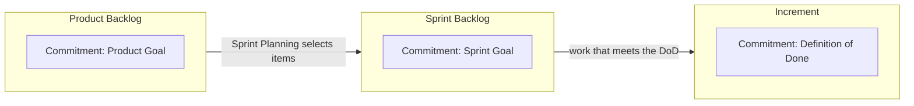

# Artifacts and commitments: Product Goal, Sprint Goal, Definition of Done

> **Before this lesson:** read [The Scrum events and their timeboxes](#/lesson/jira/scrum-events). You should know what happens in Sprint Planning and the Sprint Review.

## In plain words

When you renovate a flat, three documents keep everyone honest. A **wish list** of everything you might want done, with the most important things at the top. A **plan for this month**: the jobs the contractor will tackle now and why ("make the kitchen usable"). And a **checklist for "finished"**: wiring certified, paint dry, debris removed. Without the checklist, "the kitchen is done" means different things to you and to the contractor.

Scrum has three **artifacts** that play the same roles: the **Product Backlog** (the wish list), the **Sprint Backlog** (this Sprint's plan) and the **Increment** (the finished, usable work). An artifact here means a piece of information that represents work or value and is made visible so that it can be inspected.

The 2020 Scrum Guide added something important: each artifact has a **commitment** attached. A commitment is a fixed point that gives the artifact focus and lets progress be measured against it:

| Artifact | Commitment | The question the commitment answers |
|---|---|---|
| Product Backlog | **Product Goal** | Where are we heading in the long run? |
| Sprint Backlog | **Sprint Goal** | Why does this Sprint matter? |
| Increment | **Definition of Done** | What does "finished" mean for us? |

Why it matters for a job: "What is your Definition of Done?" and "What makes a good Sprint Goal?" are standard interview questions for engineers in Scrum teams. Day to day, these commitments decide whether you can call your work finished and whether a mid-Sprint request is reasonable.



## Artifact 1: the Product Backlog and the Product Goal

The **Product Backlog** is an emergent, ordered list of what is needed to improve the product. "Emergent" means it changes as the team and stakeholders learn; it is never complete. The Guide calls it the single source of work undertaken by the Scrum Team. If something is not on the Product Backlog, the team is not supposed to be doing it.

Items near the top are smaller and clearer, ready to be selected in a Sprint Planning soon. Items lower down can be large and vague; there is no point detailing work that may never happen.

The **Product Goal** describes a future state of the product that the team plans for. It lives in the Product Backlog, and the rest of the backlog emerges to define what will fulfil it. The Guide says the Scrum Team must fulfil (or abandon) one Product Goal before taking on the next. It is a long-term objective, often reached over many Sprints.

Examples of Product Goals:

- "Small merchants in Singapore and Malaysia can accept QR payments without visiting a branch."
- "Our mobile app's checkout works fully offline-tolerant for riders in low-signal areas."

A good Product Goal is specific enough that you could argue whether a backlog item helps it, and broad enough to leave room for discovery.

## Artifact 2: the Sprint Backlog and the Sprint Goal

The **Sprint Backlog** has three parts:

1. The **Sprint Goal** (the why).
2. The Product Backlog items selected for the Sprint (the what).
3. An actionable plan for delivering the Increment (the how), often as tasks.

It is a plan made by and for the Developers, and the Guide describes it as a highly visible, real-time picture of the work they plan to do during the Sprint. It is updated throughout the Sprint as more is learned. In Jira, this is the content of the active sprint on the board.

The **Sprint Goal** is the single objective for the Sprint. It is created during Sprint Planning and added to the Sprint Backlog. It gives the Developers flexibility about the exact work needed to achieve it, and it creates coherence and focus, encouraging the team to work together rather than on separate initiatives.

If the work turns out to be different from what was expected, the Developers collaborate with the Product Owner to negotiate the scope of the Sprint Backlog **without affecting the Sprint Goal**.

### Good and bad Sprint Goals

| Weak Sprint Goal | Why it is weak | Stronger version |
|---|---|---|
| "Complete PAY-101, PAY-104, PAY-110" | A list of tickets, no reason; any slip "fails" the goal | "Customers can refund a card payment themselves from the order page" |
| "Work on performance" | Not inspectable | "Search results load in under one second for the 95% of queries we measured last week" |
| "Do as much as possible" | No focus at all | "Prove that the new pricing engine can replace the old one for the top 10 products" |

A strong goal states an outcome that stakeholders understand and that the team can check at the review.

> [!TIP]
> Jira lets you enter a sprint goal when you start a sprint, and shows it on the board. Write it there. A goal that only exists in someone's head cannot be inspected at the Daily Scrum.

## Artifact 3: the Increment and the Definition of Done

An **Increment** is a concrete stepping stone towards the Product Goal. Each Increment adds to all previous Increments and is thoroughly verified, so that all Increments work together. To provide value, an Increment must be **usable**.

Three points from the Guide often surprise people:

- **Several Increments can be created within one Sprint.** You do not have to wait for the end of the Sprint.
- The sum of the Increments is presented at the Sprint Review, but an Increment **may be delivered to stakeholders before the end of the Sprint**. The Guide says the Sprint Review should never be considered a gate to releasing value. Teams practising continuous delivery release many times per Sprint, which fits Scrum perfectly.
- Work cannot be considered part of an Increment unless it meets the Definition of Done.

### The Definition of Done

The **Definition of Done** (DoD) is a formal description of the state of the Increment when it meets the quality measures required for the product. The moment a Product Backlog item meets the Definition of Done, an Increment is born.

The DoD creates transparency by giving everyone a shared understanding of what work was completed. If a Product Backlog item does not meet the Definition of Done, it cannot be released or even presented at the Sprint Review. It returns to the Product Backlog for future consideration.

Who writes it? If the organisation has a standard DoD, all Scrum Teams must follow it as a minimum. If not, the Scrum Team creates one appropriate for the product. If several Scrum Teams work on the same product, they must share and comply with the same DoD.

### An example Definition of Done

Here is a realistic DoD for a web product team:

1. Code is merged to the main branch through a reviewed pull request (at least one approval).
2. Automated unit and integration tests are written and passing in the pipeline.
3. No new critical or high findings from the security scanner.
4. The feature is behind a feature flag or is safe to release immediately.
5. Deployed to the staging environment and smoke-tested.
6. User-facing text has been reviewed, and screens meet the team's accessibility checks.
7. Monitoring or logging is in place for new endpoints.
8. Documentation (API reference or runbook) is updated.

Notice what this list is: it applies to **every** item. It does not say anything specific about any one feature.

> [!NOTE]
> Many items on a good DoD come from engineering practice: code review, automated tests, deployment pipelines. The git track's lesson on [reviews, protected branches and Actions](#/lesson/git/github-reviews-automation) and the CI/CD track's [continuous integration](#/lesson/cicd/ci-practices) lesson cover how those checks are enforced automatically. A DoD that is enforced by tools is much more reliable than one enforced by memory.

### Definition of Done versus acceptance criteria

These two are often confused. Atlassian's Agile Coach draws the same line:

| | Definition of Done | Acceptance criteria |
|---|---|---|
| Applies to | Every item in the product | One specific item |
| Describes | Quality standard for "finished" | What this item must do to be accepted |
| Example | "Automated tests pass in CI" | "A refund cannot exceed the original payment amount" |
| Who writes it | The team (or organisation standard) | Usually the Product Owner with the team |
| Changes | Rarely, and deliberately (often raised in retrospectives) | Per item |

An item is finished when it meets **both**: its own acceptance criteria and the shared Definition of Done. Lesson 7 covers acceptance criteria in detail.

## Definition of Ready: popular, but not in the Guide

Some teams also use a **Definition of Ready** (DoR): a checklist an item should meet before it is pulled into a Sprint, for example "has acceptance criteria", "is estimated", "dependencies identified". It is **not** part of the Scrum Guide. A Scrum.org article from 2017 describes it as an optional practice and warns about the risk: if a DoR becomes a strict gate, it can turn into a hand-off contract between a business side and a development side, which works against collaboration.

A sensible stance: a light DoR can help a team notice unrefined items before planning, but treat it as a conversation guide, not a rule for refusing work.

## How Jira represents the artifacts

Jira does not use the word "artifact", but its views map onto them:

| Scrum artifact | Where it lives in Jira (Scrum board) |
|---|---|
| Product Backlog | The **Backlog** view: the ordered list below the sprints |
| Product Goal | Often written in a board description, an epic, or a pinned page; Jira has no single dedicated field for it in classic setups |
| Sprint Backlog | The **active sprint**: its work items, sub-tasks, and the board columns |
| Sprint Goal | The sprint goal field entered when starting the sprint |
| Increment | The released code itself; Jira can group finished work into **versions** (releases), covered in lesson 11 |
| Definition of Done | Usually a team page, a checklist in work item templates, or rules enforced by workflow conditions and automation (lessons 13 and 23) |

One Jira-specific trap: Jira considers a work item "done" for reports when it reaches the **rightmost column** of the board. That is a mechanical definition. The Scrum Definition of Done is a quality standard. If a team drags cards to the last column before the DoD is met, Jira's reports will look good while the Increment is not actually usable.

> [!WARNING]
> "Done but not Done-done" is a red flag. If your team says "it's done, we just need to test it", the item is not done. Either the DoD is being ignored or the board has too few columns to show where work really is.

## Scenario: the DoD saves a release

A Singapore insurance-tech team has an item "Customers can download their policy as PDF". The developer finishes the code on Wednesday, the reviewer approves on Thursday, and the PDF looks right on the developer's laptop.

The team's DoD includes "deployed to staging and smoke-tested" and "accessibility checks pass". In staging, the PDF generator fails on policies with Chinese characters in the insured person's name, because the staging fonts differ from the developer's machine. The accessibility check also flags that the download button has no text label for screen readers.

Without the DoD, the item would have been dragged to Done, shown at the review, and released to production, where a real customer with a Chinese name would have found the bug. With the DoD, the item stays in progress, the font issue is fixed on Friday, and the Increment shown on the last day is genuinely usable.

At the retrospective, the team adds "test with names in all four official languages" (English, Chinese, Malay and Tamil are Singapore's official languages) to their testing checklist. The DoD itself has improved, which is exactly what the Guide expects retrospectives to do.

You can practise automating a DoD check in the problem [Definition of Done checker](#/problem/jira-dod-check).

## How interviewers probe this

> [!INTERVIEW]
> "What is your team's Definition of Done?" Have a concrete list ready, five to eight items, and explain why one of them exists: "We added 'dashboards updated for new endpoints' after an incident where we could not see a new service failing." That shows the DoD is a living, improving standard.

Other likely questions:

- "What is the difference between acceptance criteria and the Definition of Done?" Item-specific versus universal.
- "What happens to unfinished work at the end of a Sprint?" It does not count towards the Increment; it returns to the Product Backlog, where the Product Owner reorders it (often into the next Sprint).
- "Can you release in the middle of a Sprint?" Yes; Increments can be delivered before the Sprint ends. The review is not a release gate.
- "Is a Definition of Ready part of Scrum?" No; it is an optional practice with a risk of becoming a gate.

## Summary

- Scrum's three artifacts are the Product Backlog, the Sprint Backlog and the Increment.
- Each has a commitment: the Product Goal, the Sprint Goal and the Definition of Done.
- The Product Backlog is the single, ordered, emergent source of work; the Product Goal is its long-term objective.
- The Sprint Backlog is the Sprint Goal plus selected items plus the Developers' plan; scope may change, the goal should not.
- An Increment is usable, verified work; several can be created in a Sprint and released before the review.
- The Definition of Done is the shared quality bar; work that misses it cannot be released or presented.
- The Definition of Ready is not in the Scrum Guide.
- In Jira, "done" for reports means the rightmost column, which is not the same as meeting the Definition of Done.

## Glossary

- **Artifact** — in Scrum, information representing work or value, made visible for inspection.
- **Commitment** — the fixed point attached to each artifact: Product Goal, Sprint Goal or Definition of Done.
- **Product Backlog** — the emergent, ordered list of what is needed to improve the product.
- **Emergent** — continually changing and growing as the team learns.
- **Product Goal** — the long-term future state of the product the team aims for.
- **Sprint Backlog** — the Sprint Goal, the selected items and the plan for delivering them.
- **Sprint Goal** — the single objective for a Sprint.
- **Increment** — a usable, verified piece of product that adds to all previous ones.
- **Definition of Done (DoD)** — the formal quality standard work must meet to be part of an Increment.
- **Acceptance criteria** — item-specific conditions that must be true for that item to be accepted.
- **Definition of Ready (DoR)** — an optional, non-Scrum checklist for items before they enter a Sprint.
- **Version** — in Jira, a named release that groups work items.

## Check yourself

```quiz
[
  {"q": "Which commitment belongs to the Increment?",
   "options": ["Product Goal", "Sprint Goal", "Definition of Done", "Definition of Ready"],
   "answer": 2,
   "explain": "Product Backlog: Product Goal. Sprint Backlog: Sprint Goal. Increment: Definition of Done."},
  {"q": "An item meets its acceptance criteria but has no automated tests, which the DoD requires. Can it be shown at the Sprint Review as done?",
   "options": ["Yes, acceptance criteria are enough", "No, it does not meet the DoD, so it returns to the Product Backlog", "Yes, if the Product Owner likes it", "Only if the Scrum Master approves"],
   "answer": 1,
   "explain": "Work that does not meet the Definition of Done cannot be released or presented."},
  {"q": "How many Increments can a team create in one Sprint?",
   "options": ["Exactly one", "One or more", "None; Increments are made only at release time", "Two at most"],
   "answer": 1,
   "explain": "The Guide says multiple Increments may be created within a Sprint."},
  {"q": "Which Sprint Goal is the strongest?",
   "options": ["Finish tickets PAY-1 to PAY-6", "Work on the refunds area", "Customers can refund a card payment themselves from the order page", "Do as much as possible"],
   "answer": 2,
   "explain": "It describes an outcome stakeholders understand and that can be inspected."},
  {"q": "Is the Definition of Ready part of the 2020 Scrum Guide?",
   "options": ["Yes, it is the commitment for the Sprint Backlog", "No, it is an optional practice", "Yes, but only for large teams", "It replaced the Definition of Done"],
   "answer": 1,
   "explain": "The DoR is a popular add-on practice, not part of the Guide."},
  {"q": "Three teams work on the same product. What does the Guide say about the Definition of Done?",
   "options": ["Each team writes its own", "They must share and comply with the same DoD", "Only the largest team needs one", "The Scrum Master writes it alone"],
   "answer": 1,
   "explain": "Multiple Scrum Teams on the same product share one Definition of Done."},
  {"q": "In Jira's Scrum reports, when is a work item counted as done?",
   "options": ["When its DoD checklist is ticked", "When it is in the rightmost column of the board", "When the sprint ends", "When the Product Owner comments 'done'"],
   "answer": 1,
   "explain": "Jira's reports treat the rightmost board column as done; that is mechanical and can differ from the real Definition of Done."},
  {"q": "Halfway through a Sprint, an item turns out to need far more work. What should happen?",
   "options": ["Change the Sprint Goal to match the items", "Negotiate the Sprint Backlog scope with the Product Owner without affecting the Sprint Goal", "Drop the Definition of Done for this item", "Cancel the Sprint"],
   "answer": 1,
   "explain": "Scope is negotiable; the goal and quality are protected."}
]
```

> **Source:** Ken Schwaber and Jeff Sutherland, *The Scrum Guide* (2020), section "Scrum Artifacts" (Product Backlog and Product Goal, Sprint Backlog and Sprint Goal, Increment and Definition of Done), https://scrumguides.org/scrum-guide.html (paraphrased); Scrum.org, Walking Through a Definition of Ready (2017), https://www.scrum.org/resources/blog/walking-through-definition-ready; Atlassian Agile Coach, Definition of Done, https://www.atlassian.com/agile/project-management/definition-of-done; Atlassian, Configure columns, https://support.atlassian.com/jira-software-cloud/docs/configure-columns/
