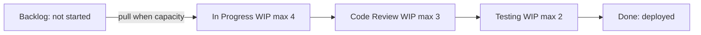

# Kanban: workflow, WIP limits, pull and service level expectations

> **Before this lesson:** read [What agile is](#/lesson/jira/agile-values). Knowing the [Scrum events](#/lesson/jira/scrum-events) helps for the comparison at the end, but is not required.

## In plain words

Think of a popular hawker stall at lunchtime. The cook can only fry four plates at once, so orders wait in a queue until a wok is free. Nobody starts a fifth plate while four are on the fire, because then every plate gets cold or burnt. When one plate goes out, the next order is pulled in. A good stall owner watches the queue: if orders are piling up at the drinks counter, the bottleneck is there, not at the wok.

**Kanban** applies that thinking to knowledge work. You make every piece of work and every stage visible (usually as cards on a board with columns), you **limit how much work is in progress** at each stage, and you **pull** new work only when there is capacity. Then you watch how work flows and improve the system.

The word "kanban" is Japanese for a signboard or visual card, and the approach comes originally from manufacturing. The current definition for knowledge work is **The Kanban Guide** (version 2025.5, published 1 May 2025, at kanbanguides.org), which this lesson paraphrases.

Why it matters for a job: many teams, especially platform, operations, support and data teams, run Kanban rather than Scrum. Jira offers a Kanban board type with work-in-progress limits and flow reports. Interviewers may ask "Scrum or Kanban, and why?" or "What is a WIP limit for?". Flow metrics such as cycle time are also used by engineering managers in Big Tech to discuss delivery.

## What the Kanban Guide says Kanban is

The Guide describes Kanban as a strategy for optimising the flow of value through a process. Its key ideas:

- **Flow** is the movement of potential value through a system.
- A **Kanban system** is the combination of the three practices below, run by its **members** (the people who take part in delivering value through it).
- There are no prescribed roles, events or Sprints. You can use Kanban on its own or alongside other ways of working, including Scrum.

## The three practices

The Kanban Guide names three practices that work together:

1. **Defining and visualising the workflow.**
2. **Actively managing items in the workflow.**
3. **Improving the workflow.**

### Practice 1: defining and visualising the workflow

The team writes down a shared, explicit understanding of how work flows. The Guide calls this the **Definition of Workflow** (DoW). At minimum, it includes:

| Element | Meaning | Example for a backend team |
|---|---|---|
| Work items | The units of value moving through the system | Feature requests and bugs |
| Start and finish points | When an item counts as started and as finished | Started when pulled into "In Progress"; finished when deployed to production |
| States | The stages between start and finish; items in them are **work in progress** | In Progress, Code Review, Testing |
| WIP control | How the amount of work in progress is limited | At most 4 in In Progress, 3 in Code Review |
| Explicit policies | Rules for how items move | "An item leaves Code Review only with one approval and green CI" |
| Service Level Expectation | A forecast of how long items should take | "85% of items finish within 8 days" |

The visual form is usually a **board**: columns for states, cards for items. A Jira Kanban board is exactly this, with columns mapped to workflow statuses (lesson 14).



Notice that the backlog sits **before** the start point. Items waiting there are not yet work in progress; the clock starts when they are pulled.

### Practice 2: actively managing items in the workflow

This is where Kanban earns its keep. Managing the workflow means:

- **Controlling WIP.** Work in progress (WIP) is the number of items that have started but not finished. The team keeps WIP within its limits.
- **Pulling.** New work starts only when there is a clear signal of capacity, usually when WIP drops below the limit. Work is not pushed onto people.
- **Not letting items age unnecessarily.** The team watches how long each in-progress item has been running and intervenes if one is getting old.
- **Responding to blocked items.**

**Why limit WIP?** Starting work feels productive, but every started-and-unfinished item has a cost: context switching, merge conflicts, partially built features delivering no value, and longer waiting for everything. Limiting WIP forces the question "Can I help finish something?" before "What new thing can I start?". A common team slogan is "stop starting, start finishing".

A worked example makes it concrete. Suppose a team of four has eight items, each needing two days of focused work.

- **Everyone starts two items at once and alternates.** Each item takes about four calendar days, and the first finished item appears on day four. All eight are done on day four.
- **Each person works on one item at a time.** The first four items finish on day two; the next four on day four.

Same total output, but in the second case half the value reaches users two days earlier, and the team learns from real usage sooner. In real life, multitasking also adds switching overhead, so the first case is usually worse than four days.

> [!NOTE]
> There is a well-known relationship from queueing theory, called Little's Law: in a stable system, average cycle time equals average WIP divided by average throughput. If a team finishes 5 items a week and keeps 10 items in progress, items take about 2 weeks on average. Halve the WIP at the same throughput and the average time roughly halves. It is a long-run average for stable systems, not a promise for any single item.

### Practice 3: improving the workflow

The team regularly looks at its flow metrics and policies and runs experiments to improve: lowering a WIP limit, splitting a column, changing a policy, automating a hand-off. Kanban has no mandated retrospective event, but teams often hold regular reviews of flow for this purpose.

## The four flow measures

The Kanban Guide says Kanban systems must track at least four measures. Learn the exact definitions; they come up in interviews and in Jira reports.

| Measure | Definition (paraphrased) | Example |
|---|---|---|
| **WIP** | The number of items started but not finished | 7 items currently between start and finish |
| **Throughput** | The number of items finished per unit of time, as an exact count | 12 items finished last week |
| **Work item age** | Time elapsed since an item started, for items not yet finished | KAN-42 started 9 days ago and is still in Code Review |
| **Cycle time** | Time elapsed from when an item started to when it finished | KAN-17 started Monday and finished Thursday: 4 days (depending on whether you count partial days) |

Two points beginners miss:

- **Age is for unfinished items; cycle time is for finished items.** Age is the early warning: an item whose age already exceeds your usual cycle time is at risk, and you can act *now*.
- **Throughput is a count of items, not story points.** Kanban does not require estimates at all. If items are kept reasonably small, counting them works well for forecasting (lesson 22).

You can compute throughput and age from timestamps in the problem [Throughput and work item age](#/problem/jira-throughput-age).

## Service Level Expectation

The **Service Level Expectation** (SLE) is a forecast of how long it should take a single item to flow from start to finish. It has two parts: a **time period** and a **probability**. For example: "85% of items finish within 8 days."

The Guide says the SLE should be based on historical cycle time. When a team has no history yet, it can make a best guess and refine it.

How a team uses it day to day: when an item's **age** approaches the SLE (say, it is on day 6 of 8), the team swarms on it, splits it, or removes the blocker. The SLE turns a vague "this is taking a while" into a clear trigger.

> [!TIP]
> To compute an SLE from history, sort the cycle times of recent finished items and read off the value below which, say, 85% of them fall (the 85th percentile). If the last 20 items had cycle times whose 85th percentile is 8 days, the SLE could be "85% within 8 days". Choosing 85% is common practice, not a rule.

## WIP limits in Jira

Jira boards let you set **column constraints**: a minimum and/or maximum number of items for each column. Atlassian's documentation describes the behaviour:

- When a column's **maximum is exceeded**, its column header turns **red**.
- When a column's **minimum is not met**, its column header turns **yellow**.
- The constraint counts **all** items in the column, including items currently hidden by quick filters.
- You can choose to count items with or without sub-tasks; Atlassian recommends excluding sub-tasks for Scrum teams.
- Jira does not stop you from dragging a card into a full column. The colour is a signal for a conversation, not a lock.

Why would a column need a **minimum**? A minimum on a "Ready for Development" column, for example, signals that refinement must top it up so developers never sit idle. A minimum on "In Progress" is unusual.

The problem [WIP-limit checker](#/problem/jira-wip-check) asks you to compute exactly these red and yellow signals.

## Try it: a mini Kanban board with WIP limits

Move cards with the arrow buttons, change the min and max of each column, and watch the column headers turn red (maximum exceeded) or yellow (minimum not met), the same signals Jira uses. The page also shows total WIP and suggests a pull when a column has room. It runs entirely in this frame and stores nothing.

```html-run
<!doctype html>
<html lang="en">
<head>
<meta charset="utf-8">
<title>Mini Kanban board</title>
<style>
  body { font-family: system-ui, sans-serif; margin: 10px; color: #1f2937; background: #fff; }
  .board { display: grid; grid-template-columns: repeat(4, 1fr); gap: 8px; }
  .col { border: 1px solid #d1d5db; border-radius: 8px; background: #f9fafb; min-height: 220px; }
  .head { padding: 6px 8px; border-radius: 8px 8px 0 0; background: #e5e7eb; font-weight: 600; font-size: 14px; }
  .head.red { background: #fca5a5; }
  .head.yellow { background: #fde68a; }
  .limits { font-weight: 400; font-size: 12px; margin-top: 4px; }
  .limits input { width: 38px; font: inherit; }
  .card { background: #fff; border: 1px solid #cbd5e1; border-radius: 6px; margin: 6px; padding: 6px; font-size: 13px; }
  .card .k { font-weight: 600; color: #1d4ed8; }
  .card button { font-size: 12px; margin-top: 4px; cursor: pointer; }
  #status { margin-top: 10px; font-size: 14px; }
  #status li { margin: 3px 0; }
  @media (max-width: 560px) { .board { grid-template-columns: 1fr 1fr; } }
</style>
</head>
<body>
<div class="board" id="board"></div>
<ul id="status"></ul>
<script>
var cols = [
  { name: "To Do", min: 2, max: "" },
  { name: "In Progress", min: "", max: 3 },
  { name: "Code Review", min: "", max: 2 },
  { name: "Done", min: "", max: "" }
];
var cards = [
  { key: "SHOP-1", title: "Saved cards list", col: 1 },
  { key: "SHOP-2", title: "Refund button", col: 1 },
  { key: "SHOP-3", title: "Fix VAT rounding", col: 2 },
  { key: "SHOP-4", title: "Order history paging", col: 0 },
  { key: "SHOP-5", title: "Promo code field", col: 0 },
  { key: "SHOP-6", title: "Receipt email", col: 0 },
  { key: "SHOP-7", title: "Login rate limit", col: 3 }
];
function num(v) { return v === "" || v === null || isNaN(parseInt(v, 10)) ? null : parseInt(v, 10); }
function render() {
  var board = document.getElementById("board");
  board.innerHTML = "";
  cols.forEach(function (c, ci) {
    var inCol = cards.filter(function (k) { return k.col === ci; });
    var mx = num(c.max), mn = num(c.min);
    var cls = "head";
    if (mx !== null && inCol.length > mx) cls += " red";
    else if (mn !== null && inCol.length < mn) cls += " yellow";
    var col = document.createElement("div");
    col.className = "col";
    col.innerHTML = '<div class="' + cls + '">' + c.name + " (" + inCol.length + ')' +
      '<div class="limits">min <input data-c="' + ci + '" data-f="min" value="' + c.min + '"> max <input data-c="' + ci + '" data-f="max" value="' + c.max + '"></div></div>';
    inCol.forEach(function (k) {
      var d = document.createElement("div");
      d.className = "card";
      d.innerHTML = '<span class="k">' + k.key + "</span> " + k.title + "<br>";
      if (ci > 0) { var l = document.createElement("button"); l.textContent = "<"; l.onclick = function () { k.col--; render(); }; d.appendChild(l); }
      if (ci < cols.length - 1) { var r = document.createElement("button"); r.textContent = ">"; r.onclick = function () { k.col++; render(); }; d.appendChild(r); }
      col.appendChild(d);
    });
    board.appendChild(col);
  });
  Array.prototype.forEach.call(document.querySelectorAll(".limits input"), function (inp) {
    inp.onchange = function () { cols[+inp.dataset.c][inp.dataset.f] = inp.value.trim(); render(); };
  });
  var st = document.getElementById("status");
  st.innerHTML = "";
  var wip = cards.filter(function (k) { return k.col === 1 || k.col === 2; }).length;
  var msgs = ["Work in progress (In Progress + Code Review): " + wip];
  cols.forEach(function (c, ci) {
    var n = cards.filter(function (k) { return k.col === ci; }).length;
    var mx = num(c.max), mn = num(c.min);
    if (mx !== null && n > mx) msgs.push(c.name + " is RED: " + n + " items, max " + mx + ". Stop starting; help finish.");
    else if (mn !== null && n < mn) msgs.push(c.name + " is YELLOW: " + n + " items, min " + mn + ". Refill it.");
    else if (mx !== null && n < mx && ci > 0) msgs.push(c.name + " has room for " + (mx - n) + ": it may pull from the column to its left.");
  });
  msgs.forEach(function (m) { var li = document.createElement("li"); li.textContent = m; st.appendChild(li); });
}
render();
</script>
</body>
</html>
```

Try this: move SHOP-4 into In Progress. The column now holds 3 items, exactly its maximum, so it stays grey. Move SHOP-5 in as well, and the In Progress header turns red. The same move leaves To Do with only one card, below its minimum of 2, so its header turns yellow. Now move SHOP-1 on to Code Review: In Progress drops back to its limit, and Code Review reaches its maximum of 2. Move SHOP-2 there as well and Code Review turns red instead. Pushing work forward did not remove the problem; it moved the queue to review, which is exactly what WIP limits are meant to reveal.

## Kanban and Scrum compared

| Aspect | Scrum | Kanban |
|---|---|---|
| Cadence | Fixed-length Sprints | Continuous flow; cadences optional |
| Roles | Product Owner, Scrum Master, Developers | None prescribed |
| Main limit on work | What fits in the Sprint | Explicit WIP limits per state |
| Change during the cycle | Protected Sprint Goal; scope negotiated | New work can be pulled any time capacity frees up |
| Key metrics in common use | Velocity (not in the Guide), burndown | WIP, throughput, age, cycle time |
| Jira board | Scrum board with backlog and sprints | Kanban board with continuous columns |
| Good fit | Product development with a goal per cycle | Support, operations, platform and maintenance work with unpredictable arrivals |

They are not exclusive. Many Scrum teams add WIP limits to their sprint board, and the Kanban Guide's preface says various approaches can complement Kanban, and its endnote says other principles, methodologies and techniques can be added so long as the minimum practices, metrics and the spirit of optimising value are kept. The term "Scrumban" is sometimes used for such mixes.

## Scenario: a platform team switches to Kanban

The internal platform team at a Singapore logistics company ran two-week Sprints, but half of every Sprint was interrupted by urgent requests from other teams. Sprint Goals were missed every time and morale was low.

They moved to a Kanban board in Jira with columns Backlog, In Progress (max 4), Review (max 2), Deploying (max 2), Done. They agreed explicit policies: urgent production issues may skip the queue; everything else is pulled in order. They set an initial SLE guess of "85% within 10 days".

After six weeks they reviewed the control chart and cumulative flow diagram (lesson 22). Review was the bottleneck: its band kept widening. They added a policy that anyone with free capacity reviews before pulling new work. Median cycle time fell from 9 days to 5, and the SLE was revised to "85% within 7 days", now based on real history.

## How interviewers probe this

> [!INTERVIEW]
> "What is a WIP limit and why would a team use one?" Define it, then give the reason in one line: "It caps how many items can be in a stage at once, so the team finishes work before starting more. That shortens cycle time, exposes bottlenecks, and cuts context switching. In Jira the column header turns red when we exceed it, which is our cue to swarm."

Other likely questions:

- "Scrum or Kanban for an on-call support team?" Kanban usually fits better, because work arrives unpredictably and cannot wait for the next Sprint.
- "What is the difference between cycle time and work item age?" Cycle time is for finished items; age is for items still in progress.
- "How would you set an SLE?" From the historical distribution of cycle times, choosing a percentile such as 85%.

## Summary

- Kanban is a strategy for optimising the flow of value, defined in the Kanban Guide (2025.5).
- Three practices: define and visualise the workflow, actively manage items in it, improve it.
- The Definition of Workflow names work items, start and finish points, states, WIP control, explicit policies and a Service Level Expectation.
- Four measures: WIP, throughput, work item age and cycle time.
- Pull new work only when there is capacity; limiting WIP shortens cycle time.
- In Jira, column headers turn red when the maximum is exceeded and yellow when the minimum is not met; constraints count items hidden by quick filters.

## Glossary

- **Kanban** — a strategy for optimising the flow of value by visualising work, limiting WIP and improving the workflow.
- **Flow** — the movement of potential value through a system.
- **Definition of Workflow (DoW)** — the team's explicit, shared description of how work flows.
- **Work in progress (WIP)** — items that have started but not finished.
- **WIP limit** — the maximum number of items allowed in a state at once.
- **Pull** — starting new work only when there is capacity, instead of having it pushed onto people.
- **Throughput** — the count of items finished per unit of time.
- **Work item age** — the time since an unfinished item started.
- **Cycle time** — the time from when an item started to when it finished.
- **Service Level Expectation (SLE)** — a forecast of how long an item should take, stated as a period and a probability.
- **Explicit policy** — a written rule for how items move through the workflow.
- **Bottleneck** — the stage that limits the speed of the whole system.
- **Column constraint** — Jira's minimum and maximum item counts for a board column.
- **Little's Law** — in a stable system, average cycle time equals average WIP divided by average throughput.

## Check yourself

```quiz
[
  {"q": "Which are the three practices in the Kanban Guide?",
   "options": ["Plan, do, check", "Defining and visualising the workflow, actively managing items, improving the workflow", "Daily stand-up, review, retrospective", "Estimate, commit, deliver"],
   "answer": 1,
   "explain": "Those three practices together form a Kanban system."},
  {"q": "An item started 9 days ago and is still in Code Review. Which measure describes the 9 days?",
   "options": ["Cycle time", "Throughput", "Work item age", "Lead time"],
   "answer": 2,
   "explain": "Age is the elapsed time for an item that has started but not finished."},
  {"q": "In Jira, a column has max 3 and currently holds 4 items. What happens?",
   "options": ["Jira blocks the fourth card", "The column header turns red", "The column header turns yellow", "Nothing visible"],
   "answer": 1,
   "explain": "Exceeding the maximum turns the header red; Jira still lets you move cards."},
  {"q": "What does a Service Level Expectation contain?",
   "options": ["A list of items for the next Sprint", "A time period and a probability, such as 85% within 8 days", "A story point target", "A deadline for every item"],
   "answer": 1,
   "explain": "The SLE is a forecast with a period and a probability, based on historical cycle time."},
  {"q": "How is throughput measured in the Kanban Guide?",
   "options": ["Story points per Sprint", "Hours worked per week", "Number of items finished per unit of time", "Lines of code per day"],
   "answer": 2,
   "explain": "Throughput is an exact count of finished items per period."},
  {"q": "A team finishes on average 5 items per week and keeps 10 items in progress. By Little's Law, roughly how long does an item take on average?",
   "options": ["0.5 weeks", "2 weeks", "5 weeks", "50 weeks"],
   "answer": 1,
   "explain": "Average cycle time = average WIP / average throughput = 10 / 5 = 2 weeks, for a stable system."},
  {"q": "A quick filter hides two of the five cards in a column with max 4. What does Jira's constraint count?",
   "options": ["3 visible cards, so no warning", "All 5 cards, so the header is red", "Only cards assigned to you", "Nothing while a filter is active"],
   "answer": 1,
   "explain": "Constraints count all items in the column, including those hidden by quick filters."}
]
```

> **Source:** The Kanban Guide, version 2025.5 (1 May 2025), https://kanbanguides.org/english/ (paraphrased); Atlassian, Configure columns, https://support.atlassian.com/jira-software-cloud/docs/configure-columns/; Atlassian Agile Coach, WIP limits, https://www.atlassian.com/agile/kanban/wip-limits
