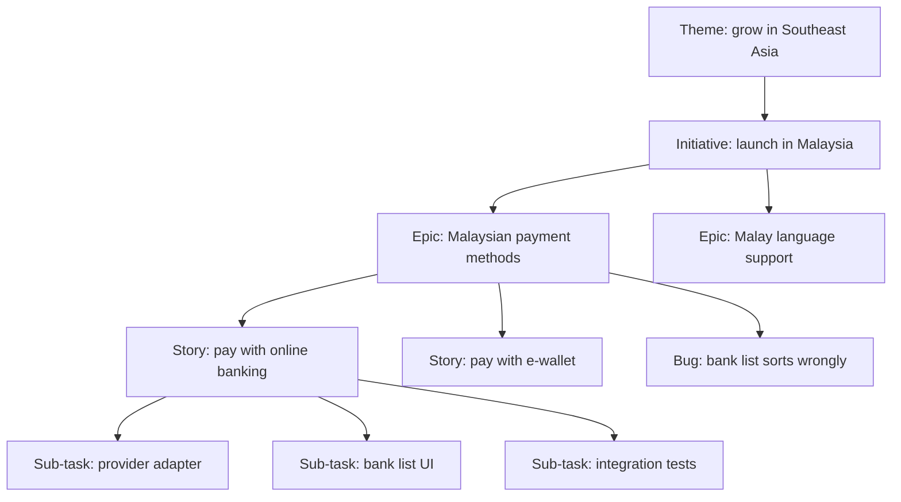
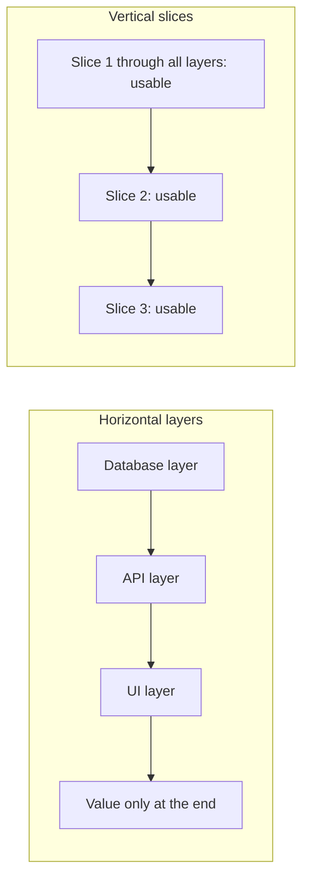

# Epics, stories, initiatives and splitting work

> **Before this lesson:** read [User stories, INVEST and acceptance criteria](#/lesson/jira/user-stories). You should know the story template and why stories should be small.

## In plain words

Writing a book is too big to plan as one task. You split it into parts, the parts into chapters, and the chapters into sections you can write in an afternoon. Each level answers a different question: the part says what theme you are covering, the chapter says what the reader will learn, the section is what you actually write today.

Agile teams organise work the same way. Big goals are broken into **epics**, epics into **stories**, and stories into **sub-tasks**. Above epics, some organisations group work into **initiatives** or **themes**. Each level is a different zoom on the same work: leaders look at initiatives, Product Owners at epics, Developers at stories and sub-tasks.

The second half of this lesson covers the skill that makes this hierarchy useful: **splitting** big work into small, valuable slices. It is one of the most practical skills an engineer in an agile team can have, and a favourite interview topic.

Why it matters for a job: in Jira, every story you work on usually has a **parent** epic, and roadmaps and reports group work by epic. When an item is too big to finish in a Sprint, someone has to split it, and engineers are often best placed to suggest how.

## The levels of work

Atlassian's Agile Coach describes four common levels:

| Level | What it is | Typical size | Example |
|---|---|---|---|
| **Theme** | A large focus area spanning the organisation | Year or more | "Grow in Southeast Asian markets" |
| **Initiative** | A collection of epics driving towards a common goal | Quarter to a year | "Launch in Malaysia" |
| **Epic** | A large body of work that can be broken down into stories | Several Sprints | "Malaysian payment methods at checkout" |
| **Story** | A small piece of user value (lesson 7) | Days | "As a Malaysian customer, I want to pay with online banking so that I don't need a credit card" |

Below stories, the Developers often create **sub-tasks**: technical steps such as "build the payment provider adapter", "add the bank list UI", "write integration tests". Sub-tasks are part of the Developers' plan, not separate pieces of user value.



Themes and initiatives are planning ideas; not every company uses both words, and they may mean slightly different things in different organisations. Epics, stories and sub-tasks are the levels nearly every Jira team uses.

## How Jira represents the hierarchy

In Jira, each work item has a **work type** (older name: issue type). The common default types in a software space are:

- **Epic**: a large piece of work that groups other items.
- **Story**: a user-facing piece of value.
- **Task**: a piece of work that is not a user story, such as "renew the TLS certificate".
- **Bug**: a problem that stops the product working as intended.
- **Sub-task**: a smaller piece of work belonging to one of the above.

Jira places these types on numbered **hierarchy levels**. By default:

| Level | Types on that level |
|---|---|
| 1 | Epic |
| 0 | Story, Task, Bug (the "standard" types) |
| -1 | Sub-task |

An item can have a **parent** on the level directly above it: a story's parent is an epic; a sub-task's parent is a story, task or bug. Atlassian's documentation notes that up to 500 child items are shown on a parent.

Some points that trip people up:

- **Bugs and tasks are on the same level as stories.** A bug can belong to an epic in the same way a story can.
- **Custom levels above Epic** (for example, an "Initiative" type on level 2) are possible, but Atlassian's documentation says configuring extra hierarchy levels requires the Premium or Enterprise plan.
- **"Epic Link" is retired.** Older Jira sites used a special field called Epic Link to connect a story to its epic. Atlassian retired it in February 2024 in favour of the single **`parent`** field, used at every level. If you see "Epic Link" in old documentation or old searches, the modern equivalent is `parent`.

Lesson 11 goes deeper into fields and levels; lesson 19 shows how to search by parent with JQL.

> [!TIP]
> Practise reasoning about the hierarchy in code with the problem [Hierarchy roll-up](#/problem/jira-hierarchy-rollup): validate parent links level by level and roll story points up to epics without double counting.

## Why splitting matters

Large items cause problems that compound:

- **They hide risk.** A three-week item can be "90% done" for two weeks.
- **They block flow.** One huge card sits in "In Progress" and nothing finishes.
- **They delay feedback.** Users see nothing until the whole thing is done.
- **They are hard to estimate.** Uncertainty grows faster than size.
- **They cannot fit a Sprint.** A Scrum team cannot deliver a Done Increment from them in one Sprint.

Small items fix all of this, but only if each small item still delivers value. That is the key idea: split **vertically**, not horizontally.

## Vertical slices versus horizontal layers

Imagine a cake with layers: sponge, cream, icing. A **horizontal** split gives you "all the sponge first, then all the cream, then the icing". Nobody can eat any of it until the end. A **vertical** slice gives you a thin wedge through every layer: small, but a complete piece of cake.

In software, the layers are things like database, backend API, frontend and tests.

| Horizontal split (avoid) | Vertical slices (prefer) |
|---|---|
| Story 1: design the database tables for refunds | Story 1: a customer can request a full refund for a card payment (DB, API, UI, tests for this one case) |
| Story 2: build the refunds API | Story 2: a customer can request a partial refund |
| Story 3: build the refunds screen | Story 3: refunds for e-wallet payments |
| Story 4: test everything | Story 4: the support team sees refund requests in their tool |

After horizontal story 1, nothing is usable. After vertical story 1, real customers can request a refund. Each vertical slice can be demonstrated at a Sprint Review, released, and learned from.



## Splitting techniques

Here are reliable ways to find vertical slices. Each comes with an example from one epic: **"Customers can book a table at a restaurant through our app."**

1. **By workflow steps.** Deliver one step of the user's journey at a time, starting with the simplest complete path.
   - Book a table for today only, with a phone confirmation by staff. Later: pick any date; then automatic confirmation.

2. **By business rule variations.** Start with the simple rule, add the complex ones later.
   - Fixed 2-hour slots first. Later: variable slots; minimum spend on weekends.

3. **By data variations.** Support one kind of input first.
   - Party sizes 1 to 6 first. Later: large groups that need manager approval.

4. **By happy path, then unhappy paths.** Ship the main flow first; handle errors and edge cases in follow-up stories, but before a wide release.
   - Booking succeeds. Later: restaurant full, double booking, cancellation.

5. **By operations (create, read, update, delete).** Often "create" and "read" deliver most of the value.
   - Make a booking and view it. Later: change it; then cancel it.

6. **By platform or channel.** One platform first if that is where most users are.
   - Android first, where most users of this hypothetical app are. Later: iOS, web.

7. **By performance or quality level.** Make it work, then make it fast, if the slow version is still useful to some users.
   - Works for 10 restaurants. Later: search across 2,000 restaurants with fast results.

8. **Spike first.** When the team does not know enough to split, time-box a spike to learn, then split.
   - One-day spike: does the restaurant system offer an API for availability?

> [!WARNING]
> Splitting by role in the team ("frontend story", "backend story", "QA story") is a horizontal split in disguise. It creates hand-offs and nothing is usable until all pieces finish. Sub-tasks can be split by skill; stories should not be.

## Scenario: splitting an epic in refinement

The payments team at a Singapore bank receives an epic: **"Customers can schedule recurring transfers."** The first draft has one huge story: "Build recurring transfers." The Developers estimate it at "at least three Sprints, maybe more".

In refinement, they split it:

| # | Story | Why it is a valid slice |
|---|---|---|
| 1 | Schedule a monthly transfer of a fixed amount to an existing payee, starting next month | Narrowest useful path; covers DB, scheduler, API, UI |
| 2 | View and cancel scheduled transfers | Create and read already exist; delete adds safety |
| 3 | Choose weekly or monthly frequency | Business-rule variation |
| 4 | Choose an end date or a number of repetitions | Data variation |
| 5 | Notify the customer the day before a transfer, and if it fails for insufficient funds | Unhappy path |
| 6 | Edit a scheduled transfer | Update operation, least valuable, done last |

Story 1 fits in one Sprint and can be released to staff first for testing. The Product Owner orders the rest by value. The epic in Jira now has six child stories; its progress bar fills as each one reaches Done, instead of sitting at zero for six weeks.

Two extra points from this scenario:

- The team noticed that "insufficient funds" handling is required by the bank's policy before any customer release. So story 5 must finish before a public launch, even though it is a separate story. Splitting is about delivering and learning in small steps, not about shipping something unsafe.
- They added a one-day spike before story 1: "Confirm the scheduler service can run jobs at a fixed local time in Singapore time (UTC+8)". Time zones are a classic hidden risk.

## Epics in Jira day to day

Once epics exist, Jira uses them in several places:

- **Backlog**: you can filter the backlog by epic, to see only the refund work, for example.
- **Board**: swimlanes can group cards by epic (lesson 14).
- **Timeline** (a roadmap view): epics appear as bars over time, with their child items underneath.
- **Search**: `parent = SHOP-100` finds the children of epic SHOP-100 (lesson 19).
- **Progress**: an epic shows how many of its children are done.

Good habits:

- Give each epic a clear outcome, like a mini Product Goal, and a definition of when it is finished.
- Close epics when their goal is met. An epic that stays open for a year with 80 children has become a theme or a dumping ground.
- Do not use epics as permanent categories ("Backend", "Bugs"). Use components or labels for categories (lesson 11).

## How interviewers probe this

> [!INTERVIEW]
> "A feature is estimated at three Sprints. What would you do?" Explain vertical slicing: find the thinnest end-to-end path that delivers value, ship it first, and add variations, rules and edge cases as follow-up stories. Give an example split, and mention a spike if the uncertainty is technical. Close with why: earlier feedback, visible progress, lower risk.

Other likely questions:

- "What is the difference between an epic and a story?" Size and purpose: an epic is a large body of work broken into stories; a story is a small, valuable slice that fits in a Sprint.
- "Bug or story: which level is a bug on in Jira?" Same level as a story (level 0) by default, so it can have an epic as parent.
- "Why not split by frontend and backend?" Neither half is usable alone, so it delays value and creates hand-offs.

## Summary

- Work is organised in levels: themes and initiatives (big goals), epics (large bodies of work), stories (small value) and sub-tasks (technical steps).
- Jira's default hierarchy is level 1 Epic, level 0 Story/Task/Bug, level -1 Sub-task, connected by the `parent` field; Epic Link was retired in February 2024.
- Extra levels above Epic need the Premium or Enterprise plan.
- Split work into vertical slices that cut through all layers and deliver value, not horizontal layers or role-based pieces.
- Useful splitting techniques: workflow steps, business rules, data variations, happy then unhappy paths, operations, platforms, performance, and spikes.

## Glossary

- **Theme** — a large, organisation-wide focus area.
- **Initiative** — a collection of epics working towards a common goal.
- **Epic** — a large body of work broken down into stories.
- **Sub-task** — a smaller piece of work belonging to a story, task or bug; level -1 in Jira.
- **Task** — a work type for work that is not a user story.
- **Bug** — a work type for a problem that stops the product working as intended.
- **Work type** — Jira's category for a work item (formerly "issue type").
- **Hierarchy level** — the numbered level of a work type in Jira's parent-child structure.
- **Parent** — the item directly above in the hierarchy; also the Jira field that links them.
- **Epic Link** — an older Jira field for linking stories to epics, retired in February 2024 in favour of `parent`.
- **Vertical slice** — a small piece of work cutting through all technical layers to deliver usable value.
- **Horizontal split** — dividing work by technical layer, so no piece is usable alone.
- **Timeline** — Jira's roadmap view showing epics as bars over time.

## Check yourself

```quiz
[
  {"q": "In Jira's default hierarchy, which level is a Bug on?",
   "options": ["Level 1, with epics", "Level 0, with stories and tasks", "Level -1, with sub-tasks", "It has no level"],
   "answer": 1,
   "explain": "Story, Task and Bug are the standard types on level 0."},
  {"q": "What replaced the Epic Link field in Jira Cloud?",
   "options": ["The Labels field", "The parent field", "The Component field", "The Sprint field"],
   "answer": 1,
   "explain": "Epic Link was retired in February 2024; the parent field links items at every level."},
  {"q": "Which split is a vertical slice?",
   "options": ["Story 1: database tables; Story 2: API; Story 3: UI", "Story 1: frontend; Story 2: backend", "Story 1: a customer can request a full refund for a card payment, end to end", "Story 1: write all the tests"],
   "answer": 2,
   "explain": "It cuts through every layer and is usable on its own."},
  {"q": "A team cannot split a story because it does not know whether a partner API exists. What is a good first step?",
   "options": ["Split by frontend and backend", "Run a short time-boxed spike to find out", "Estimate it as very large and start", "Move it to the next quarter"],
   "answer": 1,
   "explain": "A spike creates the knowledge needed to split and estimate."},
  {"q": "What do you need to add hierarchy levels above Epic, such as Initiative?",
   "options": ["Any Jira plan", "The Premium or Enterprise plan", "A Kanban board", "The Epic Link field"],
   "answer": 1,
   "explain": "Atlassian's documentation says custom hierarchy levels require Premium or Enterprise."},
  {"q": "Why is splitting stories by team role (frontend, backend, QA) discouraged?",
   "options": ["Jira cannot store such stories", "None of the pieces is usable alone, so value and feedback are delayed and hand-offs are created", "It makes estimates too accurate", "The Scrum Guide forbids it"],
   "answer": 1,
   "explain": "It is a horizontal split in disguise. Sub-tasks can be split by skill; stories should be vertical."},
  {"q": "A team uses an epic called 'Backend' that has been open for two years. What is the better practice?",
   "options": ["Keep it; epics are categories", "Use components or labels for categories and give epics a finishable outcome", "Make it a sub-task", "Delete all its children"],
   "answer": 1,
   "explain": "Epics should represent finishable bodies of work; categories belong in components or labels."}
]
```

> **Source:** Atlassian Agile Coach, Epics, stories, themes and initiatives, https://www.atlassian.com/agile/project-management/epics-stories-themes; Atlassian, What are work types, https://support.atlassian.com/jira-cloud-administration/docs/what-are-issue-types/; Atlassian, Configure the issue type hierarchy, https://support.atlassian.com/jira-cloud-administration/docs/configure-the-issue-type-hierarchy/; Atlassian, What is an epic, https://support.atlassian.com/jira-software-cloud/docs/what-is-an-epic/; Bill Wake, INVEST (2003), https://xp123.com/invest-in-good-stories-and-smart-tasks/
