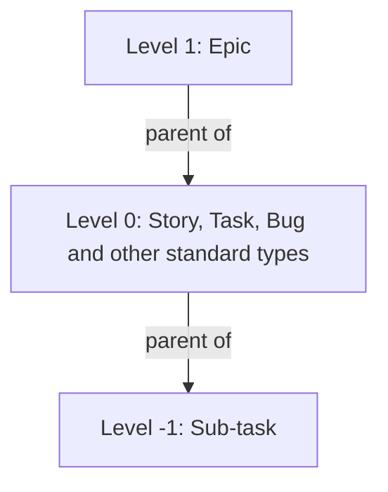

# The Jira data model: work types, hierarchy and fields

> **Before this lesson:** read [What Jira is](#/lesson/jira/what-is-jira) (sites, spaces, keys) and [Epics, stories, initiatives and splitting work](#/lesson/jira/epics-splitting) (the hierarchy as an idea).

## In plain words

A library catalogue card for a book has the same slots every time: title, author, subject, shelf number, whether it is on loan. Because every card has the same shape, a librarian can answer questions like "which history books are on loan?" in seconds.

Jira works the same way. Every **work item** is a record with a fixed set of slots called **fields**: summary, status, assignee, priority, labels, fix version and so on. Because the shape is consistent, you can search, sort, group and chart thousands of work items. Understanding the fields is what turns Jira from a to-do list into a tool you can query.

This lesson walks through the parts of that data model: **work types**, the **hierarchy**, the most important **fields**, **components**, **labels**, **versions** and **links**.

Why it matters for a job: every JQL search (lessons 16 to 19), every board filter and every report is built from these fields. If you know that "resolution" and "status" are different fields, or that a bug can sit under an epic, you will write searches that return the right work and avoid reports that quietly lie.

## A work item as a record

Here is one work item written out as data, roughly as Jira's API would describe it. You do not need to read JSON fluently; notice the field names.

```json
{
  "key": "SHOP-1042",
  "fields": {
    "summary": "Apply promo code at checkout",
    "issuetype": "Story",
    "status": "In Progress",
    "statusCategory": "In Progress",
    "resolution": null,
    "priority": "High",
    "assignee": "Farah Rahman",
    "reporter": "Siti Nur",
    "labels": ["checkout", "cny-campaign"],
    "components": ["Payments"],
    "fixVersions": ["2026.03"],
    "sprint": "SHOP Sprint 14",
    "parent": "SHOP-1000",
    "storyPoints": 5,
    "created": "2026-02-20T09:12:00+08:00",
    "updated": "2026-03-04T15:30:00+08:00",
    "duedate": null
  }
}
```

The API still calls the type `issuetype`, consistent with Atlassian's statement that existing APIs keep the "issue" wording. Real API responses contain much more, including identifiers and nested objects, but the idea holds: a work item is a key plus named fields.

## Work types

The **work type** (formerly issue type) says what kind of work the item is. Atlassian's administration documentation lists the defaults for software spaces:

| Work type | Use it for | Example |
|---|---|---|
| **Epic** | A large body of work grouping other items | "Self-service refunds" |
| **Story** | A user-facing piece of value | "Customer can request a refund for a card payment" |
| **Task** | Work that is not a user story | "Rotate the payment provider API key" |
| **Bug** | A problem that stops the product working as intended | "Refund button missing on iOS 17" |
| **Sub-task** | A smaller piece of a story, task or bug | "Write integration tests for refund API" |

Administrators can add custom work types, such as "Spike", "Incident" or "Tech debt". Each work type can have its own fields and even its own workflow (lesson 13).

## The hierarchy, precisely

Work types sit on numbered **hierarchy levels**. The defaults:



Rules worth remembering:

- An item's **parent** is on the level directly above it. A Story's parent is an Epic; a Sub-task's parent is a Story, Task or Bug.
- A Sub-task **must** have a parent. Standard items may have no parent.
- The single field that holds the link is **`parent`**. The older **Epic Link** field was retired in February 2024.
- A parent shows up to 500 child items.
- Levels above Epic (for example Initiative at level 2) can be configured, but Atlassian's documentation says this requires the **Premium** or **Enterprise** plan.

## Fields: the slots on every record

A **field** is one named piece of information on a work item. Jira has **system fields**, which exist everywhere, and **custom fields**, which administrators add (such as "Customer impact" or "Acceptance criteria"). Here are the fields you will use most, grouped by purpose.

### Identity and description

| Field | What it holds | Notes |
|---|---|---|
| Key | `SHOP-1042` | Unique, assigned by Jira |
| Summary | One-line title | Keep it short and specific; it is what people see on cards |
| Description | Full details, acceptance criteria, links | Rich text |
| Work type | Story, Bug and so on | JQL field `issuetype` or `type` |

### Workflow state

| Field | What it holds | Notes |
|---|---|---|
| Status | The current step in the workflow, such as "In Review" | Each space or work type can have different statuses |
| Status category | One of three buckets: **To Do**, **In Progress**, **Done** | Every status belongs to exactly one category; great for searching across different workflows |
| Resolution | Why an item is finished: "Done", "Won't Do", "Duplicate" and so on | Empty means unresolved; JQL `resolution = Unresolved` finds open work |
| Resolved | The date the resolution was set | Used for "what did we finish last week?" |

**Status versus status category** is a key idea. One team's workflow might have statuses "Selected", "Building", "Peer Review", "QA", "Shipped"; another's has "Open", "In Progress", "Closed". Searching `statusCategory = "In Progress"` finds in-flight work in both, without knowing their exact status names.

**Status versus resolution** is the classic trap. Status says *where* the item is; resolution says *whether and how* it was closed. In a well-configured workflow, moving to a done status also sets a resolution. In a badly configured one, items can sit in "Done" with no resolution, and then any search for `resolution = Unresolved` still lists them as open. If your "open bugs" count never drops, check this first.

### People

| Field | Meaning |
|---|---|
| Assignee | The person currently responsible for the item (can be empty) |
| Reporter | The person who created or raised it |
| Watchers | People who get notifications about changes |

### Planning and sizing

| Field | Meaning |
|---|---|
| Priority | How urgent it is, such as Highest, High, Medium, Low, Lowest (names are configurable) |
| Sprint | The sprint(s) the item is or was in |
| Story point estimate / Story Points | The team's size estimate (lesson 9) |
| Original / remaining estimate, time spent | Time tracking fields |
| Due date | A date the item must be finished by, if any |
| Fix version | The release in which the work is delivered |
| Affects version | For bugs: the release in which the problem was found |

### Classification

| Field | Meaning |
|---|---|
| Labels | Free-form tags anyone can add, such as `cny-campaign` or `tech-debt` |
| Components | Named sub-parts of a space, set up by admins |
| Parent | The item above in the hierarchy |

### Timestamps

`created`, `updated` and `resolved` are recorded automatically. Every change also lands in the item's **history**, which advanced JQL can search (lesson 19).

## Components versus labels

Both group work, but they behave differently.

**Components** are defined by space administrators. Atlassian's documentation describes them as grouping work items around product features, departments or workstreams. They are available in **company-managed** spaces (lesson 12) and scoped to the space where they are created. A component can have an owner, who can choose who is automatically assigned to work items in that component. Example: a space has components "Frontend", "Backend" and "Payments"; any new bug filed under "Payments" is auto-assigned to the payments lead for triage.

**Labels** are free text that anyone can add, and they work across spaces. They are flexible, which is both their strength and their weakness: you will find `checkout`, `Checkout` and `check-out` used for the same thing.

| | Components | Labels |
|---|---|---|
| Who creates them | Space admins | Anyone |
| Scope | One space | Whole site |
| Typical use | Stable parts of the product, ownership | Campaigns, themes, temporary tags |
| Extra features | Owner and auto-assignment | None |
| Risk | Gets out of date if the product changes | Typos and duplicates |

## Versions

A **version** (also called a release) is a bundle of features and fixes shipped together as one update, according to Atlassian. In Scrum spaces you can assign items to versions to plan what reaches customers when; versions can span several sprints. In Kanban spaces you can release a version at any time containing whatever is complete at that point.

The two version fields answer different questions:

- **Fix version**: "In which release will this be delivered?" A story with fix version `2026.03` ships in that release.
- **Affects version**: "In which release did this bug appear?" A bug with affects version `2026.02` and fix version `2026.03` was found in February's release and fixed in March's.

JQL can use version functions such as `fixVersion in unreleasedVersions()` to find work planned for upcoming releases (lesson 18).

> [!TIP]
> Versions connect Jira to release notes. A search like `fixVersion = "2026.03" AND type = Bug` gives you the "bugs fixed" section. The CI/CD track's [Monorepo vs polyrepo and artifact versioning](#/lesson/cicd/monorepo-versioning) lesson covers how version numbers are chosen.

## Links between work items

Work items can be connected by **links**, each with a **link type** that reads in two directions:

| Link type | Outward reading | Inward reading |
|---|---|---|
| Blocks | SHOP-1 *blocks* SHOP-2 | SHOP-2 *is blocked by* SHOP-1 |
| Relates | SHOP-1 *relates to* SHOP-2 | (same both ways) |
| Duplicates | SHOP-3 *duplicates* SHOP-1 | SHOP-1 *is duplicated by* SHOP-3 |
| Clones | SHOP-4 *clones* SHOP-1 | SHOP-1 *is cloned by* SHOP-4 |

Links are different from the parent relationship. A parent link builds the hierarchy (one parent only); other links express dependencies and relationships (many allowed). JQL's `linkedIssues()` function can find items linked to a given key (lesson 18); current Jira Cloud docs also list the newer name `linkedWorkItems()`, and the older name still works.

Atlassian's work item view can also show **development information**: branches, commits, pull requests and builds connected through keys (lesson 24).

## Scenario: a bug report done well

A customer support agent reports that promo codes fail for some users during the Chinese New Year campaign. Here is how a careful engineer, Wei Ling, records it:

| Field | Value | Why |
|---|---|---|
| Work type | Bug | It is a defect, not new value |
| Summary | Promo code rejected when cart contains a gift card | Specific; describes the condition |
| Description | Steps to reproduce, expected vs actual, screenshot, affected order IDs | Makes it reproducible |
| Priority | High | Campaign revenue affected; not an outage |
| Components | Payments | Auto-assigns to the payments triage owner |
| Labels | `cny-campaign` | Lets marketing see all campaign issues |
| Affects version | 2026.02 | The release currently in production |
| Parent | SHOP-1000 "Promo codes" epic | Groups it with related work |
| Link | relates to SHOP-1042 | The original promo code story |

Two days later, the payments team fixes it and sets fix version `2026.02.1`, a patch release. Because the fields are filled in, three different questions can now be answered by search: "What is still open for the campaign?", "What bugs were fixed in 2026.02.1?", and "How many bugs did the promo code epic produce?".

Compare a bad report: summary "Promo broken!!", no steps, no component, priority Highest because the reporter was worried. It lands in nobody's queue, nobody can reproduce it, and it pollutes every "highest priority" search.

## Field hygiene: habits that keep data useful

- **Fill the fields your team's searches and reports depend on**, and no more. Twenty mandatory fields lead people to type rubbish into them.
- **Agree priority definitions**, such as "Highest = production outage". Otherwise every reporter picks Highest.
- **Prefer components over labels** for stable ownership; use labels for temporary groupings.
- **Make sure done statuses set a resolution**, or open-work searches will be wrong.
- **Do not reuse fields for other meanings**, such as putting team names in "Environment". Ask an admin for a proper custom field.

## How interviewers probe this

> [!INTERVIEW]
> "What makes a good bug report?" Answer with the fields and why: a specific summary, steps to reproduce, expected versus actual result, environment and version, severity and priority by agreed definitions, the component for routing, and evidence such as logs or screenshots. Then add one sentence of judgement: "The goal is that someone who has never seen the problem can reproduce it in five minutes."

Other likely questions:

- "What's the difference between status and resolution?" Status is where the item is in its workflow; resolution records how it was closed, and empty means unresolved.
- "Labels or components?" Components for stable, owned areas with auto-assignment (company-managed spaces); labels for flexible, cross-space tags.
- "What's a fix version?" The release in which the work ships; affects version is where a bug was found.

## Summary

- A work item is a record: a key plus fields. Consistent fields make searching, boards and reports possible.
- Default work types are Epic, Story, Task, Bug and Sub-task, on hierarchy levels 1, 0 and -1, linked by `parent`.
- Status is the workflow step; status category groups every status into To Do, In Progress or Done; resolution records how an item was closed.
- Key fields: assignee, reporter, priority, labels, components, sprint, story points, fix version, affects version, due date and timestamps.
- Components are admin-defined, space-scoped and support auto-assignment (company-managed spaces); labels are free-form and site-wide.
- Versions bundle work into releases; links express relationships such as blocks, relates to and duplicates.

## Glossary

- **Field** — one named piece of information on a work item.
- **System field** — a field built into Jira, such as summary or assignee.
- **Custom field** — a field added by an administrator.
- **Status** — the current step of a work item in its workflow.
- **Status category** — one of three buckets (To Do, In Progress, Done) that every status belongs to.
- **Resolution** — a field recording how a work item was closed; empty means unresolved.
- **Assignee** — the person currently responsible for a work item.
- **Reporter** — the person who raised a work item.
- **Priority** — how urgent a work item is.
- **Label** — a free-form tag on a work item.
- **Component** — an admin-defined sub-part of a company-managed space, optionally with an owner and auto-assignment.
- **Version** — a named release bundling work items.
- **Fix version** — the release in which an item is delivered.
- **Affects version** — the release in which a bug was found.
- **Link type** — the kind of relationship between two linked work items, such as blocks or duplicates.
- **History** — the record of every change made to a work item.

## Check yourself

```quiz
[
  {"q": "A team's workflow has statuses 'Building' and 'Peer Review'. Which field lets one search find in-flight work across this and other teams' workflows?",
   "options": ["Resolution", "Status category", "Priority", "Labels"],
   "answer": 1,
   "explain": "Every status belongs to To Do, In Progress or Done, so statusCategory works across different workflows."},
  {"q": "Items sit in a 'Done' status, but searches for unresolved work still return them. What is the likely cause?",
   "options": ["The board filter is wrong", "The workflow does not set a resolution when moving to Done", "The items have no assignee", "The items are sub-tasks"],
   "answer": 1,
   "explain": "Resolution is a separate field. If it stays empty, Jira treats the item as unresolved."},
  {"q": "What does the Affects version field record for a bug?",
   "options": ["The release in which it will be fixed", "The release in which it was found", "The sprint it belongs to", "The epic it belongs to"],
   "answer": 1,
   "explain": "Affects version is where the problem appeared; fix version is where it is delivered."},
  {"q": "Which statement about components is correct according to Atlassian's documentation?",
   "options": ["They are free text anyone can add", "They are available in company-managed spaces and scoped to their space", "They replace epics", "They work across all spaces automatically"],
   "answer": 1,
   "explain": "Components are admin-defined, space-scoped, and available in company-managed spaces."},
  {"q": "Which field links a story to its epic in current Jira Cloud?",
   "options": ["Epic Link", "parent", "Labels", "Fix version"],
   "answer": 1,
   "explain": "Epic Link was retired in February 2024 in favour of parent."},
  {"q": "SHOP-1 must be finished before SHOP-2 can start. Which link expresses this?",
   "options": ["SHOP-1 duplicates SHOP-2", "SHOP-1 blocks SHOP-2", "SHOP-2 clones SHOP-1", "SHOP-1 is the parent of SHOP-2"],
   "answer": 1,
   "explain": "Blocks expresses a dependency; parent builds the hierarchy instead."},
  {"q": "Why are twenty mandatory fields on a bug form a bad idea?",
   "options": ["Jira limits forms to ten fields", "People fill them with meaningless values, which corrupts searches and reports", "It slows the database", "Bugs cannot have custom fields"],
   "answer": 1,
   "explain": "Fields only help if the data is accurate; forcing too many leads to junk data."}
]
```

> **Source:** Atlassian, What are work types, https://support.atlassian.com/jira-cloud-administration/docs/what-are-issue-types/; Atlassian, Configure the issue type hierarchy, https://support.atlassian.com/jira-cloud-administration/docs/configure-the-issue-type-hierarchy/; Atlassian, What are Jira components, https://support.atlassian.com/jira-software-cloud/docs/what-are-jira-components/; Atlassian, What is a version, https://support.atlassian.com/jira-software-cloud/docs/what-is-a-version/; Atlassian, JQL fields, https://support.atlassian.com/jira-software-cloud/docs/jql-fields/; Jira Data Center fields reference, https://confluence.atlassian.com/jirasoftwareserver/advanced-searching-fields-reference-939938743.html
