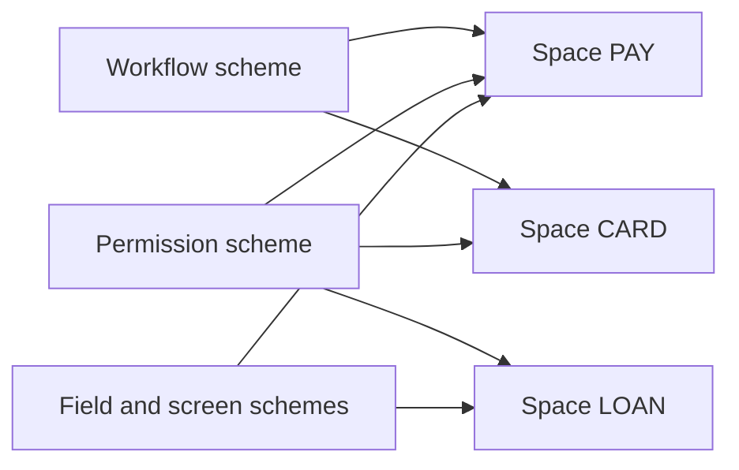
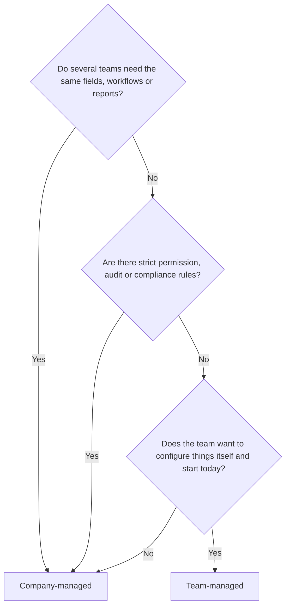

# Team-managed and company-managed spaces

> **Before this lesson:** read [The Jira data model](#/lesson/jira/data-model). You should know what work types, fields and components are.

## In plain words

Think about two ways of running offices. In a co-working space, each small team decorates its own room: they pick the furniture, the whiteboard layout and the door sign, without asking anyone. In a large corporate building, facilities management sets standard furniture, signage and access badges for every floor; changing them means filing a request, but every floor works the same way and security is consistent.

Jira offers both styles. A **team-managed space** is like the co-working room: the team configures it itself, quickly and with little setup. A **company-managed space** is like the corporate building: Jira administrators configure it using shared building blocks called **schemes**, so many spaces can follow the same rules.

Why it matters for a job: when you join a team, the space type explains a lot of things that otherwise look random. Why can't I add a status? (Company-managed: only an admin can.) Why does this space have no components? (Team-managed spaces do not offer Jira components.) Why does a report from the documentation not appear? (Several reports are documented for company-managed spaces.) Some interviewers for team-lead or process-heavy roles also ask how you would set Jira up for a new team.

## The two types at a glance

Atlassian's documentation describes the difference this way:

| | Team-managed space | Company-managed space |
|---|---|---|
| Who sets it up and maintains it | Anyone on the team; space admins control setup without needing a Jira admin | Jira admins |
| Where configuration lives | Inside the space itself | In shared screens and schemes configured by a Jira admin |
| Effect of a change | Affects only this space | A change to a shared scheme affects every company-managed space that uses it |
| Complexity | Simpler, quick to start | More complex, but supports standardised workflows and complex permissions |
| Custom fields | Scoped to the space; cannot be shared with other spaces | Typically shared across many spaces |
| Components | Not available (Jira components are company-managed only) | Available |

Atlassian's documentation for the control chart, the cumulative flow diagram and the velocity chart describes them for company-managed spaces. Team-managed spaces have their own, simpler set of reports, and the exact set changes over time, so check your site rather than assuming.

> [!TIP]
> To find out which type a space is, Atlassian's documentation says to open **More actions** (the ••• menu) next to the space name and look at the bottom of the menu, where the space type is shown.

## Schemes: the building blocks of company-managed spaces

A **scheme** is a reusable piece of configuration that maps one thing to another, for example "for work type Bug, use workflow X". A company-managed space is assembled from several schemes, and the same scheme can be shared by many spaces.



The schemes you will hear about most:

| Scheme | What it maps | Example |
|---|---|---|
| **Workflow scheme** | Work types to workflows | Bugs use "Bug workflow" with a Verified step; stories use "Standard workflow" |
| **Work type scheme** (issue type scheme) | Which work types a space offers | The PAY space offers Epic, Story, Bug, Task, Sub-task, Incident |
| **Screen scheme** | Which fields appear on the create, edit and view screens | The Incident create screen shows "Customer impact" |
| **Field configuration scheme** | Field behaviour, such as required or hidden | "Affects version" is required for bugs |
| **Permission scheme** | Who can do what (create, edit, transition, delete) | Only the Payments group can transition PAY items to Done |
| **Notification scheme** | Who gets emailed about which events | Reporters are emailed when their bug is resolved |

Atlassian's permissions documentation notes that permission schemes are not available on the Free plan.

The power and the danger are the same thing: **sharing**. If twenty banking spaces share one workflow scheme, a compliance rule ("every change needs an approval step") can be added once and applies everywhere. But an admin who edits that scheme for one team's convenience changes it for all twenty. That is why company-managed configuration is usually locked down to Jira administrators.

## Team-managed spaces in practice

In a team-managed space, a space admin (often the team lead or any trusted member) can directly:

- add, rename or remove statuses and transitions in a work type's workflow, and add simple workflow rules (lesson 13);
- create work types and add fields to each, with fields belonging only to this space;
- set up the board's columns;
- manage who has access to the space.

This is ideal for a new or small team that wants to start working today and shape the process as it learns.

Limitations to understand:

- **No sharing.** A field created in one team-managed space cannot be reused by another. If ten teams each create "Customer impact", there are ten unrelated fields with the same name, which makes cross-team searching and reporting awkward.
- **No Jira components.** Use labels or a custom field instead.
- **Less control.** Organisations with audit or regulatory needs may not want each team defining its own permissions and workflows.

## Company-managed spaces in practice

In a company-managed space, a Jira admin (often a central tools or platform team) configures the schemes. Team members usually can:

- create and edit work items within the rules;
- configure their own **board** (columns, quick filters, swimlanes), since boards are separate from the space configuration (lesson 14);
- request changes to workflows or fields through the admins.

Strengths:

- **Consistency.** Every team uses the same fields and statuses, so a director's dashboard across thirty spaces is meaningful.
- **Advanced configuration.** Complex permissions, shared custom fields, workflow conditions and validators.
- **More reports and features documented**, including components, the control chart and the cumulative flow diagram.

Costs:

- **Slower change.** "Can we add a 'Blocked' status?" becomes a ticket for the admin team.
- **Shared blast radius.** A careless scheme edit can disrupt many teams.

## How to choose



A rough guide:

- **Team-managed** suits a small or new team, an experiment, a hackathon, a non-software team, or a start-up without a Jira admin.
- **Company-managed** suits organisations with many teams that must report consistently, regulated industries, and spaces that need components, shared fields or detailed permissions.

Atlassian provides a documented path to migrate work between the two types. Migration is a real project: fields, statuses and history need mapping, so it is better to choose sensibly at the start.

## Scenario: two companies, two choices

**A 12-person Singapore start-up** building a logistics app creates two team-managed spaces, `APP` and `OPS`. The mobile team adds a "Device" field to its bug type and a "Ready for QA" status in five minutes. Nobody waits for anyone. When the company grows to 60 engineers and the CTO wants a weekly report of "bugs by severity across all teams", they discover each team created its own "Severity" field with different values. They decide to move the main product spaces to company-managed, with one shared severity field and one bug workflow.

**A regional bank** runs about forty company-managed spaces. Every space uses a shared permission scheme where only members of the team's group can transition items, and a shared workflow scheme in which production changes need an "Approved" status set by a change manager. A new squad asks for a lightweight space for a three-week innovation sprint. The tools team gives them a team-managed space so they can move fast without touching the regulated schemes, on the condition that no production change is tracked there.

Both organisations made reasonable choices. The skill is knowing what each type optimises for.

## What you can change yourself

A practical table for your first weeks in a new team:

| I want to... | Team-managed space | Company-managed space |
|---|---|---|
| Add a column to the board | Space admin, on the board | Board admin (often the team), in board settings |
| Add a new status to the workflow | Space admin | Jira admin edits the workflow (affects every space sharing it) |
| Add a custom field | Space admin, for this space only | Jira admin; may be shared across spaces |
| Add a quick filter or swimlane | Board settings (where available) | Board admin, in board settings |
| Change who can delete items | Space access settings | Jira admin, via the permission scheme |
| Create a component | Not available | Space admin |

If you are unsure, ask the team lead first, then the Jira admins. Never edit a shared scheme "just for my team" without understanding who else uses it.

## A common confusion: spaces, boards and teams

Beginners often assume one team equals one space equals one board. In practice the three are separate ideas:

- A **space** holds work items and their configuration (work types, workflows, fields, permissions).
- A **board** is a view built from a saved filter (lesson 14). In company-managed setups, one space can have several boards (for example a Scrum board for the product team and a Kanban board for bug triage), and one board can show items from several spaces.
- A **team** is a group of people. Several teams can share a space, each with its own board filtered by component or label; one team can also work across several spaces.

So when someone says "add it to our board", the useful follow-up questions are: which space should the item live in (that decides its workflow and fields), and will it match the board's filter (that decides whether the team sees it)? Asking these two questions avoids the classic "I created the ticket but it's not on the board" confusion.

> [!WARNING]
> "Jira admin" and "space admin" are different powers. A space admin manages one space; a Jira admin manages site-wide configuration including shared schemes. Being given admin rights on one team-managed space does not let you change company-managed schemes.

## How interviewers probe this

> [!INTERVIEW]
> "You're setting up Jira for a new team of six. What would you do?" A strong answer starts with the team's needs, not Jira's features: "I'd start with a team-managed space and a simple workflow, To Do, In Progress, In Review, Done, because we don't yet know what we need and the team can adjust it themselves. If the company already reports across teams with shared fields, I'd ask the Jira admins for a company-managed space using the standard schemes, so our data fits their dashboards." Then mention keeping the board, Definition of Done and fields minimal at first.

Other likely questions:

- "What is a workflow scheme?" A mapping from work types to workflows, shared across company-managed spaces.
- "Why might a team not be able to add a status itself?" Its space is company-managed, so the workflow belongs to a shared scheme controlled by Jira admins.
- "What are the risks of every team using team-managed spaces?" Inconsistent fields and statuses make cross-team reporting and governance difficult.

## Summary

- Jira has two space types: team-managed (configured by the team, simple, self-contained) and company-managed (configured by Jira admins with shared schemes, more powerful, standardised).
- Schemes map work types to workflows, fields, screens, permissions and notifications; sharing them gives consistency but means changes affect every space using them.
- Team-managed custom fields stay in their space; company-managed fields are typically shared.
- Jira components exist only in company-managed spaces; several reports are documented for company-managed spaces.
- Permission schemes are not available on the Free plan.
- Choose based on cross-team consistency, compliance needs and how much the team wants to self-configure; migration between types is possible but takes effort.

## Glossary

- **Team-managed space** — a space configured by its own team, with settings that apply only to it.
- **Company-managed space** — a space configured by Jira admins using shared schemes.
- **Scheme** — a reusable configuration mapping, shared by company-managed spaces.
- **Workflow scheme** — maps work types to workflows.
- **Work type scheme** — defines which work types a space offers.
- **Screen scheme** — defines which fields appear on create, edit and view screens.
- **Field configuration** — controls field behaviour such as required or hidden.
- **Permission scheme** — defines who can perform which actions in a space.
- **Notification scheme** — defines who is notified about which events.
- **Jira admin** — a user who manages site-wide Jira configuration.
- **Space admin** — a user who manages one space's settings.
- **Blast radius** — how much is affected when a shared thing changes or breaks.

## Check yourself

```quiz
[
  {"q": "Who sets up and maintains a company-managed space?",
   "options": ["Anyone on the team", "Jira admins", "Only the Product Owner", "Atlassian support"],
   "answer": 1,
   "explain": "Company-managed spaces are set up and maintained by Jira admins using shared schemes."},
  {"q": "An admin edits a workflow scheme to add a status for one team. What else happens?",
   "options": ["Nothing; schemes are per space", "Every company-managed space using that scheme gets the change", "Only team-managed spaces change", "The board is deleted"],
   "answer": 1,
   "explain": "Schemes are shared; a change applies everywhere the scheme is used."},
  {"q": "Two team-managed spaces each create a field called 'Severity'. What is true?",
   "options": ["They are the same field", "They are separate fields scoped to each space, which complicates cross-team reporting", "Jira merges them automatically", "Neither can be searched"],
   "answer": 1,
   "explain": "Team-managed custom fields are scoped to their space and cannot be shared."},
  {"q": "A team needs Jira components with owners and auto-assignment. Which space type?",
   "options": ["Team-managed", "Company-managed", "Either", "Neither; use labels"],
   "answer": 1,
   "explain": "Jira components are available only in company-managed spaces."},
  {"q": "What does a workflow scheme map?",
   "options": ["Users to groups", "Work types to workflows", "Boards to filters", "Versions to sprints"],
   "answer": 1,
   "explain": "A workflow scheme says which workflow each work type uses in the spaces sharing it."},
  {"q": "Which situation suits a team-managed space best?",
   "options": ["Forty regulated spaces needing identical approval steps", "A small new team that wants to configure its own process today", "A director's dashboard across all teams with shared fields", "Strict permission rules for production changes"],
   "answer": 1,
   "explain": "Team-managed spaces are simple and self-configured, ideal for a small team starting quickly."},
  {"q": "Are permission schemes available on Jira's Free plan?",
   "options": ["Yes", "No", "Only for team-managed spaces", "Only in Data Center"],
   "answer": 1,
   "explain": "Atlassian's permissions documentation notes they are not available on Free."}
]
```

> **Source:** Atlassian, What are team-managed and company-managed spaces, https://support.atlassian.com/jira-software-cloud/docs/what-are-team-managed-and-company-managed-spaces/; Atlassian, Work types: how do team-managed and company-managed spaces differ, https://support.atlassian.com/jira-software-cloud/docs/issue-types-how-do-team-managed-and-company-managed-projects-differ/; Atlassian, What are Jira components, https://support.atlassian.com/jira-software-cloud/docs/what-are-jira-components/; Atlassian, Manage project permissions, https://support.atlassian.com/jira-cloud-administration/docs/manage-project-permissions/; Atlassian report documentation (control chart, cumulative flow diagram, velocity chart), https://support.atlassian.com/jira-software-cloud/docs/view-and-understand-the-control-chart/
