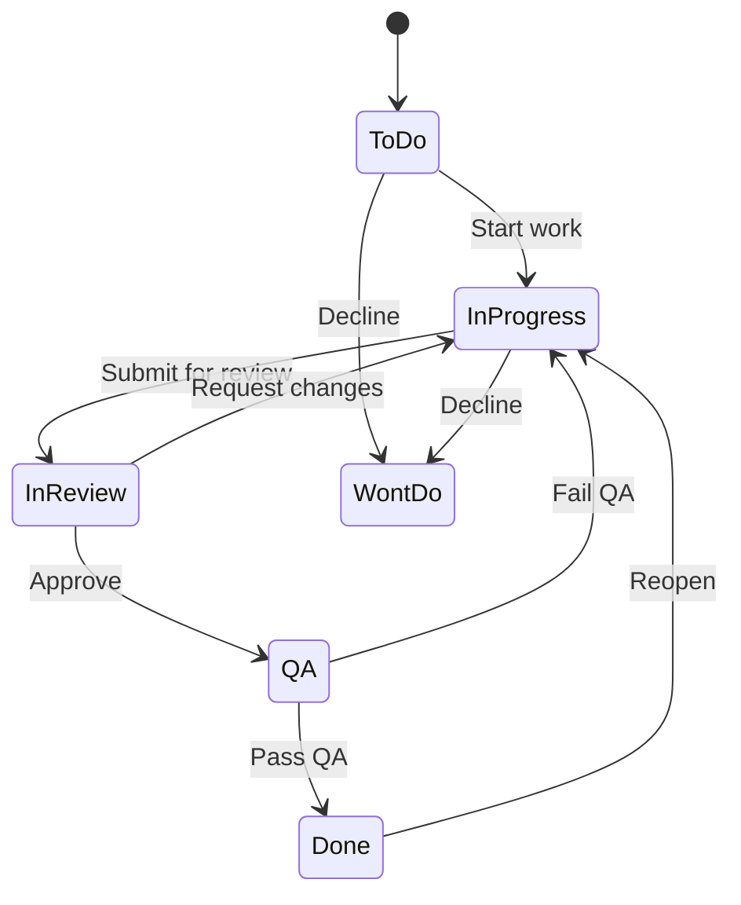

# Workflows: statuses, transitions and status categories

> **Before this lesson:** read [The Jira data model](#/lesson/jira/data-model) (status, status category, resolution) and [Team-managed and company-managed spaces](#/lesson/jira/team-company-managed) (who can change configuration).

## In plain words

A parcel delivery has a fixed path: ordered, packed, shipped, out for delivery, delivered. It cannot jump from "ordered" to "delivered", and it can only go back in specific ways ("delivery failed, returned to depot"). Each step is a **state**, and each allowed move between steps is a **transition**. Together they form a small **state machine**: a model of something that is always in exactly one state and moves between states only along allowed paths.

A Jira **workflow** is exactly that for work items. Atlassian describes it as the path work items take from creation to completion. It is made of **statuses** (the states, such as "In Progress") and **transitions** (the allowed moves, such as "Start review"). Workflows can also have rules: who may make a move, what must be true first, and what happens automatically afterwards.

Why it matters for a job: the workflow decides what the columns on your board mean, what "done" means to Jira's reports, and what you must do before moving a card. Engineers regularly suggest workflow changes ("we need a Blocked status", "QA should be a separate step"). Interviewers may ask you to design a workflow for a team, which is really a state-machine design question.

## Statuses, transitions and categories

**Status**: a named state a work item can be in. Examples: To Do, In Progress, In Review, QA, Done, Won't Do.

**Transition**: a named, directed move from one status to another. Example: "Submit for review" goes from In Progress to In Review. A transition is one-way; going back needs its own transition, such as "Request changes" from In Review to In Progress.

**Status category**: every status belongs to one of three categories, **To Do**, **In Progress** or **Done**. Categories let Jira (and you, in JQL) treat different workflows consistently: "In Review" and "QA" are both In Progress, "Done" and "Won't Do" are both Done.

Here is a typical software workflow drawn as a state diagram:



| Status | Category |
|---|---|
| ToDo | To Do |
| InProgress, InReview, QA | In Progress |
| Done, WontDo | Done |

Reading the diagram: an item cannot go from To Do straight to QA, because no transition exists. It can loop between In Progress and In Review many times. It can be reopened from Done. "Won't Do" is a second finishing status for work the team decides not to do.

## The default workflows

Atlassian's board documentation describes how default workflows map onto board columns:

- With Jira's **default workflow**, the To Do column holds the statuses Open and Reopened, In Progress holds In Progress, and Done holds Resolved and Closed.
- With the **simplified workflow**, the statuses To Do, In Progress and Done map directly to columns of the same names.

Many new spaces start with To Do, In Progress and Done. Teams then add what they need, carefully.

## Rules on transitions

A plain transition lets anyone with permission move the item. Often you want more control. The vocabulary depends on the space type.

**Team-managed spaces** offer **workflow rules** that you add to transitions. Atlassian's documentation lists four kinds:

1. **Assign a work item** to someone during the transition (for example, assign to the QA engineer on "Approve").
2. **Check a work item's field** before allowing the transition (for example, "Story point estimate must not be empty" before "Start work").
3. **Check whether the work item has been through a status** (for example, can only enter Done if it has been through In Review).
4. **Update a work item field** during the transition (for example, clear the assignee when moving back to To Do).

**Company-managed spaces** use the classic three building blocks, configured by Jira admins:

| Building block | Runs | Purpose | Example |
|---|---|---|---|
| **Condition** | Before the transition is offered | Decides whether the user can see and use the transition at all | Only members of the QA group see "Pass QA" |
| **Validator** | When the user tries the transition | Checks input; blocks the move with an error if invalid | "Fix version is required to move to Done" |
| **Post function** | After the transition succeeds | Does something automatically | Set resolution to "Done"; clear "Flagged" |

The post function that **sets the resolution** on finishing transitions is the one most worth checking in any workflow. As lesson 11 explained, an item in "Done" with an empty resolution still appears in every "unresolved" search.

> [!TIP]
> Rules are how a team can enforce parts of its Definition of Done. "Cannot move to Done unless it has been through In Review" is a mechanical guard that no one can forget. Keep such rules few: each one adds friction to every item.

## Workflow schemes

In company-managed spaces, a **workflow scheme** maps each work type to a workflow (lesson 12). This lets one space use, for example:

- a short workflow for Tasks: To Do, In Progress, Done;
- a longer one for Bugs: Open, Triaged, In Progress, In Review, Verified, Closed;
- a regulated one for Change Requests with an Approved step.

Because the scheme can be shared, a change to it can affect many spaces. In team-managed spaces, each work type's workflow is edited within the space.

## Workflows and boards

A board shows columns, not statuses. Each column is **mapped** to one or more statuses (lesson 14). Two consequences matter a lot:

1. **Unmapped statuses are invisible.** Atlassian's documentation says items in a status that is not mapped to any column are hidden from both the board and the backlog. Add a new status without mapping it, and items seem to vanish.
2. **The rightmost column means "complete".** Jira only considers items in the rightmost column of the board complete. Atlassian advises mapping statuses like Blocked or Canceled thoughtfully; for example, a canceled item left outside the last column stays "incomplete" and can block a sprint from completing cleanly or get carried forward.

So workflow design and board design go together.

## Designing a good workflow

Good workflows are boring: they mirror how work actually flows, and nothing more.

**1. Model real hand-offs, not wishes.** Add a status when work genuinely waits for a different person or condition (review, QA, deployment). Do not add one for every activity.

**2. Prefer few statuses.** Every status is a column to drag through and a place for work to hide. Five to seven statuses is common for software teams.

**3. Represent "blocked" deliberately.** Two common options:
- a **Blocked status**: visible as a column, but blocked items lose their position in the flow and inflate a status nobody "works" in;
- a **flag** (Jira can flag a card, showing it highlighted): the item stays in its real column but is marked as stuck.
Many teams prefer flags, because the item's true stage stays visible and cycle time still counts the wait.

**4. Allow necessary backward moves.** Real work goes back: review requests changes, QA fails, a released bug is reopened. A workflow without those transitions forces people into workarounds.

**5. Every finishing status sets a resolution.** Including "Won't Do" and "Duplicate", each with a matching resolution value.

**6. Keep the same workflow for similar work across teams** when you need cross-team reporting.

> [!WARNING]
> A workflow with 15 statuses and rules on every transition looks rigorous but usually produces the opposite: people skip steps by bulk-editing, or leave cards in the wrong column because moving them is painful. The board stops reflecting reality, and transparency is lost.

## Try it: a workflow as a state machine in code

A workflow is a set of allowed transitions. Here it is as a Python dictionary, with a function that applies a sequence of moves and rejects invalid ones. Edit the moves and run it.

```python-run
WORKFLOW = {
    "To Do":       {"Start work": "In Progress", "Decline": "Won't Do"},
    "In Progress": {"Submit for review": "In Review", "Decline": "Won't Do"},
    "In Review":   {"Request changes": "In Progress", "Approve": "QA"},
    "QA":          {"Fail QA": "In Progress", "Pass QA": "Done"},
    "Done":        {"Reopen": "In Progress"},
    "Won't Do":    {},
}
CATEGORY = {"To Do": "To Do", "In Progress": "In Progress", "In Review": "In Progress",
            "QA": "In Progress", "Done": "Done", "Won't Do": "Done"}

def apply(status, moves):
    for move in moves:
        allowed = WORKFLOW[status]
        if move not in allowed:
            print(f"  REJECTED '{move}' from {status}. Allowed: {list(allowed) or 'none'}")
            continue
        status = allowed[move]
        print(f"  {move:<18} -> {status:<12} ({CATEGORY[status]})")
    return status

print("SHOP-1042")
final = apply("To Do", ["Start work", "Submit for review", "Request changes",
                        "Submit for review", "Approve", "Pass QA"])
print("final:", final)
print("SHOP-1050")
apply("To Do", ["Approve", "Start work", "Pass QA", "Decline", "Reopen"])
```

The first item goes round the review loop once and finishes in Done. The second shows rejected moves: "Approve" is not available from To Do, "Pass QA" is not available from In Progress, and once declined, "Won't Do" has no outgoing transitions, so "Reopen" is rejected. Jira behaves the same way: a transition that does not exist from the current status is not offered.

The problem [Workflow transitions](#/problem/jira-workflow-transitions) asks you to build this, including counting reopenings and computing time spent per status category. For a deeper treatment of state machines as a testing tool, see the thinking track's [Modelling a device as a state machine](#/lesson/thinking/modelling-state-machines).

## Scenario: fixing a workflow that hides problems

A data platform team in Singapore has this workflow: To Do, In Progress, Waiting, Code Review, Testing, Deploying, Monitoring, Done, Closed. Their board has five columns, and their sprint reports look strange: items finish late, and the "completed" count jumps on certain days.

Their Scrum Master investigates:

- **Waiting** is unmapped, so blocked items disappear from the board. Nobody notices them in the Daily Scrum.
- **Monitoring** is mapped to the rightmost column together with Done, so Jira counts items "complete" while engineers are still watching dashboards and sometimes rolling back.
- **Closed** has no post function setting a resolution, so closed items still appear in "open work" searches.

At a retrospective, the team agrees changes and asks the Jira admin to apply them:

1. Remove the Waiting status; use the flag feature for blocked items instead.
2. Merge Deploying and Monitoring into one "Releasing" status in its own column, so the rightmost column means really finished.
3. Merge Done and Closed into Done, with a post function setting resolution "Done".
4. Add a "Won't Do" status with resolution "Won't Do", mapped to the rightmost column.

The new workflow has six statuses: To Do, In Progress, Code Review, Testing, Releasing, Done (plus Won't Do). The board now shows every item, the reports match reality, and searches for open work are correct.

## How interviewers probe this

> [!INTERVIEW]
> "Design a Jira workflow for a team that has code review and a separate QA engineer." Draw the states and transitions out loud: To Do, In Progress, In Review, QA, Done, with backward transitions for "Request changes" and "Fail QA", and a Won't Do exit. Say which rules you would add ("moving to Done sets the resolution; only QA can pass QA") and which you would avoid. Mention mapping every status to a board column, with only truly finished statuses in the rightmost one. Close with: "I'd keep it minimal and revisit it at retrospectives."

Other likely questions:

- "What's the difference between a status and a transition?" A state versus an allowed move between states.
- "Why do status categories exist?" To compare and search across workflows with different status names; Jira's reports and JQL can rely on To Do, In Progress and Done.
- "What's a validator versus a condition?" A condition hides a transition from users who cannot use it; a validator checks input when the transition is attempted.

## Summary

- A workflow is the path work items take: statuses (states) connected by transitions (allowed moves). It is a state machine.
- Every status belongs to one of three categories, To Do, In Progress or Done, which make cross-workflow searches and reports possible.
- Team-managed spaces offer four kinds of workflow rule: assign, check a field, check a previous status, update a field.
- Company-managed spaces use conditions, validators and post functions, with workflows assigned to work types by workflow schemes.
- Unmapped statuses hide items from the board and backlog; only the rightmost column counts as complete.
- Good workflows are minimal, mirror real hand-offs, allow backward moves, and always set a resolution when work finishes.

## Glossary

- **Workflow** — the set of statuses and transitions a work item moves through.
- **State machine** — a model of something that is always in one state and moves only along allowed transitions.
- **Status** — a named state in a workflow.
- **Transition** — a named, one-way move from one status to another.
- **Status category** — To Do, In Progress or Done; every status belongs to one.
- **Workflow rule** — in team-managed spaces, an automatic check or action attached to a transition.
- **Condition** — a company-managed rule deciding whether a transition is available to a user.
- **Validator** — a company-managed rule that checks input when a transition is attempted.
- **Post function** — a company-managed action run after a transition succeeds.
- **Workflow scheme** — maps work types to workflows in company-managed spaces.
- **Column mapping** — which statuses each board column shows.
- **Unmapped status** — a status not assigned to any board column; its items are hidden.
- **Flag** — a marker that highlights a stuck card without changing its status.
- **Reopen** — moving a finished item back into an active status.

## Check yourself

```quiz
[
  {"q": "What is a transition in a Jira workflow?",
   "options": ["A board column", "A named, one-way move between two statuses", "A sprint boundary", "A type of field"],
   "answer": 1,
   "explain": "Transitions are the allowed moves; going back needs a separate transition."},
  {"q": "A team adds a 'Waiting' status but does not map it to any board column. What happens to items in Waiting?",
   "options": ["They appear in To Do", "They are hidden from the board and the backlog", "They are deleted", "They count as done"],
   "answer": 1,
   "explain": "Atlassian's documentation says unmapped statuses hide items in both board and backlog."},
  {"q": "Which company-managed building block runs after a transition to set the resolution automatically?",
   "options": ["Condition", "Validator", "Post function", "Screen"],
   "answer": 2,
   "explain": "Post functions run after a successful transition, for example setting the resolution."},
  {"q": "Which of these is NOT one of the team-managed workflow rule kinds Atlassian lists?",
   "options": ["Assign a work item", "Check a work item's field", "Check whether it has been through a status", "Delete the work item"],
   "answer": 3,
   "explain": "The four kinds are assign, check a field, check a previous status, and update a field."},
  {"q": "Why might a team prefer flagging blocked cards over a 'Blocked' status?",
   "options": ["Flags are required by Scrum", "The card keeps its real position in the flow and its wait still shows in cycle time", "Flags delete the card", "Statuses cannot be added"],
   "answer": 1,
   "explain": "A flag marks the problem without moving the item out of its true stage."},
  {"q": "Which status category do 'In Review' and 'QA' usually belong to?",
   "options": ["To Do", "In Progress", "Done", "None"],
   "answer": 1,
   "explain": "Both are active work between start and finish."},
  {"q": "A Monitoring status is mapped to the rightmost column. What is the risk?",
   "options": ["Items in Monitoring are hidden", "Jira counts items as complete while engineers are still watching them", "The sprint cannot start", "Nothing"],
   "answer": 1,
   "explain": "Jira treats the rightmost column as complete, so reports overstate finished work."}
]
```

> **Source:** Atlassian, What are Jira workflows, https://support.atlassian.com/jira-software-cloud/docs/what-are-jira-workflows/; Atlassian, Create, edit and delete transitions in team-managed spaces, https://support.atlassian.com/jira-software-cloud/docs/create-edit-and-delete-transitions-in-team-managed-projects/; Atlassian, Configure columns, https://support.atlassian.com/jira-software-cloud/docs/configure-columns/; Jira Data Center fields reference (statusCategory), https://confluence.atlassian.com/jirasoftwareserver/advanced-searching-fields-reference-939938743.html
