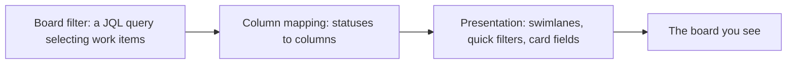

# Boards: columns, WIP limits, swimlanes and quick filters

> **Before this lesson:** read [Workflows: statuses, transitions and status categories](#/lesson/jira/workflows) and [Kanban: workflow, WIP limits, pull and service level expectations](#/lesson/jira/kanban-flow).

## In plain words

A kitchen ticket rail shows every order as a slip moving from "ordered" to "cooking" to "ready". The rail is not the orders themselves; it is a view of them, arranged so the cooks see at a glance what is waiting and what is stuck. You could arrange the same slips differently, for example by table, without changing any order.

A Jira **board** is that kind of view. Atlassian describes it as displaying your team's work as cards that you move between columns. The work items themselves live in spaces; the board chooses which items to show (using a saved search called the **board filter**) and how to arrange them (columns mapped to statuses, swimlanes, quick filters). Two boards can show the same items in different ways.

Why it matters for a job: the board is the screen your team looks at together every day. Knowing how it works lets you fix the common complaints ("my ticket disappeared", "the sprint won't close", "the burndown is wrong") and design boards that make problems visible. Interviewers may ask how you would set up a board, or how your team used WIP limits and swimlanes.

## A board is a view built from a filter

Every board has three layers:



1. **Board filter.** A saved JQL query (lessons 16 to 20) decides which work items belong to the board. For a simple team, it is often `project = SHOP ORDER BY Rank ASC`. A board can pull items from several spaces, for example `project in (SHOP, PAY) AND component = Checkout`.
2. **Column mapping.** Each column shows one or more statuses (lesson 13).
3. **Presentation.** Swimlanes, quick filters, card layout and colours.

Because reports such as the burndown and velocity charts are board-specific and include only items matching the board's saved filter, changing the filter changes every report. That is a common source of "the numbers changed and nobody knows why".

> [!NOTE]
> Atlassian's documentation says a board can display up to 5,000 work items at a time, and that this limit has been removed in the new board view now rolling out, except for company-managed software boards that pull work items from several spaces. If an old board shows a warning about too many items, tighten its filter, for example by excluding items resolved long ago.

## Scrum boards and Kanban boards

Jira offers two board styles, matching the two methods.

| | Scrum board | Kanban board |
|---|---|---|
| Built around | Sprints | Continuous flow |
| Main views | Backlog (ordered list plus planned sprints) and the active sprint board | The board itself; a separate backlog can be enabled |
| Which items appear on the board | Items in the active sprint | All items matching the filter in mapped statuses |
| Finished items | Stay on the board until the sprint is completed | Removed from view after a while (Atlassian's board page mentions 14 days without sprints) |
| Typical reports | Burndown, burnup, velocity, sprint report | Cumulative flow diagram, control chart |
| Best for | Teams working in Sprints | Support, operations, continuous delivery teams |

Atlassian's sprint documentation is explicit that sprints are for Scrum and do not apply to Kanban spaces.

## Columns and status mapping

Columns are the stages a card visibly moves through. Each column is mapped to statuses from the workflows of the items on the board. Atlassian's column documentation gives the rules:

- You map statuses to columns by dragging them; statuses not in any column sit in an **Unmapped statuses** area.
- **Unmapped statuses hide work items** from both the board and the backlog.
- Deleting a column moves its statuses back to unmapped.
- **Jira only treats items in the rightmost column as complete.** Statuses like Blocked or Canceled need deliberate placement; leaving them outside the last column keeps those items "incomplete", which can stop a sprint completing or carry the items forward.

### Mapping one column to several statuses

A column can show several statuses. That is useful when different work types have different workflows: a "Review" column might hold "In Review" from the story workflow and "Code Review" from the bug workflow. It is also useful when two statuses mean the same to the team, such as Done and Won't Do in the last column.

### Try it: check a column mapping

This script plays the part of Jira's mapping logic: which column each item appears in, which items are hidden because their status is unmapped, and which count as complete.

```python-run
columns = [            # left to right
    ("To Do",       ["Open", "To Do", "Reopened"]),
    ("In Progress", ["In Progress"]),
    ("Review",      ["In Review", "Code Review"]),
    ("Done",        ["Done", "Won't Do"]),
]
items = [("SHOP-1", "Open"), ("SHOP-2", "In Progress"), ("SHOP-3", "Code Review"),
         ("SHOP-4", "Blocked"), ("SHOP-5", "Won't Do"), ("SHOP-6", "QA")]

where = {status: name for name, statuses in columns for status in statuses}
rightmost = columns[-1][0]
for key, status in items:
    col = where.get(status)
    if col is None:
        print(f"{key:7} status {status!r:14} -> HIDDEN (unmapped status)")
    else:
        done = " (complete)" if col == rightmost else ""
        print(f"{key:7} status {status!r:14} -> column {col}{done}")
```

SHOP-4 (Blocked) and SHOP-6 (QA) vanish from the board because nobody mapped those statuses. SHOP-5 (Won't Do) counts as complete because it sits in the rightmost column. If this were a sprint board, SHOP-4 and SHOP-6 would still be in the sprint but invisible during the Daily Scrum, a real way for work to be forgotten.

## Column constraints (WIP limits)

Lesson 6 introduced WIP limits; here is how they work on a Jira board, per Atlassian's documentation:

- Each column can have a **minimum**, a **maximum**, both or neither.
- **Exceeding the maximum** turns the column header **red**; **not meeting the minimum** turns it **yellow**.
- You choose whether constraints count work items **with or without sub-tasks**. Atlassian recommends excluding sub-tasks for Scrum teams, since sub-tasks are steps of a story rather than separate pieces of flow.
- Constraints count **every** item in the column, including items hidden by quick filters. A quick filter changes what you see, not what is counted.
- The documentation describes constraints for company-managed Scrum and Kanban boards.

Picking limits: a common starting point is roughly the number of people who work in that stage, or slightly fewer, so that people are nudged to pair or help finish. Then adjust at retrospectives using data (lesson 22). The interactive board in lesson 6 lets you experiment, and the problem [WIP-limit checker](#/problem/jira-wip-check) implements the colour rule.

## Swimlanes

**Swimlanes** are horizontal rows that split the board into groups. Common groupings:

| Swimlane by | Useful when |
|---|---|
| **Assignee** | You want to see each person's load; good for spotting someone with five items in progress |
| **Epic** (or parent) | You want to see progress per feature |
| **Parent story** | Sub-tasks grouped under their story, so the team sees which stories are nearly done |
| **Custom queries** | You want an expedite lane, for example a top swimlane with `priority = Highest` for urgent production bugs |
| **None** | Small boards where rows add noise |

The **expedite lane** is a classic Kanban pattern: a swimlane for urgent work that is allowed to jump the queue, usually with its own tight WIP limit (for example, at most one item), so "urgent" cannot become the normal way to get work done.

## Quick filters

**Quick filters** are buttons above the board that apply an extra JQL condition to what is shown. Examples:

| Quick filter | JQL |
|---|---|
| Only my items | `assignee = currentUser()` |
| Bugs | `type = Bug` |
| Blocked (flagged) | `flagged is not EMPTY` |
| Recently updated | `updated >= -1d` |
| Checkout component | `component = Checkout` |

Quick filters combine with the board filter (only items matching both are shown). They are perfect for focused conversations, such as "let's look only at bugs" during triage. Remember that WIP constraints still count the hidden cards.

> [!TIP]
> The control chart documentation suggests a use for quick filters in reports too: label outliers that are not real (an item started and then abandoned) and create a quick filter that excludes that label, so the chart reflects normal work.

## Card layout and other settings

Boards also let you choose:

- **Card fields**: which extra fields show on each card, such as story points, due date or labels. Show the few that matter in the Daily Scrum.
- **Card colours**: by work type, priority, assignee or a JQL query. Colouring overdue items red is a common, useful choice.
- **Estimation statistic**: what reports use, such as story points or work item count (lesson 9).
- **Working days**: non-working days that burndown charts skip, useful for public holidays.

## Designing a board: a walkthrough

The `CARD` team at a Singapore payments company builds card-issuing features. Their workflow (company-managed) is: To Do, In Progress, In Review, QA, Releasing, Done, Won't Do. They also receive production bugs from support.

Their board design, step by step:

1. **Filter**: `project = CARD ORDER BY Rank ASC`. Simple, one space.
2. **Columns**:

| Column | Statuses | Constraint |
|---|---|---|
| To Do | To Do | none |
| In Progress | In Progress | max 4 |
| Review | In Review | max 3 |
| QA | QA | max 2 |
| Releasing | Releasing | max 2 |
| Done | Done, Won't Do | none |

3. **Count constraints without sub-tasks**, because stories are the unit of flow.
4. **Swimlanes**: a query swimlane "Expedite" with `priority = Highest AND type = Bug`, then everything else.
5. **Quick filters**: "My items", "Bugs", "Flagged".
6. **Card fields**: story points and fix version; card colour red for flagged items.
7. **Working days**: Singapore public holidays marked as non-working.

During the first week, the Review column turns red every afternoon. At the retrospective the team agrees a policy: before pulling anything new from To Do, review someone else's pull request. The red header becomes rare within two Sprints. The board did not fix the problem; it made it impossible to ignore.

## Common board problems and fixes

| Symptom | Likely cause | Fix |
|---|---|---|
| "My ticket disappeared from the board" | Its status is unmapped, or the item no longer matches the board filter | Map the status; check the filter |
| "The sprint won't complete cleanly" | Items sit in statuses outside the rightmost column (for example Canceled) | Map finishing statuses to the last column |
| "The burndown shows work done that isn't done" | A not-really-finished status is mapped to the last column | Give it its own column |
| "WIP limit is red, but I only see two cards" | A quick filter hides some cards; constraints count all | Clear quick filters |
| "Two teams' boards show each other's work" | Board filters overlap | Narrow each filter, for example by component |
| "The board is slow and cluttered" | Filter includes years of resolved items | Exclude old resolved items in the filter |

## How interviewers probe this

> [!INTERVIEW]
> "How did your team's board work?" Walk through filter, columns, limits and one habit: "Our board pulled our space's items, with columns To Do, In Progress, Review, QA, Done. We had WIP limits on Review and QA; when Review went red we stopped starting new work and reviewed. We had an expedite swimlane for production bugs with a limit of one. In stand-up we walked the board right to left." Specifics like these signal real experience.

Other likely questions:

- "Scrum board or Kanban board for a support team?" Kanban, for continuous arrivals; mention an expedite lane.
- "Why might an item vanish from a board?" Unmapped status or not matching the board filter.
- "What does Jira count as done on a board?" Items in the rightmost column.

## Summary

- A board is a view: a board filter selects items, columns map statuses, and swimlanes, quick filters and card settings shape the display.
- Reports are board-specific; changing the board filter or mapping changes the numbers.
- Scrum boards revolve around a backlog and sprints; Kanban boards show continuous flow.
- Unmapped statuses hide items; only the rightmost column counts as complete.
- Column constraints turn headers red when a maximum is exceeded and yellow when a minimum is not met, count hidden cards, and can exclude sub-tasks.
- Swimlanes group cards (assignee, epic, parent, queries such as an expedite lane); quick filters add a JQL condition to the view.

## Glossary

- **Board** — a view that shows work items as cards in columns.
- **Board filter** — the saved JQL query that decides which items appear on a board.
- **Column mapping** — the assignment of statuses to board columns.
- **Unmapped status** — a status in no column; its items are hidden.
- **Column constraint** — a minimum and/or maximum card count for a column.
- **Swimlane** — a horizontal row grouping cards on a board.
- **Expedite lane** — a swimlane for urgent items, usually with a very low WIP limit.
- **Quick filter** — a board button that adds a JQL condition to what is shown.
- **Card layout** — the fields displayed on each card.
- **Rank** — the order of items in the backlog and on the board.
- **Working days** — the days a board's reports treat as working days.
- **Scrum board** — a board organised around a backlog and sprints.
- **Kanban board** — a board organised around continuous flow.

## Check yourself

```quiz
[
  {"q": "What decides which work items appear on a board?",
   "options": ["The space key only", "The board filter, a saved JQL query", "The assignee field", "The sprint goal"],
   "answer": 1,
   "explain": "Every board is built from a saved filter; it can even span several spaces."},
  {"q": "A column has max 3. A quick filter hides 2 of its 4 cards. What colour is the header?",
   "options": ["Normal, because only 2 are visible", "Red, because constraints count all 4 cards", "Yellow", "Grey"],
   "answer": 1,
   "explain": "Constraints count items hidden by quick filters."},
  {"q": "Which board setting would best show urgent production bugs separately at the top?",
   "options": ["A quick filter", "A query-based swimlane such as an expedite lane", "Card colours only", "A new space"],
   "answer": 1,
   "explain": "A swimlane defined by a query groups those items in their own row."},
  {"q": "Why does Atlassian recommend excluding sub-tasks from constraints for Scrum teams?",
   "options": ["Sub-tasks cannot be on boards", "Sub-tasks are steps of a story, not separate units of flow", "It makes the board faster", "Sub-tasks have no status"],
   "answer": 1,
   "explain": "Counting sub-tasks would inflate WIP for a single story."},
  {"q": "A team's burndown changed overnight though nobody moved cards. What is a likely cause?",
   "options": ["Someone changed the board filter or column mapping", "Jira randomises reports", "The sprint goal changed", "A user logged time"],
   "answer": 0,
   "explain": "Reports are built from the board's filter and mapping, so editing them changes the numbers."},
  {"q": "What does a quick filter do?",
   "options": ["Permanently changes the board filter", "Adds a JQL condition to the current view", "Deletes non-matching items", "Creates a new sprint"],
   "answer": 1,
   "explain": "Quick filters narrow the display temporarily; they combine with the board filter."},
  {"q": "Which board type do sprints apply to?",
   "options": ["Kanban boards", "Scrum boards", "Both equally", "Neither"],
   "answer": 1,
   "explain": "Atlassian's documentation says sprints are for Scrum and do not apply to Kanban spaces."}
]
```

> **Source:** Atlassian, What is a Jira board, https://support.atlassian.com/jira-software-cloud/docs/what-is-a-jira-software-board/; Atlassian, Configure columns, https://support.atlassian.com/jira-software-cloud/docs/configure-columns/; Atlassian, What is a sprint, https://support.atlassian.com/jira-software-cloud/docs/what-is-a-sprint/; Atlassian, View and understand the burndown chart, https://support.atlassian.com/jira-software-cloud/docs/view-and-understand-the-burndown-chart/; Atlassian, View and understand the control chart, https://support.atlassian.com/jira-software-cloud/docs/view-and-understand-the-control-chart/; Atlassian Agile Coach, WIP limits, https://www.atlassian.com/agile/kanban/wip-limits
