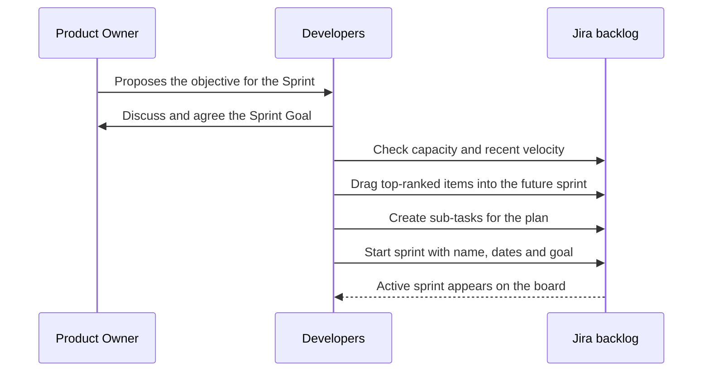

# Backlog refinement and sprint planning in Jira

> **Before this lesson:** read [The Scrum events and their timeboxes](#/lesson/jira/scrum-events), [Estimation](#/lesson/jira/estimation) and [Boards](#/lesson/jira/boards).

## In plain words

Packing for a two-week trip goes better if you have already laid out clothes on the bed during the week, sorted by what you will definitely need. On the night before, you only have to decide what fits in the suitcase. If you start from an unsorted wardrobe at midnight, packing takes hours and you forget the charger.

Scrum teams work the same way. **Backlog refinement** is the "laying out" during the week: making the top of the Product Backlog small, clear and estimated. **Sprint planning** is "packing": choosing what fits in the next Sprint and agreeing why. Jira's **backlog** view is where both happen, and its **Start sprint** and **Complete sprint** actions mark the Sprint's boundaries.

Why it matters for a job: you will spend part of every Sprint in refinement and planning, and you will see the Jira backlog many times a week. Doing this well is the difference between Sprints that start calmly and Sprints that start with an eight-hour argument. Interviewers ask "How does your team plan a sprint?" and "What do you do when work doesn't finish?".

## The backlog view

In a Scrum space, the **backlog** view shows, from top to bottom:

1. The **active sprint** (if one is running), collapsed or expanded.
2. Any **future sprints** that have been created but not started.
3. The **backlog** itself: every item matching the board's filter that is not in a sprint and not done, in **rank** order.

**Rank** is the order of items, set by dragging them up and down. It is how the Product Owner expresses the ordering of the Product Backlog (lesson 3). The JQL clause `ORDER BY Rank ASC` sorts search results in this same order.

From the backlog view you can also create items, edit them in a side panel, filter by epic or version, and drag items into a future sprint.

## Backlog refinement in practice

The Scrum Guide calls refinement an ongoing activity of breaking down and adding detail, such as a description, order and size, to backlog items (lesson 4). In Jira terms, refining the top of the backlog usually means making sure each item near the top has:

| Check | In Jira |
|---|---|
| A clear summary and description | Description filled in, with a link to designs if relevant |
| Acceptance criteria | In the description or a custom field |
| A size estimate | Story point estimate field |
| A parent epic, if it belongs to one | Parent field |
| Small enough to finish well within a Sprint | Split if 13 points or more (a common team rule) |
| Dependencies identified | "is blocked by" links |
| Rank | Dragged into position by the Product Owner |

A typical rhythm: one refinement session of about an hour each week, attended by the Product Owner and most Developers, looking at roughly the next two Sprints' worth of items. As lesson 4 noted, the 2020 Scrum Guide gives no capacity percentage for refinement; an "about 10%" figure comes from the older 2017 edition.

> [!TIP]
> A useful refinement question for every item: "If we pulled this into the Sprint tomorrow, what would we have to ask before starting?" Every answer is something to fix now.

## Sprint planning in Jira, step by step

Here is how the three topics of Sprint Planning (why, what, how) map onto Jira actions.



1. **Before the meeting**: someone creates the next sprint in the backlog (it appears as an empty container). The Product Owner makes sure the top items are refined.
2. **Why**: the Product Owner proposes the objective; the team agrees a **Sprint Goal** (lesson 5).
3. **What**: the Developers check their **capacity** for this Sprint and their recent results, then drag items from the top of the backlog into the sprint until it feels full. Jira shows a running total of the estimates in the sprint, which helps compare against past results.
4. **How**: the Developers create **sub-tasks** under the selected stories, or otherwise plan the work.
5. **Start sprint**: Jira asks for the sprint's name, duration, start and end dates, and goal. Fill in the goal; it then appears on the board.

## Capacity: how much fits?

The Scrum Guide says the Developers' forecast is more confident the more they know about past performance, upcoming capacity and their Definition of Done. A simple, widely used approach is to scale a recent result by available time.

```python-run
sprint_days = 10              # working days in the Sprint
holidays = 1                  # public holiday inside the Sprint, affects everyone
team = [                      # name, personal days off, % of time on this team
    ("Ana",   0, 100),
    ("Ben",   3, 100),        # three days of leave
    ("Chitra", 0, 50),        # half-time on this team
    ("Dev",   0, 100),
]

capacity = sum(max(0, sprint_days - holidays - off) * pct / 100 for _, off, pct in team)

recent = [31, 27, 34]         # points completed in the last three Sprints
recent_days = [36, 33, 37]    # person-days available in those Sprints
points_per_day = sum(recent) / sum(recent_days)

print(f"capacity this Sprint: {capacity} person-days")
print(f"recent rate: {points_per_day:.2f} points per person-day")
print(f"forecast: about {int(capacity * points_per_day)} points")
```

This team has 28.5 person-days this Sprint (Ben's leave and the public holiday cost a lot) and finished about 0.87 points per person-day recently, so a forecast of about 24 points is sensible, well below their usual 31. Using three Sprints instead of one smooths out noise. The problem [Sprint capacity planning](#/problem/jira-sprint-capacity) has you implement the core of this calculation.

> [!WARNING]
> Capacity planning gives a forecast, not a target. If the team sees that its Sprint Goal needs less than the forecast, it is fine to take less. Filling the Sprint to 100% leaves no room for the unexpected, and something unexpected always happens.

## During the Sprint

- **The board** shows the active sprint's items. Developers move cards and update sub-tasks.
- **Scope changes**: if an item is added after the sprint starts, Jira records it. The sprint report marks such items with an asterisk, and the burndown shows the scope change (lesson 21). This is not forbidden, but it should be a conscious decision with the Product Owner, not a quiet habit.
- **Estimate changes** made during the sprint are visible in the sprint report as an old and a new value.

## Completing the Sprint

At the end, someone (often the Scrum Master or any team member with the right permission) chooses **Complete sprint**. Jira counts items in the rightmost column as completed. For items that are not complete, Jira asks where to move them, typically to the backlog, to the next planned sprint, or to a new sprint.

What the team should do, in Scrum terms:

- Incomplete items do **not** count towards the Increment (lesson 5). They go back to the Product Backlog, where the Product Owner re-ranks them. Often they will be at the top of the next Sprint, but that is a decision, not an automatic carry-over.
- Partly done work should be re-estimated for what remains, or split so the finished part can be closed honestly.
- Look at *why* items did not finish at the retrospective: too much taken in, unexpected interruptions, dependencies, unclear stories.

> [!NOTE]
> Items in a status that is not mapped to the rightmost column, such as a "Canceled" status mapped elsewhere or not at all, count as incomplete. Atlassian advises mapping such statuses to the rightmost column, otherwise they keep being carried from sprint to sprint.

## Versions and sprints together

Sprints and **versions** (releases) answer different questions: a sprint is "what the team works on in these two weeks"; a version is "what ships to customers together". Atlassian's documentation notes that versions may span several sprints in Scrum spaces.

Example: version `2026.04` contains epics "Self-service refunds" and "Saved cards". Their stories are spread over Sprints 15, 16 and 17. Each story has fix version `2026.04`. A search `fixVersion = "2026.04" AND statusCategory != Done` shows what is still outstanding for the release at any moment.

Teams practising continuous delivery may release many times per sprint and use versions lightly, or not at all. That is fine; the Scrum Guide says Increments may be delivered before the Sprint ends.

## A full scenario: Sprint 14 for the SHOP team

The `SHOP` team (five Developers, a Product Owner, a part-time Scrum Master) runs two-week Sprints.

**Wednesday of the previous Sprint, refinement (1 hour).** They look at the top 12 items. Two are split (a "promo code" story becomes "apply a code" and "show code on receipt"). One gets a spike. Each of the top 9 now has acceptance criteria and an estimate.

**Monday, Sprint Planning (2 hours).**

- *Why*: The Product Owner explains that the Chinese New Year campaign starts in three weeks. The team agrees the goal: "Customers can apply a campaign promo code at checkout and see it on their receipt."
- *What*: Capacity is lower than usual: one person on leave for three days and a public holiday. The forecast is about 24 points. They pull the two promo-code stories (8 and 5), a related bug (3), the analytics event for code usage (3) and a small accessibility fix (2). Total 21. They leave room deliberately, because the payment provider's sandbox has been unreliable.
- *How*: They break the stories into sub-tasks: API validation, checkout UI, receipt template, tests, analytics event.
- They click **Start sprint**, enter the goal, set dates, and the board fills up.

**Day 6.** The marketing lead asks for a "code expiry countdown" banner. The Product Owner decides it does not serve the goal and adds it to the backlog for next Sprint. Nothing is added to the sprint.

**Day 8.** The receipt story turns out to need a change in the email service owned by another team. The team and Product Owner agree the goal can still be met with a simpler receipt line, and split out the richer version as a new backlog item.

**Day 10, Sprint Review.** Stakeholders apply promo codes in the staging app. The goal is met.

**Complete sprint.** 18 of 21 points are in Done. The accessibility fix is still in review; Jira asks where to move it, and the team moves it to the backlog, where the Product Owner ranks it at the top for Sprint 15.

**Retrospective.** The team notices that cross-team dependencies were found late, on day 8. Action: add "dependencies identified" to their refinement checklist, with owner Ana.

## How interviewers probe this

> [!INTERVIEW]
> "What happens to unfinished work at the end of a sprint?" Answer in two parts. The Jira mechanics: "When we complete the sprint, Jira asks where to move incomplete items, backlog or next sprint." The Scrum principle: "They don't count as done and go back to the Product Backlog; the PO re-ranks them, and we look at why at the retro, for example we'd overcommitted or found a dependency late." Mentioning both shows you understand the tool and the reason.

Other likely questions:

- "How do you decide how much to put in a sprint?" Recent results, this Sprint's capacity, the Sprint Goal, and room for the unexpected.
- "Someone adds work mid-sprint. What happens?" It is visible as a scope change; it should be agreed with the PO and weighed against the Sprint Goal.
- "How is a version different from a sprint?" A sprint is a time-box for the team; a version is a set of changes released together, possibly spanning sprints.

## Summary

- The Jira backlog view shows the active sprint, future sprints, and the ranked backlog; rank is the Product Owner's ordering.
- Refinement makes top items clear, estimated, small and ordered; the 2020 Guide treats it as ongoing and gives no capacity percentage.
- Sprint planning in Jira: agree the goal, check capacity and recent results, drag items into the sprint, plan sub-tasks, then Start sprint with dates and goal.
- Forecast with capacity times a recent rate, and leave slack; it is a forecast, not a target.
- Items added after the start are visible in the sprint report (asterisk) and the burndown; estimate changes appear as old and new values.
- On Complete sprint, only rightmost-column items count; incomplete items return to the backlog or move to a sprint, and should be re-ranked, not automatically carried over.
- Versions group work for release and can span sprints.

## Glossary

- **Backlog view** — Jira's screen listing sprints and the ranked backlog for a Scrum board.
- **Rank** — the order of items in the backlog, set by dragging.
- **Backlog refinement** — making upcoming backlog items clear, small, estimated and ordered.
- **Future sprint** — a sprint created in Jira but not yet started.
- **Start sprint** — the Jira action that begins a sprint with a name, dates and goal.
- **Complete sprint** — the Jira action that ends a sprint and moves incomplete items.
- **Capacity** — the time a team has available in a Sprint.
- **Forecast** — an estimate of how much the team expects to complete, not a promise.
- **Scope change** — adding or removing work after a sprint starts.
- **Carry-over** — incomplete work moved from one sprint to the next.
- **Fix version** — the release in which an item is delivered.

## Check yourself

```quiz
[
  {"q": "What does rank represent in the Jira backlog?",
   "options": ["Story points", "The order of items, expressing the Product Owner's ordering", "The assignee's seniority", "The creation date"],
   "answer": 1,
   "explain": "Rank is the drag-and-drop order of the backlog."},
  {"q": "A team usually completes 30 points, but this Sprint has 20% less capacity. What is a sensible starting forecast?",
   "options": ["36 points", "30 points", "About 24 points", "0 points"],
   "answer": 2,
   "explain": "Scaling recent results by available capacity gives about 24; then adjust for risk."},
  {"q": "How does Jira's sprint report show an item added after the sprint started?",
   "options": ["It hides it", "With an asterisk", "In red text", "It moves it to the backlog"],
   "answer": 1,
   "explain": "Atlassian's documentation says items added after the start are marked with an asterisk."},
  {"q": "At Complete sprint, which items count as completed?",
   "options": ["Items with any resolution", "Items in the rightmost board column", "Items with logged time", "All items in the sprint"],
   "answer": 1,
   "explain": "Jira treats the rightmost column as complete."},
  {"q": "In Scrum terms, what should happen to incomplete items at the end of a Sprint?",
   "options": ["They count as half done", "They return to the Product Backlog, where the PO re-orders them", "They are deleted", "They are added to the Increment"],
   "answer": 1,
   "explain": "Unfinished work is not part of the Increment and goes back to the Product Backlog."},
  {"q": "What is the difference between a sprint and a version in Jira?",
   "options": ["They are the same", "A sprint is a team time-box; a version groups work released together and may span sprints", "Versions are only for Kanban", "Sprints are released to customers"],
   "answer": 1,
   "explain": "Atlassian notes versions may span multiple sprints."},
  {"q": "Why leave some slack instead of filling the Sprint to the full forecast?",
   "options": ["Scrum forbids full Sprints", "Unexpected work and risks always appear; slack protects the Sprint Goal", "Jira limits sprint size", "To lower velocity"],
   "answer": 1,
   "explain": "The forecast is not a target; slack absorbs surprises."}
]
```

> **Source:** Atlassian, What is a sprint, https://support.atlassian.com/jira-software-cloud/docs/what-is-a-sprint/; Atlassian, What is a version, https://support.atlassian.com/jira-software-cloud/docs/what-is-a-version/; Atlassian, View and understand the sprint report, https://support.atlassian.com/jira-software-cloud/docs/view-and-understand-the-sprint-report/; Atlassian, Configure columns, https://support.atlassian.com/jira-software-cloud/docs/configure-columns/; Ken Schwaber and Jeff Sutherland, The Scrum Guide (2020), https://scrumguides.org/scrum-guide.html
