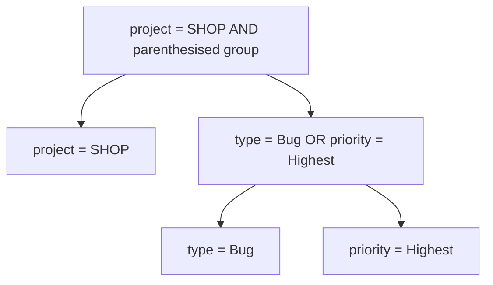

# JQL basics: field, operator, value

> **Before this lesson:** read [The Jira data model](#/lesson/jira/data-model). You should know what fields such as status, assignee, priority and labels hold, and the difference between status and status category.

## In plain words

In a library you can browse shelves, or you can ask the librarian a precise question: "Show me history books, published after 2010, that are not on loan." The second way is faster and exact, but you have to phrase the question in a form the catalogue understands.

**JQL**, the **Jira Query Language**, is that precise form for Jira. A JQL query is a sentence built from **clauses**, and each clause has three parts: a **field**, an **operator** and a **value**. For example:

```text
project = SHOP AND assignee = currentUser() AND statusCategory != Done
```

reads as "work items in the SHOP space, assigned to me, that are not finished". Jira returns the matching work items as a list you can sort, save, share, put on a board or chart on a dashboard.

Why it matters for a job: JQL is the single most useful Jira skill for an engineer. Board filters, quick filters, saved filters, dashboards and many automation rules are all JQL underneath. Teams notice the person who can answer "which high-priority bugs in the checkout component were reopened this month?" in one line. Interview tasks and take-home questions about Jira usually involve writing a few JQL queries.

## Basic search and advanced search

Jira's search screen has two modes:

- **Basic search**: drop-down menus for common fields (space, type, status, assignee) and a text box. Good for simple questions.
- **Advanced search** (JQL): a text box where you type a query. Jira offers autocomplete for field names, operators and values as you type, and marks invalid queries. Anything you build in basic mode can be viewed as JQL, and many advanced queries cannot be expressed in basic mode.

This track teaches JQL directly, because every other feature builds on it.

> [!NOTE]
> **Names, old and new.** Jira Cloud now says "space" for project and "work item" for issue, and its JQL documentation shows newer forms such as `space = SHOP`. The same documentation says some new terms may not work yet and recommends falling back to the old ones, and that there are no changes to existing JQL queries. In this track we write the long-established forms, `project`, `issue`, `issuetype`, which work on Jira Cloud and on Jira Data Center alike.

## The anatomy of a clause

```text
priority   =   High
  field    op  value
```

- **Field**: what you are asking about, such as `project`, `status`, `assignee`, `priority`, `labels`, `created`. Most fields have the names you see on the work item; a few have short aliases (`type` for `issuetype`, `key` for `issuekey`).
- **Operator**: how to compare, such as `=`, `!=`, `>`, `<`, `IN`, `~`, `IS`. Lesson 17 covers all of them.
- **Value**: what to compare against: a word (`High`), a quoted phrase (`"In Progress"`), a number (`5`), a date (`"2026-03-01"`), a list (`(Bug, Task)`), or a **function** such as `currentUser()` (lesson 18).

Clauses are joined with the **keywords** `AND`, `OR` and `NOT`, grouped with parentheses, and the whole query can end with `ORDER BY` to sort the results.

## The sample data for this lesson

To make every example concrete, here is a small set of work items. The interactive playground below uses exactly these items, and lessons 17 to 19 refer back to them.

| Key | Type | Summary | Status | Status category | Assignee | Priority | Labels | Points | Created | Parent |
|---|---|---|---|---|---|---|---|---|---|---|
| SHOP-1 | Story | Apply promo code at checkout | Done | Done | farah | High | checkout, cny | 5 | 2026-02-20 | SHOP-10 |
| SHOP-2 | Bug | Promo code accepted on empty cart | In Progress | In Progress | farah | Highest | checkout | 2 | 2026-03-04 | SHOP-10 |
| SHOP-3 | Story | Show promo code on receipt | To Do | To Do | (none) | Medium | cny | 3 | 2026-03-02 | SHOP-10 |
| SHOP-4 | Task | Rotate payment API key | In Review | In Progress | wei | High | (none) | (none) | 2026-03-06 | (none) |
| SHOP-5 | Bug | Receipt email missing logo | To Do | To Do | aisha | Low | email | 1 | 2026-02-11 | (none) |
| SHOP-6 | Story | Saved cards list | In Progress | In Progress | aisha | Medium | cards | 8 | 2026-02-25 | (none) |
| SHOP-10 | Epic | Promo codes | In Progress | In Progress | siti | Medium | cny | (none) | 2026-02-01 | (none) |
| PAY-7 | Bug | Refund fails for e-wallet payments | In Progress | In Progress | wei | Highest | refunds | 3 | 2026-03-09 | (none) |
| PAY-8 | Story | Partial refunds for card payments | To Do | To Do | (none) | High | refunds | 13 | 2026-02-27 | (none) |
| PAY-9 | Task | Upgrade payment SDK | Done | Done | farah | Low | (none) | 2 | 2026-01-15 | (none) |

Assume "today" is 2026-03-10 and the current user is `farah`.

## First queries, with results explained

**1. One clause.**

```text
project = SHOP
```

Result: SHOP-1, SHOP-2, SHOP-3, SHOP-4, SHOP-5, SHOP-6, SHOP-10 (7 items). Every item whose space key is SHOP; the three PAY items are excluded.

**2. Narrow with AND.** Both clauses must be true.

```text
project = SHOP AND type = Bug
```

Result: SHOP-2, SHOP-5. PAY-7 is a bug but in the wrong space.

**3. Broaden with OR.** At least one clause must be true.

```text
type = Bug OR priority = Highest
```

Result: SHOP-2, SHOP-5, PAY-7. PAY-7 matches both clauses; it still appears once.

**4. Status names with spaces must be quoted.**

```text
status = "In Progress"
```

Result: SHOP-2, SHOP-6, SHOP-10, PAY-7. Without the quotes Jira reads `In` as the keyword `IN` and rejects the query.

**5. Status category instead of status.**

```text
statusCategory = "In Progress"
```

Result: SHOP-2, SHOP-4, SHOP-6, SHOP-10, PAY-7. SHOP-4 is "In Review", a different status in the same category. This is why category searches are robust across workflows.

**6. Negation with NOT.**

```text
NOT type = Story
```

Result: SHOP-2, SHOP-4, SHOP-5, SHOP-10, PAY-7, PAY-9: everything that is not a story.

## Combining clauses: always use parentheses

Mixing `AND` and `OR` without parentheses is the most common JQL mistake. Compare:

```text
project = SHOP AND type = Bug OR priority = Highest
```

```text
project = SHOP AND (type = Bug OR priority = Highest)
```

The second is unambiguous: SHOP items that are bugs or highest priority, which gives SHOP-2 and SHOP-5. The first could be read as "(SHOP bugs) or (anything Highest)", which would also pull in PAY-7 from another space. Atlassian's keyword documentation says parentheses control the order in which clauses are evaluated. Rather than memorising precedence rules, make your intent explicit every time you mix `AND` and `OR`.



The diagram shows the query as a tree: the parentheses make the OR group one branch of the AND.

## Quoting and reserved words

Values that are a single plain word can be written bare: `type = Bug`. You need quotes (single or double both work) when the value:

- contains a space: `status = "In Review"`, `summary ~ "tech debt"` (labels cannot contain spaces at all, so a label would be written `labels = tech-debt`, with no quotes needed);
- contains a reserved character such as `+`, `.`, `,`, `;`, `?`, `|`, `*`, `/`, `%`, `^`, `$`, `#`, `@`, `[` or `]` (from Atlassian's Data Center documentation of reserved characters);
- is a reserved word such as `and`, `or`, `not`, `order`: `labels = "order"`.

Dates should also be quoted: `created >= "2026-03-01"`.

Keywords such as `AND`, `OR`, `NOT`, `IN`, `IS`, `EMPTY` and `ORDER BY` can be typed in any case; writing them in capitals makes queries easier to read.

## A first look at ORDER BY

`ORDER BY` sorts the results and must be the **last** part of the query. You can sort by several fields, separated by commas, each with `ASC` (ascending) or `DESC` (descending):

```text
project = SHOP AND statusCategory != Done ORDER BY priority DESC, created ASC
```

Result order: SHOP-2 (Highest), SHOP-4 (High), SHOP-10 (Medium, created 1 Feb), SHOP-6 (Medium, 25 Feb), SHOP-3 (Medium, 2 Mar), SHOP-5 (Low). Atlassian's documentation notes that without `ASC` or `DESC`, each field uses its own default sort order. Lesson 18 goes further.

## Try it: a JQL playground

The playground below runs a small JQL interpreter over the ten sample items above. It implements only a **documented subset** of real JQL:

- fields: `project` (alias `space`), `key` (aliases `issuekey`, `issue`), `type` (alias `issuetype`), `summary`, `text` (searches the summary here), `status`, `statusCategory`, `resolution`, `assignee`, `priority`, `labels`, `points`, `created`, `parent`;
- operators: `=`, `!=`, `>`, `>=`, `<`, `<=` (numbers, dates and priority), `IN`, `NOT IN`, `~`, `!~`, `IS EMPTY`, `IS NOT EMPTY` (`NULL` works too);
- `AND`, `OR`, `NOT`, parentheses (here `NOT` binds tightest, then `AND`, then `OR`; in real Jira, add parentheses rather than relying on this);
- functions `currentUser()` (returns `farah`) and `now()`; relative dates like `-7d` or `-2w` measured from 2026-03-10;
- `ORDER BY` with several fields; empty values sort last.

No history operators, sprint functions or real full-text search. Nothing is stored or sent anywhere.

```html-run
<!doctype html>
<html lang="en">
<head>
<meta charset="utf-8">
<title>JQL playground</title>
<style>
  body { font-family: system-ui, sans-serif; margin: 10px; color: #1f2937; background: #fff; }
  textarea { width: 100%; box-sizing: border-box; font: 14px ui-monospace, Consolas, monospace; padding: 6px; min-height: 48px; }
  button { font: inherit; margin: 4px 4px 0 0; cursor: pointer; }
  #msg { margin: 8px 0; font-size: 14px; }
  .err { color: #b91c1c; }
  table { border-collapse: collapse; width: 100%; font-size: 13px; }
  th, td { border: 1px solid #d1d5db; padding: 3px 5px; text-align: left; }
  th { background: #f3f4f6; }
  .samples { font-size: 13px; }
</style>
</head>
<body>
<textarea id="q">project = SHOP AND (type = Bug OR priority = Highest) ORDER BY priority DESC</textarea>
<div><button id="run">Run query</button></div>
<div class="samples" id="samples">Samples: </div>
<div id="msg"></div>
<div id="out"></div>
<script>
var TODAY = new Date("2026-03-10T00:00:00");
var ME = "farah";
function I(key, type, summary, status, assignee, priority, labels, points, created, parent) {
  var cat = status === "To Do" ? "To Do" : status === "Done" ? "Done" : "In Progress";
  return { key: key, project: key.split("-")[0], type: type, summary: summary, status: status, statuscategory: cat,
    resolution: cat === "Done" ? "Done" : null, assignee: assignee, priority: priority, labels: labels,
    points: points, created: created, parent: parent };
}
var ISSUES = [
  I("SHOP-1", "Story", "Apply promo code at checkout", "Done", "farah", "High", ["checkout", "cny"], 5, "2026-02-20", "SHOP-10"),
  I("SHOP-2", "Bug", "Promo code accepted on empty cart", "In Progress", "farah", "Highest", ["checkout"], 2, "2026-03-04", "SHOP-10"),
  I("SHOP-3", "Story", "Show promo code on receipt", "To Do", null, "Medium", ["cny"], 3, "2026-03-02", "SHOP-10"),
  I("SHOP-4", "Task", "Rotate payment API key", "In Review", "wei", "High", [], null, "2026-03-06", null),
  I("SHOP-5", "Bug", "Receipt email missing logo", "To Do", "aisha", "Low", ["email"], 1, "2026-02-11", null),
  I("SHOP-6", "Story", "Saved cards list", "In Progress", "aisha", "Medium", ["cards"], 8, "2026-02-25", null),
  I("SHOP-10", "Epic", "Promo codes", "In Progress", "siti", "Medium", ["cny"], null, "2026-02-01", null),
  I("PAY-7", "Bug", "Refund fails for e-wallet payments", "In Progress", "wei", "Highest", ["refunds"], 3, "2026-03-09", null),
  I("PAY-8", "Story", "Partial refunds for card payments", "To Do", null, "High", ["refunds"], 13, "2026-02-27", null),
  I("PAY-9", "Task", "Upgrade payment SDK", "Done", "farah", "Low", [], 2, "2026-01-15", null)
];
var PRI = { lowest: 1, low: 2, medium: 3, high: 4, highest: 5 };
var KW = ["AND", "OR", "NOT", "IN", "IS", "EMPTY", "NULL", "ORDER", "BY", "ASC", "DESC"];
var ALIAS = { issuetype: "type", issuekey: "key", issue: "key", space: "project" };
var FIELDS = ["key", "project", "type", "summary", "text", "status", "statuscategory", "resolution", "assignee", "priority", "labels", "points", "created", "parent"];

function tokenize(s) {
  var toks = [], i = 0;
  while (i < s.length) {
    var c = s[i];
    if (/\s/.test(c)) { i++; continue; }
    if (c === '"' || c === "'") {
      var j = i + 1, v = "";
      while (j < s.length && s[j] !== c) { v += s[j]; j++; }
      if (j >= s.length) throw new Error("Unterminated quote starting at position " + (i + 1));
      toks.push({ t: "STR", v: v }); i = j + 1; continue;
    }
    if (c === "(" || c === ")" || c === ",") { toks.push({ t: c }); i++; continue; }
    var two = s.substr(i, 2);
    if (two === "!=" || two === ">=" || two === "<=" || two === "!~") { toks.push({ t: "OP", v: two }); i += 2; continue; }
    if (c === "=" || c === ">" || c === "<" || c === "~") { toks.push({ t: "OP", v: c }); i++; continue; }
    var m = /^[A-Za-z0-9_.+-]+/.exec(s.slice(i));
    if (m) {
      var w = m[0];
      if (KW.indexOf(w.toUpperCase()) >= 0) toks.push({ t: "KW", v: w.toUpperCase() });
      else toks.push({ t: "WORD", v: w });
      i += w.length; continue;
    }
    throw new Error("Unexpected character '" + c + "' at position " + (i + 1));
  }
  return toks;
}

function parse(toks) {
  var p = 0;
  function peek() { return toks[p]; }
  function isKW(k) { var t = toks[p]; return t && t.t === "KW" && t.v === k; }
  function isT(type) { var t = toks[p]; return t && t.t === type; }
  function expect(type, v) {
    var t = toks[p];
    if (!t || t.t !== type || (v && t.v !== v)) throw new Error("Expected " + (v || type) + " at token " + (p + 1));
    p++; return t;
  }
  function orE() { var n = andE(); while (isKW("OR")) { p++; n = { op: "or", a: n, b: andE() }; } return n; }
  function andE() { var n = notE(); while (isKW("AND")) { p++; n = { op: "and", a: n, b: notE() }; } return n; }
  function notE() {
    if (isKW("NOT")) { p++; return { op: "not", a: notE() }; }
    if (isT("(")) { p++; var n = orE(); expect(")"); return n; }
    return clause();
  }
  function value() {
    var t = toks[p];
    if (!t) throw new Error("A value is missing at the end");
    if (t.t === "STR") { p++; return { v: t.v }; }
    if (t.t === "WORD") {
      p++;
      if (isT("(")) { p++; expect(")"); return { fn: t.v.toLowerCase() }; }
      return { v: t.v };
    }
    throw new Error("Expected a value at token " + (p + 1) + " (quote values containing spaces or keywords)");
  }
  function clause() {
    var f = expect("WORD").v.toLowerCase();
    f = ALIAS[f] || f;
    if (FIELDS.indexOf(f) < 0) throw new Error("Unknown field '" + f + "' in this playground");
    if (isKW("IS")) {
      p++; var neg = false;
      if (isKW("NOT")) { p++; neg = true; }
      if (isKW("EMPTY") || isKW("NULL")) { p++; return { op: neg ? "notempty" : "empty", f: f }; }
      throw new Error("Expected EMPTY or NULL after IS");
    }
    var notIn = false;
    if (isKW("NOT")) { p++; notIn = true; if (!isKW("IN")) throw new Error("Expected IN after NOT"); }
    if (isKW("IN")) {
      p++; expect("(");
      var vals = [value()];
      while (isT(",")) { p++; vals.push(value()); }
      expect(")");
      return { op: notIn ? "notin" : "in", f: f, vals: vals };
    }
    var op = expect("OP").v;
    if (isKW("EMPTY") || isKW("NULL")) {
      p++;
      if (op === "=") return { op: "empty", f: f };
      if (op === "!=") return { op: "notempty", f: f };
      throw new Error("EMPTY only works with = or != (or IS)");
    }
    return { op: "cmp", c: op, f: f, val: value() };
  }
  var where = null, order = [];
  if (toks.length && !isKW("ORDER")) where = orE();
  if (isKW("ORDER")) {
    p++; expect("KW", "BY");
    while (true) {
      var fld = expect("WORD").v.toLowerCase(); fld = ALIAS[fld] || fld;
      if (FIELDS.indexOf(fld) < 0) throw new Error("Unknown sort field '" + fld + "'");
      var dir = "ASC";
      if (isKW("ASC") || isKW("DESC")) { dir = toks[p].v; p++; }
      order.push({ f: fld, dir: dir });
      if (isT(",")) { p++; continue; }
      break;
    }
  }
  if (p < toks.length) throw new Error("Unexpected text at token " + (p + 1) + " (ORDER BY must come last)");
  return { where: where, order: order };
}

function get(it, f) { return f === "text" ? it.summary : it[f]; }
function empty(v) { return v === null || v === undefined || (Array.isArray(v) && v.length === 0); }
function resolve(q) {
  if (q.fn) {
    if (q.fn === "currentuser") return ME;
    if (q.fn === "now") return TODAY;
    throw new Error("Function " + q.fn + "() is not supported in this playground");
  }
  return q.v;
}
function toDate(x) {
  if (x instanceof Date) return x;
  var m = /^([+-]?)(\d+)([dw])$/i.exec(x);
  if (m) {
    var n = parseInt(m[2], 10) * (m[3].toLowerCase() === "w" ? 7 : 1);
    if (m[1] === "-") n = -n;
    var d = new Date(TODAY.getTime()); d.setDate(d.getDate() + n); return d;
  }
  var d2 = new Date(String(x).replace(/\//g, "-") + "T00:00:00");
  if (isNaN(d2.getTime())) throw new Error("Cannot read the date '" + x + "'");
  return d2;
}
function cmp(f, a, b) {
  if (f === "created") { var x = toDate(a).getTime(), y = toDate(b).getTime(); return x < y ? -1 : x > y ? 1 : 0; }
  if (f === "priority") {
    var pa = PRI[String(a).toLowerCase()], pb = PRI[String(b).toLowerCase()];
    if (pb === undefined) throw new Error("Unknown priority '" + b + "'");
    return pa < pb ? -1 : pa > pb ? 1 : 0;
  }
  if (typeof a === "number") {
    var nb = Number(b);
    if (isNaN(nb)) throw new Error("Expected a number for " + f);
    return a < nb ? -1 : a > nb ? 1 : 0;
  }
  return String(a).toLowerCase() === String(b).toLowerCase() ? 0 : NaN;
}
function test(it, n) {
  if (n.op === "and") return test(it, n.a) && test(it, n.b);
  if (n.op === "or") return test(it, n.a) || test(it, n.b);
  if (n.op === "not") return !test(it, n.a);
  var v = get(it, n.f);
  if (n.op === "empty") return empty(v);
  if (n.op === "notempty") return !empty(v);
  var vals = Array.isArray(v) ? v : (empty(v) ? [] : [v]);
  function eq(q) { var r = resolve(q); return vals.some(function (x) { return cmp(n.f, x, r) === 0; }); }
  if (n.op === "in") return n.vals.some(eq);
  if (n.op === "notin") return vals.length > 0 && !n.vals.some(eq);
  var c = n.c;
  if (c === "=") return eq(n.val);
  if (c === "!=") return vals.length > 0 && !eq(n.val);
  if (c === "~" || c === "!~") {
    var words = String(resolve(n.val)).toLowerCase().split(/\s+/).filter(Boolean);
    var tw = vals.join(" ").toLowerCase().split(/[^a-z0-9]+/);
    var hit = words.every(function (w) { return tw.indexOf(w) >= 0; });
    return c === "~" ? hit : (vals.length > 0 && !hit);
  }
  if (vals.length === 0) return false;
  var r = resolve(n.val);
  return vals.some(function (x) {
    var k = cmp(n.f, x, r);
    if (isNaN(k)) throw new Error("Operator " + c + " is not supported for " + n.f + " in this playground");
    return c === ">" ? k > 0 : c === ">=" ? k >= 0 : c === "<" ? k < 0 : k <= 0;
  });
}
function sortKey(it, f) {
  var v = get(it, f);
  if (empty(v)) return null;
  if (f === "priority") return PRI[String(v).toLowerCase()];
  if (f === "created") return toDate(v).getTime();
  if (f === "key" || f === "parent") { var parts = String(v).split("-"); return parts[0] + ("000000" + parts[1]).slice(-6); }
  if (Array.isArray(v)) return v.join(",").toLowerCase();
  return typeof v === "number" ? v : String(v).toLowerCase();
}
function run() {
  var msg = document.getElementById("msg"), out = document.getElementById("out");
  out.innerHTML = ""; msg.className = "";
  try {
    var q = parse(tokenize(document.getElementById("q").value));
    var rows = ISSUES.map(function (it, i) { return { it: it, i: i }; })
      .filter(function (r) { return q.where === null || test(r.it, q.where); });
    rows.sort(function (A, B) {
      for (var k = 0; k < q.order.length; k++) {
        var o = q.order[k], a = sortKey(A.it, o.f), b = sortKey(B.it, o.f);
        if (a === b) continue;
        if (a === null) return 1;
        if (b === null) return -1;
        var s = a < b ? -1 : 1;
        return o.dir === "DESC" ? -s : s;
      }
      return A.i - B.i;
    });
    msg.textContent = rows.length + " result(s)";
    var cols = ["key", "type", "summary", "status", "assignee", "priority", "labels", "points", "created"];
    var t = "<table><tr>" + cols.map(function (c) { return "<th>" + c + "</th>"; }).join("") + "</tr>";
    rows.forEach(function (r) {
      t += "<tr>" + cols.map(function (c) {
        var v = r.it[c];
        return "<td>" + (empty(v) ? "" : (Array.isArray(v) ? v.join(", ") : v)) + "</td>";
      }).join("") + "</tr>";
    });
    out.innerHTML = t + "</table>";
  } catch (e) {
    msg.className = "err"; msg.textContent = "Error: " + e.message;
  }
}
var SAMPLES = [
  "assignee = currentUser() AND statusCategory != Done",
  "assignee != farah",
  "assignee != farah OR assignee IS EMPTY",
  "labels IN (cny, refunds) ORDER BY created DESC",
  "summary ~ \"promo code\"",
  "points >= 5 ORDER BY points DESC",
  "created >= -7d",
  "status = In Progress"
];
var box = document.getElementById("samples");
SAMPLES.forEach(function (s) {
  var b = document.createElement("button");
  b.textContent = s;
  b.onclick = function () { document.getElementById("q").value = s; run(); };
  box.appendChild(b);
});
document.getElementById("run").onclick = run;
run();
</script>
</body>
</html>
```

Things to try: the sample `assignee != farah` returns 5 items, not 7, because SHOP-3 and PAY-8 have no assignee; lesson 17 explains why. The last sample shows the error you get when a value with a space is not quoted.

## Reading queries aloud

A good habit is to read every query aloud as an English sentence before running it:

| JQL | Read aloud |
|---|---|
| `project = PAY AND type = Bug AND priority IN (High, Highest)` | Bugs in PAY with high or highest priority |
| `assignee = currentUser() AND statusCategory != Done` | My unfinished work |
| `project = SHOP AND labels = cny ORDER BY created ASC` | SHOP items labelled cny, oldest first |
| `type = Story AND points IS EMPTY` | Stories that have no estimate |

If the sentence sounds wrong, the query is wrong.

## Scenario: three questions in a stand-up

During a Daily Scrum, the SHOP team's Scrum Master asks three questions. Farah answers each with JQL on the shared screen:

1. *"What are we working on right now?"* `project = SHOP AND statusCategory = "In Progress" ORDER BY priority DESC` → SHOP-2, SHOP-4, SHOP-6, SHOP-10 (SHOP-6 and SHOP-10 are both Medium and keep their original order).
2. *"Is anything urgent unassigned?"* `project in (SHOP, PAY) AND priority IN (High, Highest) AND assignee IS EMPTY` → PAY-8. Someone picks it up.
3. *"Which stories have no estimate?"* `type = Story AND points IS EMPTY` → none in this data set, a good sign before planning. (In a real site, the field is usually called "Story Points" or "Story point estimate"; lesson 17 shows how to refer to such names.)

## How interviewers probe this

> [!INTERVIEW]
> "Write a JQL query for all open high-priority bugs in the PAY space assigned to nobody." Write it and read it back: `project = PAY AND type = Bug AND priority IN (High, Highest) AND assignee IS EMPTY AND statusCategory != Done`. Then mention the two traps you avoided: using `statusCategory` rather than a specific status so the query works across workflows, and `IS EMPTY` rather than `= ""`.

Other likely questions:

- "What are the three parts of a JQL clause?" Field, operator, value.
- "Why does `status = In Progress` fail?" The value has a space and `In` is read as a keyword; quote it.
- "How do you combine AND and OR safely?" With parentheses that make the grouping explicit.

## Summary

- JQL queries are clauses of the form field, operator, value, joined by `AND`, `OR` and `NOT`, optionally followed by `ORDER BY`.
- Use `project`, `issue` and `issuetype` as the safe field names; Jira Cloud also shows newer `space` and work item forms, which may not work everywhere yet.
- Quote values that contain spaces, reserved characters or reserved words, and quote dates.
- Use parentheses whenever you mix `AND` and `OR`.
- `statusCategory` makes queries work across different workflows.
- `ORDER BY` must come last, can take several fields, and each can be `ASC` or `DESC`.

## Glossary

- **JQL (Jira Query Language)** — the text language for searching Jira work items.
- **Clause** — one condition in a query, made of a field, an operator and a value.
- **Field** — the attribute being searched, such as status or assignee.
- **Operator** — how the field is compared, such as `=` or `IN`.
- **Value** — what the field is compared against.
- **Keyword** — a reserved word with special meaning, such as `AND`, `OR`, `NOT`, `EMPTY`, `ORDER BY`.
- **Function** — a value computed by Jira, such as `currentUser()`.
- **Basic search** — Jira's drop-down search mode.
- **Advanced search** — Jira's JQL text search mode.
- **Reserved character** — a character that forces a value to be quoted.
- **ORDER BY** — the clause that sorts results; it must come last.
- **Autocomplete** — Jira's suggestions of fields, operators and values while you type.

## Check yourself

```quiz
[
  {"q": "What are the three parts of a JQL clause?",
   "options": ["Table, column, row", "Field, operator, value", "Space, board, sprint", "Select, from, where"],
   "answer": 1,
   "explain": "For example priority = High: field priority, operator =, value High."},
  {"q": "Using the sample data, what does `project = SHOP AND type = Bug` return?",
   "options": ["SHOP-2 and SHOP-5", "SHOP-2, SHOP-5 and PAY-7", "Only PAY-7", "All bugs and all SHOP items"],
   "answer": 0,
   "explain": "Both clauses must hold; PAY-7 is a bug in a different space."},
  {"q": "Why does `status = In Progress` fail?",
   "options": ["Status cannot be searched", "The value contains a space and In is a keyword, so it must be quoted", "JQL is case-sensitive", "The = operator is not allowed"],
   "answer": 1,
   "explain": "Write status = \"In Progress\"."},
  {"q": "What is the safest way to write 'SHOP items that are bugs or highest priority'?",
   "options": ["`project = SHOP AND type = Bug OR priority = Highest`", "`project = SHOP AND (type = Bug OR priority = Highest)`", "`project = SHOP OR type = Bug AND priority = Highest`", "`(project = SHOP AND type = Bug) OR priority = Highest`"],
   "answer": 1,
   "explain": "Parentheses make the grouping explicit; the last option would include PAY-7 from another space."},
  {"q": "Why might `statusCategory = \"In Progress\"` be better than `status = \"In Progress\"`?",
   "options": ["It is shorter", "It also matches other active statuses such as In Review, across different workflows", "Status cannot be quoted", "It is required for ORDER BY"],
   "answer": 1,
   "explain": "Every status belongs to a category, so category searches work across workflows."},
  {"q": "Where must ORDER BY appear in a query?",
   "options": ["At the start", "Anywhere", "At the end", "Inside parentheses"],
   "answer": 2,
   "explain": "Atlassian's documentation says ORDER BY must be placed at the end, otherwise the query is invalid."},
  {"q": "Which field names does this track recommend as the safe forms?",
   "options": ["space and workItem", "project and issue", "board and card", "team and ticket"],
   "answer": 1,
   "explain": "Jira's documentation says new terms may not work yet and existing queries are unchanged, so project and issue are safe."}
]
```

> **Source:** Atlassian, Use advanced search with JQL, https://support.atlassian.com/jira-software-cloud/docs/use-advanced-search-with-jira-query-language-jql/; Atlassian, JQL keywords, https://support.atlassian.com/jira-software-cloud/docs/jql-keywords/; Atlassian, JQL operators, https://support.atlassian.com/jira-software-cloud/docs/jql-operators/; Atlassian, JQL fields, https://support.atlassian.com/jira-software-cloud/docs/jql-fields/; Jira Data Center advanced searching (reserved characters and words), https://confluence.atlassian.com/jirasoftwareserver/advanced-searching-939938733.html
