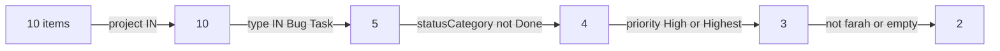

# JQL operators in depth

> **Before this lesson:** read [JQL basics: field, operator, value](#/lesson/jira/jql-basics). This lesson reuses its ten sample work items and its playground.

## In plain words

When you search for a flat to rent, "rent below 3,000 dollars", "in Tampines or Bedok", "description mentions near MRT" and "no agent fee listed" are four different kinds of comparison: a number range, a list, a text search and a check for something missing. Use the wrong kind and you get the wrong flats.

JQL **operators** are those kinds of comparison. Lesson 16 used `=`, `AND` and `OR`; this lesson covers every operator you need for day-to-day work, with the exact behaviour that catches people out, especially around **empty** fields. Lesson 19 adds the history operators (`WAS`, `CHANGED`).

Why it matters for a job: wrong operators produce believable but wrong numbers. "How many open bugs are not assigned to the payments team?" can silently skip every unassigned bug if you use `!=` carelessly. Knowing these details is what makes your dashboards trustworthy.

## The operator families

| Family | Operators | Typical use |
|---|---|---|
| Equality | `=`, `!=` | Exact values: status, type, assignee |
| Ordering | `>`, `>=`, `<`, `<=` | Dates, numbers, versions, priority |
| Lists | `IN`, `NOT IN` | Any of several values |
| Text | `~` (contains), `!~` (does not contain) | Words in summary, description, comments |
| Emptiness | `IS EMPTY`, `IS NOT EMPTY` (also `NULL`) | Missing values |
| History | `WAS`, `WAS IN`, `WAS NOT`, `WAS NOT IN`, `CHANGED` | Past values (lesson 19) |

Not every field supports every operator. Atlassian's field reference lists the operators each field accepts; for example, `component` supports `=`, `!=`, `IS`, `IS NOT`, `IN` and `NOT IN` but no ordering or text operators, and `text` supports only `~`.

## Equality: = and !=

`=` matches items whose field exactly equals the value. For multi-valued fields such as `labels` or `component`, it matches if **any** of the item's values equals it.

```text
labels = cny
```

Sample result: SHOP-1, SHOP-3, SHOP-10 (SHOP-1 has two labels; one of them matches).

Atlassian notes that `=` does not work on **text fields** such as summary or description; use `~` for those. (The lesson 16 playground lets `summary =` through for simplicity; real Jira will tell you to use `~`.)

### The != trap: empty fields are excluded

Atlassian's operator documentation is explicit: **`!=` does not match a field that has no value.**

```text
assignee != farah
```

Sample result: SHOP-4, SHOP-5, SHOP-6, SHOP-10, PAY-7. That is 5 items, not 7. SHOP-3 and PAY-8 have no assignee, so they are left out, even though "nobody" is clearly "not farah".

If you want them, say so:

```text
assignee != farah OR assignee IS EMPTY
```

Sample result: all 7 items not assigned to farah, including the unassigned ones.

Why does Jira behave this way? Think of `!=` as "has a value, and the value is not this". It is a common design in query languages (SQL's `NULL` behaves similarly), and Atlassian documents that `field != value` is equivalent to `NOT field = value`. The practical rule: **whenever empty values matter to your question, add an explicit `IS EMPTY` or `IS NOT EMPTY`.**

> [!NOTE]
> The playground and the practice problems in this track implement `NOT` as plain logical negation, so `NOT assignee = farah` returns the unassigned items there. Given Atlassian's statement that `!=` and `NOT ... =` are equivalent, do not rely on `NOT` to include empty values in real Jira. Add `OR assignee IS EMPTY`.

## Ordering: >, >=, <, <=

These work on fields that have an order: dates, numbers, versions and priority. Atlassian notes they cannot be used on text fields.

```text
points >= 5
```

Sample result: SHOP-1 (5), SHOP-6 (8), PAY-8 (13). Items with no points are not matched: an empty value is neither bigger nor smaller than 5.

```text
created >= "2026-03-01"
```

Sample result: SHOP-2, SHOP-3, SHOP-4, PAY-7.

```text
priority > Medium
```

Sample result: SHOP-1, SHOP-2, SHOP-4, PAY-7, PAY-8 (High and Highest). Priority comparisons follow the order of priorities configured on the site, not alphabetical order.

Versions also compare in the order set by the space administrator: `fixVersion > "2026.02"` means releases ordered after 2026.02.

## Lists: IN and NOT IN

`IN` is shorthand for several `=` clauses joined by `OR`:

```text
priority IN (High, Highest)
```

is the same as `priority = High OR priority = Highest`. Sample result: SHOP-1, SHOP-2, SHOP-4, PAY-7, PAY-8.

`NOT IN` matches items whose value is none of the listed values, and, like `!=`, **does not match empty fields**:

```text
assignee NOT IN (farah, wei)
```

Sample result: SHOP-5, SHOP-6, SHOP-10 (aisha and siti). The unassigned SHOP-3 and PAY-8 are excluded; add `OR assignee IS EMPTY` if you want them.

Lists can mix values and functions: `assignee IN (currentUser(), wei)`. Atlassian's Data Center reference mentions a limit of 3,000 values in one list, far more than you should ever type by hand; if you need that many, you probably want a label, a component or a saved filter instead.

## Text search: ~ and !~

`~` ("contains") performs a text search on text fields such as `summary`, `description`, `comment` and `environment`. The special field **`text`** searches across summary, description, environment, comments and free-text custom fields at once.

Text search is not a simple substring match. Based on Atlassian's operator reference:

| Query | What it matches |
|---|---|
| `summary ~ refund` | Summaries containing the word "refund", and close variations such as "refunds" |
| `summary ~ "refund*"` | Words starting with "refund" (wildcard) |
| `summary ~ "partial refund"` | Summaries containing both words, not necessarily next to each other or in that order |
| `summary ~ "\"partial refund\""` | The exact phrase "partial refund" (only this escaped form is an exact phrase), with escaped inner quotes |
| `text ~ "timeout"` | "timeout" in summary, description, comments and more |

Sample results using the playground's simpler word matching:

```text
summary ~ "promo code"
```

returns SHOP-1, SHOP-2, SHOP-3.

`!~` is the negation. For text fields, `summary !~ promo` finds summaries without the word. The Jira Data Center operators reference describes `!~` on version fields as also excluding items with an empty version (Data Center behaviour; the Jira Cloud documentation does not describe it), so if you rely on it, test on your site and add `OR fixVersion IS EMPTY` when needed.

> [!TIP]
> Text search is great for finding a half-remembered bug ("something about a timeout in refunds": `text ~ "timeout refund"`), but poor for reporting. Words vary ("refund", "chargeback", "reversal"). If you need a reliable category, use a label or component, not a text search.

## Emptiness: IS EMPTY and IS NOT EMPTY

`IS` and `IS NOT` are used only with `EMPTY` (or its synonym `NULL`).

```text
assignee IS EMPTY
```

Sample result: SHOP-3, PAY-8.

```text
type = Story AND points IS EMPTY
```

Sample result: none (all sample stories are estimated). In a real team this is a great pre-planning check.

```text
labels IS EMPTY
```

Sample result: SHOP-4, PAY-9.

Both `IS EMPTY` and `= EMPTY` work, as do `IS NOT EMPTY` and `!= EMPTY`; most people prefer the `IS` form because it reads naturally.

> [!WARNING]
> `assignee = ""` is not how you search for empty values. Use `assignee IS EMPTY`.

## Field names with spaces and custom fields

Some fields, especially custom fields, have spaces in their names, such as "Story Points" or "Customer Impact". Quote the field name:

```text
"Story Points" >= 8
```

Custom fields can also be referred to by their numeric id in the form `cf[12345]`, which is stable even if someone renames the field. You can find the id in the field's configuration or through autocomplete.

## A worked example: building a query step by step

**Question:** "Which open, high-priority bugs or tasks in SHOP and PAY are either unassigned or assigned to someone other than farah, newest first?"

Build it one clause at a time and check the result after each step.

1. Spaces: `project IN (SHOP, PAY)` → all 10 items.
2. Types: `AND type IN (Bug, Task)` → SHOP-2, SHOP-4, SHOP-5, PAY-7, PAY-9.
3. Open: `AND statusCategory != Done` → SHOP-2, SHOP-4, SHOP-5, PAY-7.
4. Priority: `AND priority IN (High, Highest)` → SHOP-2, SHOP-4, PAY-7.
5. Assignee, with empties handled: `AND (assignee != farah OR assignee IS EMPTY)` → SHOP-4, PAY-7.
6. Sort: `ORDER BY created DESC` → PAY-7 (9 Mar), SHOP-4 (6 Mar).

Final query:

```text
project IN (SHOP, PAY) AND type IN (Bug, Task) AND statusCategory != Done
AND priority IN (High, Highest) AND (assignee != farah OR assignee IS EMPTY)
ORDER BY created DESC
```

Paste it into the lesson 16 playground to check. Building incrementally like this is the fastest way to debug JQL: when a result looks wrong, you know which clause changed it.



## Common operator mistakes

| Mistake | Why it is wrong | Fix |
|---|---|---|
| `assignee != farah` to mean "everyone but farah" | Skips unassigned items | `assignee != farah OR assignee IS EMPTY` |
| `summary = "refund"` | `=` does not work on text fields | `summary ~ refund` |
| `labels = "cny, refunds"` | Searches for one label with a comma in it | `labels IN (cny, refunds)` |
| `priority > "High"` expecting alphabetical | Priority uses the configured order | It means Highest here, which may be what you want; check |
| `status != Done` for open work | Misses other done statuses such as Won't Do | `statusCategory != Done` or `resolution IS EMPTY` |
| `assignee = ""` | Not the empty check | `assignee IS EMPTY` |
| `fixVersion !~ "2026.*"` | On Data Center, silently drops items with no version (not documented for Cloud) | add `OR fixVersion IS EMPTY` |

## Practice in code

The problems [Mini-JQL: single clause](#/problem/jira-jql-clause) and [Mini-JQL: boolean queries](#/problem/jira-jql-boolean) ask you to implement these operators over a list of work items in Python, including the `!=` and `NOT IN` rule for empty fields. Implementing the rules is the surest way to remember them.

## Scenario: a misleading dashboard

A team lead at a Singapore insurer shows a dashboard gadget "Bugs not owned by the Claims team" built on:

```text
type = Bug AND component != Claims AND statusCategory != Done
```

It shows 14 bugs. A new engineer, Kumar, notices that many bugs in the space have **no component at all** because the support team files them quickly. He runs:

```text
type = Bug AND component IS EMPTY AND statusCategory != Done
```

and finds 37 more. The real number of open bugs not owned by Claims is 51, not 14. The team fixes the filter:

```text
type = Bug AND (component != Claims OR component IS EMPTY) AND statusCategory != Done
```

and adds an automation rule (lesson 23) that flags new bugs without a component for triage. One operator detail had been hiding most of the work.

## How interviewers probe this

> [!INTERVIEW]
> "What does `assignee != alice` return?" The strong answer includes the subtlety: "All items with an assignee other than Alice, but not unassigned items, because != doesn't match empty fields. If I want those too I add `OR assignee IS EMPTY`." Mentioning this unprompted signals real experience.

Other likely questions:

- "How do you search for text across a work item?" `text ~ "words"`, which covers summary, description, comments and more.
- "IN versus several ORs?" Equivalent; IN is shorter and clearer.
- "How do you find stories without estimates?" `type = Story AND "Story Points" IS EMPTY` (or the site's field name).

## Summary

- Equality `=` and `!=` work on exact values; `=` matches any value of a multi-valued field; neither works on text fields.
- `!=` and `NOT IN` do not match empty fields; add `OR field IS EMPTY` when empties matter.
- Ordering operators work on dates, numbers, versions and priority (in configured order), never on text.
- `~` and `!~` perform text search with word variations, wildcards and phrases; `text` searches many text fields at once.
- `IS EMPTY` and `IS NOT EMPTY` (or `NULL`) test for missing values.
- Quote field names with spaces; custom fields can be referenced as `cf[id]`.
- Build complex queries one clause at a time and check the count after each step.

## Glossary

- **Operator** — the comparison in a JQL clause.
- **Multi-valued field** — a field that can hold several values, such as labels, components or fix versions.
- **Empty value** — a field with no value; written `EMPTY` or `NULL` in JQL.
- **Text field** — a field holding free text, such as summary or description.
- **Text search** — matching words in text fields with `~`, including variations and wildcards.
- **Wildcard** — a `*` in a text search that matches any ending.
- **Phrase search** — a text search for words appearing together; in JQL only the escaped form `"\"partial refund\""` is an exact phrase, while `"partial refund"` matches both words anywhere.
- **`text` field** — a special JQL field that searches summary, description, environment, comments and text custom fields.
- **Custom field id** — the numeric identifier of a custom field, used as `cf[id]`.
- **Incremental query building** — adding one clause at a time and checking results after each.

## Check yourself

```quiz
[
  {"q": "With the sample data, how many items does `assignee != farah` return?",
   "options": ["7, everyone except farah's items", "5, because unassigned items are excluded", "3", "0"],
   "answer": 1,
   "explain": "!= does not match empty fields, so SHOP-3 and PAY-8 are left out."},
  {"q": "How do you include unassigned items when excluding farah?",
   "options": ["`assignee != farah AND assignee IS EMPTY`", "`assignee != farah OR assignee IS EMPTY`", "`assignee != \"\"`", "`assignee !~ farah`"],
   "answer": 1,
   "explain": "Add an explicit OR for the empty case."},
  {"q": "Which operator should you use to search the summary for a word?",
   "options": ["=", "~", "IN", ">"],
   "answer": 1,
   "explain": "= does not work on text fields; ~ performs a text search."},
  {"q": "What does `labels IN (cny, refunds)` mean?",
   "options": ["Items with both labels", "Items with at least one of the two labels", "Items with a label called 'cny, refunds'", "Items with no labels"],
   "answer": 1,
   "explain": "IN is a shorthand for several = clauses joined by OR."},
  {"q": "With the sample data, what does `points >= 5` return?",
   "options": ["SHOP-1, SHOP-6, PAY-8", "SHOP-1, SHOP-6, PAY-8 and every item without points", "Only PAY-8", "SHOP-6 only"],
   "answer": 0,
   "explain": "Items with 5, 8 and 13 points; empty values do not satisfy ordering comparisons."},
  {"q": "Which query reliably finds open work across workflows with several done statuses?",
   "options": ["`status != Done`", "`statusCategory != Done`", "`status = Open`", "`resolution = Done`"],
   "answer": 1,
   "explain": "Every done-like status shares the Done category; status != Done misses Won't Do and others."},
  {"q": "How do you refer to a custom field whose name contains a space?",
   "options": ["Remove the space", "Put the field name in quotes, or use cf[id]", "It cannot be searched", "Use the ~ operator"],
   "answer": 1,
   "explain": "Quoted names such as \"Story Points\" or the stable cf[12345] form both work."}
]
```

> **Source:** Atlassian, JQL operators, https://support.atlassian.com/jira-software-cloud/docs/jql-operators/; Atlassian, JQL fields, https://support.atlassian.com/jira-software-cloud/docs/jql-fields/; Atlassian, JQL keywords, https://support.atlassian.com/jira-software-cloud/docs/jql-keywords/; Jira Data Center operators reference, https://confluence.atlassian.com/jirasoftwareserver/advanced-searching-operators-reference-939938745.html; Jira Data Center fields reference, https://confluence.atlassian.com/jirasoftwareserver/advanced-searching-fields-reference-939938743.html
