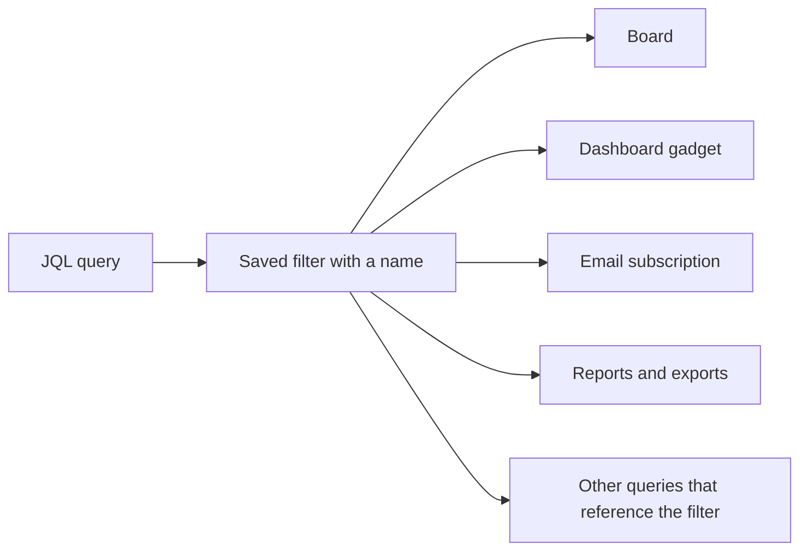

# Filters, subscriptions and dashboards

> **Before this lesson:** read [JQL functions, dates and ordering](#/lesson/jira/jql-functions-dates) and [Advanced JQL](#/lesson/jira/jql-advanced). You should be able to write a query with functions and `ORDER BY`.

## In plain words

Writing a good recipe once and keeping it in a folder is better than re-inventing the dish every time. Pinning the recipe on the fridge, where everyone in the family can see it, is better still. And if the recipe card could update itself with today's ingredients, you would never have a stale list.

In Jira, a **filter** is a saved search: a JQL query with a name that you can run again, share with others and build on. A **subscription** emails a filter's results to people on a schedule. A **dashboard** is a page of **gadgets**, small panels that each show a filter's results as a list, a count or a chart. Together they turn the queries from lessons 16 to 19 into tools the whole team uses every day.

Why it matters for a job: every board is built on a filter (lesson 14), many automation rules are scoped by JQL (lesson 23), and team leads and on-call engineers live on dashboards. Interviewers asking "How did you track quality or on-call load?" are often asking about filters and dashboards.

## From query to tool



One well-designed filter can feed a board, a dashboard and a daily email at once. Fix the query in one place and every consumer is fixed.

## Saving and managing filters

Atlassian's documentation calls saved searches **filters** and describes what you can do with them:

- **Reuse** them: run the same query later without retyping it.
- **Favourite** them, so they appear in your list of starred filters.
- **Share** them with colleagues.
- **Subscribe** to them, so results are emailed on a schedule you choose.
- **Export** results, in formats such as a spreadsheet, or show them in a report or a dashboard gadget.

Good habits when saving:

- **Name for the question it answers**, not the query: "SHOP: open bugs by priority" rather than "my filter 3".
- **Prefix with the team or space** so filters are easy to find on a big site.
- **Use functions**, not fixed dates or names, so the filter does not go stale (lesson 18).
- **Add a description** saying what it is for and who uses it, especially if a board depends on it.

### Referencing a filter in JQL

A saved filter can be used inside another query with the `filter` field:

```text
filter = "SHOP: open bugs" AND assignee = currentUser()
```

This composes queries: one canonical definition of "open bugs", reused with an extra condition. If the team later changes what counts as an open bug, every query built on it follows.

## Sharing and its consequences

A filter starts private to its owner. Sharing makes it visible to others, for example a group or the members of a space. Two practical consequences:

1. **A board built on a filter needs that filter to be visible** to the board's users. If the filter is private, other people's view of the board will not work properly.
2. **Whoever can edit a filter can change every board and gadget built on it.** If a board's filter is edited carelessly, the team's board and its reports change overnight. Keep board filters owned by the team (or a shared account the team controls), and treat edits to them as a team decision.

> [!WARNING]
> When someone leaves the company, filters they owned can become a problem for boards and dashboards that depend on them. Teams with many shared filters periodically check who owns them and move ownership to someone current.

## Subscriptions

A **subscription** runs a filter on a schedule (for example every weekday at 08:30) and emails the results. Useful subscriptions:

| Subscription | Filter | Who receives it |
|---|---|---|
| Morning triage list | New bugs since yesterday: `project = SHOP AND type = Bug AND created >= "-1d" ORDER BY priority DESC` | The on-call engineer |
| Release countdown | `fixVersion = earliestUnreleasedVersion(SHOP) AND statusCategory != Done` | The team, during release week |
| Stale work | `project = SHOP AND statusCategory = "In Progress" AND updated <= "-5d"` | The team lead, weekly |
| My overdue items | `assignee = currentUser() AND due < startOfDay() AND statusCategory != Done` | Each engineer, daily |

Subscriptions are a gentle form of automation: nothing changes in Jira, but the right people see the right list at the right time. Keep them few; an inbox full of Jira emails gets filtered to a folder nobody reads.

## Dashboards and gadgets

A **dashboard** is a configurable page made of **gadgets**. Most gadgets are driven by a filter and display its results in some form. Gadget names and the exact set available vary between Jira versions and plans, but common kinds include:

| Kind of gadget | Shows | Good for |
|---|---|---|
| Filter results list | The items a filter returns, with chosen columns | "Open highest-priority bugs" |
| Pie or bar chart by field | Counts grouped by a field, such as priority or assignee | "Open bugs by component" |
| Two-dimensional statistics | A table counting items by two fields | "Bugs by priority and status" |
| Created versus resolved | Items created and resolved per day over a period | "Are we keeping up with incoming bugs?" |
| Sprint or burndown gadgets | A board's sprint progress | Team TV screen |
| Assigned to me | The viewer's assigned items | Personal home dashboard |

Because gadgets can use `currentUser()` filters, one shared dashboard can show each viewer their own data.

### Designing a useful team dashboard

A dashboard is only useful if it answers questions people actually ask. Design it backwards from those questions.

**Example: the SHOP team's dashboard**

| Question | Gadget | Filter |
|---|---|---|
| What is urgent right now? | Filter results | `project = SHOP AND priority = Highest AND statusCategory != Done ORDER BY created ASC` |
| Are we keeping up with bugs? | Created vs resolved, last 30 days | `project = SHOP AND type = Bug` |
| Where are the open bugs? | Pie chart by component | `project = SHOP AND type = Bug AND statusCategory != Done` |
| How is the sprint going? | Sprint burndown | The SHOP board |
| What is stuck? | Filter results | `project = SHOP AND statusCategory = "In Progress" AND updated <= "-3d" ORDER BY updated ASC` |
| What's next to release? | Filter results | `fixVersion = earliestUnreleasedVersion(SHOP) AND statusCategory != Done` |

Six gadgets, each answering one question. The team reviews it at the start of the Daily Scrum and the on-call engineer keeps it open all day.

### Reading the created-versus-resolved chart

This chart is worth understanding precisely, because it is often misread. For each day, it plots how many matching items were **created** and how many were **resolved**. The gap between the two cumulative lines is the growth (or shrinkage) of the open backlog.

```python-run
created  = [5, 3, 4, 6, 2, 0, 0, 7, 4, 3]   # new bugs per day
resolved = [2, 4, 3, 3, 4, 0, 0, 3, 5, 6]   # bugs resolved per day

open_count, total_c, total_r = 20, 0, 0       # 20 bugs open before day 1
for day, (c, r) in enumerate(zip(created, resolved), start=1):
    total_c += c
    total_r += r
    open_count += c - r
    bar = "#" * open_count
    print(f"day {day:2}: +{c} -{r}  cumulative created {total_c:2} resolved {total_r:2}  open {open_count:2} {bar}")
```

Over ten days, 34 bugs arrived and 30 were resolved, so the open count grew from 20 to 24, even though the team resolved bugs every working day. The chart makes "we are fixing lots of bugs" and "we are falling behind" visible at the same time. The useful conversation is about the gap: why are 34 bugs arriving, and what would prevent some of them?

## Dashboards that mislead

Dashboards are persuasive, which makes them dangerous when they are wrong or used for the wrong purpose.

| Problem | Example | Fix |
|---|---|---|
| Wrong filter | "Open bugs" uses `status != Done` and misses Won't Do and other statuses | Use `statusCategory` or `resolution IS EMPTY` |
| Empty-field trap | "Bugs not in Claims" uses `component != Claims` and silently drops unassigned components | Add `OR component IS EMPTY` (lesson 17) |
| Vanity metrics | A big number "Tickets closed this month: 412" | Ask what decision it informs; if none, remove it |
| Individual ranking | "Tickets closed per engineer" leaderboard | Remove; it encourages gaming and discourages hard work and helping others |
| Stale gadgets | A gadget still tracks last year's release | Use functions like `earliestUnreleasedVersion()` |
| Too many gadgets | 20 charts nobody reads | Keep the few that answer real questions |

> [!TIP]
> For every gadget, write the question it answers in its title. If you cannot phrase a question, the gadget probably does not need to exist.

## Scenario: an on-call dashboard

The payments platform team at a Singapore fintech runs a weekly on-call rotation. New on-call engineers kept missing urgent tickets because they arrived through three routes: a JSM queue, bugs filed by other teams, and monitoring alerts that automation turned into work items.

The team lead builds one filter, `On-call: needs attention`:

```text
project IN (PAY, PAYOPS) AND statusCategory != Done
AND (priority IN (Highest, High) OR labels = alert)
AND (assignee IS EMPTY OR assignee = currentUser())
ORDER BY priority DESC, created ASC
```

and uses it in three ways:

1. A **dashboard** gadget listing the results, plus a created-versus-resolved chart for PAYOPS over 14 days.
2. A **subscription** emailing the list every weekday at 08:00 to the on-call group.
3. A **quick filter** on the team's Kanban board using the same conditions.

Note the details: `assignee IS EMPTY OR assignee = currentUser()` shows each viewer the unassigned items plus their own, and `created ASC` within a priority makes the oldest urgent item appear first. Within a month, the average time before someone picked up a Highest-priority ticket dropped noticeably, and handovers between on-call engineers became a two-minute look at one dashboard.

## How interviewers probe this

> [!INTERVIEW]
> "How did you keep track of bugs or on-call work?" Describe a filter, where it was used, and what decision it supported: "We had a saved JQL filter for unassigned high-priority items in our two spaces, sorted by priority then age. It fed our on-call dashboard and a daily email, so the on-call engineer started each day with one list. We also watched created-versus-resolved for bugs; when the open count grew three weeks in a row, we put a bug-reduction goal in the next sprint."

Other likely questions:

- "What's the risk of editing a shared filter?" Every board, gadget and subscription built on it changes.
- "What would you put on a team dashboard?" Gadgets that each answer a question the team actually asks; avoid individual leaderboards.
- "How do you make a filter work for everyone?" Use `currentUser()` and other functions.

## Summary

- A filter is a saved, named JQL query that can be reused, favourited, shared, subscribed to, exported and shown in gadgets.
- Filters can be referenced in other queries with `filter = "name"`, giving one canonical definition.
- Shared filters power boards and dashboards; editing one changes everything built on it, and private filters break shared boards.
- Subscriptions email filter results on a schedule; keep them few and purposeful.
- Dashboards are pages of gadgets; design each gadget to answer one real question.
- Read created-versus-resolved as the gap between arrivals and completions; avoid vanity metrics and individual rankings.

## Glossary

- **Filter** — a saved, named JQL search.
- **Favourite filter** — a filter you have starred for quick access.
- **Shared filter** — a filter visible to other people or groups.
- **Filter owner** — the person who owns and can edit a filter.
- **Subscription** — a scheduled email of a filter's results.
- **Dashboard** — a page of gadgets.
- **Gadget** — a dashboard panel that displays data, usually from a filter.
- **Created versus resolved** — a chart comparing items created and resolved over time.
- **Vanity metric** — a number that looks impressive but informs no decision.
- **`filter` field** — lets one JQL query reference a saved filter.

## Check yourself

```quiz
[
  {"q": "What is a Jira filter?",
   "options": ["A board column", "A saved, named JQL search", "A workflow rule", "An automation trigger"],
   "answer": 1,
   "explain": "Atlassian calls saved searches filters."},
  {"q": "Someone edits the filter behind the team's board. What happens?",
   "options": ["Nothing; boards copy the filter", "The board and its reports change to match the new query", "The filter is duplicated", "Only new items are affected"],
   "answer": 1,
   "explain": "Boards and gadgets read the filter live, so edits affect them all."},
  {"q": "How can one query reuse a saved filter called 'SHOP: open bugs'?",
   "options": ["`include \"SHOP: open bugs\"`", "`filter = \"SHOP: open bugs\" AND ...`", "`board = \"SHOP: open bugs\"`", "It cannot"],
   "answer": 1,
   "explain": "The filter field lets a query build on a saved filter."},
  {"q": "Over 10 days, 34 bugs were created and 30 resolved. What does a created-versus-resolved chart tell you?",
   "options": ["The team is keeping up", "The open backlog grew by 4 even though bugs were resolved daily", "Nothing useful", "The team resolved too many bugs"],
   "answer": 1,
   "explain": "The gap between created and resolved is the change in open items."},
  {"q": "Which dashboard gadget is most likely to cause harm?",
   "options": ["Open highest-priority bugs list", "Created vs resolved for bugs", "A leaderboard of tickets closed per engineer", "Stale in-progress items"],
   "answer": 2,
   "explain": "Ranking individuals by ticket counts encourages gaming and discourages helping others."},
  {"q": "What does a filter subscription do?",
   "options": ["Changes work items on a schedule", "Emails the filter's results on a schedule", "Locks the filter", "Creates a board"],
   "answer": 1,
   "explain": "Subscriptions deliver results by email; they do not change anything in Jira."},
  {"q": "Why use `assignee IS EMPTY OR assignee = currentUser()` in an on-call filter?",
   "options": ["To show every item to everyone", "So each viewer sees unassigned items plus their own", "To hide urgent items", "It is required for subscriptions"],
   "answer": 1,
   "explain": "currentUser() personalises the filter while IS EMPTY keeps unclaimed work visible."}
]
```

> **Source:** Atlassian, Save your search as a filter, https://support.atlassian.com/jira-software-cloud/docs/save-your-search-as-a-filter/; Atlassian, JQL fields, https://support.atlassian.com/jira-software-cloud/docs/jql-fields/; Atlassian, JQL functions, https://support.atlassian.com/jira-software-cloud/docs/jql-functions/; Atlassian, What is a Jira board, https://support.atlassian.com/jira-software-cloud/docs/what-is-a-jira-software-board/; Atlassian Agile Coach, Metrics, https://www.atlassian.com/agile/project-management/metrics
