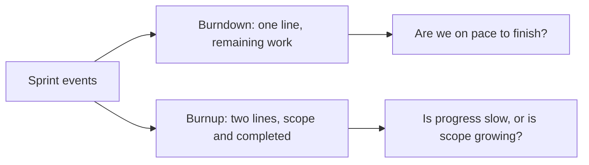

# Scrum reports and how they are misused

> **Before this lesson:** read [Estimation](#/lesson/jira/estimation) (story points, the estimation statistic), [Boards](#/lesson/jira/boards) (board filters, the rightmost column) and [Backlog refinement and sprint planning in Jira](#/lesson/jira/sprints-in-jira).

## In plain words

A car dashboard tells you speed, fuel and engine temperature. It is extremely useful for driving, and nearly useless for judging whether the driver is a good person. Worse, if you paid drivers by the speedometer reading, you would get fast, dangerous driving.

Jira's **Scrum reports** are a team's dashboard for a Sprint. The **burndown chart** shows how much work remains; the **burnup chart** shows work completed against total scope; the **velocity chart** shows how much the team planned and finished in recent Sprints; the **sprint report** lists what was completed, what was not, and what changed. Each is good at answering specific questions for the team, and each becomes harmful when used as a target or a scorecard.

Why it matters for a job: these charts appear in sprint reviews, retrospectives and management updates. You need to read them accurately ("that jump on day 6 is scope added, not slow progress") and to recognise misuse ("comparing velocity across teams is meaningless"). Interviewers ask "How did you measure progress?" and "What do you think of velocity as a metric?" to see whether you understand both.

## What every Scrum report has in common

Atlassian's documentation for these reports shares several rules. Knowing them prevents most misreadings.

| Rule | Consequence |
|---|---|
| They are available for **Scrum boards** | Kanban teams use the flow reports instead (lesson 22) |
| They are **board-specific**: only items matching the board's filter count | Changing the board filter changes the charts, even for past sprints |
| **Done means the rightmost column**; the leftmost column means To Do | If "Monitoring" sits in the last column, unfinished work counts as done |
| They use the board's **estimation statistic** (story points, time, item count...) | Charts in points and charts in counts can tell different stories |
| **Story points on sub-tasks are excluded**; only parent items' estimates count | Put estimates on stories, not on sub-tasks |

## The burndown chart

The **sprint burndown chart** shows the work remaining in a sprint over time:

- **Horizontal axis**: time (the days of the sprint).
- **Vertical axis**: remaining work, in the board's estimation statistic.
- **Remaining work line**: drops when items reach the rightmost column, rises when work is added or estimates increase.
- **Guideline**: a grey straight line from the starting total down to zero at the end, a rough reference for "on pace". Atlassian notes that if the guideline is missing, the sprint was probably started before any work was in it.

### Reading a burndown, step by step

Here is a ten-day sprint replayed from its events. Run it to see the numbers; change the events and run again.

```python-run
days = 10
items = {"SHOP-1": 5, "SHOP-2": 3, "SHOP-3": 8, "SHOP-4": 2, "SHOP-5": 5}   # committed at start: 23 points
events = {           # day -> list of (kind, key, value)
    2: [("done", "SHOP-4", None)],
    4: [("done", "SHOP-2", None)],
    5: [("add", "SHOP-9", 5)],                 # scope added mid-sprint
    6: [("estimate", "SHOP-3", 13)],           # re-estimated upwards
    7: [("done", "SHOP-1", None)],
    9: [("done", "SHOP-9", None), ("done", "SHOP-5", None)],
}
done = set()
start_total = sum(items.values())
for day in range(days + 1):
    for kind, key, value in events.get(day, []):
        if kind == "done":
            done.add(key)
        elif kind in ("add", "estimate"):
            items[key] = value
    remaining = sum(p for k, p in items.items() if k not in done)
    guide = start_total * (1 - day / days)
    print(f"day {day:2}: remaining {remaining:2}  guideline {guide:5.1f}  {'#' * remaining}")
```

Reading the output like a team would:

- Days 0 to 4: remaining falls from 23 to 18 as two small items finish. Slightly behind the guideline, which is normal: big items finish late.
- Day 5: remaining **rises** by 5. Nobody "un-did" work; scope was added. On Jira's chart this shows as a step up, and the sprint report marks the added item with an asterisk.
- Day 6: another rise of 5: SHOP-3 was re-estimated from 8 to 13. The team learned it was bigger.
- Day 9: two items finish together; 13 points (SHOP-3) remain at the end. The sprint goal may still be met if SHOP-3 was not essential to it.

### Common burndown shapes

| Shape | What it usually means | Question to ask |
|---|---|---|
| Flat for days, then a cliff at the end | Work finishes in big batches; items too large or testing at the end | Can we split stories and finish some earlier? |
| Steps upwards mid-sprint | Scope added or estimates raised | Was the addition agreed with the PO? Does it serve the Sprint Goal? |
| Tracks the guideline perfectly every day | Suspicious; maybe cards are moved to please the chart | Does the board reflect reality? |
| Ends well above zero | Over-commitment, interruptions, or unplanned work | What took capacity? |
| Drops below zero, or to zero by mid-sprint | Under-commitment or work done outside Jira | Are estimates or the board out of date? |

## The burnup chart

The **burnup chart** shows two lines instead of one:

- **Work scope** (Atlassian's documentation draws it red): the total work planned for the sprint. It rises when scope is added.
- **Completed work** (green): work moved to done.
- A **guideline** for an approximate pace.

The gap between the two lines is the remaining work; the lines meet when everything is done.

Why use burnup when you have burndown? Because burndown merges two different events into one line: "the team finished something" (line goes down) and "someone added something" (line goes up). A flat burndown could mean nothing happened, or that the team finished 10 points while 10 points were added. Burnup separates them, so scope creep is visible as its own line.



Using the same events as above, the burnup's scope line goes 23, then 28 on day 5, then 33 on day 6; the completed line goes 0, 2, 5, 10, then 20 on day 9 (counting SHOP-3's 13 points as not done). Same sprint, clearer story: progress was steady, and scope grew by 10 points.

The problems [Sprint burndown](#/problem/jira-burndown) and [Sprint burnup](#/problem/jira-burnup) replay events like these, including sub-tasks that must be excluded and reopened items.

## The velocity chart

The **velocity chart** shows, for each recent sprint, two bars:

- **Commitment** (grey): the total estimate of all work in the sprint **when it started**. Atlassian's documentation says items added after the start, and later estimate changes, are excluded from this total.
- **Completed** (green): the total estimate of work completed by the end of the sprint. Scope changes after the start **are** included here, so an item added mid-sprint and finished counts as completed.

The team's **velocity** is usually the average of completed work over the recent sprints shown. Atlassian's documentation gives an example: a team averaging about 25 points per sprint can expect to complete roughly that much next sprint, with forecasts improving as more sprints accumulate.

Worked example:

| Sprint | Commitment at start | Added later | Completed |
|---|---|---|---|
| 12 | 30 | 0 | 26 |
| 13 | 28 | 5 | 31 |
| 14 | 32 | 0 | 22 |
| 15 | 27 | 3 | 27 |

Average completed: (26 + 31 + 22 + 27) / 4 = 26.5 points. Notice sprint 13: completed (31) exceeds commitment (28) only because 5 points were added and finished; that is not "over-delivery" so much as unplanned work. The problem [Velocity from sprint records](#/problem/jira-velocity) asks you to compute exactly these numbers, including estimate changes.

### How to use velocity well

- **For the team's own planning**: as one input to "how much should we take into the next Sprint?", along with capacity (lesson 15).
- **For rough release forecasts**: remaining backlog points divided by average velocity gives a number of sprints, best stated as a range.
- **Look at the trend and spread, not one number**: 22 to 31 tells you more than "26.5".

## The sprint report

The **sprint report** summarises one sprint: a burndown-style chart plus lists of the work. Atlassian's documentation highlights two markers:

- Items **added after the sprint started are marked with an asterisk**.
- When an estimate changed during the sprint, it shows as **old value, arrow, new value** (for example 3 → 5).

Teams commonly read it at the review and retrospective to see what was completed, what was not, what was added, and which estimates moved. The problem [Sprint report](#/problem/jira-sprint-report) builds a simplified version of these lists.

## How these reports are misused

Each report is a tool for the team to inspect and adapt. Trouble starts when they are turned into targets or comparisons.

| Misuse | Why it fails | Better use |
|---|---|---|
| **Comparing velocity between teams** | Story points are relative to each team (lesson 9); team A's 40 and team B's 20 cannot be compared | Compare a team only with its own past |
| **Velocity as a productivity target** ("increase velocity 20%") | Teams inflate estimates; velocity rises, output does not (Goodhart's law) | Use outcomes: features in users' hands, lead time, quality |
| **Burndown as a daily performance check** | People move cards to make the line look good; transparency is lost | Use it in the Daily Scrum as a conversation starter |
| **Judging a sprint by "commitment met"** | Encourages under-committing and hiding problems | Judge by the Sprint Goal and the Increment |
| **Individual velocity** | Points are a team estimate; individuals optimise for themselves, stop helping others | Never compute it |
| **Ignoring scope changes** | A "failed" sprint may have absorbed 30% unplanned work | Read burnup or the asterisks in the sprint report |
| **Comparing charts across board configuration changes** | Filter or column changes alter history | Note configuration changes in the retrospective |

> [!WARNING]
> A sentence worth remembering: **velocity is a capacity-planning tool, not a performance metric.** Saying this clearly, with a reason, is one of the strongest signals in an agile-process interview.

## Scenario: the velocity drop

A director at a Singapore e-commerce company emails the SHOP team: "Your velocity dropped from 30 to 18 this sprint. What happened?"

The Scrum Master looks at the reports before answering:

1. **Velocity chart**: commitment was 29, completed 18.
2. **Sprint report**: four items have asterisks, totalling 14 points of production bug fixes added mid-sprint after a payment provider incident. Two estimates rose (5 → 8, 3 → 8).
3. **Burnup**: the scope line rose from 29 to 43 on days 3 and 4. The completed line was steady at the usual rate.
4. **Capacity**: one engineer was on medical leave for four days.

The reply: "Completed work on planned items was lower because we absorbed 14 points of urgent incident work (marked in the sprint report) and had one person out for four days. The team's pace on the work it did was normal. In the retrospective we agreed to keep 15% of capacity free during the campaign season for incidents, and to ask the payments team for a joint post-incident review."

Notice what did **not** happen: no one demanded "higher velocity next sprint", and the answer focused on causes and actions, not defending a number. For structuring this kind of conversation in an interview, see the behavioural track's [Ownership and delivering results](#/lesson/behavioural/ownership-results).

## How interviewers probe this

> [!INTERVIEW]
> "What do you think about using velocity to measure team performance?" A strong answer: "Velocity is useful for a team's own planning: it tells us roughly how much fits in a sprint. It's a poor performance measure because story points are relative to each team, and if it becomes a target, estimates inflate. To judge a team I'd look at outcomes and flow: whether the Sprint Goal and Increment delivered value, lead time, and quality signals like change failure rate."

Other likely questions:

- "Your burndown went up mid-sprint. What could cause that?" Scope added, or estimates increased; check the sprint report's asterisks and estimate changes.
- "Burndown or burnup?" Burnup separates progress from scope change; burndown is simpler for daily pace.
- "What counts as done in Jira's reports?" Items in the rightmost board column, using parent estimates only.

## Summary

- Scrum reports (burndown, burnup, velocity, sprint report) are for Scrum boards, use the board's filter and estimation statistic, treat the rightmost column as done, and ignore sub-task story points.
- Burndown shows remaining work; rises mean added scope or increased estimates. Burnup shows scope and completed work as separate lines.
- Velocity chart: commitment is the total at sprint start (later additions and estimate changes excluded); completed includes work added mid-sprint.
- The sprint report marks items added after the start with an asterisk and shows estimate changes as old → new.
- Use these reports for team planning and conversation; never compare velocity across teams or turn it into a target.

## Glossary

- **Burndown chart** — a chart of remaining work over the sprint.
- **Burnup chart** — a chart showing total scope and completed work as two lines.
- **Guideline** — the grey reference line showing an even pace.
- **Scope creep** — work added to a sprint after it starts.
- **Velocity** — the average amount of work a team completes per sprint, in its estimation statistic.
- **Commitment (velocity chart)** — total estimate of sprint work at the moment the sprint started.
- **Completed (velocity chart)** — total estimate of work done by the sprint's end, including work added mid-sprint.
- **Sprint report** — Jira's summary of one sprint's completed, incomplete and changed work.
- **Estimation statistic** — the measure the board's reports use, such as story points.
- **Goodhart's law** — when a measure becomes a target, it ceases to be a good measure.
- **Vanity metric** — a number that looks good but does not inform decisions.

## Check yourself

```quiz
[
  {"q": "A burndown line rises on day 5. What is the most likely explanation?",
   "options": ["The team undid work", "Scope was added or an estimate increased", "The chart is broken", "A sprint was cancelled"],
   "answer": 1,
   "explain": "Remaining work only increases when work is added or re-estimated upwards (or reopened)."},
  {"q": "In Jira's velocity chart, what is 'commitment'?",
   "options": ["Everything completed", "The total estimate of sprint work when the sprint started", "The average of the last three sprints", "Work added mid-sprint"],
   "answer": 1,
   "explain": "Atlassian defines commitment as the total at sprint start; later additions and estimate changes are excluded."},
  {"q": "An item added on day 3 is finished by the end of the sprint. Where does it appear in the velocity chart?",
   "options": ["In commitment only", "In completed, not in commitment", "In both", "In neither"],
   "answer": 1,
   "explain": "Completed includes scope changes after the start; commitment does not."},
  {"q": "Why might a team prefer a burnup chart to a burndown?",
   "options": ["It is required by Scrum", "It separates progress from scope changes", "It hides added work", "It works on Kanban boards only"],
   "answer": 1,
   "explain": "Two lines show completed work and total scope separately."},
  {"q": "How does the sprint report mark items added after the sprint started?",
   "options": ["In bold", "With an asterisk", "In a separate sprint", "It does not show them"],
   "answer": 1,
   "explain": "Atlassian documents that such items are marked with an asterisk."},
  {"q": "Team A's velocity is 40 and team B's is 20. A manager concludes team A is twice as productive. What is wrong?",
   "options": ["Nothing", "Story points are relative to each team, so velocities cannot be compared", "Team B must be estimating in hours", "Velocity measures quality"],
   "answer": 1,
   "explain": "Each team calibrates its own points."},
  {"q": "A team puts story points only on sub-tasks. What does the burndown show?",
   "options": ["The sub-task points", "No estimated work, because sub-task points are excluded", "Double the points", "Only bugs"],
   "answer": 1,
   "explain": "Only parent items' estimates count in these reports."},
  {"q": "Completed work in sprints was 26, 31, 22 and 27 points. What is the average velocity?",
   "options": ["26", "26.5", "27", "31"],
   "answer": 1,
   "explain": "(26 + 31 + 22 + 27) / 4 = 106 / 4 = 26.5."}
]
```

> **Source:** Atlassian, View and understand the burndown chart, https://support.atlassian.com/jira-software-cloud/docs/view-and-understand-the-burndown-chart/; Atlassian, View and understand the burnup chart, https://support.atlassian.com/jira-software-cloud/docs/view-and-understand-the-burnup-chart/; Atlassian, View and understand the velocity chart, https://support.atlassian.com/jira-software-cloud/docs/view-and-understand-the-velocity-chart/; Atlassian, View and understand the sprint report, https://support.atlassian.com/jira-software-cloud/docs/view-and-understand-the-sprint-report/; Atlassian Agile Coach, Velocity, https://www.atlassian.com/agile/project-management/velocity-scrum; Atlassian Agile Coach, Metrics, https://www.atlassian.com/agile/project-management/metrics
