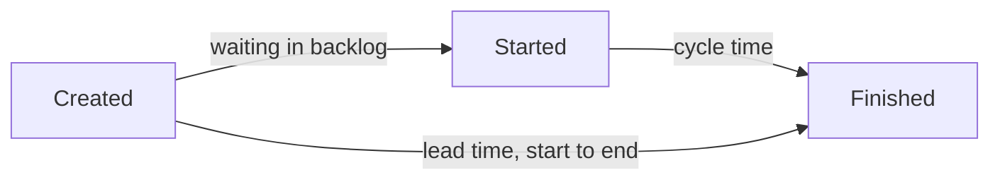

# Flow reports, forecasting and DORA

> **Before this lesson:** read [Kanban: workflow, WIP limits, pull and service level expectations](#/lesson/jira/kanban-flow) (WIP, throughput, age, cycle time) and [Scrum reports and how they are misused](#/lesson/jira/scrum-reports).

## In plain words

Picture a motorway camera that photographs the same stretch every minute. One photo shows cars; a stack of photos shows *flow*: where traffic is jammed, how long a car takes from one exit to the next, and how many cars pass per hour. From that history you can even predict, with some confidence, how long tomorrow's drive will take.

**Flow reports** do this for work. The **cumulative flow diagram** (CFD) stacks the number of items in each board column over time, so jams (bottlenecks) are visible. The **control chart** plots how long each finished item took (its cycle time), with a rolling average. From the history of how many items finish per day, a **Monte Carlo forecast** answers "how many items by this date?" and "when will these 40 items be done?" with probabilities instead of guesses. Finally, **DORA metrics** measure the delivery pipeline from commit to production.

Why it matters for a job: flow metrics are how mature teams and engineering managers talk about delivery without story points. "Our 85th percentile cycle time is 6 days" or "there's an 85% chance we finish by 14 May" are statements interviewers at larger tech companies expect a senior engineer to understand. They also give you honest answers to "when will it be done?".

## Cycle time and lead time

Two terms first, because they are used loosely in industry.

- **Cycle time**: the Kanban Guide defines it as the time from when an item **started** to when it **finished**. Jira's control chart measures it as the time spent in the columns you select (for example In Progress and In Review).
- **Lead time**: commonly the time from when an item was **requested** (created) to when it **finished**. It includes waiting in the backlog. The Kanban Guide does not define it; teams should say which start point they mean.
- **DORA's change lead time** is different again: from a change being **committed** to version control to it **running in production** (see below).



Example: SHOP-42 was created on 2 March, started on 9 March and finished on 12 March. Its cycle time is 3 days; its lead time is 10 days. Customers feel lead time; the team controls cycle time most directly.

### Reopens count

Atlassian's control chart documentation says that when an item is reopened, the time spent on the reopened work is added to its cycle time. Measuring only the first pass would make rework invisible. The problem [Cycle and lead time](#/problem/jira-cycle-lead-time) computes both from a status-change log that includes reopen loops.

## The cumulative flow diagram

Atlassian describes the CFD as follows:

- **Horizontal axis**: time. **Vertical axis**: number of work items.
- **Each coloured band is a board column** (a workflow stage), based on the board's column mapping. The leftmost column counts as To Do and the rightmost as Done.
- The documentation's worked example: start a sprint with 5 items, so To Do shows 5; move 2 to In Progress, then To Do still shows 5 and In Progress 2; move 1 to Done, giving Done 1, In Progress 2, To Do 5; move that item back to To Do and it leaves Done and In Progress, while To Do stays at 5.

That example reveals how to read the numbers: each band's top edge counts the items that have reached **that column or any column to its right**. So the To Do line counts everything that has entered the board; the Done line counts everything finished. The vertical thickness of a band is the number of items currently in that column; the horizontal distance between lines approximates how long items spend in between.

### Reading the shapes

Atlassian's documentation says a band that **widens vertically over time** generally signals a **bottleneck**: work is piling up in that column. Other common readings (interpretation, not Atlassian's wording):

| Shape | Likely meaning |
|---|---|
| A middle band (e.g. Review) keeps widening | Work enters faster than it leaves: a bottleneck |
| All bands flat for days | Nothing moving: holidays, a blocker, or the board is not being updated |
| The Done line rises in steps | Work finishes in batches, for example at release time |
| The top line rises steeply while Done is flat | More work is arriving than finishing; WIP will balloon |
| Bands parallel and thin | Healthy, stable flow |

### A CFD from data

```python-run
columns = ["To Do", "In Progress", "Review", "Done"]
# (day, key, column entered); every item enters "To Do" when created
moves = [(0, "A", "To Do"), (0, "B", "To Do"), (0, "C", "To Do"), (1, "D", "To Do"),
         (1, "A", "In Progress"), (2, "B", "In Progress"), (3, "A", "Review"),
         (4, "B", "Review"), (4, "C", "In Progress"), (5, "E", "To Do"), (6, "A", "Done"),
         (7, "C", "Review"), (8, "D", "In Progress"), (9, "B", "Done")]
days = 10
where = {}
print("day  " + "  ".join(f"{c[:11]:>11}" for c in columns))
for day in range(days):
    for d, key, col in moves:
        if d == day:
            where[key] = columns.index(col)
    # band top for column c = items currently in column c or any column to its right
    tops = [sum(1 for pos in where.values() if pos >= c) for c in range(len(columns))]
    print(f"{day:3}  " + "  ".join(f"{t:>11}" for t in tops))
```

Look at the Review column's count (Review line minus Done line): it reaches 2 on day 4 and stays at 1 or 2 while In Progress keeps feeding it; only two items reach Done in ten days. On a chart, the Review band would stay thick while Done barely rises: a review bottleneck. The problem [Cumulative flow counts](#/problem/jira-cfd) asks you to produce these numbers.

## The control chart

The **control chart** plots each finished item as a dot: the horizontal position is when it finished, the vertical position is its cycle time. Atlassian's documentation describes:

- **Columns setting**: choose the statuses that count as active work, for example In Progress and In Review. Jira tries to pick them automatically.
- **Rolling average** (blue line): work-based, not time-based. For each item, it averages that item's cycle time with the same number of items before and after it. The window is **20% of the items displayed, always an odd number, and at least 5 items**. Shortening the date range reduces the number of items and so shrinks the window.
- **Standard deviation** (shaded band): how much actual cycle times vary from the rolling average. A narrow band means future cycle times are likely to be close to the average.
- **Outliers**: dots far from the rest. Investigate them; some are not real work (an item started and then abandoned without going back to To Do). Atlassian suggests labelling such items and adding a quick filter that excludes the label.
- The documentation applies to **company-managed** spaces.

### Computing a rolling average

Atlassian does not spell out how 20% is rounded. The script below (and the problem [Control chart rolling average](#/problem/jira-control-chart)) uses one reasonable rule: take 20% of the item count rounded down, add 1 if that is even, and use at least 5. Near the ends of the list, where fewer neighbours exist, it averages whatever is available.

```python-run
cycle_times = [2, 3, 1, 8, 2, 4, 3, 15, 2, 3, 4, 2, 6, 3, 2, 5, 3, 2, 4, 3,
               2, 3, 7, 2, 3]                      # in finishing order, days

n = len(cycle_times)
window = max(5, n * 20 // 100)
if window % 2 == 0:
    window += 1
half = window // 2
print("items:", n, "window:", window)

rolling = []
for i in range(n):
    lo, hi = max(0, i - half), min(n, i + half + 1)
    part = cycle_times[lo:hi]
    rolling.append(round(sum(part) / len(part), 2))

mean = sum(cycle_times) / n
std = (sum((c - mean) ** 2 for c in cycle_times) / n) ** 0.5
for i, (c, r) in enumerate(zip(cycle_times, rolling)):
    flag = "  <- far above the average" if c > mean + 2 * std else ""
    print(f"item {i:2}: cycle {c:2}  rolling avg {r:5}{flag}")
```

With 25 items the window is 5 (20% of 25 is 5, already odd). The item with cycle time 15 stands out; the script flags points more than two standard deviations above the mean, a simple rule of thumb for this demo, not an Atlassian definition. In a real retrospective you would open that item and ask what happened.

## Forecasting with Monte Carlo simulation

"When will it be done?" is the question every team is asked. Averages give one number that hides risk. A **Monte Carlo simulation** gives a range with probabilities, using the team's own history. The Scrum.org article by Julia Wester (2020) describes the approach:

1. Take historical data that reflects the variety of the team's work, for example items finished per day over the last few weeks (throughput).
2. Run thousands of **trials**. Each trial builds one possible future by sampling randomly from the history.
3. Collect the outcomes and read off **percentiles**: the result that 50%, 85% or 95% of trials achieved.
4. State the forecast as a range with a probability, and update it as work finishes.

Two question types:

- **How many items by a date?** Each trial: for each remaining day, draw a random day's throughput from history and add it up. Report, for example, "85% of trials finished at least 31 items".
- **When will N items be done?** Each trial: draw days until the total reaches N; record how many days that took. Report "85% of trials finished within 18 working days".

```python-run
import random

history = [0, 2, 1, 3, 0, 2, 4, 1, 2, 0, 3, 2, 1, 2, 3]   # items finished per working day, last 3 weeks
random.seed(42)
trials = 10000

# Question 1: how many items in the next 10 working days?
totals = sorted(sum(random.choice(history) for _ in range(10)) for _ in range(trials))
for p in (50, 85, 95):
    at_least = totals[int((100 - p) * trials / 100)]
    print(f"{p}% confidence: at least {at_least} items in 10 days")

# Question 2: how many working days to finish 40 items?
days_needed = []
for _ in range(trials):
    done = days = 0
    while done < 40:
        done += random.choice(history)
        days += 1
    days_needed.append(days)
days_needed.sort()
for p in (50, 85, 95):
    print(f"{p}% confidence: within {days_needed[int(p * trials / 100) - 1]} working days")
```

Read the output carefully: for "how many", higher confidence means a **smaller** number (you are more confident of achieving less); for "when", higher confidence means a **later** date. Fixing the random seed makes the run repeatable, which is useful for demonstrations and for the auto-graded problems [Monte Carlo: how many items](#/problem/jira-monte-carlo-how-many) and [Monte Carlo: when will it be done](#/problem/jira-monte-carlo-when).

Caveats from the same article: the method assumes the future resembles the past, so treat forecasts carefully when the team or the work changes until new data accumulates. Reporting the 85th percentile is common practice, not a rule.

> [!TIP]
> Monte Carlo works on item counts, so it needs no story points at all. Keep items reasonably small and similar in size by splitting (lesson 8), and the history becomes a good predictor.

## Service Level Expectation, revisited

Lesson 6 introduced the Kanban Guide's **Service Level Expectation**: a period and a probability, such as "85% of items finish within 8 days", based on historical cycle time. The control chart's data is exactly what you need: sort recent cycle times and read the 85th percentile. Then, day to day, compare each in-progress item's **age** against the SLE and act before it is late.

## DORA metrics: the pipeline view

Flow reports measure work items on a board. **DORA** (DevOps Research and Assessment) measures the software delivery pipeline. Its current guide lists **five** metrics in two groups:

| Group | Metric | Meaning |
|---|---|---|
| Throughput | **Change lead time** | Time from a change being committed to version control to running in production |
| Throughput | **Deployment frequency** | How often changes are deployed (or the time between deployments) |
| Throughput | **Failed deployment recovery time** | Time to recover from a failed deployment needing immediate intervention |
| Instability | **Change fail rate** | Share of deployments needing immediate intervention, such as a rollback or hotfix |
| Instability | **Deployment rework rate** | Share of deployments that are unplanned and caused by a production incident |

DORA's guide is explicit that the metrics should **not** be used as targets (citing Goodhart's law) and should **not** be used to compare teams or organisations; they track improvement over time for one application or service. The CI/CD track's [DORA metrics](#/lesson/cicd/dora-metrics) lesson covers computing them.

How they relate to Jira: Jira measures the journey of a work item (idea to done); DORA measures the journey of a code change (commit to production). A team can have short Jira cycle times but long change lead times if "Done" in Jira happens before deployment, which is a good reason to put a "Releasing" column before Done (lesson 13) or to link deployments to work items (lesson 24).

## Misuse of flow metrics

| Misuse | Better |
|---|---|
| Rewarding low average cycle time | People split work artificially or avoid hard items; look at the distribution and outcomes |
| Excluding every slow item as an "outlier" | Only exclude items that were not real work; slow real work is the most important data |
| Forecasting from a few days of data | Use several weeks, and update as data arrives |
| Treating an 85% forecast as a promise | It means about one time in seven it will be later; say so up front |
| Comparing teams' DORA numbers or cycle times | Compare a team with its own history |

## Scenario: answering "when will it be done?"

A product director asks the PAY team: "When will partial refunds be ready? We have 40 items in the epic." The engineering lead, Arjun, answers in three steps.

1. **Data**: the last six weeks' daily throughput for the team, roughly the history in the script above.
2. **Simulation**: 10,000 trials of "days to finish 40 items".
3. **Answer**: "Our median is 23 working days from now, about four and a half weeks; at 85% confidence it is 27 working days, a little over five weeks. I'd plan the launch announcement for the 85% date, and I'll rerun this every Monday. If we pull in other urgent work, the dates move, and I'll tell you the same day."

He also checks the CFD: Review has been widening, so the team agrees a WIP limit on Review. Two weeks later the forecast tightens because throughput improved. The director gets a range with a probability, updated weekly, rather than a single date that silently becomes wrong.

## How interviewers probe this

> [!INTERVIEW]
> "How would you forecast delivery without story points?" Explain throughput and Monte Carlo: "I'd take our daily throughput for the last six to eight weeks, simulate thousands of possible futures by sampling those days, and report percentiles, for example an 85% chance of finishing 40 items within 27 working days. It assumes the future resembles the past, so I'd keep items small and rerun it weekly."

Other likely questions:

- "What does a widening band on a CFD mean?" Work accumulating in that column: a bottleneck.
- "Cycle time versus lead time?" Started-to-finished versus created-to-finished; state your definitions.
- "Name the DORA metrics." Change lead time, deployment frequency, failed deployment recovery time, change fail rate, deployment rework rate.

## Summary

- Cycle time runs from start to finish; lead time usually from creation to finish; DORA's change lead time from commit to production. Reopened time counts in Jira's control chart.
- The CFD shows one band per column over time; a band widening vertically signals a bottleneck.
- The control chart plots cycle time per item with a work-based rolling average whose window is 20% of the items shown, always odd, minimum 5, plus a standard deviation band.
- Monte Carlo forecasting samples historical throughput thousands of times and reports percentiles for "how many by a date" and "when will N be done".
- DORA has five metrics, three for throughput and two for instability; do not use them as targets or to compare teams.

## Glossary

- **Flow** — the movement of work items through the workflow.
- **Cycle time** — time from an item's start to its finish.
- **Lead time** — usually time from an item's creation to its finish.
- **Cumulative flow diagram (CFD)** — a stacked chart of item counts per column over time.
- **Bottleneck** — a stage where work accumulates because it leaves more slowly than it arrives.
- **Control chart** — a chart of each finished item's cycle time with a rolling average.
- **Rolling average** — an average over a sliding window of neighbouring items.
- **Standard deviation** — a measure of how spread out values are around their average.
- **Outlier** — a data point far from the others.
- **Monte Carlo simulation** — estimating outcomes by running many random trials based on historical data.
- **Trial** — one simulated possible future.
- **Percentile** — the value below (or above) which a given percentage of results fall.
- **Throughput** — items finished per unit of time.
- **DORA** — DevOps Research and Assessment, a research programme defining software delivery metrics.
- **Change lead time** — DORA's time from commit to running in production.

## Check yourself

```quiz
[
  {"q": "What does a band that widens vertically over time on a CFD usually indicate?",
   "options": ["Faster delivery", "A bottleneck: work piling up in that column", "Items being deleted", "A sprint ending"],
   "answer": 1,
   "explain": "Atlassian's documentation says a widening band generally marks a bottleneck."},
  {"q": "How does Jira's control chart choose its rolling-average window?",
   "options": ["Always 7 days", "20% of the items displayed, always odd, minimum 5", "The last sprint", "10 items"],
   "answer": 1,
   "explain": "The window is work-based: 20% of the items shown, odd, at least 5."},
  {"q": "An item was reopened and worked on for two more days. What happens to its cycle time in the control chart?",
   "options": ["Unchanged", "The extra time is added", "It is reset to two days", "The item is excluded"],
   "answer": 1,
   "explain": "Atlassian says time spent on reopened work is added to the cycle time."},
  {"q": "A Monte Carlo 'how many by date' forecast gives 50%: 24 items, 85%: 19 items. What does the 85% figure mean?",
   "options": ["85% of trials finished exactly 19", "85% of trials finished at least 19 items", "The team will finish 19 items 85% faster", "19 is the average"],
   "answer": 1,
   "explain": "Higher confidence corresponds to a smaller guaranteed number of items."},
  {"q": "What is the main assumption behind Monte Carlo forecasting from throughput?",
   "options": ["All items are the same size", "The future resembles the recent past", "The team uses story points", "There are no weekends"],
   "answer": 1,
   "explain": "It samples history, so it is only as good as the history is representative."},
  {"q": "Which of these is one of DORA's two instability metrics?",
   "options": ["Deployment frequency", "Change lead time", "Change fail rate", "Velocity"],
   "answer": 2,
   "explain": "Instability: change fail rate and deployment rework rate."},
  {"q": "Item created 2 March, started 9 March, finished 12 March. What are its cycle and lead times?",
   "options": ["3 and 10 days", "10 and 3 days", "7 and 3 days", "3 and 7 days"],
   "answer": 0,
   "explain": "Cycle: start to finish, 3 days. Lead: creation to finish, 10 days."},
  {"q": "What does DORA's guide say about comparing teams on its metrics?",
   "options": ["Rank teams monthly", "Do not use them to compare teams; track improvement over time", "Compare only deployment frequency", "Use them as bonus targets"],
   "answer": 1,
   "explain": "DORA warns against targets and cross-team comparisons."}
]
```

> **Source:** Atlassian, View and understand the cumulative flow diagram, https://support.atlassian.com/jira-software-cloud/docs/view-and-understand-the-cumulative-flow-diagram/; Atlassian, View and understand the control chart, https://support.atlassian.com/jira-software-cloud/docs/view-and-understand-the-control-chart/; The Kanban Guide (2025.5), https://kanbanguides.org/english/; Julia Wester, Create faster and more accurate forecasts using probabilities (Scrum.org, 2020), https://www.scrum.org/resources/blog/create-faster-and-more-accurate-forecasts-using-probabilities; DORA, DORA's software delivery metrics, https://dora.dev/guides/dora-metrics/
