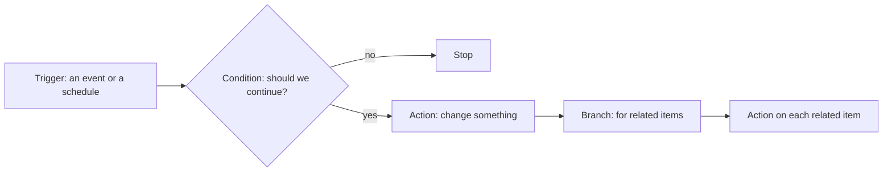

# Automation: triggers, conditions, actions and branches

> **Before this lesson:** read [Workflows](#/lesson/jira/workflows) (statuses and transitions) and [JQL functions, dates and ordering](#/lesson/jira/jql-functions-dates). Automation uses both.

## In plain words

Home automation works with simple sentences: *when* the front door opens, *if* it is after sunset, *then* switch on the hall light. You do not program the light every evening; you describe the rule once.

**Jira automation** lets a team write the same kind of sentence about work: *when* a pull request is merged, *if* the work item is in Code Review, *then* move it to QA and comment with the PR link. Atlassian's documentation describes each automation as made of a **trigger** (when), optional **conditions** (if), **actions** (then), and optional **branches** that run steps on related items such as sub-tasks or a parent.

> [!NOTE]
> Wording is changing. Atlassian's newer documentation calls an automation a **flow** (previously a **rule**) and its building blocks **steps** (previously **components**), and uses "work item" for issue. URLs and many teams still say "rules" and "components". This lesson uses "rule" and "flow" interchangeably.

Why it matters for a job: automation removes the small, repetitive Jira chores that otherwise get forgotten (closing parents, assigning triage, nagging about stale items) and keeps the board honest. Engineers are often the ones who suggest and build these rules. Interviewers may ask "How did you reduce process overhead?", and a concrete automation story is a great answer.

## The anatomy of a rule



| Part | What it does | Example |
|---|---|---|
| **Trigger** | Starts the rule when something happens, or on a schedule | Work item transitioned |
| **Condition** | Must be true for the rule to continue | Priority is High |
| **Action** | Makes a change or sends something | Assign to the team lead; add a comment; send a message |
| **Branch** | Runs the following steps for related items, in a separate path | For each sub-task: transition to Done |

Atlassian notes that **advanced steps** (more complex structures) are available on Cloud Premium and Enterprise plans.

## Triggers

Atlassian's trigger reference groups them into families. Common ones:

**Work item events**

- **Work item created**, **Work item transitioned**, **Work item updated**, **Work item assigned**, **Work item commented**.
- **Field value changed**: runs when a chosen field changes, such as priority.
- **Work item linked**, **Work item moved**, **Work logged**.
- **Manual trigger from work item**: a user starts the rule from the item's actions menu, like a custom button.

**Time**

- **Scheduled**: runs at a fixed interval or on a cron schedule. You can attach a **JQL query**, and the actions then run on the work items the query returns. Atlassian notes a scheduled flow is disabled automatically after 10 consecutive failed runs.

**Agile**

- **Sprint created, started or completed**; **Version created, updated or released**.

**Development tools** (need a connected code or build tool)

- **Branch created**, **Commit created**, **Pull request created / merged / declined**.
- **Build successful / failed**, **Deployment successful / failed**.

**External**

- **Incoming webhook**: an outside system sends an HTTP POST to the rule's unique URL. A **webhook** is a message one system sends to another automatically when an event happens.

## Conditions

Conditions keep a rule from firing too broadly. Typical ones:

- **Field condition**: "priority equals Highest", "assignee is empty".
- **JQL condition**: the item must match a JQL query, for example `type = Bug AND component = Payments`.
- **Related items condition**: "all sub-tasks are Done", "the parent is In Progress".
- **User condition**: "the person who triggered this is in the QA group".

A good habit: write the narrowest condition that expresses your intent. A rule with no condition on "Work item updated" runs on every edit across the space.

## Actions

Actions are what the rule does. Common ones:

- **Transition** a work item to another status.
- **Edit fields**: set the assignee, priority, labels, fix version.
- **Comment** on the item.
- **Create** a work item or sub-tasks (for example, a standard checklist of sub-tasks for every new story).
- **Send** an email or a chat message.
- **Log** something to the rule's audit log for debugging.
- **Send a web request** to another system.

## Smart values

Rules often need to refer to the item that triggered them. **Smart values** are placeholders in double curly braces that the rule fills in at run time. Atlassian's trigger reference lists, for example:

| Smart value | Available with | Meaning |
|---|---|---|
| `{{issue}}` | Most work item triggers | The work item; fields are reached with dots, for example `{{issue.key}}`, `{{issue.summary}}` |
| `{{fieldChange}}` | Field value changed | What changed, from what to what |
| `{{changelog}}` | Work item transitioned | The status change details |
| `{{pullRequest}}`, `{{branch}}`, `{{commit}}` | Development triggers | The PR, branch or commit involved |
| `{{webhookData}}` | Incoming webhook | The data the external system sent |

Example comment text:

```text
Moved to QA automatically because pull request {{pullRequest.title}} was merged.
```

When the rule runs for SHOP-1042, the comment contains the actual pull-request title. Smart values still use the word "issue" (as the APIs do), which is consistent with Atlassian keeping "issue" in technical interfaces.

## Five rules teams actually use

### 1. Close the parent when all children are done

- **Trigger**: Work item transitioned (to Done).
- **Condition**: the item is a sub-task, and all of its parent's sub-tasks are Done.
- **Branch**: for the parent.
- **Action**: transition the parent to Done (or to the next review step, if stories need a final check).

Saves the "forgot to move the story" problem that makes boards and burndowns wrong.

### 2. Triage new bugs by component

- **Trigger**: Work item created.
- **Condition**: JQL `type = Bug AND component IS EMPTY`.
- **Action**: add the label `needs-triage`, assign to the triage owner of the week, comment asking the reporter for steps to reproduce.

This directly fixes the "bugs with no component" trap from lesson 17.

### 3. Move to QA when the pull request merges

- **Trigger**: Pull request merged.
- **Condition**: the linked work item is in Code Review.
- **Action**: transition to QA; comment with the PR link.

Requires the code tool to be connected and the key in the branch or PR title (lesson 24).

### 4. Stale work reminder

- **Trigger**: Scheduled, every weekday at 09:00, with JQL
  `project = SHOP AND statusCategory = "In Progress" AND updated <= "-3d"`.
- **Action**: comment mentioning the assignee: "This hasn't moved in three days. Blocked? Flag it or ask for help in stand-up."

A gentle nudge that supports flow (lesson 6) without a manager chasing people.

### 5. Sprint start housekeeping

- **Trigger**: Sprint started.
- **Branch**: for each item in the sprint with no estimate (JQL condition `"Story Points" IS EMPTY AND type = Story`).
- **Action**: comment "Please estimate before planning ends" and add the label `unestimated`.

## Designing rules responsibly

Automation is code that runs with real effects on everyone's work. Treat it that way.

**Scope it.** Rules can apply to a single space or several. A rule scoped too widely can change other teams' work.

**Avoid loops.** A rule that edits an item can itself trigger "Work item updated" rules, including itself. Many platforms, including Jira automation, have settings and safeguards for rules triggering other rules; keep them off unless you need them, and test.

**Know the actor.** Rules act as a configured user (often an automation account). Changes appear in history under that actor, and permissions apply to it. Make sure it can do what the rule needs, and only that.

**Check the audit log.** Each rule keeps a log of its runs, successes and failures. When a rule "did nothing", the log usually says why: a condition was false, a permission was missing, or a field did not exist.

**Prefer few, clear rules.** Twenty overlapping rules become a hidden process nobody understands. Name each rule for what it does, describe it, and review the list at a retrospective now and then.

**Do not automate a broken process.** If items sit in Review for days because nobody reviews, a reminder rule treats the symptom. A WIP limit and a team agreement treat the cause.

> [!WARNING]
> A rule that transitions items to Done without the Definition of Done being met makes reports look better and the product worse. Automate the bookkeeping, not the quality decisions.

## Testing a rule before trusting it

A simple, safe process:

1. Write down the sentence: when X, if Y, then Z.
2. Build the rule scoped to a test space or with a narrow JQL condition (for example `labels = automation-test`).
3. Trigger it on a test item and read the audit log.
4. Check the item's history: did the right fields change, by the expected actor?
5. Widen the scope; announce it to the team, so nobody is surprised when cards move on their own.

## A small simulation

To make the trigger, condition, action model concrete, here is a tiny rule engine in Python that processes a stream of events. It is a teaching model, not how Jira is built.

```python-run
items = {
    "SHOP-1": {"type": "Story", "status": "In Progress", "parent": None},
    "SHOP-2": {"type": "Sub-task", "status": "In Progress", "parent": "SHOP-1"},
    "SHOP-3": {"type": "Sub-task", "status": "To Do", "parent": "SHOP-1"},
}

def rule_close_parent(event):
    """When a sub-task moves to Done, if all siblings are Done, then move the parent to Done."""
    if event["type"] != "transitioned" or event["to"] != "Done":          # trigger
        return
    item = items[event["key"]]
    if item["type"] != "Sub-task":                                        # condition
        return
    parent = item["parent"]
    siblings = [k for k, v in items.items() if v["parent"] == parent]
    if all(items[k]["status"] == "Done" for k in siblings):              # condition
        items[parent]["status"] = "Done"                                  # action on the parent (a branch)
        print(f"  rule: all sub-tasks of {parent} are Done -> {parent} moved to Done")

def transition(key, to):
    items[key]["status"] = to
    print(f"{key} -> {to}")
    rule_close_parent({"type": "transitioned", "key": key, "to": to})

transition("SHOP-2", "Done")
transition("SHOP-3", "In Progress")
transition("SHOP-3", "Done")
print({k: v["status"] for k, v in items.items()})
```

The first transition does not fire the action because SHOP-3 is not done. The last one does, and the parent story moves to Done automatically.

## Scenario: automation that backfired, and the fix

The CARD team at a Singapore payments company added a rule: "When a pull request is merged, transition the work item to Done." It saved clicks, and velocity looked great.

Two weeks later, QA found that several items marked Done had never been tested in staging; they had been merged and auto-closed. The sprint review showed features that did not work in staging. The rule had quietly bypassed the team's Definition of Done ("deployed to staging and smoke-tested").

At the retrospective they changed it:

- **Trigger**: Pull request merged.
- **Condition**: item in Code Review.
- **Action**: transition to **QA**, not Done; comment with the PR link and the staging build number.

A second rule now moves items from QA to Done only when the QA engineer uses a manual trigger "Passed QA", which also records who approved it. Bookkeeping is automated; the quality decision stays human.

## How interviewers probe this

> [!INTERVIEW]
> "Tell me about a process improvement you made." An automation story is concrete and measurable: "Our board was always out of date because people forgot to move stories after merging. I set up a Jira automation: when a PR with the ticket key merges and the item is in Code Review, it moves to QA and comments the PR link. Cards stopped lingering, and our cycle-time data became trustworthy. I deliberately didn't auto-close to Done, because QA sign-off is part of our Definition of Done."

Other likely questions:

- "What are the parts of a Jira automation rule?" Trigger, conditions, actions, and branches for related items.
- "What can go wrong with automation?" Loops, overly broad scope, a powerful actor account, and automating away quality checks.
- "How would you remind people about stale tickets?" A scheduled trigger with a JQL query and a comment action.

## Summary

- Jira automation rules (newer docs: flows) combine a trigger, optional conditions, actions and optional branches; building blocks are now called steps.
- Triggers include work item events, field changes, schedules with JQL, sprint and version events, development events (branch, commit, pull request, build, deployment) and incoming webhooks.
- Smart values such as `{{issue.key}}` insert data from the triggering event.
- Scope rules narrowly, avoid loops, know the acting user, read the audit log, and test before widening.
- Automate bookkeeping, not quality decisions; never let a rule bypass the Definition of Done.

## Glossary

- **Automation rule (flow)** — a configured "when, if, then" process that Jira runs automatically.
- **Step (component)** — a building block of a rule: trigger, condition, action or branch.
- **Trigger** — the event or schedule that starts a rule.
- **Condition** — a check that must pass for the rule to continue.
- **Action** — a change or message the rule performs.
- **Branch** — a separate execution path running steps for related items.
- **Smart value** — a `{{...}}` placeholder filled with data when the rule runs.
- **Scheduled trigger** — a trigger that runs on a time schedule, optionally over a JQL query's results.
- **Webhook** — an automatic HTTP message from one system to another when an event happens.
- **Actor** — the user account a rule acts as.
- **Audit log** — the record of a rule's runs and their outcomes.
- **Rule loop** — rules triggering each other (or themselves) repeatedly.

## Check yourself

```quiz
[
  {"q": "What are the main parts of a Jira automation rule?",
   "options": ["Board, column, card", "Trigger, condition, action, and optionally branch", "Sprint, story, task", "Filter, gadget, dashboard"],
   "answer": 1,
   "explain": "A trigger starts it, conditions gate it, actions do things, branches handle related items."},
  {"q": "In Atlassian's newer wording, what is an automation 'rule' called?",
   "options": ["A script", "A flow", "A workflow", "A filter"],
   "answer": 1,
   "explain": "Newer documentation says flow (and step instead of component)."},
  {"q": "Which trigger lets a rule run every weekday over the results of a JQL query?",
   "options": ["Work item created", "Scheduled", "Incoming webhook", "Manual trigger"],
   "answer": 1,
   "explain": "Scheduled triggers can include a JQL query whose results the actions run on."},
  {"q": "What does `{{issue.key}}` do in a comment action?",
   "options": ["Nothing; it is literal text", "Inserts the key of the work item the rule is running on", "Creates a new work item", "Searches all keys"],
   "answer": 1,
   "explain": "Smart values are filled in with data when the rule runs."},
  {"q": "A rule auto-transitions items to Done when a PR merges, and QA keeps finding untested work. What is the best fix?",
   "options": ["Delete all automation", "Transition to QA instead, and keep the Done decision with a human check", "Add more PR reviewers", "Disable the board"],
   "answer": 1,
   "explain": "Automate the bookkeeping, keep quality decisions aligned with the Definition of Done."},
  {"q": "A rule 'did nothing'. Where should you look first?",
   "options": ["The board's quick filters", "The rule's audit log", "The velocity chart", "The sprint report"],
   "answer": 1,
   "explain": "The audit log records each run and why it succeeded, failed or stopped at a condition."},
  {"q": "Which plans include Jira automation's advanced steps, according to Atlassian?",
   "options": ["Free", "Standard only", "Premium and Enterprise", "Data Center only"],
   "answer": 2,
   "explain": "Atlassian notes advanced steps are available on Cloud Premium and Enterprise."}
]
```

> **Source:** Atlassian, What are automation rules (flows), https://support.atlassian.com/jira-core-cloud/docs/what-are-automation-rules/; Atlassian, Jira automation triggers, https://support.atlassian.com/cloud-automation/docs/jira-automation-triggers/; Atlassian, What are Jira workflows, https://support.atlassian.com/jira-software-cloud/docs/what-are-jira-workflows/; Atlassian Agile Coach, Definition of Done, https://www.atlassian.com/agile/project-management/definition-of-done
