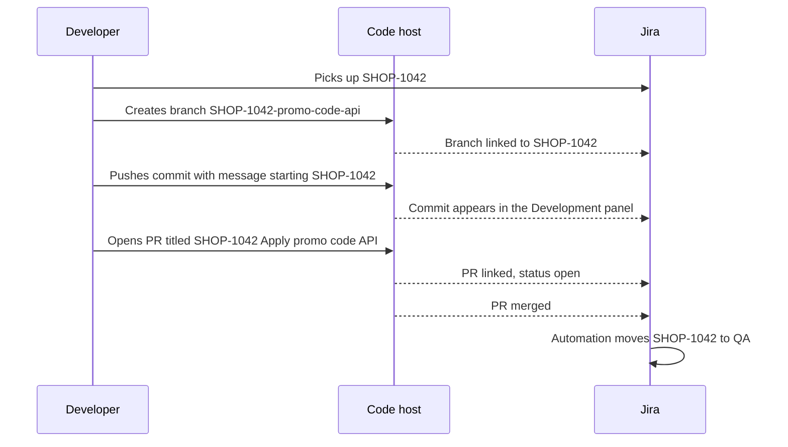

# Jira and your code: keys, smart commits and permissions

> **Before this lesson:** read [What Jira is](#/lesson/jira/what-is-jira) (work item keys) and [Workflows](#/lesson/jira/workflows) (transitions). From the git track, it helps to know [what a branch is](#/lesson/git/branches-in-a-nutshell), how to [record changes with commits](#/lesson/git/recording-changes), and [the pull-request flow](#/lesson/git/github-forks-prs).

## In plain words

A parcel's tracking number connects everything about it: the order, the warehouse scan, the delivery van, the signature. Type the number anywhere and you see the whole story.

A **work item key** such as `SHOP-1042` plays that role between Jira and your code. If you put the key in your **branch** name, your **commit** messages and your **pull request** title, Jira links them to the work item automatically. Anyone opening `SHOP-1042` sees which branches exist, which commits were made, whether the pull request is merged, and (with supported tools) which builds and deployments included it. With **smart commits**, a commit message can even comment on the work item, log time or move it through the workflow.

Why it matters for a job: almost every engineering team that uses Jira expects keys in branches and pull requests; some enforce it with checks. It is the first convention you will be told about on day one. It also powers automation (lesson 23), traceability for audits (common in banking and government work in Singapore), and release notes.

## Where to put the key

Atlassian's guidance, with its rules:

| Place | How | Notes |
|---|---|---|
| **Branch name** | `git checkout -b SHOP-1042-promo-code-api` | With Bitbucket Cloud, GitHub or GitLab connected, you can create a branch from the work item's Development section and Jira adds the key |
| **Commit message** | `git commit -m "SHOP-1042 validate expiry dates"` | Put the key at the **start** of the message |
| **Pull request title** | `SHOP-1042 Apply promo code API` | Creating the PR from the work item's development panel adds the key |

For a pull request to be linked, Atlassian says at least one of these must hold: the **PR title** includes the key, or the **source branch name** includes the key (and, on Bitbucket Cloud only, a non-merge commit in the PR mentions the key).

**Keys must be uppercase.** Atlassian's documentation uses the example that `JRA-123` works and `jra-123` does not, and notes that wrong casing is a common reason links do not appear.

Other conditions from the same page: a Jira admin must connect a supported development tool; you need the **View development tools** permission; something must have been pushed for syncing to start, and syncing can take a few minutes.

> [!TIP]
> Many teams agree a branch naming convention such as `<KEY>-<short-description>` or `feature/<KEY>-<short-description>`. Both contain the key, so both link. The git track's [Commit conventions, review etiquette, monorepos and large files](#/lesson/git/conventions-review-scale) lesson discusses commit message styles; adding the key at the start fits alongside them.

## The development panel

On the work item, a **Development** section shows counts of linked branches, commits and pull requests, and you can open each for details. Atlassian notes that boards can also show development icons on cards in some conditions. Depending on the tools connected:

- **Builds** can be linked: for example, Atlassian's documentation says Bamboo links a build when a commit in it mentions the key, and Bitbucket Pipelines when the key is in the branch name.
- **Deployments** can be linked when a commit in the deployment mentions the key, by default with Bamboo and Bitbucket Pipelines.

This is what lets a Product Owner see "merged, built, deployed to staging" without asking an engineer.



The last step is the automation rule from lesson 23, made possible by the key in the PR.

## Smart commits

**Smart commits** let a commit message act on Jira work items. They must be enabled by an admin for the connected tool (Atlassian documents Bitbucket Cloud and GitHub, among others). The general form is:

```text
<WORK_ITEM_KEY> <ignored text> #<command> <arguments>
```

Three kinds of command:

**1. Comment**

```text
SHOP-1042 #comment Expiry check now uses the store's time zone
```

Adds the text as a comment on SHOP-1042, authored by the Jira user matched to the committer.

**2. Log time**

```text
SHOP-1042 #time 1w 2d 4h 30m Total work logged
```

Logs 1 week, 2 days, 4 hours and 30 minutes against the item, with "Total work logged" as the work log comment. Values may be decimals (`1.5h`). Time tracking must be enabled by an admin.

**3. Transition**

```text
SHOP-1042 #close #comment Fixed this today
```

Runs the workflow transition named "close" (if it exists from the item's current status), then adds the comment.

### The rules that trip people up

From Atlassian's smart commits documentation:

- **Transition names are matched by the part before the first space.** A transition called "Finish work" is triggered by `#finish`. Where names share a first word, such as "Start Progress" and "Start Review", `#start` is ambiguous; use hyphens: `#start-review` or `#start-progress`.
- **If a transition has required fields** (other than a comment, which `#comment` can supply), the transition silently fails.
- **You cannot set the Resolution field** with `#resolve`.
- **Several commands on one line** are allowed: `SHOP-1042 #time 2d 5h #comment Done ahead of schedule #resolve`.
- **One command can apply to several items**, with keys separated by whitespace or commas: `SHOP-1042 SHOP-1043 #resolve`.
- **Commands do not span lines.** Each line needs its own key; later lines without a key are ignored.
- **Keys must use the default format**: two or more uppercase letters, a hyphen and a number.
- **The committer's email must match exactly one Jira user** with the needed permissions. If it matches none or several, the smart commit fails (the commit itself still succeeds) and Jira emails a failure notice. Mismatched emails, such as a personal email in your local git config, are the most common cause.

> [!WARNING]
> Check `git config user.email` on a new laptop. If it is your personal address and Jira knows your work address, every smart commit you make will fail quietly.

### Try it: a smart commit parser

This sketch mirrors the rules above for one commit message. Transition names are matched by their first word or by their hyphenated full name, and an ambiguous first word is reported. The problem [Smart commit parser](#/problem/jira-smart-commit) asks you to build a complete version.

```python-run
import re

transitions = ["Start Progress", "Start Review", "Close", "Finish work"]   # available from the item's status
message = """SHOP-1042 SHOP-1043 #time 1h 30m #comment Edge cases covered #start-review
this line has no key, so it is ignored #close
SHOP-1050 #start
SHOP-1051 #finish"""

KEY = re.compile(r"(?<![A-Za-z0-9])[A-Z]{2,}-[1-9][0-9]*(?![A-Za-z0-9])")

def match_transition(cmd):
    exact = [t for t in transitions if t.lower().replace(" ", "-") == cmd]
    if exact:
        return exact[0]
    first = [t for t in transitions if t.lower().split(" ")[0] == cmd]
    if len(first) == 1:
        return first[0]
    return "AMBIGUOUS" if first else None

for line in message.splitlines():
    head = line.split("#", 1)[0]
    keys = KEY.findall(head)
    if not keys:
        print("skip:", line[:40])
        continue
    for part in line.split("#")[1:]:
        cmd, _, rest = part.partition(" ")
        cmd = cmd.lower()
        if cmd == "comment":
            print(keys, "comment:", rest.strip())
        elif cmd == "time":
            print(keys, "time:", rest.strip())
        else:
            print(keys, "transition:", match_transition(cmd) or "unknown #" + cmd)
```

The first line logs time and comments on two items, then runs "Start Review" through its hyphenated name. The second line has no key and is ignored. `#start` on SHOP-1050 is ambiguous; `#finish` on SHOP-1051 runs "Finish work".

## Permissions basics

**Permissions** decide who can do what in Jira. Two levels matter:

- **Global permissions** apply across the whole site (for example, who can administer Jira).
- **Space permissions** apply within one space, such as **Browse spaces** (see the space and its items) and **Create work items**, plus others for editing, transitioning, assigning, deleting, administering the space and **View development tools** (needed to see the Development panel).

In company-managed spaces, a **permission scheme** grants space permissions to users, groups or **space roles** (such as Administrators or Developers). Schemes can be shared, so a change affects every space using the scheme; roles let one scheme serve many spaces while each space admin manages who is in each role. Atlassian notes that permission schemes, space roles and work item security schemes are **not available on the Free plan**.

Practical consequences for engineers:

| Symptom | Likely permission cause |
|---|---|
| "I can't see the Development panel" | Missing View development tools permission, or no tool connected |
| "The Done transition isn't offered to me" | A workflow condition or the Transition permission (lesson 13) |
| "My smart commit didn't transition anything" | The matched user lacks permission, or the email matched no user |
| "A board shows nothing for my colleague" | They cannot browse one of the spaces, or the board's filter is not shared with them |
| "The automation rule failed" | The rule's actor lacks a permission (lesson 23) |

> [!NOTE]
> Atlassian's permission documentation also mentions AI agents: an agent with its own account gets access through permission schemes like any user, and one running under a person's account inherits that person's permissions. Granting a permission to "any logged-in user" can therefore reach more accounts than intended.

## Traceability: why regulated teams care

In regulated industries (banks, insurers, healthcare, government systems), auditors often ask: "For this production change, who requested it, who approved it, which code implemented it, and when was it deployed?" Keys in branches, commits and pull requests, plus linked builds and deployments, answer that chain from one work item. Combined with workflow conditions ("only the change manager can approve") and history queries (lesson 19), Jira becomes the evidence trail. That is why some companies run CI checks that **reject pull requests without a valid key** in the title.

## Scenario: a team convention, start to finish

The SHOP team writes its convention on one page:

1. Branch: `SHOP-<number>-<short-description>`, created from the work item's Development section when possible.
2. Commits: start with the key; one logical change per commit.
3. PR title: `SHOP-<number> <summary>`; a CI check fails PRs without a valid uppercase key.
4. Smart commits: allowed for `#comment` and `#time`; transitions are done by automation on PR merge, not by hand.
5. Local setup: `git config user.email` must be the work email.

Two weeks in, the Scrum Master runs `project = SHOP AND statusCategory = Done AND resolved >= startOfWeek("-1w")` and opens a few items: each shows its branch, commits, merged PR and the deployment to staging. Release notes for the week are generated from the same query. The convention cost each engineer a few keystrokes per change and removed a whole category of "where is this change?" questions.

## How interviewers probe this

> [!INTERVIEW]
> "How did your team connect code to tickets?" Give the convention and the benefit: "Every branch and PR title started with the Jira key, which linked them on the ticket and let an automation move the ticket to QA on merge. We also had a CI check rejecting PRs without a key, mostly for audit traceability." If asked about smart commits, mention a rule that shows depth: transitions are matched by the first word, so ambiguous names need hyphens, and the commit email must match your Jira account.

Other likely questions:

- "Why didn't my commit show up on the ticket?" Lowercase key, key not at the start, tool not connected, missing permission, or syncing delay.
- "What can smart commits do?" Comment, log time and transition, for one or several keys on a line.
- "What's a permission scheme?" A shareable set of grants from permissions to users, groups or roles, used by company-managed spaces.

## Summary

- Put the uppercase work item key in branch names, at the start of commit messages and in pull request titles; Jira links them in the Development panel.
- A PR links if its title or source branch includes the key; builds and deployments can link through commits or branch names with supported tools.
- Smart commits support `#comment`, `#time` (w, d, h, m, decimals allowed) and `#<transition>`; transitions match the name's first word, so use hyphens for ambiguous names.
- Smart commits need the committer's email to match exactly one Jira user with the right permissions; commands do not span lines.
- Space permissions (browse, create, transition, view development tools, and more) are granted through permission schemes and roles; not on the Free plan.

## Glossary

- **Work item key** — the identifier such as `SHOP-1042` that links code to Jira.
- **Branch** — an independent line of development in git.
- **Commit message** — the text describing a commit.
- **Pull request (PR)** — a request to merge a branch, with review.
- **Development panel** — the work item section listing linked branches, commits, PRs, builds and deployments.
- **Smart commit** — a commit message containing commands that act on Jira work items.
- **Transition command** — a smart commit `#name` that runs a workflow transition.
- **Work log** — time recorded against a work item.
- **Global permission** — a site-wide permission.
- **Space permission** — a permission within one space.
- **Permission scheme** — a shareable mapping of space permissions to users, groups or roles.
- **Space role** — a named group of people per space, such as Developers, used by schemes.
- **Traceability** — the ability to follow a change from request to deployment.

## Check yourself

```quiz
[
  {"q": "Where does Atlassian recommend putting the key in a commit message?",
   "options": ["At the end", "At the start", "Only in the commit body", "Anywhere in lowercase"],
   "answer": 1,
   "explain": "The documentation's example puts the key at the start: `JRA-123 <summary>`."},
  {"q": "A PR does not appear on the work item. The branch is `feature/promo` and the title is `shop-1042 promo API`. Why?",
   "options": ["PRs never link", "The key is lowercase in the title and absent from the branch name", "The PR is too large", "Titles cannot contain keys"],
   "answer": 1,
   "explain": "Keys must be uppercase, and either the PR title or source branch must contain the key."},
  {"q": "A workflow has transitions 'Start Progress' and 'Start Review'. What happens with `#start`?",
   "options": ["Start Progress runs", "Both run", "It is ambiguous; use #start-progress or #start-review", "It logs time"],
   "answer": 2,
   "explain": "Only the part before the first space is matched, so #start matches both."},
  {"q": "What does `SHOP-1 #time 1w 2d 4h 30m` do?",
   "options": ["Sets the due date", "Logs 1 week, 2 days, 4 hours and 30 minutes of work on SHOP-1", "Changes the sprint", "Nothing; time cannot be logged"],
   "answer": 1,
   "explain": "#time logs work using w, d, h and m values."},
  {"q": "A developer's smart commits never work, but the commits push fine. What is the most likely cause?",
   "options": ["The repository is too large", "The commit email does not match exactly one Jira user", "Smart commits only work on Fridays", "The board is Kanban"],
   "answer": 1,
   "explain": "Mismatched emails are the most common cause; the commit still succeeds."},
  {"q": "A commit message has the key on line 1 and `#close` alone on line 2. What happens to line 2?",
   "options": ["It closes the item from line 1", "It is ignored, because commands do not span lines", "It closes every item", "It creates a new item"],
   "answer": 1,
   "explain": "Each line needs its own key."},
  {"q": "Which permission is needed to see the Development panel?",
   "options": ["Browse spaces only", "View development tools", "Administer Jira", "Create work items"],
   "answer": 1,
   "explain": "Atlassian lists View development tools as required."}
]
```

> **Source:** Atlassian, Reference work items in your development work, https://support.atlassian.com/jira-software-cloud/docs/reference-issues-in-your-development-work/; Atlassian, Process work items with smart commits, https://support.atlassian.com/jira-software-cloud/docs/process-issues-with-smart-commits/; Atlassian, Manage project permissions, https://support.atlassian.com/jira-cloud-administration/docs/manage-project-permissions/; Atlassian, What is a work item, https://support.atlassian.com/jira-software-cloud/docs/what-is-a-work-item/
