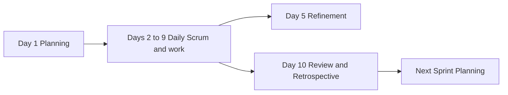

# A sprint in the life of an engineer, service desks and scaling

> **Before this lesson:** this lesson pulls the whole track together. You should have read the Scrum lessons ([events](#/lesson/jira/scrum-events), [artifacts](#/lesson/jira/artifacts-commitments)), [Boards](#/lesson/jira/boards), the JQL lessons up to [Filters and dashboards](#/lesson/jira/filters-dashboards), [Scrum reports](#/lesson/jira/scrum-reports), [Automation](#/lesson/jira/automation) and [Jira and your code](#/lesson/jira/dev-integration).

## In plain words

Learning the rules of football from a book is different from watching a full match. This lesson is the full match. We follow one engineer through one two-week Sprint, from planning to retrospective, and see where each idea from this track shows up: the Sprint Goal, the board, JQL, smart commits, automation, the burndown, and the retrospective action.

After the match, two short sections widen the view: **service desks** (how support requests reach engineering teams, often through Jira Service Management) and **scaling** (what happens when one product has many Scrum teams).

Why it matters for a job: interviewers ask "Walk me through how your team works" and "What does a typical sprint look like for you?". A clear, specific narrative, with the reasons behind each habit, is far more convincing than a list of buzzwords. If you have not worked in such a team yet, this lesson gives you a realistic model to understand and discuss.

## The setting

- **Company**: a Singapore online grocery business, "FreshCart" (fictional).
- **Team**: `CART` space, six Developers (backend, frontend, mobile, QA), a Product Owner (Siti), a Scrum Master shared with another team (Kenji).
- **Engineer we follow**: Daniel, backend engineer, eight months in the team.
- **Rhythm**: two-week Sprints, Monday to Friday of the following week.
- **Board columns**: To Do, In Progress (max 4), Code Review (max 3), QA (max 2), Releasing, Done (with Done and Won't Do mapped to the last column).
- **Definition of Done**: reviewed PR, tests pass in CI, deployed to staging and smoke-tested, monitoring for new endpoints, user-facing text reviewed.



## Day 1 (Monday): Sprint Planning

**Before the meeting.** Siti has ordered the top of the backlog. Last week's refinement made sure the top ten items have acceptance criteria and estimates. Kenji created "CART Sprint 22" in the backlog view.

**Why.** Siti explains that customers abandon carts when a delivery slot is full. The team agrees the Sprint Goal: *"Customers can join a waitlist for a full delivery slot and are notified when it frees up."*

**What.** Capacity is a little lower than usual: Mei is on leave Thursday and Friday of week two. Recent completed work was 27, 31 and 25 points; with the leave, the team forecasts about 24. They pull:

| Key | Item | Points |
|---|---|---|
| CART-310 | Join waitlist for a full slot (API + app) | 8 |
| CART-311 | Notify waitlisted customers when a slot frees | 5 |
| CART-312 | Admin view of waitlist sizes per slot | 3 |
| CART-298 | Bug: slot times shown in UTC for some users | 2 |
| CART-305 | Upgrade payments SDK (security advisory) | 3 |
| | **Total** | **21** |

They leave room deliberately: last Sprint, two urgent bugs arrived mid-Sprint.

**How.** Daniel and the mobile engineer break CART-310 into sub-tasks: waitlist table and migration, API endpoint, app screen, tests, monitoring dashboard. Kenji clicks **Start sprint**, entering the goal and dates. The board fills.

## Days 2 to 4: flow

**Daniel's morning.** He opens his saved filter "My open work" (`assignee = currentUser() AND statusCategory != Done ORDER BY priority DESC`), then the team dashboard.

**Daily Scrum, 09:45.** The team walks the board from right to left: "What would it take to finish this?" Daniel says the waitlist API is nearly done and he needs a review by early afternoon.

**Code.** He works on branch `CART-310-waitlist-api`. His commits start with the key:

```text
CART-310 add waitlist table and migration
CART-310 waitlist endpoint with idempotency key #time 3h
```

The `#time` smart command logs three hours to CART-310, because his team tracks time for capitalised R&D costs. His PR, titled `CART-310 Waitlist API`, appears in the item's Development panel.

**Automation.** When the PR merges, the team's rule moves CART-310's API sub-task to QA and comments with the PR link. Nobody has to remember to drag it.

**Day 4, a red column.** Code Review turns red: four items waiting, max 3. Following their working agreement, Daniel reviews two PRs before starting the next sub-task. By lunch the column is back within its limit.

## Day 5 (Friday of week one): an interruption and refinement

**10:30.** The customer support team raises a ticket through the service desk: some customers in Johor receive orders but the app shows "not delivered". It arrives in the `CART` space as a linked bug, CART-330, Priority High.

The team checks it against the Sprint Goal: it does not serve the goal but harms customers now. Siti agrees to take it in; the team drops CART-312 (admin view, 3 points) back to the backlog to make room. In Jira, CART-330 is added to the active sprint (the sprint report will show it with an asterisk), and CART-312 is moved out. The scope change is visible, explained and agreed.

**14:00, refinement.** One hour on next Sprint's candidates. A large item, "Recurring orders", is split into four vertical slices (lesson 8). A spike is added to check whether the notification service can handle 10 times more messages during festive peaks.

## Days 6 to 9: finishing

**Day 7.** CART-310 needs its acceptance criterion "a customer cannot join the same waitlist twice" tested in staging. QA finds a bug: double taps create two entries. Daniel adds a unique constraint and re-tests. The item goes back from QA to In Progress and returns; its cycle time includes the rework.

**Day 8.** The burndown has a step up on day 5 (CART-330 added) and a step down (CART-312 removed), then drops steadily. Kenji points at the chart in the Daily Scrum: "We're on track for the goal; CART-305 is the risk, still not started." Daniel pairs with a colleague on the SDK upgrade that afternoon.

**Day 9.** A query helps the team check its Definition of Done before the review:

```text
project = CART AND sprint in openSprints() AND statusCategory = Done
AND status WAS NOT "QA"
```

It returns nothing: every done item passed through QA. One item is in Releasing, waiting for a deployment window.

## Day 10 (Friday of week two): Review and Retrospective

**Sprint Review (1 hour).** Stakeholders from operations and marketing try the waitlist in staging on their phones. The operations lead asks for a waitlist cap per slot; Siti adds it to the backlog. The marketing lead wants to announce the feature; Siti says it will be released Tuesday after a staged rollout.

**Complete sprint.** Completed: CART-310, CART-311, CART-298, CART-305 and CART-330 (20 points, including the 2-point CART-330 added mid-sprint). Nothing is left incomplete. The velocity chart will show commitment 21 (CART-330 is excluded because it was added later; CART-312 is included because it was in the sprint at the start, though it was removed) and completed 20.

**Sprint Retrospective (1 hour).** The team looks at three things:

1. **Code Review went red three times.** Action: "review before you start" is already the agreement; they add a Slack reminder when the column turns red, built with an automation rule.
2. **The double-tap bug** was caught in QA, not by tests. Action: add an idempotency test template to the backend checklist. Owner: Daniel.
3. **The interruption** was handled well because there was slack. Action: keep forecasting about 85% of recent completed work during festive season.

The top action goes onto the next Sprint as a visible task with an owner.

## What Daniel used, mapped to this track

| Moment | Concept | Lesson |
|---|---|---|
| Sprint Goal, forecast, capacity | Scrum events and artifacts, capacity planning | 4, 5, 15 |
| Vertical slices, spike | Splitting work | 8 |
| Saved "My open work" filter | JQL functions, filters | 18, 20 |
| Branch, commits, PR with key, `#time` | Developer integration, smart commits | 24 |
| PR merge moves the item | Automation | 23 |
| Red Code Review column | WIP limits | 6, 14 |
| Added bug with asterisk, removed item | Sprint report, scope change | 15, 21 |
| `status WAS NOT "QA"` | History JQL | 19 |
| Burndown step up and down | Burndown reading | 21 |
| Rework counted in cycle time | Control chart | 22 |
| Review with stakeholders, retrospective action | Scrum events | 4 |

## Service desks and Jira Service Management

Not all work starts in a backlog. Customers and colleagues report problems and ask for things: "I can't log in", "please give me access to the analytics tool", "the checkout page is down". A **service desk** is the team and tooling that receives these **requests**, sorts them, and either resolves them or passes them to the right engineering team.

**Jira Service Management** (JSM) is Atlassian's service desk product, built on the same work items as Jira. Atlassian now sells it within its **Service Collection**, alongside Customer Service Management and Assets. In general terms, service desk tools provide:

- a **portal** or help centre where people raise requests without seeing the engineers' boards;
- **request types** (incident, access request, question) that capture the right information up front;
- **queues** for support agents, ordered by urgency;
- **service level** targets, such as "first response within 4 hours", with timers.

How this touches engineers: when a request needs a code fix, the support agent creates or links a work item in the engineering space (like CART-330 above). Good teams agree:

- which priority levels may interrupt a Sprint (often only production incidents);
- who triages incoming bugs (a rotating "triage" or on-call engineer, lesson 20);
- how the requester is told about progress (linked items, or automation that comments back when the engineering item is done).

> [!TIP]
> A Kanban board with an expedite swimlane (lesson 14) is a common way for a platform or support-facing team to handle this flow; Scrum teams usually reserve some capacity instead.

## Scaling: many teams, one product

When a product needs more people than one Scrum Team of about ten, the Scrum Guide suggests several cohesive Scrum Teams sharing **one Product Goal, one Product Backlog and one Product Owner** (lesson 2). Several published frameworks build on that idea.

**LeSS (Large-Scale Scrum)** keeps Scrum's core and applies it to many teams working on one product:

- **LeSS** covers up to about eight teams; **LeSS Huge** covers much larger groups.
- One Product Owner, one Product Backlog, one Definition of Done, and **one shared Sprint** in which all teams produce a single shippable Increment.
- **Sprint Planning One** brings the Product Owner and members of all teams together to divide work; **Sprint Planning Two** happens per team.
- An **Overall Retrospective** looks at the whole system, not only one team.

**SAFe (Scaled Agile Framework)** is another widely used framework, especially in large enterprises such as banks; it adds more structure and roles across teams and longer planning cycles. Its official site could not be checked for this track, so treat any specific SAFe details you hear as something to verify against the framework's own material.

How Jira fits scaling: several teams' boards can share one space or draw from several spaces with board filters; higher hierarchy levels (for example Initiative, on Premium and Enterprise plans) group epics across teams; dashboards and JQL filters such as `project in (CART, PAY, OPS) AND fixVersion = earliestUnreleasedVersion(CART)` give a cross-team view. The danger at scale is the same as for one team: more process and more tooling do not replace conversation. Large-scale frameworks emphasise teams working directly with each other and with users.

## How interviewers probe this

> [!INTERVIEW]
> "Walk me through a typical sprint on your team." Use the structure of this lesson in two minutes: planning (goal, capacity, slack), daily flow (stand-up walking the board, keys in branches, PR-merge automation, WIP limits), handling an interruption (agreed with the PO, visible in Jira), review with real stakeholders, retrospective with one owned action. Then add one thing you improved, which turns a description into evidence of ownership.

Other likely questions:

- "How did you handle urgent requests during a sprint?" Agreed rules for what may interrupt, a visible scope trade-off with the PO, and slack in the forecast.
- "Have you worked with a service desk?" Describe how requests reached your team, who triaged them, and how requesters were updated.
- "How do multiple teams coordinate on one product?" One backlog and Product Owner, shared Definition of Done, joint planning and reviews; mention LeSS as an example.

## Summary

- A Sprint ties the track together: goal and forecast at planning; daily flow with the board, WIP limits, keys in code and automation; visible, agreed scope changes; DoD checks; review with stakeholders; an owned retrospective action.
- Service desks receive requests through portals and queues; Jira Service Management, now part of Atlassian's Service Collection, connects them to engineering work items.
- Scaling Scrum keeps one Product Owner, one Product Backlog and one Definition of Done across teams; LeSS adds joint planning and an overall retrospective. Verify SAFe specifics against its own material.

## Glossary

- **Service desk** — the team and tools that receive, sort and resolve requests from customers or colleagues.
- **Request** — something a customer or colleague asks for or reports through a service desk.
- **Jira Service Management (JSM)** — Atlassian's service desk product built on Jira work items.
- **Service Collection** — Atlassian's bundle containing Jira Service Management, Customer Service Management and Assets.
- **Portal** — the page where people raise requests.
- **Queue** — an ordered list of requests for agents to handle.
- **Service level target** — a time limit for responding to or resolving a request.
- **Triage** — sorting incoming work by urgency and routing it to the right owner.
- **LeSS** — Large-Scale Scrum, a framework applying Scrum to many teams on one product.
- **SAFe** — the Scaled Agile Framework, a structured framework for agile at enterprise scale.
- **Overall Retrospective** — LeSS's cross-team retrospective on the whole system.

## Check yourself

```quiz
[
  {"q": "Mid-sprint, an urgent customer bug arrives that does not serve the Sprint Goal. What did the CART team do?",
   "options": ["Ignored it until next sprint", "Agreed with the PO to take it in and moved a lower-value item out, visibly in Jira", "Cancelled the sprint", "Worked overtime without telling anyone"],
   "answer": 1,
   "explain": "A visible, agreed trade-off protects the goal and keeps transparency."},
  {"q": "Why does the velocity chart show CART-330 under completed but not under commitment?",
   "options": ["It was a bug", "It was added after the sprint started", "It had no estimate", "It was in the rightmost column at the start"],
   "answer": 1,
   "explain": "Commitment is the total at sprint start; completed includes work added mid-sprint."},
  {"q": "What does `statusCategory = Done AND status WAS NOT \"QA\"` check in this scenario?",
   "options": ["Items still in QA", "Finished items that skipped QA, a Definition of Done check", "Items with no estimate", "Bugs created this week"],
   "answer": 1,
   "explain": "A history operator verifies every done item went through QA."},
  {"q": "The Code Review column turned red. What did the team's working agreement say?",
   "options": ["Raise the WIP limit", "Review pending PRs before starting new work", "Ignore it", "Move items back to To Do"],
   "answer": 1,
   "explain": "Respecting WIP limits means helping finish before starting."},
  {"q": "In LeSS, how many Product Backlogs are there for one product with five teams?",
   "options": ["Five", "One", "One per sprint", "None"],
   "answer": 1,
   "explain": "LeSS keeps one Product Owner and one Product Backlog for the whole product."},
  {"q": "Which bundle does Atlassian now sell Jira Service Management within?",
   "options": ["Software Collection", "Service Collection", "Teamwork Collection", "Data Center"],
   "answer": 1,
   "explain": "JSM is part of the Service Collection, with Customer Service Management and Assets."},
  {"q": "Why did Daniel's team forecast less than their recent average?",
   "options": ["To look good", "Lower capacity (leave) and deliberate slack for interruptions", "Jira required it", "Story points expired"],
   "answer": 1,
   "explain": "Capacity and known risks shape the forecast; slack protects the goal."}
]
```

> **Source:** Ken Schwaber and Jeff Sutherland, The Scrum Guide (2020), https://scrumguides.org/scrum-guide.html; Atlassian, Introduction to the Service Collection, https://www.atlassian.com/collections/service/guides/introduction-service-collection; LeSS framework, https://less.works/less/framework/index; Atlassian, View and understand the velocity chart, https://support.atlassian.com/jira-software-cloud/docs/view-and-understand-the-velocity-chart/; Atlassian, Process work items with smart commits, https://support.atlassian.com/jira-software-cloud/docs/process-issues-with-smart-commits/; Atlassian, JQL operators, https://support.atlassian.com/jira-software-cloud/docs/jql-operators/
