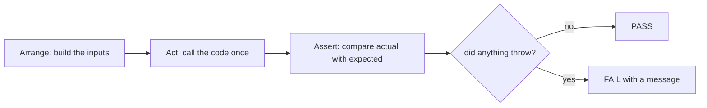

# Why automate tests: your first unit test

> **Before this lesson:** you can write and call JavaScript functions ([Functions and scope](#/lesson/javascript/functions-scope)), you know arrays and objects ([Objects, arrays and mutability](#/lesson/javascript/objects-arrays)), and you have seen `try` / `catch` ([Bugs, strict mode, testing and debugging](#/lesson/javascript/bugs-strict-testing)). You do not need to have written a test before. That is what this track is for.

## In plain words

A **test** is a small program whose only job is to check another program. You tell it "when I call this function with these inputs, I expect this result", and it answers with one word: *pass* or *fail*.

Think of the smoke alarm in a kitchen. You could walk into the kitchen every ten minutes and sniff the air. That works on the first day. By the third day you stop doing it, and that is the day the toast catches fire. A smoke alarm does the sniffing for you, all day, without getting bored, and it only makes noise when something is wrong. An **automated test** is a smoke alarm for one behaviour of your code: silent while things work, loud the moment they stop working.

Why this matters for a job: nearly every professional team requires tests with each change, hiring exercises are frequently marked by running hidden tests against your code, and "how would you test this?" is one of the most common interview follow-up questions. Being able to write a clear test is as basic a skill as being able to write a function.

In this lesson you will write your first tests with no tools at all, then build a miniature test tool in about twenty lines, so that later, when you meet real tools such as Jest and Vitest, you already know what happens inside them.

## The problem with checking by hand

Here is a small function. It takes a price and a tax rate in percent and returns the price including tax.

```js-run
function addTax(price, ratePercent) {
  return price + price * ratePercent / 100;
}

console.log(addTax(100, 20));
console.log(addTax(50, 10));
```

Line by line: `function addTax(price, ratePercent)` declares a function with two parameters. The `return` line computes the tax (`price * ratePercent / 100`) and adds it to the price. The two `console.log` lines call the function and print what comes back.

Press Run. You see `120` and `55`. You look at the numbers, do the arithmetic in your head, and decide they are right. This is **manual testing**: a human runs the code and judges the output by eye.

Manual testing has four weaknesses, and each one gets worse as a program grows.

1. **It needs a human every time.** Whenever anyone changes the function, someone has to run it again and re-do the mental arithmetic.
2. **The expected answer lives only in your head.** The code prints `120`. Nothing in the file says that `120` is *correct*. A colleague reading the output next month cannot tell a right answer from a wrong one.
3. **It does not scale.** Two calls are easy to eyeball. Two hundred printed lines are not; a wrong number in line 143 will be missed.
4. **It gets skipped under pressure.** On the evening before a deadline, the checks people forget are exactly the ones that needed doing.

The cure is to write the expected answer *into the program* and let the computer do the comparing.

## Step 1: a test that checks itself

```js-run
function addTax(price, ratePercent) {
  return price + price * ratePercent / 100;
}

const actual = addTax(100, 20);
const expected = 120;

if (actual === expected) {
  console.log("PASS");
} else {
  console.log("FAIL: expected " + expected + " but got " + actual);
}
```

What is new:

- `actual` holds what the code really returned.
- `expected` holds what we, the authors, say the right answer is.
- The `if` compares them with `===` (strict equality: same type and same value) and prints `PASS` or a `FAIL` message that shows both numbers.

That is a complete automated test. It is small, but it has the two properties that matter: it runs without a human, and it **decides for itself** whether the result is right. Nobody has to know that 120 is the correct answer in order to read the output.

Three names from this example are used in every testing tool in every language:

| Term | Meaning in one sentence |
|---|---|
| **System under test** | The code being checked; here, `addTax`. Often shortened to SUT. |
| **Actual value** | What the code returned when the test ran. |
| **Expected value** | What the test's author says the code should return. |

## Step 2: assertions

Writing that `if` / `else` for every check is repetitive, so we wrap it in a helper function. A statement that says "this must be true, otherwise stop and complain" is called an **assertion**. Here is the smallest possible one.

```javascript
function assert(condition, message) {
  if (!condition) {
    throw new Error(message);
  }
}
```

- `condition` is any value. If it is falsy (for example `false`), the assertion has failed.
- `throw new Error(message)` stops the current function immediately and reports an error carrying our message. An **error** (also called an exception) is JavaScript's way of saying "I cannot continue normally".
- If the condition is truthy, the function does nothing at all. A passing assertion is silent, like the smoke alarm.

`assert(addTax(100, 20) === 120, "100 plus 20% should be 120")` now replaces five lines.

There is a weakness. When the condition is false, all `assert` receives is `false`. It never saw the two numbers, so it cannot tell you what the function actually returned. A more helpful assertion takes the two values separately:

```javascript
function assertEqual(actual, expected) {
  if (actual !== expected) {
    throw new Error("expected " + expected + " but got " + actual);
  }
}
```

Now a failure reads `expected 120 but got 100.2`, which already hints at the bug. Good failure messages are the main reason testing tools ship dozens of specialised assertions (often called **matchers**) and not only one.

> [!TIP]
> When a test fails, the message is the first thing you read and often the only thing you need. Prefer the assertion that sees both values (`toBe`, `toEqual`) over one that only sees `true` or `false`.

## Step 3: test functions and a runner

One thrown error stops the whole script, so with bare assertions the first failure hides every check that comes after it. We want each check to run on its own, with a name, and we want a report at the end. So we put each check in its own function and hand it to a tiny **test runner**: a piece of code that calls test functions one by one, catches any error they throw, and reports the outcome.

```js-run
function test(name, fn) {
  try {
    fn();
    console.log("PASS  " + name);
  } catch (error) {
    console.log("FAIL  " + name);
    console.log("      -> " + error.message);
  }
}

function assertEqual(actual, expected) {
  if (actual !== expected) {
    throw new Error("expected " + expected + " but got " + actual);
  }
}

// ---- the code under test ----
function addTax(price, ratePercent) {
  return price + price * ratePercent / 100;
}

// ---- the tests ----
test("adds 20% tax to 100", () => {
  assertEqual(addTax(100, 20), 120);
});

test("a rate of 0 leaves the price unchanged", () => {
  assertEqual(addTax(80, 0), 80);
});

test("a price of 0 stays 0", () => {
  assertEqual(addTax(0, 20), 0);
});
```

Read `test` slowly, because every real framework contains this same idea:

- `test(name, fn)` receives a description and a function holding the checks.
- `try { fn(); ... }` runs the checks. If none of them throws, execution reaches the next line and prints `PASS`.
- `catch (error)` runs only if something inside `fn` threw. The runner prints `FAIL`, the name and the message, and then carries on with the next test. One failure no longer hides the others.

The rule underneath is worth memorising: **a test passes when its function finishes without throwing, and fails when it throws.** Assertions are functions that throw when reality does not match expectation.

A single test function such as the one named "adds 20% tax to 100" is also called a **test case**. A test that checks one small piece of code (one function, one class) separately from everything around it is a **unit test**. "Unit" is deliberately loose; what matters is that the piece is small enough for a failure to point straight at the cause, and that the test needs no database, network or browser to run.

## Step 4: watch a test catch a real bug

A new requirement arrives: prices must be rounded to whole cents, because `addTax(19.99, 7)` currently returns a number with a long tail of decimals. We write the test for the new requirement first and run it against the current code.

**The test:**

```javascript
test("rounds to two decimals", () => {
  assertEqual(addTax(19.99, 7), 21.39);
});
```

**The failing output** (the code has not changed yet):

```text
FAIL  rounds to two decimals
      -> expected 21.39 but got 21.3893
```

The failure tells us what is wrong and by how much. Now **the fix**, in the code under test:

```javascript
function addTax(price, ratePercent) {
  const total = price + price * ratePercent / 100;
  return Math.round(total * 100) / 100;   // keep two decimals
}
```

`Math.round(total * 100) / 100` shifts the decimal point two places right, rounds to a whole number, and shifts it back.

**The passing output**, with the three earlier tests still included:

```text
PASS  adds 20% tax to 100
PASS  a rate of 0 leaves the price unchanged
PASS  a price of 0 stays 0
PASS  rounds to two decimals
```

Notice what the three old tests did for us. We changed the inside of `addTax`, and within a second we knew the change had not broken the behaviours we already relied on. A test that keeps guarding old behaviour while you change code is called a **regression test**; a regression is a bug in something that used to work. This safety net is the largest practical benefit of automated tests.

Try it yourself. The block below uses a slightly nicer assertion style, `expect(actual).toBe(expected)`, which reads like a sentence and is the style used by Jest and Vitest. The runner is the same twenty-line idea you saw above.

```js-run
// --- the tiny test runner from lesson 1 ---
function test(name, fn) {
  try { fn(); console.log("PASS  " + name); }
  catch (e) { console.log("FAIL  " + name + "\n      -> " + e.message); }
}
function expect(actual) {
  const show = (v) => typeof v === "function" ? "[function]" : JSON.stringify(v);
  const fail = (msg) => { throw new Error(msg); };
  return {
    toBe(expected) {
      if (!Object.is(actual, expected)) fail("expected " + show(expected) + " but got " + show(actual));
    },
    toEqual(expected) {
      if (JSON.stringify(actual) !== JSON.stringify(expected)) fail("expected " + show(expected) + " but got " + show(actual));
    },
    toThrow(text = "") {
      try { actual(); } catch (e) {
        if (!String(e.message).includes(text)) fail("threw the wrong error: " + e.message);
        return;
      }
      fail("expected the function to throw, but it returned normally");
    },
  };
}
// --- end of runner ---

function addTax(price, ratePercent) {
  const total = price + price * ratePercent / 100;
  return Math.round(total * 100) / 100;
}

test("adds 20% tax to 100", () => {
  expect(addTax(100, 20)).toBe(120);
});

test("rounds to two decimals", () => {
  expect(addTax(19.99, 7)).toBe(21.39);
});

test("rejects a negative price", () => {
  expect(() => addTax(-5, 20)).toThrow();
});
```

The third test fails: nothing in `addTax` rejects negative prices. Make it pass by adding `if (price < 0) throw new Error("price must not be negative");` as the first line of `addTax`, then press Run again. You have now made a failing test pass, which is the core loop of the whole track.

Why does the third test wrap the call in an arrow function, `() => addTax(-5, 20)`? If you wrote `expect(addTax(-5, 20)).toThrow()`, JavaScript would call `addTax` *before* `expect` runs, the error would escape, and the matcher would never get a chance to catch it. Passing a function lets the matcher decide when to call it, inside its own `try` / `catch`.

## The same test in a real framework

Nothing can be installed inside this page, so real framework code is shown as static text. This is the identical test written for **Vitest**, a popular modern test runner (Jest looks the same apart from the import line, which Jest does not need):

```javascript
// add-tax.test.js
import { test, expect } from "vitest";
import { addTax } from "./add-tax.js";

test("adds 20% tax to 100", () => {
  expect(addTax(100, 20)).toBe(120);
});

test("rounds to two decimals", () => {
  expect(addTax(19.99, 7)).toBe(21.39);
});
```

You run it by typing `npx vitest run` in a terminal. The output looks like this:

```text
 ✓ add-tax.test.js (2 tests) 3ms
   ✓ adds 20% tax to 100
   ✓ rounds to two decimals

 Test Files  1 passed (1)
      Tests  2 passed (2)
```

And when a test fails, the framework prints the two values and points at the line:

```text
 FAIL  add-tax.test.js > rounds to two decimals
AssertionError: expected 21.3893 to be 21.39 // Object.is equality

- Expected
+ Received

- 21.39
+ 21.3893

 ❯ add-tax.test.js:10:31
```

A framework adds conveniences: it finds every file ending in `.test.js`, runs files in parallel, prints coloured differences, and re-runs tests when you save a file. The core is still the `try` / `catch` you wrote in Step 3.

## The three parts of every test

Almost every good test has the same shape, known as **Arrange, Act, Assert** (some teams say *Given, When, Then*):



```javascript
test("applies the member discount to the basket total", () => {
  // Arrange
  const basket = [{ name: "tea", price: 4 }, { name: "mug", price: 6 }];

  // Act
  const total = totalWithDiscount(basket, 10);

  // Assert
  expect(total).toBe(9);
});
```

Keeping the three parts visible makes a test readable in seconds: what world did we set up, what single thing did we do, and what did we expect to see.

## Comparing objects: `toBe` versus `toEqual`

There is one trap that catches every beginner in their first week.

```js-run
// --- the tiny test runner from lesson 1 ---
function test(name, fn) {
  try { fn(); console.log("PASS  " + name); }
  catch (e) { console.log("FAIL  " + name + "\n      -> " + e.message); }
}
function expect(actual) {
  const show = (v) => typeof v === "function" ? "[function]" : JSON.stringify(v);
  const fail = (msg) => { throw new Error(msg); };
  return {
    toBe(expected) {
      if (!Object.is(actual, expected)) fail("expected " + show(expected) + " but got " + show(actual));
    },
    toEqual(expected) {
      if (JSON.stringify(actual) !== JSON.stringify(expected)) fail("expected " + show(expected) + " but got " + show(actual));
    },
    toThrow(text = "") {
      try { actual(); } catch (e) {
        if (!String(e.message).includes(text)) fail("threw the wrong error: " + e.message);
        return;
      }
      fail("expected the function to throw, but it returned normally");
    },
  };
}
// --- end of runner ---

function makeUser(name) {
  return { name: name, active: true };
}

test("toBe on two separate objects", () => {
  expect(makeUser("Ada")).toBe({ name: "Ada", active: true });
});

test("toEqual on two separate objects", () => {
  expect(makeUser("Ada")).toEqual({ name: "Ada", active: true });
});
```

The first test fails even though the two objects look identical. `toBe` uses `Object.is`, which for objects asks "are these the very same object in memory?". Two objects that were created separately are never the same object, whatever they contain. `toEqual` instead compares *contents*, property by property, going into nested objects and arrays. This is called **deep equality**.

Rule of thumb: `toBe` for numbers, strings, booleans, `null` and `undefined`; `toEqual` for objects and arrays. (Our tiny runner implements `toEqual` by comparing JSON text, which is enough for lessons. You will build a proper deep-equality function in the practice problems.)

## What makes a good first test

- **One behaviour per test.** If the name needs the word "and", split it.
- **A name that states the expected behaviour**, such as "rounds to two decimals", not "test 4" or "addTax works". When the test fails in six months, the name is the bug report.
- **Fixed inputs written in the test.** No random numbers, no current date, no reading files. The same test must give the same verdict every time. This property is called being **deterministic**.
- **Edge cases as well as the typical case.** An edge case is an input at the boundary of what is allowed: zero, an empty list, a negative number, a very large value. Bugs live at the edges.
- **Fast.** Unit tests should take milliseconds, so you can run hundreds of them after every small change.

## Common pitfalls

> [!WARNING]
> **A test with no assertion always passes.** A test passes when nothing throws. If you call the function and forget to assert on the result, the test goes green and proves nothing. This is the most common "passes for the wrong reason" mistake.

```javascript
test("rounds to two decimals", () => {
  addTax(19.99, 7);            // called, but never checked: always PASS
});
```

Other traps:

- **Never having seen the test fail.** If a test has only ever been green, you do not know that it *can* go red. Break the code on purpose once (or write the test before the fix, as in Step 4) and watch it fail.
- **Swapping actual and expected.** `expect(120).toBe(addTax(100, 20))` still passes and fails at the right times, but the failure message is back to front and will mislead whoever reads it. The value from your code goes inside `expect(...)`.
- **Forgetting the arrow function with `toThrow`.** Covered above: pass a function, not the result of calling it.
- **Comparing floating-point numbers exactly.** `0.1 + 0.2` is `0.30000000000000004` in JavaScript, so `toBe(0.3)` fails. Round first, or use a matcher built for the job such as `toBeCloseTo`.
- **Testing the language instead of your code.** `expect(1 + 1).toBe(2)` tests JavaScript, not your program. Each test should be able to fail because of a mistake *you* could make.

> [!INTERVIEW]
> **"What is a unit test and why write one?"** A strong answer in three sentences: a unit test is an automated check of one small piece of code in isolation, with fixed inputs and an explicit expected result. It gives fast feedback, guards against regressions when code changes, and documents intended behaviour with runnable examples. Its limits: it cannot prove the pieces work *together*, so it is combined with a smaller number of integration and end-to-end tests.

## Cheat sheet

| You want to check | Jest / Vitest | Notes |
|---|---|---|
| Same primitive value | `expect(x).toBe(5)` | Uses `Object.is`; right for numbers, strings, booleans |
| Same contents (object, array) | `expect(x).toEqual({ a: 1 })` | Deep equality |
| Truthy / falsy | `expect(x).toBeTruthy()` / `.toBeFalsy()` | Weak message; prefer a specific matcher |
| `null` / `undefined` | `.toBeNull()` / `.toBeUndefined()` | |
| Number near another | `expect(0.1 + 0.2).toBeCloseTo(0.3)` | For floating-point results |
| Array or string contains | `expect(list).toContain("tea")` | |
| Function throws | `expect(() => f()).toThrow("message")` | Pass a function |
| The opposite of any matcher | `expect(x).not.toBe(5)` | `.not` flips the check |
| Declare a test | `test("name", () => { ... })` | `it(...)` is an alias |

## Summary

- Manual checking needs a human, hides the expected answer, and gets skipped. An automated test writes the expectation into code and judges itself.
- An assertion throws when actual and expected differ. A test passes when its function finishes without throwing.
- A test runner calls each test function inside `try` / `catch`, so one failure does not hide the others, and prints a report.
- Structure tests as Arrange, Act, Assert; name them after the behaviour; keep them deterministic and fast.
- Use `toBe` for primitive values and `toEqual` for objects and arrays.
- Always watch a new test fail at least once, and make sure it contains an assertion.

## Glossary

- **Test / test case**: a small function that runs some code and checks the result automatically.
- **Unit test**: a test of one small piece of code in isolation, with no network, database or browser.
- **Assertion**: a statement that throws an error if a condition does not hold.
- **Matcher**: an assertion method attached to `expect(...)`, such as `toBe` or `toEqual`.
- **Actual / expected**: what the code produced, and what the author said it should produce.
- **System under test (SUT)**: the code a test is checking.
- **Test runner**: the program that finds tests, runs them and reports results.
- **Regression**: a bug in behaviour that previously worked; a regression test guards against it.
- **Deterministic**: giving the same result on every run.
- **Edge case**: an input at the limit of what is allowed, such as zero or an empty list.
- **Deep equality**: comparing two structures by their contents, level by level.

## Check yourself

```quiz
[
  {"q": "According to the rule used by the tiny runner and by real frameworks, when does a test pass?",
   "options": ["When it prints the word PASS", "When its function finishes without throwing an error", "When it contains at least one assertion", "When the actual value is truthy"],
   "answer": 1,
   "explain": "The runner calls the test function inside try/catch. Reaching the end without a thrown error means pass; any thrown error means fail. Assertions are functions that throw."},
  {"q": "test('rounds to two decimals', () => { addTax(19.99, 7); }); The current addTax does NOT round. Will this test pass, fail, or pass for the wrong reason?",
   "options": ["Fail, because the result has too many decimals", "Pass for the wrong reason: there is no assertion, so nothing can throw", "Pass correctly", "Fail, because the return value is unused"],
   "answer": 1,
   "explain": "The function is called but its result is never compared with anything. With no assertion nothing throws, so the test is green while proving nothing."},
  {"q": "expect({ id: 1 }).toBe({ id: 1 }) fails. Why?",
   "options": ["toBe only works on strings", "The two objects are separate objects in memory, and toBe checks identity, not contents", "Objects cannot be compared in JavaScript", "The properties are in a different order"],
   "answer": 1,
   "explain": "toBe uses Object.is. Two separately created objects are never the same object. Use toEqual to compare contents."},
  {"q": "Which call correctly checks that parseAge('abc') throws?",
   "options": ["expect(parseAge('abc')).toThrow()", "expect(() => parseAge('abc')).toThrow()", "expect(parseAge).toThrow('abc')", "expect(parseAge('abc')).toBe(Error)"],
   "answer": 1,
   "explain": "The matcher must call the function itself inside try/catch. In the first option parseAge runs before expect and the error escapes the matcher."},
  {"q": "Why is a helper like assertEqual(actual, expected) more useful than assert(actual === expected)?",
   "options": ["It runs faster", "It can include both values in the failure message", "It works with objects", "It never throws"],
   "answer": 1,
   "explain": "assert only receives true or false. assertEqual sees both values, so its message can say what was expected and what was received."},
  {"q": "A team has 300 unit tests. A developer rewrites the inside of one function and all 300 still pass. What have the tests provided here?",
   "options": ["Proof that the program has no bugs", "A regression safety net: evidence that existing checked behaviour still works", "A performance measurement", "Nothing, because no new test was written"],
   "answer": 1,
   "explain": "Passing tests show that the behaviours they check still hold after the change. They cannot prove the absence of all bugs, only the absence of the ones they look for."},
  {"q": "expect(0.1 + 0.2).toBe(0.3). Pass or fail?",
   "options": ["Pass", "Fail, because 0.1 + 0.2 is 0.30000000000000004 in floating-point arithmetic", "Fail, because toBe does not accept numbers", "It throws a syntax error"],
   "answer": 1,
   "explain": "Binary floating point cannot represent 0.1 or 0.2 exactly. Use toBeCloseTo(0.3) or round before comparing."},
  {"q": "Which test name is the most useful when the test fails six months from now?",
   "options": ["test 7", "addTax works", "rounds the total to two decimals", "check rounding and negative and zero"],
   "answer": 2,
   "explain": "It states one expected behaviour. 'test 7' and 'works' say nothing, and the last name bundles three behaviours that belong in three tests."}
]
```

> **Source:** Johansen, *Test-Driven JavaScript Development*, ch. 1 (Automated Testing). Docs: https://vitest.dev/guide/ , https://jestjs.io/docs/getting-started , https://jestjs.io/docs/expect
