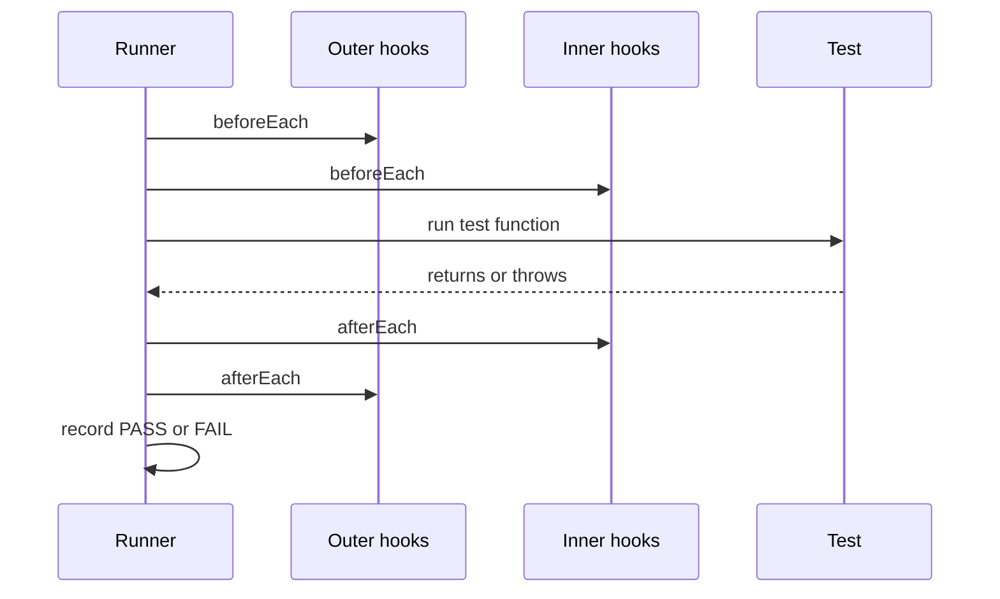

# Setup, teardown, suites and integration tests

> **Before this lesson:** read [Why automate tests: your first unit test](#/lesson/js-testing/first-unit-test). You should be comfortable with the rule "a test passes when its function does not throw", and with closures ([Closures and recursion](#/lesson/javascript/closures-recursion)), because the tiny runner in this lesson stores functions in arrays.

## In plain words

One test is easy to manage. Fifty tests in one file need organising, in the same way that fifty loose sheets of paper need folders. This lesson covers the three organising tools every test framework gives you:

- **setup**: code that runs *before* each test to prepare a clean starting point;
- **teardown**: code that runs *after* each test to tidy up;
- **suites**: named groups of related tests.

An everyday picture: a driving examiner tests many learners in one day using the same car. Before each candidate, the examiner resets the seat and mirrors and sets the trip counter to zero (setup). After each candidate, the examiner removes the L-plate clip and notes the mileage (teardown). No candidate inherits the previous candidate's seat position. Tests need the same courtesy: each one must start from a known state and must not leave a mess for the next.

The lesson then steps back and asks two bigger questions. What is the difference between a unit test and an **integration test**? And what do tests cost, as well as what they give? Interviewers like both questions because the honest answers show experience.

## The problem: tests that share state

**State** means data that is remembered between calls: a variable outside a function, the contents of an array, a file on disk. Here is a small shopping basket that keeps state, followed by two tests that share a single basket.

```js-run
// --- the tiny test runner from lesson 1 ---
function test(name, fn) {
  try { fn(); console.log("PASS  " + name); }
  catch (e) { console.log("FAIL  " + name + "\n      -> " + e.message); }
}
function expect(actual) {
  const show = (v) => typeof v === "function" ? "[function]" : JSON.stringify(v);
  const fail = (msg) => { throw new Error(msg); };
  return {
    toBe(expected) {
      if (!Object.is(actual, expected)) fail("expected " + show(expected) + " but got " + show(actual));
    },
    toEqual(expected) {
      if (JSON.stringify(actual) !== JSON.stringify(expected)) fail("expected " + show(expected) + " but got " + show(actual));
    },
    toThrow(text = "") {
      try { actual(); } catch (e) {
        if (!String(e.message).includes(text)) fail("threw the wrong error: " + e.message);
        return;
      }
      fail("expected the function to throw, but it returned normally");
    },
  };
}
// --- end of runner ---

function createBasket() {
  const items = [];
  return {
    add(name, price) { items.push({ name, price }); },
    count() { return items.length; },
    total() { return items.reduce((sum, item) => sum + item.price, 0); },
  };
}

const basket = createBasket();          // one basket shared by both tests

test("a new basket holds one item after one add", () => {
  basket.add("tea", 4);
  expect(basket.count()).toBe(1);
});

test("total adds up the prices", () => {
  basket.add("mug", 6);
  expect(basket.total()).toBe(6);
});
```

The second test fails with `expected 6 but got 10`. Nothing is wrong with `total`. The basket still contains the tea from the first test. The second test's result depends on what ran before it, which makes the pair **order-dependent**: swap the two tests, or run only the second one, and the verdicts change.

Order-dependent tests are a serious problem. Modern runners execute test files in parallel and let you run a single test by name. A test that only passes when its neighbours have run first will fail at random, and a test that fails at random teaches the team to ignore failures.

The cure is a rule: **every test builds its own world.** Tests must be **isolated**, meaning no test can affect the outcome of another.

## Setup with `beforeEach`

The direct fix is to create a fresh basket in the first line of each test. That works, and for one line it is the best choice. When the preparation grows to several lines repeated in every test, frameworks let you register a function that runs before each test. In Jest and Vitest it is called `beforeEach`.

Let us add that feature to our runner so you can see there is no magic in it.

```js-run
const befores = [];                       // functions to run before each test
const afters = [];                        // functions to run after each test

function beforeEach(fn) { befores.push(fn); }
function afterEach(fn) { afters.push(fn); }

function test(name, fn) {
  try {
    befores.forEach((hook) => hook());    // 1. setup
    fn();                                 // 2. the test itself
    console.log("PASS  " + name);
  } catch (error) {
    console.log("FAIL  " + name + "\n      -> " + error.message);
  } finally {
    afters.forEach((hook) => hook());     // 3. teardown, even after a failure
  }
}

function expectEqual(actual, expected) {
  if (actual !== expected) throw new Error("expected " + expected + " but got " + actual);
}

// ---- code under test ----
function createBasket() {
  const items = [];
  return {
    add(name, price) { items.push({ name, price }); },
    count() { return items.length; },
    total() { return items.reduce((sum, item) => sum + item.price, 0); },
  };
}

// ---- tests ----
let basket;                               // declared outside, assigned in setup

beforeEach(() => {
  basket = createBasket();                // a brand-new basket for every test
});

afterEach(() => {
  console.log("      (teardown ran)");
});

test("holds one item after one add", () => {
  basket.add("tea", 4);
  expectEqual(basket.count(), 1);
});

test("total adds up the prices", () => {
  basket.add("mug", 6);
  expectEqual(basket.total(), 6);
});
```

Walk through the new parts:

- `befores` and `afters` are arrays of functions. `beforeEach(fn)` and `afterEach(fn)` only store the function; they do not call it.
- Inside `test`, the runner calls every stored `before` function, then the test function.
- `finally` is the part of `try` / `catch` that runs whether or not an error happened. Putting teardown there guarantees the tidying runs even when a test fails. If teardown were skipped after a failure, one broken test could poison every test after it.
- `let basket;` is declared outside the tests so that both the hook and the tests can see it, and it is *assigned* inside `beforeEach`, so every test receives a new object.

Both tests pass now, in either order. The functions `beforeEach` and `afterEach` are known as **hooks**: places where the runner lets you plug in extra code at a fixed moment.

The objects and data a test needs in place before it can start have a name too: the **fixture**. The fresh basket is this suite's fixture.

## Teardown: when you need `afterEach`

A new object created in setup needs no cleaning; when the next test replaces it, JavaScript's garbage collector reclaims the old one. Teardown is for things the *outside world* remembers:

- a timer started with `setInterval` (it would keep firing during later tests);
- a global you replaced, such as `Date.now` or `fetch`;
- a temporary file or a database row;
- an element you appended to the page;
- an event listener you attached to `window`.

The pattern is always the same: whatever setup changes outside the test, teardown restores.

```javascript
let originalNow;

beforeEach(() => {
  originalNow = Date.now;                 // remember the real function
  Date.now = () => 1700000000000;         // freeze the clock for the test
});

afterEach(() => {
  Date.now = originalNow;                 // put the real clock back
});
```

There are also `beforeAll` and `afterAll`, which run once for the whole group and not once per test. Use them for expensive, read-only preparation such as starting a local server. Do not use them to create objects that tests then modify, because that reintroduces shared state.

## Suites with `describe`

A **test suite** is a named group of tests. In Jest and Vitest you create one with `describe(name, fn)`. Suites can be nested, and hooks registered inside a suite apply only to the tests in that suite.

```javascript
import { describe, test, expect, beforeEach } from "vitest";
import { createBasket } from "./basket.js";

describe("basket", () => {
  let basket;
  beforeEach(() => { basket = createBasket(); });

  describe("when empty", () => {
    test("has a count of 0", () => {
      expect(basket.count()).toBe(0);
    });
    test("has a total of 0", () => {
      expect(basket.total()).toBe(0);
    });
  });

  describe("after adding two items", () => {
    beforeEach(() => {
      basket.add("tea", 4);
      basket.add("mug", 6);
    });
    test("has a count of 2", () => {
      expect(basket.count()).toBe(2);
    });
    test("sums the prices", () => {
      expect(basket.total()).toBe(10);
    });
  });
});
```

The runner's report mirrors the nesting, so the output reads like a specification of the basket:

```text
 ✓ basket > when empty > has a count of 0
 ✓ basket > when empty > has a total of 0
 ✓ basket > after adding two items > has a count of 2
 ✓ basket > after adding two items > sums the prices
```

For a test in the inner suite the order of execution is: outer `beforeEach`, inner `beforeEach`, the test, inner `afterEach`, outer `afterEach`. Setup runs from the outside in; teardown from the inside out, like putting on and taking off socks and shoes.



> [!TIP]
> Keep setup small enough that a reader can see what a test depends on without scrolling. If a test needs one special value, create it inside that test and not in a shared hook. A little repetition in tests is better than a hidden dependency.

## Unit tests and integration tests

So far every test has checked one unit alone. An **integration test** checks that several units work correctly *together*: your function plus the module it calls, your code plus a real database, your component plus the browser.

A concrete pair makes the difference clear. Suppose a checkout uses two units: `createBasket` from above, and a `priceWithTax` function.

```js-run
// --- the tiny test runner from lesson 1 ---
function test(name, fn) {
  try { fn(); console.log("PASS  " + name); }
  catch (e) { console.log("FAIL  " + name + "\n      -> " + e.message); }
}
function expect(actual) {
  const show = (v) => typeof v === "function" ? "[function]" : JSON.stringify(v);
  const fail = (msg) => { throw new Error(msg); };
  return {
    toBe(expected) {
      if (!Object.is(actual, expected)) fail("expected " + show(expected) + " but got " + show(actual));
    },
    toEqual(expected) {
      if (JSON.stringify(actual) !== JSON.stringify(expected)) fail("expected " + show(expected) + " but got " + show(actual));
    },
    toThrow(text = "") {
      try { actual(); } catch (e) {
        if (!String(e.message).includes(text)) fail("threw the wrong error: " + e.message);
        return;
      }
      fail("expected the function to throw, but it returned normally");
    },
  };
}
// --- end of runner ---

function createBasket() {
  const items = [];
  return {
    add(name, price) { items.push({ name, price }); },
    total() { return items.reduce((sum, item) => sum + item.price, 0); },
  };
}
function priceWithTax(amount, ratePercent) {
  return Math.round(amount * (100 + ratePercent)) / 100;
}
function checkout(basket, ratePercent) {
  return { net: basket.total(), gross: priceWithTax(basket.total(), ratePercent) };
}

// unit test: one function, nothing else involved
test("unit: priceWithTax adds 20% to 10", () => {
  expect(priceWithTax(10, 20)).toBe(12);
});

// integration test: basket + tax + checkout working together
test("integration: checkout reports net and gross for a real basket", () => {
  const basket = createBasket();
  basket.add("tea", 4);
  basket.add("mug", 6);
  expect(checkout(basket, 20)).toEqual({ net: 10, gross: 12 });
});
```

The two kinds of test answer different questions and have different costs.

| | Unit test | Integration test |
|---|---|---|
| Checks | One small piece alone | Several pieces working together |
| Speed | Milliseconds | Slower; may touch disk, network, browser |
| When it fails | The cause is nearly always in that one unit | The cause could be in any piece, or in the wiring between them |
| Catches | Logic errors inside a unit | Wrong assumptions between units: argument order, data shapes, configuration |
| How many | Many | Fewer |

Neither replaces the other. Unit tests can all be green while the application is broken, because two correct units can disagree about what they pass to each other (one returns cents, the other expects whole currency units). Integration tests catch that, but there are too many paths through a whole system to cover every edge case with them, and when one fails it takes longer to find out why. Later lessons in this track add a third level, **end-to-end tests**, which drive the complete application the way a user would.

## What tests give you, and what they cost

**Benefits**

- **Regression protection.** Old behaviour is checked every time anything changes.
- **Fast feedback.** You learn about a mistake seconds after making it, while the change is still in your head, instead of days later from a user.
- **Confidence to refactor.** To **refactor** is to improve the structure of code without changing what it does. With tests you can do that and know immediately whether behaviour changed.
- **Living documentation.** A test is an example of how to call the code and what to expect, and unlike a comment it cannot silently become out of date, because it fails when it is wrong.
- **Better design pressure.** Code that is hard to test is usually hard to use: too many responsibilities, hidden dependencies. Writing the test exposes that early.

**Costs and pitfalls**

- **Tests are code and need maintenance.** Each test has to be read, updated and kept passing for as long as the code lives.
- **Brittle tests.** A test that checks *how* the code works internally, and not *what* it produces, breaks every time you refactor, even when behaviour is unchanged. Such tests punish improvement.
- **False confidence.** A green suite only proves the things it checks. A hundred tests that never try an empty list say nothing about empty lists.
- **Slow suites.** If the suite takes ten minutes, people stop running it. Speed is a feature.
- **Flaky tests.** A **flaky** test passes on some runs and fails on others without any code change, usually because of shared state, real time or real networks. A flaky test is worse than no test, because it trains everyone to ignore red.

> [!INTERVIEW]
> **"What are the downsides of unit testing?"** Do not answer "none". Mention maintenance cost, brittle tests coupled to implementation details, false confidence from tests that check the wrong thing, and the fact that unit tests cannot see integration problems. Then say how you limit each: test behaviour through the public interface, keep tests isolated and fast, and add a smaller layer of integration tests.

## Common pitfalls

> [!WARNING]
> **Shared mutable fixtures.** A `const basket = createBasket()` at the top of a file, modified by several tests, is the classic cause of order-dependent failures. Create mutable objects in `beforeEach` or inside each test.

- **Cleanup written at the end of the test body.** If an assertion above it throws, the cleanup line never runs. Put cleanup in `afterEach`, which runs regardless.
- **Asserting inside hooks.** A failed assertion in `beforeEach` fails every test in the suite with a confusing message. Hooks prepare; tests assert.
- **Deeply nested suites with hooks at every level.** To understand one test, a reader must mentally run four `beforeEach` blocks. Two levels of nesting is usually plenty.
- **Using `beforeAll` for mutable data.** It runs once, so every test sees the leftovers of the tests before it.
- **Calling something a unit test when it talks to a real server.** It may be a useful test, but it is an integration test, and it belongs in a separate, slower group.

## Cheat sheet

| API (Jest / Vitest) | When it runs | Typical use |
|---|---|---|
| `describe(name, fn)` | Groups tests; runs `fn` once to collect them | One suite per unit or per scenario |
| `test(name, fn)` / `it(name, fn)` | Once | One behaviour |
| `beforeEach(fn)` | Before every test in the suite | Build a fresh fixture |
| `afterEach(fn)` | After every test, pass or fail | Restore globals, clear timers, remove elements |
| `beforeAll(fn)` | Once before the first test | Expensive read-only preparation |
| `afterAll(fn)` | Once after the last test | Stop a server, close a connection |
| `test.only(...)` / `describe.only(...)` | Runs only this one | Focus while debugging; remove before committing |
| `test.skip(...)` | Not run, reported as skipped | Temporarily park a test |
| `test.todo("name")` | Not run, listed as to-do | Note a test you still need to write |
| `test.each([...])("name %s", fn)` | Once per row of data | Same check with many inputs |

## Summary

- Tests must be isolated: each one builds its own starting state and leaves nothing behind.
- `beforeEach` builds the fixture; `afterEach` restores whatever setup changed in the outside world, and it runs even when the test fails.
- `describe` groups tests into suites; hooks apply to the suite they are declared in, outer setup first and outer teardown last.
- Unit tests check one piece alone and are fast and precise; integration tests check pieces together and catch disagreements between them.
- Tests bring regression protection, feedback, refactoring confidence and documentation. They cost maintenance, and badly written tests become brittle, slow or flaky.

## Glossary

- **State**: data remembered between calls.
- **Isolated test**: a test whose result cannot be changed by other tests.
- **Order-dependent test**: a test that passes or fails depending on which tests ran before it.
- **Setup / teardown**: code run before / after each test to prepare and to clean up.
- **Hook**: a point where the runner calls code you registered, such as `beforeEach`.
- **Fixture**: the objects and data a test needs in place before it starts.
- **Test suite**: a named group of tests, created with `describe`.
- **Integration test**: a test that checks several units working together.
- **Refactor**: to change the structure of code without changing its behaviour.
- **Brittle test**: a test that fails when implementation details change although behaviour did not.
- **Flaky test**: a test that sometimes passes and sometimes fails with no change to the code.

## Check yourself

```quiz
[
  {"q": "Two tests share one array declared at the top of the file. The first pushes an item; the second expects the array to have length 1 after its own push. Running the whole file, what happens to the second test?",
   "options": ["It passes", "It fails, because the array still holds the first test's item", "It is skipped", "It passes for the wrong reason"],
   "answer": 1,
   "explain": "The array has length 2 when the second assertion runs. The tests are order-dependent because they share mutable state."},
  {"q": "In the same file, a developer runs ONLY the second test with test.only. What happens now?",
   "options": ["It fails in the same way", "It passes, which shows that the test's verdict depends on what else ran", "It throws a syntax error", "The first test still runs first"],
   "answer": 1,
   "explain": "Run alone, the array starts empty, so the length is 1. A verdict that changes with the selection of tests is the mark of missing isolation."},
  {"q": "Why does the tiny runner call the afterEach hooks inside a finally block?",
   "options": ["finally is faster than catch", "So teardown runs even when the test throws", "So teardown can change the test result to PASS", "Because hooks cannot be called from try"],
   "answer": 1,
   "explain": "finally runs after try whether or not an error was thrown. Skipping cleanup after a failure would leak state into later tests."},
  {"q": "For a test inside a nested describe, which order is correct?",
   "options": ["inner beforeEach, outer beforeEach, test, outer afterEach, inner afterEach", "outer beforeEach, inner beforeEach, test, inner afterEach, outer afterEach", "outer beforeEach, test, inner beforeEach, inner afterEach, outer afterEach", "All hooks run after the test"],
   "answer": 1,
   "explain": "Setup runs from the outermost suite inwards; teardown unwinds from the innermost suite outwards."},
  {"q": "All unit tests for formatPrice and for loadCart pass, yet the cart page shows 'NaN'. Which kind of test would most directly have caught this?",
   "options": ["More unit tests for formatPrice with valid numbers", "An integration test that passes loadCart's real output into formatPrice", "A test with no assertions", "A beforeAll hook"],
   "answer": 1,
   "explain": "Each unit is correct alone but they disagree about the data passed between them. Only a test that exercises them together can see that."},
  {"q": "A beforeAll hook creates one basket object and five tests each add items to it. What is the risk?",
   "options": ["beforeAll cannot create objects", "The tests share mutable state, so they become order-dependent", "The suite will run slower", "afterAll will not run"],
   "answer": 1,
   "explain": "beforeAll runs once. Every test then sees items left by earlier tests. Mutable fixtures belong in beforeEach."},
  {"q": "A test replaces Date.now with a fake at its start and restores it on its last line, after the assertions. An assertion fails. What is the consequence?",
   "options": ["Nothing, the runner restores globals automatically", "The restore line never runs, so later tests see the fake clock", "The test passes for the wrong reason", "Date.now becomes undefined"],
   "answer": 1,
   "explain": "A thrown assertion skips the rest of the test body. Restoring in afterEach guarantees it happens."},
  {"q": "Which statement about the costs of testing is accurate?",
   "options": ["Tests have no maintenance cost because they are not shipped", "A test coupled to internal details can fail after a refactor that did not change behaviour", "A flaky test is harmless as long as it passes most of the time", "A green suite proves the program has no bugs"],
   "answer": 1,
   "explain": "Tests tied to implementation are brittle. Tests need maintenance, flaky tests destroy trust, and green only covers what is checked."}
]
```

> **Source:** Johansen, *Test-Driven JavaScript Development*, ch. 1 (Automated Testing). Docs: https://vitest.dev/api/ , https://jestjs.io/docs/setup-teardown , https://jestjs.io/docs/api
