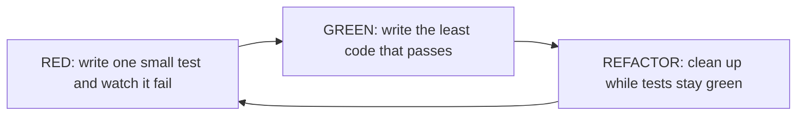

# Test-driven development: red, green, refactor

> **Before this lesson:** you can write a test with `test` and `expect` ([Why automate tests: your first unit test](#/lesson/js-testing/first-unit-test)) and you know what isolation and refactoring mean ([Setup, teardown, suites and integration tests](#/lesson/js-testing/setup-suites-integration)).

## In plain words

**Test-driven development**, shortened to **TDD**, is a way of working in which you write the test *before* the code it tests. You write one small failing test, write the least code that makes it pass, tidy up, and repeat. The tests are not an afterthought bolted on at the end. They steer the work, one small step at a time.

Think of a tailor fitting a jacket. A careless tailor cuts all the cloth, sews the whole jacket, and only then asks the customer to try it on; if a sleeve is short, a lot of work is undone. A careful tailor pins one seam, checks it against the customer, sews it, checks again, and moves to the next seam. Each check is tiny, and a mistake is caught while it is one seam old. TDD is the second way of working. The "customer trying it on" is a test that you run every minute or two.

Why it matters for a job: many teams practise TDD or expect you to be able to, pair-programming interviews are often run test-first, and even on teams that do not use TDD every day, the habit of asking "what should this do, exactly, and how will I know?" before typing makes you a noticeably more reliable developer.

## The cycle

TDD repeats three steps. They are traditionally named after the colours test runners print.



1. **Red.** Write one test for a behaviour the code does not have yet. Run it. It must fail, and you must read *why* it fails.
2. **Green.** Write the smallest amount of production code that makes the test pass. **Production code** is the code that ships to users, as opposed to test code. It does not have to be elegant yet. Run all the tests; they must all pass.
3. **Refactor.** Now that you are protected by passing tests, remove duplication and improve names and structure, in both the production code and the tests. Run the tests after every small change; they must stay green. No new behaviour is added in this step.

Then pick the next small behaviour and go round again. One trip round the loop typically takes between thirty seconds and a few minutes.

## Why each step exists

Newcomers often want to skip a step. Each one protects you from a specific mistake.

**Why watch the test fail?** Because a test you have never seen fail has not shown that it can detect anything. A red run proves three things at once: the test is really being executed, it really checks the behaviour, and the behaviour is really missing. It also shows you the failure message while you can still improve it. If a brand-new test passes straight away, stop: either the behaviour already existed (then the test is fine but was not needed to drive new code), or the test is broken and checks nothing.

**Why the *least* code?** Because any line of production code that no test demanded is a line no test protects. Writing only what the current test requires keeps you from building features on speculation, and it forces the next behaviour to arrive with its own test. This idea has its own slogan, **YAGNI**, "you aren't gonna need it": do not write code for a need that has not appeared yet.

**Why refactor as a separate step?** Because making something work and making it clean are two different mental tasks, and doing them one at a time is easier than doing both at once. Green gives you permission to be messy for a moment; refactor is where you pay that debt immediately, with a safety net. Skip this step and TDD produces working, tangled code.

The rules of TDD are sometimes written as three laws:

1. Write no production code except to make a failing test pass.
2. Write no more of a test than is enough to fail (and failing to run at all counts as failing).
3. Write no more production code than is enough to pass the one failing test.

Treat these as training wheels for learning the rhythm, not as a religion.

## One full trip round the loop

We will build `initials(name)`, which turns `"Ada Lovelace"` into `"AL"`.

### Red

Start with the most basic behaviour you can think of and write its test first.

```javascript
test("returns the first letters of a first and last name", () => {
  expect(initials("Ada Lovelace")).toBe("AL");
});
```

Run it:

```text
FAIL  returns the first letters of a first and last name
      -> initials is not defined
```

The function does not exist. That counts as red. It also made us decide three things before writing any implementation: the function's name, what it takes, and what it returns. In TDD the test is the first *user* of your code, so you design the interface from the caller's side.

### Green

Now the least code that passes. Here is a move that feels like cheating the first time you see it:

```javascript
function initials(name) {
  return "AL";
}
```

```text
PASS  returns the first letters of a first and last name
```

Returning a constant is called **faking it**. It is a legitimate step, and it teaches something important: one example never pins down a general rule. The test is satisfied by a function that always returns `"AL"`, so we need a second example to force a real implementation. Using two or more examples to force general code is called **triangulation**, by analogy with finding a position from two bearings.

### Red again

```javascript
test("works for a different name", () => {
  expect(initials("Grace Hopper")).toBe("GH");
});
```

```text
PASS  returns the first letters of a first and last name
FAIL  works for a different name
      -> expected "GH" but got "AL"
```

### Green again

A constant can no longer satisfy both tests, so we write the general code:

```javascript
function initials(name) {
  const parts = name.split(" ");
  return parts[0][0] + parts[1][0];
}
```

`name.split(" ")` cuts the string at each space and gives an array of words. `parts[0][0]` is the first character of the first word. Both tests pass.

### Refactor

Is there anything to clean? The code handles exactly two words by indexing `0` and `1`, which is repetitive and will not stretch to three names. We can express "first letter of each word" directly, without changing behaviour:

```javascript
function initials(name) {
  return name.split(" ").map((word) => word[0]).join("");
}
```

`map` builds a new array by applying the function to every word; `join("")` glues the letters back into a string. Run the tests: still green. The refactoring changed the structure, the tests confirmed the behaviour did not move.

When the general solution is as clear as this one, experienced developers often skip the fake and type the real code straight away. That is called **obvious implementation**. If the tests then surprise you with a red bar, drop back to smaller steps. TDD lets you change gear: tiny steps when unsure, larger steps when confident.

### Keep going

Each new behaviour gets its own red and green. Run the block and you will see a failing test waiting for you.

```js-run
// --- the tiny test runner from lesson 1 ---
function test(name, fn) {
  try { fn(); console.log("PASS  " + name); }
  catch (e) { console.log("FAIL  " + name + "\n      -> " + e.message); }
}
function expect(actual) {
  const show = (v) => typeof v === "function" ? "[function]" : JSON.stringify(v);
  const fail = (msg) => { throw new Error(msg); };
  return {
    toBe(expected) {
      if (!Object.is(actual, expected)) fail("expected " + show(expected) + " but got " + show(actual));
    },
    toEqual(expected) {
      if (JSON.stringify(actual) !== JSON.stringify(expected)) fail("expected " + show(expected) + " but got " + show(actual));
    },
    toThrow(text = "") {
      try { actual(); } catch (e) {
        if (!String(e.message).includes(text)) fail("threw the wrong error: " + e.message);
        return;
      }
      fail("expected the function to throw, but it returned normally");
    },
  };
}
// --- end of runner ---

function initials(name) {
  return name.split(" ").map((word) => word[0]).join("");
}

test("returns the first letters of a first and last name", () => {
  expect(initials("Ada Lovelace")).toBe("AL");
});
test("works for a different name", () => {
  expect(initials("Grace Hopper")).toBe("GH");
});
test("handles three names", () => {
  expect(initials("Mary Jane Watson")).toBe("MJW");
});
test("upper-cases the letters", () => {
  expect(initials("ada lovelace")).toBe("AL");
});
test("ignores extra spaces", () => {
  expect(initials("  Ada   Lovelace ")).toBe("AL");
});
```

Three names already work, as a free result of the refactoring. The fourth test is red. Make it green by adding `.toUpperCase()` to the end of the chain, and run again.

The fifth test passes, and it deserves a second look, because it passes by accident. Splitting `"  Ada   Lovelace "` at single spaces produces several empty strings between the words. The first character of an empty string is `undefined`, and `join` happens to turn `undefined` into nothing. The right answer falls out of a quirk, not out of code that says what it means. Put a tab character between the names and the function breaks. Make the intent explicit: replace `name.split(" ")` with `name.trim().split(/\s+/)` (`trim` removes whitespace at both ends; the regular expression `/\s+/` splits on one or more whitespace characters of any kind). The test stays green, and now it is green for a reason you can explain.

## Choosing the next test

A good order of tests makes TDD flow; a bad order makes you write the whole function to pass test two. Some guidance:

- **Keep a test list.** Before you start, jot down the behaviours you can think of: normal case, empty input, one word, extra spaces, lower case. Add to the list whenever an idea interrupts you, then return to the current test. The list stops you from chasing three things at once.
- **Start with the simplest case that teaches you something**, often called the degenerate case: empty input, zero, a single element.
- **Pick the next test that needs the smallest change** to the production code. If passing it would require twenty new lines, look for a smaller step in between.
- **Save error handling and exotic cases for after the main path works**, unless they shape the interface.

## What makes TDD easier

TDD only works when running the tests is nearly free.

- **Fast tests.** The whole unit suite should finish in a few seconds. This is why unit tests avoid the network, the disk and real timers.
- **Watch mode.** Runners such as Vitest and Jest can watch your files and re-run the affected tests each time you save (`npx vitest` or `npx jest --watch`). Feedback then arrives without you asking for it. The older name for this is *autotesting*.
- **Isolated tests**, so a failure points at one cause.
- **Small units with explicit inputs.** A function that receives what it needs as arguments is easy to test first. A function that reaches out to global state, the clock or the network needs those things replaced in tests; later lessons show how.

## What TDD gives you

- **Code that is testable by construction.** You cannot write untestable code if the test came first.
- **Interfaces designed from the caller's side.** You experience the function's name, arguments and return value as a user before you implement them.
- **A suite you can trust.** Every test was seen failing, so every test is known to detect something.
- **Small steps and short debugging sessions.** When a test goes red, the bug is in the few lines you typed in the last minute.
- **Less unneeded code.** Nothing is written without a test asking for it.
- **A clear stopping point.** When every item on the test list is green and the code is clean, you are done.

## What TDD does not give you

> [!WARNING]
> TDD is a development technique, not a proof of correctness. The tests only contain the cases *you* thought of. If you misunderstood the requirement, you will write a wrong test and then correct code for the wrong behaviour, and everything will be green.

Other honest limits:

- **It is slower at the very start**, especially while you are learning it. The time comes back later as less debugging and safer changes.
- **It is awkward for exploratory work.** When you do not yet know what you are building (a visual layout, a throwaway prototype, an unfamiliar library), write a quick experiment first, learn from it, then throw it away and build the real thing test-first. Such a throwaway experiment is called a **spike**.
- **It does not replace integration and end-to-end tests.** Unit-level TDD cannot tell you that the pieces fit together.
- **It can produce brittle suites** if the tests pin down *how* the code works and not *what* it does.

> [!INTERVIEW]
> **"Explain red-green-refactor, and tell me one downside of TDD."** Describe the three steps and why each exists (red proves the test can fail, green adds only demanded code, refactor cleans with a safety net). For the downside, pick a real one: slower initial pace, poor fit for exploratory UI work, or the risk of over-specifying implementation. Showing you know when *not* to use a technique is what the interviewer is listening for.

## Common pitfalls

- **Writing several tests before any code.** You then face many failures at once and lose the small-step benefit. One failing test at a time.
- **Not reading the red message.** A test can fail for the wrong reason, for example a typing mistake in the test, and then pass for the wrong reason too. Check that it fails *because the behaviour is missing*.
- **Skipping refactor.** After ten cycles you have a passing mess. Refactor is one third of the method.
- **Changing behaviour during refactor.** If you need new behaviour, go back to red first.
- **Refactoring on a red bar.** Only restructure when all tests pass; otherwise you cannot tell whether a new failure came from the restructuring.
- **Giant first test.** "It processes the whole order" is not a first test. "An empty order totals zero" is.
- **Writing the test afterwards to match what the code happens to do.** That records current behaviour, bugs included, and is not TDD.

> [!TIP]
> When you are stuck on how to make a test pass, the step is too big. Delete the test, write a smaller one, and get back to green. Being at most a minute away from a green bar is the whole point of the rhythm.

## Cheat sheet

| Moment | What you do | What you must see |
|---|---|---|
| Red | Write one small test for missing behaviour | The test fails, for the expected reason |
| Green | Least production code to pass: fake it, or the obvious implementation | All tests pass |
| Refactor | Remove duplication, rename, restructure; no new behaviour | All tests still pass after each change |
| Triangulate | Add a second example that a fake cannot satisfy | Red, forcing general code |
| Stuck | Delete the test, take a smaller step | Back to green quickly |
| Watch mode | `npx vitest` or `npx jest --watch` | Tests re-run on every save |
| Focus | `test.only(...)` or `npx vitest -t "name"` | Only the chosen test runs |

## Summary

- TDD means the test is written first and drives the code: red, green, refactor, repeated in small steps.
- Red proves the test can fail and designs the interface from the caller's point of view.
- Green adds only the code the test demands; faking and triangulating are valid ways to get there.
- Refactor improves structure under the protection of green tests and adds no behaviour.
- TDD needs fast, isolated tests and a runner in watch mode.
- It yields testable code, trustworthy tests and short debugging, but it does not prove correctness, suits exploration poorly, and does not replace higher-level tests.

## Glossary

- **Test-driven development (TDD)**: writing a failing test before the production code that makes it pass.
- **Production code**: the code that ships, as opposed to test code.
- **Red / green**: a failing / passing test run.
- **Refactor**: to improve structure without changing behaviour.
- **Fake it**: return a hard-coded value to get to green quickly.
- **Triangulation**: adding a second example so that only general code can pass.
- **Obvious implementation**: typing the real solution directly when it is clear.
- **YAGNI**: "you aren't gonna need it"; do not build for needs that have not arrived.
- **Test list**: a running to-do list of behaviours still to be tested.
- **Watch mode**: a runner setting that re-runs tests whenever files are saved.
- **Spike**: a throwaway experiment written to learn, not to keep.

## Check yourself

```quiz
[
  {"q": "You write a new test for a feature that does not exist yet, run it, and it passes immediately. What should you do?",
   "options": ["Celebrate and move on", "Stop and investigate: the test may be checking nothing, or the behaviour already exists", "Delete the production code", "Add more assertions without running anything"],
   "answer": 1,
   "explain": "A test that never failed has not shown it can detect the behaviour. Find out why it is green before trusting it."},
  {"q": "Tests so far: expect(initials('Ada Lovelace')).toBe('AL'). Implementation: function initials() { return 'AL'; }. Does the test pass, fail, or pass for the wrong reason?",
   "options": ["It fails", "It passes, and that is an accepted TDD step called faking it; a second example is needed to force real code", "It throws", "It passes and the function is finished"],
   "answer": 1,
   "explain": "A constant satisfies a single example. That is fine as a step, but triangulating with a second name is required before the code is general."},
  {"q": "What is allowed during the refactor step?",
   "options": ["Adding a small new feature while you are there", "Changing structure and names while all tests stay green", "Deleting tests that are in the way", "Working while one test is red"],
   "answer": 1,
   "explain": "Refactoring changes structure, not behaviour, and is done only on a green bar so that any failure is known to come from the restructuring."},
  {"q": "Why does TDD ask for the LEAST code that passes the test?",
   "options": ["Short code runs faster", "Code no test demanded is code no test protects, and it may never be needed", "To make the refactor step impossible", "Because functions must fit on one line"],
   "answer": 1,
   "explain": "Every line should exist because a test asked for it. Extra speculative code is untested and often unnecessary (YAGNI)."},
  {"q": "A developer writes five tests, then the full implementation, then runs everything and sees three failures. What benefit of TDD was lost?",
   "options": ["Code coverage", "Small steps: with one failing test at a time, a failure points at the last minute of work", "The ability to use describe blocks", "Nothing was lost"],
   "answer": 1,
   "explain": "With several new tests and a large change, the cause of each failure is unclear. One red test at a time keeps debugging short."},
  {"q": "Which situation is the WEAKEST fit for strict test-first work?",
   "options": ["A price calculation with clear rules", "A parsing function with known inputs and outputs", "Exploring an unfamiliar charting library to see what is possible", "A bug with a known reproduction"],
   "answer": 2,
   "explain": "When you do not yet know what to build, a throwaway spike is more useful. Once you have learned enough, build the real code test-first."},
  {"q": "All tests are green and were written test-first. Which claim is justified?",
   "options": ["The program is free of bugs", "The behaviours the tests describe work, and each test is known to be able to fail", "The requirements were understood correctly", "No integration tests are needed"],
   "answer": 1,
   "explain": "TDD gives trustworthy tests for the cases you thought of. It cannot detect a misunderstood requirement or problems between units."},
  {"q": "A test fails with 'initals is not defined' (note the spelling) after you have implemented initials. What does this illustrate?",
   "options": ["The implementation is wrong", "A test can fail for the wrong reason; always read the failure message", "The runner is broken", "Refactoring is needed"],
   "answer": 1,
   "explain": "The failure comes from a typing mistake in the test, not from missing behaviour. Reading the red message catches this."}
]
```

> **Source:** Johansen, *Test-Driven JavaScript Development*, ch. 2 (The Test-Driven Development Process). Docs: https://vitest.dev/guide/cli , https://jestjs.io/docs/cli
