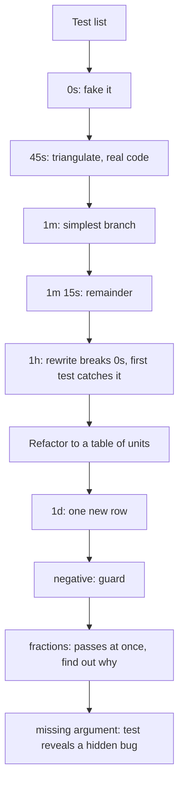

# A complete TDD session, test by test

> **Before this lesson:** you know the red, green, refactor cycle, faking it and triangulation from [Test-driven development: red, green, refactor](#/lesson/js-testing/red-green-refactor). You should also know the remainder operator `%` and `Math.floor` ([Values, types and operators](#/lesson/javascript/values-types-operators)).

## In plain words

Reading the rules of a sport is not the same as watching a match. The previous lesson gave the rules of test-driven development. This lesson is the match: one small function built from nothing, with every test, every failure message and every decision shown, including the moments of doubt.

A useful picture is a climber on a rock face. The climber moves a short distance, then clips the rope into a new anchor. If they slip, they fall only as far as the last anchor. In this session each passing test is an anchor. We never climb far above the last one, so no mistake costs more than a minute.

Why it matters for a job: live-coding interviews often ask you to build a small function while explaining your thinking. Working test-first gives you a script to follow under pressure: state the next behaviour, write its test, make it pass, clean up, say what comes next.

## The task

We need `formatDuration(seconds)`, which turns a number of seconds into text a person can read:

| Input | Output |
|---|---|
| `0` | `"0s"` |
| `45` | `"45s"` |
| `75` | `"1m 15s"` |
| `3600` | `"1h"` |
| `3661` | `"1h 1m 1s"` |

Units that are zero are left out (`3600` is `"1h"`, not `"1h 0m 0s"`), except that zero seconds in total is `"0s"`.

## Step 0: the test list

Before typing any code, write down the behaviours you can think of. This takes one minute and stops you from holding everything in your head.

```text
[ ] 0 seconds            -> "0s"
[ ] under a minute       -> "45s"
[ ] exact minutes        -> "1m"
[ ] minutes and seconds  -> "1m 15s"
[ ] hours                -> "1h", "1h 1m 1s"
[ ] negative input       -> error
[ ] fractions of a second?   (ask: round down)
[ ] days?                    (ask: yes, "1d")
```

Two items are questions. Writing tests first surfaces unclear requirements *before* you have built the wrong thing. We asked, and the answers are in the brackets.

## Cycle 1: zero

**Red.** The simplest case first.

```javascript
test("0 seconds is 0s", () => {
  expect(formatDuration(0)).toBe("0s");
});
```

```text
FAIL  0 seconds is 0s
      -> formatDuration is not defined
```

**Green.** The least code:

```javascript
function formatDuration(seconds) {
  return "0s";
}
```

```text
PASS  0 seconds is 0s
```

**Refactor.** Nothing to clean yet. Tick the first item on the list.

## Cycle 2: seconds under a minute

**Red.**

```javascript
test("under a minute shows seconds", () => {
  expect(formatDuration(45)).toBe("45s");
});
```

```text
PASS  0 seconds is 0s
FAIL  under a minute shows seconds
      -> expected "45s" but got "0s"
```

The fake is exposed, as intended. **Green:**

```javascript
function formatDuration(seconds) {
  return seconds + "s";
}
```

`seconds + "s"` joins the number and the letter into one string; with `45` it gives `"45s"`, with `0` it gives `"0s"`. Both tests pass. Nothing to refactor.

## Cycle 3: exact minutes

**Red.**

```javascript
test("60 seconds is 1m", () => {
  expect(formatDuration(60)).toBe("1m");
});
```

```text
FAIL  60 seconds is 1m
      -> expected "1m" but got "60s"
```

**Green.** The most direct change that passes all three tests:

```javascript
function formatDuration(seconds) {
  if (seconds >= 60) {
    return Math.floor(seconds / 60) + "m";
  }
  return seconds + "s";
}
```

`Math.floor(seconds / 60)` is the number of whole minutes. All green. This code is plainly wrong for 75 seconds, and that is fine: no test has asked about 75 yet. The next test will.

## Cycle 4: minutes and seconds together

**Red.**

```javascript
test("75 seconds is 1m 15s", () => {
  expect(formatDuration(75)).toBe("1m 15s");
});
```

```text
FAIL  75 seconds is 1m 15s
      -> expected "1m 15s" but got "1m"
```

**Green.** We need the leftover seconds, and we must keep leaving out a zero part so that 60 stays `"1m"`.

```javascript
function formatDuration(seconds) {
  if (seconds >= 60) {
    const minutes = Math.floor(seconds / 60);
    const rest = seconds % 60;
    return rest === 0 ? minutes + "m" : minutes + "m " + rest + "s";
  }
  return seconds + "s";
}
```

`seconds % 60` is the remainder after dividing by 60, so for 75 it is 15. The `? :` expression picks the short form when nothing is left over. Four tests pass.

**Refactor.** There is a smell: the special handling of "leave out zero parts" is tangled into string building, and hours will need the same again. We could restructure now, but with only one example of the pattern it is easy to guess the wrong structure. A common guideline is the **rule of three**: tolerate a duplication twice, remove it the third time. We leave it and let the next test show us the shape.

## Cycle 5: hours

**Red.**

```javascript
test("3600 seconds is 1h", () => {
  expect(formatDuration(3600)).toBe("1h");
});
```

```text
FAIL  3600 seconds is 1h
      -> expected "1h" but got "60m"
```

**Green**, the direct way, by adding another branch:

```javascript
function formatDuration(seconds) {
  const parts = [];
  const hours = Math.floor(seconds / 3600);
  const minutes = Math.floor((seconds % 3600) / 60);
  const rest = seconds % 60;
  if (hours > 0) parts.push(hours + "h");
  if (minutes > 0) parts.push(minutes + "m");
  if (rest > 0) parts.push(rest + "s");
  return parts.join(" ");
}
```

We collect the non-zero parts in an array and join them with spaces. Run the tests:

```text
FAIL  0 seconds is 0s
      -> expected "0s" but got ""
PASS  under a minute shows seconds
PASS  60 seconds is 1m
PASS  75 seconds is 1m 15s
PASS  3600 seconds is 1h
```

This is the moment the earlier tests earn their keep. The rewrite broke the zero case, and the very first test, written five minutes ago, told us within a second. Without it, an empty string would have reached a user. The fix is one line before the `return`:

```javascript
  if (parts.length === 0) return "0s";
```

All five green. Add one more example to be sure the three units combine, `expect(formatDuration(3661)).toBe("1h 1m 1s")`; it passes immediately. A test that passes on first run is acceptable here because it confirms a combination of behaviours that were each driven by a failing test. To convince yourself it can fail, temporarily change `3600` to `3601` in the code, watch it go red, and change it back.

**Refactor.** Now the pattern has appeared three times: compute a unit, push it if non-zero. We can describe the units as data and loop over them.

```javascript
const UNITS = [
  ["h", 3600],
  ["m", 60],
  ["s", 1],
];

function formatDuration(seconds) {
  const parts = [];
  let left = seconds;
  for (const [label, size] of UNITS) {
    const amount = Math.floor(left / size);
    if (amount > 0) parts.push(amount + label);
    left = left % size;
  }
  return parts.length === 0 ? "0s" : parts.join(" ");
}
```

Line by line: `UNITS` lists each unit's letter and its size in seconds, largest first. The loop takes one unit at a time; `const [label, size]` unpacks the pair. `amount` is how many whole units fit into what is left. If there are any, we record them. `left % size` keeps only the remainder for the smaller units. Run the tests after the change: six green. The structure changed completely and the behaviour did not move at all, which is exactly what refactoring means.

## Cycle 6: days, almost for free

**Red.**

```javascript
test("90061 seconds is 1d 1h 1m 1s", () => {
  expect(formatDuration(90061)).toBe("1d 1h 1m 1s");
});
```

```text
FAIL  90061 seconds is 1d 1h 1m 1s
      -> expected "1d 1h 1m 1s" but got "25h 1m 1s"
```

**Green.** One new row at the top of the table: `["d", 86400],`. Green. The refactoring in the previous cycle paid for itself immediately: a new requirement became a one-line change.

## Cycle 7: bad input

**Red.**

```javascript
test("negative input is rejected", () => {
  expect(() => formatDuration(-1)).toThrow("negative");
});
```

```text
FAIL  negative input is rejected
      -> expected the function to throw, but it returned normally
```

**Green.** A guard at the top of the function:

```javascript
  if (seconds < 0) throw new Error("seconds must not be negative");
```

## Cycle 8: fractions

**Red?** The answer to our earlier question was "round down".

```javascript
test("fractions of a second are rounded down", () => {
  expect(formatDuration(59.9)).toBe("59s");
});
```

```text
PASS  fractions of a second are rounded down
```

It passes on the first run. Do not shrug and move on; find out why. Trace it: for the seconds unit, `Math.floor(59.9 / 1)` is `59`, so `"59s"` is recorded and the leftover `0.9` is dropped when the loop ends. The behaviour was already there as a side effect of the table refactoring. We keep the test, because it documents a decision ("round down") that a future rewrite could easily lose.

## Cycle 9: a missing argument

**Red.** What if a caller forgets the argument, or passes something that is not a number?

```javascript
test("input that is not a number is rejected", () => {
  expect(() => formatDuration(undefined)).toThrow("number");
});
```

```text
FAIL  input that is not a number is rejected
      -> expected the function to throw, but it returned normally
```

So what did it return? Add a temporary `console.log(formatDuration(undefined))` and you see `0s`. Arithmetic on `undefined` gives `NaN` ("not a number"), every comparison with `NaN` is false, no part is recorded, and the function reports zero seconds. A caller with a bug would be told, confidently, that the duration is nothing. This is a hidden bug we would not have guessed without writing the test.

**Green.** Strengthen the guard so it covers both bad cases:

```javascript
  if (!Number.isFinite(seconds) || seconds < 0) {
    throw new Error("seconds must be a non-negative number");
  }
```

`Number.isFinite(x)` is true only for real numbers: it is false for `NaN`, `Infinity`, `undefined` and strings. The message contains both "negative" and "number", so the test from cycle 7 still passes.

## The finished code and suite

Run it, then try changing things: break a unit size and see which tests notice, or add a week unit test-first.

```js-run
// --- the tiny test runner from lesson 1 ---
function test(name, fn) {
  try { fn(); console.log("PASS  " + name); }
  catch (e) { console.log("FAIL  " + name + "\n      -> " + e.message); }
}
function expect(actual) {
  const show = (v) => typeof v === "function" ? "[function]" : JSON.stringify(v);
  const fail = (msg) => { throw new Error(msg); };
  return {
    toBe(expected) {
      if (!Object.is(actual, expected)) fail("expected " + show(expected) + " but got " + show(actual));
    },
    toEqual(expected) {
      if (JSON.stringify(actual) !== JSON.stringify(expected)) fail("expected " + show(expected) + " but got " + show(actual));
    },
    toThrow(text = "") {
      try { actual(); } catch (e) {
        if (!String(e.message).includes(text)) fail("threw the wrong error: " + e.message);
        return;
      }
      fail("expected the function to throw, but it returned normally");
    },
  };
}
// --- end of runner ---

const UNITS = [
  ["d", 86400],
  ["h", 3600],
  ["m", 60],
  ["s", 1],
];

function formatDuration(seconds) {
  if (!Number.isFinite(seconds) || seconds < 0) {
    throw new Error("seconds must be a non-negative number");
  }
  const parts = [];
  let left = seconds;
  for (const [label, size] of UNITS) {
    const amount = Math.floor(left / size);
    if (amount > 0) parts.push(amount + label);
    left = left % size;
  }
  return parts.length === 0 ? "0s" : parts.join(" ");
}

test("0 seconds is 0s", () => expect(formatDuration(0)).toBe("0s"));
test("under a minute shows seconds", () => expect(formatDuration(45)).toBe("45s"));
test("60 seconds is 1m", () => expect(formatDuration(60)).toBe("1m"));
test("75 seconds is 1m 15s", () => expect(formatDuration(75)).toBe("1m 15s"));
test("3600 seconds is 1h", () => expect(formatDuration(3600)).toBe("1h"));
test("3661 seconds is 1h 1m 1s", () => expect(formatDuration(3661)).toBe("1h 1m 1s"));
test("90061 seconds is 1d 1h 1m 1s", () => expect(formatDuration(90061)).toBe("1d 1h 1m 1s"));
test("negative input is rejected", () => expect(() => formatDuration(-1)).toThrow("negative"));
test("fractions are rounded down", () => expect(formatDuration(59.9)).toBe("59s"));
test("input that is not a number is rejected", () => expect(() => formatDuration(undefined)).toThrow("number"));
```

## Refactoring the tests too

Tests are code, and the refactor step applies to them. Seven of the tests above have the same shape: an input and an expected string. Real runners have a table form for this, often called a **parameterised test** or table-driven test.

```javascript
import { test, expect } from "vitest";
import { formatDuration } from "./format-duration.js";

test.each([
  [0, "0s"],
  [45, "45s"],
  [60, "1m"],
  [75, "1m 15s"],
  [3600, "1h"],
  [3661, "1h 1m 1s"],
  [90061, "1d 1h 1m 1s"],
])("formatDuration(%i) returns %s", (input, expected) => {
  expect(formatDuration(input)).toBe(expected);
});
```

Each row becomes its own test with its own line in the report (`%i` and `%s` are placeholders filled from the row):

```text
 ✓ formatDuration(0) returns 0s
 ✓ formatDuration(45) returns 45s
 ✓ formatDuration(60) returns 1m
 ...
 Tests  7 passed (7)
```

Keep the error case and the rounding case as separate named tests; they describe different rules and deserve their own sentences.

You can build the same table idea with the tiny runner and a loop:

```js-run
// --- the tiny test runner from lesson 1 ---
function test(name, fn) {
  try { fn(); console.log("PASS  " + name); }
  catch (e) { console.log("FAIL  " + name + "\n      -> " + e.message); }
}
function expect(actual) {
  const show = (v) => typeof v === "function" ? "[function]" : JSON.stringify(v);
  const fail = (msg) => { throw new Error(msg); };
  return {
    toBe(expected) {
      if (!Object.is(actual, expected)) fail("expected " + show(expected) + " but got " + show(actual));
    },
    toEqual(expected) {
      if (JSON.stringify(actual) !== JSON.stringify(expected)) fail("expected " + show(expected) + " but got " + show(actual));
    },
    toThrow(text = "") {
      try { actual(); } catch (e) {
        if (!String(e.message).includes(text)) fail("threw the wrong error: " + e.message);
        return;
      }
      fail("expected the function to throw, but it returned normally");
    },
  };
}
// --- end of runner ---

function formatDuration(seconds) {
  const units = [["h", 3600], ["m", 60], ["s", 1]];
  const parts = [];
  let left = Math.floor(seconds);
  for (const [label, size] of units) {
    const amount = Math.floor(left / size);
    if (amount > 0) parts.push(amount + label);
    left %= size;
  }
  return parts.join(" ") || "0s";
}

const cases = [[0, "0s"], [59, "59s"], [60, "1m"], [61, "1m 1s"], [3599, "59m 59s"], [3600, "1h"], [7325, "2h 2m 5s"]];

for (const [input, expected] of cases) {
  test("formatDuration(" + input + ") returns " + expected, () => {
    expect(formatDuration(input)).toBe(expected);
  });
}
```

Notice the values chosen for the table: 59, 60 and 61; 3599 and 3600. These sit on either side of a boundary where behaviour changes. Testing immediately below, on and above each boundary is called **boundary value testing**, and it finds the classic off-by-one mistake (writing `>` where `>=` was needed).

## What the session showed



- **Design emerged.** Nobody planned the `UNITS` table at the start. It appeared when three similar lines made the pattern visible.
- **Old tests caught a new mistake** (the empty string for zero) within a second.
- **A test revealed a bug nobody had imagined** (a missing argument silently reported as `0s`).
- **Questions were raised early**, by the test list, and not after delivery.
- **Each step was small.** At no point were we more than a few lines from a green bar.

In a real project you would also **commit** to version control at each green-and-clean point, with a message such as "formatDuration: support hours". If the next step goes wrong you can return to the last good state in one command.

## Common pitfalls

> [!WARNING]
> **Refactoring too early.** After cycle 4 we felt a design smell and waited. Generalising from one example usually produces the wrong abstraction, which is harder to undo than duplication. Let two or three concrete cases show you the pattern first.

- **Taking too big a step.** If we had started with the test for `3661`, the first green would have needed the whole algorithm. Order tests so each needs a small change.
- **Ignoring a surprise.** When the rewrite broke the zero case, the right reaction was to stop and fix it, not to "come back to it later".
- **Keeping fakes forever.** A fake is a stepping stone. If no second test arrives to force real code, the function stays fake.
- **Testing only the middle of each range.** `45` and `75` are comfortable values. Bugs sit at `59`, `60` and `61`.
- **Only happy-path tests.** The **happy path** is the case where every input is valid. The negative, fractional and missing inputs each exposed behaviour that somebody had to decide.

> [!TIP]
> Say the next test out loud as a sentence before writing it: "sixty seconds should be one minute". If you cannot say it in one short sentence, it is more than one test.

> [!INTERVIEW]
> **"Implement this small function; talk as you go."** Narrate the session structure: "I will list the cases first. Simplest case: zero. Here is its test. Now the least code. Next case forces a general rule." Interviewers repeatedly report that candidates who drive with examples and edge cases outperform those who write the whole function and then debug it.

## Cheat sheet

| Technique | What it means | Where it appeared |
|---|---|---|
| Test list | Write the cases down first | Step 0 |
| Fake it | Return a constant to get green | Cycle 1 |
| Triangulate | Second example forces general code | Cycle 2 |
| Rule of three | Remove duplication at the third occurrence | Cycles 4 and 5 |
| Data-driven refactor | Replace repeated branches with a table and a loop | `UNITS` |
| Boundary values | Test below, on and above each limit | 59, 60, 61 |
| `test.each(rows)(name, fn)` | One test per row of a table | Refactoring the tests |
| `toThrow("text")` | Error whose message contains the text | Cycles 7 and 9 |
| `Number.isFinite(x)` | True only for real, finite numbers | Cycle 9 guard |

## Summary

- Start with a test list; it exposes open questions before any code exists.
- Take the simplest case first and let each new test demand one small change.
- Earlier tests guard every later step, including full rewrites of the function body.
- Wait for a pattern to repeat before abstracting, then refactor on green.
- Refactor the tests as well: tables for same-shaped cases, named tests for distinct rules.
- Choose boundary values, not comfortable middle values.

## Glossary

- **Test list**: a to-do list of behaviours to drive with tests.
- **Rule of three**: remove duplication when it occurs the third time, not sooner.
- **Parameterised (table-driven) test**: one test body run once per row of input and expected output.
- **Boundary value testing**: choosing inputs immediately around a limit where behaviour changes.
- **Off-by-one error**: a mistake of exactly one at a boundary, such as `>` in place of `>=`.
- **Guard clause**: an early check at the top of a function that rejects invalid input.
- **Commit**: a saved snapshot of the code in version control.
- **Design smell**: a sign in the code, such as duplication, that the structure could be better.

## Check yourself

```quiz
[
  {"q": "After cycle 3 the code is: if (seconds >= 60) return Math.floor(seconds / 60) + 'm'; return seconds + 's'. A new test expects formatDuration(75) to be '1m 15s'. Pass or fail?",
   "options": ["Pass", "Fail with expected '1m 15s' but got '1m'", "Fail with expected '1m 15s' but got '75s'", "It throws"],
   "answer": 1,
   "explain": "75 is at least 60, so the first branch returns whole minutes only. The leftover seconds are not handled until cycle 4."},
  {"q": "In cycle 5 the rewrite returned an empty string for 0. What caught it?",
   "options": ["The new hours test", "The very first test, written in cycle 1", "The JavaScript engine", "A code review"],
   "answer": 1,
   "explain": "The zero test kept running after every change and failed as soon as the rewrite lost that behaviour. That is regression protection at work."},
  {"q": "Why did the session NOT refactor to a table of units after cycle 4?",
   "options": ["Refactoring is not allowed before cycle 5", "With one example of the pattern, the right abstraction was not yet clear", "The tests were red", "Tables are slower than if statements"],
   "answer": 1,
   "explain": "Following the rule of three, we waited until the repeated shape was visible, which made the correct structure easy to see."},
  {"q": "The test for 3661 passed the first time it was run. Is that a problem?",
   "options": ["Yes, always delete tests that pass immediately", "It is acceptable here because it confirms a combination of already driven behaviours, and you can break the code briefly to check it can fail", "Yes, it means the runner is broken", "No test should ever combine units"],
   "answer": 1,
   "explain": "A first-run pass deserves a moment of suspicion. Here the behaviour had been driven by earlier red tests; temporarily breaking the code confirms the test detects it."},
  {"q": "Which set of inputs best tests the rule 'under 60 seconds show seconds, from 60 show minutes'?",
   "options": ["10, 20, 30", "59, 60, 61", "45, 75", "0, 1000"],
   "answer": 1,
   "explain": "Boundary values immediately below, on and above the limit catch off-by-one mistakes such as using > where >= is needed."},
  {"q": "The guard is only: if (seconds < 0) throw ... A test asserts expect(() => formatDuration(undefined)).toThrow(). Pass, fail, or pass for the wrong reason?",
   "options": ["Pass", "Fail: undefined < 0 is false, the arithmetic produces NaN, no part is recorded and the function returns '0s' without throwing", "Pass for the wrong reason", "Fail with a syntax error"],
   "answer": 1,
   "explain": "Comparisons with undefined or NaN are false, so the guard does not trigger and the loop records nothing. Number.isFinite is needed to reject it."},
  {"q": "The fractions test (59.9 gives '59s') passed the first time it was run. What is the right reaction?",
   "options": ["Delete it, because TDD forbids tests that pass immediately", "Work out why it passes; here Math.floor in the loop already rounds down, so keep the test as documentation of the decision", "Change the expected value until it fails", "Ignore it"],
   "answer": 1,
   "explain": "An immediate pass needs an explanation. Once you know the behaviour exists for a sound reason, the test is still valuable as a guard for future rewrites."},
  {"q": "What does test.each([[0, '0s'], [60, '1m']])('formats %i as %s', fn) produce?",
   "options": ["One test that loops over both rows", "Two separate tests, each reported on its own line", "A snapshot", "A skipped test"],
   "answer": 1,
   "explain": "Each row becomes an independent test, so one failing row does not hide the others and the report shows which input failed."}
]
```

> **Source:** Johansen, *Test-Driven JavaScript Development*, ch. 2 (The Test-Driven Development Process). Docs: https://vitest.dev/api/#test-each , https://jestjs.io/docs/api#testeachtablename-fn-timeout
