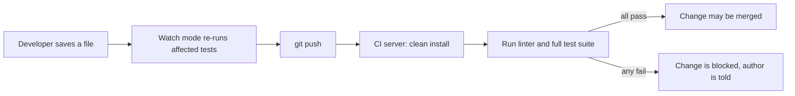

# Tools of the trade: runners, styles, coverage and CI

> **Before this lesson:** you have built a tiny runner with `test`, `expect`, `beforeEach` and suites in [Setup, teardown, suites and integration tests](#/lesson/js-testing/setup-suites-integration), and you know the TDD loop from [Test-driven development: red, green, refactor](#/lesson/js-testing/red-green-refactor). It helps to know what npm is ([Node.js: modules, streams and npm](#/lesson/javascript/node-core)).

## In plain words

So far you have used a twenty-line test runner written by hand. Real projects use ready-made tools that do the same job with many conveniences on top. This lesson is a map of that toolbox: which families of tools exist, how they differ, and what the surrounding machinery (coverage reports, headless browsers, continuous integration) is for.

Think of kitchen knives. A chef's knife from one maker and a chef's knife from another differ in handle and weight, but both cut, and someone who can use one can use the other after five minutes. Test frameworks are like that. They disagree about spelling (`test` or `it`, `assert.equal` or `expect().toBe`), but underneath every one of them does what your tiny runner does: collect test functions, call each one, catch what it throws, report.

Why it matters for a job: every codebase you join has already chosen its tools. You need to recognise them on sight, read their output, and know what a "coverage threshold" or "the CI is red" means in a team chat on your first day.

## The xUnit family

The oldest and most widespread design for test frameworks is known as **xUnit**. The name comes from a line of tools that began with SUnit for Smalltalk and JUnit for Java; the "x" stands for whichever language the copy was made for (JUnit, NUnit, PHPUnit, and many more). The design has five parts, all of which you have already met:

| xUnit concept | What it is | Your tiny runner |
|---|---|---|
| Test case | One function checking one behaviour | the function passed to `test` |
| Assertion | A check that throws on mismatch | `assertEqual`, `expect(...).toBe` |
| Fixture, with setup and teardown | Known starting state, built before and cleaned after each test | `beforeEach`, `afterEach` |
| Test suite | A group of test cases | `describe` |
| Test runner | Finds, runs, reports | the `try` / `catch` loop |

Classic xUnit assertions are plain functions that take the expected value first, then the actual value. Node.js ships an xUnit-flavoured toolkit in its standard library, so this runs with no installation at all:

```javascript
// basket.test.js
import { test, describe, beforeEach } from "node:test";
import assert from "node:assert/strict";
import { createBasket } from "./basket.js";

describe("basket", () => {
  let basket;
  beforeEach(() => { basket = createBasket(); });

  test("starts empty", () => {
    assert.equal(basket.count(), 0);
  });

  test("totals the prices", () => {
    basket.add("tea", 4);
    basket.add("mug", 6);
    assert.equal(basket.total(), 10);
    assert.deepEqual(basket.names(), ["tea", "mug"]);
  });
});
```

You run it with `node --test`. The output:

```text
▶ basket
  ✔ starts empty (0.6ms)
  ✔ totals the prices (0.2ms)
✔ basket (1.4ms)
ℹ tests 2
ℹ pass 2
ℹ fail 0
```

`assert.equal(a, b)` throws if the two values differ; `assert.deepEqual` compares contents of objects and arrays. With the `/strict` import both use strict comparison.

## Behaviour-driven style

A second tradition, **behaviour-driven development** (BDD), keeps the same machinery and changes the vocabulary. Its claim is that the word "test" makes people think about checking code after the fact, while words such as "should" and "it" make them think about *describing behaviour* before the code exists. In BDD style:

- a suite is introduced with `describe` and names the thing or the situation;
- each case is introduced with `it` and reads as a sentence: "it rejects an empty name";
- assertions read as sentences too: `expect(total).toBe(10)`.

```javascript
describe("basket", () => {
  describe("when empty", () => {
    it("has a total of zero", () => {
      expect(createBasket().total()).toBe(0);
    });
  });
});
```

In Jest and Vitest, `it` and `test` are the same function under two names; pick one per project. A heavier form of BDD writes scenarios in structured plain language, with lines starting *Given*, *When*, *Then*, and binds each line to code (the Cucumber tool does this). That form pays off when non-programmers read or write the scenarios; otherwise `describe` and `it` give most of the benefit.

Here is a runner that supports nested `describe` and `it`, to show how little is needed:

```js-run
const path = [];                               // names of the suites we are inside
let passed = 0, failed = 0;

function describe(name, body) {
  path.push(name);                             // enter the suite
  body();                                      // run its body, which calls it(...)
  path.pop();                                  // leave the suite
}

function it(name, fn) {
  const fullName = [...path, name].join(" > ");
  try { fn(); passed++; console.log("  ok    " + fullName); }
  catch (e) { failed++; console.log("  FAIL  " + fullName + "\n        " + e.message); }
}

function expect(actual) {
  return { toBe(expected) { if (actual !== expected) throw new Error("expected " + expected + ", got " + actual); } };
}

// ---- a specification written in BDD style ----
function clamp(n, low, high) { return Math.min(Math.max(n, low), high); }

describe("clamp", () => {
  describe("when the number is inside the range", () => {
    it("returns the number unchanged", () => expect(clamp(5, 0, 10)).toBe(5));
  });
  describe("when the number is outside the range", () => {
    it("returns the lower limit for small numbers", () => expect(clamp(-3, 0, 10)).toBe(0));
    it("returns the upper limit for large numbers", () => expect(clamp(42, 0, 10)).toBe(10));
  });
});

console.log(passed + " passed, " + failed + " failed");
```

`path` is a stack of suite names. `describe` pushes its name, runs the body, and pops the name again, so that `it` can build the full sentence from wherever it is called.

## Test runners, then and now

When test-driven JavaScript first became popular, around 2010, JavaScript ran almost only in browsers, and browsers disagreed with each other constantly. A test "runner" was often an HTML page: you opened it in each browser by hand and read a list of green and red lines. More advanced tools kept several real browsers open in the background, sent the tests to all of them from the command line, and collected the results. Running the same suite in six browsers mattered because one piece of code could behave in six ways.

Two things changed. Node.js let JavaScript run outside a browser, so tests could run from a terminal in milliseconds. And browsers converged on shared standards, so most logic no longer needs checking in each browser separately. Today's landscape:

| Tool | What it is | Typical use |
|---|---|---|
| **Vitest** | Runner built on the Vite build tool; Jest-compatible API; fast watch mode; native ES modules and TypeScript | New front-end and library projects |
| **Jest** | All-in-one runner with assertions, mocks, coverage and snapshots built in | A very large number of existing projects, React Native |
| **node:test** | Runner and assertions built into Node.js | Libraries and services that want zero dependencies |
| **Mocha** | A flexible runner only; you add an assertion library (Chai) and a mocking library (Sinon) | Older Node projects, custom setups |
| **Jasmine** | An early BDD framework; origin of `describe` / `it` / `expect` | Angular's historical default |
| **Playwright Test** | Runner that drives real browsers | End-to-end tests |

Because Vitest copied Jest's API on purpose, a test written for one usually runs on the other after changing the import line and replacing `jest.` with `vi.`. Learn one and you can read both.

A project wires its runner into the `scripts` section of `package.json`, the file that describes an npm project, so everyone starts tests the same way:

```json
{
  "scripts": {
    "test": "vitest run",
    "test:watch": "vitest",
    "test:coverage": "vitest run --coverage"
  }
}
```

`npm test` then runs the suite once; `npm run test:watch` keeps it running and re-tests on every save.

## Where the tests run: Node, simulated DOM, headless browser

Code that only computes values can be tested in plain Node. Code that touches a web page needs a `document`. There are two ways to provide one.

1. **A simulated DOM.** Libraries such as **jsdom** and **happy-dom** implement the browser's document model in JavaScript, inside Node. They are fast and good enough for most component tests. They do not lay out or paint anything, so they cannot tell you whether a button is visible or covered by another element.
2. **A real browser running headless.** A **headless browser** is a normal browser engine (Chromium, Firefox, WebKit) started without a visible window and controlled by a program. It behaves like the real thing because it is the real thing. Playwright controls headless browsers, and Vitest has a browser mode that runs unit tests inside one. This is slower to start but gives true rendering, real events and real network behaviour.

In Vitest you choose the environment in the configuration file:

```javascript
// vitest.config.js
import { defineConfig } from "vitest/config";

export default defineConfig({
  test: {
    environment: "jsdom",        // "node" is the default
  },
});
```

A common split: pure logic in the Node environment, components in jsdom, and a small set of full journeys in real browsers.

## Coverage

**Code coverage** measures which parts of the production code were executed while the tests ran. The runner **instruments** the code, which means it adds counters around each piece, runs the suite and reports the percentages.

| Metric | Question it answers |
|---|---|
| Statement / line coverage | Was this statement (or line) executed at least once? |
| Branch coverage | Was each outcome of every `if`, `? :`, `&&`, `||` taken? |
| Function coverage | Was each function called at least once? |

A typical report from `npx vitest run --coverage`:

```text
 % Coverage report from v8
------------|---------|----------|---------|---------|-------------------
File        | % Stmts | % Branch | % Funcs | % Lines | Uncovered Line #s
------------|---------|----------|---------|---------|-------------------
All files   |   91.66 |       75 |     100 |   91.66 |
 basket.js  |     100 |      100 |     100 |     100 |
 discount.js|   83.33 |       50 |     100 |   83.33 | 12
------------|---------|----------|---------|---------|-------------------
```

Line 12 of `discount.js` never ran, and half of its branches were never taken. That is a to-do item: some behaviour there has no test.

The block below instruments a function by hand so you can see where the numbers come from.

```js-run
const hits = new Set();                        // line labels that were executed
const mark = (label) => hits.add(label);
const ALL = ["L1", "L2", "L3", "L4"];

function shippingCost(total, isMember) {
  mark("L1"); let cost = 5;
  if (total >= 50) { mark("L2"); cost = 0; }
  if (isMember)    { mark("L3"); cost = Math.max(0, cost - 2); }
  mark("L4"); return cost;
}

// the "test suite": one test only
console.log("small order costs", shippingCost(20, false));

const missed = ALL.filter((label) => !hits.has(label));
console.log("line coverage: " + (hits.size / ALL.length * 100) + "%");
console.log("never executed: " + missed.join(", "));
```

One call covers half the lines. Add `shippingCost(60, true)` before the report and coverage reaches 100%. Now notice what coverage did **not** require: the second call has no assertion. The lines ran; nothing checked that the answer was right.

> [!WARNING]
> Coverage tells you what the tests **executed**, not what they **verified**. A suite with no assertions can reach 100% coverage. Low coverage is a reliable sign of missing tests; high coverage is not proof of good ones.

Sensible uses of coverage: find untested files and branches; set a modest **threshold** (a minimum percentage below which the run fails) to stop coverage from sliding backwards; look at the uncovered lines when reviewing a change. Chasing 100% leads to tests written to touch lines, not to check behaviour.

## Continuous testing: watch mode and CI

Tests help only if they run. Two mechanisms make that automatic.

**Locally: watch mode.** The runner stays open, notices saved files and re-runs the affected tests. Feedback arrives in a second or two without you asking.

**For the team: continuous integration.** **Continuous integration** (CI) is the practice of merging everyone's work frequently and having a server build the project and run the whole suite on every push. If any test fails, the change is marked red and is not merged. This catches "it works on my machine" problems, because the CI server starts from a clean copy every time.



A minimal GitHub Actions workflow that runs the tests on every push and pull request:

```yaml
# .github/workflows/test.yml
name: tests
on: [push, pull_request]
jobs:
  test:
    runs-on: ubuntu-latest
    steps:
      - uses: actions/checkout@v4
      - uses: actions/setup-node@v4
        with:
          node-version: 22
          cache: npm
      - run: npm ci
      - run: npm test
```

`npm ci` installs exactly the dependency versions recorded in the lock file; `npm test` runs the script shown earlier. If the command exits with a non-zero status code, which every runner does when a test fails, the job is red. The site's CI/CD track explains pipelines in depth; start with [A complete GitHub Actions pipeline, line by line](#/lesson/cicd/github-actions-workflow).

> [!TIP]
> In CI, use the run-once command (`vitest run`, `jest --ci`), never watch mode, or the job will wait for file changes until it times out.

> [!INTERVIEW]
> **"Jest or Vitest, and why?"** There is no single right answer; show you understand the trade-off. Vitest shares the project's Vite configuration, starts faster and handles ES modules and TypeScript without extra setup. Jest is mature, has a huge ecosystem and is already in place in many codebases, and migrating a working suite has a cost. The APIs are nearly identical, so the choice is about the build tooling around them.

## Common pitfalls

- **Treating the coverage number as a goal.** It is a flashlight for finding untested code, not a score.
- **Committing `test.only`.** One focused test silently disables the rest of the file. Many teams add a lint rule or use the runner's CI flag that fails the run when `.only` is present.
- **Assuming jsdom is a browser.** It has no layout: element sizes are zero and CSS visibility is mostly not computed. Tests about what the user can see or click belong in a real browser.
- **Mixing styles in one project.** Half the files using `test` with `assert.equal(expected, actual)` and half using `it` with `expect(actual)` invites swapped-argument mistakes.
- **A slow default command.** If `npm test` takes minutes, people stop running it before pushing. Keep unit tests in the default command and put slow suites behind a separate script.
- **Tests that pass locally and fail in CI.** Usual causes: reliance on local time zone, file order, leftover files, or a globally installed tool. A clean CI run is the reference.

## Cheat sheet

| Task | Vitest | Jest | node:test |
|---|---|---|---|
| Run once | `npx vitest run` | `npx jest` | `node --test` |
| Watch mode | `npx vitest` | `npx jest --watch` | `node --test --watch` |
| Filter by name | `npx vitest -t "basket"` | `npx jest -t "basket"` | `node --test --test-name-pattern="basket"` |
| Coverage | `npx vitest run --coverage` | `npx jest --coverage` | `node --test --experimental-test-coverage` |
| Equality | `expect(a).toBe(b)` | `expect(a).toBe(b)` | `assert.equal(a, b)` |
| Deep equality | `expect(a).toEqual(b)` | `expect(a).toEqual(b)` | `assert.deepEqual(a, b)` |
| Throws | `expect(fn).toThrow()` | `expect(fn).toThrow()` | `assert.throws(fn)` |
| Mock function | `vi.fn()` | `jest.fn()` | `mock.fn()` from `node:test` |
| DOM environment | `environment: "jsdom"` | `testEnvironment: "jsdom"` | add jsdom yourself |

## Summary

- xUnit frameworks share five parts: test case, assertion, fixture, suite and runner. BDD style keeps the parts and renames them to read as sentences.
- Runners moved from HTML pages in many browsers to fast command-line tools in Node: Vitest, Jest, node:test, Mocha.
- DOM code is tested in a simulated DOM (fast, no layout) or in a headless real browser (slower, faithful).
- Coverage shows which code ran during tests. It finds gaps; it does not measure test quality.
- Watch mode gives feedback while you type; CI runs the full suite on every push and blocks changes that fail.

## Glossary

- **xUnit**: the family of test frameworks descended from SUnit and JUnit, sharing the same five concepts.
- **Behaviour-driven development (BDD)**: a style of writing tests as sentences describing behaviour, using `describe` and `it`.
- **Test runner**: the program that discovers, executes and reports tests.
- **jsdom / happy-dom**: JavaScript implementations of the browser document model that run inside Node.
- **Headless browser**: a real browser engine running without a window, controlled by a program.
- **Code coverage**: the share of production code executed during the test run.
- **Instrumentation**: counters added to code so that execution can be measured.
- **Branch coverage**: whether every outcome of each decision point was taken.
- **Threshold**: a minimum coverage percentage that fails the run if not met.
- **Continuous integration (CI)**: automatically building and testing every pushed change on a shared server.
- **Lock file**: the file recording the exact dependency versions to install.

## Check yourself

```quiz
[
  {"q": "Which list names the five core concepts shared by xUnit-style frameworks?",
   "options": ["Compiler, linker, loader, debugger, profiler", "Test case, assertion, fixture with setup and teardown, suite, runner", "Mock, stub, spy, fake, dummy", "Red, green, refactor, commit, push"],
   "answer": 1,
   "explain": "Every xUnit descendant provides test cases, assertions, fixtures managed by setup and teardown, suites and a runner."},
  {"q": "In Jest and Vitest, what is the difference between it('...') and test('...')?",
   "options": ["it runs in a browser, test runs in Node", "None; they are two names for the same function", "it cannot use beforeEach", "test is asynchronous, it is not"],
   "answer": 1,
   "explain": "They are aliases. it reads well inside describe blocks in BDD style; choose one per project."},
  {"q": "A suite calls every function in a module but contains no assertions at all. What does the coverage report most likely show, and do the tests pass?",
   "options": ["0% coverage, tests fail", "High coverage and all tests pass, although nothing is verified", "High coverage, tests fail", "Coverage cannot be measured without assertions"],
   "answer": 1,
   "explain": "Coverage counts executed code. With no assertions nothing can throw, so every test passes for the wrong reason while coverage looks excellent."},
  {"q": "A function contains: if (isMember) { cost -= 2; }. Tests only ever call it with isMember = true. Line coverage is 100%. What about branch coverage?",
   "options": ["Also 100%", "Below 100%, because the outcome where the condition is false was never taken", "0%", "Branch coverage does not apply to if statements"],
   "answer": 1,
   "explain": "Every line ran, but the if has two outcomes and only one was exercised. Branch coverage exposes the untested path."},
  {"q": "You need to check that a dropdown menu is not hidden behind another element. Which environment can answer that?",
   "options": ["Plain Node", "jsdom, because it implements the DOM", "A real browser, for example headless Chromium driven by Playwright", "Any of them"],
   "answer": 2,
   "explain": "jsdom does no layout or painting, so it cannot know what overlaps what. Only a real rendering engine can."},
  {"q": "A CI job runs the command 'vitest' (without 'run'). What happens?",
   "options": ["It runs once and exits", "It starts watch mode and waits for file changes until the job times out", "It only runs failed tests", "It skips coverage"],
   "answer": 1,
   "explain": "Without run (or a detected CI environment) Vitest stays in watch mode. CI must use the run-once command."},
  {"q": "A developer commits a file containing test.only(...). The file has 40 tests. CI is green. Why is that dangerous?",
   "options": ["test.only is slower", "Only one test in that file ran; the other 39 were silently skipped, so green means much less than it appears", "CI cannot run focused tests", "It doubles the coverage"],
   "answer": 1,
   "explain": "A focused test disables its siblings. The suite passes while most of the file is no longer being checked."}
]
```

> **Source:** Johansen, *Test-Driven JavaScript Development*, ch. 3 (Tools of the Trade). Docs: https://vitest.dev/guide/ , https://vitest.dev/guide/coverage , https://jestjs.io/docs/getting-started , https://nodejs.org/api/test.html , https://playwright.dev/docs/intro
