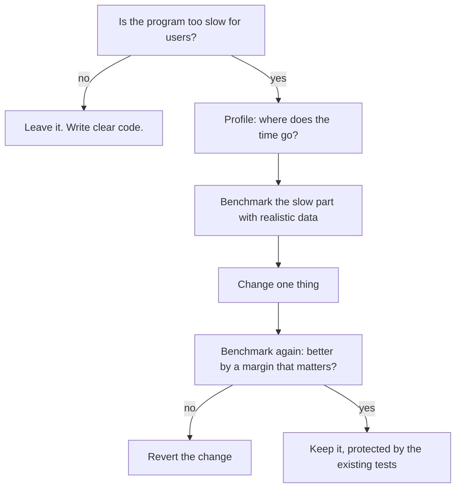

# Test to learn: learning tests and honest benchmarks

> **Before this lesson:** you can write tests with `test` and `expect` ([Why automate tests: your first unit test](#/lesson/js-testing/first-unit-test)) and you know the common array and string methods ([Objects, arrays and mutability](#/lesson/javascript/objects-arrays), [Higher-order functions: map, filter, reduce](#/lesson/javascript/higher-order-functions)).

## In plain words

Tests are usually described as a way to check code *you* wrote. They are just as useful for checking your **understanding** of code somebody else wrote: the JavaScript language itself, a built-in method, a library you have installed. You write down what you *believe* a function does as a test, run it, and the computer tells you whether your belief is true. A test written for this purpose is called a **learning test**.

Think of a scientist. A scientist does not settle a question by arguing or by remembering what a textbook said ten years ago. They state a prediction ("this liquid will boil at 78 degrees"), run the experiment, and write the result in a lab notebook that others can check and repeat. A learning test is a prediction plus an experiment plus a notebook entry, all in six lines.

The second half of this lesson applies the same scientific attitude to speed. A **benchmark** is an experiment that measures how long code takes. Benchmarks are easy to get badly wrong, and wrong numbers lead to slower, uglier code written in the name of "performance".

Why it matters for a job: you will spend a great deal of your working life using APIs you only half know. Engineers who verify with a two-minute experiment make fewer wrong assumptions than those who guess, and in interviews "I would write a quick test to confirm" is a strong answer when you are unsure of a detail.

## Learning tests: predict, run, record

Here is the method.

1. **Predict.** Write a test that states what you think the result is.
2. **Run.** If it passes, your mental model was right and you now have proof. If it fails, you have learned something, and the failure message shows the real behaviour.
3. **Record.** Correct the test to match reality, give it a name that states the lesson, and keep it.

Let us use it on a question that trips up many developers: what does `sort()` do to an array of numbers?

```js-run
// --- the tiny test runner from lesson 1 ---
function test(name, fn) {
  try { fn(); console.log("PASS  " + name); }
  catch (e) { console.log("FAIL  " + name + "\n      -> " + e.message); }
}
function expect(actual) {
  const show = (v) => typeof v === "function" ? "[function]" : JSON.stringify(v);
  const fail = (msg) => { throw new Error(msg); };
  return {
    toBe(expected) {
      if (!Object.is(actual, expected)) fail("expected " + show(expected) + " but got " + show(actual));
    },
    toEqual(expected) {
      if (JSON.stringify(actual) !== JSON.stringify(expected)) fail("expected " + show(expected) + " but got " + show(actual));
    },
    toThrow(text = "") {
      try { actual(); } catch (e) {
        if (!String(e.message).includes(text)) fail("threw the wrong error: " + e.message);
        return;
      }
      fail("expected the function to throw, but it returned normally");
    },
  };
}
// --- end of runner ---

test("sort() puts numbers in ascending order", () => {
  expect([10, 9, 1, 100].sort()).toEqual([1, 9, 10, 100]);
});
```

It fails: `expected [1,9,10,100] but got [1,10,100,9]`. The prediction was wrong. With no argument, `sort` converts every element to a string and orders the strings alphabetically, character by character, so `"100"` comes before `"9"` because `"1"` comes before `"9"`. Now we record what we learned as passing tests whose names state the facts:

```js-run
// --- the tiny test runner from lesson 1 ---
function test(name, fn) {
  try { fn(); console.log("PASS  " + name); }
  catch (e) { console.log("FAIL  " + name + "\n      -> " + e.message); }
}
function expect(actual) {
  const show = (v) => typeof v === "function" ? "[function]" : JSON.stringify(v);
  const fail = (msg) => { throw new Error(msg); };
  return {
    toBe(expected) {
      if (!Object.is(actual, expected)) fail("expected " + show(expected) + " but got " + show(actual));
    },
    toEqual(expected) {
      if (JSON.stringify(actual) !== JSON.stringify(expected)) fail("expected " + show(expected) + " but got " + show(actual));
    },
    toThrow(text = "") {
      try { actual(); } catch (e) {
        if (!String(e.message).includes(text)) fail("threw the wrong error: " + e.message);
        return;
      }
      fail("expected the function to throw, but it returned normally");
    },
  };
}
// --- end of runner ---

test("sort() with no argument compares elements as strings", () => {
  expect([10, 9, 1, 100].sort()).toEqual([1, 10, 100, 9]);
});

test("sort((a, b) => a - b) orders numbers numerically", () => {
  expect([10, 9, 1, 100].sort((a, b) => a - b)).toEqual([1, 9, 10, 100]);
});

test("sort() changes the original array and returns that same array", () => {
  const original = [3, 1, 2];
  const returned = original.sort();
  expect(returned).toBe(original);          // same object, not a copy
  expect(original).toEqual([1, 2, 3]);      // the original was reordered
});

test("toSorted() returns a new array and leaves the original alone", () => {
  const original = [3, 1, 2];
  const sorted = original.toSorted();
  expect(original).toEqual([3, 1, 2]);
  expect(sorted).toEqual([1, 2, 3]);
});
```

Line by line in the third test: `original.sort()` sorts **in place**, meaning it rearranges the array it was called on. `expect(returned).toBe(original)` checks identity: the returned value is the very same array object. The fourth test records that the newer `toSorted` method makes a copy instead.

Four facts, each verified, each with a name you can search for later. Compare that with a note in a text file saying "sort is weird with numbers": the note can be wrong, and nothing will ever tell you.

## A small collection of surprises

Each of these is a real source of bugs. Before you run the block, cover the expected values and predict them.

```js-run
// --- the tiny test runner from lesson 1 ---
function test(name, fn) {
  try { fn(); console.log("PASS  " + name); }
  catch (e) { console.log("FAIL  " + name + "\n      -> " + e.message); }
}
function expect(actual) {
  const show = (v) => typeof v === "function" ? "[function]" : JSON.stringify(v);
  const fail = (msg) => { throw new Error(msg); };
  return {
    toBe(expected) {
      if (!Object.is(actual, expected)) fail("expected " + show(expected) + " but got " + show(actual));
    },
    toEqual(expected) {
      if (JSON.stringify(actual) !== JSON.stringify(expected)) fail("expected " + show(expected) + " but got " + show(actual));
    },
    toThrow(text = "") {
      try { actual(); } catch (e) {
        if (!String(e.message).includes(text)) fail("threw the wrong error: " + e.message);
        return;
      }
      fail("expected the function to throw, but it returned normally");
    },
  };
}
// --- end of runner ---

test("months in new Date(year, month, day) start at 0", () => {
  const d = new Date(2024, 0, 31);              // month 0 is January
  expect(d.getMonth()).toBe(0);
  expect(new Date(2024, 1, 1).getMonth()).toBe(1);   // month 1 is February
});

test("a day number past the end of the month rolls over", () => {
  const d = new Date(2023, 1, 30);              // 30 February 2023 does not exist
  expect([d.getMonth(), d.getDate()]).toEqual([2, 2]);   // it becomes 2 March
});

test("parseInt stops at the first character that is not a digit", () => {
  expect(parseInt("42px")).toBe(42);
  expect(Number("42px")).toBe(NaN);             // Number() rejects the whole string
});

test("JSON.stringify leaves out properties whose value is undefined", () => {
  expect(JSON.stringify({ a: 1, b: undefined })).toBe('{"a":1}');
});

test("typeof null is 'object'", () => {
  expect(typeof null).toBe("object");
});

test("splitting an empty string gives one empty string, not an empty array", () => {
  expect("".split(",")).toEqual([""]);
});

test("map passes the index as a second argument, which parseInt reads as a radix", () => {
  expect(["10", "10", "10"].map(parseInt)).toEqual([10, NaN, 2]);
});
```

The last one deserves an explanation because it is a classic interview puzzle. `map` calls its callback with three arguments: the element, its index, and the whole array. `parseInt` takes a second argument, the **radix**, which is the number base to read the digits in. So the calls are `parseInt("10", 0)` (radix 0 means "decide automatically", giving 10), `parseInt("10", 1)` (base 1 is invalid, giving `NaN`) and `parseInt("10", 2)` (binary `10` is 2). A thirty-second learning test replaces ten minutes of confused debugging.

## Learning tests for libraries

The same technique works on third-party code. When you adopt a library, write a few tests against the parts you rely on, using *its* real functions:

```javascript
// learning/date-fns.learning.test.js
import { test, expect } from "vitest";
import { addMonths, format } from "date-fns";

test("addMonths clamps to the last day of a shorter month", () => {
  const result = addMonths(new Date(2024, 0, 31), 1);     // 31 January + 1 month
  expect(format(result, "yyyy-MM-dd")).toBe("2024-02-29");
});
```

```text
 ✓ learning/date-fns.learning.test.js (1 test) 4ms
   ✓ addMonths clamps to the last day of a shorter month
```

This buys you three things:

- **You learn by doing**, in a safe place away from your application code.
- **You get an early warning on upgrades.** When you later install a new major version of the library, run the learning tests. If the library changed a behaviour you depend on, a test fails on the day of the upgrade, and not in production three weeks later.
- **You document your assumptions** for teammates, in executable form.

Keep learning tests in their own folder and keep them few: cover what your code depends on, not the whole library. The library's authors have their own suite.

## Reproducing a bug is a learning test too

When a bug is reported, the first job is to understand it, and the most reliable way is to capture it in a failing test *before* touching the code.

```javascript
test("bug #214: the total is wrong when the basket holds the same item twice", () => {
  const basket = createBasket();
  basket.add("tea", 4);
  basket.add("tea", 4);
  expect(basket.total()).toBe(8);
});
```

```text
FAIL  bug #214: the total is wrong when the basket holds the same item twice
      -> expected 8 but got 4
```

Now the bug is pinned down. You know you have reproduced it (red), you will know the moment it is fixed (green), and it can never return unnoticed, because the test stays in the suite as a regression test.

> [!TIP]
> If you cannot make a test fail in the way the bug report describes, you have not understood the bug yet. Do not start "fixing" until the test is red for the right reason.

## Benchmarks: measuring speed without fooling yourself

Sooner or later someone claims "a `for` loop is faster than `forEach`" or "string concatenation is slow". Such claims go out of date as JavaScript engines improve, and many were never true for realistic code. The honest response is to measure. A careless measurement, however, is worse than none, because it gives a wrong answer with a number attached.

The measuring tool is `performance.now()`, a clock that returns the time in milliseconds with sub-millisecond precision. The naive benchmark reads the clock, runs the code once, and reads the clock again. It is wrong for five reasons.

1. **Warm-up.** JavaScript engines start by interpreting code and compile the hot parts to fast machine code after they have run many times. This is **just-in-time compilation** (JIT). The first runs are far slower than later ones. Run the code many times before you start timing.
2. **Noise.** Other programs, garbage collection (the engine pausing to free unused memory) and the operating system all steal time at random. One measurement is an anecdote. Take many samples and summarise them.
3. **Clock resolution.** Browsers deliberately make timers coarse for security reasons. A single fast operation measures as zero. Time a large batch of operations and divide.
4. **Dead-code elimination.** If the engine notices that a result is never used, it may skip the computation entirely, and you measure an empty loop. Use the result: add it to a running total that you read at the end.
5. **Unrealistic input.** An algorithm that wins on 10 items can lose on 10,000, and the reverse. Measure with the sizes your program really handles.

A harness that respects those rules:

```js-run
function bench(name, fn, { samples = 15, batch = 200 } = {}) {
  let sink = 0;                                    // 4. use every result
  for (let i = 0; i < batch; i++) sink += fn();    // 1. warm-up, not timed
  const times = [];
  for (let s = 0; s < samples; s++) {              // 2. many samples
    const start = performance.now();
    for (let i = 0; i < batch; i++) sink += fn();  // 3. a batch per sample
    times.push((performance.now() - start) / batch);
  }
  times.sort((a, b) => a - b);
  const median = times[Math.floor(times.length / 2)];
  console.log(name.padEnd(22) + (median * 1000).toFixed(2) + " microseconds per call   (sum of results " + sink + ")");
  return median;
}

const words = Array.from({ length: 2000 }, (_, i) => "word" + i);   // 5. realistic size

function withConcat() {
  let text = "";
  for (const w of words) text += w + " ";
  return text.length;
}
function withJoin() {
  return (words.join(" ") + " ").length;
}

const a = bench("concat in a loop", withConcat);
const b = bench("array join", withJoin);
console.log("ratio: " + (a / b).toFixed(1) + " to 1");
```

Reading the harness: `sink` collects every return value so the engine cannot discard the work. The first loop warms the code up. Each sample times a batch of 200 calls and stores the average per call. We report the **median**, the middle value after sorting, because it ignores the occasional sample ruined by a pause; an average would be dragged up by one bad sample.

Run it several times. The absolute numbers change between runs and between machines. The *ratio* is more stable, and the ratio is what answers the question "which is faster here?".

Were you expecting `join` to win? Many developers are, because "never build strings with `+=` in a loop" was sound advice for the engines of fifteen years ago. On a current V8 engine (the one inside Chrome and Node) the loop with `+=` is usually the faster of the two for this input, because the engine now represents a growing string as a cheap chain of pieces. Folklore about performance has a short shelf life, which is the whole argument for measuring.

### Before you benchmark at all



- **Measure the whole program first.** A **profiler** (built into browser developer tools and into Node via `node --cpu-prof`) records where time is spent while the real program runs. Most of the time is usually spent in a small part of the code, and it is rarely the part you would have guessed.
- **Algorithm before micro-tuning.** Replacing a loop inside a loop (work that grows with the square of the input size) with a single pass and a `Map` can be a thousand times faster. Swapping `forEach` for `for` rarely changes anything a user could notice.
- **Keep the tests green.** An optimisation is a refactoring: same behaviour, different structure. Your unit tests tell you whether the faster version is still correct.

Real tools exist so you do not maintain your own harness. Vitest has a benchmark mode built on the tinybench library:

```javascript
// join.bench.js
import { bench, describe } from "vitest";

const words = Array.from({ length: 2000 }, (_, i) => "word" + i);

describe("building a sentence", () => {
  bench("concat in a loop", () => {
    let text = "";
    for (const w of words) text += w + " ";
  });
  bench("array join", () => {
    words.join(" ");
  });
});
```

Run with `npx vitest bench`. It reports operations per second with a margin of error for each case and says which is fastest:

```text
 ✓ join.bench.js > building a sentence
     name                     hz      mean     rme   samples
   · concat in a loop   44,870.52   0.0223  ±0.91%   22436   fastest
   · array join         27,310.08   0.0366  ±1.07%   13656
```

`hz` is calls per second; `rme` is the relative margin of error. If two results differ by less than their margins, treat them as equal.

> [!WARNING]
> Do not put strict timing assertions such as `expect(elapsed).toBeLessThan(5)` in a unit test suite. CI machines are shared and vary in speed, so such tests fail at random. Track performance with dedicated benchmark runs and compare trends, or assert on something countable, such as "the function called the database once, not once per item".

> [!INTERVIEW]
> **"Which is faster, X or Y?"** The mature answer: "It depends on the engine and the data, so I would measure with realistic input: warm up, take many samples, compare medians, and first confirm with a profiler that this code is the bottleneck at all." Then mention that algorithmic complexity usually matters more than syntax-level choices.

## Common pitfalls

- **Keeping a failed prediction as a failing test.** A learning test's final form must pass. Update it to record the real behaviour, and rename it to state the fact.
- **Learning tests that restate the documentation for everything.** Test what you depend on or what surprised you.
- **Timing one run.** A single run mostly measures warm-up and noise.
- **Benchmarking code whose result is thrown away.** You may be timing nothing.
- **Tiny inputs.** Three-element arrays say nothing about three thousand.
- **Comparing numbers from different machines or different days.** Compare two variants in the same run.
- **Optimising before profiling.** You will speed up code that was never the problem and make it harder to read.

## Cheat sheet

| Goal | Tool or technique |
|---|---|
| Check what a built-in does | A learning test: predict, run, record |
| Protect against library upgrades | Learning tests on the functions you depend on |
| Understand a bug | A failing test that reproduces it, kept as a regression test |
| High-resolution clock | `performance.now()` (milliseconds, fractional) |
| Avoid JIT distortion | Warm-up runs before timing |
| Avoid noise | Many samples; report the median |
| Avoid dead-code elimination | Use every result (accumulate into a variable you print) |
| Ready-made benchmarks | `bench()` with `npx vitest bench`; the tinybench library |
| Find the real bottleneck | Browser Performance panel; `node --cpu-prof app.js` |
| Count instead of time | Assert call counts with a mock function |

## Summary

- A learning test states a belief about a language feature or library as a test. Passing confirms it; failing teaches you the truth.
- Keep learning tests for the library behaviour you rely on; they warn you when an upgrade changes it.
- Reproduce every bug as a failing test before fixing it.
- Benchmarks need warm-up, many samples, a robust summary such as the median, used results and realistic input.
- Profile before optimising, prefer better algorithms to micro-tuning, and let the existing tests protect behaviour while you change the code.

## Glossary

- **Learning test**: a test written to discover or confirm how existing code behaves.
- **In place**: changing the original value instead of returning a changed copy.
- **Radix**: the number base (2 for binary, 10 for decimal) used to interpret digits.
- **Benchmark**: an experiment that measures the running time of code.
- **Just-in-time compilation (JIT)**: the engine compiling frequently run code to machine code while the program runs.
- **Warm-up**: running code repeatedly before measuring so that it has been compiled.
- **Garbage collection**: the engine's automatic freeing of memory that is no longer used.
- **Dead-code elimination**: an optimisation that removes computations whose results are never used.
- **Median**: the middle value of a sorted list of measurements.
- **Profiler**: a tool that records where a running program spends its time.

## Check yourself

```quiz
[
  {"q": "expect([10, 9, 1, 100].sort()).toEqual([1, 9, 10, 100]). Pass or fail?",
   "options": ["Pass", "Fail: the result is [1, 10, 100, 9] because the default sort compares elements as strings", "Fail: sort returns undefined", "Fail: sort cannot be called without a comparison function"],
   "answer": 1,
   "explain": "Without a comparison function, elements are converted to strings and ordered alphabetically, so '100' sorts before '9'."},
  {"q": "A learning test's prediction turns out to be wrong. What is the correct final state of that test?",
   "options": ["Left failing as a reminder", "Deleted", "Updated to assert the real behaviour, renamed to state the fact, and kept passing", "Marked with test.skip forever"],
   "answer": 2,
   "explain": "The value is the recorded, verified fact. A permanently failing or skipped test records nothing and trains people to ignore red."},
  {"q": "Why keep learning tests for a third-party library in your repository?",
   "options": ["To raise the coverage percentage", "They fail when an upgrade changes behaviour you depend on, on the day of the upgrade", "The library has no tests of its own", "They make the library faster"],
   "answer": 1,
   "explain": "They encode your assumptions about the library. Running them after an upgrade shows at once whether those assumptions still hold."},
  {"q": "expect(['10', '10', '10'].map(parseInt)).toEqual([10, 10, 10]). Pass or fail?",
   "options": ["Pass", "Fail: map passes the index as the second argument, which parseInt treats as the radix, giving [10, NaN, 2]", "Fail: map cannot take a built-in function", "Fail: the result is ['10', '10', '10']"],
   "answer": 1,
   "explain": "The calls are parseInt('10', 0), parseInt('10', 1) and parseInt('10', 2). Radix 1 is invalid and radix 2 reads binary."},
  {"q": "A benchmark times a single call to each of two functions and reports that the first is 4 times slower. What is the main flaw?",
   "options": ["performance.now is inaccurate", "One cold run mostly measures warm-up and random noise, not steady-state speed", "Functions cannot be timed", "The result must be divided by 1000"],
   "answer": 1,
   "explain": "Without warm-up and repeated samples, JIT compilation and background noise dominate. The first function measured often pays extra start-up costs too."},
  {"q": "Why does the bench harness add every return value to a variable that is printed at the end?",
   "options": ["To make the benchmark slower", "So the engine cannot remove the computation as unused, which would leave an empty loop being timed", "To check correctness of the function", "Because performance.now requires it"],
   "answer": 1,
   "explain": "Engines may eliminate work whose result is never observed. Using the result keeps the measured work real."},
  {"q": "A unit test asserts expect(elapsedMs).toBeLessThan(5) around a function call. It passes on the author's laptop. What is likely to happen in CI?",
   "options": ["It always passes", "It fails intermittently, because shared CI machines vary in speed", "It is skipped automatically", "It fails every time by design"],
   "answer": 1,
   "explain": "Wall-clock assertions depend on the machine and its load. They produce flaky failures; measure performance in dedicated benchmark runs instead."},
  {"q": "A page feels slow. What should happen first?",
   "options": ["Rewrite every forEach as a for loop", "Profile the running program to find where the time is spent", "Add a benchmark for string concatenation", "Raise the coverage threshold"],
   "answer": 1,
   "explain": "Without a profile you are guessing. Time is usually concentrated in a small part of the code, often not the part you expect."}
]
```

> **Source:** Johansen, *Test-Driven JavaScript Development*, ch. 4 (Test to Learn). Docs: https://vitest.dev/guide/features#benchmarking , https://developer.mozilla.org/en-US/docs/Web/API/Performance/now , https://developer.mozilla.org/en-US/docs/Web/JavaScript/Reference/Global_Objects/Array/sort
