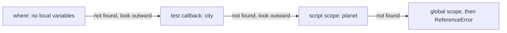

# Functions under test: declarations, arguments, scope and `this`

> **Before this lesson:** you have met functions and scope in [Functions and scope](#/lesson/javascript/functions-scope), and you know the learning-test method (predict, run, record) from [Test to learn: learning tests and honest benchmarks](#/lesson/js-testing/learning-tests-benchmarks). This lesson revisits functions with a new goal: every claim is backed by a test you can run.

## In plain words

A **function** is a reusable set of instructions with a name: you hand it some inputs, it does its work, and it hands back a result. Functions are the main building block of JavaScript programs, and they are also the main thing you test. To test them well you need to know precisely how they behave in four areas where JavaScript differs from many other languages: how functions are *created*, how they receive *arguments*, which variables they can *see* (scope), and what the keyword `this` means inside them.

Think of a function as a recipe card. The card lists the ingredients it expects (parameters) and the steps. Cooking the recipe is *calling* the function. Two things about the kitchen matter a great deal: which cupboards the cook is allowed to open (scope), and whose kitchen the cook is standing in while cooking (`this`). The same recipe cooked in a different kitchen can turn out differently, and that second point surprises nearly everyone who learns JavaScript.

Why it matters for a job: "what does `this` refer to here?" and "what does this snippet print?" are among the most frequent JavaScript interview questions, and lost `this` values are a common real bug in event handlers and callbacks. Instead of memorising rules, we will prove each rule with a small test, which is how you should settle such questions for the rest of your career.

## Three ways to create a function

```js-run
// --- the tiny test runner from lesson 1 ---
function test(name, fn) {
  try { fn(); console.log("PASS  " + name); }
  catch (e) { console.log("FAIL  " + name + "\n      -> " + e.message); }
}
function expect(actual) {
  const show = (v) => typeof v === "function" ? "[function]" : JSON.stringify(v);
  const fail = (msg) => { throw new Error(msg); };
  return {
    toBe(expected) {
      if (!Object.is(actual, expected)) fail("expected " + show(expected) + " but got " + show(actual));
    },
    toEqual(expected) {
      if (JSON.stringify(actual) !== JSON.stringify(expected)) fail("expected " + show(expected) + " but got " + show(actual));
    },
    toThrow(text = "") {
      try { actual(); } catch (e) {
        if (!String(e.message).includes(text)) fail("threw the wrong error: " + e.message);
        return;
      }
      fail("expected the function to throw, but it returned normally");
    },
  };
}
// --- end of runner ---

test("a function declaration can be called before the line that defines it", () => {
  expect(double(4)).toBe(8);           // works: declarations are hoisted
  function double(n) { return n * 2; }
});

test("a function expression in a const cannot be used before its line", () => {
  expect(() => {
    triple(4);                         // too early
    const triple = function (n) { return n * 3; };
  }).toThrow();                         // a ReferenceError
});

test("an arrow function is an expression with a shorter syntax", () => {
  const square = (n) => n * n;         // one expression: its value is returned
  expect(square(5)).toBe(25);
});

test("functions are values: they can be stored and passed around", () => {
  const operations = { add: (a, b) => a + b };
  const apply = (fn, x, y) => fn(x, y);
  expect(apply(operations.add, 2, 3)).toBe(5);
});
```

What each test establishes:

- A **function declaration** starts a statement with the word `function` and a name. JavaScript processes all declarations in a scope before running any code in it, an effect called **hoisting** (the declaration behaves as if lifted to the top). That is why the call on the line above the definition works.
- A **function expression** creates a function as a value in the middle of an expression, usually to store it in a variable. The variable follows the normal rules for `const` and `let`: using it before its line throws a `ReferenceError`. The stretch of code between the start of the block and the declaration line is known as the **temporal dead zone**.
- An **arrow function** (`=>`) is a compact function expression. With a single expression after the arrow, that expression's value is returned without writing `return`. Arrow functions also treat `this` differently, as you will see below.
- Functions are **first-class values**: they can be assigned, stored in objects and arrays, passed as arguments and returned. This is what makes callbacks, test functions and mock functions possible; `test(name, fn)` itself relies on it.

## Arguments: what a function really receives

JavaScript does not check that a call supplies the number of arguments the function declares. Missing ones are `undefined`; extra ones are still delivered.

```js-run
// --- the tiny test runner from lesson 1 ---
function test(name, fn) {
  try { fn(); console.log("PASS  " + name); }
  catch (e) { console.log("FAIL  " + name + "\n      -> " + e.message); }
}
function expect(actual) {
  const show = (v) => typeof v === "function" ? "[function]" : JSON.stringify(v);
  const fail = (msg) => { throw new Error(msg); };
  return {
    toBe(expected) {
      if (!Object.is(actual, expected)) fail("expected " + show(expected) + " but got " + show(actual));
    },
    toEqual(expected) {
      if (JSON.stringify(actual) !== JSON.stringify(expected)) fail("expected " + show(expected) + " but got " + show(actual));
    },
    toThrow(text = "") {
      try { actual(); } catch (e) {
        if (!String(e.message).includes(text)) fail("threw the wrong error: " + e.message);
        return;
      }
      fail("expected the function to throw, but it returned normally");
    },
  };
}
// --- end of runner ---

function describeCall(a, b) {
  return { a: a, b: b, received: arguments.length };
}

test("missing arguments are undefined, and the call does not fail", () => {
  expect(describeCall(1)).toEqual({ a: 1, b: undefined, received: 1 });
});

test("extra arguments are accepted and counted", () => {
  expect(describeCall(1, 2, 3, 4).received).toBe(4);
});

test("fn.length is the number of declared parameters, not passed arguments", () => {
  expect(describeCall.length).toBe(2);
});

test("a default value fills in for undefined only", () => {
  const greet = (name = "stranger") => "Hello, " + name;
  expect(greet()).toBe("Hello, stranger");
  expect(greet(undefined)).toBe("Hello, stranger");
  expect(greet(null)).toBe("Hello, null");       // null is a value; no default
});

test("a rest parameter gathers remaining arguments into a real array", () => {
  const sum = (first, ...others) => first + others.reduce((t, n) => t + n, 0);
  expect(sum(1, 2, 3, 4)).toBe(10);
});
```

- `arguments` is an array-like object, available inside every non-arrow function, that holds everything the caller passed. It has a `length` and numbered entries but lacks array methods such as `map`. It is the older mechanism.
- A **rest parameter** (`...others`) is the modern replacement: a genuine array of "all the remaining arguments". Prefer it.
- A **default parameter** (`name = "stranger"`) is used when the argument is missing or `undefined`. The test proves that `null` does not trigger it, a detail that causes real bugs when data comes from a server.

Because nothing is checked for you, functions that need valid input should check it themselves, and you should write a test for what happens when a caller gets it wrong.

## Scope: which variables a function can see

**Scope** is the region of the program in which a variable name is usable. JavaScript decides scope by *where the code is written*, not by where it is called from. This is called **lexical scope** ("lexical" means "to do with the text").

```js-run
// --- the tiny test runner from lesson 1 ---
function test(name, fn) {
  try { fn(); console.log("PASS  " + name); }
  catch (e) { console.log("FAIL  " + name + "\n      -> " + e.message); }
}
function expect(actual) {
  const show = (v) => typeof v === "function" ? "[function]" : JSON.stringify(v);
  const fail = (msg) => { throw new Error(msg); };
  return {
    toBe(expected) {
      if (!Object.is(actual, expected)) fail("expected " + show(expected) + " but got " + show(actual));
    },
    toEqual(expected) {
      if (JSON.stringify(actual) !== JSON.stringify(expected)) fail("expected " + show(expected) + " but got " + show(actual));
    },
    toThrow(text = "") {
      try { actual(); } catch (e) {
        if (!String(e.message).includes(text)) fail("threw the wrong error: " + e.message);
        return;
      }
      fail("expected the function to throw, but it returned normally");
    },
  };
}
// --- end of runner ---

const planet = "Earth";                       // outer scope

test("inner functions can read variables from enclosing scopes", () => {
  const city = "Oslo";
  function where() { return city + ", " + planet; }
  expect(where()).toBe("Oslo, Earth");
});

test("a variable declared inside a function is invisible outside it", () => {
  function makeSecret() { const secret = 42; return secret; }
  makeSecret();
  expect(typeof secret).toBe("undefined");    // no such name out here
});

test("let and const are scoped to the nearest pair of braces", () => {
  let seen = "outer";
  if (true) {
    let seen = "inner";                       // a different variable
    expect(seen).toBe("inner");
  }
  expect(seen).toBe("outer");
});

test("var ignores block braces and belongs to the whole function", () => {
  if (true) { var leaked = "still here"; }
  expect(leaked).toBe("still here");
});

test("scope follows where a function is written, not where it is called", () => {
  const label = "defined here";
  const show = () => label;
  function callElsewhere(fn) { const label = "called here"; return fn(); }
  expect(callElsewhere(show)).toBe("defined here");
});
```

Each time a function is called, the engine creates an **execution context**: a record holding that call's parameters and local variables, a link to the scope the function was written in, and its `this` value. When code uses a name, the engine looks in the current context first, then follows the link outward, scope by scope, until it reaches the global scope. That series of links is the **scope chain**.



The last test is the important one. `show` was written where `label` is `"defined here"`, so that is the variable it sees, even though it is called inside a function with its own `label`.

## `this`: decided by how a function is called

Inside a function, `this` is a special value that normally refers to "the object this function was called on". Unlike ordinary variables, `this` is **not** looked up through the scope chain. For regular functions it is set fresh at each call, by the *form of the call*. There are four call forms plus one exception.

```js-run
// --- the tiny test runner from lesson 1 ---
function test(name, fn) {
  try { fn(); console.log("PASS  " + name); }
  catch (e) { console.log("FAIL  " + name + "\n      -> " + e.message); }
}
function expect(actual) {
  const show = (v) => typeof v === "function" ? "[function]" : JSON.stringify(v);
  const fail = (msg) => { throw new Error(msg); };
  return {
    toBe(expected) {
      if (!Object.is(actual, expected)) fail("expected " + show(expected) + " but got " + show(actual));
    },
    toEqual(expected) {
      if (JSON.stringify(actual) !== JSON.stringify(expected)) fail("expected " + show(expected) + " but got " + show(actual));
    },
    toThrow(text = "") {
      try { actual(); } catch (e) {
        if (!String(e.message).includes(text)) fail("threw the wrong error: " + e.message);
        return;
      }
      fail("expected the function to throw, but it returned normally");
    },
  };
}
// --- end of runner ---

function whoAmI() { "use strict"; return this; }
const robot = { name: "Bolt", whoAmI: whoAmI };

test("1. called as a method: this is the object before the dot", () => {
  expect(robot.whoAmI()).toBe(robot);
});

test("2. called plainly: this is undefined in strict mode", () => {
  const loose = robot.whoAmI;          // copy the function out of the object
  expect(loose()).toBe(undefined);     // no object before the dot any more
});

test("3. called with call or apply: this is whatever you pass first", () => {
  const other = { name: "Nut" };
  expect(whoAmI.call(other)).toBe(other);
  expect(whoAmI.apply(other, [])).toBe(other);
});

test("4. called with new: this is a brand-new object", () => {
  function Robot(name) { this.name = name; }
  const made = new Robot("Cog");
  expect(made.name).toBe("Cog");
});

test("exception: an arrow function has no this of its own", () => {
  const timer = {
    seconds: 10,
    regular() { return function () { "use strict"; return this; }; },
    arrow() { return () => this; },
  };
  expect(timer.regular()()).toBe(undefined);   // inner plain call: no this
  expect(timer.arrow()()).toBe(timer);         // arrow uses the this of arrow()
});
```

The rules, in order of priority:

| Call form | Example | `this` inside |
|---|---|---|
| With `new` | `new Robot("Cog")` | the newly created object |
| With `call` / `apply` / `bind` | `whoAmI.call(other)` | the object you pass |
| As a method | `robot.whoAmI()` | the object before the dot |
| Plain call | `loose()` | `undefined` in strict mode; the global object otherwise |
| Arrow function | `() => this` | whatever `this` is in the surrounding code |

`"use strict"` at the top of a function switches on **strict mode**, a stricter variant of JavaScript covered in a later lesson. It matters here because in old non-strict code a plain call silently sets `this` to the global object, which hides bugs. Code inside ES modules and classes is always strict.

`call` and `apply` both run the function immediately with a `this` of your choosing; `call` takes the arguments one by one, `apply` takes them as an array.

## Worked example: the lost `this` bug

Here is a bug that reaches production in real applications, driven out with a test.

**The code under test:**

```javascript
const counter = {
  count: 0,
  increment() { this.count += 1; },
};

function repeat(times, action) {          // calls action several times
  for (let i = 0; i < times; i++) action();
}
```

**The test:**

```javascript
test("repeat can drive the counter's increment method", () => {
  repeat(3, counter.increment);
  expect(counter.count).toBe(3);
});
```

**The failing output:**

```text
FAIL  repeat can drive the counter's increment method
      -> Cannot read properties of undefined (reading 'count')
```

Why? `counter.increment` without parentheses does not call the method; it takes the function *out of* the object. Inside `repeat` it is called as `action()`, a plain call, so `this` is `undefined`, and `undefined.count` throws. The object before the dot was left behind when the function was passed along.

**The fix** is to hand over a function that still knows its object. Two common ways:

```javascript
repeat(3, () => counter.increment());       // wrap: the method call form is kept
repeat(3, counter.increment.bind(counter)); // bind: a copy with this fixed
```

**The passing output:**

```text
PASS  repeat can drive the counter's increment method
```

Run it yourself, then restore the bug by changing the call to `repeat(3, counter.increment)`.

```js-run
// --- the tiny test runner from lesson 1 ---
function test(name, fn) {
  try { fn(); console.log("PASS  " + name); }
  catch (e) { console.log("FAIL  " + name + "\n      -> " + e.message); }
}
function expect(actual) {
  const show = (v) => typeof v === "function" ? "[function]" : JSON.stringify(v);
  const fail = (msg) => { throw new Error(msg); };
  return {
    toBe(expected) {
      if (!Object.is(actual, expected)) fail("expected " + show(expected) + " but got " + show(actual));
    },
    toEqual(expected) {
      if (JSON.stringify(actual) !== JSON.stringify(expected)) fail("expected " + show(expected) + " but got " + show(actual));
    },
    toThrow(text = "") {
      try { actual(); } catch (e) {
        if (!String(e.message).includes(text)) fail("threw the wrong error: " + e.message);
        return;
      }
      fail("expected the function to throw, but it returned normally");
    },
  };
}
// --- end of runner ---

function makeCounter() {
  return {
    count: 0,
    increment() { "use strict"; this.count += 1; },
  };
}
function repeat(times, action) {
  for (let i = 0; i < times; i++) action();
}

test("passing the bare method loses this", () => {
  const counter = makeCounter();
  expect(() => repeat(3, counter.increment)).toThrow("undefined");
});

test("wrapping in an arrow function keeps the method call form", () => {
  const counter = makeCounter();
  repeat(3, () => counter.increment());
  expect(counter.count).toBe(3);
});

test("bind returns a new function whose this is fixed", () => {
  const counter = makeCounter();
  repeat(3, counter.increment.bind(counter));
  expect(counter.count).toBe(3);
});
```

The same thing happens whenever a method is passed as a callback: `button.addEventListener("click", cart.checkout)`, `setTimeout(user.save, 1000)`, `items.forEach(logger.log)`. The next lesson looks at `bind` and closures in detail.

> [!WARNING]
> In a test, `expect(counter.increment).toThrow()` and `expect(() => counter.increment()).toThrow()` are different tests. The first hands the bare function to the matcher, which calls it plainly, so `this` is lost *by the test itself*. If your method works in the application but throws in the test, check how the test passes it.

> [!INTERVIEW]
> **"What determines the value of `this`?"** Answer with the call-form rules: `new` creates a fresh object; `call`, `apply` and `bind` set it explicitly; a method call uses the object before the dot; a plain call gives `undefined` in strict mode; arrow functions take `this` from the enclosing scope and cannot be re-bound. Then give the callback example above as the classic way to lose it.

## Common pitfalls

- **Thinking `this` works like a variable.** It is not found through the scope chain (except in arrow functions). It is set by the call.
- **Arrow functions as object methods.** `const robot = { name: "Bolt", hello: () => this.name }` does not see `robot`; the arrow takes `this` from the code around the object literal. Use the method shorthand `hello() { ... }`.
- **Relying on hoisting.** Calling functions above their definition works for declarations and fails for `const` expressions. Define before use and the difference never matters.
- **Using `var` in loops and blocks.** It leaks out of the braces. Use `let` and `const`.
- **Trusting argument counts.** A call with too few arguments does not fail; it proceeds with `undefined`. Test the bad-input case explicitly.
- **Assuming defaults apply to `null`.** They apply to `undefined` only.

> [!TIP]
> Whenever you are unsure what a language feature does, do what this lesson did: write three lines of test and run them. It is faster than searching, and the answer is true for the engine you are using.

## Cheat sheet

| Concept | Key fact | A test that shows it |
|---|---|---|
| Function declaration | Hoisted with its body | call it on the line above |
| `const f = function () {}` | Not usable before its line | `expect(() => ...).toThrow()` |
| Arrow function | No own `this` or `arguments` | `timer.arrow()()` returns `timer` |
| `arguments.length` | Number of arguments passed | `describeCall(1, 2, 3, 4).received` is 4 |
| `fn.length` | Number of declared parameters | `describeCall.length` is 2 |
| Default parameter | Applies to `undefined` only | `greet(null)` gives `"Hello, null"` |
| Rest parameter | Real array of the remaining arguments | `sum(1, 2, 3, 4)` |
| Lexical scope | Names resolve where the function was written | `callElsewhere(show)` |
| `fn.call(obj, a, b)` | Call now with `this = obj` | `whoAmI.call(other)` |
| `fn.apply(obj, [a, b])` | Same, arguments in an array | `whoAmI.apply(other, [])` |
| `fn.bind(obj)` | New function with `this` fixed | `counter.increment.bind(counter)` |

## Summary

- Declarations are hoisted; function expressions and arrows follow the rules of the variable that holds them.
- JavaScript does not enforce argument counts. Missing arguments are `undefined`; defaults and rest parameters handle the common cases.
- Scope is lexical: a function sees the variables of the place where it was written, through the scope chain.
- `this` is set by the form of the call: `new`, explicit (`call`, `apply`, `bind`), method, or plain. Arrow functions inherit it from their surroundings.
- Passing a bare method as a callback loses its `this`; wrap it in an arrow function or bind it.
- Small tests are the quickest way to confirm any of these rules.

## Glossary

- **Function declaration**: a statement beginning with `function name(...)`, hoisted to the top of its scope.
- **Function expression**: a function created as a value inside an expression.
- **Arrow function**: a short function expression written with `=>` that has no own `this`.
- **Hoisting**: declarations being processed before the code in their scope runs.
- **Temporal dead zone**: the part of a block before a `let` or `const` declaration, where using the name throws.
- **First-class value**: something that can be stored, passed and returned like any other value.
- **Rest parameter**: `...name`, an array of the remaining arguments.
- **Scope / lexical scope**: where a name is usable; determined by the position of code in the source text.
- **Execution context**: the engine's record for one function call: its variables, scope link and `this`.
- **Scope chain**: the linked series of scopes searched when a name is looked up.
- **`this`**: a value set at each call, normally the object the function was called on.

## Check yourself

```quiz
[
  {"q": "test('early call', () => { expect(twice(2)).toBe(4); const twice = (n) => n * 2; }); Pass or fail?",
   "options": ["Pass, because functions are hoisted", "Fail with a ReferenceError: a const cannot be used before its declaration line", "Fail because arrow functions cannot return values", "Pass for the wrong reason"],
   "answer": 1,
   "explain": "Only function declarations are hoisted with their body. twice is a const holding an arrow function, and it is in the temporal dead zone when called."},
  {"q": "function f(a, b) { return arguments.length; } What do f.length and f(1, 2, 3) evaluate to?",
   "options": ["3 and 3", "2 and 3", "2 and 2", "3 and 2"],
   "answer": 1,
   "explain": "f.length counts declared parameters (2). arguments.length counts what the caller actually passed (3)."},
  {"q": "const greet = (name = 'friend') => 'Hi ' + name; expect(greet(null)).toBe('Hi friend'). Pass or fail?",
   "options": ["Pass", "Fail: defaults apply only to undefined, so the result is 'Hi null'", "Fail: arrow functions cannot have defaults", "It throws a TypeError"],
   "answer": 1,
   "explain": "null is a deliberate value and does not trigger the default. Only a missing argument or undefined does."},
  {"q": "const user = { name: 'Ada', getName() { 'use strict'; return this.name; } }; const fn = user.getName; expect(() => fn()).toThrow(). Pass or fail?",
   "options": ["Fail, fn() returns 'Ada'", "Pass: the plain call has this undefined, so reading .name throws", "Fail, fn() returns undefined", "Pass for the wrong reason: expect itself throws"],
   "answer": 1,
   "explain": "Taking the method out of the object and calling it plainly leaves this undefined in strict mode. undefined.name is a TypeError."},
  {"q": "Which call sets this to the object 'other' and passes 1 and 2 as arguments, running the function immediately?",
   "options": ["fn.bind(other, 1, 2)", "fn.call(other, 1, 2)", "fn(other, 1, 2)", "new fn(other, 1, 2)"],
   "answer": 1,
   "explain": "call runs the function now with the given this and listed arguments. bind returns a new function without calling it."},
  {"q": "const label = 'A'; const show = () => label; function run(fn) { const label = 'B'; return fn(); } What does run(show) return?",
   "options": ["'B', because that is the nearest label when called", "'A', because scope follows where show was written", "undefined", "It throws a ReferenceError"],
   "answer": 1,
   "explain": "Scope is lexical. show closes over the label of the place it was defined, not the one in run."},
  {"q": "const obj = { value: 7, get: () => this.value }; In a strict module, what happens on obj.get()?",
   "options": ["Returns 7", "this is not obj, because an arrow function takes this from the surrounding code; at module level that is undefined, so it throws", "Returns the function itself", "Returns null"],
   "answer": 1,
   "explain": "Arrow functions have no own this. The object literal does not create a scope, so this is the module's this, which is undefined."},
  {"q": "A test does expect(counter.increment).toThrow() and passes. The developer concludes increment is broken in the app. Is that sound?",
   "options": ["Yes, the test proves it", "No: the test passed the bare method, so the matcher called it without its object; the test lost this itself", "Yes, because toThrow always passes", "No, because toThrow cannot be used on methods"],
   "answer": 1,
   "explain": "The throw comes from how the test invokes the method. Wrapping it as () => counter.increment() tests the real usage."}
]
```

> **Source:** Johansen, *Test-Driven JavaScript Development*, ch. 5 (Functions). Docs: https://developer.mozilla.org/en-US/docs/Web/JavaScript/Reference/Operators/this , https://developer.mozilla.org/en-US/docs/Web/JavaScript/Reference/Functions
