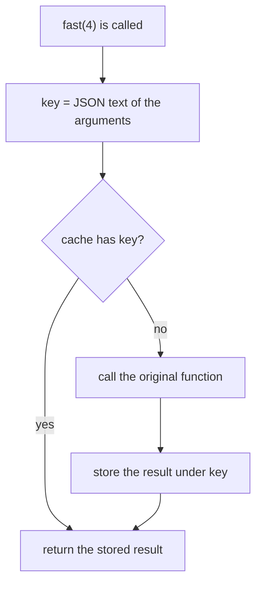

# Applied functions: binding, closures, state and memoisation

> **Before this lesson:** you know the call-form rules for `this` and the lost-`this` bug from [Functions under test: declarations, arguments, scope and this](#/lesson/js-testing/functions-scope-this), and you have met closures in [Closures and recursion](#/lesson/javascript/closures-recursion). We will again prove every idea with tests, and build three small utilities test-first.

## In plain words

A **closure** is a function together with the variables that were in scope where it was created. The function keeps access to those variables for as long as it lives, even after the code that created them has finished running.

Picture a hiker setting off with a backpack. Before leaving the cabin, the hiker puts a map and a water bottle in the pack. Miles away, with the cabin long out of sight, the map and bottle are still there, and the hiker can read the map or drink the water. A function is the hiker; the variables it captured are the contents of the backpack. Nobody else on the trail can reach into that backpack, which is what makes closures useful for keeping data private.

From this one idea come several everyday tools: functions that remember their `this` (**binding**), functions that keep private **state** between calls, and functions that remember past answers so they do not have to compute them twice (**memoisation**).

Why it matters for a job: "implement `bind`", "implement `once`", "implement `memoize`" and "what does this loop print?" are standard interview exercises, and all four are closure questions. Debounce, throttle, React hooks and every mock function in every test framework are built from closures too.

## Closures, proven with tests

```js-run
// --- the tiny test runner from lesson 1 ---
function test(name, fn) {
  try { fn(); console.log("PASS  " + name); }
  catch (e) { console.log("FAIL  " + name + "\n      -> " + e.message); }
}
function expect(actual) {
  const show = (v) => typeof v === "function" ? "[function]" : JSON.stringify(v);
  const fail = (msg) => { throw new Error(msg); };
  return {
    toBe(expected) {
      if (!Object.is(actual, expected)) fail("expected " + show(expected) + " but got " + show(actual));
    },
    toEqual(expected) {
      if (JSON.stringify(actual) !== JSON.stringify(expected)) fail("expected " + show(expected) + " but got " + show(actual));
    },
    toThrow(text = "") {
      try { actual(); } catch (e) {
        if (!String(e.message).includes(text)) fail("threw the wrong error: " + e.message);
        return;
      }
      fail("expected the function to throw, but it returned normally");
    },
  };
}
// --- end of runner ---

function makeCounter() {
  let count = 0;                       // lives in the backpack
  return function () {
    count += 1;
    return count;
  };
}

test("the returned function remembers the variable between calls", () => {
  const next = makeCounter();
  expect(next()).toBe(1);
  expect(next()).toBe(2);
  expect(next()).toBe(3);
});

test("each call to makeCounter creates a separate, independent variable", () => {
  const a = makeCounter();
  const b = makeCounter();
  a(); a();
  expect(b()).toBe(1);                 // b has its own count
});

test("the captured variable cannot be reached from outside", () => {
  const next = makeCounter();
  expect(next.count).toBe(undefined);  // not a property; truly private
});
```

Line by line: `makeCounter` declares `count` and returns an inner function. When `makeCounter` finishes, its local variable would normally be discarded, but the inner function still refers to it, so the engine keeps it alive. Each call of `next()` reads and updates that same variable. Calling `makeCounter` a second time runs the function body again, creating a second, unrelated `count`.

A function like `next`, whose result depends on what happened in earlier calls, is called a **stateful function**. Stateful functions need care in tests: note how each test above creates its *own* counter, so the tests stay isolated.

### The loop trap

```js-run
// --- the tiny test runner from lesson 1 ---
function test(name, fn) {
  try { fn(); console.log("PASS  " + name); }
  catch (e) { console.log("FAIL  " + name + "\n      -> " + e.message); }
}
function expect(actual) {
  const show = (v) => typeof v === "function" ? "[function]" : JSON.stringify(v);
  const fail = (msg) => { throw new Error(msg); };
  return {
    toBe(expected) {
      if (!Object.is(actual, expected)) fail("expected " + show(expected) + " but got " + show(actual));
    },
    toEqual(expected) {
      if (JSON.stringify(actual) !== JSON.stringify(expected)) fail("expected " + show(expected) + " but got " + show(actual));
    },
    toThrow(text = "") {
      try { actual(); } catch (e) {
        if (!String(e.message).includes(text)) fail("threw the wrong error: " + e.message);
        return;
      }
      fail("expected the function to throw, but it returned normally");
    },
  };
}
// --- end of runner ---

test("with var, every callback shares one variable", () => {
  const callbacks = [];
  for (var i = 0; i < 3; i++) callbacks.push(() => i);
  expect(callbacks.map((cb) => cb())).toEqual([3, 3, 3]);
});

test("with let, every turn of the loop gets a fresh variable", () => {
  const callbacks = [];
  for (let i = 0; i < 3; i++) callbacks.push(() => i);
  expect(callbacks.map((cb) => cb())).toEqual([0, 1, 2]);
});
```

A closure captures the *variable*, not a copy of its value at that moment. `var` creates one `i` for the whole function, so all three callbacks see its final value, 3. `let` creates a new `i` for each pass through the loop, so each callback keeps its own.

## Binding, built test-first

In the previous lesson, `counter.increment.bind(counter)` fixed a lost `this`. `bind` is not magic; it is a closure. To understand it, let us write our own version, `bindTo(fn, thisValue)`, driven by tests.

**The first test:**

```javascript
test("the bound function runs with the given this", () => {
  const cat = { sound: "meow" };
  function speak() { return this.sound; }
  const bound = bindTo(speak, cat);
  expect(bound()).toBe("meow");
});
```

**Failing output:**

```text
FAIL  the bound function runs with the given this
      -> bindTo is not defined
```

**The code that passes:**

```javascript
function bindTo(fn, thisValue) {
  return function () {
    return fn.call(thisValue);
  };
}
```

`bindTo` returns a new function. That new function has `fn` and `thisValue` in its backpack and, when called, runs `fn` with `this` set through `call`.

**Second test, red:** arguments must be passed through.

```javascript
test("arguments given to the bound function reach the original", () => {
  const cat = { sound: "meow" };
  function speak(times) { return this.sound.repeat(times); }
  expect(bindTo(speak, cat)(2)).toBe("meowmeow");
});
```

```text
FAIL  arguments given to the bound function reach the original
      -> Invalid count value: undefined
```

**Green:** collect the arguments with a rest parameter and forward them with `apply`.

```javascript
function bindTo(fn, thisValue) {
  return function (...args) {
    return fn.apply(thisValue, args);
  };
}
```

**Third test:** the real `bind` can also fix some leading arguments in advance. Supplying part of a function's arguments now and the rest later is called **partial application**.

```js-run
// --- the tiny test runner from lesson 1 ---
function test(name, fn) {
  try { fn(); console.log("PASS  " + name); }
  catch (e) { console.log("FAIL  " + name + "\n      -> " + e.message); }
}
function expect(actual) {
  const show = (v) => typeof v === "function" ? "[function]" : JSON.stringify(v);
  const fail = (msg) => { throw new Error(msg); };
  return {
    toBe(expected) {
      if (!Object.is(actual, expected)) fail("expected " + show(expected) + " but got " + show(actual));
    },
    toEqual(expected) {
      if (JSON.stringify(actual) !== JSON.stringify(expected)) fail("expected " + show(expected) + " but got " + show(actual));
    },
    toThrow(text = "") {
      try { actual(); } catch (e) {
        if (!String(e.message).includes(text)) fail("threw the wrong error: " + e.message);
        return;
      }
      fail("expected the function to throw, but it returned normally");
    },
  };
}
// --- end of runner ---

function bindTo(fn, thisValue, ...fixed) {
  return function (...later) {
    return fn.apply(thisValue, [...fixed, ...later]);
  };
}

test("the bound function runs with the given this", () => {
  const cat = { sound: "meow" };
  function speak() { return this.sound; }
  expect(bindTo(speak, cat)()).toBe("meow");
});

test("arguments given to the bound function reach the original", () => {
  const cat = { sound: "meow" };
  function speak(times) { return this.sound.repeat(times); }
  expect(bindTo(speak, cat)(2)).toBe("meowmeow");
});

test("arguments given at bind time come first (partial application)", () => {
  function volume(width, height, depth) { return width * height * depth; }
  const slab = bindTo(volume, null, 10, 10);   // width and height fixed
  expect(slab(2)).toBe(200);
  expect(slab(5)).toBe(500);
});

test("the built-in bind behaves the same way", () => {
  function volume(w, h, d) { return w * h * d; }
  expect(volume.bind(null, 10, 10)(2)).toBe(200);
});
```

The last test is a learning test that compares our version with the built-in one. Writing a simplified copy of a library function and checking it against the original is an excellent way to understand that function.

## Immediately invoked functions and private state

Before JavaScript had modules and block-scoped variables, the only way to create a private scope was a function. Developers therefore wrote functions that were called the instant they were defined. Such a function is an **immediately invoked function expression**, or **IIFE** (pronounced "iffy").

```js-run
// --- the tiny test runner from lesson 1 ---
function test(name, fn) {
  try { fn(); console.log("PASS  " + name); }
  catch (e) { console.log("FAIL  " + name + "\n      -> " + e.message); }
}
function expect(actual) {
  const show = (v) => typeof v === "function" ? "[function]" : JSON.stringify(v);
  const fail = (msg) => { throw new Error(msg); };
  return {
    toBe(expected) {
      if (!Object.is(actual, expected)) fail("expected " + show(expected) + " but got " + show(actual));
    },
    toEqual(expected) {
      if (JSON.stringify(actual) !== JSON.stringify(expected)) fail("expected " + show(expected) + " but got " + show(actual));
    },
    toThrow(text = "") {
      try { actual(); } catch (e) {
        if (!String(e.message).includes(text)) fail("threw the wrong error: " + e.message);
        return;
      }
      fail("expected the function to throw, but it returned normally");
    },
  };
}
// --- end of runner ---

const idGenerator = (function () {
  let lastId = 0;                          // private to this function scope
  return {
    next() { lastId += 1; return "id-" + lastId; },
    reset() { lastId = 0; },
  };
})();                                      // the () here calls it at once

test("the IIFE ran once and returned an object", () => {
  expect(typeof idGenerator.next).toBe("function");
});

test("its private variable is not exposed", () => {
  expect(idGenerator.lastId).toBe(undefined);
});

test("next produces increasing ids", () => {
  idGenerator.reset();
  expect(idGenerator.next()).toBe("id-1");
  expect(idGenerator.next()).toBe("id-2");
});
```

The surrounding parentheses turn the function into an expression, and the final `()` calls it. What it returns, an object with two methods that share the hidden `lastId`, is stored in `idGenerator`. This arrangement is known as the **module pattern**. Today each file is an ES module with its own scope, and `let` in a block is private to the block, so you rarely write IIFEs by hand. You still meet them in older code and in the output of build tools.

Notice the `reset` method and the `idGenerator.reset()` call at the start of the third test. `idGenerator` is a single shared object, created once. Without a way to reset it, the expected ids would depend on how many tests had called `next` before. Shared state created at load time is called a **singleton**, and singletons make tests order-dependent. The friendlier design is a *factory* function, such as `makeCounter` above, which gives every test a fresh instance.

> [!TIP]
> If code is hard to test because of hidden shared state, that is design feedback. Prefer `createThing()` that returns a new instance over one module-level instance that everything shares.

## A stateful helper: `once`

`once(fn)` returns a function that runs `fn` the first time it is called and afterwards returns the remembered result without running `fn` again. It is used for one-time initialisation.

How can a test check that `fn` was *not* called a second time? Return values cannot show that. We need a function that records its own calls. Such a recording function is called a **spy**, and it is yet another closure. The helper `mockFn` below is a miniature of `jest.fn()` and `vi.fn()`.

```js-run
// --- the tiny test runner from lesson 1 ---
function test(name, fn) {
  try { fn(); console.log("PASS  " + name); }
  catch (e) { console.log("FAIL  " + name + "\n      -> " + e.message); }
}
function expect(actual) {
  const show = (v) => typeof v === "function" ? "[function]" : JSON.stringify(v);
  const fail = (msg) => { throw new Error(msg); };
  return {
    toBe(expected) {
      if (!Object.is(actual, expected)) fail("expected " + show(expected) + " but got " + show(actual));
    },
    toEqual(expected) {
      if (JSON.stringify(actual) !== JSON.stringify(expected)) fail("expected " + show(expected) + " but got " + show(actual));
    },
    toThrow(text = "") {
      try { actual(); } catch (e) {
        if (!String(e.message).includes(text)) fail("threw the wrong error: " + e.message);
        return;
      }
      fail("expected the function to throw, but it returned normally");
    },
  };
}
// --- end of runner ---
// --- a tiny mock function, like jest.fn() / vi.fn() ---
function mockFn(impl = () => undefined) {
  const mock = (...args) => {
    mock.calls.push(args);            // remember the arguments of every call
    const value = impl(...args);
    mock.results.push(value);         // remember what was returned
    return value;
  };
  mock.calls = [];
  mock.results = [];
  mock.mockReturnValue = (v) => { impl = () => v; return mock; };
  mock.mockImplementation = (f) => { impl = f; return mock; };
  return mock;
}
// --- end of mock ---

function once(fn) {
  let done = false;
  let result;
  return function (...args) {
    if (!done) {
      done = true;
      result = fn.apply(this, args);
    }
    return result;
  };
}

test("calls the original the first time and returns its result", () => {
  const init = mockFn(() => "ready");
  const start = once(init);
  expect(start()).toBe("ready");
  expect(init.calls.length).toBe(1);
});

test("later calls return the first result without calling again", () => {
  const init = mockFn(() => "ready");
  const start = once(init);
  start(); start(); start();
  expect(init.calls.length).toBe(1);
  expect(start()).toBe("ready");
});

test("the first call's arguments are passed through", () => {
  const init = mockFn((name) => "hello " + name);
  const start = once(init);
  expect(start("Ada")).toBe("hello Ada");
  expect(init.calls[0]).toEqual(["Ada"]);
});
```

`mockFn` returns a function with two arrays attached: `calls`, which gains one entry (the argument list) per call, and `results`. The assertions `init.calls.length` and `init.calls[0]` ask "how many times, and with what?". Later lessons on test doubles build on this.

## Memoisation, test-first

**Memoisation** means storing the result of a function call so that calling again with the same arguments returns the stored result instead of recomputing it. The storage is called a **cache**. It trades memory for speed and is only correct for **pure functions**: functions whose result depends on nothing except their arguments and which change nothing outside themselves.

The test list for `memoize(fn)`:

```text
[ ] returns the same result as the original
[ ] same argument twice: the original is called once
[ ] different arguments: computed separately
[ ] several arguments form the cache key together
[ ] each memoised function has its own cache
```

**Red** for the second item, the heart of the feature:

```text
FAIL  same argument twice: the original runs once
      -> expected 1 but got 2
```

That is what a pass-through such as `const memoize = (fn) => (...args) => fn(...args)` produces: correct results, no caching. **Green** needs a cache in the backpack:

```js-run
// --- the tiny test runner from lesson 1 ---
function test(name, fn) {
  try { fn(); console.log("PASS  " + name); }
  catch (e) { console.log("FAIL  " + name + "\n      -> " + e.message); }
}
function expect(actual) {
  const show = (v) => typeof v === "function" ? "[function]" : JSON.stringify(v);
  const fail = (msg) => { throw new Error(msg); };
  return {
    toBe(expected) {
      if (!Object.is(actual, expected)) fail("expected " + show(expected) + " but got " + show(actual));
    },
    toEqual(expected) {
      if (JSON.stringify(actual) !== JSON.stringify(expected)) fail("expected " + show(expected) + " but got " + show(actual));
    },
    toThrow(text = "") {
      try { actual(); } catch (e) {
        if (!String(e.message).includes(text)) fail("threw the wrong error: " + e.message);
        return;
      }
      fail("expected the function to throw, but it returned normally");
    },
  };
}
// --- end of runner ---
// --- a tiny mock function, like jest.fn() / vi.fn() ---
function mockFn(impl = () => undefined) {
  const mock = (...args) => {
    mock.calls.push(args);            // remember the arguments of every call
    const value = impl(...args);
    mock.results.push(value);         // remember what was returned
    return value;
  };
  mock.calls = [];
  mock.results = [];
  mock.mockReturnValue = (v) => { impl = () => v; return mock; };
  mock.mockImplementation = (f) => { impl = f; return mock; };
  return mock;
}
// --- end of mock ---

function memoize(fn) {
  const cache = new Map();                    // key -> stored result
  return function (...args) {
    const key = JSON.stringify(args);         // one text key for all arguments
    if (!cache.has(key)) {
      cache.set(key, fn(...args));
    }
    return cache.get(key);
  };
}

test("returns the same result as the original", () => {
  const square = memoize((n) => n * n);
  expect(square(4)).toBe(16);
});

test("same argument twice: the original runs once", () => {
  const slow = mockFn((n) => n * n);
  const fast = memoize(slow);
  fast(4); fast(4);
  expect(slow.calls.length).toBe(1);
});

test("different arguments are computed separately", () => {
  const slow = mockFn((n) => n * n);
  const fast = memoize(slow);
  expect([fast(2), fast(3), fast(2)]).toEqual([4, 9, 4]);
  expect(slow.calls.length).toBe(2);
});

test("all arguments together form the key", () => {
  const add = mockFn((a, b) => a + b);
  const fast = memoize(add);
  expect([fast(1, 2), fast(2, 1), fast(1, 2)]).toEqual([3, 3, 3]);
  expect(add.calls.length).toBe(2);           // (1,2) and (2,1) are different keys
});

test("a result of undefined is cached too", () => {
  const nothing = mockFn(() => undefined);
  const fast = memoize(nothing);
  fast(1); fast(1);
  expect(nothing.calls.length).toBe(1);
});

test("the number 1 and the string '1' do not share a cache entry", () => {
  const kind = memoize((x) => typeof x);
  expect([kind(1), kind("1")]).toEqual(["number", "string"]);
});
```

The reasons behind three choices in the implementation, each pinned by a test:

- `cache.has(key)` and not `if (cache.get(key))`: a stored result of `undefined`, `0` or `false` is falsy, and a truthiness check would recompute it every time. The fifth test guards this.
- `JSON.stringify(args)` as the key: it keeps `[1, 2]` distinct from `[2, 1]` and `1` from `"1"`, because JSON text writes them differently. The fourth and sixth tests guard this.
- One `cache` per call to `memoize`: every memoised function has its own backpack.



> [!WARNING]
> Memoising an impure function produces wrong answers. `memoize(() => Date.now())` returns the same timestamp forever, and `memoize(getUserFromServer)` keeps serving stale data. Cache keys also have limits: `JSON.stringify` treats `{a: 1, b: 2}` and `{b: 2, a: 1}` as different, cannot tell `undefined` from `null` inside arrays, and ignores functions. And a cache that only grows is a memory leak in a long-running program; real caches have a size limit or an expiry time.

> [!INTERVIEW]
> **"Implement `memoize`. How would you test it?"** Write the closure with a `Map`. Then say the important part: results alone cannot prove caching, so the test wraps the original in a spy and asserts on its call count. Mention the falsy-result trap (`has`, not truthiness), the cache-key question for object arguments, and that it is only valid for pure functions.

## Common pitfalls

- **Capturing a loop variable declared with `var`.** All closures share it. Use `let`.
- **Testing stateful functions with shared instances.** Create a fresh one per test, or the tests become order-dependent.
- **Checking the cache with truthiness.** Falsy results are recomputed forever.
- **Forgetting to forward arguments or `this`** in wrappers such as `once`, `memoize` and `bindTo`. Use `...args` and `fn.apply(this, args)`.
- **Binding in a loop or render path.** Each `bind` call creates a new function; comparing or removing it later (for example with `removeEventListener`) fails because it is not the same function object.
- **Closures holding large data.** Whatever is in the backpack cannot be freed while the function is alive.

## Cheat sheet

| Tool | What it does | Core of the implementation |
|---|---|---|
| Closure | Function keeps access to variables from where it was created | inner function referring to an outer `let` |
| `fn.bind(obj, a)` | New function with `this` (and leading arguments) fixed | `(...later) => fn.apply(obj, [a, ...later])` |
| Partial application | Supply some arguments now, the rest later | `bind(null, a, b)` |
| IIFE | Function called as soon as it is defined | `(function () { ... })()` |
| Module pattern | IIFE returning an object of methods over private variables | replaced by ES modules today |
| `once(fn)` | Run `fn` only the first time | `done` flag plus stored `result` |
| `memoize(fn)` | Cache results by arguments | `Map`, key from the arguments, `has` check |
| Spy | Function that records its calls | `calls.push(args)` inside a wrapper |
| `vi.fn()` / `jest.fn()` | Real spy; assert with `toHaveBeenCalledTimes(1)` | `expect(spy).toHaveBeenCalledWith(4)` |

## Summary

- A closure is a function plus the variables it captured; the variables stay alive and private.
- Closures capture variables, not values: `var` in a loop is shared, `let` is per iteration.
- `bind` is a closure that calls the original with a fixed `this` and optional leading arguments.
- IIFEs created private scope before modules; shared singletons hurt test isolation, factories help it.
- `once` and `memoize` are stateful wrappers; proving that they *avoid* calls requires a spy that counts calls.
- Memoise only pure functions, check the cache with `has`, and think about keys and memory.

## Glossary

- **Closure**: a function bundled with the variables in scope at its creation.
- **Stateful function**: a function whose result depends on earlier calls.
- **Binding**: creating a function with its `this` value fixed.
- **Partial application**: fixing some arguments of a function in advance.
- **IIFE**: immediately invoked function expression; a function called where it is defined.
- **Module pattern**: using an IIFE to expose public methods over private variables.
- **Singleton**: one shared instance used by the whole program.
- **Factory function**: a function that creates and returns a new instance each time.
- **Spy**: a function that records how it was called so a test can assert on it.
- **Memoisation**: caching a function's results by its arguments.
- **Cache**: a store of previously computed results.
- **Pure function**: a function whose output depends only on its inputs and which has no outside effects.

## Check yourself

```quiz
[
  {"q": "const a = makeCounter(); const b = makeCounter(); a(); a(); What does b() return?",
   "options": ["3", "1", "2", "undefined"],
   "answer": 1,
   "explain": "Each call to makeCounter creates a new count variable. b has never been called, so its count goes from 0 to 1."},
  {"q": "for (var i = 0; i < 3; i++) fns.push(() => i); expect(fns.map(f => f())).toEqual([0, 1, 2]). Pass or fail?",
   "options": ["Pass", "Fail: the result is [3, 3, 3] because all closures share the single var i", "Fail: the result is [2, 2, 2]", "It throws a ReferenceError"],
   "answer": 1,
   "explain": "var is function-scoped, so there is one i. After the loop it is 3, and every closure reads that same variable."},
  {"q": "A memoize implementation uses: if (cache.get(key)) return cache.get(key); A test memoises (n) => n - n and calls it with 5 twice, asserting the original ran once. Pass or fail?",
   "options": ["Pass", "Fail: the result 0 is falsy, so the cache check misses and the original runs twice", "Pass for the wrong reason", "It throws"],
   "answer": 1,
   "explain": "A truthiness check cannot tell 'not cached' from 'cached a falsy value'. Use cache.has(key)."},
  {"q": "A test for memoize asserts only that fast(4) returns 16, twice. The implementation is a pass-through with no cache. Pass, fail, or pass for the wrong reason?",
   "options": ["Fail", "Pass for the wrong reason: results are correct either way, so the test never checks that caching happens", "Pass, and caching is proven", "It throws"],
   "answer": 1,
   "explain": "Return values cannot distinguish cached from recomputed. A spy and an assertion on its call count are needed."},
  {"q": "What does volume.bind(null, 10, 10) produce, given function volume(w, h, d)?",
   "options": ["The number 100", "A new function that takes d and calls volume(10, 10, d)", "An error, because this is null", "The original function, unchanged"],
   "answer": 1,
   "explain": "bind returns a new function with leading arguments fixed. This is partial application; the remaining argument is supplied later."},
  {"q": "Why does a module-level singleton such as idGenerator make tests harder?",
   "options": ["Singletons are slower", "Its state persists across tests, so results depend on which tests ran earlier unless it is reset", "It cannot be imported", "It disables closures"],
   "answer": 1,
   "explain": "Shared state breaks isolation. A factory that returns a fresh instance per test, or an explicit reset in setup, restores it."},
  {"q": "memoize(() => Date.now()) is called now and again one minute later. What does the second call return?",
   "options": ["The current time", "The time of the first call, because the result was cached", "undefined", "It throws"],
   "answer": 1,
   "explain": "The function is impure: its result depends on the clock, not its arguments. Memoising it freezes the first answer."},
  {"q": "In once(fn), how can a test verify that fn is not executed on the second call?",
   "options": ["Compare the two return values", "Wrap fn in a spy and assert that it recorded exactly one call", "Measure the running time", "It cannot be tested"],
   "answer": 1,
   "explain": "The return values are equal whether or not fn ran again. Only a recording function can show the number of calls."}
]
```

> **Source:** Johansen, *Test-Driven JavaScript Development*, ch. 6 (Applied Functions and Closures). Docs: https://developer.mozilla.org/en-US/docs/Web/JavaScript/Closures , https://developer.mozilla.org/en-US/docs/Web/JavaScript/Reference/Global_Objects/Function/bind , https://vitest.dev/api/mock , https://jestjs.io/docs/mock-functions
