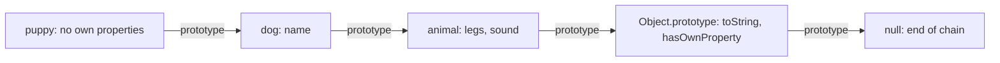

# Objects and prototype chains, explored with tests

> **Before this lesson:** you know how `this` is set by `new` and by method calls ([Functions under test: declarations, arguments, scope and this](#/lesson/js-testing/functions-scope-this)) and have seen classes once ([Prototypes, classes and encapsulation](#/lesson/javascript/prototypes-classes)). Here we go underneath classes and verify each mechanism with a test.

## In plain words

An **object** in JavaScript is a collection of named values called **properties**. What makes JavaScript unusual is how objects share behaviour. Most languages you may have heard of use *classes* as blueprints. JavaScript uses **prototypes**: every object can have a link to another object, its prototype, and when you ask an object for a property it does not have, JavaScript quietly asks the prototype instead. That one rule is called **prototypal inheritance**.

Think of asking a question in an office. You ask a new employee where the fire exit is. If they know, they answer. If they do not, they ask their team lead; the lead, if unsure, asks the department head. The first person in that chain who knows gives the answer, and if nobody knows, the answer is "no idea" (`undefined`). The new employee did not copy the lead's knowledge; they *delegate* to it at the moment of asking.

Why it matters for a job: the `class` keyword you will write every day is a thin layer over prototypes. Stack traces, debugger panels, `instanceof` checks and many interview questions ("what does `new` do?", "how does inheritance work in JavaScript?") speak the prototype language directly.

## Properties: own and inherited

```js-run
// --- the tiny test runner from lesson 1 ---
function test(name, fn) {
  try { fn(); console.log("PASS  " + name); }
  catch (e) { console.log("FAIL  " + name + "\n      -> " + e.message); }
}
function expect(actual) {
  const show = (v) => typeof v === "function" ? "[function]" : JSON.stringify(v);
  const fail = (msg) => { throw new Error(msg); };
  return {
    toBe(expected) {
      if (!Object.is(actual, expected)) fail("expected " + show(expected) + " but got " + show(actual));
    },
    toEqual(expected) {
      if (JSON.stringify(actual) !== JSON.stringify(expected)) fail("expected " + show(expected) + " but got " + show(actual));
    },
    toThrow(text = "") {
      try { actual(); } catch (e) {
        if (!String(e.message).includes(text)) fail("threw the wrong error: " + e.message);
        return;
      }
      fail("expected the function to throw, but it returned normally");
    },
  };
}
// --- end of runner ---

const animal = { legs: 4, describe() { return "I have " + this.legs + " legs"; } };
const dog = Object.create(animal);     // a new empty object whose prototype is animal
dog.name = "Rex";

test("an own property is stored on the object itself", () => {
  expect(Object.hasOwn(dog, "name")).toBe(true);
});

test("a missing property is looked up on the prototype", () => {
  expect(dog.legs).toBe(4);
  expect(Object.hasOwn(dog, "legs")).toBe(false);   // it lives on animal
});

test("the in operator sees own and inherited properties", () => {
  expect("legs" in dog).toBe(true);
  expect("wings" in dog).toBe(false);
});

test("an inherited method runs with this set to the object it was called on", () => {
  expect(dog.describe()).toBe("I have 4 legs");
});

test("writing a property creates an own property and never changes the prototype", () => {
  dog.legs = 3;
  expect(dog.legs).toBe(3);
  expect(animal.legs).toBe(4);
});

test("a property found nowhere on the chain is undefined", () => {
  expect(dog.wings).toBe(undefined);
});
```

`Object.create(animal)` makes a new, empty object and sets its prototype link to `animal`. The tests then establish the rules:

- An **own property** is stored directly on the object. `Object.hasOwn(obj, name)` reports only those.
- *Reading* walks up the chain: `dog.legs` is not on `dog`, so the engine checks `animal` and finds it.
- *Writing* never walks up. `dog.legs = 3` creates an own property on `dog` that hides the inherited one. The hiding is called **shadowing**. The prototype is untouched.
- A method found on the prototype still gets `this` from the call: `dog.describe()` has `dog` before the dot.

## The prototype chain

Every object's chain ends somewhere. For ordinary objects the last link is `Object.prototype`, the built-in object that supplies methods such as `toString` and `hasOwnProperty`. Its own prototype is `null`, meaning "the chain stops here".

```js-run
// --- the tiny test runner from lesson 1 ---
function test(name, fn) {
  try { fn(); console.log("PASS  " + name); }
  catch (e) { console.log("FAIL  " + name + "\n      -> " + e.message); }
}
function expect(actual) {
  const show = (v) => typeof v === "function" ? "[function]" : JSON.stringify(v);
  const fail = (msg) => { throw new Error(msg); };
  return {
    toBe(expected) {
      if (!Object.is(actual, expected)) fail("expected " + show(expected) + " but got " + show(actual));
    },
    toEqual(expected) {
      if (JSON.stringify(actual) !== JSON.stringify(expected)) fail("expected " + show(expected) + " but got " + show(actual));
    },
    toThrow(text = "") {
      try { actual(); } catch (e) {
        if (!String(e.message).includes(text)) fail("threw the wrong error: " + e.message);
        return;
      }
      fail("expected the function to throw, but it returned normally");
    },
  };
}
// --- end of runner ---

const animal = { legs: 4 };
const dog = Object.create(animal);
const puppy = Object.create(dog);

test("Object.getPrototypeOf returns the next link", () => {
  expect(Object.getPrototypeOf(puppy)).toBe(dog);
  expect(Object.getPrototypeOf(dog)).toBe(animal);
});

test("plain objects end at Object.prototype, whose prototype is null", () => {
  expect(Object.getPrototypeOf(animal)).toBe(Object.prototype);
  expect(Object.getPrototypeOf(Object.prototype)).toBe(null);
});

test("lookups travel the whole chain", () => {
  expect(puppy.legs).toBe(4);                         // found two links up
  expect(typeof puppy.toString).toBe("function");     // found three links up
});

test("changing the prototype is visible to every object that delegates to it", () => {
  animal.sound = "generic noise";
  expect(puppy.sound).toBe("generic noise");
});

test("Object.keys lists own properties only; for...in includes inherited ones", () => {
  dog.name = "Rex";
  const seen = [];
  for (const key in dog) seen.push(key);
  expect(Object.keys(dog)).toEqual(["name"]);
  expect(seen.includes("legs")).toBe(true);
});
```



The fourth test shows that inheritance here is *live delegation*, not copying: a property added to `animal` after `puppy` was created is immediately visible through `puppy`.

## Constructors and what `new` does

Creating objects one at a time with `Object.create` is fine for a handful. To make many similar objects, JavaScript has long used **constructor functions**: ordinary functions, named with a capital letter by convention, that are called with `new`.

```javascript
function Circle(radius) {
  this.radius = radius;                       // own property on each new circle
}
Circle.prototype.area = function () {         // one shared method for all circles
  return Math.PI * this.radius * this.radius;
};
```

Every function automatically has a property called `prototype`, an object that starts out nearly empty. It is *not* the function's own prototype; it is the object that will become the prototype of everything created with `new` from that function.

`new Circle(2)` does four things. The most convincing way to learn them is to write a function that does the same job and test it against the real `new`.

**The test first:**

```javascript
test("construct behaves like new", () => {
  const c = construct(Circle, 2);
  expect(c.radius).toBe(2);
  expect(Object.getPrototypeOf(c)).toBe(Circle.prototype);
});
```

**Failing output:**

```text
FAIL  construct behaves like new
      -> construct is not defined
```

**The implementation, and the passing run:**

```js-run
// --- the tiny test runner from lesson 1 ---
function test(name, fn) {
  try { fn(); console.log("PASS  " + name); }
  catch (e) { console.log("FAIL  " + name + "\n      -> " + e.message); }
}
function expect(actual) {
  const show = (v) => typeof v === "function" ? "[function]" : JSON.stringify(v);
  const fail = (msg) => { throw new Error(msg); };
  return {
    toBe(expected) {
      if (!Object.is(actual, expected)) fail("expected " + show(expected) + " but got " + show(actual));
    },
    toEqual(expected) {
      if (JSON.stringify(actual) !== JSON.stringify(expected)) fail("expected " + show(expected) + " but got " + show(actual));
    },
    toThrow(text = "") {
      try { actual(); } catch (e) {
        if (!String(e.message).includes(text)) fail("threw the wrong error: " + e.message);
        return;
      }
      fail("expected the function to throw, but it returned normally");
    },
  };
}
// --- end of runner ---

function Circle(radius) {
  this.radius = radius;
}
Circle.prototype.area = function () {
  return Math.PI * this.radius * this.radius;
};

function construct(Constructor, ...args) {
  const fresh = Object.create(Constructor.prototype);    // 1 + 2: new object, linked
  const returned = Constructor.apply(fresh, args);       // 3: run with this = fresh
  const isObject = returned !== null && (typeof returned === "object" || typeof returned === "function");
  return isObject ? returned : fresh;                    // 4: return it
}

test("construct behaves like new", () => {
  const c = construct(Circle, 2);
  expect(c.radius).toBe(2);
  expect(Object.getPrototypeOf(c)).toBe(Circle.prototype);
});

test("the real new gives the same shape", () => {
  const c = new Circle(2);
  expect(c.radius).toBe(2);
  expect(Object.getPrototypeOf(c)).toBe(Circle.prototype);
});

test("methods live once on the prototype, shared by all instances", () => {
  const a = new Circle(1), b = new Circle(2);
  expect(a.area).toBe(b.area);                   // the very same function
  expect(Object.hasOwn(a, "area")).toBe(false);
});

test("instanceof asks: is Circle.prototype on this object's chain?", () => {
  expect(new Circle(1) instanceof Circle).toBe(true);
  expect(construct(Circle, 1) instanceof Circle).toBe(true);
  expect({ radius: 1 } instanceof Circle).toBe(false);
});

test("the prototype object points back with its constructor property", () => {
  expect(Circle.prototype.constructor).toBe(Circle);
  expect(new Circle(1).constructor).toBe(Circle);   // inherited from the prototype
});

test("calling a constructor without new is a mistake that strict mode catches", () => {
  function Strict(radius) { "use strict"; this.radius = radius; }
  expect(() => Strict(2)).toThrow("undefined");
});
```

The four steps of `new`, as the comments mark them:

1. Create a new empty object.
2. Set its prototype to the constructor's `prototype` property.
3. Call the constructor with `this` bound to the new object, so `this.radius = radius` writes onto it.
4. Return the new object (unless the constructor itself returns a different object, a rarely used escape hatch).

An object made by a constructor is an **instance** of it. `instanceof` does not look at how an object was made; it walks the object's chain looking for `Circle.prototype`, which is why the object from our own `construct` also passes.

## Pseudo-classical inheritance

To make one kind of object a specialisation of another, you connect the prototype objects into a chain. Because it imitates class-based languages, this recipe is known as **pseudo-classical inheritance**. It has two wiring steps, and forgetting either one is a classic bug. We will let tests find them.

**The code under test, with both steps missing:**

```javascript
function Shape(name) { this.name = name; }
Shape.prototype.describe = function () { return this.name + " with area " + this.area(); };

function Square(side) { this.side = side; }
Square.prototype.area = function () { return this.side * this.side; };
```

**The test:**

```javascript
test("a square can describe itself using Shape's method", () => {
  expect(new Square(3).describe()).toBe("square with area 9");
});
```

**Failing output:**

```text
FAIL  a square can describe itself using Shape's method
      -> new Square(...).describe is not a function
```

`Square.prototype` is not linked to `Shape.prototype`, so the lookup for `describe` ends at `Object.prototype`. **Fix 1:** create `Square.prototype` as an object that delegates to `Shape.prototype`.

```javascript
Square.prototype = Object.create(Shape.prototype);
Square.prototype.constructor = Square;       // restore the back-pointer
```

Run again:

```text
FAIL  a square can describe itself using Shape's method
      -> expected "square with area 9" but got "undefined with area 9"
```

Progress: the method is found, and `area` works. But `name` is `undefined`, because nothing ran the `Shape` constructor for our new object. **Fix 2:** call the parent constructor with the child's `this`.

```js-run
// --- the tiny test runner from lesson 1 ---
function test(name, fn) {
  try { fn(); console.log("PASS  " + name); }
  catch (e) { console.log("FAIL  " + name + "\n      -> " + e.message); }
}
function expect(actual) {
  const show = (v) => typeof v === "function" ? "[function]" : JSON.stringify(v);
  const fail = (msg) => { throw new Error(msg); };
  return {
    toBe(expected) {
      if (!Object.is(actual, expected)) fail("expected " + show(expected) + " but got " + show(actual));
    },
    toEqual(expected) {
      if (JSON.stringify(actual) !== JSON.stringify(expected)) fail("expected " + show(expected) + " but got " + show(actual));
    },
    toThrow(text = "") {
      try { actual(); } catch (e) {
        if (!String(e.message).includes(text)) fail("threw the wrong error: " + e.message);
        return;
      }
      fail("expected the function to throw, but it returned normally");
    },
  };
}
// --- end of runner ---

function Shape(name) { this.name = name; }
Shape.prototype.describe = function () { return this.name + " with area " + this.area(); };

function Square(side) {
  Shape.call(this, "square");                         // fix 2: run the parent constructor
  this.side = side;
}
Square.prototype = Object.create(Shape.prototype);    // fix 1: link the prototypes
Square.prototype.constructor = Square;
Square.prototype.area = function () { return this.side * this.side; };

test("a square can describe itself using Shape's method", () => {
  expect(new Square(3).describe()).toBe("square with area 9");
});

test("a square is an instance of both Square and Shape", () => {
  const s = new Square(3);
  expect(s instanceof Square).toBe(true);
  expect(s instanceof Shape).toBe(true);
});

test("the chain is square -> Square.prototype -> Shape.prototype", () => {
  const s = new Square(3);
  expect(Object.getPrototypeOf(s)).toBe(Square.prototype);
  expect(Object.getPrototypeOf(Square.prototype)).toBe(Shape.prototype);
});

test("the constructor back-pointer names the right function", () => {
  expect(new Square(1).constructor).toBe(Square);
});

test("a child can override a method and still call the parent's version", () => {
  Square.prototype.describe = function () {
    return Shape.prototype.describe.call(this) + " and side " + this.side;
  };
  expect(new Square(2).describe()).toBe("square with area 4 and side 2");
});
```

Why `Object.create(Shape.prototype)` and not `Square.prototype = Shape.prototype`? With the second form both names would refer to the *same* object, so adding `area` for squares would add it to every shape. And why not `Square.prototype = new Shape()`, which older tutorials show? That runs the `Shape` constructor at definition time with no sensible arguments and leaves a stray `name` property on the prototype. `Object.create` links without running anything.

The last test shows **overriding**: a child's method shadows the parent's method of the same name. To reuse the parent's behaviour, call it explicitly with `call(this)`.

> [!TIP]
> When inheritance misbehaves, test the chain itself with `Object.getPrototypeOf` and `Object.hasOwn`. Asserting on where a property lives locates the missing link much faster than staring at output.

> [!INTERVIEW]
> **"What happens when you call a function with `new`?"** Four steps: a new object is created; its prototype is set to the function's `prototype` property; the function runs with `this` as that object; the object is returned unless the function returns another object. Follow up by saying that `instanceof` checks whether `Constructor.prototype` is on the object's prototype chain.

## Common pitfalls

> [!WARNING]
> **Mutable values on a prototype are shared by every instance.** `Team.prototype.members = []` gives all teams one array; `teamA.members.push("Ada")` shows up in `teamB`. Arrays and objects that belong to an instance must be created in the constructor (`this.members = []`). A test that creates two instances and changes one is the way to catch it.

- **Confusing `Constructor.prototype` with an object's prototype.** `Circle.prototype` is the object given to instances. The prototype of `Circle` itself is `Function.prototype`.
- **Forgetting `new`.** Without it, no object is created. In strict mode `this` is `undefined` and the call throws; in old non-strict code it silently writes to the global object.
- **Replacing `prototype` after creating instances.** Existing instances keep pointing at the old object.
- **Forgetting to restore `constructor`** after assigning a new prototype object; `instance.constructor` then names the parent.
- **Using `for...in` and being surprised by inherited keys.** Use `Object.keys` or check `Object.hasOwn`.
- **Deep chains.** Three or more levels of inheritance are hard to follow and to test. The next lesson shows composition as an alternative.

## Cheat sheet

| Expression | Meaning | Assertion you can write |
|---|---|---|
| `Object.create(proto)` | New object whose prototype is `proto` | `expect(Object.getPrototypeOf(o)).toBe(proto)` |
| `Object.getPrototypeOf(o)` | The next link in the chain | as above |
| `Object.hasOwn(o, "k")` | Is `k` stored on `o` itself? | `.toBe(true)` |
| `"k" in o` | Is `k` anywhere on the chain? | `.toBe(true)` |
| `Object.keys(o)` | Own enumerable property names | `.toEqual(["name"])` |
| `new F(a)` | Create, link to `F.prototype`, run, return | `expect(x instanceof F).toBe(true)` |
| `F.prototype.m = function () {}` | Method shared by all instances | `expect(a.m).toBe(b.m)` |
| `Child.prototype = Object.create(Parent.prototype)` | Link child to parent | `expect(c instanceof Parent).toBe(true)` |
| `Parent.call(this, args)` | Run the parent constructor on the new object | assert the parent's properties exist |
| `Parent.prototype.m.call(this)` | Call the overridden parent method | assert the combined result |

## Summary

- Objects delegate missing property reads to their prototype, link by link, until `null`.
- Reads walk the chain; writes create own properties and shadow inherited ones.
- `new` creates an object, links it to the constructor's `prototype`, runs the constructor with `this`, and returns the object.
- Methods belong on the prototype (shared); per-instance data belongs in the constructor.
- Pseudo-classical inheritance needs two steps: link the prototypes with `Object.create`, and call the parent constructor with `call(this)`.
- Tests on `getPrototypeOf`, `hasOwn` and `instanceof` make the invisible chain visible.

## Glossary

- **Property**: a named value stored on an object.
- **Prototype**: the object another object delegates to for properties it lacks.
- **Prototypal inheritance**: sharing behaviour by delegation along prototype links.
- **Own property**: a property stored directly on an object.
- **Shadowing**: an own property hiding an inherited one of the same name.
- **Prototype chain**: the sequence of prototype links ending in `null`.
- **Constructor function**: a function intended to be called with `new` to initialise objects.
- **Instance**: an object created by a particular constructor.
- **Pseudo-classical inheritance**: wiring constructors and prototypes to imitate classes.
- **Override**: to define a method on a child that replaces the parent's method of the same name.

## Check yourself

```quiz
[
  {"q": "const base = { n: 1 }; const child = Object.create(base); child.n = 2; What is base.n?",
   "options": ["2", "1", "undefined", "It throws"],
   "answer": 1,
   "explain": "Writing creates an own property on child that shadows the inherited one. The prototype is never modified by an assignment through the child."},
  {"q": "function Team() {} Team.prototype.members = []; const a = new Team(), b = new Team(); a.members.push('Ada'); expect(b.members).toEqual([]). Pass or fail?",
   "options": ["Pass", "Fail: both instances share the one array on the prototype, so b.members is ['Ada']", "Fail: members is undefined", "It throws"],
   "answer": 1,
   "explain": "push mutates the shared array; it is not an assignment, so no own property is created. Per-instance arrays belong in the constructor."},
  {"q": "Which of these is NOT one of the steps performed by new F()?",
   "options": ["Creating a new object", "Linking the object to F.prototype", "Copying every method of F.prototype onto the object", "Running F with this set to the object"],
   "answer": 2,
   "explain": "Nothing is copied. The object delegates to F.prototype through its prototype link, which is why methods are shared."},
  {"q": "Square.prototype = Object.create(Shape.prototype) is present, but the Square constructor does not call Shape.call(this, 'square'). A test expects new Square(3).name to be 'square'. Pass or fail?",
   "options": ["Pass", "Fail: the methods are inherited, but the parent constructor never ran, so name is undefined", "Fail: Square is not a function", "Pass for the wrong reason"],
   "answer": 1,
   "explain": "Linking prototypes shares methods. Instance properties set in the parent constructor only exist if that constructor is run on the new object."},
  {"q": "const o = construct(Circle, 2), where construct uses Object.create(Circle.prototype) and never uses new. expect(o instanceof Circle).toBe(true). Pass or fail?",
   "options": ["Fail, because new was not used", "Pass: instanceof only checks whether Circle.prototype is on the object's chain", "It throws", "Fail, because o has no constructor property"],
   "answer": 1,
   "explain": "instanceof walks the prototype chain looking for Circle.prototype. How the object was created is irrelevant."},
  {"q": "Why is Child.prototype = Parent.prototype a mistake?",
   "options": ["It throws an error", "Both constructors then share one prototype object, so methods added for the child appear on every parent instance too", "It copies the methods too slowly", "It removes the constructor property"],
   "answer": 1,
   "explain": "The assignment makes two names for the same object. Object.create(Parent.prototype) creates a separate object that delegates to the parent."},
  {"q": "expect(Object.keys(Object.create({ a: 1 }))).toEqual(['a']). Pass or fail?",
   "options": ["Pass", "Fail: Object.keys lists own properties only, so the result is an empty array", "It throws", "Fail: the result is [1]"],
   "answer": 1,
   "explain": "The new object has no own properties; a is inherited. Object.keys ignores inherited properties."}
]
```

> **Source:** Johansen, *Test-Driven JavaScript Development*, ch. 7 (Objects and Prototypal Inheritance). Docs: https://developer.mozilla.org/en-US/docs/Web/JavaScript/Inheritance_and_the_prototype_chain , https://developer.mozilla.org/en-US/docs/Web/JavaScript/Reference/Operators/new
