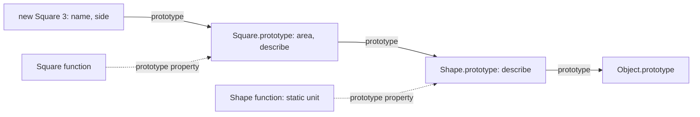

# Private state, composition, mixins and how classes map to prototypes

> **Before this lesson:** you understand prototype chains, constructors and the four steps of `new` from [Objects and prototype chains, explored with tests](#/lesson/js-testing/objects-prototype-chains), and closures from [Applied functions: binding, closures, state and memoisation](#/lesson/js-testing/closures-binding-memoize).

## In plain words

This lesson answers three practical questions about objects.

1. **How do I stop outside code from meddling with an object's internals?** That is **encapsulation**: hiding an object's data behind a small set of methods, so the data can only change in ways the object allows.
2. **How do I share behaviour between objects without a tall inheritance tree?** That is **composition** and its cousin the **mixin**: building an object out of small, independent pieces.
3. **What is a `class` really doing?** It is a tidier way of writing the constructor-and-prototype wiring from the previous lesson.

An everyday picture for encapsulation is a cash machine. You cannot open it and move banknotes around. You press buttons (the public methods), and the machine applies its rules: it will not hand out more than your balance. The rules can be trusted *because* the vault is closed. For composition, think of a toolbox compared with a Swiss Army knife. With a toolbox you pick the three tools a job needs and combine them freely; with the knife you carry every blade whether you need it or not.

Why it matters for a job: interviewers ask "how do you make something private in JavaScript?" and "composition or inheritance?", and the answers shape how testable your code is. Objects with a small public surface and replaceable parts are the easiest things in the world to test.

## Encapsulation: three ways to keep state private

Here is an account object whose rule is "the balance never goes below zero". With public data the rule cannot be trusted:

```js-run
// --- the tiny test runner from lesson 1 ---
function test(name, fn) {
  try { fn(); console.log("PASS  " + name); }
  catch (e) { console.log("FAIL  " + name + "\n      -> " + e.message); }
}
function expect(actual) {
  const show = (v) => typeof v === "function" ? "[function]" : JSON.stringify(v);
  const fail = (msg) => { throw new Error(msg); };
  return {
    toBe(expected) {
      if (!Object.is(actual, expected)) fail("expected " + show(expected) + " but got " + show(actual));
    },
    toEqual(expected) {
      if (JSON.stringify(actual) !== JSON.stringify(expected)) fail("expected " + show(expected) + " but got " + show(actual));
    },
    toThrow(text = "") {
      try { actual(); } catch (e) {
        if (!String(e.message).includes(text)) fail("threw the wrong error: " + e.message);
        return;
      }
      fail("expected the function to throw, but it returned normally");
    },
  };
}
// --- end of runner ---

function createOpenAccount() {
  return {
    balance: 0,
    deposit(amount) { this.balance += amount; },
    withdraw(amount) {
      if (amount > this.balance) throw new Error("insufficient funds");
      this.balance -= amount;
    },
  };
}

test("withdraw protects the balance", () => {
  const account = createOpenAccount();
  account.deposit(50);
  expect(() => account.withdraw(80)).toThrow("insufficient");
});

test("but anyone can bypass the rule by writing the property", () => {
  const account = createOpenAccount();
  account.balance = -1000000;                 // no method involved, no rule applied
  expect(account.balance).toBe(-1000000);
});
```

The second test passes, and that is the problem it documents: the rule lives in `withdraw`, but nothing forces callers to go through `withdraw`. A rule that must always hold for an object is called an **invariant**; encapsulation exists to protect invariants.

### Way 1: a closure

```javascript
function createAccount() {
  let balance = 0;                            // private: only these functions see it
  return {
    deposit(amount) {
      if (amount <= 0) throw new Error("deposit must be positive");
      balance += amount;
    },
    withdraw(amount) {
      if (amount > balance) throw new Error("insufficient funds");
      balance -= amount;
    },
    getBalance() { return balance; },
  };
}
```

`balance` is a local variable of `createAccount`. The three methods are closures that share it. There is no property to overwrite.

### Way 2: private class fields

Modern JavaScript has true private fields in classes, written with a leading `#`:

```javascript
class Account {
  #balance = 0;                               // private field
  deposit(amount) {
    if (amount <= 0) throw new Error("deposit must be positive");
    this.#balance += amount;
  }
  withdraw(amount) {
    if (amount > this.#balance) throw new Error("insufficient funds");
    this.#balance -= amount;
  }
  get balance() { return this.#balance; }     // read-only accessor
}
```

A `#name` field can only be used inside the body of the class that declares it. Outside code that writes `account.#balance` does not even parse. `get balance()` defines a **getter**: a method that is read like a property (`account.balance`) and, having no matching setter, cannot be assigned.

### Way 3: a naming convention

Older code marks "please do not touch" with an underscore, as in `this._balance`. This is a request, not protection. You will see it often; treat such properties as private when you read and test that code.

One suite can check both real implementations, because both offer the same behaviour:

```js-run
// --- the tiny test runner from lesson 1 ---
function test(name, fn) {
  try { fn(); console.log("PASS  " + name); }
  catch (e) { console.log("FAIL  " + name + "\n      -> " + e.message); }
}
function expect(actual) {
  const show = (v) => typeof v === "function" ? "[function]" : JSON.stringify(v);
  const fail = (msg) => { throw new Error(msg); };
  return {
    toBe(expected) {
      if (!Object.is(actual, expected)) fail("expected " + show(expected) + " but got " + show(actual));
    },
    toEqual(expected) {
      if (JSON.stringify(actual) !== JSON.stringify(expected)) fail("expected " + show(expected) + " but got " + show(actual));
    },
    toThrow(text = "") {
      try { actual(); } catch (e) {
        if (!String(e.message).includes(text)) fail("threw the wrong error: " + e.message);
        return;
      }
      fail("expected the function to throw, but it returned normally");
    },
  };
}
// --- end of runner ---

function createAccount() {
  let balance = 0;
  return {
    deposit(amount) { if (amount <= 0) throw new Error("deposit must be positive"); balance += amount; },
    withdraw(amount) { if (amount > balance) throw new Error("insufficient funds"); balance -= amount; },
    get balance() { return balance; },
  };
}

class Account {
  #balance = 0;
  deposit(amount) { if (amount <= 0) throw new Error("deposit must be positive"); this.#balance += amount; }
  withdraw(amount) { if (amount > this.#balance) throw new Error("insufficient funds"); this.#balance -= amount; }
  get balance() { return this.#balance; }
}

const implementations = { "closure version": () => createAccount(), "class version": () => new Account() };

for (const [label, make] of Object.entries(implementations)) {
  test(label + ": deposits and withdrawals change the balance", () => {
    const account = make();
    account.deposit(100);
    account.withdraw(30);
    expect(account.balance).toBe(70);
  });
  test(label + ": overdrawing is refused and the balance is unchanged", () => {
    const account = make();
    account.deposit(50);
    expect(() => account.withdraw(80)).toThrow("insufficient");
    expect(account.balance).toBe(50);
  });
  test(label + ": the balance cannot be overwritten from outside", () => {
    "use strict";
    const account = make();
    account.deposit(50);
    try { account.balance = -1000000; } catch (e) { /* strict mode throws; either way it must not change */ }
    expect(account.balance).toBe(50);
  });
}
```

Running one set of tests against two implementations is called a **contract test**: the tests describe the promise, and anything that keeps the promise passes. Notice also what the tests do *not* do. They never look at the private variable. They deposit, withdraw and read the public balance.

> [!TIP]
> Test private state through public behaviour. If you feel a need to reach inside an object to check it, either the behaviour is visible some other way (assert on that), or a piece of logic is hiding inside that deserves to be its own small, public, separately tested unit.

## Composition and mixins

Inheritance says "a `Square` **is a** `Shape`". Composition says "a `Player` **has a** position, **has an** inventory, **can** be saved". With inheritance, behaviours arrive in a fixed bundle from the parent. With composition, each behaviour is a separate piece and you pick the pieces you need.

A **mixin** is a group of methods intended to be copied onto other objects. `Object.assign(target, source)` does the copying: it copies every own enumerable property of `source` onto `target`.

```js-run
// --- the tiny test runner from lesson 1 ---
function test(name, fn) {
  try { fn(); console.log("PASS  " + name); }
  catch (e) { console.log("FAIL  " + name + "\n      -> " + e.message); }
}
function expect(actual) {
  const show = (v) => typeof v === "function" ? "[function]" : JSON.stringify(v);
  const fail = (msg) => { throw new Error(msg); };
  return {
    toBe(expected) {
      if (!Object.is(actual, expected)) fail("expected " + show(expected) + " but got " + show(actual));
    },
    toEqual(expected) {
      if (JSON.stringify(actual) !== JSON.stringify(expected)) fail("expected " + show(expected) + " but got " + show(actual));
    },
    toThrow(text = "") {
      try { actual(); } catch (e) {
        if (!String(e.message).includes(text)) fail("threw the wrong error: " + e.message);
        return;
      }
      fail("expected the function to throw, but it returned normally");
    },
  };
}
// --- end of runner ---

// two small, independent behaviours
const canGreet = {
  greet() { return "Hi, I am " + this.name; },
};
const canCount = {
  increment() { this.count = (this.count || 0) + 1; return this.count; },
};

test("Object.assign copies behaviours onto one object", () => {
  const robot = Object.assign({ name: "Bolt" }, canGreet, canCount);
  expect(robot.greet()).toBe("Hi, I am Bolt");
  expect(robot.increment()).toBe(1);
});

test("mixed-in methods are own properties, not inherited ones", () => {
  const robot = Object.assign({ name: "Bolt" }, canGreet);
  expect(Object.hasOwn(robot, "greet")).toBe(true);
});

test("a mixin can be added to a constructor's prototype to reach all instances", () => {
  function Pet(name) { this.name = name; }
  Object.assign(Pet.prototype, canGreet);
  expect(new Pet("Rex").greet()).toBe("Hi, I am Rex");
});

test("each mixin can be tested alone on a minimal object", () => {
  const minimal = { name: "X", ...canGreet };
  expect(minimal.greet()).toBe("Hi, I am X");
});

test("later sources win when two mixins define the same name", () => {
  const loud = { greet() { return "HELLO"; } };
  const robot = Object.assign({ name: "Bolt" }, canGreet, loud);
  expect(robot.greet()).toBe("HELLO");
});
```

The fourth test is the testing payoff: a mixin is a small unit that can be checked on the smallest object that satisfies its needs (here, anything with a `name`). The last test records a hazard: when two mixins use the same method name, the later one silently replaces the earlier.

A mixin with private state combines this idea with closures. It is written as a function that takes an object and adds methods to it; this form is called a **functional mixin**:

```js-run
// --- the tiny test runner from lesson 1 ---
function test(name, fn) {
  try { fn(); console.log("PASS  " + name); }
  catch (e) { console.log("FAIL  " + name + "\n      -> " + e.message); }
}
function expect(actual) {
  const show = (v) => typeof v === "function" ? "[function]" : JSON.stringify(v);
  const fail = (msg) => { throw new Error(msg); };
  return {
    toBe(expected) {
      if (!Object.is(actual, expected)) fail("expected " + show(expected) + " but got " + show(actual));
    },
    toEqual(expected) {
      if (JSON.stringify(actual) !== JSON.stringify(expected)) fail("expected " + show(expected) + " but got " + show(actual));
    },
    toThrow(text = "") {
      try { actual(); } catch (e) {
        if (!String(e.message).includes(text)) fail("threw the wrong error: " + e.message);
        return;
      }
      fail("expected the function to throw, but it returned normally");
    },
  };
}
// --- end of runner ---

function withEvents(target) {
  const listeners = [];                          // private to this one target
  target.on = (fn) => { listeners.push(fn); };
  target.emit = (value) => { listeners.forEach((fn) => fn(value)); };
  return target;
}

test("an object gains on and emit", () => {
  const door = withEvents({ name: "front door" });
  const heard = [];
  door.on((what) => heard.push(what));
  door.emit("opened");
  expect(heard).toEqual(["opened"]);
});

test("each object gets its own private listener list", () => {
  const a = withEvents({}), b = withEvents({});
  const heard = [];
  a.on((x) => heard.push("a:" + x));
  b.emit("ping");                                // nobody is listening on b
  expect(heard).toEqual([]);
});
```

> [!INTERVIEW]
> **"Composition or inheritance?"** A balanced answer: inheritance fits a true, stable "is a" relationship with one level or two. It couples the child tightly to the parent's implementation, so changes to the parent ripple down. Composition assembles small parts that can be combined, replaced and tested alone, which is why the common advice is to prefer composition and use inheritance sparingly. Mention that replaceable parts are also what make test doubles possible.

## How `class` maps onto prototypes

The `class` syntax arrived in ES2015. It does not add a second object system; it writes the constructor and prototype wiring for you. Learning tests make the mapping concrete.

```js-run
// --- the tiny test runner from lesson 1 ---
function test(name, fn) {
  try { fn(); console.log("PASS  " + name); }
  catch (e) { console.log("FAIL  " + name + "\n      -> " + e.message); }
}
function expect(actual) {
  const show = (v) => typeof v === "function" ? "[function]" : JSON.stringify(v);
  const fail = (msg) => { throw new Error(msg); };
  return {
    toBe(expected) {
      if (!Object.is(actual, expected)) fail("expected " + show(expected) + " but got " + show(actual));
    },
    toEqual(expected) {
      if (JSON.stringify(actual) !== JSON.stringify(expected)) fail("expected " + show(expected) + " but got " + show(actual));
    },
    toThrow(text = "") {
      try { actual(); } catch (e) {
        if (!String(e.message).includes(text)) fail("threw the wrong error: " + e.message);
        return;
      }
      fail("expected the function to throw, but it returned normally");
    },
  };
}
// --- end of runner ---

class Shape {
  constructor(name) { this.name = name; }
  describe() { return this.name + " with area " + this.area(); }
  static unit() { return "cm"; }
}

class Square extends Shape {
  constructor(side) {
    super("square");                    // same job as Shape.call(this, "square")
    this.side = side;
  }
  area() { return this.side * this.side; }
  describe() { return super.describe() + " and side " + this.side; }
}

test("a class is a function", () => {
  expect(typeof Shape).toBe("function");
});

test("methods are stored on the prototype, exactly as before", () => {
  expect(typeof Shape.prototype.describe).toBe("function");
  expect(Object.hasOwn(new Square(2), "describe")).toBe(false);
});

test("extends links the prototypes", () => {
  expect(Object.getPrototypeOf(Square.prototype)).toBe(Shape.prototype);
});

test("super(...) runs the parent constructor; super.method() calls the parent method", () => {
  expect(new Square(3).describe()).toBe("square with area 9 and side 3");
});

test("static methods belong to the class function, not to instances", () => {
  expect(Shape.unit()).toBe("cm");
  expect(new Shape("x").unit).toBe(undefined);
});

test("unlike a constructor function, a class cannot be called without new", () => {
  expect(() => Shape("oops")).toThrow("new");
});

test("class methods are not enumerable, so they do not appear in for...in", () => {
  const keys = [];
  for (const key in new Square(1)) keys.push(key);
  expect(keys).toEqual(["name", "side"]);
});
```

Side by side:

| Class syntax | What it does underneath |
|---|---|
| `class Shape { constructor(name) { ... } }` | `function Shape(name) { ... }` |
| `describe() { ... }` in the class body | `Shape.prototype.describe = function () { ... }` (non-enumerable) |
| `class Square extends Shape` | `Square.prototype = Object.create(Shape.prototype)` plus the constructor fix |
| `super("square")` | `Shape.call(this, "square")` |
| `super.describe()` | `Shape.prototype.describe.call(this)` |
| `static unit() { ... }` | `Shape.unit = function () { ... }` |
| `#balance` | true privacy; no equivalent in the old style except closures |



Classes add a few safety improvements over hand wiring: they refuse to be called without `new`, their bodies always run in strict mode, and they support private fields.

## Worked example: a test that finds a leaking internal

Encapsulation can leak even when the variable itself is private.

**Code under test:**

```javascript
class Playlist {
  #songs = [];
  add(title) { this.#songs.push(title); }
  get songs() { return this.#songs; }           // hands out the internal array
}
```

**The test:**

```javascript
test("callers cannot change the playlist through the returned list", () => {
  const list = new Playlist();
  list.add("Blue");
  list.songs.push("Injected");                  // mutate what the getter returned
  expect(list.songs).toEqual(["Blue"]);
});
```

**Failing output:**

```text
FAIL  callers cannot change the playlist through the returned list
      -> expected ["Blue"] but got ["Blue","Injected"]
```

The field is private, but the getter returns a reference to the very array stored inside, so callers can mutate it. **The fix** is to return a copy: `get songs() { return [...this.#songs]; }`.

**Passing output:**

```text
PASS  callers cannot change the playlist through the returned list
```

A copy returned to protect internal data is called a **defensive copy**.

## Common pitfalls

> [!WARNING]
> **Private does not mean protected if you hand out references.** Returning an internal array or object from a getter lets callers change it. Return a copy, or return something that cannot be changed.

- **Testing private details.** A test that reads `account._balance` breaks when you rename the field, although behaviour is unchanged. Assert through the public interface.
- **Arrow functions as class methods to "fix" `this` everywhere.** Each instance then carries its own copy of the function, and the method is no longer on the prototype, so it cannot be overridden with `super`. Use them deliberately, for callbacks.
- **Mixin name clashes.** `Object.assign` overwrites silently. Keep mixins small and their method names distinctive.
- **Deep class hierarchies.** Each level is another place a behaviour may come from. Prefer composition beyond one or two levels.
- **Forgetting `super(...)` in a subclass constructor.** Using `this` before calling `super` throws a `ReferenceError`.
- **Assuming `class` copies methods to instances.** It does not; instances delegate, as the tests showed.

## Cheat sheet

| Goal | Technique | How to test it |
|---|---|---|
| Private state, factory style | `let` inside a factory, methods as closures | try to overwrite from outside; assert unchanged |
| Private state, class style | `#field` | same public-behaviour tests |
| Read-only view | `get name() { ... }` with no setter | assign, then assert unchanged |
| Protect internal collections | return a defensive copy `[...this.#items]` | mutate the returned value; assert unchanged |
| Share behaviour without inheritance | `Object.assign(target, mixin)` | test the mixin on a minimal object |
| Mixin with private state | `function withX(target) { ... }` | two targets must not share state |
| Parent constructor | `super(args)` | assert parent-set properties exist |
| Parent method | `super.method()` | assert the combined result |
| Class-level helper | `static name() {}` | call on the class, not on an instance |

## Summary

- Encapsulation hides state so that an object's invariants can be trusted; closures and `#private` fields enforce it, underscores only suggest it.
- Tests should exercise the public interface; a contract test can run the same expectations against several implementations.
- Composition builds objects from small parts; mixins copy methods with `Object.assign` or add them through a function with private state.
- `class`, `extends`, `super` and `static` are syntax over constructor functions and prototype links, with stricter rules.
- Returning internal mutable data breaks encapsulation; return defensive copies.

## Glossary

- **Encapsulation**: hiding an object's data behind methods that control how it changes.
- **Invariant**: a rule that must hold for an object at all times.
- **Private field**: a class field named with `#`, usable only inside the class body.
- **Getter**: a method defined with `get` that is read like a property.
- **Composition**: building an object from smaller independent objects or behaviours.
- **Mixin**: a set of methods meant to be copied onto other objects.
- **Functional mixin**: a function that adds methods, and possibly private state, to an object.
- **Contract test**: one set of tests run against every implementation of the same interface.
- **Static method**: a method that belongs to the class itself, not to its instances.
- **Defensive copy**: a copy returned or stored so that outside code cannot mutate internal data.

## Check yourself

```quiz
[
  {"q": "function createAccount() { let balance = 0; return { deposit(n) { balance += n; }, get balance() { return balance; } }; } const a = createAccount(); a.deposit(50); a.balance = 0; expect(a.balance).toBe(50). Pass or fail (in non-strict code)?",
   "options": ["Fail, the balance is now 0", "Pass: there is a getter but no setter, so the assignment has no effect on the private variable", "It throws a SyntaxError", "Fail, the balance is undefined"],
   "answer": 1,
   "explain": "The variable lives in the closure. Assigning to a getter-only property is ignored in non-strict code (and throws in strict code); either way the private value is unchanged."},
  {"q": "class P { #items = []; add(x) { this.#items.push(x); } get items() { return this.#items; } } const p = new P(); p.add(1); p.items.push(2); expect(p.items).toEqual([1]). Pass or fail?",
   "options": ["Pass, the field is private", "Fail: the getter returns the internal array itself, so the push changed it to [1, 2]", "It throws because #items is private", "Pass for the wrong reason"],
   "answer": 1,
   "explain": "Privacy applies to the name, not to the object it refers to. Returning the reference leaks it; return a copy instead."},
  {"q": "A test asserts expect(account._balance).toBe(70). The team later renames the field to #balance without changing behaviour. What happens to the test?",
   "options": ["It still passes", "It fails although behaviour is unchanged, because it was coupled to an internal detail", "It is skipped", "It passes for the wrong reason"],
   "answer": 1,
   "explain": "Tests that reach into internals are brittle. Asserting on the public balance would have survived the refactor."},
  {"q": "expect(typeof class Foo {}).toBe('function'). Pass or fail?",
   "options": ["Fail, the type is 'class'", "Pass: a class is a constructor function with stricter rules", "Fail, the type is 'object'", "It throws"],
   "answer": 1,
   "explain": "Classes are functions underneath. Their methods are placed on the prototype object, as with hand-written constructors."},
  {"q": "What does 'super.describe()' inside a subclass method correspond to in the pre-class style?",
   "options": ["Parent.describe()", "Parent.prototype.describe.call(this)", "this.describe()", "Object.create(Parent)"],
   "answer": 1,
   "explain": "It looks the method up on the parent's prototype and calls it with the current object as this."},
  {"q": "Object.assign({ name: 'A' }, { hi() { return 1; } }, { hi() { return 2; } }).hi() returns?",
   "options": ["1", "2", "It throws because of the duplicate name", "undefined"],
   "answer": 1,
   "explain": "Sources are applied left to right and later properties overwrite earlier ones silently. This is the mixin name-clash hazard."},
  {"q": "Why can a mixin such as canGreet be unit-tested without any class?",
   "options": ["Mixins cannot be tested", "It only needs an object with the properties it uses, so a minimal literal object is enough", "Because Object.assign runs the tests", "Because mixins have no this"],
   "answer": 1,
   "explain": "A mixin's dependencies are the properties it reads through this. Any small object providing them is a sufficient fixture."}
]
```

> **Source:** Johansen, *Test-Driven JavaScript Development*, ch. 7 (Objects and Prototypal Inheritance). Docs: https://developer.mozilla.org/en-US/docs/Web/JavaScript/Reference/Classes , https://developer.mozilla.org/en-US/docs/Web/JavaScript/Reference/Classes/Private_elements , https://developer.mozilla.org/en-US/docs/Web/JavaScript/Reference/Global_Objects/Object/assign
