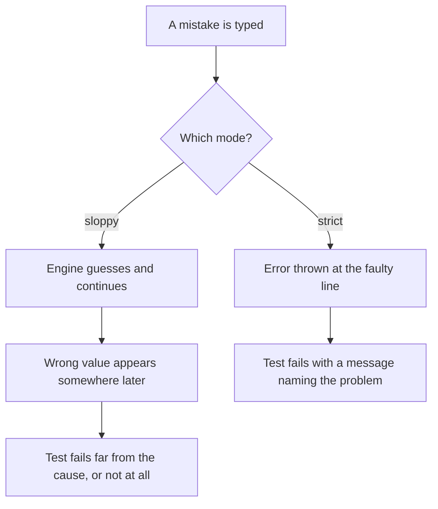

# Strict mode and modern language features, verified by tests

> **Before this lesson:** you can write learning tests ([Test to learn: learning tests and honest benchmarks](#/lesson/js-testing/learning-tests-benchmarks)) and you know scope, `this` and prototypes from the three previous lessons. A wider tour of recent syntax is in [Modern JavaScript: ES2015 and beyond](#/lesson/javascript/modern-javascript); this lesson focuses on what each change means for writing reliable, testable code.

## In plain words

JavaScript is defined by a standard called **ECMAScript**, and the standard is revised regularly. Two revisions reshaped everyday code. The fifth edition, **ES5** (2009), added **strict mode**, fine control over object properties, and the array methods you now take for granted. The sixth, **ES2015** (also called ES6), added `let` and `const`, arrow functions, classes, modules and promises. Since then a smaller update has arrived every year.

Strict mode is the centrepiece of this lesson. Early JavaScript was designed to be forgiving: when you made certain mistakes, it guessed what you meant and carried on. Strict mode is an opt-in setting under which those mistakes become errors.

Think of a spell-checker. Without one, a misspelt word goes into your letter and the reader is left to puzzle over it. With one, the word is underlined the moment you type it. Strict mode underlines mistakes at the moment they happen, at the line where they happen. That is precisely what a tester wants: a bug that throws immediately is easy to find; a bug that silently produces a slightly wrong value may surface three screens later.

Why it matters for a job: all modern code (ES modules, classes, anything built with current tools) runs in strict mode, while a lot of older code does not, and interviewers enjoy asking what changes between the two.

## Turning strict mode on

- Put the string `"use strict";` as the first statement of a script file or of a single function.
- Or do nothing: code inside an **ES module** (a file loaded with `import` / `export`) and inside a `class` body is always strict.

The runnable blocks on this page execute in the old non-strict mode, often called **sloppy mode**, unless a function opts in. That lets us test both behaviours side by side.

## What strict mode changes

### 1. Assigning to an undeclared variable

```js-run
// --- the tiny test runner from lesson 1 ---
function test(name, fn) {
  try { fn(); console.log("PASS  " + name); }
  catch (e) { console.log("FAIL  " + name + "\n      -> " + e.message); }
}
function expect(actual) {
  const show = (v) => typeof v === "function" ? "[function]" : JSON.stringify(v);
  const fail = (msg) => { throw new Error(msg); };
  return {
    toBe(expected) {
      if (!Object.is(actual, expected)) fail("expected " + show(expected) + " but got " + show(actual));
    },
    toEqual(expected) {
      if (JSON.stringify(actual) !== JSON.stringify(expected)) fail("expected " + show(expected) + " but got " + show(actual));
    },
    toThrow(text = "") {
      try { actual(); } catch (e) {
        if (!String(e.message).includes(text)) fail("threw the wrong error: " + e.message);
        return;
      }
      fail("expected the function to throw, but it returned normally");
    },
  };
}
// --- end of runner ---

test("sloppy mode: a misspelt variable silently becomes a global", () => {
  function addUp() { runningTotl = 5; }        // typo: never declared
  addUp();
  expect(globalThis.runningTotl).toBe(5);      // it leaked into the global object
  delete globalThis.runningTotl;               // clean up after ourselves
});

test("strict mode: the same typo throws at once", () => {
  function addUp() { "use strict"; runningTotl = 5; }
  expect(addUp).toThrow();                    // a ReferenceError
});
```

The strict test calls `toThrow()` with no text on purpose. The wording of built-in error messages differs between JavaScript engines (Chrome, Firefox and Safari each phrase this error differently), so a test that matched the exact message would pass in one browser and fail in another. For errors thrown by the engine, assert that something was thrown, or assert on the error's type; match message text only for errors your own code creates.

In sloppy mode an assignment to a name that was never declared creates a property on the **global object** (`globalThis`, known as `window` in browsers). The typo "works", and two unrelated functions with the same typo now share a hidden variable. In strict mode the assignment throws a `ReferenceError`. Note the cleanup line in the first test: the leak is real shared state, and a test that creates shared state must remove it.

### 2. `this` in a plain function call

```js-run
// --- the tiny test runner from lesson 1 ---
function test(name, fn) {
  try { fn(); console.log("PASS  " + name); }
  catch (e) { console.log("FAIL  " + name + "\n      -> " + e.message); }
}
function expect(actual) {
  const show = (v) => typeof v === "function" ? "[function]" : JSON.stringify(v);
  const fail = (msg) => { throw new Error(msg); };
  return {
    toBe(expected) {
      if (!Object.is(actual, expected)) fail("expected " + show(expected) + " but got " + show(actual));
    },
    toEqual(expected) {
      if (JSON.stringify(actual) !== JSON.stringify(expected)) fail("expected " + show(expected) + " but got " + show(actual));
    },
    toThrow(text = "") {
      try { actual(); } catch (e) {
        if (!String(e.message).includes(text)) fail("threw the wrong error: " + e.message);
        return;
      }
      fail("expected the function to throw, but it returned normally");
    },
  };
}
// --- end of runner ---

test("sloppy mode: this in a plain call is the global object", () => {
  function whoAmI() { return this; }
  expect(whoAmI()).toBe(globalThis);
});

test("strict mode: this in a plain call is undefined", () => {
  function whoAmI() { "use strict"; return this; }
  expect(whoAmI()).toBe(undefined);
});

test("strict mode therefore catches a constructor called without new", () => {
  function Point(x) { "use strict"; this.x = x; }
  expect(() => Point(3)).toThrow("undefined");
});
```

In sloppy mode, forgetting `new` makes the constructor write its properties onto the global object without complaint. In strict mode `this` is `undefined` and the first assignment throws.

### 3. Writes that cannot succeed

```js-run
// --- the tiny test runner from lesson 1 ---
function test(name, fn) {
  try { fn(); console.log("PASS  " + name); }
  catch (e) { console.log("FAIL  " + name + "\n      -> " + e.message); }
}
function expect(actual) {
  const show = (v) => typeof v === "function" ? "[function]" : JSON.stringify(v);
  const fail = (msg) => { throw new Error(msg); };
  return {
    toBe(expected) {
      if (!Object.is(actual, expected)) fail("expected " + show(expected) + " but got " + show(actual));
    },
    toEqual(expected) {
      if (JSON.stringify(actual) !== JSON.stringify(expected)) fail("expected " + show(expected) + " but got " + show(actual));
    },
    toThrow(text = "") {
      try { actual(); } catch (e) {
        if (!String(e.message).includes(text)) fail("threw the wrong error: " + e.message);
        return;
      }
      fail("expected the function to throw, but it returned normally");
    },
  };
}
// --- end of runner ---

test("sloppy mode: writing to a frozen object is silently ignored", () => {
  const settings = Object.freeze({ theme: "dark" });
  settings.theme = "light";                    // nothing happens, no error
  expect(settings.theme).toBe("dark");
});

test("strict mode: writing to a frozen object throws", () => {
  const settings = Object.freeze({ theme: "dark" });
  function change() { "use strict"; settings.theme = "light"; }
  expect(change).toThrow();                   // a TypeError
});

test("strict mode: assigning to a getter-only property throws", () => {
  const circle = { get area() { return 12; } };
  function change() { "use strict"; circle.area = 99; }
  expect(change).toThrow();
});
```

Sloppy mode discards impossible writes and keeps going, leaving you to wonder later why a value "did not stick". Strict mode reports the line.

### 4. Smaller clean-ups

| Feature | Sloppy mode | Strict mode |
|---|---|---|
| Duplicate parameter names `function f(a, a)` | allowed; the last wins | `SyntaxError` |
| The `with` statement | allowed | `SyntaxError` |
| `delete` on a plain variable | returns `false`, does nothing | `SyntaxError` |
| Octal literals such as `010` | means 8 | `SyntaxError` (write `0o10`) |
| `arguments` and named parameters | linked: changing one changes the other | independent |
| Variables declared inside `eval` | leak into the surrounding scope | stay inside the `eval` |
| Words such as `let`, `static`, `interface` as variable names | allowed | reserved |

Several of these are syntax errors, which means the engine rejects the code when it reads it, before running anything. Those are the cheapest bugs of all to find.

## Worked example: a bug that only a strict test reveals

**Code under test** (sloppy, as in an old script file):

```javascript
function averageScore(scores) {
  var total = 0;
  for (var i = 0; i < scores.length; i++) {
    totl = total + scores[i];                  // typo on the left-hand side
  }
  return scores.length === 0 ? 0 : total / scores.length;
}
```

**The test:**

```javascript
test("averages three scores", () => {
  expect(averageScore([4, 8, 6])).toBe(6);
});
```

**Failing output in sloppy mode:**

```text
FAIL  averages three scores
      -> expected 6 but got 0
```

The test fails, which is good, but the message only says the answer is wrong. You must now read the function hunting for the cause. Add `"use strict";` as the first line of the function and run the same test:

```text
FAIL  averages three scores
      -> totl is not defined
```

The failure now names the misspelt variable. **The fix** is to correct the spelling to `total = total + scores[i];`.

**Passing output:**

```text
PASS  averages three scores
```

Same bug, same test; strict mode turned a vague wrong answer into a message that points at the mistake.

```js-run
// --- the tiny test runner from lesson 1 ---
function test(name, fn) {
  try { fn(); console.log("PASS  " + name); }
  catch (e) { console.log("FAIL  " + name + "\n      -> " + e.message); }
}
function expect(actual) {
  const show = (v) => typeof v === "function" ? "[function]" : JSON.stringify(v);
  const fail = (msg) => { throw new Error(msg); };
  return {
    toBe(expected) {
      if (!Object.is(actual, expected)) fail("expected " + show(expected) + " but got " + show(actual));
    },
    toEqual(expected) {
      if (JSON.stringify(actual) !== JSON.stringify(expected)) fail("expected " + show(expected) + " but got " + show(actual));
    },
    toThrow(text = "") {
      try { actual(); } catch (e) {
        if (!String(e.message).includes(text)) fail("threw the wrong error: " + e.message);
        return;
      }
      fail("expected the function to throw, but it returned normally");
    },
  };
}
// --- end of runner ---

function averageScore(scores) {
  "use strict";
  let total = 0;
  for (const score of scores) {
    total = total + score;
  }
  return scores.length === 0 ? 0 : total / scores.length;
}

test("averages three scores", () => expect(averageScore([4, 8, 6])).toBe(6));
test("an empty list averages to 0, not NaN", () => expect(averageScore([])).toBe(0));
test("a single score is its own average", () => expect(averageScore([7])).toBe(7));
```

## ES5's other gifts: control over properties

ES5 also let programs describe *how* a property behaves, through **property descriptors**. Each property has three switches besides its value: `writable` (may the value change?), `enumerable` (does it show up in `Object.keys` and loops?) and `configurable` (may it be deleted or redefined?).

```js-run
// --- the tiny test runner from lesson 1 ---
function test(name, fn) {
  try { fn(); console.log("PASS  " + name); }
  catch (e) { console.log("FAIL  " + name + "\n      -> " + e.message); }
}
function expect(actual) {
  const show = (v) => typeof v === "function" ? "[function]" : JSON.stringify(v);
  const fail = (msg) => { throw new Error(msg); };
  return {
    toBe(expected) {
      if (!Object.is(actual, expected)) fail("expected " + show(expected) + " but got " + show(actual));
    },
    toEqual(expected) {
      if (JSON.stringify(actual) !== JSON.stringify(expected)) fail("expected " + show(expected) + " but got " + show(actual));
    },
    toThrow(text = "") {
      try { actual(); } catch (e) {
        if (!String(e.message).includes(text)) fail("threw the wrong error: " + e.message);
        return;
      }
      fail("expected the function to throw, but it returned normally");
    },
  };
}
// --- end of runner ---

test("defineProperty can create a read-only, hidden property", () => {
  const user = { name: "Ada" };
  Object.defineProperty(user, "id", { value: 42, writable: false, enumerable: false });
  user.id = 99;                                   // ignored in sloppy mode
  expect(user.id).toBe(42);
  expect(Object.keys(user)).toEqual(["name"]);    // id is not listed
});

test("getters and setters run code on read and write", () => {
  const temp = {
    celsius: 20,
    get fahrenheit() { return this.celsius * 9 / 5 + 32; },
    set fahrenheit(f) { this.celsius = (f - 32) * 5 / 9; },
  };
  expect(temp.fahrenheit).toBe(68);
  temp.fahrenheit = 212;
  expect(temp.celsius).toBe(100);
});

test("Object.freeze is shallow: nested objects stay changeable", () => {
  const config = Object.freeze({ limits: { max: 10 } });
  config.limits.max = 99;
  expect(config.limits.max).toBe(99);
  expect(Object.isFrozen(config)).toBe(true);
});

test("seal allows changing values but not adding or removing properties", () => {
  const point = Object.seal({ x: 1 });
  point.x = 2;
  point.y = 3;                                    // ignored
  expect(point).toEqual({ x: 2 });
});
```

`Object.freeze` makes every own property read-only and forbids adding or removing properties, but only one level deep, as the third test records. Frozen objects are handy in tests: freeze an input before passing it to the function under test, and (in strict code) any attempt to mutate the input throws, proving or disproving that the function leaves its arguments alone.

ES5 also standardised `Function.prototype.bind`, `JSON.parse` and `JSON.stringify`, `Object.keys`, `Object.create`, `Array.isArray`, and the array methods `forEach`, `map`, `filter`, `reduce`, `some`, `every` and `indexOf`.

## The modern features and what each one changed

| Feature (edition) | Replaces | Why it makes code safer or easier to test |
|---|---|---|
| `let`, `const` (ES2015) | `var` | Block scope; no accidental sharing between loop turns; `const` prevents reassignment |
| Arrow functions (ES2015) | `var self = this` tricks | `this` comes from the surrounding code, so callbacks do not lose it |
| Classes (ES2015), `#private` (ES2022) | hand-wired prototypes | Less wiring to get wrong; must be called with `new`; true privacy |
| ES modules (ES2015) | global variables and IIFEs | Every file has its own scope and is always strict; dependencies are explicit imports that tests can replace |
| Template literals (ES2015) | string concatenation | Fewer quoting mistakes in messages and test names |
| Destructuring, default, rest and spread (ES2015) | manual unpacking, `arguments` | Clear inputs; easy copies without mutation |
| `Map`, `Set` (ES2015) | objects used as dictionaries | Any value as a key; no clash with inherited property names |
| Promises (ES2015), `async` / `await` (ES2017) | nested callbacks | Asynchronous code that reads top to bottom and that a test can `await` |
| Optional chaining `?.` and nullish coalescing `??` (ES2020) | long `&&` chains, `||` defaults | No crash on missing data; `??` keeps valid falsy values such as `0` |

```js-run
// --- the tiny test runner from lesson 1 ---
function test(name, fn) {
  try { fn(); console.log("PASS  " + name); }
  catch (e) { console.log("FAIL  " + name + "\n      -> " + e.message); }
}
function expect(actual) {
  const show = (v) => typeof v === "function" ? "[function]" : JSON.stringify(v);
  const fail = (msg) => { throw new Error(msg); };
  return {
    toBe(expected) {
      if (!Object.is(actual, expected)) fail("expected " + show(expected) + " but got " + show(actual));
    },
    toEqual(expected) {
      if (JSON.stringify(actual) !== JSON.stringify(expected)) fail("expected " + show(expected) + " but got " + show(actual));
    },
    toThrow(text = "") {
      try { actual(); } catch (e) {
        if (!String(e.message).includes(text)) fail("threw the wrong error: " + e.message);
        return;
      }
      fail("expected the function to throw, but it returned normally");
    },
  };
}
// --- end of runner ---

test("const prevents reassignment but not mutation of the object", () => {
  const list = [1];
  list.push(2);                                    // allowed: same array, changed contents
  expect(list).toEqual([1, 2]);
  expect(() => { list = []; }).toThrow();
});

test("spread makes a shallow copy, so the original input is untouched", () => {
  const original = { name: "Ada", tags: ["x"] };
  const copy = { ...original, name: "Grace" };
  expect(original.name).toBe("Ada");
  expect(copy.tags).toBe(original.tags);           // nested values are shared
});

test("optional chaining returns undefined where a plain dot would throw", () => {
  const user = { profile: null };
  expect(user.profile?.city).toBe(undefined);
  expect(() => user.profile.city).toThrow("null");
});

test("?? falls back only for null and undefined; || also replaces 0 and ''", () => {
  const quantity = 0;
  expect(quantity || 10).toBe(10);                 // 0 is falsy: surprising default
  expect(quantity ?? 10).toBe(0);                  // 0 is kept
});

test("a Map keeps keys of different types apart", () => {
  const seen = new Map([[1, "number one"], ["1", "string one"]]);
  expect(seen.get(1)).toBe("number one");
  expect(seen.size).toBe(2);
});
```

The fourth test documents one of the most common real bugs fixed by a modern operator: using `||` for a default wipes out legitimate values such as a quantity of `0` or an empty string.



> [!TIP]
> In a test, wrap fixture data in `Object.freeze(...)` when the function under test promises not to modify its input. In strict code, any accidental mutation becomes a thrown error and a failing test.

> [!INTERVIEW]
> **"What does 'use strict' do?"** Give the principle and three examples: it turns silent mistakes into errors. Assigning to an undeclared variable throws instead of creating a global; `this` is `undefined` in plain function calls instead of the global object; writes to read-only properties throw instead of being ignored. Add that modules and classes are strict automatically, so in modern code you rarely type the directive.

## Common pitfalls

> [!WARNING]
> `"use strict"` only works as the *first* statement of a file or function. Placed after another statement it is an ordinary string that does nothing, and no error tells you so. A quick learning test (`expect(function () { "use strict"; return this; }()).toBe(undefined)`) confirms whether strictness is active.

- **Concatenating strict and sloppy script files.** In old build setups, joining files could make a file-level directive apply to code that was never written for it. Function-level directives or modules avoid this.
- **Believing `const` makes values immutable.** It fixes the binding, not the contents. Use `Object.freeze` for one level of immutability.
- **Assuming `Object.freeze` is deep.** Nested objects remain mutable.
- **Using `||` for defaults when `0`, `""` or `false` are valid.** Use `??`.
- **Tests that leak globals.** A sloppy-mode typo in test code creates a global that later tests can see. Run tests as modules so they are strict.
- **Feature availability.** A very new syntax may not exist in an old runtime. Check the support table or the runtime version before relying on it; the next lesson covers detecting features.

## Cheat sheet

| Behaviour to verify | Assertion |
|---|---|
| Strict mode is active here | `expect((function () { "use strict"; return this; })()).toBe(undefined)` |
| Typo assignment throws | `expect(fn).toThrow(ReferenceError)` in Jest and Vitest |
| Object is frozen | `expect(Object.isFrozen(obj)).toBe(true)` |
| Function does not mutate its input | freeze the input, call the function in strict code, `expect(...).not.toThrow()` |
| Property is hidden from listing | `expect(Object.keys(obj)).not.toContain("id")` |
| Property descriptor | `expect(Object.getOwnPropertyDescriptor(obj, "id").writable).toBe(false)` |
| Reassigning a `const` throws | `expect(() => { c = 1; }).toThrow()` |
| Safe navigation | `expect(a?.b?.c).toBeUndefined()` |
| Default keeps zero | `expect(0 ?? 10).toBe(0)` |

## Summary

- Strict mode converts silent mistakes into errors: undeclared assignments, lost `this`, impossible writes and several confusing syntaxes.
- Modules and classes are always strict; `"use strict"` is needed only in old-style scripts and must come first.
- Errors thrown at the faulty line make failing tests point at the cause.
- ES5 added property descriptors, getters and setters, `freeze` and `seal`, `bind`, JSON and the array methods.
- ES2015 and later added block scope, arrows, classes, modules, promises, `async` / `await`, `?.` and `??`; each removed a category of bug.

## Glossary

- **ECMAScript**: the standard that defines the JavaScript language; editions are named ES5, ES2015, and so on.
- **Strict mode**: an opt-in variant of the language in which many silent mistakes throw errors.
- **Sloppy mode**: the informal name for the default, non-strict behaviour.
- **Global object**: the object holding global variables, reachable as `globalThis`.
- **Implicit global**: a global created by accident by assigning to an undeclared name in sloppy mode.
- **ES module**: a file using `import` and `export`, with its own scope and automatic strict mode.
- **Property descriptor**: the settings of a property: value, `writable`, `enumerable`, `configurable`, or a getter and setter.
- **Freeze / seal**: lock an object against all changes / against adding and removing properties.
- **Optional chaining (`?.`)**: property access that yields `undefined` if the left side is `null` or `undefined`.
- **Nullish coalescing (`??`)**: a default that applies only to `null` and `undefined`.

## Check yourself

```quiz
[
  {"q": "function f() { 'use strict'; count = 1; } expect(f).toThrow(). Pass or fail?",
   "options": ["Fail: count becomes a global", "Pass: in strict mode, assigning to an undeclared variable throws a ReferenceError", "Fail: strict mode forbids functions named f", "Pass for the wrong reason"],
   "answer": 1,
   "explain": "Strict mode refuses to create implicit globals. The assignment throws 'count is not defined'."},
  {"q": "In sloppy mode: const s = Object.freeze({ a: 1 }); s.a = 2; expect(s.a).toBe(2). Pass or fail?",
   "options": ["Pass", "Fail: the write is silently ignored, so s.a is still 1", "It throws a TypeError", "Fail: s.a is undefined"],
   "answer": 1,
   "explain": "Frozen properties cannot change. Sloppy mode ignores the write without an error; strict mode would throw."},
  {"q": "function g() { doWork(); 'use strict'; return this; } Called plainly in a script, what does g() return (assume doWork exists)?",
   "options": ["undefined, because the function is strict", "The global object: the directive is not the first statement, so it has no effect", "null", "It throws a SyntaxError"],
   "answer": 1,
   "explain": "The directive only counts at the very start of a file or function body. Anywhere else it is an ordinary string expression."},
  {"q": "const stock = 0; expect(stock || 5).toBe(0). Pass or fail?",
   "options": ["Pass", "Fail: 0 is falsy, so || returns 5; use ?? to keep 0", "It throws", "Fail: the result is undefined"],
   "answer": 1,
   "explain": "|| replaces every falsy value. The nullish coalescing operator ?? only replaces null and undefined."},
  {"q": "const cfg = Object.freeze({ db: { port: 5432 } }); cfg.db.port = 1; expect(cfg.db.port).toBe(5432). Pass or fail?",
   "options": ["Pass, the object is frozen", "Fail: freeze is shallow, so the nested object was changed to port 1", "It throws", "Pass for the wrong reason"],
   "answer": 1,
   "explain": "Only the top-level properties of cfg are locked. The nested db object is a separate, unfrozen object."},
  {"q": "Why does strict mode help when a test fails?",
   "options": ["It makes tests run faster", "Mistakes throw at the faulty line, so the failure message names the cause instead of showing a distant wrong value", "It hides failing tests", "It adds assertions automatically"],
   "answer": 1,
   "explain": "A thrown error at the source is a far better clue than a silently wrong result detected later."},
  {"q": "Which code is strict without any 'use strict' directive?",
   "options": ["Any function declared with var", "Code inside ES modules and class bodies", "Code inside try blocks", "Code run with setTimeout"],
   "answer": 1,
   "explain": "The standard makes module code and class bodies strict automatically."}
]
```

> **Source:** Johansen, *Test-Driven JavaScript Development*, ch. 8 (ECMAScript 5th Edition). Docs: https://developer.mozilla.org/en-US/docs/Web/JavaScript/Reference/Strict_mode , https://developer.mozilla.org/en-US/docs/Web/JavaScript/Reference/Global_Objects/Object/defineProperty , https://developer.mozilla.org/en-US/docs/Web/JavaScript/Reference/Operators/Nullish_coalescing
