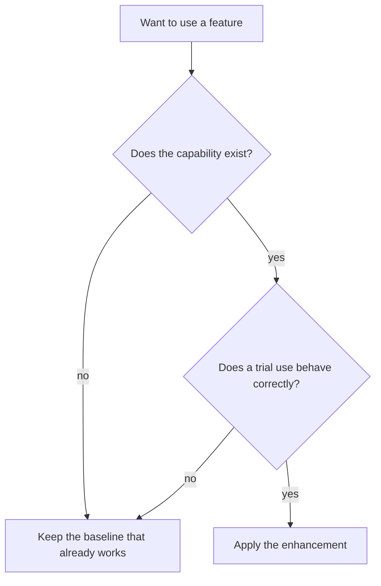

# Unobtrusive JavaScript, progressive enhancement and feature detection

> **Before this lesson:** you know how a page is represented as a tree of elements and how event handlers are attached ([JavaScript in the browser and the DOM tree](#/lesson/javascript/browser-dom-tree), [Event handlers, propagation and delegation](#/lesson/javascript/event-handling)), and you can write tests that pass objects into a function ([Why automate tests: your first unit test](#/lesson/js-testing/first-unit-test)).

## In plain words

A web page is made of three layers: **HTML** says what the content *is* (a heading, a form, a link), **CSS** says how it *looks*, and **JavaScript** says how it *behaves*. **Unobtrusive JavaScript** is the discipline of keeping the behaviour layer separate and polite: the script lives in its own files, it attaches itself to the page from outside, and it makes no demands. If the script is missing, slow or broken, the page still does its basic job.

**Progressive enhancement** is the strategy that follows: build the basic working version with plain HTML first, then *add* improvements for browsers that can handle them. **Feature detection** is the technique for deciding, at run time, whether a given improvement can be used: you ask the browser "do you have this capability?" and not "what is your name?".

Think of a building with stairs and an escalator. The stairs always work. The escalator is a pleasant extra: faster and easier. When the power fails, a stopped escalator is still a staircase, and nobody is trapped. A page built with progressive enhancement is the same: the HTML is the stairs, the JavaScript is the motor.

Why it matters for a job: scripts fail more often than developers assume (flaky mobile networks, blocked third-party hosts, a bug in one file stopping the rest), accessibility and search engines depend on meaningful HTML, and interviewers often ask "feature detection or browser sniffing, and why?". There is a testing bonus as well: code written in this style receives its surroundings as inputs, and anything that arrives as an input can be replaced by a fake in a test.

## Obtrusive code and its problems

```html
<a href="javascript:void(0)" onclick="openHelp()">Help</a>
<div onclick="save()" style="color: blue">Save</div>
```

Everything is tangled together here.

- **Behaviour is buried in the markup.** To change what happens on click, you edit HTML in every place the pattern was pasted.
- **Without the script, nothing works.** The link goes nowhere. The `div` is not a control at all.
- **Assistive technology is locked out.** A `div` cannot be reached with the Tab key and is not announced as a button by a screen reader (software that reads the page aloud for blind users).
- **It is hard to test.** The functions must be global for the attributes to find them, and the logic can only be exercised by clicking in a real page.

## The rules of unobtrusive scripting

1. **Start from meaningful HTML that works alone.** A real `<a href="/help">` leads to a help page; a real `<form action="/search">` submits to the server; a real `<button>` is focusable and announced correctly.
2. **Keep script out of the markup.** No `onclick` attributes. Scripts find elements and attach listeners with `addEventListener`.
3. **Assume nothing.** The element you want might not be on this page. The feature you want might not exist in this browser. Check, and if the check fails, leave the page alone.
4. **Leave a small footprint.** Do not create global variables or modify built-in objects; use modules.
5. **Enhance, do not replace.** The script upgrades the working baseline in place.

Here is a live page that follows the rules. A long article has a "table of contents" made of ordinary links to headings, which work with no script at all. The script, if it runs and if the browser has the capability it needs, adds a highlight for the section you clicked.

```html-run
<!doctype html>
<html>
<head>
<style>
  body { font-family: sans-serif; margin: 16px; }
  nav a { margin-right: 12px; }
  section { margin-top: 12px; padding: 8px; border-left: 4px solid transparent; }
  section.current { border-left-color: #2a7; background: #eefaf3; }
  #report { margin-top: 16px; font-family: monospace; white-space: pre; color: #333; }
</style>
</head>
<body>
  <nav id="toc">
    <a href="#intro">Intro</a>
    <a href="#setup">Setup</a>
    <a href="#usage">Usage</a>
  </nav>
  <section id="intro"><h3>Intro</h3><p>Plain links already jump here.</p></section>
  <section id="setup"><h3>Setup</h3><p>Click a link above.</p></section>
  <section id="usage"><h3>Usage</h3><p>The highlight is the enhancement.</p></section>
  <div id="report"></div>

<script>
  // ---- behaviour, kept apart from the markup ----
  function enhanceToc(doc) {
    var toc = doc.getElementById("toc");
    if (!toc || !toc.addEventListener || !doc.querySelector) return false;   // assume nothing
    toc.addEventListener("click", function (event) {
      var link = event.target.closest ? event.target.closest("a") : null;
      if (!link) return;
      var old = doc.querySelector("section.current");
      if (old) old.classList.remove("current");
      var target = doc.querySelector(link.getAttribute("href"));
      if (target) target.classList.add("current");
      // no preventDefault: the browser still performs the normal jump
    });
    return true;
  }

  // ---- a tiny in-page test run ----
  var lines = [];
  function test(name, fn) {
    try { fn(); lines.push("PASS  " + name); } catch (e) { lines.push("FAIL  " + name + " -> " + e.message); }
  }
  function assert(cond, msg) { if (!cond) throw new Error(msg); }

  test("enhancement reports success on this page", function () {
    assert(enhanceToc(document) === true, "expected true");
  });
  test("it does nothing, without throwing, when the element is missing", function () {
    var emptyDoc = { getElementById: function () { return null; } };
    assert(enhanceToc(emptyDoc) === false, "expected false");
  });
  test("clicking a link marks its section as current", function () {
    document.querySelector('a[href="#setup"]').click();
    assert(document.getElementById("setup").classList.contains("current"), "setup not highlighted");
  });
  document.getElementById("report").textContent = lines.join("\n");
</script>
</body>
</html>
```

Read `enhanceToc` with the rules in mind. It receives the document as a parameter (`doc`) instead of reaching for the global one. Its first act is a guard: if the navigation element is missing, or the browser lacks a method the code needs, it returns `false` and touches nothing. It attaches **one** listener to the container and works out which link was clicked from `event.target`; handling events for many children on a shared ancestor is called **event delegation**. And it never cancels the link's default action, so the baseline jump keeps working.

The second in-page test is the interesting one. Because the function takes its document as an argument, the test can hand it a **fake**: a plain object with only a `getElementById` method that returns `null`. No real page without a `toc` had to be built.

## Feature detection versus browser sniffing

Suppose you want to use a capability that not every browser has. There are two ways to decide.

**Browser sniffing** reads the **user-agent string**, a line of text the browser sends to identify itself, and guesses capabilities from the browser's name and version:

```javascript
// fragile: do not do this
if (navigator.userAgent.includes("Chrome")) {
  useFancyFeature();
}
```

This approach fails in several ways. User-agent strings are full of historical lies: for compatibility reasons nearly every browser's string contains the names of *other* browsers, so the check above also matches browsers that are not Chrome. The list of names and versions must be maintained by hand for ever. A new browser, or an old one that gains the feature in an update, is wrongly excluded. Users and privacy features change or shorten the string. And the question was never "which browser is this?"; it was "can I use this feature?".

**Feature detection** asks that question directly:

```javascript
if ("clipboard" in navigator && typeof navigator.clipboard.writeText === "function") {
  enableCopyButton();
}
```

Whatever the browser is called, whenever it was released, if the capability exists the code uses it, and if not, the baseline remains.

The common detection forms:

| Form | Example | Use when |
|---|---|---|
| Property exists | `"geolocation" in navigator` | An API hangs off a known object |
| Type check | `typeof window.fetch === "function"` | You will call it as a function |
| Constructor exists | `typeof IntersectionObserver !== "undefined"` | You will use `new` |
| CSS support | `CSS.supports("display", "grid")` or `@supports` in CSS | A style feature |
| Try it and inspect the result | set a value and read it back | Existence is not enough; behaviour varies |

The last form is the most thorough and is sometimes called **feature testing**: a property can exist and still be broken or be a stub, so you exercise it once and check what happened.

### Making detection testable

Detection logic has two branches, "supported" and "not supported". On your own machine you can only ever see one of them, unless the environment is an input. Write detection as a function of an environment object, and both branches become ordinary unit tests.

**Code under test (first attempt):**

```javascript
function pickStorage(env) {
  if (env.localStorage) return "local";
  return "memory";
}
```

**The tests:**

```javascript
test("uses local storage when it exists and works", () => {
  const env = { localStorage: workingStorage() };
  expect(pickStorage(env)).toBe("local");
});

test("falls back to memory when storage exists but writes throw", () => {
  const env = { localStorage: { setItem() { throw new Error("quota exceeded"); }, removeItem() {} } };
  expect(pickStorage(env)).toBe("memory");
});
```

**Failing output:**

```text
PASS  uses local storage when it exists and works
FAIL  falls back to memory when storage exists but writes throw
      -> expected "memory" but got "local"
```

The second test models a real situation: some browsers expose `localStorage` in private-browsing or restricted modes but throw on every write. Checking existence is not enough. **The fix** is feature testing: try a write and see whether it worked.

```js-run
// --- the tiny test runner from lesson 1 ---
function test(name, fn) {
  try { fn(); console.log("PASS  " + name); }
  catch (e) { console.log("FAIL  " + name + "\n      -> " + e.message); }
}
function expect(actual) {
  const show = (v) => typeof v === "function" ? "[function]" : JSON.stringify(v);
  const fail = (msg) => { throw new Error(msg); };
  return {
    toBe(expected) {
      if (!Object.is(actual, expected)) fail("expected " + show(expected) + " but got " + show(actual));
    },
    toEqual(expected) {
      if (JSON.stringify(actual) !== JSON.stringify(expected)) fail("expected " + show(expected) + " but got " + show(actual));
    },
    toThrow(text = "") {
      try { actual(); } catch (e) {
        if (!String(e.message).includes(text)) fail("threw the wrong error: " + e.message);
        return;
      }
      fail("expected the function to throw, but it returned normally");
    },
  };
}
// --- end of runner ---

function pickStorage(env) {
  const store = env.localStorage;
  if (!store) return "memory";
  try {
    store.setItem("__probe__", "1");          // try it for real
    store.removeItem("__probe__");            // and clean up
    return "local";
  } catch (error) {
    return "memory";                          // present but unusable
  }
}

function workingStorage() {
  const data = {};
  return {
    setItem(key, value) { data[key] = String(value); },
    removeItem(key) { delete data[key]; },
    keys() { return Object.keys(data); },
  };
}

test("uses local storage when it exists and works", () => {
  expect(pickStorage({ localStorage: workingStorage() })).toBe("local");
});

test("falls back to memory when storage is absent", () => {
  expect(pickStorage({})).toBe("memory");
});

test("falls back to memory when storage exists but writes throw", () => {
  const broken = { setItem() { throw new Error("quota exceeded"); }, removeItem() {} };
  expect(pickStorage({ localStorage: broken })).toBe("memory");
});

test("the probe leaves nothing behind", () => {
  const store = workingStorage();
  pickStorage({ localStorage: store });
  expect(store.keys()).toEqual([]);
});
```

In the application you call `pickStorage(window)`. In tests you pass small hand-made objects. Supplying a function's collaborators from outside, instead of letting it grab globals, is called **dependency injection**, and it is the single most useful design habit for testable code. You will use it constantly in the rest of this track.



## A little history, and where things stand now

Around 2010, browsers disagreed about fundamentals. One family attached events with `addEventListener` and another with `attachEvent`; requests to a server were created in different ways in different browsers. Libraries were full of code that detected which variant was present and wrapped the differences behind one function. Detection was done once, when the script loaded, and the chosen implementation was stored, so the check did not repeat on every call.

Today the major engines implement the same standards and update themselves automatically, so the *core* APIs need no detection. Detection still matters for three things: recently standardised features that have not reached every browser yet, capabilities that depend on the device or on permissions (camera, clipboard, notifications, storage in private mode), and environments that are not browsers at all (your code running in Node during tests or server-side rendering, where `window` does not exist).

Two related terms: a **polyfill** is a script that implements a missing standard feature so the rest of your code can use it normally; it should itself begin with a feature check (`if (!Array.prototype.at) { ... }`). And **graceful degradation** is progressive enhancement approached from the other end: build the full experience first, then make sure it fails softly. Starting from the baseline tends to produce the more robust result, because the fallback is the foundation and not an afterthought.

> [!TIP]
> Guard for missing environments in shared code: `typeof window !== "undefined"` is the standard check that code is running in a browser. Using `typeof` on an undeclared name is safe; it gives `"undefined"` and does not throw.

> [!INTERVIEW]
> **"Why is feature detection preferred over user-agent sniffing?"** Sniffing infers capability from identity, and identity is unreliable (strings imitate each other, change, and can be altered), needs constant upkeep, and breaks for unknown or updated browsers. Detection checks the capability itself, so it stays correct for browsers that did not exist when the code was written. Mention the limits too: existence does not guarantee correct behaviour, so for critical paths you test the feature by using it once.

## Common pitfalls

> [!WARNING]
> **Existence is not correctness.** `if (env.localStorage)` is true in modes where every write throws. When wrong behaviour would break the page, perform a trial use inside `try` / `catch`.

- **Detecting one thing and using another.** Checking for `addEventListener` and then calling `fetch` proves nothing about `fetch`. Detect exactly what you will use.
- **Cancelling the default action unconditionally.** Calling `event.preventDefault()` before you know the enhancement can complete leaves the user with nothing if it fails afterwards.
- **Clickable `div` and `span` elements.** They are invisible to keyboards and screen readers. Use `button` and `a`.
- **Scripts that assume their element exists.** `document.getElementById("toc").addEventListener(...)` throws on every page without a `toc`, and an uncaught error stops the rest of that script.
- **Reaching for globals inside logic.** A function that reads `window` and `document` directly can only be tested inside a browser-like environment. Pass them in.
- **Polyfills that overwrite working native features.** Always wrap them in a detection.

## Cheat sheet

| Goal | Pattern |
|---|---|
| Is an API present? | `"serviceWorker" in navigator` |
| Is it callable? | `typeof navigator.share === "function"` |
| Does CSS support a rule? | `CSS.supports("gap", "1rem")` |
| Am I in a browser at all? | `typeof window !== "undefined"` |
| Does it really work? | trial use inside `try` / `catch` |
| Test both branches | pass a fake environment object into the detecting function |
| Attach behaviour | `element.addEventListener("click", handler)`, never `onclick="..."` |
| Many similar children | one delegated listener on the parent, inspect `event.target` |
| Keep the baseline | call `preventDefault()` only once the enhancement is certain |
| Assert in Jest / Vitest | `expect(pickStorage({})).toBe("memory")` |

## Summary

- Unobtrusive JavaScript keeps behaviour out of the markup, assumes nothing about the page or the browser, and leaves the baseline HTML working.
- Progressive enhancement builds the working baseline first and layers improvements on top.
- Browser sniffing guesses from an unreliable name; feature detection asks about the capability itself, and feature testing confirms it by use.
- Writing detection and enhancement code as functions of an injected environment makes both the supported and the unsupported branch unit-testable with small fakes.
- Core APIs are now consistent across engines, but detection remains necessary for new features, permission-dependent capabilities and non-browser environments.

## Glossary

- **Unobtrusive JavaScript**: scripting kept separate from markup that enhances a page without being required by it.
- **Progressive enhancement**: starting with a working baseline and adding improvements where supported.
- **Graceful degradation**: building the full experience and ensuring it fails softly where unsupported.
- **Screen reader**: software that reads page content aloud for users who cannot see it.
- **Event delegation**: handling events for many elements with one listener on a common ancestor.
- **User-agent string**: the text a browser sends to identify itself.
- **Browser sniffing**: inferring capabilities from the user-agent string.
- **Feature detection**: checking directly whether a capability exists before using it.
- **Feature testing**: confirming a capability by trying it and inspecting the result.
- **Polyfill**: code that supplies a missing standard feature.
- **Dependency injection**: passing a function the things it depends on instead of letting it fetch them itself.
- **Fake**: a simple stand-in object used in a test in place of the real thing.

## Check yourself

```quiz
[
  {"q": "A page's only navigation is <div onclick='go()'>Next</div>. The script file fails to download. What can the user do?",
   "options": ["Navigate normally", "Nothing: the div has no behaviour without the script and is not a link", "Use the keyboard instead", "The browser shows a fallback automatically"],
   "answer": 1,
   "explain": "A div has no built-in behaviour. A real link with an href would still have worked, which is the point of starting from meaningful HTML."},
  {"q": "if (navigator.userAgent.includes('Chrome')) { useFeature(); } What is the main weakness?",
   "options": ["includes is slow", "It infers capability from a name that many other browsers also include and that says nothing certain about the feature", "userAgent is not a string", "It only works in Node"],
   "answer": 1,
   "explain": "User-agent strings imitate each other and change. The reliable question is whether the feature exists, not what the browser calls itself."},
  {"q": "function pickStorage(env) { return env.localStorage ? 'local' : 'memory'; } A test passes a storage object whose setItem always throws and expects 'memory'. Pass or fail?",
   "options": ["Pass", "Fail: the object exists, so the function returns 'local' without discovering that writes throw", "It throws quota exceeded", "Pass for the wrong reason"],
   "answer": 1,
   "explain": "Existence was detected, behaviour was not tested. A trial write inside try/catch is needed."},
  {"q": "Why does enhanceToc take the document as a parameter instead of using the global document?",
   "options": ["Global variables are slower", "So tests can pass a fake document and exercise the 'element missing' branch without building a page", "Because document is read-only", "To make the function asynchronous"],
   "answer": 1,
   "explain": "Injected dependencies can be replaced. A tiny fake object is enough to test the guard branch."},
  {"q": "A test calls pickStorage({}) on a developer's laptop where the real browser has working localStorage, and expects 'memory'. Pass or fail?",
   "options": ["Fail, because the laptop has localStorage", "Pass: the function only looks at the environment object it was given, which has no localStorage", "It throws", "It depends on the browser"],
   "answer": 1,
   "explain": "With injection, the result depends only on the argument. That is what makes the unsupported branch testable on any machine."},
  {"q": "Which statement about polyfills is correct?",
   "options": ["They should always overwrite the native implementation", "They implement a missing standard feature and should first check that the feature is absent", "They are a form of browser sniffing", "They only work for CSS"],
   "answer": 1,
   "explain": "A polyfill fills a gap. Guarding it with a feature check avoids replacing a correct native implementation."},
  {"q": "A click handler begins with event.preventDefault() and then calls an enhancement that throws an error. What does the user experience?",
   "options": ["The link works normally", "Nothing happens: the default navigation was cancelled and the enhancement failed", "The page reloads", "The browser retries the handler"],
   "answer": 1,
   "explain": "Cancelling the default removes the baseline. Do it only when the enhanced path is certain to complete, or do not cancel at all."}
]
```

> **Source:** Johansen, *Test-Driven JavaScript Development*, ch. 9 (Unobtrusive JavaScript) and ch. 10 (Feature Detection). Docs: https://developer.mozilla.org/en-US/docs/Learn_web_development/Extensions/Testing/Feature_detection , https://developer.mozilla.org/en-US/docs/Glossary/Progressive_Enhancement , https://developer.mozilla.org/en-US/docs/Web/API/CSS/supports_static
