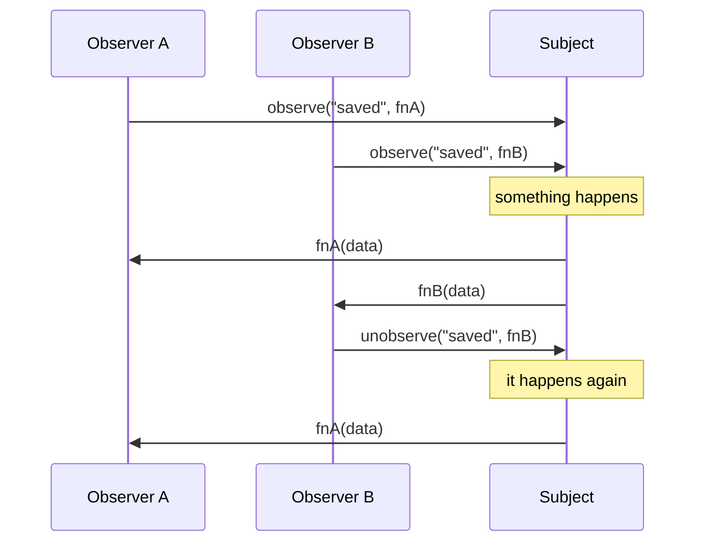

# The observer pattern, built test-first

> **Before this lesson:** you can run the red, green, refactor loop ([A complete TDD session, test by test](#/lesson/js-testing/tdd-worked-session)) and you have used a spy that records calls ([Applied functions: binding, closures, state and memoisation](#/lesson/js-testing/closures-binding-memoize)). This is the first lesson of the real-world part of the track: from here on we build things you would find in a production codebase.

## In plain words

The **observer pattern** is a way for one object to announce "something happened" without knowing who is listening. Objects that care sign up in advance; when the event occurs, each of them is told. The announcing object is called the **subject** or **observable**; the listeners are called **observers** (also *subscribers*, *listeners* or *handlers*). You will also hear the pattern called *publish/subscribe*, or pub/sub for short.

Think of a newspaper subscription. The publisher does not know or care what you do with the paper. It keeps a list of addresses. When an issue is printed, a copy goes to every address on the list. You can subscribe, and you can cancel, and neither the publisher nor the other readers need to change anything when you do.

Why it matters for a job: this pattern is everywhere in JavaScript. `button.addEventListener("click", fn)` is the observer pattern. So are Node's `EventEmitter`, the stores behind state-management libraries, and reactive streams. Because the subject does not know its observers, the parts of a program stay loosely connected, which is what lets you test them one at a time. "Implement an event emitter" is also a standard interview exercise, and you are about to do it properly.

## The design, as a test list

We will build `createObservable()`, which returns an object with three methods:

- `observe(event, fn)`: register `fn` to be called when `event` happens;
- `notify(event, ...args)`: announce `event`, calling every registered function with the arguments;
- `unobserve(event, fn)`: remove a registration.

```text
[ ] an observer is called when its event is notified
[ ] it receives the arguments passed to notify
[ ] several observers are all called, in the order they were added
[ ] observers of other events are not called
[ ] notifying an event with no observers does nothing (and does not throw)
[ ] an observer can be removed
[ ] observe rejects something that is not a function
[ ] one failing observer does not stop the others
```



## Cycle 1: one observer is called

**Red.**

```javascript
test("an observer is called when its event is notified", () => {
  const subject = createObservable();
  const observer = mockFn();
  subject.observe("saved", observer);
  subject.notify("saved");
  expect(observer.calls.length).toBe(1);
});
```

```text
FAIL  an observer is called when its event is notified
      -> createObservable is not defined
```

How does the test know the observer was called? The observer is a spy from `mockFn`, which records every call in its `calls` array. The subject returns nothing useful, so recording is the only way to see its effect.

**Green**, with the least code:

```javascript
function createObservable() {
  let observer;
  return {
    observe(event, fn) { observer = fn; },
    notify(event) { observer(); },
  };
}
```

One variable, no list, the event name ignored. It is plainly incomplete, and each shortcoming will be driven out by its own test.

## Cycle 2: arguments are passed along

**Red.**

```javascript
test("the observer receives the arguments passed to notify", () => {
  const subject = createObservable();
  const observer = mockFn();
  subject.observe("saved", observer);
  subject.notify("saved", "report.txt", 3);
  expect(observer.calls[0]).toEqual(["report.txt", 3]);
});
```

```text
FAIL  the observer receives the arguments passed to notify
      -> expected ["report.txt",3] but got []
```

**Green:** `notify(event, ...args) { observer(...args); }`.

## Cycle 3: several observers, in order

**Red.**

```javascript
test("all observers are called, in the order they were added", () => {
  const subject = createObservable();
  const order = [];
  subject.observe("saved", () => order.push("first"));
  subject.observe("saved", () => order.push("second"));
  subject.notify("saved");
  expect(order).toEqual(["first", "second"]);
});
```

```text
FAIL  all observers are called, in the order they were added
      -> expected ["first","second"] but got ["second"]
```

The single variable was overwritten by the second registration. **Green:** keep a list.

```javascript
function createObservable() {
  const observers = [];
  return {
    observe(event, fn) { observers.push(fn); },
    notify(event, ...args) { observers.forEach((fn) => fn(...args)); },
  };
}
```

The test uses a shared `order` array that both observers push into. That is a neat way to assert on sequence without any tool.

## Cycle 4: events are kept apart

**Red.**

```javascript
test("observers of other events are not called", () => {
  const subject = createObservable();
  const onSaved = mockFn(), onDeleted = mockFn();
  subject.observe("saved", onSaved);
  subject.observe("deleted", onDeleted);
  subject.notify("saved");
  expect(onDeleted.calls.length).toBe(0);
});
```

```text
FAIL  observers of other events are not called
      -> expected 0 but got 1
```

**Green:** one list per event name, stored in a `Map` (a built-in collection of key and value pairs).

```javascript
function createObservable() {
  const observers = new Map();                 // event name -> array of functions
  return {
    observe(event, fn) {
      if (!observers.has(event)) observers.set(event, []);
      observers.get(event).push(fn);
    },
    notify(event, ...args) {
      observers.get(event).forEach((fn) => fn(...args));
    },
  };
}
```

## Cycle 5: no observers, no problem

**Red.**

```javascript
test("notifying an event nobody observes does nothing", () => {
  const subject = createObservable();
  subject.notify("ghost");                     // must not throw
});
```

```text
FAIL  notifying an event nobody observes does nothing
      -> Cannot read properties of undefined (reading 'forEach')
```

This test has no `expect` line, and it is still a real test: its claim is "this call does not throw", and a throw is exactly what fails a test. (In Jest or Vitest you could make the claim explicit with `expect(() => subject.notify("ghost")).not.toThrow()`.) **Green:** `(observers.get(event) || []).forEach(...)`.

## Cycle 6: unsubscribing

**Red.**

```javascript
test("a removed observer is no longer called", () => {
  const subject = createObservable();
  const observer = mockFn();
  subject.observe("saved", observer);
  subject.unobserve("saved", observer);
  subject.notify("saved");
  expect(observer.calls.length).toBe(0);
});
```

```text
FAIL  a removed observer is no longer called
      -> subject.unobserve is not a function
```

**Green:**

```javascript
    unobserve(event, fn) {
      const list = observers.get(event) || [];
      const index = list.indexOf(fn);
      if (index !== -1) list.splice(index, 1);
    },
```

`indexOf` finds the position of that exact function object; `splice(index, 1)` removes one element there. The `-1` check matters: `splice(-1, 1)` would remove the *last* element, so removing an observer that was never added would silently delete someone else's. That deserves its own test, which you will find in the runnable block.

## Cycles 7 and 8: bad input and bad observers

Two more behaviours make the difference between a toy and something dependable.

**Red:** registering something that is not a function should fail at once, at the place of the mistake, and not later inside `notify`.

```text
FAIL  observe rejects a value that is not a function
      -> expected the function to throw, but it returned normally
```

**Green:** `if (typeof fn !== "function") throw new TypeError("observer must be a function");`

**Red:** if one observer throws, the others must still be told. Otherwise a bug in one listener silently disables unrelated features.

```text
FAIL  an observer that throws does not stop the others
      -> boom
```

**Green:** call each observer inside `try` / `catch`, collect the errors, and carry on.

## The finished observable

```js-run
// --- the tiny test runner from lesson 1 ---
function test(name, fn) {
  try { fn(); console.log("PASS  " + name); }
  catch (e) { console.log("FAIL  " + name + "\n      -> " + e.message); }
}
function expect(actual) {
  const show = (v) => typeof v === "function" ? "[function]" : JSON.stringify(v);
  const fail = (msg) => { throw new Error(msg); };
  return {
    toBe(expected) {
      if (!Object.is(actual, expected)) fail("expected " + show(expected) + " but got " + show(actual));
    },
    toEqual(expected) {
      if (JSON.stringify(actual) !== JSON.stringify(expected)) fail("expected " + show(expected) + " but got " + show(actual));
    },
    toThrow(text = "") {
      try { actual(); } catch (e) {
        if (!String(e.message).includes(text)) fail("threw the wrong error: " + e.message);
        return;
      }
      fail("expected the function to throw, but it returned normally");
    },
  };
}
// --- end of runner ---
// --- a tiny mock function, like jest.fn() / vi.fn() ---
function mockFn(impl = () => undefined) {
  const mock = (...args) => {
    mock.calls.push(args);            // remember the arguments of every call
    const value = impl(...args);
    mock.results.push(value);         // remember what was returned
    return value;
  };
  mock.calls = [];
  mock.results = [];
  mock.mockReturnValue = (v) => { impl = () => v; return mock; };
  mock.mockImplementation = (f) => { impl = f; return mock; };
  return mock;
}
// --- end of mock ---

function createObservable() {
  const observers = new Map();
  return {
    observe(event, fn) {
      if (typeof fn !== "function") throw new TypeError("observer must be a function");
      if (!observers.has(event)) observers.set(event, []);
      observers.get(event).push(fn);
    },
    unobserve(event, fn) {
      const list = observers.get(event) || [];
      const index = list.indexOf(fn);
      if (index !== -1) list.splice(index, 1);
    },
    notify(event, ...args) {
      const errors = [];
      for (const fn of [...(observers.get(event) || [])]) {   // iterate over a copy
        try { fn(...args); } catch (error) { errors.push(error); }
      }
      return errors;
    },
  };
}

let subject;
const fresh = () => { subject = createObservable(); };       // our beforeEach

test("an observer is called when its event is notified", () => {
  fresh();
  const observer = mockFn();
  subject.observe("saved", observer);
  subject.notify("saved");
  expect(observer.calls.length).toBe(1);
});

test("the observer receives the arguments passed to notify", () => {
  fresh();
  const observer = mockFn();
  subject.observe("saved", observer);
  subject.notify("saved", "report.txt", 3);
  expect(observer.calls[0]).toEqual(["report.txt", 3]);
});

test("all observers are called, in the order they were added", () => {
  fresh();
  const order = [];
  subject.observe("saved", () => order.push("first"));
  subject.observe("saved", () => order.push("second"));
  subject.notify("saved");
  expect(order).toEqual(["first", "second"]);
});

test("observers of other events are not called", () => {
  fresh();
  const onDeleted = mockFn();
  subject.observe("deleted", onDeleted);
  subject.notify("saved");
  expect(onDeleted.calls.length).toBe(0);
});

test("notifying an event nobody observes does nothing", () => {
  fresh();
  subject.notify("ghost");
});

test("a removed observer is no longer called", () => {
  fresh();
  const observer = mockFn();
  subject.observe("saved", observer);
  subject.unobserve("saved", observer);
  subject.notify("saved");
  expect(observer.calls.length).toBe(0);
});

test("removing an unknown observer leaves the others alone", () => {
  fresh();
  const kept = mockFn();
  subject.observe("saved", kept);
  subject.unobserve("saved", () => {});          // a function that was never added
  subject.notify("saved");
  expect(kept.calls.length).toBe(1);
});

test("observe rejects a value that is not a function", () => {
  fresh();
  expect(() => subject.observe("saved", "not a function")).toThrow("must be a function");
});

test("an observer that throws does not stop the others", () => {
  fresh();
  const after = mockFn();
  subject.observe("saved", () => { throw new Error("boom"); });
  subject.observe("saved", after);
  const errors = subject.notify("saved");
  expect(after.calls.length).toBe(1);
  expect(errors.length).toBe(1);
});

test("an observer that removes itself during notify does not skip its neighbour", () => {
  fresh();
  const neighbour = mockFn();
  const selfRemoving = () => subject.unobserve("saved", selfRemoving);
  subject.observe("saved", selfRemoving);
  subject.observe("saved", neighbour);
  subject.notify("saved");
  expect(neighbour.calls.length).toBe(1);
});
```

The last test protects a subtle line: `[...(observers.get(event) || [])]` iterates over a *copy* of the list. Try replacing it with the list itself and run again. When the first observer removes itself, every later element shifts one place left, the loop's position moves on, and the neighbour is skipped. Changing a collection while looping over it is a classic source of bugs, and "an observer unsubscribes inside its own callback" is a very common real-world case (think of a one-time listener).

## The same tests in Vitest

Real frameworks provide the spy and richer matchers. `vi.fn()` creates a mock function (in Jest, `jest.fn()`).

```javascript
import { describe, test, expect, beforeEach, vi } from "vitest";
import { createObservable } from "./observable.js";

describe("observable", () => {
  let subject;
  beforeEach(() => { subject = createObservable(); });

  test("passes notify's arguments to each observer", () => {
    const observer = vi.fn();
    subject.observe("saved", observer);

    subject.notify("saved", "report.txt", 3);

    expect(observer).toHaveBeenCalledTimes(1);
    expect(observer).toHaveBeenCalledWith("report.txt", 3);
  });

  test("a removed observer is no longer called", () => {
    const observer = vi.fn();
    subject.observe("saved", observer);
    subject.unobserve("saved", observer);

    subject.notify("saved");

    expect(observer).not.toHaveBeenCalled();
  });
});
```

```text
 ✓ observable.test.js (2 tests) 4ms
   ✓ observable > passes notify's arguments to each observer
   ✓ observable > a removed observer is no longer called
```

## Why the pattern makes code testable

Consider a "save" button that must update a status label, write a log entry and refresh a list. If the save code calls all three directly, a test of saving needs all three to exist. With an observable in between, the save code only says `subject.notify("saved", document)`. In its unit test you attach a spy and assert that it was called with the right data. The label, the log and the list each observe the event and each get their own tests, where you trigger `notify` by hand. No part needs the others in order to be tested.

The price of this looseness is that the flow of control becomes harder to follow by reading: nothing at the `notify` line tells you who will react. Use the pattern where independence is worth that cost, and keep event names in one documented place.

> [!WARNING]
> **Forgotten observers leak memory.** The subject's list holds a reference to every observer function, and each function holds its closure. If a screen subscribes when it opens and never unsubscribes when it closes, it can never be freed, and its handler keeps running for a screen nobody sees. Every `observe` needs a matching `unobserve`; many APIs return an "unsubscribe" function from `observe` to make that hard to forget.

> [!INTERVIEW]
> **"Implement an event emitter with on, off and emit."** Build it as above: a `Map` from event name to an array of functions. Then volunteer the edge cases, because they are what the interviewer is waiting for: emitting an event with no listeners, removing a listener that is not registered (the `-1` trap with `splice`), a listener that removes itself during emit (iterate over a copy), a listener that throws, and `once` (wrap the function so that it unsubscribes itself before calling the original).

## Common pitfalls

- **Removing with a different function object.** `subject.unobserve("saved", () => update())` never matches the arrow function that was registered, because two separately written functions are different objects even when the text is identical. Keep a reference to the original.
- **`splice(indexOf(...), 1)` without checking for `-1`.** It deletes the last observer.
- **Mutating the list during notification.** Iterate over a copy.
- **Letting one observer's error abort the rest.** Isolate each call.
- **Asserting only on call count.** A spy called once with the wrong data still passes `calls.length === 1`. Assert on the arguments too.
- **Event-name typos.** `notify("save")` against `observe("saved", ...)` fails silently. Constants for event names help, and a test per event catches the rest.

## Cheat sheet

| What you want to assert | Tiny runner | Jest / Vitest |
|---|---|---|
| Called at all | `expect(spy.calls.length > 0).toBe(true)` | `expect(spy).toHaveBeenCalled()` |
| Called exactly n times | `expect(spy.calls.length).toBe(n)` | `expect(spy).toHaveBeenCalledTimes(n)` |
| Called with given arguments | `expect(spy.calls[0]).toEqual([a, b])` | `expect(spy).toHaveBeenCalledWith(a, b)` |
| Arguments of the last call | `spy.calls.at(-1)` | `expect(spy).toHaveBeenLastCalledWith(a)` |
| Never called | `expect(spy.calls.length).toBe(0)` | `expect(spy).not.toHaveBeenCalled()` |
| Order of calls | push labels into a shared array | `spy.mock.invocationCallOrder` |
| Does not throw | call it with no assertion | `expect(() => f()).not.toThrow()` |
| Create a spy | `mockFn()` | `vi.fn()` / `jest.fn()` |

## Summary

- The observer pattern lets a subject announce events to registered functions without knowing who they are.
- Built test-first, the design grew one behaviour at a time: one observer, arguments, many observers, separate events, no observers, removal, input checking, error isolation.
- Spies make invisible effects (a function was called, with these arguments, this many times) assertable.
- The dangerous edge cases are removal of an unknown observer, changes to the list during notification, and throwing observers.
- Loose coupling makes each part testable alone; the costs are harder-to-trace flow and leaks from forgotten subscriptions.

## Glossary

- **Observer pattern (publish/subscribe)**: a subject keeps a list of functions and calls them when an event occurs.
- **Subject / observable**: the object that announces events.
- **Observer / listener / subscriber**: a function registered to be called on an event.
- **Notify / emit / publish**: to announce an event to all its observers.
- **Loose coupling**: parts of a program knowing as little as possible about each other.
- **Spy**: a function that records its calls for later assertions.
- **Memory leak**: memory that can never be freed because something still refers to it.
- **Map**: a built-in collection that stores values under keys of any type.

## Check yourself

```quiz
[
  {"q": "After cycle 1 the implementation stores a single observer variable. Two observers are registered for 'saved' and notify('saved') is called. A test expects both to be called once. Pass or fail?",
   "options": ["Pass", "Fail: the second registration overwrote the first, so only the second observer is called", "It throws", "Pass for the wrong reason"],
   "answer": 1,
   "explain": "One variable can hold one function. The test for several observers is what forces the change to a list."},
  {"q": "unobserve does list.splice(list.indexOf(fn), 1) with no check. Observers A and B are registered. unobserve is called with a function that was never registered. Then notify runs. Who is called?",
   "options": ["A and B", "Only A: indexOf returned -1 and splice(-1, 1) removed the last element, B", "Only B", "Nobody"],
   "answer": 1,
   "explain": "splice with a start of -1 counts from the end. Checking for -1 before splicing prevents removing an innocent observer."},
  {"q": "test('ghost event', () => { subject.notify('ghost'); }); The implementation does observers.get(event).forEach(...). Pass, fail, or pass for the wrong reason?",
   "options": ["Pass, there is no assertion", "Fail: get returns undefined for an unknown event, so calling forEach throws", "Pass for the wrong reason", "It is skipped"],
   "answer": 1,
   "explain": "A test without expect still fails if the code throws. Here the missing default list causes a TypeError."},
  {"q": "subject.observe('saved', () => refresh()); later: subject.unobserve('saved', () => refresh()); Is the observer removed?",
   "options": ["Yes, the functions are identical", "No: the two arrow functions are different objects, so indexOf does not find a match", "Yes, but only in strict mode", "It throws"],
   "answer": 1,
   "explain": "Functions are compared by identity. Keep the original function in a variable and pass that same reference to unobserve."},
  {"q": "A test registers a spy, calls notify('saved', 'a.txt'), and asserts only expect(spy.calls.length).toBe(1). The implementation forgets to pass arguments through. Pass, fail, or pass for the wrong reason?",
   "options": ["Fail", "Pass for the wrong reason: the spy was called once, but the test never checks what it was called with", "Pass correctly", "It throws"],
   "answer": 1,
   "explain": "Call count alone does not verify the data. Asserting on spy.calls[0] (or toHaveBeenCalledWith) would expose the bug."},
  {"q": "Why does notify loop over a copy of the observer list?",
   "options": ["Copies are faster to iterate", "So an observer that subscribes or unsubscribes during the notification does not disturb the loop in progress", "To sort the observers", "Because Map values are read-only"],
   "answer": 1,
   "explain": "Removing an element shifts the rest and makes the loop skip one. Iterating over a snapshot avoids it."},
  {"q": "A dialog subscribes to a global observable when opened and never unsubscribes when closed. What is the consequence?",
   "options": ["None", "A memory leak: the subject still references the handler and its closure, and the handler keeps being called", "The subject stops notifying", "A syntax error"],
   "answer": 1,
   "explain": "The observer list keeps the function alive along with everything it closed over. Unsubscribe when the observer's lifetime ends."}
]
```

> **Source:** Johansen, *Test-Driven JavaScript Development*, ch. 11 (The Observer Pattern). Docs: https://vitest.dev/api/expect.html#tohavebeencalledwith , https://jestjs.io/docs/expect#tohavebeencalledwitharg1-arg2- , https://nodejs.org/api/events.html , https://developer.mozilla.org/en-US/docs/Web/API/EventTarget
