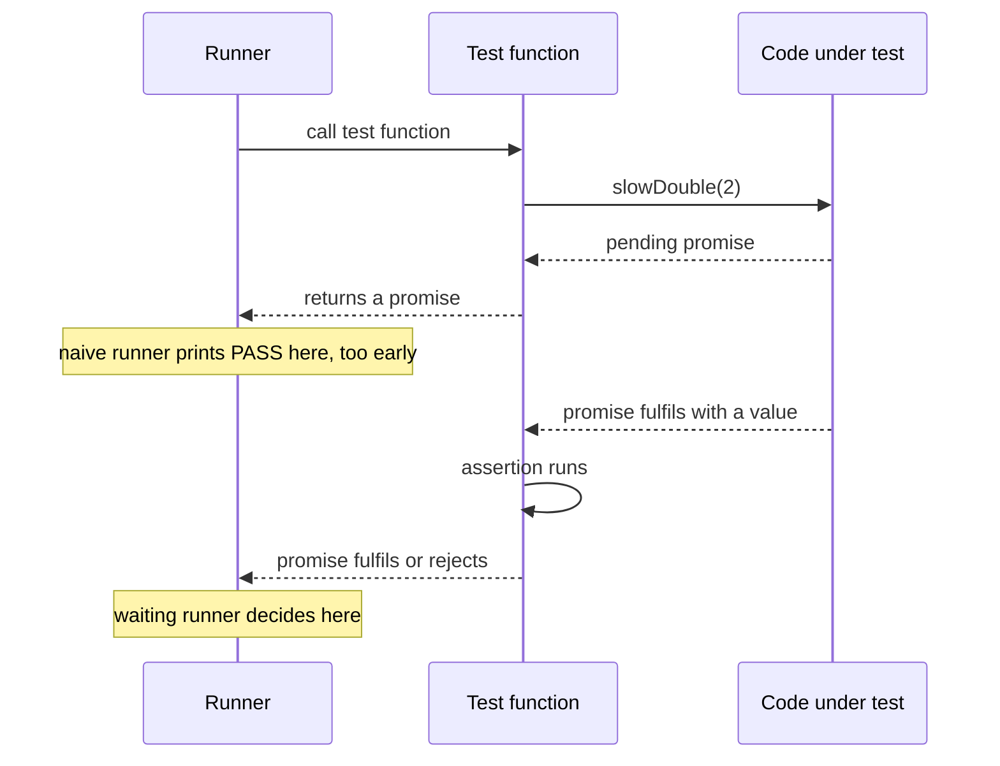

# Testing asynchronous code: callbacks, promises and async/await

> **Before this lesson:** you need promises and `async` / `await` ([Callbacks and promises](#/lesson/javascript/callbacks-promises), [Async functions and generators](#/lesson/javascript/async-await-generators)) and the rule that a test passes when its function does not throw ([Why automate tests: your first unit test](#/lesson/js-testing/first-unit-test)). Dependency injection was introduced in [Unobtrusive JavaScript, progressive enhancement and feature detection](#/lesson/js-testing/unobtrusive-feature-detection).

## In plain words

Code is **synchronous** when each line finishes before the next one starts. Code is **asynchronous** when it starts something (a network request, a timer, reading a file) and the result arrives *later*, while the program carries on with other work.

Think of ordering at a busy café that hands you a buzzer. You order, you get the buzzer, and you go and sit down. The coffee is not in your hand yet. Some time later the buzzer goes off and you collect it. Now imagine an inspector whose job is to check the coffee. If the inspector looks at your empty hands the instant you sit down and writes "no complaints", the inspection is worthless: the coffee had not arrived. The inspector has to *wait for the buzzer*.

A test of asynchronous code has exactly this problem. The rule so far has been "a test passes if its function finishes without throwing". An asynchronous test function can finish *before* the result exists, and then any assertion on that result runs too late to count, or never runs at all. Getting the runner to wait is the whole subject of this lesson.

Why it matters for a job: almost everything interesting in a web application is asynchronous: every server request, every timer, every user interaction. "How do you test async code?" is a routine interview question, and tests that pass without ever checking anything are one of the most common real defects in test suites.

## The trap: a test that passes before the answer arrives

Here is the first runner from this track, unchanged, used on an asynchronous function. To make the problem visible, the runner prints what happens to the test's promise *after* it has already announced a verdict.

```js-run
function naiveTest(name, fn) {
  try {
    const returned = fn();                       // does NOT wait
    console.log("PASS  " + name);
    if (returned && returned.catch) {
      returned.catch((e) => console.log("      ...later, unnoticed by the runner: " + e.message));
    }
  } catch (e) {
    console.log("FAIL  " + name + " -> " + e.message);
  }
}
function expectEqual(actual, expected) {
  if (actual !== expected) throw new Error("expected " + expected + " but got " + actual);
}

// code under test: answers after 50 milliseconds, and has a bug (should be 4)
function slowDouble(n) {
  return new Promise((resolve) => setTimeout(() => resolve(n * 3), 50));
}

naiveTest("slowDouble(2) is 4", async () => {
  const result = await slowDouble(2);
  expectEqual(result, 4);
});
```

The output says `PASS`, and then, a moment later, reports that the assertion failed. Step through it. `fn()` starts the async function. At the first `await`, the function pauses and hands back a **promise**: an object standing for a result that is not ready yet. Control returns to the runner, nothing has thrown, so it prints `PASS`. Fifty milliseconds later the promise from `slowDouble` settles, the test function resumes, the assertion throws, and that error rejects a promise nobody is watching.

This is a **false positive**: a test reporting success for broken code. It is the most dangerous kind of test failure because nothing looks wrong.

## The fix: the runner waits for the promise

The repair is small. If the test function returns a promise, the runner must wait for it to settle before deciding. A promise that **fulfils** means pass; one that **rejects** means fail.

```javascript
async function test(name, fn) {
  try {
    await fn();                                  // wait for the returned promise, if any
    console.log("PASS  " + name);
  } catch (e) {
    console.log("FAIL  " + name + "\n      -> " + e.message);
  }
}
```

`await fn()` does the waiting. If `fn` returns a promise that rejects, `await` turns the rejection into a thrown error, which lands in `catch`. If `fn` is an ordinary synchronous function, `await` on its plain return value continues at once, so one runner serves both kinds of test.

Every real runner works this way. The rule for you as a test author is therefore:

> **The test function must return (or `await`) every promise whose result it asserts on.**

```js-run
// --- the tiny test runner from lesson 1, async edition ---
async function test(name, fn) {   // async: it can wait for promises
  try { await fn(); console.log("PASS  " + name); }
  catch (e) { console.log("FAIL  " + name + "\n      -> " + e.message); }
}
function expect(actual) {
  const show = (v) => typeof v === "function" ? "[function]" : JSON.stringify(v);
  const fail = (msg) => { throw new Error(msg); };
  return {
    toBe(expected) {
      if (!Object.is(actual, expected)) fail("expected " + show(expected) + " but got " + show(actual));
    },
    toEqual(expected) {
      if (JSON.stringify(actual) !== JSON.stringify(expected)) fail("expected " + show(expected) + " but got " + show(actual));
    },
    toThrow(text = "") {
      try { actual(); } catch (e) {
        if (!String(e.message).includes(text)) fail("threw the wrong error: " + e.message);
        return;
      }
      fail("expected the function to throw, but it returned normally");
    },
  };
}
// --- end of runner ---

function slowDouble(n) {
  return new Promise((resolve) => setTimeout(() => resolve(n * 3), 50));   // still buggy
}

await test("slowDouble(2) is 4", async () => {
  const result = await slowDouble(2);
  expect(result).toBe(4);
});
```

Now the runner reports `FAIL ... expected 4 but got 6`. Fix the bug (`n * 2`) and run again to see it pass for the right reason.



## Three styles of asynchronous test

Asynchronous code comes in three shapes, and each has a matching test style.

### 1. Callbacks, with `done`

Older APIs report results by calling a function you pass in, a **callback**. The test needs a way to say "I am finished now". Runners that support this hand the test a `done` function; the test is complete when `done()` is called, and fails if it is called with an error or not called before a timeout.

```javascript
// Jest and Mocha style
test("readConfig passes the parsed data to the callback", (done) => {
  readConfig("app.json", (error, config) => {
    try {
      expect(error).toBeNull();
      expect(config.port).toBe(8080);
      done();                                    // success: tell the runner
    } catch (assertionError) {
      done(assertionError);                      // failure: pass the error on
    }
  });
});
```

The `try` / `catch` is needed because an assertion thrown inside a callback happens outside the runner's own `try`. Forgetting it turns a clear failure into a timeout. Vitest does not support `done`; wrap the callback API in a promise instead:

```javascript
const readConfigAsync = (file) =>
  new Promise((resolve, reject) =>
    readConfig(file, (error, config) => (error ? reject(error) : resolve(config))));
```

### 2. Promises, returned

```javascript
test("fetchUser resolves with the user", () => {
  return fetchUser(7).then((user) => {           // the return is essential
    expect(user.name).toBe("Ada");
  });
});
```

Without `return`, this is the naive-runner trap again: the test function returns `undefined` and the runner does not wait.

### 3. `async` / `await`

```javascript
test("fetchUser resolves with the user", async () => {
  const user = await fetchUser(7);
  expect(user.name).toBe("Ada");
});
```

An `async` function always returns a promise, so there is no `return` to forget. This is the style to use by default.

## Testing that something fails

Half of asynchronous behaviour is failure: the server is down, the item does not exist. Jest and Vitest provide `.rejects` and `.resolves`, which unwrap a promise before applying a matcher.

```javascript
test("fetchUser rejects for an unknown id", async () => {
  await expect(fetchUser(999)).rejects.toThrow("not found");
});

test("fetchUser resolves with a name", async () => {
  await expect(fetchUser(7)).resolves.toMatchObject({ name: "Ada" });
});
```

> [!WARNING]
> `expect(promise).rejects...` itself returns a promise. Without `await` (or `return`) in front of it, the test ends before the check happens and passes regardless. Enable the lint rules that flag un-awaited assertions; Vitest also warns about them.

The manual version uses `try` / `catch`, and has a trap of its own:

```javascript
test("fetchUser rejects for an unknown id", async () => {
  expect.assertions(1);                          // exactly one assertion must run
  try {
    await fetchUser(999);
  } catch (error) {
    expect(error.message).toContain("not found");
  }
});
```

If `fetchUser(999)` wrongly *succeeds*, the `catch` block never runs, no assertion executes, and without the first line the test would pass. `expect.assertions(1)` tells the runner to fail the test unless exactly one assertion ran.

## Worked example: a small request function, test-first

### A little history

When test-driven JavaScript was young, talking to a server from a page meant using an object called `XMLHttpRequest`, which was created in different ways in different browsers and reported progress through numbered states. Libraries hid those differences behind one small function of their own, and developers tested their code against that function. Today the standard `fetch` function works the same everywhere and returns promises. The lasting lesson is the wrapper itself: **put a small function of your own between your application and the outside world.** That function is the one place that knows about HTTP, and it is the natural place for a test to cut in. A point where one implementation can be swapped for another is called a **seam**.

### The code and the tests

`getJson(url, fetchFn)` should request a URL, turn the reply into data, and reject with a helpful error if the server answers with an error status. `fetchFn` is injected so tests can supply a fake; the application passes the real `fetch`.

**First version of the code under test:**

```javascript
async function getJson(url, fetchFn) {
  const response = await fetchFn(url);
  return response.json();
}
```

**The tests.** A fake `fetch` is a function returning a promise of an object shaped like a real response: `ok` (true for status 200 to 299), `status`, and a `json()` method returning a promise of the body.

```javascript
const fakeFetch = (status, body) => async () => ({
  ok: status >= 200 && status < 300,
  status: status,
  json: async () => body,
});

await test("resolves with the parsed body on success", async () => {
  const data = await getJson("/api/user/7", fakeFetch(200, { name: "Ada" }));
  expect(data).toEqual({ name: "Ada" });
});

await test("rejects with the status when the server answers 404", async () => {
  let caught = null;
  try { await getJson("/api/user/999", fakeFetch(404, { error: "nope" })); }
  catch (e) { caught = e; }
  expect(caught && caught.message).toBe("HTTP 404");
});
```

**Failing output:**

```text
PASS  resolves with the parsed body on success
FAIL  rejects with the status when the server answers 404
      -> expected "HTTP 404" but got null
```

The second test exposes a fact that surprises many developers: `fetch` does **not** reject for a 404 or a 500. It rejects only when no response arrives at all (network down, address unknown). An error status still fulfils the promise, with `ok` set to `false`. Our first version therefore returned the error body as if it were data. **The fix** checks `ok`:

```js-run
// --- the tiny test runner from lesson 1, async edition ---
async function test(name, fn) {   // async: it can wait for promises
  try { await fn(); console.log("PASS  " + name); }
  catch (e) { console.log("FAIL  " + name + "\n      -> " + e.message); }
}
function expect(actual) {
  const show = (v) => typeof v === "function" ? "[function]" : JSON.stringify(v);
  const fail = (msg) => { throw new Error(msg); };
  return {
    toBe(expected) {
      if (!Object.is(actual, expected)) fail("expected " + show(expected) + " but got " + show(actual));
    },
    toEqual(expected) {
      if (JSON.stringify(actual) !== JSON.stringify(expected)) fail("expected " + show(expected) + " but got " + show(actual));
    },
    toThrow(text = "") {
      try { actual(); } catch (e) {
        if (!String(e.message).includes(text)) fail("threw the wrong error: " + e.message);
        return;
      }
      fail("expected the function to throw, but it returned normally");
    },
  };
}
// --- end of runner ---

async function getJson(url, fetchFn) {
  const response = await fetchFn(url);
  if (!response.ok) throw new Error("HTTP " + response.status);
  return response.json();
}

const fakeFetch = (status, body) => async () => ({
  ok: status >= 200 && status < 300,
  status: status,
  json: async () => body,
});
const brokenNetwork = async () => { throw new Error("network down"); };

async function rejection(promise) {            // helper: the error a promise rejects with, or null
  try { await promise; return null; } catch (e) { return e; }
}

await test("resolves with the parsed body on success", async () => {
  const data = await getJson("/api/user/7", fakeFetch(200, { name: "Ada" }));
  expect(data).toEqual({ name: "Ada" });
});

await test("rejects with the status when the server answers 404", async () => {
  const error = await rejection(getJson("/api/user/999", fakeFetch(404, {})));
  expect(error && error.message).toBe("HTTP 404");
});

await test("passes a network failure through unchanged", async () => {
  const error = await rejection(getJson("/api/user/7", brokenNetwork));
  expect(error && error.message).toBe("network down");
});

await test("requests the url it was given", async () => {
  const seen = [];
  const recording = async (url) => { seen.push(url); return { ok: true, status: 200, json: async () => ({}) }; };
  await getJson("/api/user/7", recording);
  expect(seen).toEqual(["/api/user/7"]);
});
```

Notice `await test(...)` at the top level. Our tiny async runner returns a promise for each test; awaiting it keeps the tests running one after another, so their output stays in order. Real runners handle that queue for you.

The helper `rejection` converts "this promise should reject" into an ordinary value we can assert on: it returns the error, or `null` if the promise fulfilled. Asserting on `null` then fails clearly, which avoids the silent-pass trap of a bare `try` / `catch`.

## Order of execution: microtasks

Promise callbacks never run immediately. When a promise settles, its reactions are placed in the **microtask queue**, which the engine drains as soon as the currently running code has finished. Details are in [The event loop, tasks and microtasks](#/lesson/javascript/event-loop-microtasks). For tests the practical consequence is this:

```js-run
// --- the tiny test runner from lesson 1, async edition ---
async function test(name, fn) {   // async: it can wait for promises
  try { await fn(); console.log("PASS  " + name); }
  catch (e) { console.log("FAIL  " + name + "\n      -> " + e.message); }
}
function expect(actual) {
  const show = (v) => typeof v === "function" ? "[function]" : JSON.stringify(v);
  const fail = (msg) => { throw new Error(msg); };
  return {
    toBe(expected) {
      if (!Object.is(actual, expected)) fail("expected " + show(expected) + " but got " + show(actual));
    },
    toEqual(expected) {
      if (JSON.stringify(actual) !== JSON.stringify(expected)) fail("expected " + show(expected) + " but got " + show(actual));
    },
    toThrow(text = "") {
      try { actual(); } catch (e) {
        if (!String(e.message).includes(text)) fail("threw the wrong error: " + e.message);
        return;
      }
      fail("expected the function to throw, but it returned normally");
    },
  };
}
// --- end of runner ---

function createStore() {
  let value = "empty";
  return {
    load(promise) { promise.then((v) => { value = v; }); },   // updates later
    get: () => value,
  };
}

await test("checking immediately sees the old value", async () => {
  const store = createStore();
  store.load(Promise.resolve("loaded"));
  expect(store.get()).toBe("empty");            // the then-callback has not run yet
});

await test("after yielding once, the update has happened", async () => {
  const store = createStore();
  store.load(Promise.resolve("loaded"));
  await Promise.resolve();                      // let pending microtasks run
  expect(store.get()).toBe("loaded");
});
```

Even an already-fulfilled promise delivers its value *after* the current synchronous code. `await Promise.resolve()` pauses the test for one turn of the microtask queue, which is long enough for a single `then`. Code with longer promise chains needs more turns, which is why UI testing libraries offer helpers such as `waitFor` and `findBy...` that retry an assertion until it passes or a time limit is reached. Prefer those, or better, have the code return its promise so the test can await it directly. A method like `load` above that starts asynchronous work and returns nothing is called **fire and forget**, and it is hard to test for exactly that reason.

## Timeouts

A test that waits for something that never happens would hang for ever, so runners impose a time limit per test (five seconds by default in Jest and Vitest). A timeout failure usually means one of three things: a promise that never settles, a `done` that is never called, or a real wait that is too long. Raising the limit is rarely the right fix; unit tests should not wait on real time at all. The lesson [Polling a server and testing time with a fake clock](#/lesson/js-testing/polling-fake-timers) replaces real timers with fake ones.

> [!TIP]
> If an async test passes instantly when you expected it to take a moment, be suspicious. Break the code on purpose and confirm the test goes red. An async test that cannot fail is nearly always missing an `await` or a `return`.

> [!INTERVIEW]
> **"How do you test asynchronous code?"** Say: make the test function `async` and `await` the code under test, so the runner waits for the returned promise; assert on rejections with `await expect(p).rejects.toThrow()`; for callback APIs use `done` or wrap them in a promise; replace real network and timers with fakes so tests are fast and deterministic. Then name the classic bug: a missing `await` makes the test finish before the assertion runs, so it passes for the wrong reason.

## Common pitfalls

- **Missing `await` or `return`.** The runner cannot wait for a promise it never receives.
- **Un-awaited `expect(...).rejects` / `.resolves`.** The matcher is asynchronous.
- **`try` / `catch` without an assertion count.** If the code does not throw, no assertion runs and the test passes.
- **Assertions inside un-awaited callbacks** such as `setTimeout(() => expect(...))`. The error is thrown outside the test.
- **`forEach` with an async callback.** `items.forEach(async (item) => { await check(item); })` does not wait; use `for...of` with `await`, or `await Promise.all(items.map(...))`.
- **Assuming `fetch` rejects on HTTP errors.** It fulfils; check `response.ok`.
- **Real delays in tests.** `await sleep(500)` makes suites slow and still fails on a busy machine. Wait for a condition, or control time.

## Cheat sheet

| Situation | Jest / Vitest |
|---|---|
| Async test | `test("name", async () => { const v = await f(); expect(v).toBe(1); })` |
| Promise without async | `return f().then((v) => expect(v).toBe(1))` |
| Expect fulfilment | `await expect(f()).resolves.toEqual({ a: 1 })` |
| Expect rejection | `await expect(f()).rejects.toThrow("message")` |
| Callback API (Jest, Mocha) | `test("name", (done) => { api((e, v) => { ...; done(); }); })` |
| Require assertions to run | `expect.assertions(2)` or `expect.hasAssertions()` |
| Per-test time limit | `test("name", async () => { ... }, 10000)` |
| Let microtasks run | `await Promise.resolve()` |
| Retry until true (Vitest) | `await vi.waitFor(() => expect(store.get()).toBe("loaded"))` |
| Several in parallel | `await Promise.all([a(), b()])` |

## Summary

- An asynchronous test can finish before its result exists; a runner that does not wait reports a false pass.
- Runners wait for the promise a test function returns, so always `await` or `return` the promises you assert on.
- Use `done` for callback APIs (or wrap them in promises), returned promises for `then` chains, and `async` / `await` by default.
- Test rejections with `rejects`, a helper that captures the error, or `try` / `catch` plus an assertion count.
- Put a seam between your code and the network, inject a fake at that seam, and remember that `fetch` fulfils on HTTP error statuses.
- Promise reactions run as microtasks, after the current code; yield or use a waiting helper before asserting on their effects.

## Glossary

- **Synchronous / asynchronous**: finishing before the next line runs / delivering a result later.
- **Callback**: a function passed to other code to be called when work completes.
- **Promise**: an object representing a result that will be available later.
- **Fulfil / reject / settle**: a promise completing successfully / with an error / either of the two.
- **False positive**: a test that passes although the code is wrong.
- **`done` callback**: a function a runner passes to a test so it can signal completion.
- **Seam**: a place where one implementation can be substituted for another without editing the calling code.
- **Microtask queue**: the queue of promise reactions run right after the current code finishes.
- **Fire and forget**: starting asynchronous work without returning a way to wait for it.
- **Timeout**: the time limit after which a runner fails a test that has not completed.

## Check yourself

```quiz
[
  {"q": "test('loads', () => { fetchUser(7).then((u) => { expect(u.name).toBe('WRONG'); }); }); fetchUser resolves with the name 'Ada'. Pass, fail, or pass for the wrong reason?",
   "options": ["Fail, the names differ", "Pass for the wrong reason: the promise is not returned, so the test ends before the assertion runs", "Pass correctly", "It times out"],
   "answer": 1,
   "explain": "Without return or await, the runner sees a function that returned undefined without throwing. The failing assertion happens later in an unobserved promise."},
  {"q": "test('rejects', async () => { expect(fetchUser(999)).rejects.toThrow('not found'); }); fetchUser(999) actually RESOLVES. What does the runner report?",
   "options": ["Fail", "Pass, because the asynchronous matcher was not awaited and the test finished first", "A syntax error", "A timeout"],
   "answer": 1,
   "explain": "expect(...).rejects returns a promise. Without await the test function completes immediately and the later failure is not attributed to it."},
  {"q": "try { await save(bad); } catch (e) { expect(e.message).toBe('invalid'); } The save function wrongly succeeds. Without expect.assertions, what happens?",
   "options": ["The test fails", "The test passes: no error means the catch block and its assertion never run", "The test times out", "The runner reports zero assertions as an error by default"],
   "answer": 1,
   "explain": "No assertion executed, nothing threw, so the test is green. expect.assertions(1) or a rejects matcher closes the hole."},
  {"q": "The server replies with status 500 to fetch('/api'). What happens to the promise returned by fetch?",
   "options": ["It rejects with an HTTP error", "It fulfils with a response whose ok property is false", "It never settles", "It fulfils with null"],
   "answer": 1,
   "explain": "fetch only rejects when no response is received. HTTP error statuses must be detected by checking response.ok or response.status."},
  {"q": "store.load(Promise.resolve('x')) attaches a then-callback that sets a value. The next line asserts the value is 'x' with no await in between. Pass or fail?",
   "options": ["Pass, the promise is already fulfilled", "Fail: then-callbacks run as microtasks after the current synchronous code", "It throws", "Pass for the wrong reason"],
   "answer": 1,
   "explain": "Even for an already-fulfilled promise, reactions are queued. The assertion runs before the callback."},
  {"q": "items.forEach(async (item) => { await check(item); }); expect(log.length).toBe(items.length); Why can this assertion fail?",
   "options": ["forEach skips async functions", "forEach does not wait for the promises its callback returns, so the assertion runs before the checks finish", "await is not allowed in callbacks", "log is read-only"],
   "answer": 1,
   "explain": "forEach ignores return values. Use for...of with await, or await Promise.all(items.map(...))."},
  {"q": "Why does getJson take fetchFn as a parameter?",
   "options": ["To make it slower", "It creates a seam: tests pass a fake that returns canned responses, with no real network", "Because fetch is not available in browsers", "To avoid using promises"],
   "answer": 1,
   "explain": "Injecting the dependency lets tests control success, HTTP errors and network failures deterministically and instantly."}
]
```

> **Source:** Johansen, *Test-Driven JavaScript Development*, ch. 12 (Abstracting Browser Differences: Ajax). Docs: https://vitest.dev/guide/features , https://jestjs.io/docs/asynchronous , https://developer.mozilla.org/en-US/docs/Web/API/Fetch_API/Using_Fetch
