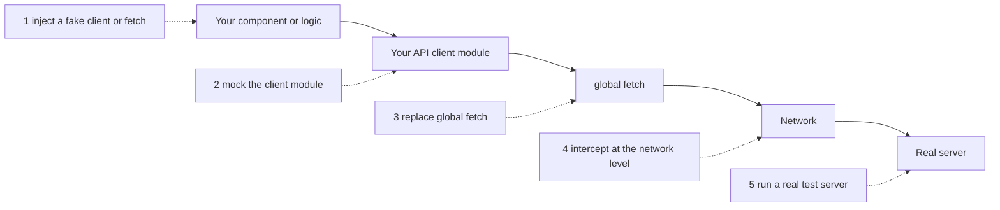

# Stubbing HTTP requests

> **Before this lesson:** you can write async tests that await promises and you have seen a hand-made fake `fetch` in [Testing asynchronous code: callbacks, promises and async/await](#/lesson/js-testing/testing-async-code). You should know what an HTTP request and response are: method, URL, status, headers and body ([HTTP, fetch, forms and client-side storage](#/lesson/javascript/http-fetch-forms)).

## In plain words

Most front-end code talks to a server. In a unit test you do not want a real server involved: it is slow, it may be down, its data changes, and you cannot ask it to fail on command. So you replace the part that talks to the network with a stand-in that returns prepared answers. A stand-in that returns canned answers is called a **stub**, and doing this for network calls is **stubbing HTTP requests**.

Think of how pilots train. They do not practise an engine failure by switching off a real engine on a real passenger flight. They use a flight simulator, where the instructor can dial up any situation on demand: clear weather, a storm, an engine fire. The cockpit controls are real; the world outside the window is simulated. In an HTTP stub, your code is the real cockpit, and the server on the other side is the simulator, with you as the instructor choosing what it answers.

Why it matters for a job: handling the unhappy paths (the server says 500, the network drops, the reply is slow, the data is malformed) is where much production code is weakest, because those paths are hard to trigger by hand. With a stub each one is a three-line test. Interviewers ask "how would you test code that calls an API?" expecting this answer and an awareness of its limits.

## What a good HTTP stub must do

1. **Answer** with a response you choose: status, headers, body.
2. **Record** each request it receives, so the test can check that the code asked for the right thing in the right way.
3. **Fail** on demand: error statuses, a rejected promise for a dead network, a response that never arrives.
4. **Complain** about requests the test did not expect, instead of quietly returning something.

## Building a stub server in thirty lines

The stub below imitates `fetch`. You give it a table of routes; it returns a function with the same shape as `fetch`.

```javascript
function createFetchStub(routes) {
  const requests = [];                                   // everything that was asked
  async function fetchStub(url, options = {}) {
    const method = options.method || "GET";
    requests.push({ method, url, headers: options.headers || {}, body: options.body });
    const reply = routes[method + " " + url];
    if (!reply) throw new Error("unexpected request: " + method + " " + url);
    if (reply.networkError) throw new TypeError("Failed to fetch");
    const status = reply.status || 200;
    return {
      ok: status >= 200 && status < 300,
      status,
      json: async () => JSON.parse(JSON.stringify(reply.body)),   // a fresh copy each time
    };
  }
  fetchStub.requests = requests;
  return fetchStub;
}
```

Line by line:

- `requests` is the recording. Every call pushes an entry with the method, URL, headers and body.
- `routes[method + " " + url]` looks up the prepared reply under a key such as `"GET /api/todos"`.
- No matching route throws. A request the test did not plan for is a bug in the code or in the test, and you want to hear about it.
- `networkError` makes the stub reject the way the real `fetch` does when no response arrives at all.
- The returned object has the three parts of a real response that our code uses. `json()` hands out a copy, so one test cannot corrupt the canned data for the next.
- `fetchStub.requests = requests` attaches the recording to the function, which is the same trick mock functions use.

## The code under test

A small client for a to-do list API. It receives its `fetch` function from outside.

```javascript
function createTodoApi(fetchFn) {
  async function request(method, url, data) {
    const options = { method, headers: {} };
    if (data !== undefined) options.body = data;                 // first attempt
    const response = await fetchFn(url, options);
    if (!response.ok) throw new Error("HTTP " + response.status);
    return response.json();
  }
  return {
    list: () => request("GET", "/api/todos"),
    add: (title) => request("POST", "/api/todos", { title }),
  };
}
```

## Test 1: the answer is passed on

```javascript
await test("list resolves with the todos from the server", async () => {
  const fetchStub = createFetchStub({
    "GET /api/todos": { body: [{ id: 1, title: "Buy milk" }] },
  });
  const api = createTodoApi(fetchStub);

  const todos = await api.list();

  expect(todos).toEqual([{ id: 1, title: "Buy milk" }]);
});
```

```text
PASS  list resolves with the todos from the server
```

## Test 2: the request is the right one

Checking the answer is half of the job. For requests that *send* data, the request itself is the behaviour: the server will only understand it if the method, the headers and the body are right.

```javascript
await test("add sends the title as JSON in a POST request", async () => {
  const fetchStub = createFetchStub({
    "POST /api/todos": { status: 201, body: { id: 2, title: "Walk dog" } },
  });
  const api = createTodoApi(fetchStub);

  await api.add("Walk dog");

  const sent = fetchStub.requests[0];
  expect(sent.method).toBe("POST");
  expect(sent.headers["Content-Type"]).toBe("application/json");
  expect(sent.body).toBe('{"title":"Walk dog"}');
});
```

**Failing output:**

```text
FAIL  add sends the title as JSON in a POST request
      -> expected "application/json" but got undefined
```

The test caught two real bugs in the first attempt, of a kind that otherwise only shows up against a live server. The header announcing the format is missing, and (once that is fixed, the next assertion fails) the body is a JavaScript object, which `fetch` would send as the useless text `[object Object]`. **The fix:**

```javascript
    if (data !== undefined) {
      options.headers["Content-Type"] = "application/json";
      options.body = JSON.stringify(data);                       // text, not an object
    }
```

**Passing output:**

```text
PASS  list resolves with the todos from the server
PASS  add sends the title as JSON in a POST request
```

## Tests 3 to 5: the unhappy paths

```js-run
// --- the tiny test runner from lesson 1, async edition ---
async function test(name, fn) {   // async: it can wait for promises
  try { await fn(); console.log("PASS  " + name); }
  catch (e) { console.log("FAIL  " + name + "\n      -> " + e.message); }
}
function expect(actual) {
  const show = (v) => typeof v === "function" ? "[function]" : JSON.stringify(v);
  const fail = (msg) => { throw new Error(msg); };
  return {
    toBe(expected) {
      if (!Object.is(actual, expected)) fail("expected " + show(expected) + " but got " + show(actual));
    },
    toEqual(expected) {
      if (JSON.stringify(actual) !== JSON.stringify(expected)) fail("expected " + show(expected) + " but got " + show(actual));
    },
    toThrow(text = "") {
      try { actual(); } catch (e) {
        if (!String(e.message).includes(text)) fail("threw the wrong error: " + e.message);
        return;
      }
      fail("expected the function to throw, but it returned normally");
    },
  };
}
// --- end of runner ---

function createFetchStub(routes) {
  const requests = [];
  async function fetchStub(url, options = {}) {
    const method = options.method || "GET";
    requests.push({ method, url, headers: options.headers || {}, body: options.body });
    const reply = routes[method + " " + url];
    if (!reply) throw new Error("unexpected request: " + method + " " + url);
    if (reply.networkError) throw new TypeError("Failed to fetch");
    const status = reply.status || 200;
    return { ok: status >= 200 && status < 300, status, json: async () => JSON.parse(JSON.stringify(reply.body)) };
  }
  fetchStub.requests = requests;
  return fetchStub;
}

function createTodoApi(fetchFn) {
  async function request(method, url, data) {
    const options = { method, headers: {} };
    if (data !== undefined) {
      options.headers["Content-Type"] = "application/json";
      options.body = JSON.stringify(data);
    }
    const response = await fetchFn(url, options);
    if (!response.ok) throw new Error("HTTP " + response.status);
    return response.json();
  }
  return {
    list: () => request("GET", "/api/todos"),
    add: (title) => request("POST", "/api/todos", { title }),
  };
}

const errorOf = async (promise) => { try { await promise; return null; } catch (e) { return e.message; } };

await test("list resolves with the todos from the server", async () => {
  const api = createTodoApi(createFetchStub({ "GET /api/todos": { body: [{ id: 1, title: "Buy milk" }] } }));
  expect(await api.list()).toEqual([{ id: 1, title: "Buy milk" }]);
});

await test("add sends the title as JSON in a POST request", async () => {
  const fetchStub = createFetchStub({ "POST /api/todos": { status: 201, body: { id: 2, title: "Walk dog" } } });
  await createTodoApi(fetchStub).add("Walk dog");
  const sent = fetchStub.requests[0];
  expect(sent.method).toBe("POST");
  expect(sent.headers["Content-Type"]).toBe("application/json");
  expect(sent.body).toBe('{"title":"Walk dog"}');
});

await test("a 500 answer becomes a rejected promise", async () => {
  const api = createTodoApi(createFetchStub({ "GET /api/todos": { status: 500, body: {} } }));
  expect(await errorOf(api.list())).toBe("HTTP 500");
});

await test("a network failure is passed through", async () => {
  const api = createTodoApi(createFetchStub({ "GET /api/todos": { networkError: true } }));
  expect(await errorOf(api.list())).toBe("Failed to fetch");
});

await test("exactly one request is made per call", async () => {
  const fetchStub = createFetchStub({ "GET /api/todos": { body: [] } });
  await createTodoApi(fetchStub).list();
  expect(fetchStub.requests.length).toBe(1);
});

await test("the stub refuses requests the test did not plan for", async () => {
  const api = createTodoApi(createFetchStub({}));
  expect(await errorOf(api.list())).toBe("unexpected request: GET /api/todos");
});
```

Try an experiment: in `createTodoApi`, change the URL in `list` to `"/api/todo"` (singular). Every `list` test now fails with `unexpected request: GET /api/todo`, a message that tells you what the code asked for. A permissive stub that answered anything would have let the typo through.

## From answers to user-visible states

The reason to test failures is that users see them. A screen that loads data is always in one of a few states. Model them explicitly and each becomes testable with the same stub.

```js-run
// --- the tiny test runner from lesson 1, async edition ---
async function test(name, fn) {   // async: it can wait for promises
  try { await fn(); console.log("PASS  " + name); }
  catch (e) { console.log("FAIL  " + name + "\n      -> " + e.message); }
}
function expect(actual) {
  const show = (v) => typeof v === "function" ? "[function]" : JSON.stringify(v);
  const fail = (msg) => { throw new Error(msg); };
  return {
    toBe(expected) {
      if (!Object.is(actual, expected)) fail("expected " + show(expected) + " but got " + show(actual));
    },
    toEqual(expected) {
      if (JSON.stringify(actual) !== JSON.stringify(expected)) fail("expected " + show(expected) + " but got " + show(actual));
    },
    toThrow(text = "") {
      try { actual(); } catch (e) {
        if (!String(e.message).includes(text)) fail("threw the wrong error: " + e.message);
        return;
      }
      fail("expected the function to throw, but it returned normally");
    },
  };
}
// --- end of runner ---

async function loadTodoScreen(api) {
  const screen = { status: "loading", todos: [], message: "" };
  try {
    screen.todos = await api.list();
    screen.status = screen.todos.length === 0 ? "empty" : "ready";
  } catch (error) {
    screen.status = "error";
    screen.message = "Could not load your list. Please try again.";
  }
  return screen;
}

// here the stub is even smaller: an object with the one method the screen uses
const apiReturning = (todos) => ({ list: async () => todos });
const apiFailing = () => ({ list: async () => { throw new Error("HTTP 503"); } });

await test("shows the todos when the server answers", async () => {
  const screen = await loadTodoScreen(apiReturning([{ id: 1, title: "Buy milk" }]));
  expect(screen.status).toBe("ready");
});

await test("shows an empty state for an empty list", async () => {
  expect((await loadTodoScreen(apiReturning([]))).status).toBe("empty");
});

await test("shows a friendly message, not the raw error, when loading fails", async () => {
  const screen = await loadTodoScreen(apiFailing());
  expect(screen.status).toBe("error");
  expect(screen.message).toBe("Could not load your list. Please try again.");
});
```

Notice where the stub sits this time. `loadTodoScreen` depends on the *API client*, not on `fetch`, so its tests stub the client: one tiny object with a `list` method. The HTTP details were already tested once, in the client's own tests. Stub at the nearest boundary of the unit you are testing.

## Where to cut: five levels of replacement



| Level | How (Vitest shown; Jest is the same with `jest.`) | Good for | Watch out for |
|---|---|---|---|
| 1. Inject a fake | pass a stub as an argument, as on this page | Unit tests; clearest and most explicit | Code must be written to accept its dependencies |
| 2. Mock a module | `vi.mock("./api.js")` | Code that imports its client directly | The mock can drift from the real module's behaviour |
| 3. Replace global `fetch` | `vi.stubGlobal("fetch", vi.fn())` | Quick tests of a thin client | Must be restored after each test; hand-built responses |
| 4. Network-level interception | Mock Service Worker (covered in [Mocking modules, globals and fetch](#/lesson/js-testing/mocking-modules-fetch)) | Component and integration tests; realistic requests | More setup |
| 5. Real test server | start the server in the test run | A few end-to-end checks | Slow; needs data management |

Levels 2 and 3 in real framework code:

```javascript
import { test, expect, vi, afterEach } from "vitest";
import { createTodoApi } from "./todo-api.js";

afterEach(() => {
  vi.unstubAllGlobals();                       // put the real fetch back
});

test("list resolves with the todos from the server", async () => {
  const fetchMock = vi.fn().mockResolvedValue({
    ok: true,
    status: 200,
    json: async () => [{ id: 1, title: "Buy milk" }],
  });
  vi.stubGlobal("fetch", fetchMock);

  const todos = await createTodoApi(fetch).list();

  expect(todos).toEqual([{ id: 1, title: "Buy milk" }]);
  expect(fetchMock).toHaveBeenCalledWith("/api/todos", expect.objectContaining({ method: "GET" }));
});
```

```text
 ✓ todo-api.test.js (1 test) 5ms
   ✓ list resolves with the todos from the server
```

`vi.fn().mockResolvedValue(x)` creates a mock function that returns a promise fulfilled with `x`; `mockRejectedValue(error)` is the failing twin. `expect.objectContaining({...})` matches any object that has at least the listed properties, so the assertion does not break when an unrelated option is added later.

> [!WARNING]
> **A stub encodes your belief about the server, and the belief can be wrong or go out of date.** If the real API renames `title` to `name`, every stubbed test stays green while the application breaks. Guard against this drift with a small number of tests against the real API (or a contract test, covered later), and generate stub data from a shared schema where you can.

> [!TIP]
> Simulate slowness without real waiting. Have the stub return a promise you settle by hand: `let release; const pending = new Promise((r) => { release = r; });`. Assert on the loading state, call `release(response)`, await, and assert on the final state.

> [!INTERVIEW]
> **"How would you test a function that calls an API?"** Describe the seam (inject the HTTP function or stub it), then the cases: success with the body mapped correctly; the request itself (method, URL, headers, serialised body); an HTTP error status; a network failure; and, if relevant, slow responses and retries. Finish with the limit: stubs can drift from the real service, so keep a few integration or contract tests.

## Common pitfalls

- **Only testing the 200 path.** The error paths are the reason stubs exist.
- **A stub that answers everything.** Unknown requests should fail loudly.
- **Not asserting on the request for write operations.** A `POST` test that only checks the return value proves the stub works, not your code.
- **Sharing one mutable canned object across tests.** Code that modifies the response then changes the next test's input. Return a fresh copy each time.
- **Forgetting to restore a replaced global.** A stubbed `fetch` left in place leaks into every later test in the file. Restore in `afterEach`.
- **Over-specifying.** Asserting on the exact full options object makes the test fail whenever a harmless header is added. Assert on what matters.
- **Stubbing what you are testing.** If the test of `createTodoApi` mocks `createTodoApi`, it tests the mock.

## Cheat sheet

| Need | Vitest (Jest: replace `vi` with `jest`) |
|---|---|
| Mock function | `const f = vi.fn()` |
| Fulfil with a value | `f.mockResolvedValue(value)` |
| Reject | `f.mockRejectedValue(new Error("down"))` |
| Different answer per call | `f.mockResolvedValueOnce(a).mockResolvedValueOnce(b)` |
| Custom behaviour | `f.mockImplementation(async (url) => ...)` |
| Replace a global | `vi.stubGlobal("fetch", f)` then `vi.unstubAllGlobals()` |
| Spy on an existing method | `vi.spyOn(globalThis, "fetch")` then `vi.restoreAllMocks()` |
| Replace a module | `vi.mock("./api.js", () => ({ list: vi.fn() }))` |
| Assert the request | `expect(f).toHaveBeenCalledWith(url, expect.objectContaining({ method: "POST" }))` |
| Assert the call count | `expect(f).toHaveBeenCalledTimes(1)` |
| Read recorded calls | `f.mock.calls[0]` |

## Summary

- A stub replaces the network with prepared answers so tests are fast, deterministic and able to simulate any failure.
- A useful stub answers, records requests, fails on demand and rejects unexpected requests.
- For requests that send data, assert on the request itself: method, URL, headers and serialised body.
- Test every state the user can see: ready, empty and error.
- Stub at the nearest boundary of the unit under test; choose the replacement level that fits the kind of test.
- Stubs can drift from reality; keep a few checks against the real service.

## Glossary

- **Stub**: a stand-in that returns prepared answers.
- **Canned response**: a response prepared in advance for a test.
- **HTTP status**: the three-digit result code of a response, such as 200 (success), 404 (not found) or 500 (server error).
- **Header**: a named piece of metadata on a request or response, such as `Content-Type`.
- **Serialise**: to convert data into text for sending, for example with `JSON.stringify`.
- **Unhappy path**: a scenario in which something goes wrong.
- **Boundary**: the point where a unit hands work to something outside itself.
- **Drift**: a stub's behaviour becoming different from the real service's over time.
- **Contract test**: a test that checks two sides agree on the shape of their communication.

## Check yourself

```quiz
[
  {"q": "A test for api.add('Walk dog') asserts only that the promise resolves with { id: 2, title: 'Walk dog' }, which is the stub's canned body. The code sends the body as a raw object without JSON.stringify. Pass, fail, or pass for the wrong reason?",
   "options": ["Fail", "Pass for the wrong reason: the assertion only checks what the stub returned, never what the code sent", "Pass correctly", "It throws"],
   "answer": 1,
   "explain": "The stub returns its canned body regardless of the request. Only an assertion on the recorded request can detect the serialisation bug."},
  {"q": "The stub has no route for 'GET /api/todo' and the code under test requests that URL because of a typo. With the stub from this lesson, what does the test show?",
   "options": ["An empty list", "A failure whose message is 'unexpected request: GET /api/todo'", "A timeout", "A pass"],
   "answer": 1,
   "explain": "The stub throws for unplanned requests, turning a silent typo into a message that names the wrong URL."},
  {"q": "A stub is configured with { status: 500 }. Does the stubbed fetch promise reject?",
   "options": ["Yes, with HTTP 500", "No: like the real fetch it fulfils with ok set to false; the client code must turn that into an error", "It never settles", "Yes, with a TypeError"],
   "answer": 1,
   "explain": "Only a missing response rejects. Error statuses arrive as normal responses, and a faithful stub copies that behaviour."},
  {"q": "A test calls vi.stubGlobal('fetch', mock) and never restores it. What is the risk?",
   "options": ["None", "Later tests in the same file silently use the mock and may pass or fail for unrelated reasons", "The mock is garbage-collected", "Coverage drops to zero"],
   "answer": 1,
   "explain": "A replaced global is shared state. Restore it in afterEach so tests remain isolated."},
  {"q": "loadTodoScreen takes an api object. What is the most suitable stub for its unit tests?",
   "options": ["A full fake of fetch with routes", "A tiny object with a list method that resolves or rejects as the test needs", "A real server", "No stub; call the real API"],
   "answer": 1,
   "explain": "Stub the nearest boundary. The screen depends on the client's list method, and the HTTP details are covered by the client's own tests."},
  {"q": "All stubbed tests pass. The backend team renames the field 'title' to 'name'. What happens?",
   "options": ["The stubbed tests fail immediately", "The stubbed tests stay green while the real application breaks, because the stub still returns the old shape", "The stub updates itself", "fetch rejects"],
   "answer": 1,
   "explain": "This is stub drift. Only a test that involves the real service, or a contract shared by both sides, can notice."},
  {"q": "expect(fetchMock).toHaveBeenCalledWith('/api/todos', expect.objectContaining({ method: 'GET' })). Why use objectContaining?",
   "options": ["It is required by fetch", "So the assertion checks the properties that matter and does not break when unrelated options are added", "To make the test asynchronous", "It compares by identity"],
   "answer": 1,
   "explain": "Matching the entire options object over-specifies the call. objectContaining keeps the test focused on the behaviour."}
]
```

> **Source:** Johansen, *Test-Driven JavaScript Development*, ch. 12 (Abstracting Browser Differences: Ajax). Docs: https://vitest.dev/guide/mocking , https://vitest.dev/api/mock , https://jestjs.io/docs/mock-function-api , https://developer.mozilla.org/en-US/docs/Web/API/Window/fetch
