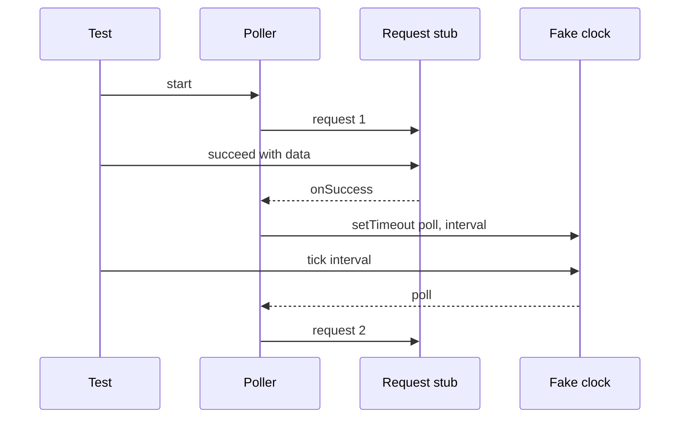

# Polling a server and testing time with a fake clock

> **Before this lesson:** you can stub an HTTP call and record what was requested ([Stubbing HTTP requests](#/lesson/js-testing/stubbing-http)), and you know why a runner has to wait for asynchronous work ([Testing asynchronous code: callbacks, promises and async/await](#/lesson/js-testing/testing-async-code)). You should have met `setTimeout` and `setInterval` ([Keys, pointers, scrolling, timers and debouncing](#/lesson/javascript/keys-pointers-timers)) and the red, green, refactor loop ([Test-driven development: red, green, refactor](#/lesson/js-testing/red-green-refactor)).

## In plain words

A web page can ask a server a question, and the server answers. What the server cannot do, with ordinary requests, is speak first. So when a page wants to stay up to date (new messages, a delivery status, a live score), the oldest trick is to ask again and again on a schedule. That is **polling**: repeating the same request at regular intervals to see whether anything has changed.

Picture waiting for a parcel in a block of flats with no doorbell. You walk down to the letterbox every ten minutes. Most trips find nothing. Walk down every ten seconds and you wear yourself out; walk down once a day and the parcel sits there for hours. Polling has exactly this trade-off between effort and delay.

Code that polls is built on timers: "do this again in five seconds". That creates a testing problem. A test that waits five real seconds is far too slow, and a test suite with a hundred of them is unusable. The answer is a **fake clock**: a stand-in for the timer functions that does not wait at all. Think of a wall clock whose hands you turn with your finger. The test says "it is now five seconds later", and every timer that was due in that span fires at once, in the right order.

Why it matters for a job: timers are everywhere in front-end code (polling, debouncing, animations, retries, session expiry, "saved 2 minutes ago" labels). "How do you test code that uses `setTimeout`?" is a standard interview question, and "use fake timers and advance them" is the answer the interviewer is listening for, together with the reasons.

## Why real timers make bad tests

Here is a test that waits on the real clock. Run it and watch the elapsed time.

```js-run
function remindLater(callback) {
  setTimeout(() => callback("time is up"), 200);     // 200 real milliseconds
}

const started = Date.now();
remindLater((message) => {
  console.log("got: " + message);
  console.log("this one test took about " + (Date.now() - started) + " ms");
});
```

Two hundred milliseconds does not sound like much. Now imagine the real delay is thirty seconds, as it would be for a poller, and that there are forty tests. Nobody would run that suite before each commit. Real waiting has a second problem as well: the delay is never exact. On a busy machine a 200 ms timer may fire after 240 ms, so a test that asserts on timing passes on your laptop and fails now and then on the shared build server. A test that sometimes passes and sometimes fails without any change to the code is called a **flaky test**, and real time is one of the most common causes.

## A fake clock, line by line

The fix is to stop using the real `setTimeout` inside the test. We give the code a replacement with the same methods, backed by nothing more than a number and a list.

```javascript
function createClock() {
  let now = 0, nextId = 1;
  const timers = [];                  // every waiting timer: { id, at, cb, every }
  const add = (cb, ms, every) => { timers.push({ id: nextId, at: now + ms, cb, every }); return nextId++; };
  const remove = (id) => { const i = timers.findIndex((t) => t.id === id); if (i >= 0) timers.splice(i, 1); };
  return {
    now: () => now,
    setTimeout: (cb, ms = 0) => add(cb, ms, 0),
    setInterval: (cb, ms) => add(cb, ms, ms),
    clearTimeout: remove,
    clearInterval: remove,
    tick(ms) {                        // move time forward, firing due timers in order
      const end = now + ms;
      for (;;) {
        timers.sort((a, b) => a.at - b.at || a.id - b.id);
        const t = timers[0];
        if (!t || t.at > end) break;
        now = t.at;
        if (t.every) t.at += t.every; else timers.shift();
        t.cb();
      }
      now = end;
    },
  };
}
```

What each part does:

- `now` is the fake current time in milliseconds. It starts at zero and only moves when the test says so.
- `timers` holds one entry per waiting timer: an `id` (so it can be cancelled), `at` (the fake time when it is due), `cb` (the **callback**, the function to call) and `every` (the repeat period, or 0 for a one-off).
- `setTimeout` and `setInterval` add an entry and return its id, as the real ones do. Nothing is scheduled with the operating system.
- `clearTimeout` and `clearInterval` remove the entry with that id.
- `tick(ms)` is the method the real timer functions do not have. It advances the fake time by `ms`, and on the way it calls every callback that falls due, earliest first. A repeating timer is moved forward by its period and stays in the list; a one-off is removed before it runs.
- Inside the loop the list is sorted again on every pass. That matters because a callback may add a new timer, and if the new timer is also due inside the span being ticked, it has to run too.

Use it once before building anything on top:

```js-run
// --- a tiny fake clock, like jest.useFakeTimers() / vi.useFakeTimers() ---
function createClock() {
  let now = 0, nextId = 1;
  const timers = [];                  // every waiting timer: { id, at, cb, every }
  const add = (cb, ms, every) => { timers.push({ id: nextId, at: now + ms, cb, every }); return nextId++; };
  const remove = (id) => { const i = timers.findIndex((t) => t.id === id); if (i >= 0) timers.splice(i, 1); };
  return {
    now: () => now,
    setTimeout: (cb, ms = 0) => add(cb, ms, 0),
    setInterval: (cb, ms) => add(cb, ms, ms),
    clearTimeout: remove,
    clearInterval: remove,
    tick(ms) {                        // move time forward, firing due timers in order
      const end = now + ms;
      for (;;) {
        timers.sort((a, b) => a.at - b.at || a.id - b.id);
        const t = timers[0];
        if (!t || t.at > end) break;
        now = t.at;
        if (t.every) t.at += t.every; else timers.shift();
        t.cb();
      }
      now = end;
    },
  };
}
// --- end of clock ---

const clock = createClock();
clock.setTimeout(() => console.log("B fires at " + clock.now()), 200);
clock.setTimeout(() => console.log("A fires at " + clock.now()), 100);
const beat = clock.setInterval(() => console.log("beat at " + clock.now()), 150);

console.log("nothing has happened yet, time is " + clock.now());
clock.tick(100);                       // exactly up to A
console.log("--- after tick(100)");
clock.tick(250);                       // passes 150, 200 and 300
console.log("--- after tick(250), time is " + clock.now());
clock.clearInterval(beat);
clock.tick(10000);                     // ten "seconds" later: silence, the interval was cancelled
console.log("done at " + clock.now() + ", in almost no real time");
```

Ten thousand fake milliseconds passed in a fraction of a real one, and the order of the output is the same on every run. A test with this property is **deterministic**: the same input always gives the same result.

## The seam: hand the clock to the code

A fake is only useful if the code under test uses it. The code must not call the global `setTimeout` directly; it receives an object with timer methods and calls those. In production you pass the real ones, in tests the fake. A place where one implementation can be swapped for another is a **seam**, and passing a dependency in from outside is **dependency injection**.

```javascript
// in the application
const realClock = {
  setTimeout: (cb, ms) => setTimeout(cb, ms),
  clearTimeout: (id) => clearTimeout(id),
  now: () => Date.now(),
};
```

Test frameworks offer a second route, which replaces the global timer functions themselves so that the code needs no parameter. You will see it near the end of this lesson. The idea underneath is identical.

## Test-driving a poller

### The design as a test list

We want `createPoller(options)` returning an object with `start()` and `stop()`. Before writing any code, list the behaviours:

1. `start` makes the first request straight away.
2. No second request is made while the first is still unanswered.
3. When the answer arrives, the data is handed to `onData` and the next request is scheduled after the interval.
4. The interval is configurable and defaults to 1000 ms.
5. A failed request is reported to `onError`, and polling carries on.
6. `stop` cancels the scheduled request.
7. An answer that arrives after `stop` does not restart the polling.
8. Calling `start` twice does not create two polling loops.

### A request stub the test can complete by hand

The poller should not know about `fetch`. It gets a `request(url, handlers)` function and calls it; the handlers object carries `onSuccess` and `onError`. For tests we write a stub that remembers each call and lets the test decide when and how each request finishes.

```javascript
function createRequestStub() {
  const calls = [];
  const request = (url, handlers) => {
    calls.push({ url, succeed: handlers.onSuccess, fail: handlers.onError });
  };
  request.calls = calls;
  return request;
}
```

After the poller calls `request`, the test can write `request.calls[0].succeed({ score: 3 })` to play the part of the server answering. Until the test does that, the request is "in flight". This gives the test full control over two things that are normally out of its hands: time, through the clock, and the network, through the stub.

### Cycle 1: the first request

```javascript
test("start makes the first request immediately", () => {
  const request = createRequestStub();
  const poller = createPoller({ url: "/api/score", request, clock: createClock() });

  poller.start();

  expect(request.calls.length).toBe(1);
  expect(request.calls[0].url).toBe("/api/score");
});
```

**Failing output** (there is no `createPoller` yet):

```text
FAIL  start makes the first request immediately
      -> createPoller is not defined
```

**The smallest code that passes:**

```javascript
function createPoller({ url, request }) {
  return {
    start() { request(url, { onSuccess() {}, onError() {} }); },
  };
}
```

```text
PASS  start makes the first request immediately
```

### Cycles 2 and 3: schedule the next request when the answer arrives

```javascript
test("waits for the answer, then polls again after the interval", () => {
  const request = createRequestStub();
  const clock = createClock();
  const poller = createPoller({ url: "/api/score", request, clock, interval: 5000 });
  poller.start();

  clock.tick(60000);                              // a whole minute with no answer
  expect(request.calls.length).toBe(1);           // still only one request

  request.calls[0].succeed({ score: 1 });         // the server answers
  clock.tick(4999);
  expect(request.calls.length).toBe(1);           // one millisecond too early
  clock.tick(1);
  expect(request.calls.length).toBe(2);           // exactly at 5000 ms
});
```

**Failing output:**

```text
FAIL  waits for the answer, then polls again after the interval
      -> expected 2 but got 1
```

Look at how precise the test is. It checks one millisecond before the deadline and at the deadline. With real timers nobody would dare to write that; with a fake clock it is exact and instant. Checking both sides of a limit is called testing the **boundary**, and off-by-one mistakes live there.

**The code that passes:**

```javascript
function createPoller({ url, request, clock, interval = 1000, onData = () => {} }) {
  function poll() {
    request(url, {
      onSuccess(data) { onData(data); clock.setTimeout(poll, interval); },
      onError() {},
    });
  }
  return { start() { poll(); } };
}
```

The default `interval = 1000` covers item 4 on the list; a short test for it follows in the full suite.

### Why not `setInterval`?

It is tempting to write `clock.setInterval(poll, interval)` and be done. The trouble shows when the server is slower than the interval. `setInterval` fires on schedule whether or not the previous request has finished, so requests pile up. The fake clock lets us demonstrate that in a few lines: below, every answer takes 2500 ms and the interval is 1000 ms.

```js-run
// --- a tiny fake clock, like jest.useFakeTimers() / vi.useFakeTimers() ---
function createClock() {
  let now = 0, nextId = 1;
  const timers = [];                  // every waiting timer: { id, at, cb, every }
  const add = (cb, ms, every) => { timers.push({ id: nextId, at: now + ms, cb, every }); return nextId++; };
  const remove = (id) => { const i = timers.findIndex((t) => t.id === id); if (i >= 0) timers.splice(i, 1); };
  return {
    now: () => now,
    setTimeout: (cb, ms = 0) => add(cb, ms, 0),
    setInterval: (cb, ms) => add(cb, ms, ms),
    clearTimeout: remove,
    clearInterval: remove,
    tick(ms) {                        // move time forward, firing due timers in order
      const end = now + ms;
      for (;;) {
        timers.sort((a, b) => a.at - b.at || a.id - b.id);
        const t = timers[0];
        if (!t || t.at > end) break;
        now = t.at;
        if (t.every) t.at += t.every; else timers.shift();
        t.cb();
      }
      now = end;
    },
  };
}
// --- end of clock ---

function simulate(strategy) {
  const clock = createClock();
  let inFlight = 0, worst = 0, sent = 0;
  const slowRequest = (done) => {              // a server that needs 2500 ms per answer
    inFlight++; sent++;
    worst = Math.max(worst, inFlight);
    clock.setTimeout(() => { inFlight--; done(); }, 2500);
  };
  if (strategy === "setInterval") {
    clock.setInterval(() => slowRequest(() => {}), 1000);
  } else {
    const poll = () => slowRequest(() => clock.setTimeout(poll, 1000));
    poll();
  }
  clock.tick(20000);                           // twenty seconds of simulated time
  return strategy + ": " + sent + " requests sent, at most " + worst + " in flight at once";
}

console.log(simulate("setInterval"));
console.log(simulate("chained setTimeout"));
```

With `setInterval` several requests overlap, and their answers can even arrive out of order, so an old answer may overwrite a newer one. Scheduling the next request only after the previous one completes keeps exactly one in flight. This pattern is often called a **chained timeout** or recursive `setTimeout`.

| | `setInterval(poll, ms)` | `setTimeout` chained after each answer |
|---|---|---|
| Gap between requests | Fixed, measured start to start | Fixed, measured from answer to next start |
| Slow server | Requests overlap and pile up | Never more than one in flight |
| Changing the delay between rounds | Needs clear and re-create | Pass a different number next time |
| Stopping | `clearInterval` | `clearTimeout` plus a flag for the in-flight request |

### Cycles 4 to 8: errors, stopping and double starts

The remaining behaviours each add one test and a line or two of code. Here is the finished poller with its full suite. Read the tests first; they are the specification.

```js-run
// --- the tiny test runner from lesson 1 ---
function test(name, fn) {
  try { fn(); console.log("PASS  " + name); }
  catch (e) { console.log("FAIL  " + name + "\n      -> " + e.message); }
}
function expect(actual) {
  const show = (v) => typeof v === "function" ? "[function]" : JSON.stringify(v);
  const fail = (msg) => { throw new Error(msg); };
  return {
    toBe(expected) {
      if (!Object.is(actual, expected)) fail("expected " + show(expected) + " but got " + show(actual));
    },
    toEqual(expected) {
      if (JSON.stringify(actual) !== JSON.stringify(expected)) fail("expected " + show(expected) + " but got " + show(actual));
    },
    toThrow(text = "") {
      try { actual(); } catch (e) {
        if (!String(e.message).includes(text)) fail("threw the wrong error: " + e.message);
        return;
      }
      fail("expected the function to throw, but it returned normally");
    },
  };
}
// --- end of runner ---

// --- a tiny fake clock, like jest.useFakeTimers() / vi.useFakeTimers() ---
function createClock() {
  let now = 0, nextId = 1;
  const timers = [];                  // every waiting timer: { id, at, cb, every }
  const add = (cb, ms, every) => { timers.push({ id: nextId, at: now + ms, cb, every }); return nextId++; };
  const remove = (id) => { const i = timers.findIndex((t) => t.id === id); if (i >= 0) timers.splice(i, 1); };
  return {
    now: () => now,
    setTimeout: (cb, ms = 0) => add(cb, ms, 0),
    setInterval: (cb, ms) => add(cb, ms, ms),
    clearTimeout: remove,
    clearInterval: remove,
    tick(ms) {                        // move time forward, firing due timers in order
      const end = now + ms;
      for (;;) {
        timers.sort((a, b) => a.at - b.at || a.id - b.id);
        const t = timers[0];
        if (!t || t.at > end) break;
        now = t.at;
        if (t.every) t.at += t.every; else timers.shift();
        t.cb();
      }
      now = end;
    },
  };
}
// --- end of clock ---

function createRequestStub() {
  const calls = [];
  const request = (url, handlers) => { calls.push({ url, succeed: handlers.onSuccess, fail: handlers.onError }); };
  request.calls = calls;
  return request;
}

// ---------- code under test ----------
function createPoller({ url, request, clock, interval = 1000, onData = () => {}, onError = () => {} }) {
  let running = false;
  let timer = null;                       // id of the scheduled next poll, if any

  function poll() {
    timer = null;
    request(url, {
      onSuccess(data) { onData(data); scheduleNext(); },
      onError(error) { onError(error); scheduleNext(); },
    });
  }
  function scheduleNext() {
    if (!running) return;                 // an answer after stop() must not restart polling
    timer = clock.setTimeout(poll, interval);
  }
  return {
    start() {
      if (running) return;                // a second start() is ignored
      running = true;
      poll();
    },
    stop() {
      running = false;
      if (timer !== null) clock.clearTimeout(timer);
      timer = null;
    },
  };
}

// ---------- the tests ----------
function setup(extra = {}) {
  const request = createRequestStub();
  const clock = createClock();
  const poller = createPoller({ url: "/api/score", request, clock, ...extra });
  return { request, clock, poller };
}

test("start makes the first request immediately", () => {
  const { request, poller } = setup();
  poller.start();
  expect(request.calls.length).toBe(1);
  expect(request.calls[0].url).toBe("/api/score");
});

test("waits for the answer, then polls again after the interval", () => {
  const { request, clock, poller } = setup({ interval: 5000 });
  poller.start();
  clock.tick(60000);
  expect(request.calls.length).toBe(1);
  request.calls[0].succeed({ score: 1 });
  clock.tick(4999);
  expect(request.calls.length).toBe(1);
  clock.tick(1);
  expect(request.calls.length).toBe(2);
});

test("the interval defaults to one second", () => {
  const { request, clock, poller } = setup();
  poller.start();
  request.calls[0].succeed({});
  clock.tick(999);
  expect(request.calls.length).toBe(1);
  clock.tick(1);
  expect(request.calls.length).toBe(2);
});

test("hands each answer to onData", () => {
  const seen = [];
  const { request, clock, poller } = setup({ onData: (d) => seen.push(d) });
  poller.start();
  request.calls[0].succeed({ score: 1 });
  clock.tick(1000);
  request.calls[1].succeed({ score: 2 });
  expect(seen).toEqual([{ score: 1 }, { score: 2 }]);
});

test("reports a failure and keeps polling", () => {
  const errors = [];
  const { request, clock, poller } = setup({ onError: (e) => errors.push(e.message) });
  poller.start();
  request.calls[0].fail(new Error("HTTP 503"));
  clock.tick(1000);
  expect(errors).toEqual(["HTTP 503"]);
  expect(request.calls.length).toBe(2);
});

test("stop cancels the scheduled request", () => {
  const { request, clock, poller } = setup();
  poller.start();
  request.calls[0].succeed({});
  poller.stop();
  clock.tick(100000);
  expect(request.calls.length).toBe(1);
});

test("an answer that arrives after stop does not restart polling", () => {
  const { request, clock, poller } = setup();
  poller.start();
  poller.stop();
  request.calls[0].succeed({});            // late answer
  clock.tick(100000);
  expect(request.calls.length).toBe(1);
});

test("calling start twice does not create two loops", () => {
  const { request, clock, poller } = setup();
  poller.start();
  poller.start();
  expect(request.calls.length).toBe(1);
  request.calls[0].succeed({});
  clock.tick(1000);
  expect(request.calls.length).toBe(2);
});
```

Try breaking it. Delete the line `if (!running) return;` in `scheduleNext` and run again: the "late answer" test goes red, which shows the line is needed and the test guards it. Then put it back, and remove `if (running) return;` from `start` to see the last test fail.

The helper `setup` builds the three objects every test needs and lets a test override single options. It keeps each test to the lines that matter for that behaviour.



## Code that reads the current time

Timers are one half of time. The other half is asking "what time is it now?" with `Date.now()` or `new Date()`. A function that reads the real clock gives a different answer every time it runs, so a test of it cannot have a fixed expected value. The cure is the same seam: pass the current time in, or pass a function that returns it.

```js-run
// --- the tiny test runner from lesson 1 ---
function test(name, fn) {
  try { fn(); console.log("PASS  " + name); }
  catch (e) { console.log("FAIL  " + name + "\n      -> " + e.message); }
}
function expect(actual) {
  const show = (v) => typeof v === "function" ? "[function]" : JSON.stringify(v);
  const fail = (msg) => { throw new Error(msg); };
  return {
    toBe(expected) {
      if (!Object.is(actual, expected)) fail("expected " + show(expected) + " but got " + show(actual));
    },
    toEqual(expected) {
      if (JSON.stringify(actual) !== JSON.stringify(expected)) fail("expected " + show(expected) + " but got " + show(actual));
    },
    toThrow(text = "") {
      try { actual(); } catch (e) {
        if (!String(e.message).includes(text)) fail("threw the wrong error: " + e.message);
        return;
      }
      fail("expected the function to throw, but it returned normally");
    },
  };
}
// --- end of runner ---

function timeAgo(thenMs, nowMs) {
  const seconds = Math.floor((nowMs - thenMs) / 1000);
  if (seconds < 5) return "now";
  if (seconds < 60) return seconds + " seconds ago";
  const minutes = Math.floor(seconds / 60);
  return minutes === 1 ? "1 minute ago" : minutes + " minutes ago";
}

const NOON = Date.UTC(2030, 0, 15, 12, 0, 0);       // a fixed, made-up moment

test("under five seconds reads as now", () => expect(timeAgo(NOON - 4999, NOON)).toBe("now"));
test("exactly five seconds is counted", () => expect(timeAgo(NOON - 5000, NOON)).toBe("5 seconds ago"));
test("59 seconds is still seconds", () => expect(timeAgo(NOON - 59000, NOON)).toBe("59 seconds ago"));
test("one minute is singular", () => expect(timeAgo(NOON - 60000, NOON)).toBe("1 minute ago"));
test("several minutes are plural", () => expect(timeAgo(NOON - 185000, NOON)).toBe("3 minutes ago"));
```

Because `nowMs` is a parameter, each test states its own "now". The component that calls `timeAgo` supplies `clock.now()`, and the fake clock from this lesson already has that method. A poller that must not ask more often than a minimum gap, which the next lesson builds, needs both halves: timers to schedule and `now()` to measure how long a request took.

## The same thing in real frameworks

Vitest and Jest ship a fake clock. Switching it on replaces the global `setTimeout`, `setInterval`, `clearTimeout`, `clearInterval` and `Date` for the duration of the test, so the code under test needs no clock parameter.

```javascript
import { test, expect, vi, beforeEach, afterEach } from "vitest";
import { createPoller } from "./poller.js";

beforeEach(() => { vi.useFakeTimers(); });       // install the fake clock
afterEach(() => { vi.useRealTimers(); });        // always put the real one back

test("polls again five seconds after the answer", () => {
  const request = vi.fn();                       // records its calls
  createPoller({ url: "/api/score", request, interval: 5000 }).start();

  const handlers = request.mock.calls[0][1];     // second argument of the first call
  handlers.onSuccess({ score: 1 });

  vi.advanceTimersByTime(4999);
  expect(request).toHaveBeenCalledTimes(1);
  vi.advanceTimersByTime(1);
  expect(request).toHaveBeenCalledTimes(2);
});

test("a label is computed from a fixed date", () => {
  vi.setSystemTime(new Date("2030-01-15T12:00:00Z"));
  expect(Date.now()).toBe(Date.UTC(2030, 0, 15, 12, 0, 0));
});
```

```text
 ✓ poller.test.js (2 tests) 4ms
```

`vi.advanceTimersByTime(ms)` is our `tick(ms)`. `vi.setSystemTime(date)` sets what `Date.now()` and `new Date()` report. In Jest, write `jest` where the example has `vi`. Node's built-in runner has the same feature as `mock.timers.enable()` and `mock.timers.tick(ms)` from `node:test`.

> [!WARNING]
> Fake timers control timers, not promises. If the code under test awaits a promise between two timers, advancing the clock synchronously is not enough, because the code after the `await` has not run yet. Frameworks provide asynchronous variants such as `await vi.advanceTimersByTimeAsync(ms)` for that case. The lesson [Promises, timers and async code under test](#/lesson/js-testing/async-timers-promises) works through it.

> [!TIP]
> Injection or global replacement? Injecting a clock makes the dependency visible in the function's signature and works without any framework, which is why this lesson uses it. Replacing the globals needs no change to the code under test, which is handy for code you did not write. Many teams use the framework's fake timers by default and inject a clock only into code where time is the main subject, such as schedulers.

> [!INTERVIEW]
> **"How do you test a function that uses `setTimeout` or `setInterval`?"** Say: never wait in real time. Install fake timers (`vi.useFakeTimers()` or `jest.useFakeTimers()`), call the code, advance the clock by an exact amount and assert, including one millisecond before the deadline to prove nothing fires early. Restore real timers afterwards. Mention the two extras that show experience: code that reads `Date.now()` needs the system time set too, and code that mixes timers with promises needs the async advance functions.

## Common pitfalls

- **Sleeping in tests.** `await new Promise((r) => setTimeout(r, 1000))` makes the suite slow and still fails on a loaded machine. Advance a fake clock.
- **Forgetting to restore real timers.** A fake clock left installed makes later tests hang, because their timers never fire. Restore in `afterEach`.
- **Asserting only after the deadline.** If you only check at 5000 ms, a bug that fires at 0 ms goes unnoticed. Check before and at the boundary.
- **Using `setInterval` for requests.** A slow server leads to overlapping requests and answers out of order.
- **`stop` that only clears the timer.** A request already in flight will come back and schedule the next round unless a flag prevents it.
- **Running all timers on a repeating schedule.** Functions such as `vi.runAllTimers()` loop for ever on code that always schedules another timer. Use `advanceTimersByTime` or `runOnlyPendingTimers` for pollers.
- **Hidden reads of the real time.** A single `new Date()` deep inside a function makes its tests depend on the day they run. Pass the time in.

## Cheat sheet

| Need | Vitest (Jest: `jest.` in place of `vi.`) | This lesson's fake |
|---|---|---|
| Install fake timers | `vi.useFakeTimers()` | `const clock = createClock()` and inject it |
| Restore real timers | `vi.useRealTimers()` | nothing to restore |
| Move time forward | `vi.advanceTimersByTime(ms)` | `clock.tick(ms)` |
| Move time, letting promises run | `await vi.advanceTimersByTimeAsync(ms)` | covered in a later lesson |
| Run timers that are waiting now, not new ones | `vi.runOnlyPendingTimers()` | |
| Run until no timers remain | `vi.runAllTimers()` | |
| Jump to the next timer | `vi.advanceTimersToNextTimer()` | |
| Set the current date | `vi.setSystemTime(new Date("2030-01-15"))` | pass `nowMs` in |
| Count waiting timers | `vi.getTimerCount()` | |
| Node built-in runner | `mock.timers.enable()`, `mock.timers.tick(ms)` | |

## Summary

- Polling repeats a request on a schedule so a page can notice changes on the server; short intervals cost load, long intervals cost freshness.
- Tests must not wait in real time. A fake clock keeps a list of timers and a number, and `tick` fires what is due, instantly and in order.
- Code becomes testable when its clock and its request function are supplied from outside.
- Schedule the next poll after the previous answer arrives; `setInterval` lets slow answers overlap.
- A stop needs both a cleared timer and a flag, because a request may be in flight.
- Code that reads the current time should receive it as an argument, or the test should fix the system time.
- Framework fake timers do the same job by replacing the globals; always restore them.

## Glossary

- **Polling**: asking a server the same question repeatedly at intervals to detect changes.
- **Interval**: the waiting time between two polls.
- **Timer**: a request to run a function later, created with `setTimeout` (once) or `setInterval` (repeatedly).
- **Callback**: a function handed to other code to be called later.
- **Fake clock / fake timers**: a replacement for the timer functions and the current time that the test advances by hand.
- **Tick**: one manual step forward of a fake clock.
- **Deterministic**: giving the same result on every run.
- **Flaky test**: a test that passes or fails unpredictably without a code change.
- **In flight**: said of a request that has been sent and not yet answered.
- **Chained timeout**: scheduling the next run with `setTimeout` only when the current one has finished.
- **Boundary**: the exact edge of a limit, where off-by-one bugs appear.
- **Seam**: a place where a dependency can be swapped without editing the code that uses it.

## Check yourself

```quiz
[
  {"q": "A poller is started with interval 5000 using a fake clock. The first request has NOT been answered. The test runs clock.tick(60000). With the chained-timeout poller from this lesson, how many requests have been made?",
   "options": ["13", "12", "1", "0"],
   "answer": 2,
   "explain": "The next poll is only scheduled inside the success or error handler. Until the first request completes there is no timer at all, so no amount of ticking produces a second request."},
  {"q": "clock.setTimeout(a, 200); clock.setTimeout(b, 100); clock.tick(150). Which callbacks have run?",
   "options": ["a only", "b only", "both, a first", "neither"],
   "answer": 1,
   "explain": "tick fires every timer due within the span, earliest first. Only b at 100 is due by 150; a is due at 200."},
  {"q": "A test asserts expect(calls).toBe(2) after clock.tick(5000) and passes. The implementation actually schedules the next poll with a delay of 0. Why did the test not notice?",
   "options": ["Fake clocks ignore zero delays", "It only checked after the deadline; a check at 4999 expecting 1 would have failed", "tick runs timers in reverse", "The stub hid the request"],
   "answer": 1,
   "explain": "A timer due at 0 has also fired by 5000. Asserting one millisecond before the boundary is what proves nothing happens early."},
  {"q": "The server takes 2500 ms to answer and the code uses setInterval(poll, 1000). What happens?",
   "options": ["Requests queue up politely one at a time", "Up to three requests are in flight at once and answers may arrive out of order", "setInterval waits for the callback's request to finish", "Nothing is sent after the first"],
   "answer": 1,
   "explain": "setInterval fires on schedule regardless of whether earlier work has finished. Chaining setTimeout after each answer keeps one request in flight."},
  {"q": "poller.stop() only calls clearTimeout on the pending timer. A request was in flight when stop was called and its answer arrives later. What happens without the running flag?",
   "options": ["Nothing, polling is stopped", "The success handler schedules a new timer and polling silently resumes", "An exception is thrown", "The clock resets to zero"],
   "answer": 1,
   "explain": "There was no timer to clear while the request was in flight. The handler runs later and schedules the next poll unless a flag tells it not to."},
  {"q": "A test file calls vi.useFakeTimers() in one test and never restores real timers. A later test awaits a real 10 ms setTimeout. What is the likely result?",
   "options": ["It passes faster", "It hangs until the runner's timeout, because the timer never fires on its own", "It throws a syntax error", "Vitest restores timers automatically between tests in every configuration"],
   "answer": 1,
   "explain": "With the fake clock still installed, timers only fire when advanced by hand. Restore real timers in afterEach."},
  {"q": "Why does timeAgo take nowMs as a parameter instead of calling Date.now() itself?",
   "options": ["Date.now() is slow", "So each test can state a fixed current time and get the same answer on every run", "Because Date is unavailable in Node", "To avoid time zones entirely"],
   "answer": 1,
   "explain": "Reading the real clock makes the output change from run to run. Passing the time in turns the function into a pure calculation that is easy to test at exact boundaries."},
  {"q": "Which statement about polling intervals is correct?",
   "options": ["Shorter is always better", "A shorter interval lowers the delay before changes are seen but raises the number of mostly empty requests the server must handle", "The interval has no effect on server load", "Polling makes the server able to send data first"],
   "answer": 1,
   "explain": "Polling trades latency against load. The server still only answers requests; it never initiates."}
]
```

> **Source:** Johansen, *Test-Driven JavaScript Development*, ch. 13 (Streaming Data with Ajax and Comet), section 13.1. Docs: https://vitest.dev/guide/mocking/timers , https://vitest.dev/api/vi.html#vi-usefaketimers , https://jestjs.io/docs/timer-mocks , https://nodejs.org/api/test.html#timers , https://developer.mozilla.org/en-US/docs/Web/API/Window/setTimeout
