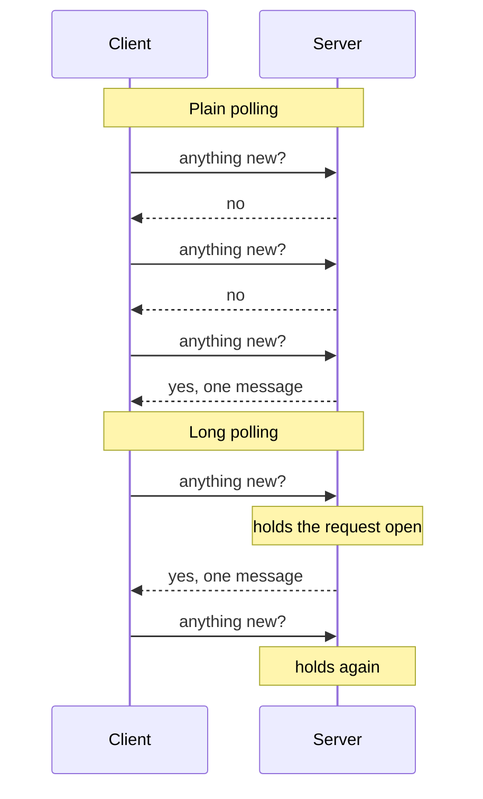

# Long polling, streaming and one connection for many topics

> **Before this lesson:** you have built a poller against a fake clock in [Polling a server and testing time with a fake clock](#/lesson/js-testing/polling-fake-timers) and an observable with `observe` and `notify` in [The observer pattern, built test-first](#/lesson/js-testing/observer-pattern-tdd). You should be comfortable with a request stub that the test completes by hand, from the same polling lesson.

## In plain words

Plain polling asks the server "anything new?" on a fixed schedule and usually hears "no". This lesson covers the better ways a page can receive data the moment it exists.

Go back to the parcel and the letterbox. With plain polling you walk downstairs every ten minutes. With **long polling** you go to the post office counter and ask, and the clerk does not answer until a parcel for you has arrived. You stand there, perhaps for a long time. The moment the parcel comes in you get it, and you immediately ask again. You receive everything with almost no delay, and you make one trip per parcel, not one trip per ten minutes. **Streaming** goes a step further: you and the clerk stay on an open phone line and the clerk reads out each arrival as it happens, with no need to ask again.

All of these give the impression that the server is sending first, so they are grouped under the name **server push**. Around 2006 to 2012 the same family of tricks was known as **Comet**, a name you will still meet in older articles and codebases.

Why it matters for a job: chat, notifications, live dashboards, collaborative editing and delivery tracking all need this. "Compare polling, long polling, server-sent events and WebSockets" is one of the most common system-design warm-up questions, and code that reconnects, backs off and fans messages out to several listeners is exactly the kind that breaks in production unless it has tests.

## What plain polling costs

Two numbers describe a polling setup. **Latency** is the delay between something happening on the server and the page finding out. **Load** is how many requests the server has to answer. With an interval of `T` seconds, a change waits on average half an interval before the next poll picks it up, and every open page sends `1 / T` requests per second whether or not there is anything to fetch.

```js-run
const users = 10000;
console.log("interval | average delay | requests per second from " + users + " open pages");
for (const seconds of [1, 5, 30, 60]) {
  const delay = seconds / 2;
  const load = Math.round(users / seconds);
  console.log(String(seconds).padStart(6) + " s | " + String(delay).padStart(11) + " s | " + String(load).padStart(8));
}
```

A one-second interval feels live and costs ten thousand requests every second, nearly all of them answered with "nothing new". A sixty-second interval is cheap and makes a chat unusable. No interval gives low latency and low load together, which is why the other techniques exist.

## The family of server-push techniques

| Technique | How it works | Direction | Strengths | Weaknesses |
|---|---|---|---|---|
| Polling | Request on a timer | Client asks, server answers | Works everywhere; trivial server | Latency or load, pick one |
| Long polling | Server holds each request open until it has data, then the client asks again | Server to client, one message batch per request | Low latency with ordinary HTTP; passes through old proxies | One held connection per client; reconnect logic is yours |
| Streaming over one response | Server keeps one response open and writes pieces into it | Server to client | One connection, no re-asking | Needs care with buffering proxies |
| Server-Sent Events | A standard streaming format read with the browser's `EventSource` object | Server to client | Reconnects by itself; resumes from the last event id; text based | One direction only |
| WebSocket | A separate protocol started from an HTTP request, then a two-way channel | Both directions | Lowest overhead per message; binary or text | Reconnection and message framing are up to you; some networks block it |

A little history explains the odd shapes. Before browsers had any of the last two rows, developers kept a hidden frame loading a page that never finished, and the server trickled script into it. It worked, but errors were nearly impossible to detect and the browser showed a loading indicator for ever. Long polling over the ordinary request object replaced it because code controls the connection and can see failures. Today `EventSource` and `WebSocket` are available in every current browser, so new projects choose between those two and keep long polling as the fallback that works through almost any network.



A fact that surprises newcomers: on the client, long polling is almost the same code as polling. Whether a request is answered at once or held for thirty seconds is the *server's* decision. The client's part is to ask again promptly, and to behave well when things go wrong.

## Test-driving a long-polling client

### Two rules that need time measurement

If the client asks again the instant an answer arrives, a server with a constant stream of events would be hit by an endless loop of back-to-back requests. So the client keeps a **minimum gap** between the *starts* of two requests:

- an answer that took longer than the gap is followed by a new request at once;
- an answer that came back quickly is followed by a new request only when the rest of the gap has passed.

Limiting how often something may happen is called **throttling**. To apply it the client has to know how long the request took, so it reads the current time when the request starts and again when it ends. That is why the fake clock from the previous lesson has a `now()` method next to its timers.

The second rule covers failure. When the server is down, asking again immediately turns every open page into a tiny attacker. The standard cure is **exponential backoff**: wait a short time after the first failure, twice as long after the second, twice as long again after the third, up to a ceiling, and go back to the short wait after any success.

### The test list

1. An answer that took longer than the minimum gap triggers the next request at once.
2. A fast answer makes the client wait out the remainder of the gap.
3. A failure is followed by a wait of the base retry delay.
4. Each further failure doubles the wait.
5. The wait never exceeds the maximum.
6. A success resets the retry delay.
7. `stop` ends everything, including after a late answer.

### First test, failing first

```javascript
test("a fast answer waits out the rest of the minimum gap", () => {
  const { request, clock, poller } = setup({ minGap: 1000 });
  poller.start();
  clock.tick(200);                         // the answer arrives 200 ms after the request began
  request.calls[0].succeed({});

  clock.tick(799);
  expect(request.calls.length).toBe(1);    // 999 ms since the start: too early
  clock.tick(1);
  expect(request.calls.length).toBe(2);    // 1000 ms since the start
});
```

Suppose the first attempt reuses the poller from the previous lesson, which waits a full interval after each answer:

```text
FAIL  a fast answer waits out the rest of the minimum gap
      -> expected 2 but got 1
```

The old code schedules the next request 1000 ms after the *answer*, which is 1200 ms after the start. The fix measures from the start:

```javascript
const startedAt = clock.now();
// ... later, in the success handler:
const elapsed = clock.now() - startedAt;
schedule(Math.max(0, minGap - elapsed));
```

`Math.max(0, ...)` handles the slow answer: if 30 seconds have passed, `minGap - elapsed` is negative and the delay becomes zero.

### The finished long poller and its suite

```js-run
// --- the tiny test runner from lesson 1 ---
function test(name, fn) {
  try { fn(); console.log("PASS  " + name); }
  catch (e) { console.log("FAIL  " + name + "\n      -> " + e.message); }
}
function expect(actual) {
  const show = (v) => typeof v === "function" ? "[function]" : JSON.stringify(v);
  const fail = (msg) => { throw new Error(msg); };
  return {
    toBe(expected) {
      if (!Object.is(actual, expected)) fail("expected " + show(expected) + " but got " + show(actual));
    },
    toEqual(expected) {
      if (JSON.stringify(actual) !== JSON.stringify(expected)) fail("expected " + show(expected) + " but got " + show(actual));
    },
    toThrow(text = "") {
      try { actual(); } catch (e) {
        if (!String(e.message).includes(text)) fail("threw the wrong error: " + e.message);
        return;
      }
      fail("expected the function to throw, but it returned normally");
    },
  };
}
// --- end of runner ---

// --- a tiny fake clock, like jest.useFakeTimers() / vi.useFakeTimers() ---
function createClock() {
  let now = 0, nextId = 1;
  const timers = [];                  // every waiting timer: { id, at, cb, every }
  const add = (cb, ms, every) => { timers.push({ id: nextId, at: now + ms, cb, every }); return nextId++; };
  const remove = (id) => { const i = timers.findIndex((t) => t.id === id); if (i >= 0) timers.splice(i, 1); };
  return {
    now: () => now,
    setTimeout: (cb, ms = 0) => add(cb, ms, 0),
    setInterval: (cb, ms) => add(cb, ms, ms),
    clearTimeout: remove,
    clearInterval: remove,
    tick(ms) {                        // move time forward, firing due timers in order
      const end = now + ms;
      for (;;) {
        timers.sort((a, b) => a.at - b.at || a.id - b.id);
        const t = timers[0];
        if (!t || t.at > end) break;
        now = t.at;
        if (t.every) t.at += t.every; else timers.shift();
        t.cb();
      }
      now = end;
    },
  };
}
// --- end of clock ---

function createRequestStub() {
  const calls = [];
  const request = (url, handlers) => { calls.push({ url, succeed: handlers.onSuccess, fail: handlers.onError }); };
  request.calls = calls;
  return request;
}

// ---------- code under test ----------
function createLongPoller({ url, request, clock, minGap = 1000, retryBase = 1000, retryMax = 30000,
                            onData = () => {}, onError = () => {} }) {
  let running = false, timer = null, failures = 0;
  const currentUrl = () => (typeof url === "function" ? url() : url);

  function connect() {
    timer = null;
    const startedAt = clock.now();                         // when this request began
    request(currentUrl(), {
      onSuccess(data) {
        failures = 0;                                      // a success resets the backoff
        onData(data);
        schedule(Math.max(0, minGap - (clock.now() - startedAt)));
      },
      onError(error) {
        failures++;
        onError(error);
        schedule(Math.min(retryMax, retryBase * 2 ** (failures - 1)));
      },
    });
  }
  function schedule(delay) {
    if (!running) return;
    timer = clock.setTimeout(connect, delay);
  }
  return {
    start() { if (running) return; running = true; connect(); },
    stop() { running = false; if (timer !== null) clock.clearTimeout(timer); timer = null; },
  };
}

// ---------- the tests ----------
function setup(extra = {}) {
  const request = createRequestStub();
  const clock = createClock();
  const poller = createLongPoller({ url: "/feed", request, clock, ...extra });
  return { request, clock, poller };
}
const down = () => new Error("HTTP 503");

test("a slow answer is followed by a new request at once", () => {
  const { request, clock, poller } = setup();
  poller.start();
  clock.tick(30000);                       // the server held the request for 30 s
  request.calls[0].succeed({});
  clock.tick(0);                           // run timers that are due right now
  expect(request.calls.length).toBe(2);
});

test("a fast answer waits out the rest of the minimum gap", () => {
  const { request, clock, poller } = setup({ minGap: 1000 });
  poller.start();
  clock.tick(200);
  request.calls[0].succeed({});
  clock.tick(799);
  expect(request.calls.length).toBe(1);
  clock.tick(1);
  expect(request.calls.length).toBe(2);
});

test("after a failure it waits the base retry delay", () => {
  const { request, clock, poller } = setup({ retryBase: 1000 });
  poller.start();
  request.calls[0].fail(down());
  clock.tick(999);
  expect(request.calls.length).toBe(1);
  clock.tick(1);
  expect(request.calls.length).toBe(2);
});

test("each further failure doubles the wait", () => {
  const { request, clock, poller } = setup({ retryBase: 1000 });
  poller.start();
  request.calls[0].fail(down()); clock.tick(1000);     // waited 1000
  request.calls[1].fail(down()); clock.tick(1999);
  expect(request.calls.length).toBe(2);                // 2000 not reached yet
  clock.tick(1);
  expect(request.calls.length).toBe(3);
  request.calls[2].fail(down()); clock.tick(3999);
  expect(request.calls.length).toBe(3);                // 4000 not reached yet
  clock.tick(1);
  expect(request.calls.length).toBe(4);
});

test("the wait never exceeds the maximum", () => {
  const { request, clock, poller } = setup({ retryBase: 1000, retryMax: 3000 });
  poller.start();
  request.calls[0].fail(down()); clock.tick(1000);
  request.calls[1].fail(down()); clock.tick(2000);
  request.calls[2].fail(down()); clock.tick(3000);     // 4000 would be the doubled value
  expect(request.calls.length).toBe(4);
});

test("a success resets the retry delay", () => {
  const { request, clock, poller } = setup({ retryBase: 1000, minGap: 0 });
  poller.start();
  request.calls[0].fail(down()); clock.tick(1000);
  request.calls[1].fail(down()); clock.tick(2000);
  request.calls[2].succeed({});  clock.tick(0);
  request.calls[3].fail(down()); clock.tick(1000);     // back to the base delay
  expect(request.calls.length).toBe(5);
});

test("stop ends the loop even when an answer arrives later", () => {
  const { request, clock, poller } = setup();
  poller.start();
  poller.stop();
  request.calls[0].succeed({});
  clock.tick(100000);
  expect(request.calls.length).toBe(1);
});
```

Notice `clock.tick(0)`. Even an "immediate" reconnect goes through `setTimeout` with a delay of zero. That keeps one code path for every case, and it means the new request starts from a fresh call stack and never from inside the old request's handler. In the test, `tick(0)` runs the timers that are already due without moving time.

Change `2 ** (failures - 1)` to `2 ** failures` and run again. The "base retry delay" test fails with `expected 2 but got 1`: an off-by-one in an exponent, the kind of mistake that is invisible when you try the page by hand and plain in a test that checks 999 and 1000.

> [!TIP]
> Production backoff usually adds **jitter**: a random extra delay, so that ten thousand clients that lost the same server do not all come back at the same millisecond. Inject the random source (`random = Math.random`) the same way as the clock, and pass `() => 0.5` in tests so results stay exact.

## Stale answers from caches

A poll is only useful if the answer is fresh. Browsers and proxies may keep a copy of a response to a `GET` request and hand that copy back the next time the same URL is asked for; this stored copy is a **cache**. For polling that is harmful: the page would keep seeing the old data.

The server controls this with a response header, `Cache-Control: no-store`, and with `fetch` the client can also ask for `{ cache: "no-store" }`. When you control neither end, an old and still effective trick is the **cache buster**: add a parameter that is different on every request, so no stored copy ever matches.

```js-run
// --- the tiny test runner from lesson 1 ---
function test(name, fn) {
  try { fn(); console.log("PASS  " + name); }
  catch (e) { console.log("FAIL  " + name + "\n      -> " + e.message); }
}
function expect(actual) {
  const show = (v) => typeof v === "function" ? "[function]" : JSON.stringify(v);
  const fail = (msg) => { throw new Error(msg); };
  return {
    toBe(expected) {
      if (!Object.is(actual, expected)) fail("expected " + show(expected) + " but got " + show(actual));
    },
    toEqual(expected) {
      if (JSON.stringify(actual) !== JSON.stringify(expected)) fail("expected " + show(expected) + " but got " + show(actual));
    },
    toThrow(text = "") {
      try { actual(); } catch (e) {
        if (!String(e.message).includes(text)) fail("threw the wrong error: " + e.message);
        return;
      }
      fail("expected the function to throw, but it returned normally");
    },
  };
}
// --- end of runner ---

function withCacheBuster(url, nowMs) {
  const joiner = url.includes("?") ? "&" : "?";
  return url + joiner + "_=" + nowMs;
}

test("adds the time as a query parameter", () => {
  expect(withCacheBuster("/feed", 1700000000000)).toBe("/feed?_=1700000000000");
});
test("uses & when the url already has a query", () => {
  expect(withCacheBuster("/feed?since=7", 5)).toBe("/feed?since=7&_=5");
});
test("two different moments give two different urls", () => {
  expect(withCacheBuster("/feed", 1) === withCacheBuster("/feed", 2)).toBe(false);
});
```

The current time is a parameter, so the test can state the exact expected URL. Had the function called `Date.now()` itself, the best a test could do is match a pattern.

## One connection, many topics

A browser opens only a handful of connections to one host at a time (six is typical for HTTP/1.1; early browsers allowed two). A held long-poll request occupies one of them for as long as it is open. A page with a chat panel, a notification badge and a live price, each holding its own request, would use up half the budget, and two tabs of that page would leave nothing for images and scripts. HTTP/2 lifts the limit by sharing one connection among many requests, but the design advice still stands: **keep one push connection per page and sort the incoming messages on the client.**

That calls for an agreed message shape. Ours is:

```json
{
  "token": "42",
  "topics": {
    "price": [{ "symbol": "ACME", "value": 101.5 }],
    "news":  [{ "title": "Markets open" }, { "title": "Rates unchanged" }]
  }
}
```

`topics` maps a topic name to a list of messages. `token` is a marker the server hands out with each answer; the client sends it back with the next request, so the server knows what this client has already received and sends only what is newer.

The client-side piece that reads this is a **dispatcher**: it takes one incoming bundle and delivers each message to whoever registered for its topic. Registration and delivery are the observer pattern you already built, so the dispatcher is a thin layer of glue over `createObservable` and `createLongPoller`.

```js-run
// --- the tiny test runner from lesson 1 ---
function test(name, fn) {
  try { fn(); console.log("PASS  " + name); }
  catch (e) { console.log("FAIL  " + name + "\n      -> " + e.message); }
}
function expect(actual) {
  const show = (v) => typeof v === "function" ? "[function]" : JSON.stringify(v);
  const fail = (msg) => { throw new Error(msg); };
  return {
    toBe(expected) {
      if (!Object.is(actual, expected)) fail("expected " + show(expected) + " but got " + show(actual));
    },
    toEqual(expected) {
      if (JSON.stringify(actual) !== JSON.stringify(expected)) fail("expected " + show(expected) + " but got " + show(actual));
    },
    toThrow(text = "") {
      try { actual(); } catch (e) {
        if (!String(e.message).includes(text)) fail("threw the wrong error: " + e.message);
        return;
      }
      fail("expected the function to throw, but it returned normally");
    },
  };
}
// --- end of runner ---

// --- a tiny fake clock, like jest.useFakeTimers() / vi.useFakeTimers() ---
function createClock() {
  let now = 0, nextId = 1;
  const timers = [];                  // every waiting timer: { id, at, cb, every }
  const add = (cb, ms, every) => { timers.push({ id: nextId, at: now + ms, cb, every }); return nextId++; };
  const remove = (id) => { const i = timers.findIndex((t) => t.id === id); if (i >= 0) timers.splice(i, 1); };
  return {
    now: () => now,
    setTimeout: (cb, ms = 0) => add(cb, ms, 0),
    setInterval: (cb, ms) => add(cb, ms, ms),
    clearTimeout: remove,
    clearInterval: remove,
    tick(ms) {                        // move time forward, firing due timers in order
      const end = now + ms;
      for (;;) {
        timers.sort((a, b) => a.at - b.at || a.id - b.id);
        const t = timers[0];
        if (!t || t.at > end) break;
        now = t.at;
        if (t.every) t.at += t.every; else timers.shift();
        t.cb();
      }
      now = end;
    },
  };
}
// --- end of clock ---

function createObservable() {                      // from the observer lesson
  const observers = new Map();
  return {
    observe(event, fn) {
      if (!observers.has(event)) observers.set(event, []);
      observers.get(event).push(fn);
    },
    notify(event, ...args) {
      const errors = [];
      for (const fn of [...(observers.get(event) || [])]) {
        try { fn(...args); } catch (error) { errors.push(error); }
      }
      return errors;
    },
  };
}
function createLongPoller({ url, request, clock, minGap = 1000, onData = () => {} }) {   // shortened
  let running = false;
  function connect() {
    const startedAt = clock.now();
    request(url(), {
      onSuccess(data) { onData(data); if (running) clock.setTimeout(connect, Math.max(0, minGap - (clock.now() - startedAt))); },
      onError() { if (running) clock.setTimeout(connect, 1000); },
    });
  }
  return { start() { if (!running) { running = true; connect(); } }, stop() { running = false; } };
}
function createRequestStub() {
  const calls = [];
  const request = (url, handlers) => { calls.push({ url, succeed: handlers.onSuccess, fail: handlers.onError }); };
  request.calls = calls;
  return request;
}

// ---------- code under test ----------
function createFeedClient({ url, request, clock }) {
  const observable = createObservable();
  let token = "";

  function dispatch(data) {
    if (data === null || typeof data !== "object") return;           // not a bundle at all
    if (data.token !== undefined) token = String(data.token);
    const topics = data.topics;
    if (topics === null || typeof topics !== "object") return;
    for (const topic of Object.keys(topics)) {
      if (!Array.isArray(topics[topic])) continue;                   // skip a malformed topic
      for (const message of topics[topic]) observable.notify(topic, message);
    }
  }
  const poller = createLongPoller({
    url: () => url + "?since=" + encodeURIComponent(token),
    request, clock, onData: dispatch,
  });
  return { observe: observable.observe, dispatch, connect: poller.start, disconnect: poller.stop };
}

// ---------- the tests ----------
function setup() {
  const request = createRequestStub();
  const clock = createClock();
  return { request, clock, client: createFeedClient({ url: "/feed", request, clock }) };
}

test("delivers every message of a topic, in order", () => {
  const { client } = setup();
  const seen = [];
  client.observe("news", (m) => seen.push(m.title));
  client.dispatch({ topics: { news: [{ title: "A" }, { title: "B" }] } });
  expect(seen).toEqual(["A", "B"]);
});

test("keeps topics apart", () => {
  const { client } = setup();
  const prices = [];
  client.observe("price", (m) => prices.push(m.value));
  client.dispatch({ topics: { news: [{ title: "A" }], price: [{ value: 101.5 }] } });
  expect(prices).toEqual([101.5]);
});

test("survives data that is not a proper bundle", () => {
  const { client } = setup();
  const seen = [];
  client.observe("news", (m) => seen.push(m));
  for (const bad of [null, "oops", 42, {}, { topics: null }, { topics: { news: "not a list" } }]) client.dispatch(bad);
  expect(seen).toEqual([]);
});

test("one failing observer does not block the others", () => {
  const { client } = setup();
  const seen = [];
  client.observe("news", () => { throw new Error("broken widget"); });
  client.observe("news", (m) => seen.push(m.title));
  client.dispatch({ topics: { news: [{ title: "A" }] } });
  expect(seen).toEqual(["A"]);
});

test("connect asks from the beginning, then from the last token", () => {
  const { request, clock, client } = setup();
  client.connect();
  expect(request.calls[0].url).toBe("/feed?since=");
  request.calls[0].succeed({ token: "42", topics: {} });
  clock.tick(1000);
  expect(request.calls[1].url).toBe("/feed?since=42");
});

test("messages from the server reach observers through the connection", () => {
  const { request, client } = setup();
  const seen = [];
  client.observe("news", (m) => seen.push(m.title));
  client.connect();
  request.calls[0].succeed({ token: "1", topics: { news: [{ title: "Live" }] } });
  expect(seen).toEqual(["Live"]);
});
```

Look at the third test. Data from a network is outside your control: a proxy may return an HTML error page, a server bug may send `null`. A dispatcher that throws on the first odd bundle stops the whole feed, so "does nothing and stays alive" is a behaviour worth a test of its own.

Look also at how most tests call `dispatch` directly and never touch the network stub. The sorting logic and the connection logic are separate concerns, so they get separate tests; only the last two tests check that the two are wired together. Keeping each test to the smallest piece that shows the behaviour makes failures point at their cause.

## Streaming with EventSource, tested with a fake

**Server-Sent Events** (SSE) is the standard way to keep one response open and send a series of text messages down it. In the browser you read it with `new EventSource(url)` and listen for `message` events; if the connection drops, the browser reconnects by itself.

`EventSource` is a global that opens a real connection, so in a unit test it needs a stand-in. A stand-in that has working behaviour of its own, in a simplified form, is called a **fake**. Our code takes the constructor as a parameter; production passes the real `EventSource`, tests pass the fake.

```js-run
// --- the tiny test runner from lesson 1 ---
function test(name, fn) {
  try { fn(); console.log("PASS  " + name); }
  catch (e) { console.log("FAIL  " + name + "\n      -> " + e.message); }
}
function expect(actual) {
  const show = (v) => typeof v === "function" ? "[function]" : JSON.stringify(v);
  const fail = (msg) => { throw new Error(msg); };
  return {
    toBe(expected) {
      if (!Object.is(actual, expected)) fail("expected " + show(expected) + " but got " + show(actual));
    },
    toEqual(expected) {
      if (JSON.stringify(actual) !== JSON.stringify(expected)) fail("expected " + show(expected) + " but got " + show(actual));
    },
    toThrow(text = "") {
      try { actual(); } catch (e) {
        if (!String(e.message).includes(text)) fail("threw the wrong error: " + e.message);
        return;
      }
      fail("expected the function to throw, but it returned normally");
    },
  };
}
// --- end of runner ---

function createFakeEventSourceClass() {
  const instances = [];
  class FakeEventSource {
    constructor(url) { this.url = url; this.closed = false; this.listeners = {}; instances.push(this); }
    addEventListener(type, fn) { (this.listeners[type] ||= []).push(fn); }
    close() { this.closed = true; }
    emit(type, text) {                                    // test-only: pretend the server sent something
      for (const fn of this.listeners[type] || []) fn({ data: text });
    }
  }
  FakeEventSource.instances = instances;
  return FakeEventSource;
}

// ---------- code under test ----------
function watchScore(url, EventSourceClass, onScore) {
  const source = new EventSourceClass(url);
  source.addEventListener("message", (event) => {
    let score;
    try { score = JSON.parse(event.data); } catch (error) { return; }   // ignore text that is not JSON
    onScore(score);
  });
  return () => source.close();                            // the caller gets a way to stop
}

// ---------- the tests ----------
test("opens one connection to the given url", () => {
  const Fake = createFakeEventSourceClass();
  watchScore("/live/score", Fake, () => {});
  expect(Fake.instances.length).toBe(1);
  expect(Fake.instances[0].url).toBe("/live/score");
});

test("hands each parsed message to the callback", () => {
  const Fake = createFakeEventSourceClass();
  const seen = [];
  watchScore("/live/score", Fake, (s) => seen.push(s));
  Fake.instances[0].emit("message", '{"home":1,"away":0}');
  Fake.instances[0].emit("message", '{"home":1,"away":1}');
  expect(seen).toEqual([{ home: 1, away: 0 }, { home: 1, away: 1 }]);
});

test("ignores a message that is not valid JSON", () => {
  const Fake = createFakeEventSourceClass();
  const seen = [];
  watchScore("/live/score", Fake, (s) => seen.push(s));
  Fake.instances[0].emit("message", "<html>502 Bad Gateway</html>");
  expect(seen).toEqual([]);
});

test("the returned function closes the connection", () => {
  const Fake = createFakeEventSourceClass();
  const stop = watchScore("/live/score", Fake, () => {});
  stop();
  expect(Fake.instances[0].closed).toBe(true);
});
```

A WebSocket client is tested the same way: a fake class with `send`, `close` and test-only methods to simulate `open`, `message` and `close` events, plus a fake clock for the reconnect delay. The backoff tests from earlier in this lesson carry over unchanged, because `WebSocket`, unlike `EventSource`, does not reconnect for you.

> [!WARNING]
> A fake proves that your code reacts correctly to the events you thought of. It cannot tell you whether a real proxy buffers your stream or a real load balancer cuts idle connections after sixty seconds. Keep a small number of tests against a real server for those questions; the unit tests here cover the logic.

> [!INTERVIEW]
> **"Polling, long polling, SSE or WebSocket: how do you choose?"** Start from the direction of data. Server to client only, text messages (notifications, feeds, dashboards): SSE, because it reconnects and resumes by itself over plain HTTP. Both directions with many small messages (chat typing indicators, games, collaborative editing): WebSocket. Rare updates where a few seconds of delay is fine, or the simplest possible server: polling. Long polling is the fallback when a network blocks the others. Then mention the costs every choice shares: one open connection per client on the server, reconnect with backoff and jitter, and resuming from a token or event id so nothing is lost across a reconnect.

## Common pitfalls

- **Reconnecting in a tight loop.** No minimum gap and no backoff means a failing server gets hammered by every open page.
- **Measuring the gap from the answer.** The rule is about request starts; measure from when the request began.
- **Backoff that never resets.** After one bad minute every later hiccup waits the maximum. Reset on success.
- **Several push connections per page.** They eat the browser's connection budget. Multiplex topics over one.
- **Trusting the shape of incoming data.** Guard against `null`, wrong types and unknown topics; one bad bundle must not kill the feed.
- **Losing messages across a reconnect.** Without a token or event id the client cannot say what it has already seen.
- **Leaving connections open.** Always return a way to stop (`close`, `disconnect`) and call it when the view goes away.
- **Testing sorting and networking in one big test.** Call the dispatcher directly for sorting behaviour; use the stub only for wiring.

## Cheat sheet

| Goal | Technique |
|---|---|
| Server to client, automatic reconnect | `const es = new EventSource(url); es.addEventListener("message", fn); es.close()` |
| Two-way channel | `const ws = new WebSocket(url); ws.send(text); ws.addEventListener("message", fn)` |
| Fresh `GET` answers | `Cache-Control: no-store` on the server, `fetch(url, { cache: "no-store" })`, or a cache-buster parameter |
| Minimum gap between request starts | `delay = Math.max(0, minGap - (now() - startedAt))` |
| Exponential backoff with a cap | `delay = Math.min(max, base * 2 ** (failures - 1))` |
| Resume after reconnect | send the last token back: `?since=TOKEN`; SSE sends `Last-Event-ID` for you |
| Test an immediate timer | `clock.tick(0)` / `vi.advanceTimersByTime(0)` |
| Stand-in for `EventSource` or `WebSocket` | inject the constructor; pass a fake class with `emit` helpers |

## Summary

- Plain polling forces a choice between latency and load; server-push techniques remove that choice.
- In long polling the server holds each request until it has data, and the client asks again at once. The client code differs from polling only in its timing rules.
- A minimum gap between request starts throttles the client; exponential backoff with a cap and a reset protects a failing server.
- Both rules depend on time, so they are tested with a fake clock at exact boundaries.
- Keep one push connection per page. A dispatcher built on the observer pattern delivers messages by topic and must tolerate malformed data.
- A token lets the client resume where it left off.
- `EventSource` and `WebSocket` are tested by injecting a fake class whose events the test triggers.

## Glossary

- **Server push**: any technique that lets a page receive data without asking for each item on a schedule.
- **Comet**: an older umbrella name for server-push techniques built on ordinary HTTP.
- **Long polling**: polling where the server delays its answer until data exists.
- **Streaming**: sending many pieces of data over one connection that stays open.
- **Server-Sent Events (SSE)**: a standard text format for streaming from server to browser, read with `EventSource`.
- **WebSocket**: a two-way message channel between browser and server.
- **Latency**: the delay between an event and the client learning of it.
- **Throttling**: limiting how often an action may happen.
- **Exponential backoff**: waiting twice as long after each consecutive failure, up to a maximum.
- **Jitter**: a random variation added to a delay so many clients do not act at the same instant.
- **Cache**: a stored copy of a response that may be reused in place of asking the server.
- **Cache buster**: a changing URL parameter that prevents a cached copy from matching.
- **Token**: a marker from the server that the client returns to say how far it has read.
- **Dispatcher**: code that routes each incoming message to the listeners registered for its topic.
- **Multiplexing**: carrying several logical streams over one connection.
- **Fake**: a simplified working implementation used in place of the real thing in tests.

## Check yourself

```quiz
[
  {"q": "minGap is 1000. A request starts at time 0 and its answer arrives at time 200. When does the long poller start the next request?",
   "options": ["At 200", "At 1000", "At 1200", "At 2000"],
   "answer": 1,
   "explain": "The gap is measured between request starts. 200 ms have elapsed, so the client waits the remaining 800 ms and starts at 1000."},
  {"q": "minGap is 1000. The server holds a request for 30 seconds before answering. In the test, which call makes the next request appear?",
   "options": ["clock.tick(1000)", "clock.tick(0), because the reconnect is scheduled with a delay of zero", "None, it is sent synchronously inside the handler", "clock.tick(30000)"],
   "answer": 1,
   "explain": "Math.max(0, 1000 - 30000) is 0, and the reconnect still goes through setTimeout. tick(0) runs timers that are already due without advancing time."},
  {"q": "retryBase is 1000 and retryMax is 30000. The request has now failed four times in a row. How long does the client wait before the fifth attempt?",
   "options": ["4000 ms", "8000 ms", "16000 ms", "30000 ms"],
   "answer": 1,
   "explain": "The waits are 1000, 2000, 4000, 8000: base times 2 to the power of failures minus one. The cap of 30000 is not reached yet."},
  {"q": "A page holds three separate long-poll requests to the same host over HTTP/1.1 and the user opens a second tab of it. What is the risk?",
   "options": ["None", "The held requests can use up the browser's per-host connection limit, so other downloads from that host wait", "The server merges them automatically", "Long polls are not counted as connections"],
   "answer": 1,
   "explain": "Browsers allow only a few simultaneous connections per host. Held requests occupy them for their whole duration, which is why one multiplexed connection is preferred."},
  {"q": "dispatch receives { topics: { news: 'not a list' } } and an observer is registered for news. With the dispatcher from this lesson, what happens?",
   "options": ["The observer is called once with the string", "The observer is called once per character", "Nothing is delivered and no error is thrown", "A TypeError stops the feed"],
   "answer": 2,
   "explain": "The Array.isArray guard skips a topic whose value is not a list. The test named 'survives data that is not a proper bundle' pins this behaviour."},
  {"q": "Why does the feed client send the last token back as ?since=TOKEN?",
   "options": ["To defeat caching", "So the server can send only messages this client has not received yet, including after a reconnect", "To authenticate the user", "To choose the topic"],
   "answer": 1,
   "explain": "The token marks how far the client has read. Without it the server must either resend everything or risk dropping messages that arrived between two requests."},
  {"q": "You need a stock ticker: the server sends a text update a few times per second and the browser never sends anything back on that channel. Which built-in fits best?",
   "options": ["WebSocket, because it is always fastest", "EventSource (Server-Sent Events): one direction, text, automatic reconnect", "setInterval with fetch every 50 ms", "A hidden iframe"],
   "answer": 1,
   "explain": "SSE is designed for server-to-client text streams and handles reconnection and resuming. WebSocket is the choice when the client must also send frequent messages."},
  {"q": "A test of watchScore passes a fake EventSource class. What can this test NOT tell you?",
   "options": ["Whether bad JSON is ignored", "Whether the right URL is opened", "Whether a real proxy between browser and server buffers the stream", "Whether stop closes the connection"],
   "answer": 2,
   "explain": "A fake checks your logic against the events you simulate. Behaviour of real network equipment needs a test against a real deployment."}
]
```

> **Source:** Johansen, *Test-Driven JavaScript Development*, ch. 13 (Streaming Data with Ajax and Comet), sections 13.2 to 13.4. Docs: https://developer.mozilla.org/en-US/docs/Web/API/Server-sent_events/Using_server-sent_events , https://developer.mozilla.org/en-US/docs/Web/API/WebSocket , https://developer.mozilla.org/en-US/docs/Web/HTTP/Guides/Caching , https://vitest.dev/guide/mocking#timers
