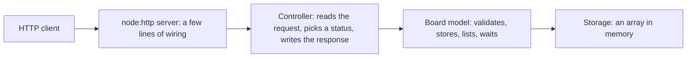

# Test-driving a small Node HTTP service

> **Before this lesson:** you can write async tests that await promises ([Testing asynchronous code: callbacks, promises and async/await](#/lesson/js-testing/testing-async-code)) and you know what long polling and a token are ([Long polling, streaming and one connection for many topics](#/lesson/js-testing/long-polling-streaming)). It helps to have seen a Node HTTP server once ([Node HTTP servers and a tip-sharing project](#/lesson/javascript/node-http-project)) and to know the parts of an HTTP request: method, URL, headers, body, and the status code of the reply ([HTTP, fetch, forms and client-side storage](#/lesson/javascript/http-fetch-forms)).

## In plain words

**Node.js** is a program that runs JavaScript outside a browser, on a laptop or a server machine. An **HTTP service** is a program that waits for requests from browsers or other programs and sends back answers. In this lesson we build one with tests written first, and without starting a real server for most of them.

Think of a small restaurant. The waiter takes an order from a customer, checks that it makes sense, passes it to the kitchen, and carries the plate back. The kitchen knows recipes and stock; it knows nothing about tables or tips. To check that the kitchen cooks correctly you do not need customers in the room: you hand it an order slip and look at the plate. To check that the waiter behaves, you do not need a real kitchen: a colleague who hands over prepared plates will do.

A well-shaped service has the same division. The part that speaks HTTP (the waiter) is the **controller**. The part that holds the rules and the data (the kitchen) is the **domain model**. Tested separately, each test is small and fast, and a failure points at one place.

Why it matters for a job: back-end and full-stack interviews often include "build a small API" exercises, and reviewers look for exactly this separation and for tests of the unhappy paths (bad input, wrong method, oversized body). Services written as one big request handler are a common source of untestable code in real companies.

## What we are building

A team status board. Colleagues post short updates; a page shows them live.

- `POST /updates` with a JSON body `{ "author": "Ada", "text": "Deployed v2" }` stores an update and answers `201` with the stored record, which now has an `id`.
- `GET /updates?since=3` answers with every update whose id is greater than 3. If there is none yet, the server holds the request open until one arrives. That is the server half of long polling.



We build from right to left: the model first, then the controller, then the wiring.

### A note on how Node handles waiting

Node runs your JavaScript on a single thread. Anything slow (reading a file, asking a database, waiting for a network packet) is started and then left to finish in the background; your code is told about the result later. This style is called **non-blocking I/O**, where I/O is short for input and output. In Node's early years the result arrived through a callback whose first argument was an error and whose second was the data. Promises and `async` / `await` have since become the normal way to write the same thing.

The consequence for design: even though our storage is an array in memory, the model's methods return promises. A real database would force that anyway, and making the interface asynchronous from the start means the controller will not need rewriting when the storage changes.

## The model, test-first

### Test list

1. `add` resolves with the stored update, which has an id.
2. Ids go up by one.
3. Surrounding spaces are trimmed.
4. `add` rejects when the author or the text is missing or blank.
5. `since(id)` resolves with only the updates newer than `id`.
6. `waitFor(id)` resolves at once when newer updates exist.
7. `waitFor(id)` stays pending until an update is added, then resolves with it.

### First test and first failure

```javascript
await test("add resolves with the stored update, including an id", async () => {
  const board = createBoard();
  const stored = await board.add({ author: "Ada", text: "Deployed v2" });
  expect(stored).toEqual({ id: 1, author: "Ada", text: "Deployed v2" });
});
```

```text
FAIL  add resolves with the stored update, including an id
      -> createBoard is not defined
```

The smallest passing version returns a fixed object. The second test ("ids go up by one") then forces a counter and a list, as the red, green, refactor rhythm prescribes: each test pulls in only the code it needs.

### Waiting without polling

Item 7 is the interesting one. A `GET` that finds nothing new must wait, and it must not wait by checking the array every few milliseconds. The model keeps a list of **waiters**: functions to call when the next update is added. `waitFor` returns a promise and stores the function that resolves it; `add` calls every stored function. This is the observer pattern again, with promises as the delivery mechanism. Node's standard library offers the same idea as the `EventEmitter` class ([The observer pattern and EventEmitter](#/lesson/nodejs/observer-eventemitter)).

To test "stays pending" we need to look at a promise without awaiting it, because awaiting a pending promise would hang the test. The trick: attach a `then` that flips a flag, let pending microtasks run, and check that the flag is still down.

```js-run
// --- the tiny test runner from lesson 1, async edition ---
async function test(name, fn) {   // async: it can wait for promises
  try { await fn(); console.log("PASS  " + name); }
  catch (e) { console.log("FAIL  " + name + "\n      -> " + e.message); }
}
function expect(actual) {
  const show = (v) => typeof v === "function" ? "[function]" : JSON.stringify(v);
  const fail = (msg) => { throw new Error(msg); };
  return {
    toBe(expected) {
      if (!Object.is(actual, expected)) fail("expected " + show(expected) + " but got " + show(actual));
    },
    toEqual(expected) {
      if (JSON.stringify(actual) !== JSON.stringify(expected)) fail("expected " + show(expected) + " but got " + show(actual));
    },
    toThrow(text = "") {
      try { actual(); } catch (e) {
        if (!String(e.message).includes(text)) fail("threw the wrong error: " + e.message);
        return;
      }
      fail("expected the function to throw, but it returned normally");
    },
  };
}
// --- end of runner ---

// ---------- code under test ----------
function createBoard() {
  const updates = [];
  const waiters = [];                              // functions to call when something is added
  let nextId = 1;
  const newerThan = (id) => updates.filter((u) => u.id > id);
  const clean = (value, label) => {
    if (typeof value !== "string" || value.trim() === "") throw new TypeError(label + " is required");
    return value.trim();
  };
  return {
    async add(input) {
      const { author, text } = input || {};
      const update = { id: nextId, author: clean(author, "author"), text: clean(text, "text") };
      nextId++;
      updates.push(update);
      for (const wake of waiters.splice(0)) wake();   // empty the list and call each waiter
      return update;
    },
    async since(id) { return newerThan(id); },
    waitFor(id) {
      if (newerThan(id).length > 0) return Promise.resolve(newerThan(id));
      return new Promise((resolve) => waiters.push(() => resolve(newerThan(id))));
    },
  };
}

// ---------- the tests ----------
const rejection = async (promise) => { try { await promise; return null; } catch (e) { return e.message; } };

await test("add resolves with the stored update, including an id", async () => {
  const stored = await createBoard().add({ author: "Ada", text: "Deployed v2" });
  expect(stored).toEqual({ id: 1, author: "Ada", text: "Deployed v2" });
});

await test("ids go up by one", async () => {
  const board = createBoard();
  await board.add({ author: "Ada", text: "one" });
  expect((await board.add({ author: "Bo", text: "two" })).id).toBe(2);
});

await test("surrounding spaces are trimmed", async () => {
  const stored = await createBoard().add({ author: "  Ada ", text: " hi  " });
  expect([stored.author, stored.text]).toEqual(["Ada", "hi"]);
});

await test("add rejects a missing or blank author", async () => {
  expect(await rejection(createBoard().add({ text: "hi" }))).toBe("author is required");
  expect(await rejection(createBoard().add({ author: "   ", text: "hi" }))).toBe("author is required");
});

await test("add rejects a missing text, and input that is not an object", async () => {
  expect(await rejection(createBoard().add({ author: "Ada" }))).toBe("text is required");
  expect(await rejection(createBoard().add(null))).toBe("author is required");
});

await test("a rejected update is not stored and does not use up an id", async () => {
  const board = createBoard();
  await rejection(board.add({ author: "Ada" }));
  expect((await board.add({ author: "Ada", text: "ok" })).id).toBe(1);
});

await test("since returns only newer updates", async () => {
  const board = createBoard();
  for (const text of ["a", "b", "c"]) await board.add({ author: "Ada", text });
  expect((await board.since(1)).map((u) => u.text)).toEqual(["b", "c"]);
});

await test("waitFor resolves at once when newer updates exist", async () => {
  const board = createBoard();
  await board.add({ author: "Ada", text: "a" });
  expect((await board.waitFor(0)).length).toBe(1);
});

await test("waitFor stays pending until an update is added", async () => {
  const board = createBoard();
  let settled = false;
  const waiting = board.waitFor(0).then((list) => { settled = true; return list; });
  await Promise.resolve();                           // let microtasks run
  expect(settled).toBe(false);                       // nothing to deliver yet
  await board.add({ author: "Bo", text: "late" });
  expect((await waiting).map((u) => u.text)).toEqual(["late"]);
});
```

The sixth test, "a rejected update is not stored and does not use up an id", was not on the original list. It was added after noticing that an early draft increased the counter before validating. Test lists grow while you work; write the new item down and give it its own cycle.

## The controller, test-first

### What Node hands a request handler

When a request arrives, Node calls your handler with two objects.

- The **request** (`req`) has `method` (such as `"POST"`), `url` (the path and query, such as `"/updates?since=3"`) and `headers`. The body is not there yet. It arrives in pieces called **chunks**, each announced by a `data` event, followed by one `end` event. An object that delivers data piece by piece like this is a **stream** ([Why streams: readable, writable and backpressure](#/lesson/nodejs/streams-readable-writable)).
- The **response** (`res`) has `writeHead(status, headers)` to set the status code and headers, and `end(body)` to send the body and finish.

Our controller only uses those few members, so a test can pass two small hand-made objects in their place. No port is opened and nothing touches the network.

```javascript
function fakeRequest(method, url) {
  const listeners = {};
  return {
    method, url,
    on(event, fn) { (listeners[event] ||= []).push(fn); return this; },
    emit(event, value) { for (const fn of listeners[event] || []) fn(value); },   // the test plays Node
  };
}
function fakeResponse() {
  return {
    status: null, headers: null, body: null, ended: false,
    writeHead(status, headers) { this.status = status; this.headers = headers; },
    end(body) { this.body = body; this.ended = true; },
  };
}
```

`fakeRequest` remembers the listeners the controller registers with `on`, and `emit` lets the test deliver chunks as Node would. `fakeResponse` records what the controller wrote, so the test can assert on it afterwards.

### Test list

1. `POST /updates` with valid JSON answers `201` and the stored update.
2. A body that arrives in several chunks is joined before parsing.
3. Text that is not JSON answers `400`.
4. JSON that fails the model's rules answers `422` with the model's message.
5. A body over the size limit answers `413`.
6. `GET /updates?since=N` answers `200` with the newer updates and a token.
7. `GET` holds the response until an update exists.
8. An unknown path answers `404`; an unsupported method answers `405`.

The status codes are part of the service's contract with its clients:

| Code | Name | Used here when |
|---|---|---|
| 200 | OK | a `GET` succeeded |
| 201 | Created | a `POST` stored something new |
| 400 | Bad Request | the body is not valid JSON |
| 404 | Not Found | no such path |
| 405 | Method Not Allowed | the path exists, but not for this method |
| 413 | Content Too Large | the body exceeds the limit |
| 422 | Unprocessable Content | valid JSON, but it breaks a rule such as "text is required" |

### A failing test that finds a real bug

A first version of the body reader handled a single chunk:

```javascript
req.on("data", (chunk) => resolve(String(chunk)));   // first attempt
```

The test for item 2 delivers the body in two pieces:

```javascript
await test("joins a body that arrives in several chunks", async () => {
  const { res } = await post(['{"author":"Ada",', '"text":"Deployed v2"}']);
  expect(res.status).toBe(201);
});
```

```text
FAIL  joins a body that arrives in several chunks
      -> expected 201 but got 400
```

The handler tried to parse the first half alone, which is not valid JSON. On a developer's machine small bodies nearly always arrive in one chunk, so this bug would have passed every manual trial and failed in production for larger bodies or slow connections. **The fix** collects chunks until `end`:

```javascript
let body = "";
req.on("data", (chunk) => { body += chunk; });
req.on("end", () => resolve(body));
```

### The finished controller and its suite

```js-run
// --- the tiny test runner from lesson 1, async edition ---
async function test(name, fn) {   // async: it can wait for promises
  try { await fn(); console.log("PASS  " + name); }
  catch (e) { console.log("FAIL  " + name + "\n      -> " + e.message); }
}
function expect(actual) {
  const show = (v) => typeof v === "function" ? "[function]" : JSON.stringify(v);
  const fail = (msg) => { throw new Error(msg); };
  return {
    toBe(expected) {
      if (!Object.is(actual, expected)) fail("expected " + show(expected) + " but got " + show(actual));
    },
    toEqual(expected) {
      if (JSON.stringify(actual) !== JSON.stringify(expected)) fail("expected " + show(expected) + " but got " + show(actual));
    },
    toThrow(text = "") {
      try { actual(); } catch (e) {
        if (!String(e.message).includes(text)) fail("threw the wrong error: " + e.message);
        return;
      }
      fail("expected the function to throw, but it returned normally");
    },
  };
}
// --- end of runner ---

function createBoard() {                              // the model from above, unchanged
  const updates = [], waiters = [];
  let nextId = 1;
  const newerThan = (id) => updates.filter((u) => u.id > id);
  const clean = (value, label) => {
    if (typeof value !== "string" || value.trim() === "") throw new TypeError(label + " is required");
    return value.trim();
  };
  return {
    async add(input) {
      const { author, text } = input || {};
      const update = { id: nextId, author: clean(author, "author"), text: clean(text, "text") };
      nextId++; updates.push(update);
      for (const wake of waiters.splice(0)) wake();
      return update;
    },
    waitFor(id) {
      if (newerThan(id).length > 0) return Promise.resolve(newerThan(id));
      return new Promise((resolve) => waiters.push(() => resolve(newerThan(id))));
    },
  };
}

// ---------- code under test ----------
function createController(board, { maxBody = 10000 } = {}) {
  function send(res, status, data) {
    res.writeHead(status, { "Content-Type": "application/json" });
    res.end(JSON.stringify(data));
  }
  function readBody(req) {
    return new Promise((resolve, reject) => {
      let body = "";
      req.on("data", (chunk) => {
        body += chunk;
        if (body.length > maxBody) reject(Object.assign(new Error("body too large"), { status: 413 }));
      });
      req.on("end", () => resolve(body));
    });
  }
  async function create(req, res) {
    let text;
    try { text = await readBody(req); }
    catch (error) { return send(res, error.status, { error: error.message }); }
    let data;
    try { data = JSON.parse(text); }
    catch (error) { return send(res, 400, { error: "body must be JSON" }); }
    try { send(res, 201, await board.add(data)); }
    catch (error) { send(res, 422, { error: error.message }); }
  }
  async function list(res, since) {
    const updates = await board.waitFor(since);            // may take a long time: that is the long poll
    send(res, 200, { token: updates[updates.length - 1].id, updates });
  }
  return {
    async handle(req, res) {
      const url = new URL(req.url, "http://localhost");    // parse path and query
      if (url.pathname !== "/updates") return send(res, 404, { error: "not found" });
      if (req.method === "POST") return create(req, res);
      if (req.method === "GET") return list(res, Number(url.searchParams.get("since")) || 0);
      send(res, 405, { error: "method not allowed" });
    },
  };
}

// ---------- test helpers ----------
function fakeRequest(method, url) {
  const listeners = {};
  return {
    method, url,
    on(event, fn) { (listeners[event] ||= []).push(fn); return this; },
    emit(event, value) { for (const fn of listeners[event] || []) fn(value); },
  };
}
function fakeResponse() {
  return {
    status: null, headers: null, body: null, ended: false,
    writeHead(status, headers) { this.status = status; this.headers = headers; },
    end(body) { this.body = body; this.ended = true; },
  };
}
async function post(chunks, options) {                     // drive one POST through a fresh controller
  const board = createBoard();
  const req = fakeRequest("POST", "/updates"), res = fakeResponse();
  const done = createController(board, options).handle(req, res);
  for (const chunk of chunks) req.emit("data", chunk);
  req.emit("end");
  await done;
  return { res, board };
}

// ---------- the tests ----------
await test("POST with valid JSON answers 201 and the stored update", async () => {
  const { res } = await post(['{"author":"Ada","text":"Deployed v2"}']);
  expect(res.status).toBe(201);
  expect(res.headers["Content-Type"]).toBe("application/json");
  expect(JSON.parse(res.body)).toEqual({ id: 1, author: "Ada", text: "Deployed v2" });
});

await test("joins a body that arrives in several chunks", async () => {
  const { res } = await post(['{"author":"Ada",', '"text":"Deployed v2"}']);
  expect(res.status).toBe(201);
});

await test("text that is not JSON answers 400", async () => {
  const { res } = await post(["author=Ada"]);
  expect(res.status).toBe(400);
  expect(JSON.parse(res.body)).toEqual({ error: "body must be JSON" });
});

await test("a rule violation answers 422 with the model's message", async () => {
  const { res } = await post(['{"author":"Ada"}']);
  expect(res.status).toBe(422);
  expect(JSON.parse(res.body)).toEqual({ error: "text is required" });
});

await test("an oversized body answers 413", async () => {
  const { res } = await post(['{"author":"Ada","text":"' + "x".repeat(200) + '"}'], { maxBody: 100 });
  expect(res.status).toBe(413);
});

await test("GET answers 200 with newer updates and a token", async () => {
  const board = createBoard();
  for (const text of ["a", "b", "c"]) await board.add({ author: "Ada", text });
  const res = fakeResponse();
  await createController(board).handle(fakeRequest("GET", "/updates?since=1"), res);
  const answer = JSON.parse(res.body);
  expect(res.status).toBe(200);
  expect(answer.token).toBe(3);
  expect(answer.updates.map((u) => u.text)).toEqual(["b", "c"]);
});

await test("GET holds the response until an update exists", async () => {
  const board = createBoard();
  const res = fakeResponse();
  const done = createController(board).handle(fakeRequest("GET", "/updates?since=0"), res);
  await Promise.resolve();
  expect(res.ended).toBe(false);                           // still held open
  await board.add({ author: "Bo", text: "late" });
  await done;
  expect(JSON.parse(res.body).updates.map((u) => u.text)).toEqual(["late"]);
});

await test("an unknown path answers 404 and an unsupported method 405", async () => {
  const controller = createController(createBoard());
  const a = fakeResponse(), b = fakeResponse();
  await controller.handle(fakeRequest("GET", "/nope"), a);
  await controller.handle(fakeRequest("DELETE", "/updates"), b);
  expect([a.status, b.status]).toEqual([404, 405]);
});
```

Three design points are worth a second look.

**`handle` returns a promise.** Node itself ignores what a handler returns. We return the promise for the tests' sake: `await done` tells the test exactly when the response has been written, so no test needs to guess or sleep. Designing a function so that it is easy to observe from outside is a habit TDD builds.

**The controller decides status codes; the model decides rules.** The model throws `TypeError("text is required")` and knows nothing about HTTP. The controller translates that into `422`. If the rules change, the model's tests change; if the API contract changes, the controller's tests change.

**Each controller test builds its own board.** The helper `post` creates a fresh model and controller per call. No state leaks from one test to the next, so the tests can run in any order.

> [!WARNING]
> **Never trust a request body.** Three separate defences appear above: a size limit, so one client cannot fill the server's memory; a `try` around `JSON.parse`, so malformed text gives `400` and does not crash the handler; and validation of the parsed value in the model. A fourth belongs to whoever displays the text later: user-supplied text must be escaped before it is placed into a page, or a posted `<script>` tag would run in every reader's browser. The next lesson's client inserts text with `textContent` for exactly that reason.

## Wiring it to a real server

With model and controller tested, the part that touches the network is a few lines with no decisions in it:

```javascript
// server.js
import { createServer } from "node:http";
import { createBoard } from "./board.js";
import { createController } from "./controller.js";

export function startServer(port = 3000) {
  const controller = createController(createBoard());
  const server = createServer((req, res) => {
    controller.handle(req, res).catch(() => { res.writeHead(500); res.end(); });
  });
  return new Promise((resolve) => server.listen(port, () => resolve(server)));
}
```

The `catch` is the safety net: any error the controller did not expect becomes a `500` answer and the server keeps running.

One **integration test** then proves that the real pieces fit together: real HTTP parsing, real streams, real `fetch`. It uses Node's built-in runner, so it needs no installation.

```javascript
// server.test.js  -  run with: node --test
import { test, before, after } from "node:test";
import assert from "node:assert/strict";
import { startServer } from "./server.js";

let server, base;
before(async () => {
  server = await startServer(0);                       // port 0: the system picks a free port
  base = "http://localhost:" + server.address().port;
});
after(() => server.close());

test("an update posted over HTTP can be read back", async () => {
  const posted = await fetch(base + "/updates", {
    method: "POST",
    body: JSON.stringify({ author: "Ada", text: "Deployed v2" }),
  });
  assert.equal(posted.status, 201);

  const listed = await fetch(base + "/updates?since=0");
  const answer = await listed.json();
  assert.deepEqual(answer.updates.map((u) => u.text), ["Deployed v2"]);
});
```

```text
✔ an update posted over HTTP can be read back (38.4ms)
ℹ tests 1
ℹ pass 1
ℹ fail 0
```

Asking for port `0` avoids clashes when several test files run at the same time, and `after` closes the server so the test process can exit. One or two tests at this level are enough. The eight controller tests already cover the branches; repeating them over real HTTP would add seconds and no information.

> [!TIP]
> Two things this small service leaves out are good exercises. First, a held `GET` should be answered with an empty list after about 25 seconds, because proxies cut connections that stay silent too long; inject a clock into the controller and test it with `tick`, as in the polling lessons. Second, when a client disconnects, its waiter should be removed (listen for the request's `close` event), or the waiter list grows for ever.

> [!INTERVIEW]
> **"How would you structure and test a small HTTP API in Node?"** Describe three layers. A model with the rules and storage behind an asynchronous interface, unit-tested with plain values. A controller that turns a request into model calls and a model result into a status code and body, unit-tested with fake request and response objects, including bad JSON, rule violations, oversized bodies, unknown paths and wrong methods. A thin server file that connects them, covered by one or two integration tests that start the server on port 0 and use `fetch`. Say why: most tests run in milliseconds without a network, and each failure names the layer at fault.

## Common pitfalls

- **Logic in the server callback.** Code written inline in `createServer((req, res) => { ... })` can only be tested through a real socket. Move it into a controller.
- **Assuming the body arrives in one chunk.** It often does locally and often does not in production. Collect until `end`.
- **No size limit on the body.** An unbounded `body += chunk` is an invitation to exhaust memory.
- **Unprotected `JSON.parse`.** It throws on bad input; without `try` the request gets no answer at all.
- **A handler that returns nothing.** The test cannot know when the response is finished. Return the promise.
- **Forgetting to end the response.** A code path that never calls `res.end` leaves the client hanging. The `405` and `404` tests exist to cover the paths that are easy to forget.
- **Fixed port numbers in tests.** Two test files, or a server left running, collide. Use port 0.
- **Not closing the server after integration tests.** The runner waits for open connections and the run never finishes.
- **Fakes that grow features.** `fakeRequest` should stay a dozen lines. If it starts to imitate half of Node, test through a real server.

## Cheat sheet

| Task | Code |
|---|---|
| Create a server | `createServer((req, res) => controller.handle(req, res))` from `node:http` |
| Read method and URL | `req.method`, `new URL(req.url, "http://localhost")` |
| Read a query parameter | `url.searchParams.get("since")` |
| Collect the body | `req.on("data", (c) => { body += c; }); req.on("end", () => ...)` |
| Send JSON | `res.writeHead(201, { "Content-Type": "application/json" }); res.end(JSON.stringify(data))` |
| Run built-in tests | `node --test` (finds `*.test.js`) |
| Built-in assertions | `assert.equal(a, b)`, `assert.deepEqual(a, b)`, `await assert.rejects(promise, /message/)` |
| Hooks in `node:test` | `before`, `after`, `beforeEach`, `afterEach` |
| Free port for a test server | `server.listen(0)` then `server.address().port` |
| Check a promise is still pending | attach `.then(() => { settled = true; })`, `await Promise.resolve()`, assert `settled` is `false` |

## Summary

- Split a service into a model (rules and data), a controller (HTTP in, HTTP out) and a thin server file.
- Give the model an asynchronous interface from the start, even over in-memory storage.
- Unit-test the controller with small fake request and response objects that the test drives by emitting `data` and `end`.
- Test the unhappy paths: bad JSON, rule violations, oversized bodies, unknown paths, wrong methods.
- Server-side long polling is a promise that resolves when the model is next changed; test "still pending" with a flag and one microtask turn.
- Return a promise from the handler so tests know when the response is complete.
- Keep one or two integration tests that start the real server on port 0.

## Glossary

- **Node.js**: a runtime that executes JavaScript outside the browser.
- **HTTP service**: a program that accepts HTTP requests and returns responses.
- **Controller**: the layer that translates between HTTP and the application's own functions.
- **Domain model**: the layer that holds the application's rules and data, independent of HTTP.
- **Non-blocking I/O**: starting slow input or output and continuing with other work until it finishes.
- **Stream**: an object that delivers or accepts data piece by piece over time.
- **Chunk**: one piece of data delivered by a stream.
- **Status code**: the three-digit number in a response that says how the request went.
- **Waiter**: here, a stored function that is called when new data arrives, used to resolve a pending promise.
- **Integration test**: a test that runs several real parts together, such as a real server and a real HTTP client.
- **Port**: a number identifying one listening program on a machine; port 0 asks the system to pick a free one.
- **Validation**: checking that input obeys the rules before using it.

## Check yourself

```quiz
[
  {"q": "A POST body is delivered as two chunks: '{\"author\":\"Ada\",' and '\"text\":\"hi\"}'. A body reader resolves on the first data event. What status does the client get?",
   "options": ["201", "400, because the first chunk alone is not valid JSON", "413", "422"],
   "answer": 1,
   "explain": "Parsing half a JSON document throws, and the controller maps that to 400. Collecting chunks until the end event fixes it."},
  {"q": "The body is valid JSON {\"author\":\"Ada\"} with no text. Which status does the controller send, and which layer produced the message?",
   "options": ["400, from the controller", "422, with the message thrown by the model", "500, from Node", "201, text is optional"],
   "answer": 1,
   "explain": "The JSON parses, so it is not a 400. The model rejects with 'text is required' and the controller translates that rejection into 422."},
  {"q": "In the test 'GET holds the response until an update exists', what does expect(res.ended).toBe(false) after await Promise.resolve() prove?",
   "options": ["That the server crashed", "That the handler has not answered yet although pending microtasks were allowed to run", "That the response body is empty JSON", "Nothing, it always passes"],
   "answer": 1,
   "explain": "If the controller answered immediately with an empty list, ended would already be true after one microtask turn. The assertion pins the 'hold' behaviour."},
  {"q": "Why does handle return a promise although Node ignores a request handler's return value?",
   "options": ["Node requires it", "So tests can await it and know exactly when the response has been written", "To make the server faster", "Because async functions cannot write responses"],
   "answer": 1,
   "explain": "The promise is an observation point for tests. Without it a test would have to guess when the asynchronous work is finished."},
  {"q": "An integration test starts the server with startServer(0). What does the 0 do?",
   "options": ["Disables networking", "Asks the operating system for any free port, avoiding clashes between test files", "Uses port 80", "Makes the server synchronous"],
   "answer": 1,
   "explain": "Port 0 means 'pick one for me'. The test reads the real number from server.address().port."},
  {"q": "board.add increases the id counter before validating. A rejected add is followed by a valid one. What id does the valid update get, and which test catches it?",
   "options": ["1; no test is needed", "2; the test 'a rejected update is not stored and does not use up an id' fails", "0; the trimming test fails", "It throws"],
   "answer": 1,
   "explain": "The counter would have advanced during the failed call. The dedicated test expects id 1 and goes red."},
  {"q": "Which of these belongs in the thin server file and NOT in the controller?",
   "options": ["Choosing 422 for a rule violation", "Calling createServer and listen, and turning unexpected errors into a 500", "Parsing the since parameter", "Joining body chunks"],
   "answer": 1,
   "explain": "The server file only wires real Node objects to the controller. Every decision about requests and responses lives in the controller, where fakes can test it."},
  {"q": "A client disconnects while its GET is being held, and the waiter is never removed. Over days, what happens?",
   "options": ["Nothing", "The waiter list keeps growing until the next update, and under constant churn it wastes memory and work", "The server answers 404", "The id counter resets"],
   "answer": 1,
   "explain": "Each abandoned request leaves a function in the list. Removing the waiter on the request's close event prevents the leak."}
]
```

> **Source:** Johansen, *Test-Driven JavaScript Development*, ch. 14 (Server-Side JavaScript with Node.js). Docs: https://nodejs.org/api/http.html , https://nodejs.org/api/test.html , https://nodejs.org/api/assert.html , https://developer.mozilla.org/en-US/docs/Web/HTTP/Reference/Status
