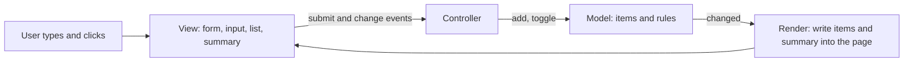

# Test-driving a DOM client: a packing list app

> **Before this lesson:** you know the DOM tree, events and `preventDefault` ([JavaScript in the browser and the DOM tree](#/lesson/javascript/browser-dom-tree), [Event handlers, propagation and delegation](#/lesson/javascript/event-handling)), the observer pattern ([The observer pattern, built test-first](#/lesson/js-testing/observer-pattern-tdd)) and the idea of keeping behaviour apart from markup ([Unobtrusive JavaScript, progressive enhancement and feature detection](#/lesson/js-testing/unobtrusive-feature-detection)). The mock function `mockFn` used below was built in the observer lesson.

## In plain words

The **DOM** (Document Object Model) is the browser's live tree of objects for a page: one object per element, each with properties you can read and change. Code that reads form fields, reacts to clicks and updates what is on screen is DOM code, and it has a reputation for being hard to test. Most of that reputation comes from one habit: writing everything inside event handlers, so that the rules of the application, the reading of inputs and the drawing of results are all tangled together.

Think of a puppet theatre. The puppets on stage do nothing by themselves; they have no opinions and no memory. The puppeteer behind the curtain makes every decision and moves the strings. If you want to check that the story is right, you watch the puppeteer's decisions, and for that you do not need the full stage with lights and scenery. A cardboard cut-out with the same strings is enough.

We will write a small app the same way. The page elements are the puppets: they hold text and fire events and decide nothing. A **controller** is the puppeteer: it listens to the elements, asks the **model** (the app's data and rules) to change, and writes the result back. This arrangement is known as a **passive view**. Because the view decides nothing, most tests can use cut-outs: plain objects with the two or three properties the controller touches. A final, smaller set of tests runs against the real DOM to prove the strings are attached.

Why it matters for a job: front-end interviews routinely ask you to build a small interactive widget (a to-do list, a tab bar, a star rating) and then ask "how would you test this?". A candidate who can separate state from rendering and name what to test at each level stands out.

## The app and its layers

A packing list for a trip. You type an item and press Add; it appears in a list with a checkbox; ticking the box marks it as packed; a line of text says how many items are left.



| Layer | Knows about | Tested with |
|---|---|---|
| Model | Items, validation, counting | Plain values, no DOM at all |
| Summary text | Numbers in, sentence out | Plain values |
| Controller | Events, the input's `value`, the model's methods | Stand-in objects for event, input and model |
| Rendering and wiring | Real elements | The real DOM in a browser (or a simulated one) |

Data flows in a circle and always in the same direction: events go to the controller, the controller changes the model, the model announces a change, and rendering redraws from the model. Nothing reads its state back out of the page. That **one-way data flow** is the central idea in React, Vue and every other current UI library, which is why practising it by hand pays off.

## Layer 1: the model

The test list:

1. A new list is empty.
2. `add` stores a trimmed name, not yet packed.
3. `add` rejects a blank name.
4. `add` rejects a name already on the list, ignoring upper and lower case.
5. `toggle` flips `packed`, and flips it back.
6. `remaining` counts the items not yet packed.
7. Listeners are told after a change, and not after a rejected `add`.
8. `items()` hands out copies, so outside code cannot change the list behind the model's back.

```js-run
// --- the tiny test runner from lesson 1 ---
function test(name, fn) {
  try { fn(); console.log("PASS  " + name); }
  catch (e) { console.log("FAIL  " + name + "\n      -> " + e.message); }
}
function expect(actual) {
  const show = (v) => typeof v === "function" ? "[function]" : JSON.stringify(v);
  const fail = (msg) => { throw new Error(msg); };
  return {
    toBe(expected) {
      if (!Object.is(actual, expected)) fail("expected " + show(expected) + " but got " + show(actual));
    },
    toEqual(expected) {
      if (JSON.stringify(actual) !== JSON.stringify(expected)) fail("expected " + show(expected) + " but got " + show(actual));
    },
    toThrow(text = "") {
      try { actual(); } catch (e) {
        if (!String(e.message).includes(text)) fail("threw the wrong error: " + e.message);
        return;
      }
      fail("expected the function to throw, but it returned normally");
    },
  };
}
// --- end of runner ---

// ---------- code under test ----------
function createPackingList() {
  const items = [];                                   // each: { id, name, packed }
  const listeners = [];
  let nextId = 1;
  const changed = () => { for (const fn of [...listeners]) fn(); };
  return {
    onChange(fn) { listeners.push(fn); },
    items: () => items.map((item) => ({ ...item })),  // copies, not the originals
    remaining: () => items.filter((item) => !item.packed).length,
    add(rawName) {
      const name = String(rawName ?? "").trim();
      if (name === "") throw new Error("Type an item name first.");
      if (items.some((item) => item.name.toLowerCase() === name.toLowerCase())) {
        throw new Error(name + " is already on the list.");
      }
      items.push({ id: nextId++, name, packed: false });
      changed();
    },
    toggle(id) {
      const item = items.find((entry) => entry.id === id);
      if (!item) return;
      item.packed = !item.packed;
      changed();
    },
  };
}

// ---------- the tests ----------
test("a new list is empty", () => {
  expect(createPackingList().items()).toEqual([]);
});

test("add stores a trimmed name, not yet packed", () => {
  const list = createPackingList();
  list.add("  Passport ");
  expect(list.items()).toEqual([{ id: 1, name: "Passport", packed: false }]);
});

test("add rejects a blank name", () => {
  expect(() => createPackingList().add("   ")).toThrow("Type an item name first.");
});

test("add rejects a duplicate, ignoring case", () => {
  const list = createPackingList();
  list.add("Charger");
  expect(() => list.add("charger")).toThrow("charger is already on the list.");
  expect(list.items().length).toBe(1);
});

test("toggle flips packed and flips it back", () => {
  const list = createPackingList();
  list.add("Socks");
  list.toggle(1);
  expect(list.items()[0].packed).toBe(true);
  list.toggle(1);
  expect(list.items()[0].packed).toBe(false);
});

test("remaining counts the items not yet packed", () => {
  const list = createPackingList();
  for (const name of ["Socks", "Charger", "Passport"]) list.add(name);
  list.toggle(2);
  expect(list.remaining()).toBe(2);
});

test("listeners hear about changes, not about rejected adds", () => {
  const list = createPackingList();
  let calls = 0;
  list.onChange(() => calls++);
  list.add("Socks");                                  // 1
  list.toggle(1);                                     // 2
  try { list.add(""); } catch (e) { /* expected */ }  // rejected: no call
  expect(calls).toBe(2);
});

test("items() hands out copies", () => {
  const list = createPackingList();
  list.add("Socks");
  list.items()[0].packed = true;                      // tamper with the copy
  expect(list.items()[0].packed).toBe(false);         // the model is unaffected
});
```

There is no `document` anywhere in that block, and it holds every rule of the application. If the product owner later says "duplicates are fine", one test and one line change, and no HTML is involved.

The sentence under the list is another pure function. Tests of pure functions are short enough to put in a table, one row per case; this is a **table-driven test**.

```js-run
// --- the tiny test runner from lesson 1 ---
function test(name, fn) {
  try { fn(); console.log("PASS  " + name); }
  catch (e) { console.log("FAIL  " + name + "\n      -> " + e.message); }
}
function expect(actual) {
  const show = (v) => typeof v === "function" ? "[function]" : JSON.stringify(v);
  const fail = (msg) => { throw new Error(msg); };
  return {
    toBe(expected) {
      if (!Object.is(actual, expected)) fail("expected " + show(expected) + " but got " + show(actual));
    },
    toEqual(expected) {
      if (JSON.stringify(actual) !== JSON.stringify(expected)) fail("expected " + show(expected) + " but got " + show(actual));
    },
    toThrow(text = "") {
      try { actual(); } catch (e) {
        if (!String(e.message).includes(text)) fail("threw the wrong error: " + e.message);
        return;
      }
      fail("expected the function to throw, but it returned normally");
    },
  };
}
// --- end of runner ---

function summaryText(total, remaining) {
  if (total === 0) return "Nothing on the list yet.";
  if (remaining === 0) return "All " + total + " packed. Ready to go!";
  return remaining + " of " + total + " left to pack.";
}

const cases = [
  [0, 0, "Nothing on the list yet."],
  [1, 1, "1 of 1 left to pack."],
  [3, 2, "2 of 3 left to pack."],
  [3, 0, "All 3 packed. Ready to go!"],
];
for (const [total, remaining, expected] of cases) {
  test("summaryText(" + total + ", " + remaining + ")", () => expect(summaryText(total, remaining)).toBe(expected));
}
```

## Layer 2: the controller, tested with stand-ins

When the form is submitted, the controller has to do five things:

1. stop the browser's own submission, which would reload the page;
2. read what was typed;
3. ask the model to add it;
4. on success, empty the input and clear any old error;
5. on rejection, show the model's message and leave the typed text in place so the user can correct it.

Look at what the controller needs from the outside world. From the **event** object: one method, `preventDefault`. From the **input** element: one property, `value`. From the **error box**: one property, `textContent`. From the **model**: one method, `add`. So the tests can pass four tiny objects with exactly those members. An object that stands in for a real collaborator during a test is called a **test double**; the next lesson sorts the kinds.

### A failing test first

```javascript
test("prevents the browser's own form submission", () => {
  const event = { preventDefault: mockFn() };
  const controller = createAddController({ model: { add: mockFn() }, input: { value: "Socks" }, errorBox: {} });

  controller.handleSubmit(event);

  expect(event.preventDefault.calls.length).toBe(1);
});
```

With a first version of `handleSubmit` that only calls `model.add(input.value)`:

```text
FAIL  prevents the browser's own form submission
      -> expected 1 but got 0
```

This is a bug that is easy to miss by hand, because in some setups the page reloads so fast that the app merely seems to "forget" the item. The test states the requirement in one line. Adding `event.preventDefault();` as the first statement turns it green.

Notice `errorBox: {}` in that test. The test is not about errors, but the controller will write to `errorBox.textContent`, so it needs *something* there. An empty object passed only to fill a parameter is called a **dummy**.

### The finished controller

```js-run
// --- the tiny test runner from lesson 1 ---
function test(name, fn) {
  try { fn(); console.log("PASS  " + name); }
  catch (e) { console.log("FAIL  " + name + "\n      -> " + e.message); }
}
function expect(actual) {
  const show = (v) => typeof v === "function" ? "[function]" : JSON.stringify(v);
  const fail = (msg) => { throw new Error(msg); };
  return {
    toBe(expected) {
      if (!Object.is(actual, expected)) fail("expected " + show(expected) + " but got " + show(actual));
    },
    toEqual(expected) {
      if (JSON.stringify(actual) !== JSON.stringify(expected)) fail("expected " + show(expected) + " but got " + show(actual));
    },
    toThrow(text = "") {
      try { actual(); } catch (e) {
        if (!String(e.message).includes(text)) fail("threw the wrong error: " + e.message);
        return;
      }
      fail("expected the function to throw, but it returned normally");
    },
  };
}
// --- end of runner ---

// --- a tiny mock function, like jest.fn() / vi.fn() ---
function mockFn(impl = () => undefined) {
  const mock = (...args) => {
    mock.calls.push(args);            // remember the arguments of every call
    const value = impl(...args);
    mock.results.push(value);         // remember what was returned
    return value;
  };
  mock.calls = [];
  mock.results = [];
  mock.mockReturnValue = (v) => { impl = () => v; return mock; };
  mock.mockImplementation = (f) => { impl = f; return mock; };
  return mock;
}
// --- end of mock ---

// ---------- code under test ----------
function createAddController({ model, input, errorBox }) {
  return {
    handleSubmit(event) {
      event.preventDefault();                 // 1. no page reload
      try {
        model.add(input.value);               // 2 and 3. read and add
        input.value = "";                     // 4. ready for the next item
        errorBox.textContent = "";
      } catch (error) {
        errorBox.textContent = error.message; // 5. explain, keep the typed text
      }
    },
  };
}

// ---------- the tests ----------
function setup({ typed = "Socks", add = mockFn() } = {}) {
  const event = { preventDefault: mockFn() };
  const input = { value: typed };
  const errorBox = { textContent: "old error" };
  const model = { add };
  const controller = createAddController({ model, input, errorBox });
  return { event, input, errorBox, model, controller };
}
const rejecting = (message) => mockFn(() => { throw new Error(message); });

test("prevents the browser's own form submission", () => {
  const { event, controller } = setup();
  controller.handleSubmit(event);
  expect(event.preventDefault.calls.length).toBe(1);
});

test("passes the typed text to the model", () => {
  const { event, model, controller } = setup({ typed: "Passport" });
  controller.handleSubmit(event);
  expect(model.add.calls).toEqual([["Passport"]]);
});

test("empties the input after a successful add", () => {
  const { event, input, controller } = setup();
  controller.handleSubmit(event);
  expect(input.value).toBe("");
});

test("clears an old error after a successful add", () => {
  const { event, errorBox, controller } = setup();
  controller.handleSubmit(event);
  expect(errorBox.textContent).toBe("");
});

test("shows the model's message when the add is rejected", () => {
  const { event, errorBox, controller } = setup({ typed: " ", add: rejecting("Type an item name first.") });
  controller.handleSubmit(event);
  expect(errorBox.textContent).toBe("Type an item name first.");
});

test("keeps the typed text when the add is rejected", () => {
  const { event, input, controller } = setup({ typed: "charger", add: rejecting("charger is already on the list.") });
  controller.handleSubmit(event);
  expect(input.value).toBe("charger");
});

test("still prevents the default when the add is rejected", () => {
  const { event, controller } = setup({ add: rejecting("no") });
  controller.handleSubmit(event);
  expect(event.preventDefault.calls.length).toBe(1);
});
```

Two kinds of checking appear in these tests. `expect(input.value).toBe("")` looks at the *state* an object is left in; that is **state verification**. `expect(model.add.calls).toEqual([["Passport"]])` looks at *which calls were made*; that is **behaviour verification**. Prefer the first when there is a state to look at, because it does not care how the result was reached. Use the second when the only effect is a message to a collaborator, as with `preventDefault`.

Move the `event.preventDefault()` line to the end of the `try` block and run again. The last test fails: on a rejected add the line is skipped and the page would reload, wiping the error message before anyone could read it.

> [!WARNING]
> **Stand-ins mirror your beliefs about the real object, and beliefs can be wrong.** If the controller read `input.text` and the test supplied `{ text: "Socks" }`, every test would pass and the app would add `undefined`, because real inputs have `value`. Nothing ties a hand-made object to the real one. Two defences: keep stand-ins tiny, so each member is one you looked up; and keep a few tests that use real elements, which comes next.

## Layer 3: rendering and wiring, on the real DOM

What is left needs real elements: turning the list of items into `<li>` nodes, and connecting events to the controller. Tests at this level build a small piece of page, run the code against it and inspect the result. A prepared piece of page used as the starting state of a test is an **HTML fixture**.

Three techniques make DOM tests reliable:

- **A fresh fixture per test.** Each test creates its own container from a template and removes it afterwards, so no test sees another's leftovers.
- **Real events.** The test calls `checkbox.click()` or dispatches a `submit` event, the same signals a user's action produces, and never calls the handler function directly. That way the wiring itself is under test.
- **Assertions on what a user would notice**: the text that is shown, whether a box is ticked, how many rows there are. Avoid asserting on incidental details such as exact class lists or the nesting depth of elements, which change with every redesign.

The page below contains the whole app and, under it, an in-page test run against the real DOM. Use the app by hand first, then read the tests.

```html-run
<!doctype html>
<html>
<head>
<style>
  body { font-family: sans-serif; margin: 16px; max-width: 520px; }
  form { display: flex; gap: 8px; }
  input[name=item] { flex: 1; padding: 6px; }
  ul { list-style: none; padding: 0; }
  li { padding: 4px 0; }
  li.packed label { text-decoration: line-through; color: #777; }
  .error { color: #b00020; min-height: 1.2em; }
  .summary { font-weight: bold; }
  #report { margin-top: 20px; padding: 8px; background: #f4f4f4; font-family: monospace; white-space: pre-wrap; }
</style>
</head>
<body>
  <h3>Packing list</h3>
  <div id="app">
    <form>
      <input name="item" placeholder="Add an item" autocomplete="off">
      <button type="submit">Add</button>
    </form>
    <p class="error" role="alert"></p>
    <ul></ul>
    <p class="summary"></p>
  </div>
  <div id="test-area" hidden></div>
  <div id="report"></div>

<script>
  // ---------- model, summary and controller: the same code as in the lesson ----------
  function createPackingList() {
    const items = [], listeners = [];
    let nextId = 1;
    const changed = () => { for (const fn of [...listeners]) fn(); };
    return {
      onChange(fn) { listeners.push(fn); },
      items: () => items.map((item) => ({ ...item })),
      remaining: () => items.filter((item) => !item.packed).length,
      add(rawName) {
        const name = String(rawName ?? "").trim();
        if (name === "") throw new Error("Type an item name first.");
        if (items.some((item) => item.name.toLowerCase() === name.toLowerCase())) throw new Error(name + " is already on the list.");
        items.push({ id: nextId++, name, packed: false });
        changed();
      },
      toggle(id) {
        const item = items.find((entry) => entry.id === id);
        if (!item) return;
        item.packed = !item.packed;
        changed();
      },
    };
  }
  function summaryText(total, remaining) {
    if (total === 0) return "Nothing on the list yet.";
    if (remaining === 0) return "All " + total + " packed. Ready to go!";
    return remaining + " of " + total + " left to pack.";
  }
  function createAddController({ model, input, errorBox }) {
    return {
      handleSubmit(event) {
        event.preventDefault();
        try { model.add(input.value); input.value = ""; errorBox.textContent = ""; }
        catch (error) { errorBox.textContent = error.message; }
      },
    };
  }

  // ---------- rendering: needs real elements ----------
  function renderItems(listEl, items) {
    listEl.replaceChildren();                           // remove the old rows
    for (const item of items) {
      const box = document.createElement("input");
      box.type = "checkbox";
      box.checked = item.packed;
      box.dataset.id = String(item.id);                 // remembers which item this box belongs to
      const label = document.createElement("label");
      label.append(box, " " + item.name);               // inserted as TEXT, never parsed as HTML
      const row = document.createElement("li");
      if (item.packed) row.classList.add("packed");
      row.append(label);
      listEl.append(row);
    }
  }

  // ---------- wiring: connect elements, controller and model ----------
  function mountPackingApp(root) {
    const model = createPackingList();
    const listEl = root.querySelector("ul");
    const summary = root.querySelector(".summary");
    const controller = createAddController({
      model, input: root.querySelector("input[name=item]"), errorBox: root.querySelector(".error"),
    });
    root.querySelector("form").addEventListener("submit", controller.handleSubmit);
    listEl.addEventListener("change", (event) => {      // one listener for every checkbox
      if (event.target.dataset.id) model.toggle(Number(event.target.dataset.id));
    });
    const refresh = () => {
      renderItems(listEl, model.items());
      summary.textContent = summaryText(model.items().length, model.remaining());
    };
    model.onChange(refresh);
    refresh();
    return model;
  }

  mountPackingApp(document.getElementById("app"));      // the app you can use above

  // ---------- an in-page test run against the real DOM ----------
  const TEMPLATE = document.getElementById("app").innerHTML;
  const lines = [];
  function test(name, fn) {
    const root = document.createElement("div");         // a fresh fixture for every test
    root.innerHTML = TEMPLATE;
    root.querySelector("ul").replaceChildren();
    document.getElementById("test-area").append(root);
    try { fn(root, mountPackingApp(root)); lines.push("PASS  " + name); }
    catch (e) { lines.push("FAIL  " + name + " -> " + e.message); }
    root.remove();                                      // teardown
  }
  function expectEqual(actual, expected) {
    if (actual !== expected) throw new Error("expected " + JSON.stringify(expected) + " but got " + JSON.stringify(actual));
  }
  function typeAndSubmit(root, text) {                  // what a user does, as a helper
    root.querySelector("input[name=item]").value = text;
    const event = new Event("submit", { bubbles: true, cancelable: true });
    root.querySelector("form").dispatchEvent(event);
    return event;
  }
  const rowTexts = (root) => [...root.querySelectorAll("li")].map((li) => li.textContent.trim()).join("|");

  test("starts with an empty list and a hint", (root) => {
    expectEqual(root.querySelectorAll("li").length, 0);
    expectEqual(root.querySelector(".summary").textContent, "Nothing on the list yet.");
  });
  test("submitting the form adds a row and empties the input", (root) => {
    typeAndSubmit(root, "Passport");
    expectEqual(rowTexts(root), "Passport");
    expectEqual(root.querySelector("input[name=item]").value, "");
  });
  test("the submit event's default action is prevented", (root) => {
    expectEqual(typeAndSubmit(root, "Socks").defaultPrevented, true);
  });
  test("a blank name shows the error and adds nothing", (root) => {
    typeAndSubmit(root, "   ");
    expectEqual(root.querySelector(".error").textContent, "Type an item name first.");
    expectEqual(root.querySelectorAll("li").length, 0);
  });
  test("ticking a box marks the item as packed and updates the summary", (root) => {
    typeAndSubmit(root, "Socks");
    typeAndSubmit(root, "Charger");
    root.querySelector("li input").click();             // a real click on the first checkbox
    expectEqual(root.querySelector("li input").checked, true);
    expectEqual(root.querySelector("li").classList.contains("packed"), true);
    expectEqual(root.querySelector(".summary").textContent, "1 of 2 left to pack.");
  });
  test("names are shown as text, never run as HTML", (root) => {
    typeAndSubmit(root, "<b>bold</b>");
    expectEqual(root.querySelector("li b"), null);      // no <b> element was created
    expectEqual(rowTexts(root), "<b>bold</b>");
  });
  test("rows appear in the order they were added", (root) => {
    for (const name of ["A", "B", "C"]) typeAndSubmit(root, name);
    expectEqual(rowTexts(root), "A|B|C");
  });

  document.getElementById("report").textContent = "In-page tests against the real DOM:\n" + lines.join("\n");
</script>
</body>
</html>
```

Things to notice in that page:

- **`label.append(box, " " + item.name)` inserts the name as text.** Had the code built the row with `innerHTML = "<li>" + item.name + "</li>"`, a name such as `` would be parsed as markup and its script would run. Injecting script through user-supplied text is called **cross-site scripting** (XSS), and the sixth test guards against it. Try changing the render code to use `innerHTML` and watch that test fail.
- **One `change` listener on the `<ul>` serves every checkbox**, including ones created later. Handling events on a common ancestor is **event delegation**. Because the list is rebuilt on every change, listeners attached to individual checkboxes would be thrown away each time.
- **The fixture is attached to the document** (inside a hidden container) before the test runs. A checkbox that is not part of the document does not fire `change` when clicked, so a detached fixture would make the toggle test fail for a reason that has nothing to do with the app.
- **Rendering rebuilds the whole list from the model.** That is the easiest approach to get right, and it is fine for short lists. UI libraries exist largely to make this "redraw from state" approach fast for big pages.

## The same tests with a simulated DOM

In a project you would not run tests inside the page. The runner provides a simulated DOM (jsdom or happy-dom), and each test builds its fixture in `document.body`:

```javascript
// packing.test.js  -  vitest.config.js sets  test: { environment: "jsdom" }
import { test, expect, beforeEach } from "vitest";
import { mountPackingApp } from "./packing.js";

beforeEach(() => {
  document.body.innerHTML = `
    <div id="app">
      <form><input name="item"><button type="submit">Add</button></form>
      <p class="error" role="alert"></p>
      <ul></ul>
      <p class="summary"></p>
    </div>`;
  mountPackingApp(document.getElementById("app"));
});

test("submitting the form adds a row and empties the input", () => {
  const input = document.querySelector("input[name=item]");
  input.value = "Passport";
  document.querySelector("form").dispatchEvent(new Event("submit", { bubbles: true, cancelable: true }));

  expect(document.querySelector("li").textContent).toContain("Passport");
  expect(input.value).toBe("");
});
```

```text
 ✓ packing.test.js (1 test) 12ms
```

`beforeEach` replaces the whole body, which is both the setup and the teardown: the next test starts from a clean page. The lesson [Component and end-to-end tests: Testing Library and Playwright](#/lesson/js-testing/testing-library-playwright) replaces the hand-written queries and events here with helpers that find elements the way a user does.

### A little history

When test-driven JavaScript was new, there was no simulated DOM. Tests ran in real browsers that disagreed about basic event handling, so developers wrapped event registration in their own helper and began each component with a check that the browser had the features it needed, skipping the component otherwise. Stand-in elements were the main tool because real ones were slow and inconsistent. Browsers have converged since, and simulated DOMs made real-element tests cheap, but the layering survived because it was never only about browsers: it is what keeps the rules of an app out of its event handlers.

> [!TIP]
> When you are handed an untested widget written as one large event handler, do not start by writing DOM tests for all of it. First pull the decisions out into functions that take values and return values (`summaryText` is the model example), test those, and leave a thin handler that reads inputs, calls the functions and writes outputs.

> [!INTERVIEW]
> **"You have built a to-do list component. How do you test it?"** Layer the answer. Rules such as validation, duplicates and counts live in plain functions or a store and get fast unit tests with no DOM. The event handler logic is tested with small stand-ins, or folded into component tests. Then a handful of tests render the component into a real or simulated DOM, act like a user (type, submit, click) and assert on what the user sees: the row appears, the input is emptied, the error is shown, the counter updates. Mention the two bugs such tests catch that unit tests cannot: wiring mistakes, and unsafe HTML insertion.

## Common pitfalls

- **Rules inside event handlers.** Validation written inline in a `submit` handler can only be tested through the DOM. Move it to the model.
- **Reading state back from the page.** Counting `<li>` elements to learn how many items exist makes the page the source of truth. Keep the truth in the model and redraw from it.
- **Calling handlers directly in DOM-level tests.** `controller.handleSubmit(fakeEvent)` in a wiring test skips the wiring. Dispatch a real event.
- **Fixtures shared between tests.** Rows left by one test change the counts in the next. Build and remove a fixture per test.
- **Detached fixtures.** Some behaviour (checkbox `change`, focus, layout) needs the element to be in the document.
- **`innerHTML` with user text.** Use `textContent`, `append` with strings, or `createTextNode`.
- **Over-specified assertions.** Checking the complete `innerHTML` string breaks on every cosmetic change. Assert on text, values and counts.
- **Stand-ins with invented members.** A stand-in may only have members the real object has. Look them up.

## Cheat sheet

| Task | Code |
|---|---|
| Build a fixture | `root.innerHTML = template; document.body.append(root)` |
| Remove it | `root.remove()` or `document.body.innerHTML = ""` |
| Simulate typing | `input.value = "text"` (plus `input.dispatchEvent(new Event("input", { bubbles: true }))` if the code listens for it) |
| Simulate a submit | `form.dispatchEvent(new Event("submit", { bubbles: true, cancelable: true }))` |
| Simulate a click | `element.click()` |
| Was the default prevented? | `event.defaultPrevented` |
| Insert text safely | `element.textContent = text` or `element.append(text)` |
| Empty an element | `element.replaceChildren()` |
| One listener for many children | `parent.addEventListener("change", (e) => { if (e.target.matches("input")) ... })` |
| Stand-in event | `{ preventDefault: vi.fn() }` |
| Simulated DOM in Vitest | `test: { environment: "jsdom" }` in the config |

## Summary

- DOM code becomes testable when the view decides nothing: a model holds data and rules, a controller reacts to events, rendering redraws from the model.
- The model and other pure functions are tested with plain values and hold most of the tests.
- The controller is tested with tiny stand-ins for the event, the input and the model, using state verification where possible and behaviour verification for calls such as `preventDefault`.
- Stand-ins can drift from the real objects, so a few tests run against real elements with fresh fixtures and real events.
- Insert user text as text. Use event delegation for lists that are redrawn.
- Assert on what a user notices, not on incidental structure.

## Glossary

- **DOM (Document Object Model)**: the browser's tree of objects representing the page.
- **Model**: the part of an app that holds its data and rules.
- **View**: the visible elements of the page.
- **Controller**: code that reacts to view events, updates the model and triggers redrawing.
- **Passive view**: an arrangement in which the view holds no logic and a controller makes every decision.
- **One-way data flow**: events change state, and the screen is redrawn from state; the screen is never read back as state.
- **Test double**: any object that stands in for a real collaborator in a test.
- **Dummy**: a stand-in passed only because a parameter must be filled; it is not used by the behaviour under test.
- **State verification**: asserting on the state left behind after the code ran.
- **Behaviour verification**: asserting on which calls the code made to its collaborators.
- **HTML fixture**: a piece of markup set up as the known starting state of a DOM test.
- **Event delegation**: handling events for many elements with one listener on a shared ancestor.
- **Cross-site scripting (XSS)**: an attack in which user-supplied text is executed as script in other users' pages.
- **Table-driven test**: one test body run over a list of input and expected-output rows.
- **Default action**: what the browser does by itself for an event, such as submitting a form.

## Check yourself

```quiz
[
  {"q": "handleSubmit calls event.preventDefault() as the LAST line inside the try block, after model.add. The user submits a blank name and the model throws. What happens in a real page?",
   "options": ["The error message is shown and stays", "preventDefault is skipped, the form submits and the page reloads, losing the message", "Nothing at all", "The item is added twice"],
   "answer": 1,
   "explain": "The throw jumps to the catch block, skipping the rest of the try. The test 'still prevents the default when the add is rejected' exists for this."},
  {"q": "A controller test passes input: { text: 'Socks' } and the controller reads input.text. All tests pass. What happens in the browser?",
   "options": ["It works", "The model receives undefined, because real input elements expose the typed text as value, not text", "A syntax error", "The browser converts text to value"],
   "answer": 1,
   "explain": "The stand-in and the code agree with each other and both disagree with reality. A test on a real element reveals it."},
  {"q": "renderItems builds rows with li.innerHTML = item.name. A user adds the item '<b>bold</b>'. Which in-page test fails, and why does it matter?",
   "options": ["None", "'names are shown as text, never run as HTML', because a real b element is created; the same hole lets attackers inject script", "The summary test", "The ordering test"],
   "answer": 1,
   "explain": "innerHTML parses the name as markup. Inserting with append or textContent treats it as plain text and closes the cross-site scripting hole."},
  {"q": "expect(model.add.calls).toEqual([['Passport']]) is an example of what?",
   "options": ["State verification", "Behaviour verification: it asserts on a call made to a collaborator", "A table-driven test", "An integration test"],
   "answer": 1,
   "explain": "It inspects the recorded call, not a resulting state. expect(input.value).toBe('') in the next test is state verification."},
  {"q": "A DOM test builds its fixture with document.createElement('div') and never appends it to the document. It then calls checkbox.click() and expects the model to toggle. Why can this fail even though the app is correct?",
   "options": ["click() does not exist on checkboxes", "A checkbox outside the document does not fire the change event the app listens for", "Detached elements have no children", "querySelector does not work on detached elements"],
   "answer": 1,
   "explain": "Some default behaviour only happens for connected elements. Attach the fixture, even inside a hidden container, and remove it afterwards."},
  {"q": "Why is one change listener on the ul preferred to one listener per checkbox in this app?",
   "options": ["It is required by the HTML standard", "The list is rebuilt on every change, so per-checkbox listeners would be discarded and re-created each time; the ancestor's listener keeps working", "Checkboxes cannot have listeners", "It makes the tests asynchronous"],
   "answer": 1,
   "explain": "Event delegation relies on events bubbling up to a stable ancestor, so it also covers rows created later."},
  {"q": "Where should the rule 'no duplicate items, ignoring case' be tested?",
   "options": ["Only in a DOM test that submits the form twice", "In the model's unit tests, with one DOM-level test at most to confirm the message is displayed", "It cannot be tested", "In the CSS"],
   "answer": 1,
   "explain": "Rules live in the model and are checked fastest there. DOM tests cover wiring and display, not every rule again."},
  {"q": "A wiring test calls controller.handleSubmit({ preventDefault() {} }) directly and passes. The line that registers the submit listener has a typo in the event name ('sumbit'). Does the test notice?",
   "options": ["Yes", "No: the handler was called by hand, so the broken registration was never exercised", "Only in jsdom", "Only with fake timers"],
   "answer": 1,
   "explain": "Dispatching a real submit event on the form is what tests the registration. Calling the handler directly bypasses it."}
]
```

> **Source:** Johansen, *Test-Driven JavaScript Development*, ch. 15 (TDD and DOM Manipulation: The Chat Client). Docs: https://developer.mozilla.org/en-US/docs/Web/API/Event/preventDefault , https://developer.mozilla.org/en-US/docs/Web/API/EventTarget/dispatchEvent , https://developer.mozilla.org/en-US/docs/Web/API/Node/textContent , https://vitest.dev/guide/environment
