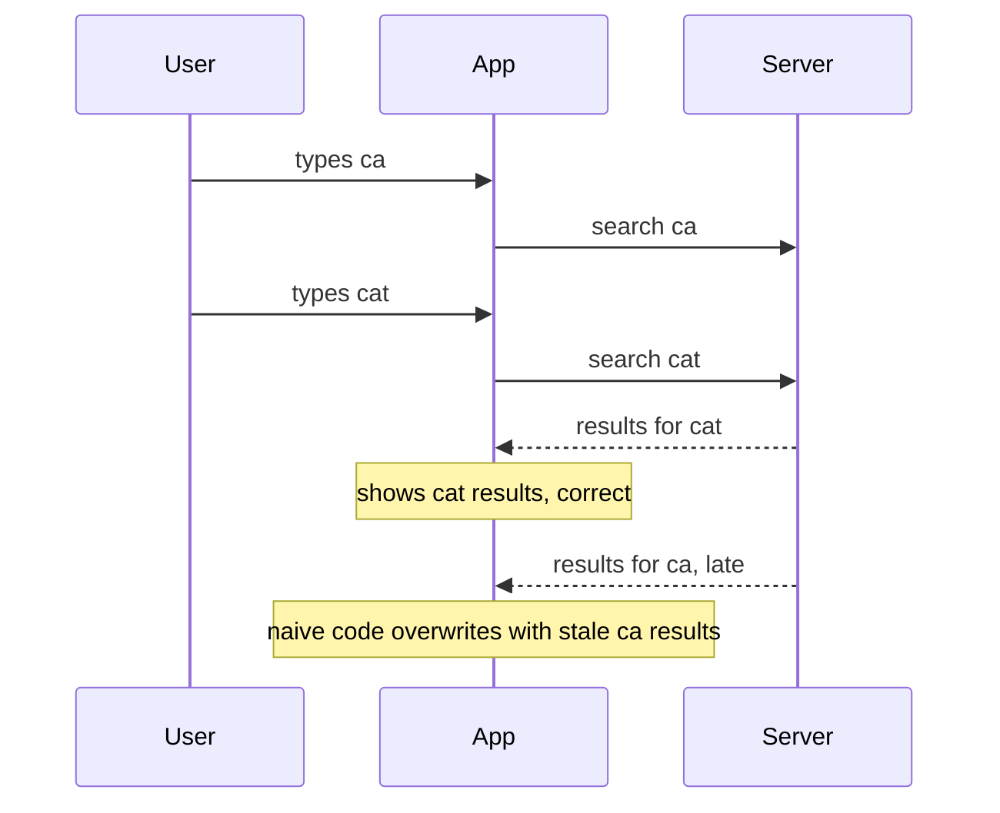

# Promises, timers and async code under test

> **Before this lesson:** you can make a runner wait for a promise and you know that `then` callbacks run as microtasks ([Testing asynchronous code: callbacks, promises and async/await](#/lesson/js-testing/testing-async-code)). You have driven timers with a fake clock ([Polling a server and testing time with a fake clock](#/lesson/js-testing/polling-fake-timers)) and built a stub with a queue of answers ([Test doubles in depth: dummies, stubs, spies, mocks and fakes](#/lesson/js-testing/test-doubles)). The event loop is explained in [The event loop, tasks and microtasks](#/lesson/javascript/event-loop-microtasks).

## In plain words

The first lesson on asynchronous tests solved one problem: getting the runner to wait. Real applications raise harder questions. What does the screen show *while* a request is still out? What happens when two answers come back in the wrong order? Does the retry wait long enough between attempts, and does the timeout fire? Each of these is about **when** things happen, and a test can only check "when" if it controls it.

Think of a relay race coach with a stopwatch and a whistle. Watching a real race, the coach can only hope the interesting moment occurs. In training, the coach decides: "runner two, go now; runner one, hold." Any hand-over, in any order, can be practised on demand. This lesson gives the test that whistle. Two tools do the work: a promise the test settles by hand, and a fake clock that knows how to let promises run between timers.

Why it matters for a job: loading spinners that never stop, search boxes that show results for a query the user has already replaced, retries that hammer a server: these are everyday production bugs and they are all timing bugs. Interviewers ask about them directly ("how do you handle out-of-order responses?"), and writing a retry or timeout helper with tests is a common coding exercise.

## Tool 1: a promise you settle by hand

A normal promise is settled from the inside, by whoever created it. For a test we want the opposite: a promise handed to the code under test whose outcome the *test* decides later. Such an object is called a **deferred**.

```javascript
function deferred() {
  let resolve, reject;
  const promise = new Promise((res, rej) => { resolve = res; reject = rej; });
  return { promise, resolve, reject };
}
```

The promise constructor runs its callback at once and passes in the two settling functions. The helper stores them in outer variables and returns them next to the promise. Newer runtimes provide the same thing ready-made as `Promise.withResolvers()`.

With a deferred, "the request is still out" is a state a test can stand in for as long as it likes.

```js-run
// --- the tiny test runner from lesson 1, async edition ---
async function test(name, fn) {   // async: it can wait for promises
  try { await fn(); console.log("PASS  " + name); }
  catch (e) { console.log("FAIL  " + name + "\n      -> " + e.message); }
}
function expect(actual) {
  const show = (v) => typeof v === "function" ? "[function]" : JSON.stringify(v);
  const fail = (msg) => { throw new Error(msg); };
  return {
    toBe(expected) {
      if (!Object.is(actual, expected)) fail("expected " + show(expected) + " but got " + show(actual));
    },
    toEqual(expected) {
      if (JSON.stringify(actual) !== JSON.stringify(expected)) fail("expected " + show(expected) + " but got " + show(actual));
    },
    toThrow(text = "") {
      try { actual(); } catch (e) {
        if (!String(e.message).includes(text)) fail("threw the wrong error: " + e.message);
        return;
      }
      fail("expected the function to throw, but it returned normally");
    },
  };
}
// --- end of runner ---

function deferred() {
  let resolve, reject;
  const promise = new Promise((res, rej) => { resolve = res; reject = rej; });
  return { promise, resolve, reject };
}

// ---------- code under test ----------
function createProfileView(api) {
  const view = { state: "idle", name: "" };
  view.load = async (id) => {
    view.state = "loading";
    try {
      view.name = (await api.fetchUser(id)).name;
      view.state = "ready";
    } catch (error) {
      view.state = "error";
    }
  };
  return view;
}

// ---------- the tests ----------
await test("shows loading while the request is out", async () => {
  const request = deferred();
  const view = createProfileView({ fetchUser: () => request.promise });

  view.load(7);                                   // not awaited: we want to look in the middle

  expect(view.state).toBe("loading");
});

await test("shows the name once the answer arrives", async () => {
  const request = deferred();
  const view = createProfileView({ fetchUser: () => request.promise });
  const loading = view.load(7);

  request.resolve({ name: "Ada" });               // the test plays the server
  await loading;

  expect([view.state, view.name]).toEqual(["ready", "Ada"]);
});

await test("shows an error state when the request fails", async () => {
  const request = deferred();
  const view = createProfileView({ fetchUser: () => request.promise });
  const loading = view.load(7);

  request.reject(new Error("HTTP 500"));
  await loading;

  expect(view.state).toBe("error");
});
```

The first test would be impossible with a stub that answers immediately: by the time the test could look, loading would be over. Note also that `view.load` returns its promise, so the later tests can `await loading` and know that the view has finished reacting.

## Out-of-order answers

A search box sends a request on every keystroke. The user types "ca", then "cat". Two requests are now out, and nothing guarantees they come back in the order they were sent. If the answer for "ca" arrives last, a naive implementation shows results for a query the user has already replaced. A bug that depends on the relative timing of events is a **race condition**.



With deferreds the test can stage exactly this order. Here is the test, written first:

```javascript
await test("a late answer to an older search is ignored", async () => {
  const pending = { ca: deferred(), cat: deferred() };
  const shown = [];
  const search = createSearch({ search: (term) => pending[term].promise }, (results) => shown.push(results));

  const first = search("ca");
  const second = search("cat");
  pending.cat.resolve(["cat", "catalogue"]);      // the newer answer arrives first
  pending.ca.resolve(["cab", "cat", "cave"]);     // the older answer arrives late
  await Promise.all([first, second]);

  expect(shown).toEqual([["cat", "catalogue"]]);
});
```

Against the naive version, `const results = await api.search(term); show(results);`, it fails:

```text
FAIL  a late answer to an older search is ignored
      -> expected [["cat","catalogue"]] but got [["cat","catalogue"],["cab","cat","cave"]]
```

The fix gives every call a ticket number and drops an answer whose ticket is no longer the newest.

```js-run
// --- the tiny test runner from lesson 1, async edition ---
async function test(name, fn) {   // async: it can wait for promises
  try { await fn(); console.log("PASS  " + name); }
  catch (e) { console.log("FAIL  " + name + "\n      -> " + e.message); }
}
function expect(actual) {
  const show = (v) => typeof v === "function" ? "[function]" : JSON.stringify(v);
  const fail = (msg) => { throw new Error(msg); };
  return {
    toBe(expected) {
      if (!Object.is(actual, expected)) fail("expected " + show(expected) + " but got " + show(actual));
    },
    toEqual(expected) {
      if (JSON.stringify(actual) !== JSON.stringify(expected)) fail("expected " + show(expected) + " but got " + show(actual));
    },
    toThrow(text = "") {
      try { actual(); } catch (e) {
        if (!String(e.message).includes(text)) fail("threw the wrong error: " + e.message);
        return;
      }
      fail("expected the function to throw, but it returned normally");
    },
  };
}
// --- end of runner ---

function deferred() {
  let resolve, reject;
  const promise = new Promise((res, rej) => { resolve = res; reject = rej; });
  return { promise, resolve, reject };
}

// ---------- code under test ----------
function createSearch(api, show) {
  let latest = 0;
  return async function search(term) {
    const ticket = ++latest;                      // this call's number
    const results = await api.search(term);
    if (ticket !== latest) return;                // a newer search has started: drop this answer
    show(results);
  };
}

// ---------- the tests ----------
function setup(terms) {
  const pending = Object.fromEntries(terms.map((term) => [term, deferred()]));
  const shown = [];
  const search = createSearch({ search: (term) => pending[term].promise }, (results) => shown.push(results));
  return { pending, shown, search };
}

await test("answers in order: the last search is shown", async () => {
  const { pending, shown, search } = setup(["ca", "cat"]);
  const first = search("ca"), second = search("cat");
  pending.ca.resolve(["cab", "cat", "cave"]);
  pending.cat.resolve(["cat", "catalogue"]);
  await Promise.all([first, second]);
  expect(shown).toEqual([["cat", "catalogue"]]);
});

await test("a late answer to an older search is ignored", async () => {
  const { pending, shown, search } = setup(["ca", "cat"]);
  const first = search("ca"), second = search("cat");
  pending.cat.resolve(["cat", "catalogue"]);
  pending.ca.resolve(["cab", "cat", "cave"]);
  await Promise.all([first, second]);
  expect(shown).toEqual([["cat", "catalogue"]]);
});

await test("a single search is shown", async () => {
  const { pending, shown, search } = setup(["dog"]);
  const only = search("dog");
  pending.dog.resolve(["dog"]);
  await only;
  expect(shown).toEqual([["dog"]]);
});
```

Delete the line with `ticket !== latest` and run again to see the second test catch the race. In applications the same guard often takes the form of cancelling the older request with an `AbortController`; the test is the same, since what matters to the user is that stale results never appear.

## Tool 2: do not wait at all when you can inject the wait

Many helpers wait between steps: retry after 100 ms, then 200 ms. The most direct way to test them is to pass the waiting function in. Production passes a real `sleep`; the test passes one that records the requested delay and returns at once. No clock is involved.

```js-run
// --- the tiny test runner from lesson 1, async edition ---
async function test(name, fn) {   // async: it can wait for promises
  try { await fn(); console.log("PASS  " + name); }
  catch (e) { console.log("FAIL  " + name + "\n      -> " + e.message); }
}
function expect(actual) {
  const show = (v) => typeof v === "function" ? "[function]" : JSON.stringify(v);
  const fail = (msg) => { throw new Error(msg); };
  return {
    toBe(expected) {
      if (!Object.is(actual, expected)) fail("expected " + show(expected) + " but got " + show(actual));
    },
    toEqual(expected) {
      if (JSON.stringify(actual) !== JSON.stringify(expected)) fail("expected " + show(expected) + " but got " + show(actual));
    },
    toThrow(text = "") {
      try { actual(); } catch (e) {
        if (!String(e.message).includes(text)) fail("threw the wrong error: " + e.message);
        return;
      }
      fail("expected the function to throw, but it returned normally");
    },
  };
}
// --- end of runner ---

// ---------- code under test ----------
async function retry(task, { attempts = 3, baseDelay = 100, sleep }) {
  let lastError;
  for (let attempt = 1; attempt <= attempts; attempt++) {
    try {
      return await task(attempt);
    } catch (error) {
      lastError = error;
      if (attempt < attempts) await sleep(baseDelay * 2 ** (attempt - 1));   // 100, 200, 400, ...
    }
  }
  throw lastError;
}
// production would pass:  const sleep = (ms) => new Promise((resolve) => setTimeout(resolve, ms));

// ---------- the tests ----------
function recordingSleep() {
  const delays = [];
  const sleep = async (ms) => { delays.push(ms); };          // remembers, does not wait
  return { sleep, delays };
}
function failingThenOk(failures) {                            // a task that fails N times, then succeeds
  let calls = 0;
  const task = async () => { calls++; if (calls <= failures) throw new Error("fail " + calls); return "ok after " + calls; };
  return { task, calls: () => calls };
}
const rejection = async (promise) => { try { await promise; return null; } catch (e) { return e.message; } };

await test("returns the value at once when the first attempt succeeds", async () => {
  const { sleep, delays } = recordingSleep();
  expect(await retry(failingThenOk(0).task, { sleep })).toBe("ok after 1");
  expect(delays).toEqual([]);
});

await test("waits 100 then 200 ms between three attempts", async () => {
  const { sleep, delays } = recordingSleep();
  expect(await retry(failingThenOk(2).task, { sleep })).toBe("ok after 3");
  expect(delays).toEqual([100, 200]);
});

await test("rejects with the last error when every attempt fails", async () => {
  const { sleep } = recordingSleep();
  expect(await rejection(retry(failingThenOk(99).task, { sleep }))).toBe("fail 3");
});

await test("does not sleep after the final failure", async () => {
  const { sleep, delays } = recordingSleep();
  await rejection(retry(failingThenOk(99).task, { sleep }));
  expect(delays).toEqual([100, 200]);                         // two waits for three attempts
});

await test("the number of attempts is configurable", async () => {
  const { sleep } = recordingSleep();
  const job = failingThenOk(99);
  await rejection(retry(job.task, { attempts: 5, sleep }));
  expect(job.calls()).toBe(5);
});
```

The fourth test guards a detail that is easy to get wrong: sleeping once more after the last failure delays the error for no benefit. Because the recorded delays are plain numbers in an array, the assertion is exact.

## Tool 3: a fake clock that lets promises run

Sometimes the timer cannot be injected so neatly, or the code mixes timers and promises in a loop. Then a fake clock is needed, and a new problem appears. Look at this function, which checks a job's status every second until it is done:

```javascript
async function pollUntilDone(check, clock, interval = 1000) {
  for (;;) {
    const status = await check();                                        // a promise
    if (status === "done") return "done";
    await new Promise((resolve) => clock.setTimeout(resolve, interval)); // a timer
  }
}
```

A test might call `pollUntilDone(check, clock)` and then `clock.tick(3000)`, expecting three rounds. It gets one. The reason is the order in which things run:

1. `pollUntilDone` starts, calls `check()` and stops at the first `await`. No timer exists yet.
2. The test calls `clock.tick(3000)`. There are no timers to fire. Time moves to 3000.
3. Only now, when the test itself awaits something, does the function resume, see "pending" and create its first timer, due at 4000.

The code after an `await` is a microtask, and microtasks run only when the currently running code, here the test, pauses. A plain `tick` is synchronous: it cannot give them a turn. The cure is to advance in small steps and pause between steps so that promise callbacks can run and register their timers.

```js-run
// --- the tiny test runner from lesson 1, async edition ---
async function test(name, fn) {   // async: it can wait for promises
  try { await fn(); console.log("PASS  " + name); }
  catch (e) { console.log("FAIL  " + name + "\n      -> " + e.message); }
}
function expect(actual) {
  const show = (v) => typeof v === "function" ? "[function]" : JSON.stringify(v);
  const fail = (msg) => { throw new Error(msg); };
  return {
    toBe(expected) {
      if (!Object.is(actual, expected)) fail("expected " + show(expected) + " but got " + show(actual));
    },
    toEqual(expected) {
      if (JSON.stringify(actual) !== JSON.stringify(expected)) fail("expected " + show(expected) + " but got " + show(actual));
    },
    toThrow(text = "") {
      try { actual(); } catch (e) {
        if (!String(e.message).includes(text)) fail("threw the wrong error: " + e.message);
        return;
      }
      fail("expected the function to throw, but it returned normally");
    },
  };
}
// --- end of runner ---

// --- a tiny fake clock, like jest.useFakeTimers() / vi.useFakeTimers() ---
function createClock() {
  let now = 0, nextId = 1;
  const timers = [];                  // every waiting timer: { id, at, cb, every }
  const add = (cb, ms, every) => { timers.push({ id: nextId, at: now + ms, cb, every }); return nextId++; };
  const remove = (id) => { const i = timers.findIndex((t) => t.id === id); if (i >= 0) timers.splice(i, 1); };
  return {
    now: () => now,
    setTimeout: (cb, ms = 0) => add(cb, ms, 0),
    setInterval: (cb, ms) => add(cb, ms, ms),
    clearTimeout: remove,
    clearInterval: remove,
    tick(ms) {                        // move time forward, firing due timers in order
      const end = now + ms;
      for (;;) {
        timers.sort((a, b) => a.at - b.at || a.id - b.id);
        const t = timers[0];
        if (!t || t.at > end) break;
        now = t.at;
        if (t.every) t.at += t.every; else timers.shift();
        t.cb();
      }
      now = end;
    },
  };
}
// --- end of clock ---

// ---------- code under test ----------
async function pollUntilDone(check, clock, interval = 1000) {
  for (;;) {
    const status = await check();
    if (status === "done") return "done";
    await new Promise((resolve) => clock.setTimeout(resolve, interval));
  }
}

// ---------- test helpers ----------
const flush = () => new Promise((resolve) => setTimeout(resolve, 0));    // a REAL zero-delay timer:
                                                                         // every pending microtask runs before it fires
async function tickAsync(clock, ms, step = 100) {
  for (let passed = 0; passed < ms; passed += step) {
    await flush();                                 // let promise callbacks run and set their timers
    clock.tick(step);                              // then fire what is due
  }
  await flush();
}
function statusSequence(...statuses) {
  let calls = 0;
  const check = async () => statuses[Math.min(calls++, statuses.length - 1)];
  return { check, calls: () => calls };
}

await test("a plain tick is not enough: only one check has happened", async () => {
  const clock = createClock();
  const job = statusSequence("pending", "pending", "done");
  pollUntilDone(job.check, clock);
  clock.tick(3000);
  await flush();
  expect(job.calls()).toBe(1);                     // documents the trap
});

await test("with tickAsync the polling runs to completion", async () => {
  const clock = createClock();
  const job = statusSequence("pending", "pending", "done");
  const result = pollUntilDone(job.check, clock);
  await tickAsync(clock, 2000);
  expect(await result).toBe("done");
  expect(job.calls()).toBe(3);                     // at 0, 1000 and 2000
});

await test("it has not finished one step before the last poll is due", async () => {
  const clock = createClock();
  const job = statusSequence("pending", "pending", "done");
  let finished = false;
  pollUntilDone(job.check, clock).then(() => { finished = true; });
  await tickAsync(clock, 1900);
  expect(finished).toBe(false);
  await tickAsync(clock, 100);
  expect(finished).toBe(true);
});
```

`flush` uses one real timer with a delay of zero. The event loop finishes all pending microtasks before it runs the next timer callback, so awaiting `flush()` is a reliable way to say "let every promise callback that is ready run now".

The framework versions do the same thing in one call:

```javascript
import { test, expect, vi, beforeEach, afterEach } from "vitest";

beforeEach(() => { vi.useFakeTimers(); });
afterEach(() => { vi.useRealTimers(); });

test("polls until the job is done", async () => {
  const check = vi.fn()
    .mockResolvedValueOnce("pending")
    .mockResolvedValueOnce("pending")
    .mockResolvedValue("done");

  const result = pollUntilDone(check);            // uses the global setTimeout

  await vi.advanceTimersByTimeAsync(2000);        // advances AND lets promises run in between
  await expect(result).resolves.toBe("done");
  expect(check).toHaveBeenCalledTimes(3);
});
```

`vi.advanceTimersByTimeAsync` (Jest: `jest.advanceTimersByTimeAsync`) is the `tickAsync` above. `vi.runAllTimersAsync()` keeps going until no timers remain.

## A timeout helper: a promise racing a timer

`withTimeout(promise, ms)` should settle like the promise if it is quick enough, and reject if it is too slow. Two things race, and the tests stage each winner.

```js-run
// --- the tiny test runner from lesson 1, async edition ---
async function test(name, fn) {   // async: it can wait for promises
  try { await fn(); console.log("PASS  " + name); }
  catch (e) { console.log("FAIL  " + name + "\n      -> " + e.message); }
}
function expect(actual) {
  const show = (v) => typeof v === "function" ? "[function]" : JSON.stringify(v);
  const fail = (msg) => { throw new Error(msg); };
  return {
    toBe(expected) {
      if (!Object.is(actual, expected)) fail("expected " + show(expected) + " but got " + show(actual));
    },
    toEqual(expected) {
      if (JSON.stringify(actual) !== JSON.stringify(expected)) fail("expected " + show(expected) + " but got " + show(actual));
    },
    toThrow(text = "") {
      try { actual(); } catch (e) {
        if (!String(e.message).includes(text)) fail("threw the wrong error: " + e.message);
        return;
      }
      fail("expected the function to throw, but it returned normally");
    },
  };
}
// --- end of runner ---

// --- a tiny fake clock, like jest.useFakeTimers() / vi.useFakeTimers() ---
function createClock() {
  let now = 0, nextId = 1;
  const timers = [];                  // every waiting timer: { id, at, cb, every }
  const add = (cb, ms, every) => { timers.push({ id: nextId, at: now + ms, cb, every }); return nextId++; };
  const remove = (id) => { const i = timers.findIndex((t) => t.id === id); if (i >= 0) timers.splice(i, 1); };
  return {
    now: () => now,
    setTimeout: (cb, ms = 0) => add(cb, ms, 0),
    setInterval: (cb, ms) => add(cb, ms, ms),
    clearTimeout: remove,
    clearInterval: remove,
    tick(ms) {                        // move time forward, firing due timers in order
      const end = now + ms;
      for (;;) {
        timers.sort((a, b) => a.at - b.at || a.id - b.id);
        const t = timers[0];
        if (!t || t.at > end) break;
        now = t.at;
        if (t.every) t.at += t.every; else timers.shift();
        t.cb();
      }
      now = end;
    },
  };
}
// --- end of clock ---

function deferred() {
  let resolve, reject;
  const promise = new Promise((res, rej) => { resolve = res; reject = rej; });
  return { promise, resolve, reject };
}

// ---------- code under test ----------
function withTimeout(promise, ms, clock) {
  return new Promise((resolve, reject) => {
    const timer = clock.setTimeout(() => reject(new Error("timed out after " + ms + " ms")), ms);
    promise.then(
      (value) => { clock.clearTimeout(timer); resolve(value); },
      (error) => { clock.clearTimeout(timer); reject(error); },
    );
  });
}

const outcome = (promise) => promise.then((value) => "fulfilled: " + value, (error) => "rejected: " + error.message);

await test("passes the value through when the work finishes in time", async () => {
  const clock = createClock(), work = deferred();
  const result = outcome(withTimeout(work.promise, 5000, clock));
  clock.tick(4999);
  work.resolve("report.pdf");
  expect(await result).toBe("fulfilled: report.pdf");
});

await test("rejects when the time runs out first", async () => {
  const clock = createClock(), work = deferred();
  const result = outcome(withTimeout(work.promise, 5000, clock));
  clock.tick(5000);
  expect(await result).toBe("rejected: timed out after 5000 ms");
});

await test("a late result after the timeout changes nothing", async () => {
  const clock = createClock(), work = deferred();
  const result = outcome(withTimeout(work.promise, 5000, clock));
  clock.tick(5000);
  work.resolve("too late");
  expect(await result).toBe("rejected: timed out after 5000 ms");
});

await test("passes the original error through", async () => {
  const clock = createClock(), work = deferred();
  const result = outcome(withTimeout(work.promise, 5000, clock));
  work.reject(new Error("disk full"));
  expect(await result).toBe("rejected: disk full");
});
```

The helper `outcome` turns either result into a string. It also attaches a rejection handler immediately, which matters more than it looks.

> [!WARNING]
> **Attach the handler before you advance the clock.** A promise that rejects while nothing is listening is reported as an **unhandled rejection**, and Vitest and Jest fail the run for it even if an assertion catches up later. With fake timers the rejection often happens *inside* the advance call. Create the assertion first, advance, then await it:
>
> ```javascript
> const assertion = expect(withTimeout(work, 5000)).rejects.toThrow("timed out");
> await vi.advanceTimersByTimeAsync(5000);
> await assertion;
> ```

## Several promises at once

The combinators that join promises each fail in their own way, and tests should cover the way that matters to the feature.

| Combinator | Fulfils when | Rejects when | Test at least |
|---|---|---|---|
| `Promise.all(list)` | all fulfil; gives the values in input order | any one rejects, at once | one rejection among successes; that order follows the input, not the arrival |
| `Promise.allSettled(list)` | always, with a status per item | never | a mix of fulfilled and rejected, and that the successes are still used |
| `Promise.race(list)` | the first to settle fulfils | the first to settle rejects | each side winning |
| `Promise.any(list)` | the first to fulfil | all reject (with an `AggregateError`) | all failing |

A frequent real bug: a dashboard loads five widgets with `Promise.all`, one endpoint fails, and the whole page shows an error although four answers arrived. A test with one stubbed rejection reveals it, and the fix is usually `Promise.allSettled`.

## Waiting for a condition you cannot await

Sometimes the code under test offers no promise to await: an event handler starts work and returns nothing. The honest fix is to return the promise. When that is not possible, wait for the *observable effect* with a helper that retries an assertion until it passes or a time limit is reached:

```javascript
await vi.waitFor(() => expect(view.state).toBe("ready"));       // retries until it stops throwing
await expect.poll(() => view.state).toBe("ready");              // the same idea, as a matcher
```

Both are far better than `await sleep(500)`: they finish as soon as the condition holds and fail with the last assertion message if it never does. They still spend real time, so reserve them for the edges.

> [!TIP]
> Order of preference for async tests: (1) await the promise the code returns; (2) inject the slow dependency (`sleep`, clock, request function) and control it; (3) fake the global timers and use the async advance functions; (4) poll for a condition with `waitFor`. A fixed sleep is not on the list.

> [!INTERVIEW]
> **"A search-as-you-type box sometimes shows results for an old query. Why, and how would you fix and test it?"** The requests for successive queries can complete out of order, so a late answer to an earlier query overwrites the newer one: a race condition. Fix it by ignoring stale answers (compare a request counter or the current query when the answer arrives) or by cancelling the previous request with `AbortController`; debouncing the input reduces the number of requests but does not remove the race. Test it by stubbing the search function with promises the test controls, resolving the second request before the first, and asserting that only the latest results are shown.

## Common pitfalls

- **Stubs that always answer instantly.** Loading states and races can never be observed. Use a deferred when the "in between" matters.
- **`clock.tick` or `advanceTimersByTime` with code that awaits between timers.** The continuation has not run, so the next timer does not exist yet. Use the async advance.
- **Starting an assertion on a rejection after advancing the clock.** The rejection is reported as unhandled. Attach first.
- **Sleeping "long enough".** Passes on a fast machine, fails in CI, and wastes time everywhere.
- **Resolving deferreds in the convenient order only.** If answers can arrive in any order in production, test the awkward order.
- **Not awaiting the code under test before asserting.** The assertion runs while the function is still paused at an `await`.
- **Forgetting that `Promise.all` rejects on the first failure.** The other results are discarded unless you ask for them with `allSettled`.
- **Leaving fake timers on for tests that rely on real waiting helpers.** `waitFor` polls with timers; if they are faked and never advanced, it hangs.

## Cheat sheet

| Need | Code |
|---|---|
| A promise settled by the test | `const d = deferred(); ... d.resolve(value)` or `Promise.withResolvers()` |
| Assert during loading | call without `await`, assert, then settle and await |
| Let ready promise callbacks run | `await Promise.resolve()` (one turn) or `await new Promise((r) => setTimeout(r, 0))` (all of them) |
| Stub a promise answer | `vi.fn().mockResolvedValue(x)`, `.mockRejectedValue(error)`, `...Once` variants |
| Fake timers with promises | `await vi.advanceTimersByTimeAsync(ms)`, `await vi.runAllTimersAsync()` |
| Expect a rejection under fake timers | create `expect(p).rejects...` first, advance, then await it |
| Wait for a condition | `await vi.waitFor(() => expect(x).toBe(y))`, `await expect.poll(() => x).toBe(y)` |
| Require assertions to run | `expect.assertions(n)`, `expect.hasAssertions()` |
| Ignore stale answers | compare a ticket number captured before the `await` with the latest one |
| Cancel a request | `const c = new AbortController(); fetch(url, { signal: c.signal }); c.abort()` |

## Summary

- Timing bugs can only be tested when the test controls the timing.
- A deferred is a promise the test settles by hand; it makes loading states and any order of arrival reproducible.
- Out-of-order answers are a race condition; guard with a ticket or cancel the older request, and test by resolving the newer request first.
- Injecting the waiting function turns a retry test into assertions on a list of numbers.
- A synchronous clock advance does not let promise callbacks run. Advance in steps with pauses, or use the framework's async advance functions.
- Attach rejection handlers before advancing fake time, or the runner reports an unhandled rejection.
- Prefer awaiting a returned promise; poll for a condition only when nothing can be awaited.

## Glossary

- **Deferred**: a promise together with its `resolve` and `reject` functions, so outside code can settle it.
- **Race condition**: a bug whose appearance depends on the relative timing of events.
- **Stale answer**: a response to a request that has since been replaced by a newer one.
- **Microtask**: a small queued job, such as the continuation after an `await`, that runs as soon as the current code finishes.
- **Flush**: to let all queued callbacks of some kind run before continuing.
- **Backoff**: increasing the delay between successive retries.
- **Unhandled rejection**: a promise that rejects while no handler is attached to it.
- **Combinator**: a function that builds one promise out of several, such as `Promise.all`.
- **`AbortController`**: a built-in object used to cancel a request or other asynchronous operation.
- **Polling for a condition**: retrying a check at short intervals until it passes or a time limit is reached.

## Check yourself

```quiz
[
  {"q": "view.load(7) is called without await and its api.fetchUser returns a deferred promise that has not been resolved. What is view.state on the next line?",
   "options": ["idle", "loading", "ready", "error"],
   "answer": 1,
   "explain": "The async function runs synchronously up to its first await, so the state has been set to loading. It stays there until the test settles the deferred."},
  {"q": "search('ca') then search('cat') are called. The answer for 'cat' arrives first, then the answer for 'ca'. With the ticket guard, what has been shown?",
   "options": ["Both result lists, cat then ca", "Only the results for cat", "Only the results for ca", "Nothing"],
   "answer": 1,
   "explain": "When the late answer for ca arrives, its ticket 1 no longer equals latest, which is 2, so it is dropped."},
  {"q": "retry is called with attempts 3 and baseDelay 100, and the task fails every time. Which delays does the recording sleep receive?",
   "options": ["[100, 200, 400]", "[100, 200]", "[100, 100, 100]", "[]"],
   "answer": 1,
   "explain": "There is a wait between attempts 1 and 2, and between 2 and 3. After the final failure the function throws without sleeping again."},
  {"q": "pollUntilDone awaits check() and then awaits a timer. The test calls it and immediately runs clock.tick(3000). How many times has check been called once pending microtasks have run?",
   "options": ["3", "4", "1", "0"],
   "answer": 2,
   "explain": "At the time of the tick the function was paused at its first await and had not created a timer. The tick fired nothing; only afterwards did the function continue and schedule its first wait."},
  {"q": "Under fake timers: const p = withTimeout(work, 5000); await vi.advanceTimersByTimeAsync(5000); await expect(p).rejects.toThrow('timed out'). Why can this run be reported as failed?",
   "options": ["rejects cannot be used with fake timers", "The promise rejected during the advance while no handler was attached, which is reported as an unhandled rejection", "advanceTimersByTimeAsync does not fire timers", "5000 is over the default timeout"],
   "answer": 1,
   "explain": "Create the rejects assertion before advancing so a handler exists when the rejection happens, then await the assertion."},
  {"q": "A page loads five widgets with Promise.all and one request rejects. What does the promise from Promise.all do?",
   "options": ["Fulfils with four values and one undefined", "Rejects with that one error; the four successful values are not delivered", "Waits for ever", "Fulfils with an array of status objects"],
   "answer": 1,
   "explain": "Promise.all rejects as soon as any input rejects. Promise.allSettled is the combinator that reports every outcome."},
  {"q": "Why is await vi.waitFor(() => expect(view.state).toBe('ready')) better than await sleep(500) followed by the assertion?",
   "options": ["It uses no timers", "It finishes as soon as the condition holds and fails with a clear message if it never does, without guessing a duration", "It makes the code synchronous", "It disables the test timeout"],
   "answer": 1,
   "explain": "A fixed sleep is either too long, wasting time, or too short, causing flaky failures. Polling adapts to the actual speed."},
  {"q": "Does debouncing a search input remove the out-of-order answer problem?",
   "options": ["Yes, completely", "No: it reduces the number of requests, but two requests that are sent can still complete in either order", "Yes, if the delay is over 300 ms", "Only in Firefox"],
   "answer": 1,
   "explain": "Debouncing waits for a pause in typing before sending. Whenever two requests are in flight the race still exists, so stale answers must be ignored or cancelled."}
]
```

> **Source:** Johansen, *Test-Driven JavaScript Development*, ch. 12 to 14 (asynchronous requests, timers and promises), extended with current practice. Docs: https://vitest.dev/api/vi.html#vi-advancetimersbytimeasync , https://vitest.dev/api/vi.html#vi-waitfor , https://jestjs.io/docs/timer-mocks , https://developer.mozilla.org/en-US/docs/Web/JavaScript/Reference/Global_Objects/Promise , https://developer.mozilla.org/en-US/docs/Web/API/AbortController
